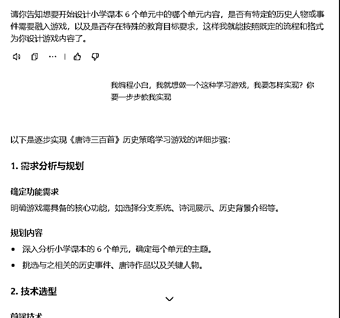
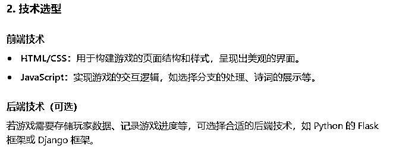
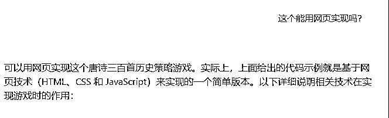
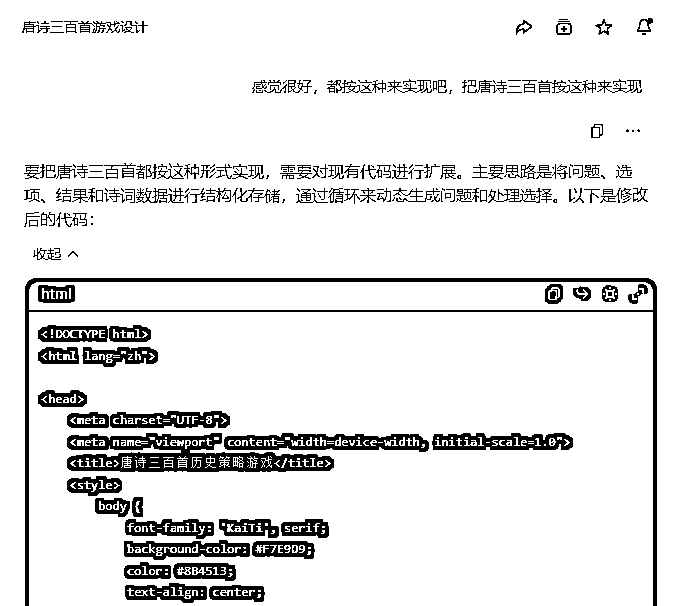
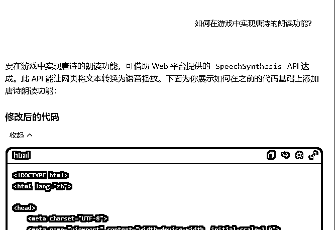
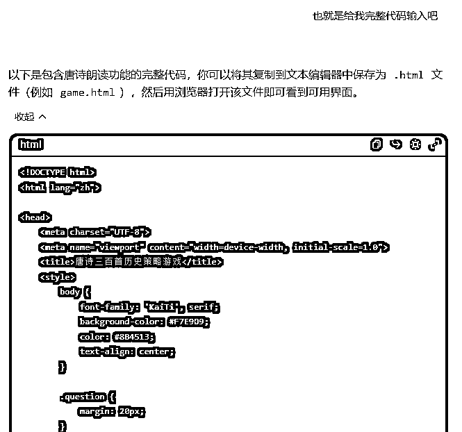
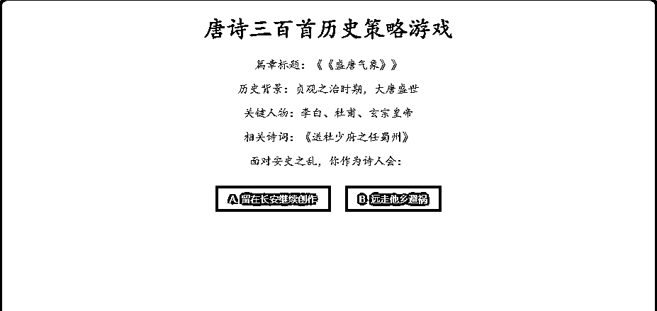
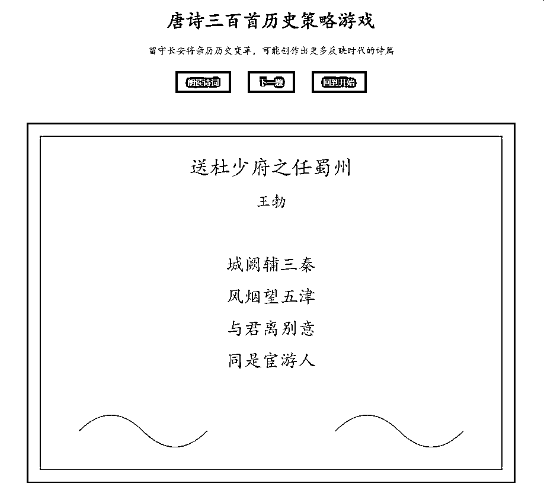
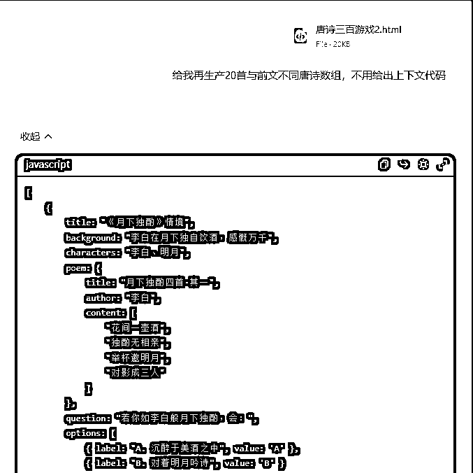

# 用 AI 把《唐诗三百首》做成策略小游戏

## 【9 赞】AI 搭一个《唐诗三百首》策略游戏

作者：大老朱

日期：2025-01-24

大家好，我是龙哥。

前一天看到周知里的老前辈提到能用 ChatGPT 直接做成可玩的游戏，我就想试试国内的工具。Kimi 和豆包我都看了下，直接套用好像不行。

恰好豆包自带 AI 编程能力，我就直接开整，看看能不能真的跑出一个能玩的demo出来。

最开始我直接把提示词丢进去，生成的完全不是我想要的样子。  images.zsxq.com/FhuOB3fMe32nMp_kl5rbWw1lijZS)

随后我把那组提示词改写成纯文字描述再喂给豆包。  images.zsxq.com/FjSnVtkP_H_MUL5k5vS-m2z0c4sM)

结果它还是在追问细节，我这才意识到没说明白自己的水平，于是重新组织需求，让它手把手带我一步步做。

这时它给我推荐了两条技术路线，我选了网页 HTML 版。至于为什么没选 JAVA，其实我自己也搞不清两者的差别，纯属随手点了一下。

做出来之后我就想分给朋友一起试玩，直接问豆包怎么发布。

它给了两条路：
方式一：借助 GitHub Pages 在线部署
方式二：搭本地服务器分享

我没有 GitHub 账号，本地服务器又太麻烦，就追问还有没有别的办法。

于是它又补了三套方案：
1. 用 Netlify 部署
2. 用 Vercel 部署
3. 直接本地文件分享【做成网页】

接着我让它把《唐诗三百首》全部写进代码里，它直接拒绝了，只给了寥寥几首的示例。

我又问怎么扩充诗的数量，它给出了一套可行的操作思路  images.zsxq.com/FtJE4rHrXLcLJDu59jUYxtZVj9FQ)

之后我让它加上朗读功能，它也给实现了。 

到这一步功能差不多了，我让它循序渐进教我做出一个能用的界面。  iX2BZHR9rzK)

最后索要完整代码。

最终成品的呈现效果

为了提升可玩性，我把网页文本重新提交回去，让豆包再生成 10 首新的古诗补进去。

成品给孩子试玩了五分钟都没通关，效果还挺不错。  xWIyK844)

整段代码我放下面了，有需要的直接复制到文本文档.txt 保存，再把后缀改成 XX.html 即可本地打开游玩 #龙珠悬赏 #AI 编程

# 《唐诗三百首》历史策略游戏

*** 评论区： 暂无评论