# 别再被Deepseek卡顿劝退！试试这套电脑+手机双端搭配，体验直线上升

如果你也受够了用Deepseek时一直转圈，那这篇内容应该能帮你省心不少。我现在主力用的是“Cherry Studio / Chatbox + 硅基流动API”的组合，电脑和手机上都能流畅跑模型，整体用下来非常舒服。

## 电脑端怎么配？Cherry Studio 携手硅基流动

### 准备工作

**① 拿下Cherry Studio**

直接到官网下载对应版本：https://cherry-ai.com/download

之前我也对比过Chatbox、AnythingLLM，最后还是更偏爱Cherry Studio。它的优势很明确：有中文汉化界面，对国内用户友好；同时电脑端支持训练个人知识库，这两个点刚好戳中我。

**② 搞定硅基流动账号**

官方入口：https://siliconflow.cn/zh-cn/

之所以推荐它，主要是调用模型时很少出现卡顿，平台里的大模型选择也很丰富，想换哪个随时调。最关键的是，只需要配置一次API Key，后面都很方便。

还没注册的话，可以走我的专属邀请链接：
https://cloud.siliconflow.cn/i/mpN7Zqif
邀请码：mpN7Zqif
你我都能额外拿到2000万token。实话实说，我自己用得太顺手，最后干脆充值了，感谢大家支持🌹

### 配置方法

- **第一步，填好API Key**：在Cherry Studio中找到模型服务设置，把Key粘贴进去，具体界面见下：
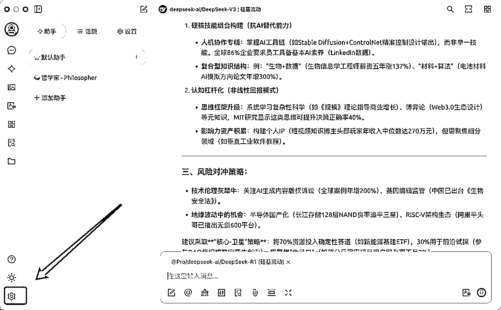
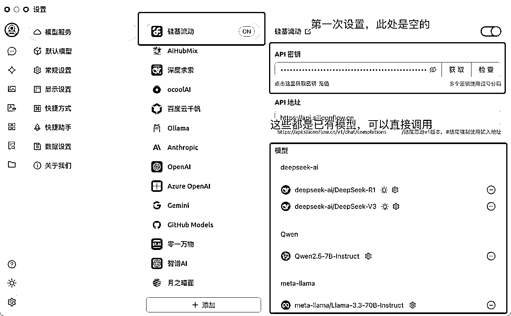

- **第二步，获取硅基流动API Key**：到硅基流动控制台，生成并复制你的专属Key，跟着截图操作就行：
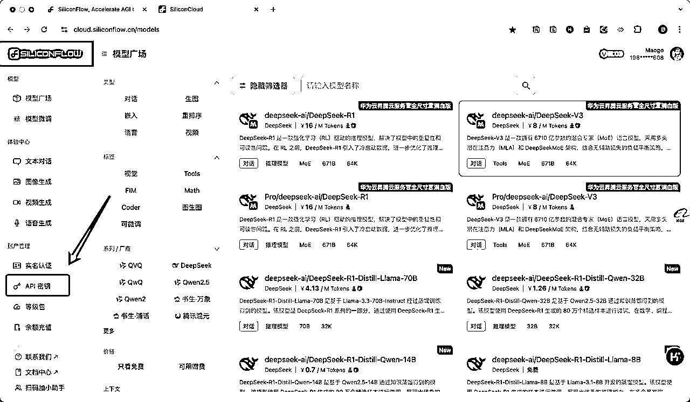
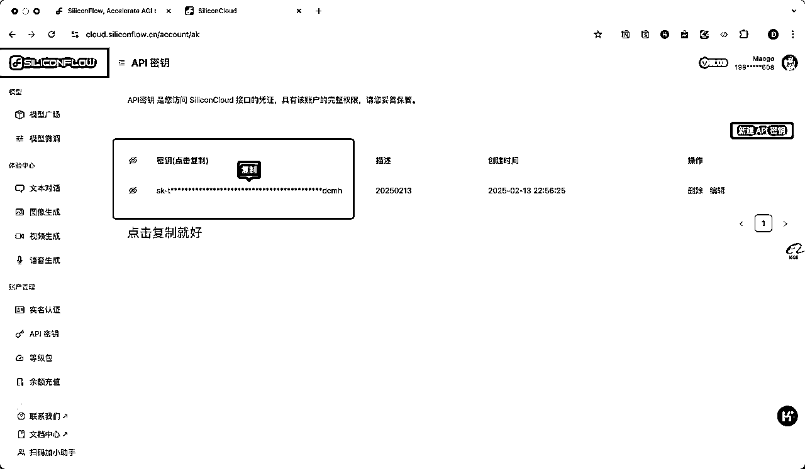
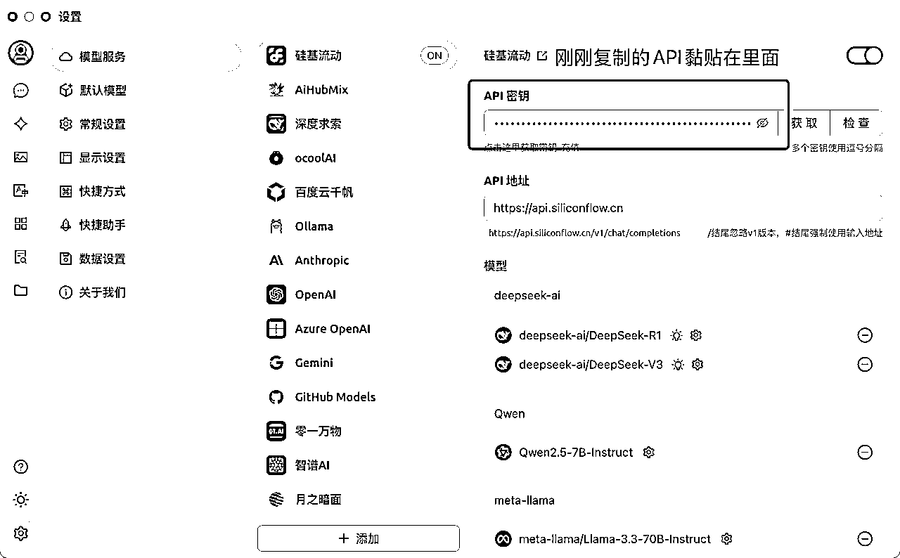
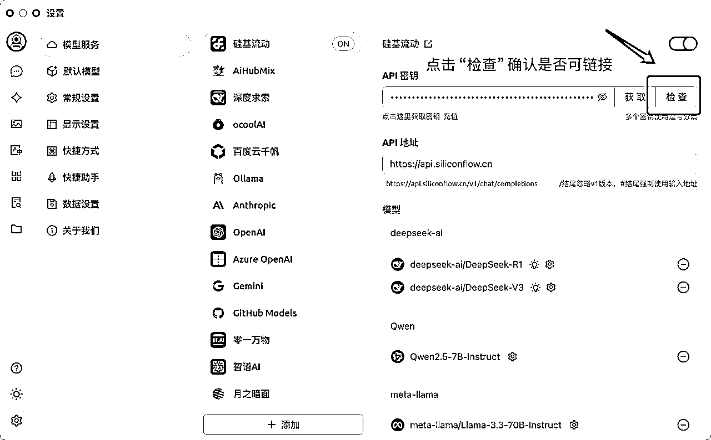
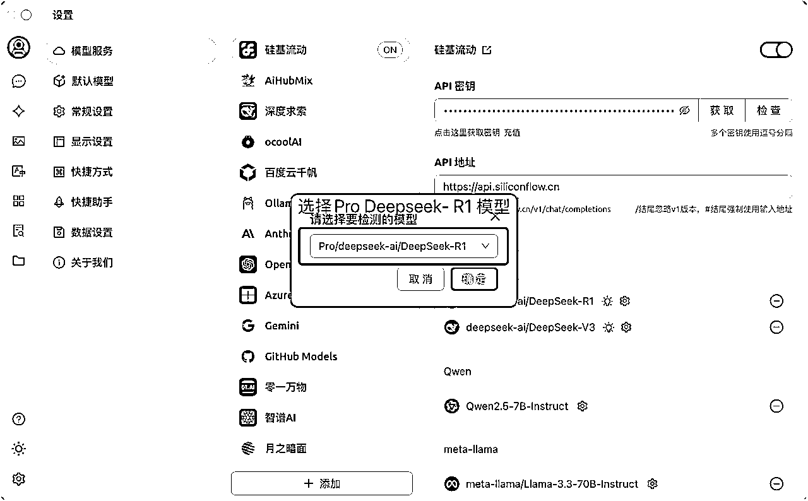
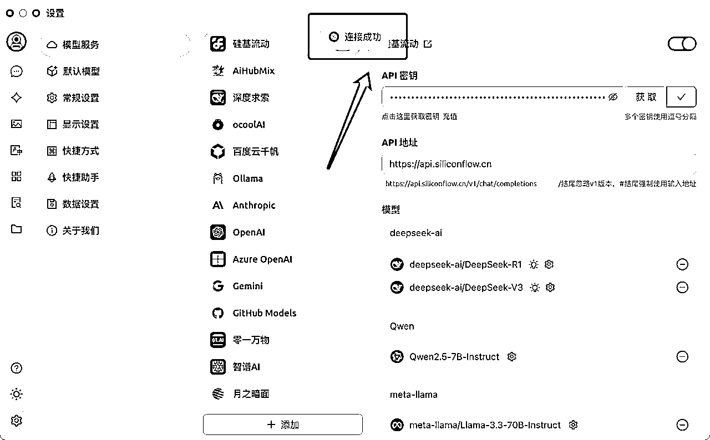

- **第三步，开始使用**：回到Cherry Studio对话窗口，选好模型即可畅快聊天：
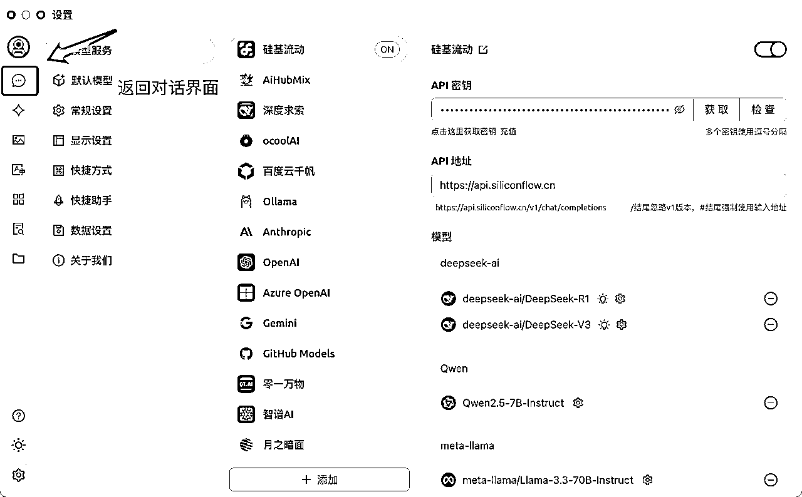
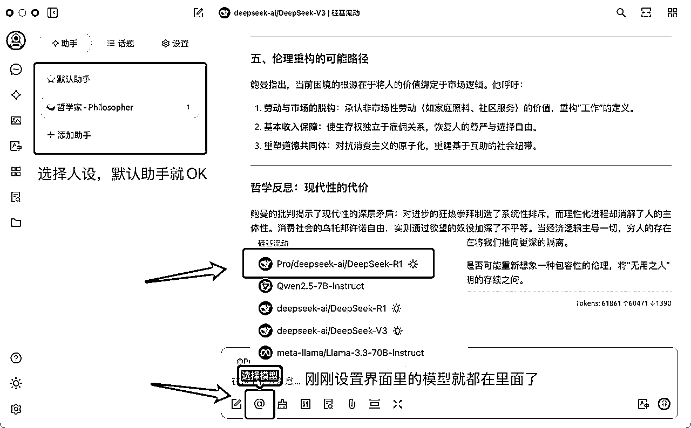
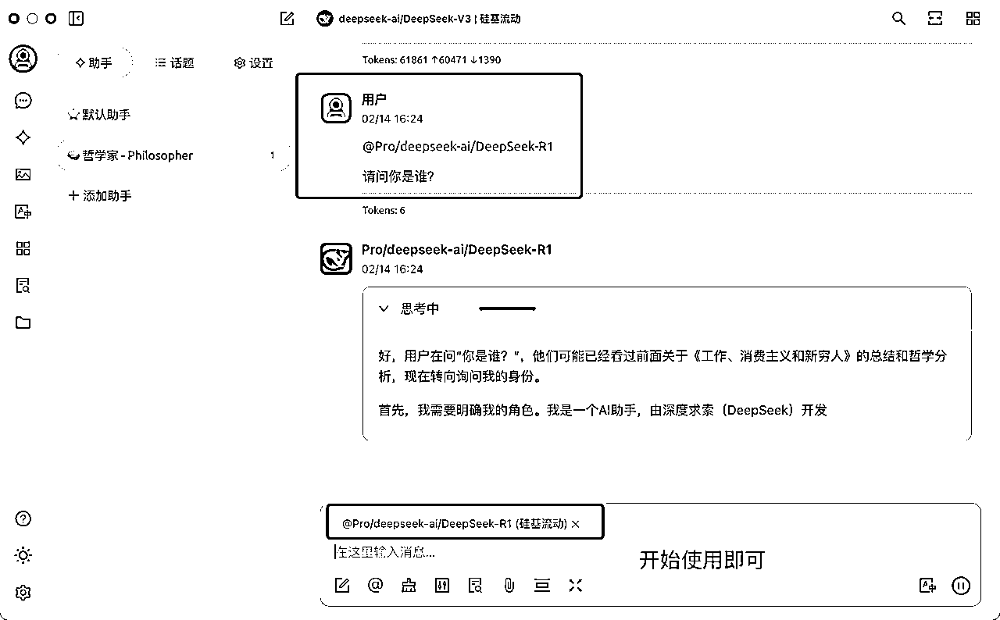

## 手机端就用这套：Chatbox 加硅基流动

目前Cherry Studio没有手机版，所以我手机上换成了Chatbox，日常使用完全够用。

**下载Chatbox AI**：https://chatboxai.app/zh
根据系统选择对应App版本，iPhone用户直接在App Store里搜“Chatbox”就能搜到。

**注册硅基流动**：流程和电脑端一致，入口还是 https://siliconflow.cn/zh-cn/
邀请链接照旧：https://cloud.siliconflow.cn/i/mpN7Zqif
邀请码：mpN7Zqif
注册成功后照样双方各送2000万token。

**手机端配置**：
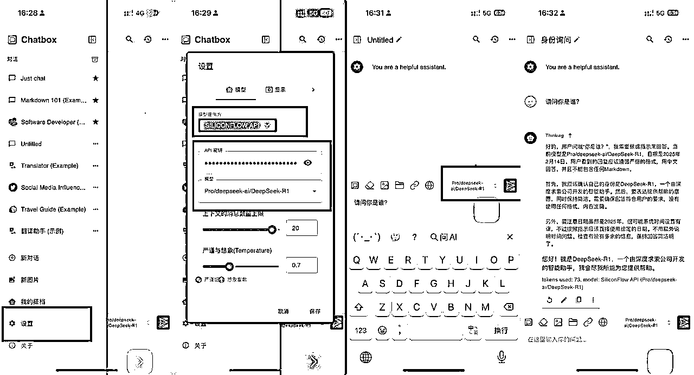

## 还想玩点花的？Cherry Studio知识库+智能体了解一下

如果只是聊天还不够，Cherry Studio还能用来搭个人知识库，官方教程放这里了：
https://docs.cherry-ai.com/knowledge-base/knowledge-base

具体界面效果：
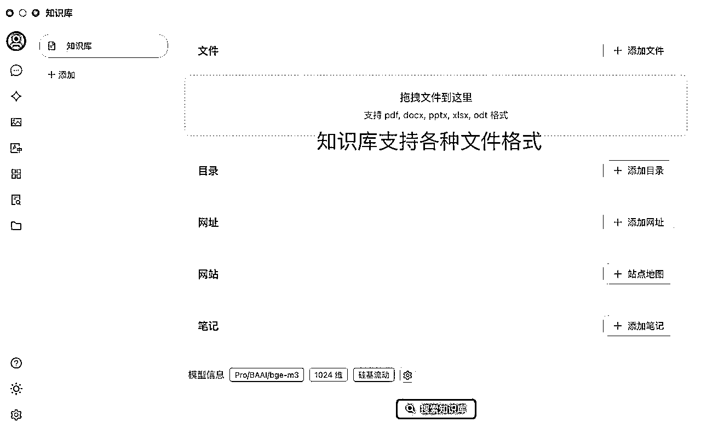

除了知识库，你也可以在里面创建专属智能体，相当于定制一个自己的AI助手：
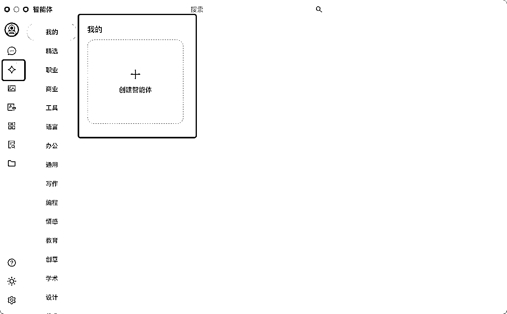

如果不想从零开始，它还带了一个智能体库，里面有不少现成角色可选，调用起来特别顺畅：
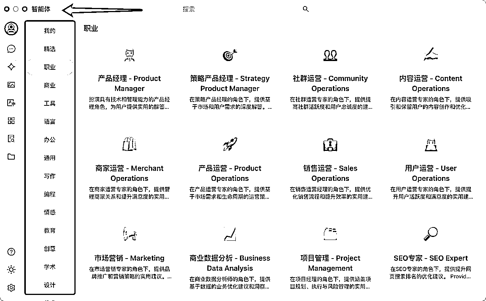

关于智能体的用法，之前专门写过一篇详细介绍。大家在实操中觉得有用的话，欢迎登录飞书账号给文档点个赞，你们的鼓励我都会看到🌹

我最初也是技术小白，所以分享时尽量讲得通俗，有说得不到位的地方，还请各位多指正🙏

另外，我的另一篇文档在私域已经破千浏览了，大家有兴趣的话也可以去看看~