# 那个“普通程序员”，在海外工具站这条路上，真的跑出了Top1

去年我也在赚钱发过一篇帖子，记录了自己从零起步、三个月跑通海外工具站MVP的经历，也侥幸拿到了一篇精华。坦白说，刚拿精华的时候我没什么特别的感觉，直到后来心血来潮去星球翻了一下，才发现赚钱的精华率大概只有1.3%。再回头看看自己那篇文章，竟然还斩获了3个碎片，已经算是挤进了Top1梯队的行列。

说实话，我这一辈子算得上“第一”的时刻屈指可数，何况是在赚钱这么硬核的圈子里，那一瞬间真觉得自己牛气冲天。

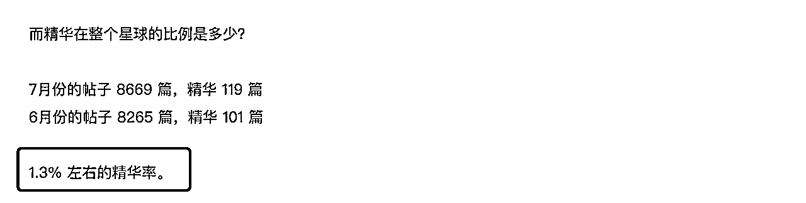

## 一篇精华帖，把我的出海路“轰”开了

很多人问，拿了精华之后到底有什么变化？对我来说，最直接的改变不是流量或关注，而是龙哥的那句话真的像颗强心针，在我后面一整年的出海路上反复回响。

每次我卡在瓶颈、内心动摇了，就想着他说的那句：“坚持做下去，至少做三年，然后你会回来感谢我。”这话很朴素，但真是有劲。我自己学东西向来偏慢，所以干脆把心理预期直接拉满，做好了持续干四五年的准备。

另一个变化是，精华帖发出去之后，陆续有不少球友私信问我问题。以前我总觉得自己是那个被人影响的人，从没想过有一天自己也能反过来给别人一点启发。这种感觉其实挺奇妙的——它成了我继续公开输出的最大推动力。

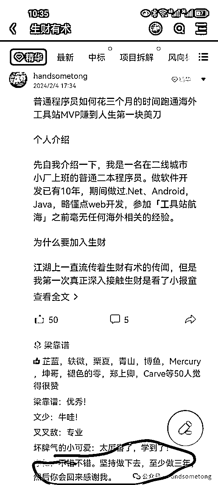

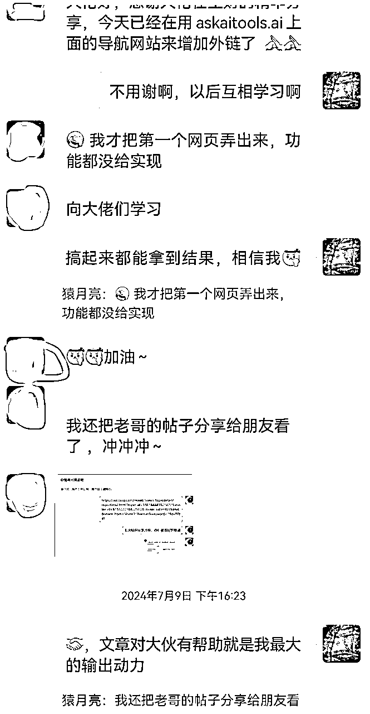

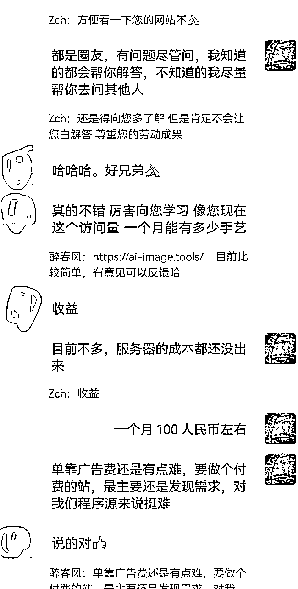

## 2024年，我的出海进度条走到哪了？

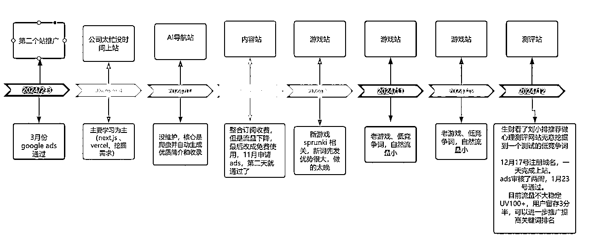

今年整体尝试的事情不算少。为了把部署成本压下来，我重新学了next.js、vercel、tailwind css这套组合拳。

7月的时候上线了一个导航站，那应该是我今年做过技术要求最高的项目了。但很遗憾，它没做起来。复盘下来原因其实很明确：一是市面上已经出现了很多体验比我要好得多的同类导航站，甚至直接有现成的模板站在抢市场；二是导航站的灵魂其实是自动爬取优质工具站并收录，但我一直没做出来这个核心功能，做着做着项目也就自然荒废了。不过这个方向我觉得没错，以后有时间我会重新把它拾起来。

到了11月，我又尝试做了游戏站。说实话，游戏站对新人来说真的是一个很好的“练手场”，特别适合用来跑通MVP：

- 用户天然就爱留下来玩，留存率先天偏高，对SEO相当友好；
- 可以直接开Google Ads，不需要去死磕Stripe、Paddle、Lemon Squeezy这种让人头大的支付网关，省掉了大量开户和封号的麻烦；
- 用iframe直接嵌小游戏就能跑，开发难度特别低。

但它的问题也显而易见：新游戏第一波先发优势很重要，你需要有灵敏的嗅觉来挖掘新游戏，而且游戏能不能火，说实话还有不小的运气成分。

不废话了，直接上大家最关心的内容。目前我的主要收入来自4个Google Ads站。

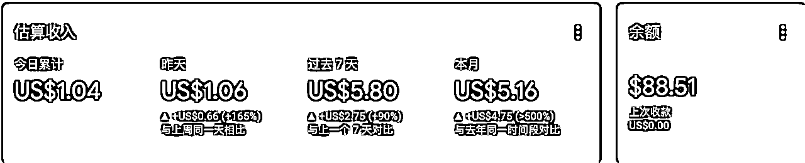

其实今年本来没什么特别想分享的，毕竟做这一行，赚钱能力才是最大的话语权。我自己2024年的整体收入，对比投入来看，说是杯水车薪也不过分。

上个月看到龙哥发布了#龙珠悬赏的活动，倒是把我心里的分享欲又勾起来了。我想想，不成功的经验也是个经验啊，说不定我就代表了这个社群里沉默的大多数呢。干脆把这次分享当成给自己做一次全面的复盘总结。

今年虽然在收入上没打出什么大突破，但上站速度这块，我是实实在在感受到了“质变”：从第一个站花了一个多月，到后面变成两周、一周，再到现在的半天甚至一天就能搞定一个站。

## 真正打实战，我悟到的这几件事

### 1. 时间权重得重新分配

做出海这件事，说白了是“挖掘需求、开发、营销推广”三大项能力的综合较量。这三块缺一不可——除非你在其中一个领域强到足以碾压另外两项的权重。举个例子，假如你挖到了一个特别新颖的需求，产品一出来用户就自发帮你传播了，那你在营销推广上的投入权重自然可以适当往下调。

目前圈子里大家比较认可一个“424”的分配比例。啥意思呢？站在程序员的角度来算一笔账：假如开发一个产品需要2天时间，那你花在挖掘需求和推广上的时间就要分别给到4天。很多程序员（包括以前的我自己）最容易犯的毛病，就是在开发上投入过多，却常常忽略掉对需求挖掘和推广营销的钻研。

而且，随着AI编程工具越来越强，开发这个环节在出海中的权重只会继续往下走。

### 2. 挖掘需求，本质就是保持好奇心

我现在的核心心法就一句话：永远对新鲜事物保持好奇。看到陌生的新词，养成打开Google Trends查一查的习惯。

用教练树哥的话来说就是：你离成功可能只差一次点击。坦诚讲，这块恰好是我三大能力里最薄弱的一环，就不在这里“丢人现眼”了。想要系统学习的，我强烈建议去看航海手册和教练哥飞的👸号。这种内容看一遍远远不够，得反复琢磨、勤加实践，慢慢把自己的“网感”练出来。

这里分享几个能提升效率的小工具：

- Google插件 TrendsBar（一个用来辅助分析Google趋势的插件）
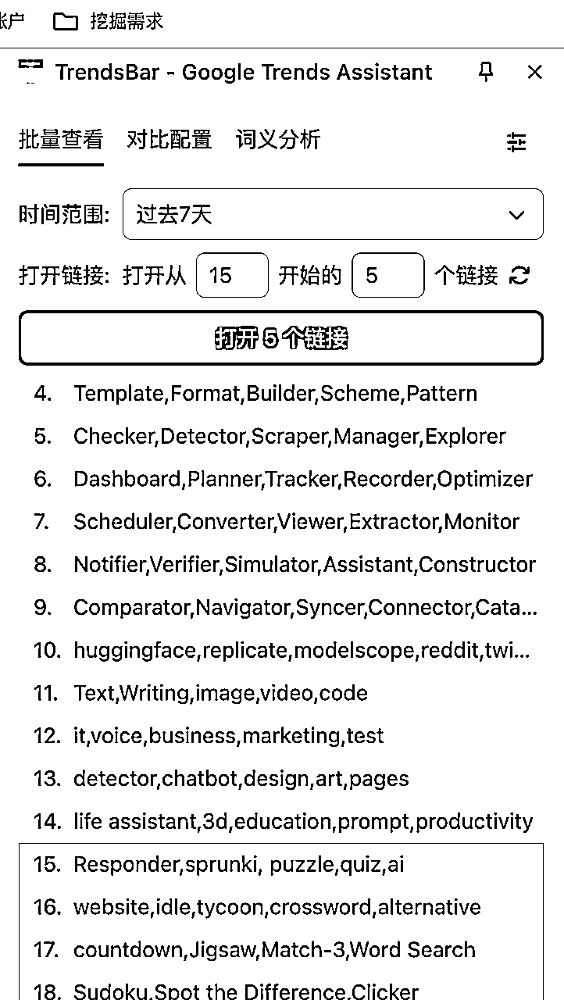
- https://query.domains/ （查关键词对应域名能不能注册、注册情况如何）
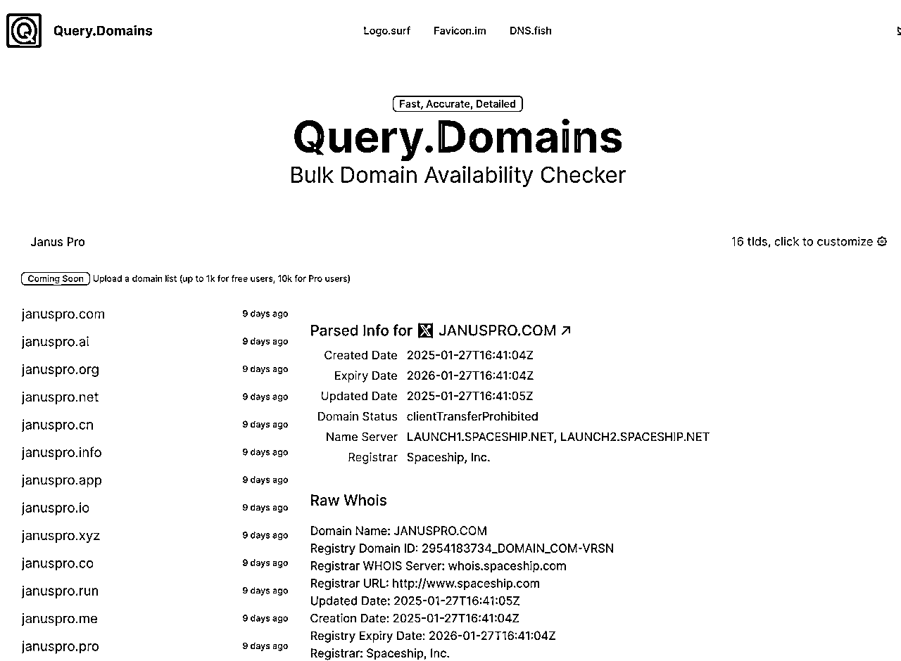

### 3. 谈推广：反链这事，只能靠“抄作业 + 笨功夫”

想要给网站加外链，我目前比较有效的一个策略是：先在Google里搜网站的核心关键词，把竞品网站全找出来，然后琢磨着“抄作业”——用https://ahrefs.com/backlink-checker或者Semrush的反向链接分析，去扒竞品网站的反链资源，一个个点开这些网站看看能不能把自己的网站也放上去。

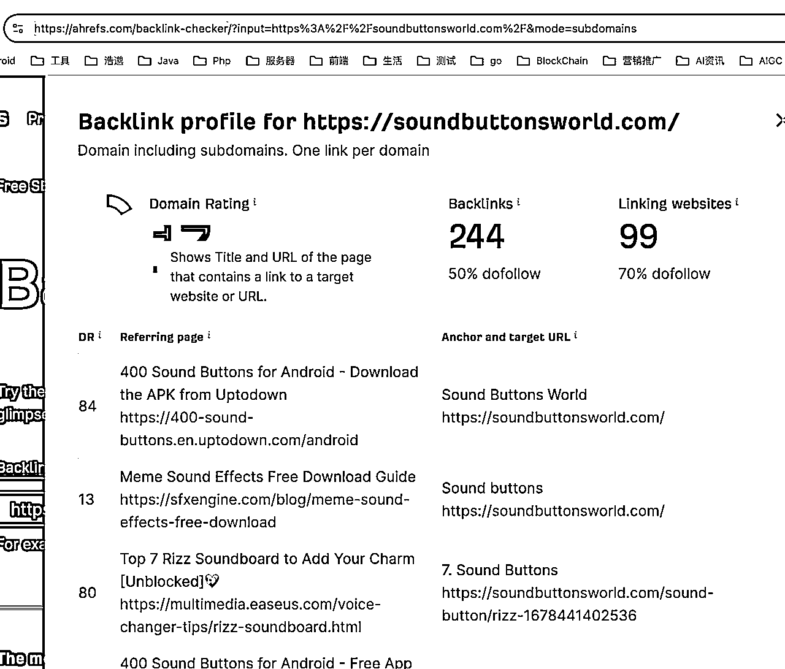

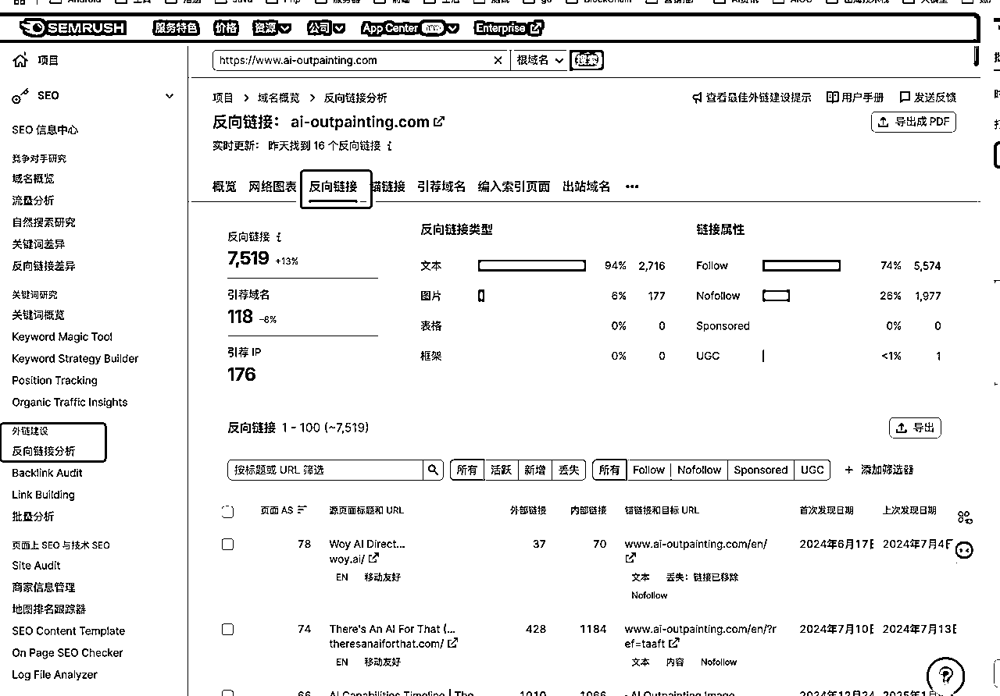

没有什么花哨的技巧，最笨的方法往往就是最有效的：一个一个手动去查、去筛。遇到可以添加反链的网站就赶紧收集记录下来（把DR信息也一并记上），时间久了你就有自己的外链库了。以后再做新网站，只需要按DR排序，按图索骥，就能快速把一批优质外链搞定。

后续还可以通过持续跟踪旧网站在Google Console里的外链数据变化，用引荐网站的数据反过来筛选出更优质的外链资源。

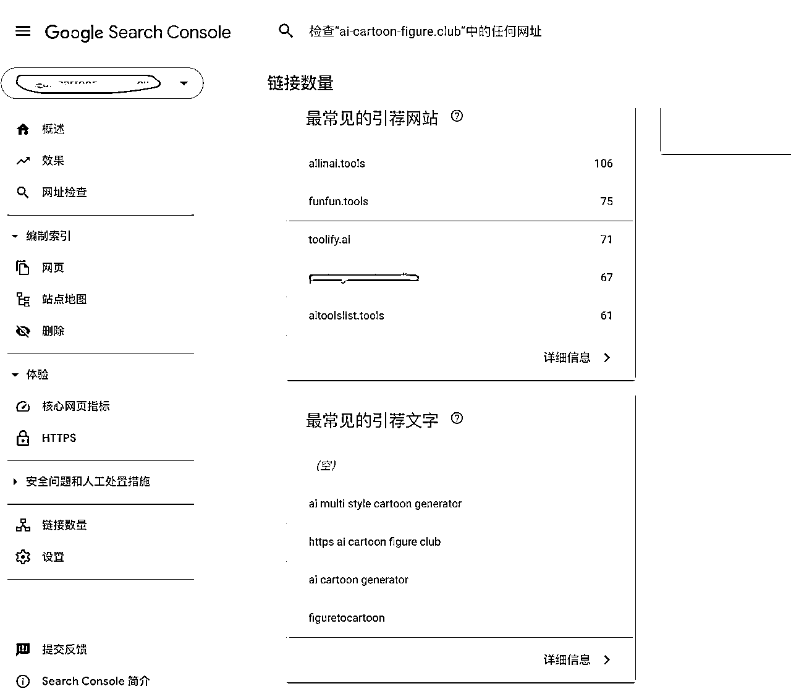

## 踩坑无数之后，想掏心窝子分享的5条建议

### 一、人想被人看见，就得先学会“出声”

写分享贴这件事，本质上就是讲故事。只要你认真做了事，把自己的做事过程、踩坑和克服困难的过程用最朴素的大白话讲清楚，那其实就是最好的故事素材。

讲个我自己的真实经历：去年我经常在v2ex上记录自己的上站全过程——从第一站没有流量，到慢慢有了一点流量，再到Google Ads审核通过，最后拿到Adsense Pin的完整经历。你光看标题就知道，里面很多帖子其实就是求助帖、引流帖。

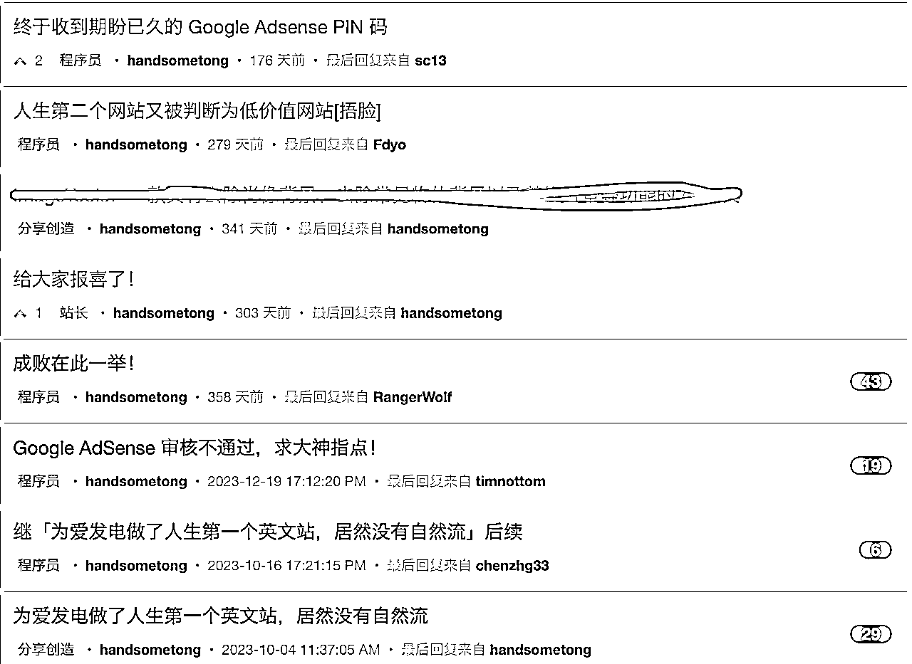

结果有一天，群里突然有人@我，说感谢我的分享。

我当时有点懵，赶紧翻上面的聊天记录才发现，原来是群主把我的帖子推荐给了大家，而且还有好几位群友说看完之后特别有感触。

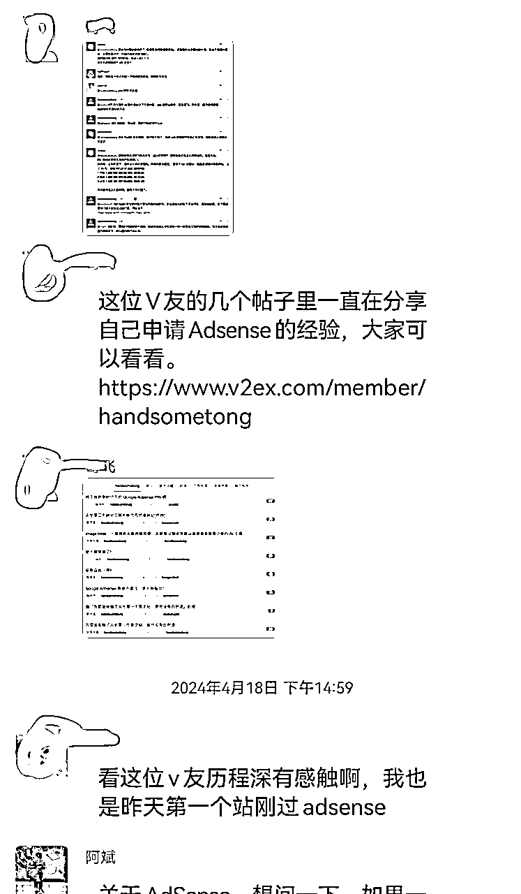

所以我现在特别想说：大胆去分享吧，尤其是做技术的人。你可能觉得自己写的东西太小儿科了，甚至有点“low”，但你觉得不起眼的经验，在别人眼里可能就是卡了好几天的“鸿沟”。

反过来我再想深一层：如果我能持续在赚钱上分享自己上站的心路历程，万一未来某一天真的做出了成绩，那这一整个系列的“成长记录”，本身就自带流量光环。

### 二、拥抱AI，给自己雇一个“AI员工”

2024年AI的发展速度是肉眼可见的快。这一年里，AI生成音乐Suno、AI生成视频Sora、腾讯混元、海螺视频、高质量文生图Flux等接连出现，更有Cursor、Windsurf、Bolt.new这类彻底改变开发者工作方式的IDE问世。

我现在自己是Cursor的重度用户。如果你还没试过任何一款AI编辑器，赚钱航海上有非常详细的Cusor使用手册。我就是照着航海手册自己学的，用了不到一周就彻底离不开了。

2025年我真的强烈建议：每个月花个十来块钱人民币（某宝有共享账号，或者直接花20美刀用正版），给自己雇一个能24小时为你待命的“AI员工”。这个六边形战士几乎可以在方方面面帮你补齐能力短板。

另外，我现在能做到半天就上完一个站，最大功臣也确实是Cursor这个得力助手。

### 三、Ship fast、Ship more，量变才有质变

我自己做过一个不完全统计：普通人第一次拿到比较大的正反馈，基本上都发生在做了10个站之后。也就是说，做满10个站也才勉强算入门（个别天选之子除外）。而我现在只上了9个站，没有拿到大的正反馈，这其实完全符合正常规律。

所以2025年我给自己定的目标是上20个站。今年我要学会降低预期、专注上站、保持平常心，不再因为目标太大而焦虑内耗。

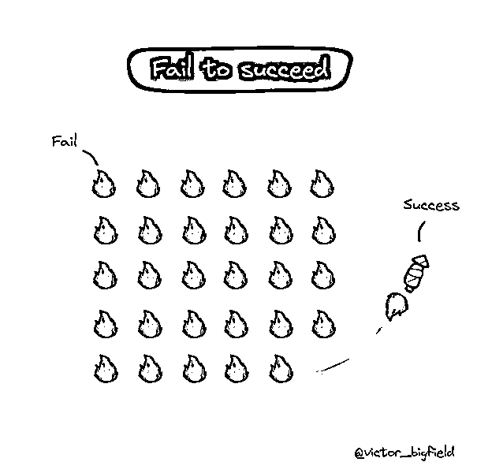

### 四、一个人走得快，一群人走得远

说实话，赚钱的航海21天，对于出海工具站这种“难而正确”的事情来说，周期始终是有点短的，而且每一期之间的间隔又太长。虽然每期航海都会建大群，但往往航海一结束，群也就跟着“沉”下去了。

我们这些做出海的人，是很需要一个固定环境的：聚集一帮目标一致的人，在里面分享成果、喜悦、困境和行业信息。这个环境不需要无时无刻为你服务，只需要在你心力值低、能量低的时候，给你一点鼓励和力量，就够了。

### 五、培养“快速切换”的肌肉记忆

今年第二季度，公司业务忙得上头，白天基本没有时间摸鱼做站，晚上还得经常加班处理公司的事。结果到了晚上好不容易有点空闲想做自己的站，脑子里的弦还绷在白天的事情上，怎么也切不到“出海”的模式。有时候好不容易来了点灵感，被同事一打断，之后就再也找不回状态了。

我相信每个做副业的人都或多或少碰上过这种问题。

所谓快速切换的能力，其实核心就八个字：“事来则应，事去则静。”

“一秒失忆，一秒上手”，做完一件事，迅速把自己从这件事和它的情绪氛围里抽离出来，立刻进入下一件事情的状态。

——粥左罗

这确实是一项需要刻意训练的能力。一旦你真正掌握了这种秒切的状态，做事的效率会提升得非常明显。

### 六、对自己的选择，要有120%的信心

出海这件事，难且正确。它的正反馈往往来得特别慢，比如SEO通常要两三个月才能看到效果。这个过程对开发者来说无异于一种煎熬，尤其是你兴致勃勃连做几个站之后，却迟迟等不来一个像样的收入反馈。

越是这种时候，越需要你对出海的美好未来“盲目”相信。甚至要120%地相信——哪怕中途被别人泼冷水、被打掉20%，还剩100%的相信，这100%依然足够支撑你走下去。

## 写在最后

很感谢「Cursor-零基础做软件应用」这期航海，让我在做“出海工具站”的开发速度上完成了一次大跃迁；也非常感谢龙哥的鼓励，让我在2024年这条曲折的出海路上依然能保持120%的信念。

赚钱里很多信息是领先于市场好几个身位的。如果你在这里看到陌生的名词或者新工具，不妨保留一点好奇心，多去问问ChatGPT了解一下。说不定，命运齿轮的转向，就是从那一次点击、那一次提问开始的。