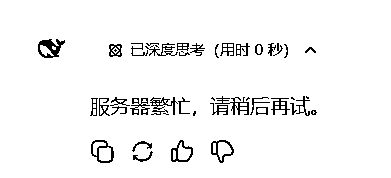
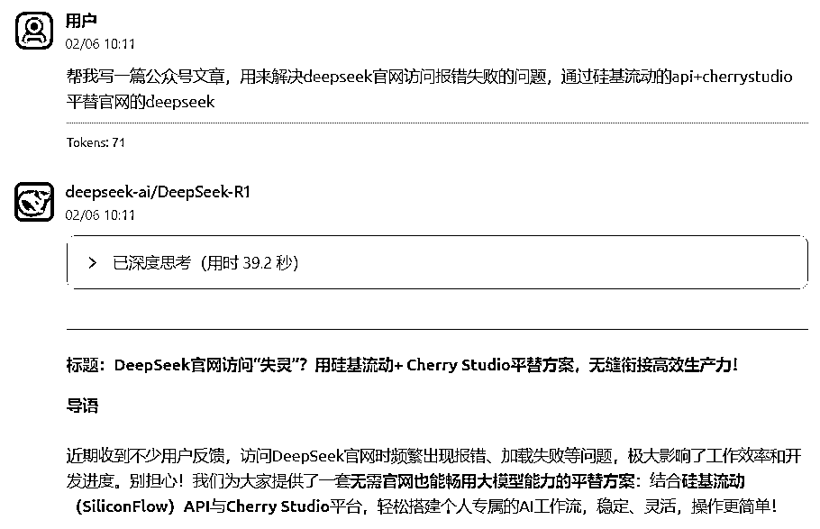
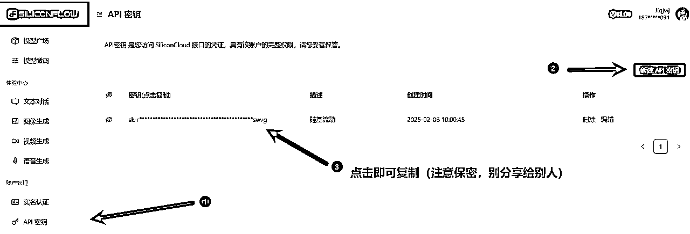
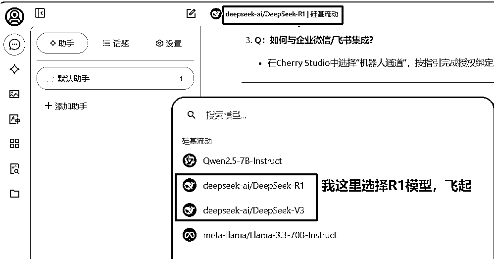

# 官网老提示“服务器繁忙”？这套硅基流动 + Cherry Studio 组合，让你本地就能稳定用上 DeepSeek 级体验

> 来源：[https://aqoyanyhfa.feishu.cn/docx/A9y0d0ciToqfD5x6vHHcdDo3nXb](https://aqoyanyhfa.feishu.cn/docx/A9y0d0ciToqfD5x6vHHcdDo3nXb)

大家好，我是大胡子RPA。昨天上班一开工就用RPA去调用 DeepSeek，结果一整天都在和“服务器繁忙”搏斗，效率直接被拖垮。被卡住没必要硬等，这里分享一个我已经在用的替代打法：不用登录官网，直接用硅基流动的 API 配合 Cherry Studio 做一个属于自己的AI工作台，用起来更顺手、更稳。

我现在本地搭好的 DeepSeek 平替效果大概是这样：

* * *

### 一、官网不稳到底卡在哪？

*   流量高峰扛不住：用户暴涨加上偶发维护，页面容易转圈、报错。
*   网络环境波动：春节期间 DeepSeek 遭遇了不少来自海外的攻击干扰。

与其干等恢复，不如换一条可控的路子，自己把模型接回来。

* * *

### 二、这套平替方案用的是什么？

**1. 硅基流动 SiliconFlow API：能力对齐，体验更快**

硅基流动是国内顶尖的模型服务平台，提供的多模态大模型接口在文本创作、代码补全、智能对话等场景上，和 DeepSeek 官网的表现非常接近。关键点在于：

*   国内节点响应快：延迟明显下降，实测访问速度提升超 50%。
*   灵活计费不浪费：按量计费，不需要先买大包年包月。新用户注册即可免费领取 2000 万 token 额度。

**2. Cherry Studio：可视化搭建，无需写代码**

Cherry Studio 是一个面向普通用户的 AI 应用搭建工具，拖拽式操作就能完成整套工作流：

*   自建对话机器人、写作助手、代码生成器等。
*   可无缝接入硅基流动等多种 API，还能连上企业微信、钉钉等。
*   本地化运行，数据更在自己手上。

* * *

### 三、实操拆解：两步搞定个人版 DeepSeek

目标是复刻一个和官网几乎一样的问答机器人。

**Step 1：搞定硅基流动的 API 账号**

1.  进入硅基流动官网注册开发者账号，目前无需实名，后期人多可能会收紧。
2.  登录控制台后创建 API Key，并领取免费试用额度。

**Step 2：在 Cherry Studio 里接入模型**

1.  Cherry Studio 官网下载有点慢，这里我放了网盘备份：https://pan.quark.cn/s/c1cbbfaeb285
2.  打开软件后粘贴你的 API Key，手动添加 DeepSeek 的 R1 和 V3 模型。
3.  完成 R1 模型的基础设置。

搞定之后，我又能顺畅地开聊了。

我是大胡子，专注 AI + RPA 落地实战，欢迎一起聊聊 DeepSeek 的本地化玩法。