# 蓝海新入口：京东外卖拉新，一单最高170元+ — ZSXQ
作者：龙哥

京东外卖刚刚起步，这两天正是空白期。现阶段入驻完全免费，佣金也免收，商家数量稀少上榜推荐很容易，一笔新商入驻奖励能到170元以上，扶持力度拉满，商家几乎没有拒绝的理由。多开一条渠道，抢在人群涌入前卡位，现在入局等于占坑。

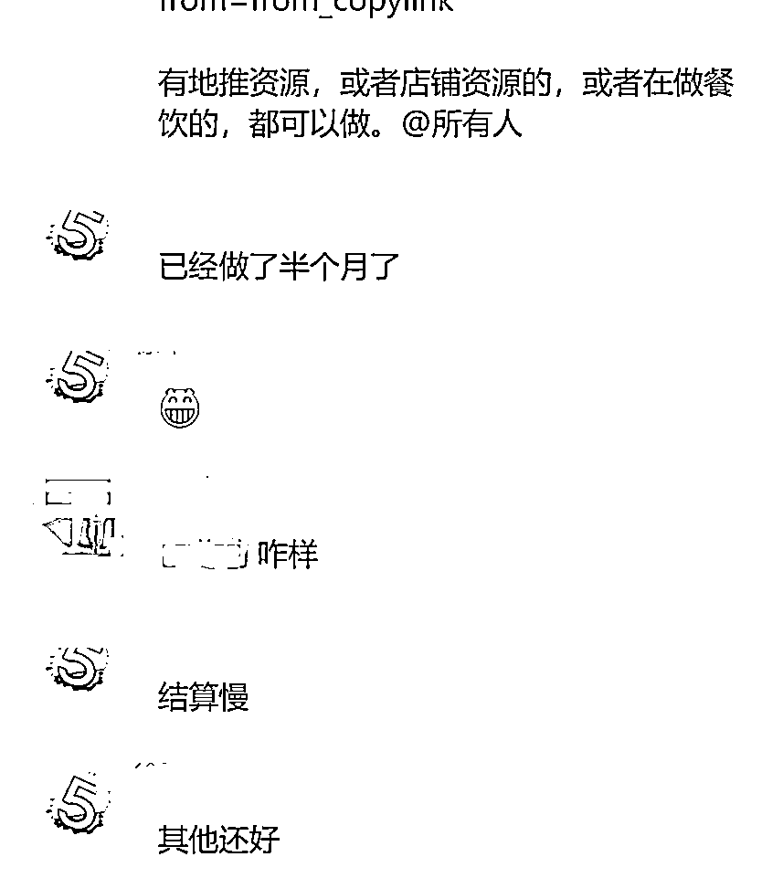

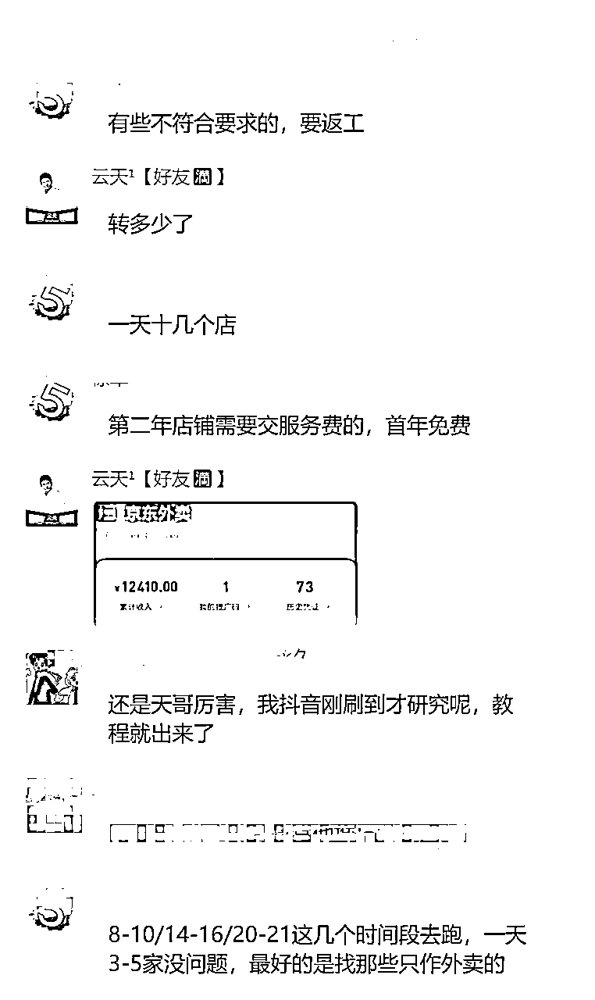

文字教程

跟市面上的外卖拉新相比，京东外卖这波机会明显不一样：

市场空窗：

不像老平台已经卷到顶，京东外卖才刚铺开，全国大量区域还是待开发状态。街头的连锁品牌、特色小馆，都在等一个低成本的增量入口。商机就在楼下，不用刻意找。

商家好说服，推进顺畅：

最大杀手锏是“零佣金”。当下人力、租金都在涨，免佣直接降本。叠加京东的品牌背书和技术赋能，商家认可度非常高，沟通阻力小，成交自然顺。

单价有保障：推广补贴给得足。5月1日前的入驻红利倒计时，商家入驻意愿强。只要方法对路，单量堆起来，日入万元不是空话，利润空间很可观。

# 入局方式

## 1.先拿到京东外卖的推广资质

## 2.🛰️扫码开通任推邦

## 3.随后在平台内找到京东外卖项目

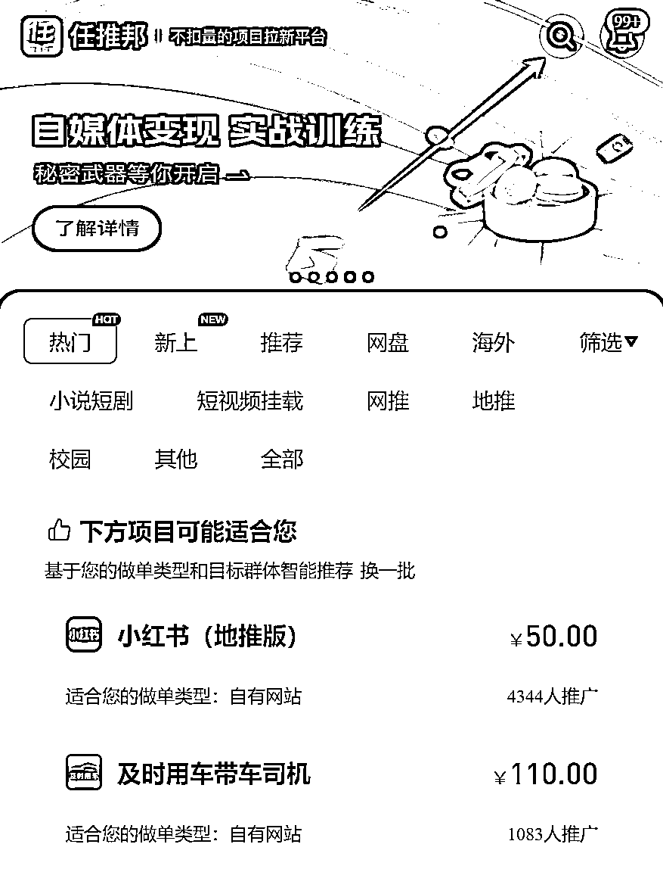

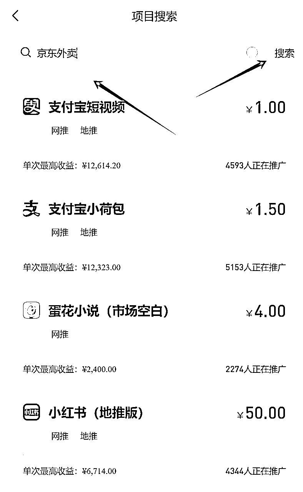

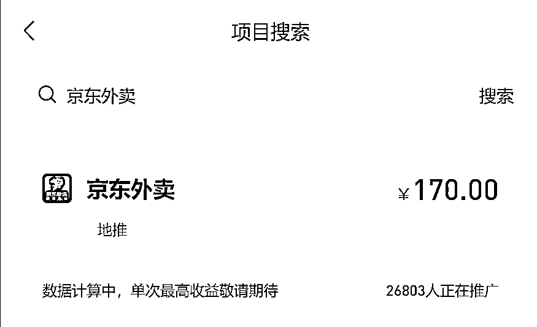

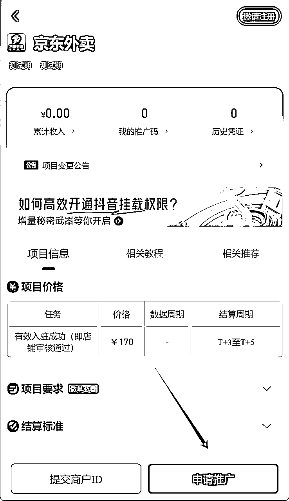

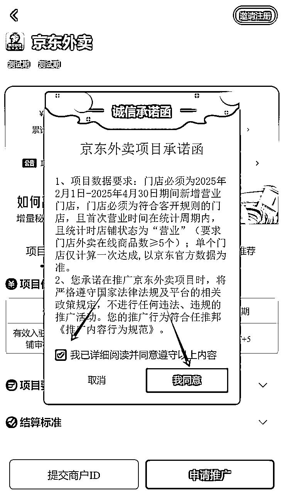

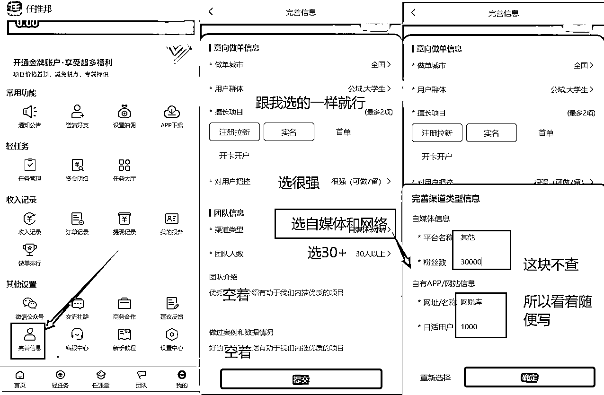

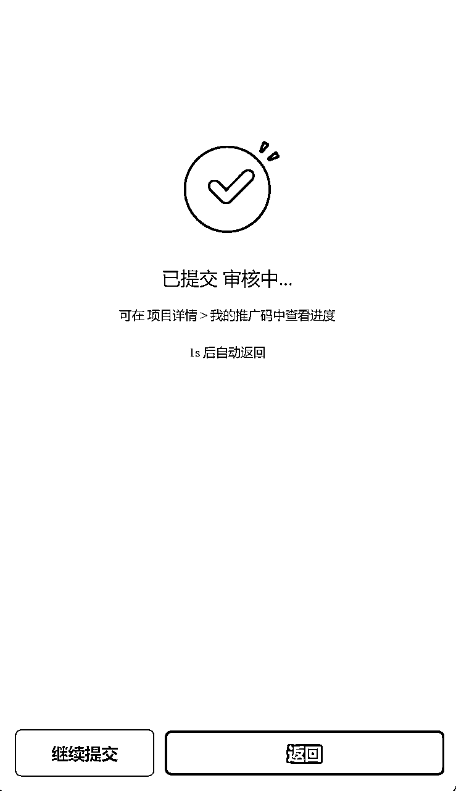

## 4.审核通过后即可正式开推

# 执行流程

操作步骤

## 商家需要准备的材料清单：

1. 门头照、店内照，格式png/jpg，单张不超过3M。
1. 营业执照，格式png/jpg，单张不超过3M。
1. 法人身份证正反面：支持身份证、护照、港澳台通行证等。
相关入驻信息：
1. 法人手机号。
1. 入驻登录手机号，建议用运营负责人号码，后续收验证码方便。
1. 邮箱，优先店主邮箱，便于接收通知。
1. 对公账户信息：开户行及支行、账号，用于品牌企业校验。个体户无对公账户可用法人银行卡或人脸验证。
1. 品牌LOGO或店铺LOGO、商标注册证如有可补充。

## 第一步：

应用商店搜索“京东秒送商家”下载APP，用商家负责人手机号注册并设置密码

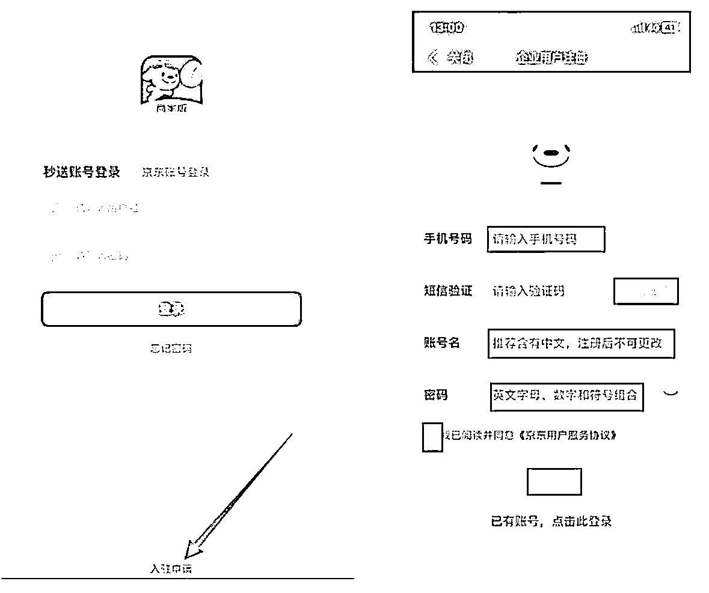

## 第二步

选择“连锁店申请入驻”或“门店申请入驻”均可，单店选门店，连锁超3家可选连锁。联系人及电话必须与注册账号一致。【经营品类】只能选咖啡茶饮或外卖美食，非茶饮类餐饮统一选外卖美食

推荐人信息必填，推荐人即填写商户邀请码，任推邦审核通过后会下发邀请码

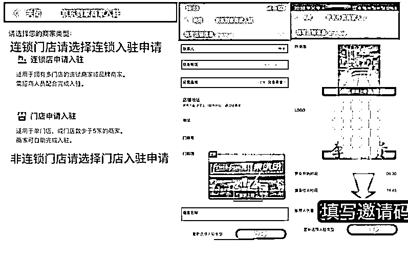

## 第三步：

上传营业执照，勾选合同方案、结算及收款方式，推广员记得保留商户ID，后续在任推邦提交

注意：务必自行留存推广凭证，以防京东抽查，包含门店照片、地址、营业执照、联系方式、推广截图等。若因商户资质不达标、ID提交错误等原因未通过，将无法结算，结算以京东官方为准，不合适请勿操作

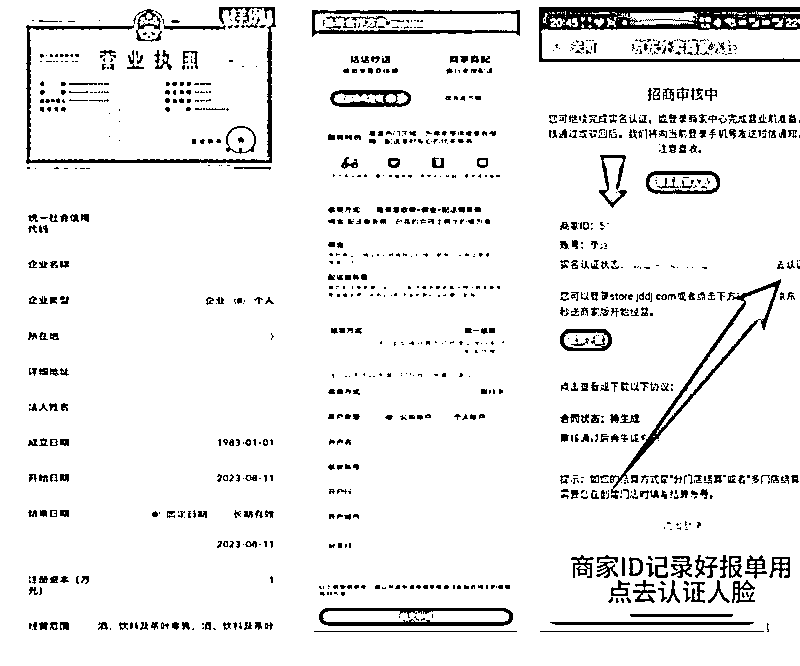

## 第四步：

商家重新登录账号，优先用京东实名完成实名认证

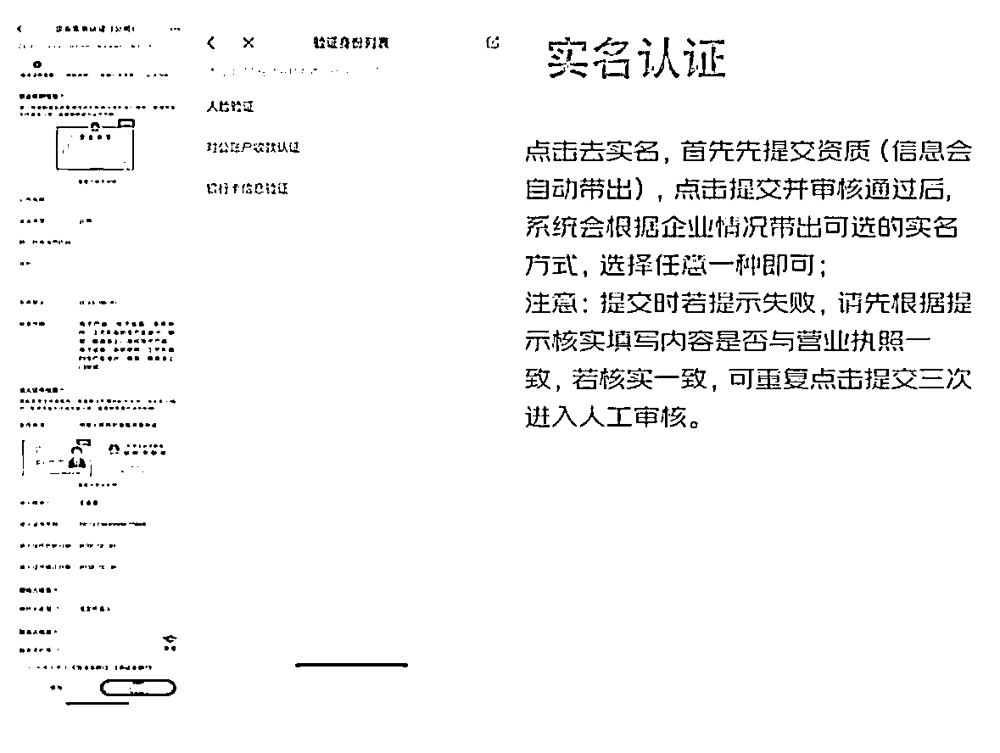

## 第五步：

完成入驻后进入合同签署环节，线上签完后等待官方审核，通常24-48小时

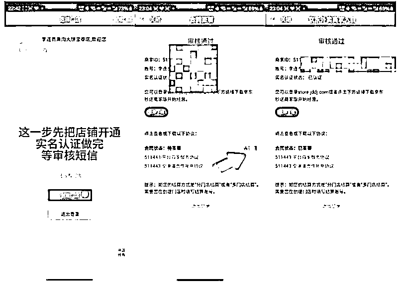

## 第六步：

创建门店，完善基础信息并选定经营位置，上架套餐，等待审核通过店铺正常营业后，即可在任推邦提交商户ID完成交单

## 第七步：

商家资质审核通过且完全达标后，前往任推邦底部提交商户ID，提交错误无数据会被判定恶意操作。京东当天审核通过的，尽量当日24点前或次日补交，避免拖延。交单前需确认：商家已成功入驻、上架商品、店铺状态为“营业”且至少5个商品在售，否则会被判定无数据

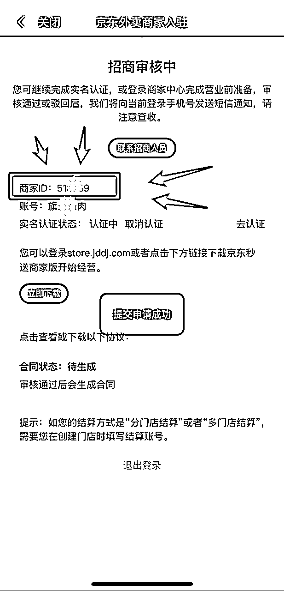

# 门店创建、上架商品、设置营业状态的详细参考

如何创建门店、上架商品、设置状态为“营业”状态，请参考下方流程

# 拉新思路

## 1.广告投放覆盖

## 2.地推分佣合作

## 3.上平台发任务赚差价，借力他人执行

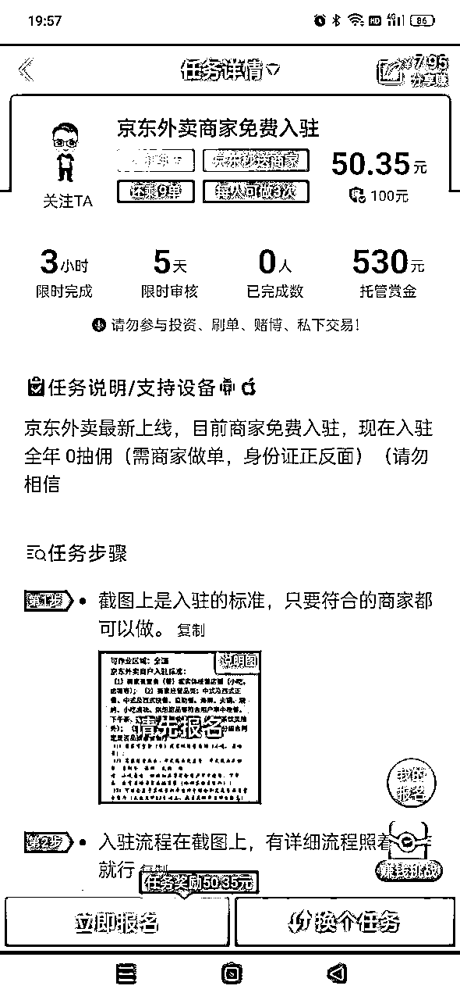

## 4.在boss直聘发布招聘信息引流

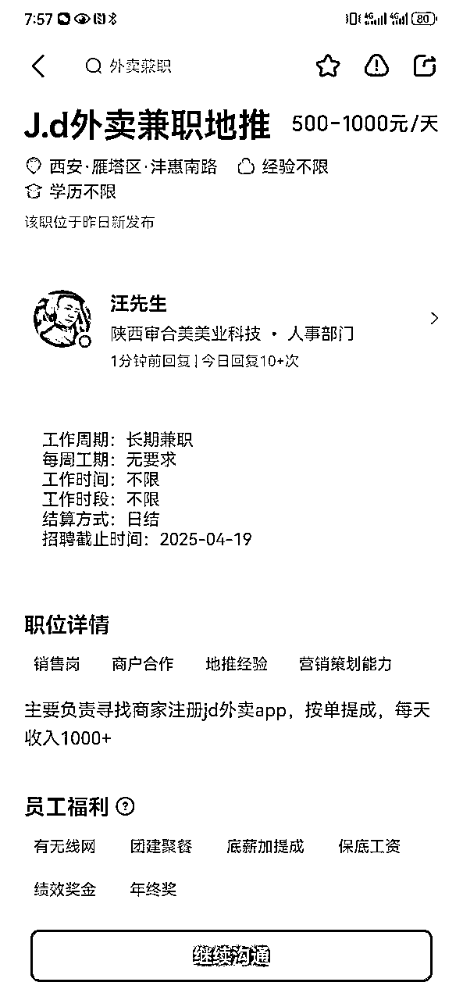

# 话术侧重点

1. 真正零抽成，自己卖多少赚多少，2025年5月1日前入驻的商家可享受全年免佣。
2. 京东流量和品牌力在线，新品类会加大资源倾斜。
3. 目前入驻商家少，上热门快，早做早占位，便于霸榜。
4. 入驻免费，多一个渠道总比少一个强，说不定爆发。
5. 你成交，我们还能给商家带来50-100元额外激励，助力他生意更好。

准备工作：
当地或淘宝定制推广物料

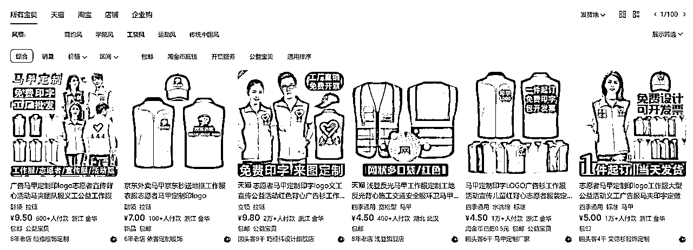

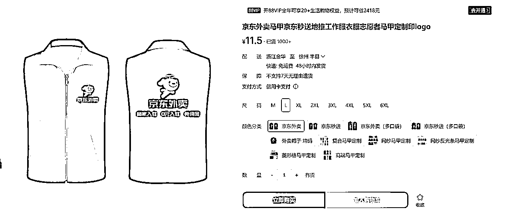

进门话术：
哥，你好，我们是京东外卖官方团队，帮您免费0元入驻，免佣金。
姐，你好，京东外卖官方人员，今天来给您开通京东秒送，完全免费，不抽佣。

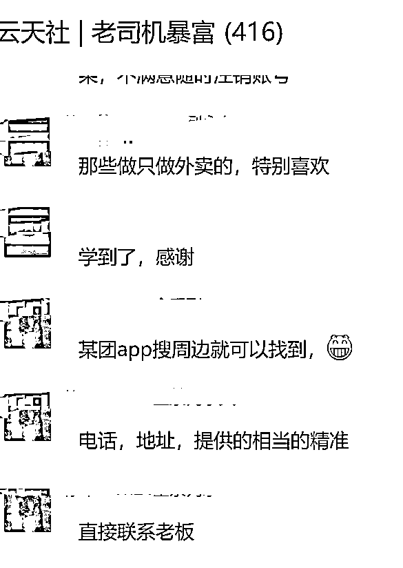

# 2026年2月20日更新：常见问题整理

Q1：能全国做吗还是只限39城？
答：39城是重点扶持，但全国均可推广。

Q2：商家评分看哪里？
答：大众点评APP，优先3.8分及以上，低于的建议放弃。

Q3：用户入口在哪？
答：京东APP首页顶部点进“秒送”。

Q4：入驻后必须上架商品吗？
答：必须，至少5个。

Q5：需要对公账户吗？
答：需要，个体无对公可用法人银行卡。

Q6：某些城市点不进去怎么办？
答：检查商家是否走完流程。

Q7：基础配送费多少？
答：3公里内3元，可商家承担也可用户承担。

Q8：商家提现到账周期？
答：3+1，3天到商家端，提现T+1。

Q9：资料提交后多久审核？
答：京东人工审核，周期不固定，建议加商家🛰️，通过后提醒并协助上架营业。

Q10：做到哪一步才算有效可结算？
答：入驻成功、上线5个及以上的商品、店铺状态开启营业，即算有效。

Q11：商家接受度如何？
答：调研反馈普遍愿意入驻，相较老平台高抽成，京东零佣金优势明显。

Q12：店铺装修和采单需要推广员上传吗？
答：不需要。

Q13：推广员有独立后台吗？
答：目前没有，后续可能也不会有，交单仍需回到任推邦京东外卖项目页。

Q14：连锁门店怎么算佣金？
答：按门店数量算，比如10家店佣金*10，目前同一品牌连锁最高可享受100店推广金上限。

Q15：商家管理后台在哪？
答：手机端应用商店搜【京东秒送商家】，电脑端 https://store.jddj.com

本项目目前处于测试阶段，建议先小批量验证，全面放开后再放大投放，提前布局的人会更占先机。

以上内容供参考，希望对大家有帮助