# 用 Coze 搭一个能自动报价的智能体，全流程拆解


# 一、业务要解决什么

从整体需求来看，这个报价智能体其实要做两件事：

1、客户把需求清单以 Excel 形式上传上来，智能体基于内部知识库检索后自动出价；

—生成一份初步报价单返回给客户，同时推送到飞书做人工二次核价

2、客户通过飞书表格链接获取最终确认价进行下载；（也可以直接新建客户记录表，查完后直接下文件）

本次演示用的测试清单只有一条数据，实际代码逻辑可以根据客户上传的列格式自行扩展。

# 二、工作流搭建思路

## 1、报价主流程

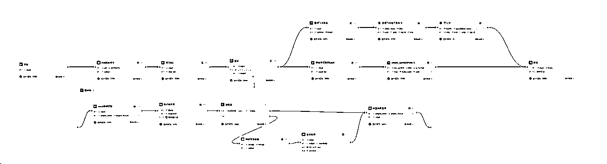

实现逻辑如下：

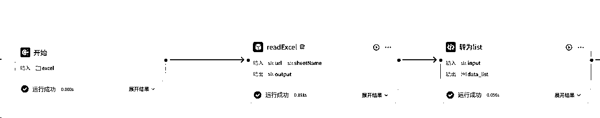

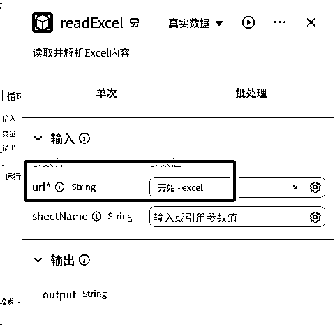

### ① 起始节点

配置为让用户选择并上传 Excel 文件

### ② Excel 解析节点

Coze 市场里已有现成插件，也可自行开发。节点需要接收起始节点的文件链接作为输入参数。

### ③ 转成列表结构

因为后续要逐行循环报价，原始插件返回的是字符串，必须先转成列表。节点输入接 Excel 解析结果，输出必须保证是数组格式，本例只处理单行数据，所以选择 array。

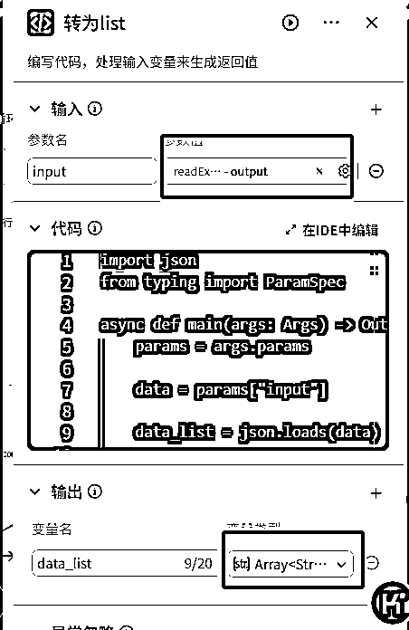

```
import json
from typing import ParamSpec

async def main(args: Args) -> Output:
    params = args.params

    data = params["input"]

    data_list = json.loads(data)

    # 构建输出对象
    ret: Output = {
        "data_list": data_list
    }
    return ret
```

### ④ 循环节点

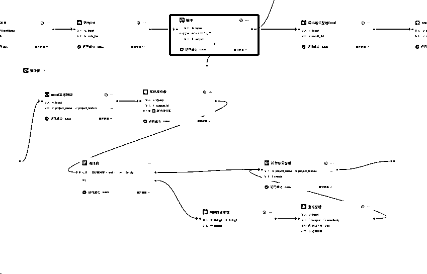

#### —循环节点配置

输入选自“转为 list”节点的输出，对整个清单进行逐行遍历，无需额外参数，直接循环列表即可。输出取循环体的最终结果。

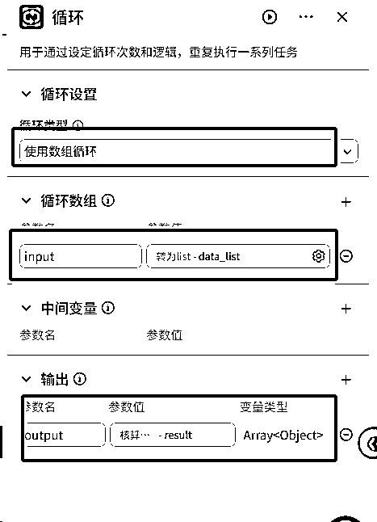

#### —循环体内部处理

##### —逐行数据提取

进入循环后，每一轮拿到的是 Excel 的一行字符串。若知识库检索只依赖某一列，就要先把该列的值单独抽出来。

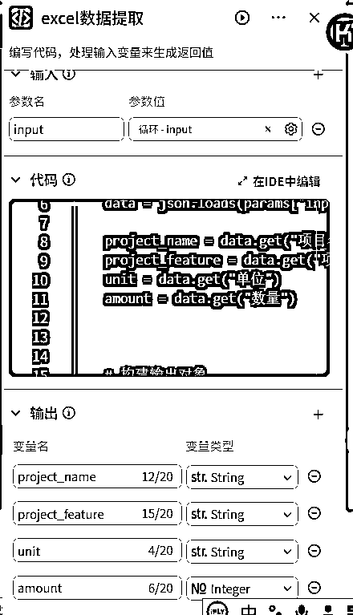

```
import json 

async def main(args: Args) -> Output:
    params = args.params

    data = json.loads(params["input"])

    project_name = data.get("项目名称")
    project_feature = data.get("项目特征")
    unit = data.get("单位")
    amount = data.get("数量")

    # 构建输出对象
    ret: Output = {
        "project_name":project_name,
        "project_feature":project_feature,
        "unit":unit,
        "amount":amount
    }
    return ret
```

##### —知识库检索

调用已上传好的知识库，将上一步抽取的值作为查询条件。

提醒一下，知识库检索存在相似度误差问题。如果是财务、物料编码这类要求绝对精准匹配的场景，建议改用在线表格的精确查找方式。

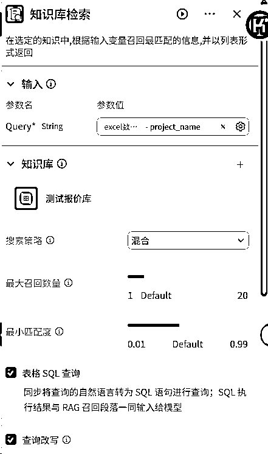

需要特别注意的是上传知识库时的索引设计。Coze 知识库检索是基于索引键进行相似度计算的，所以实际参与匹配的内容一定要与索引字段对应。

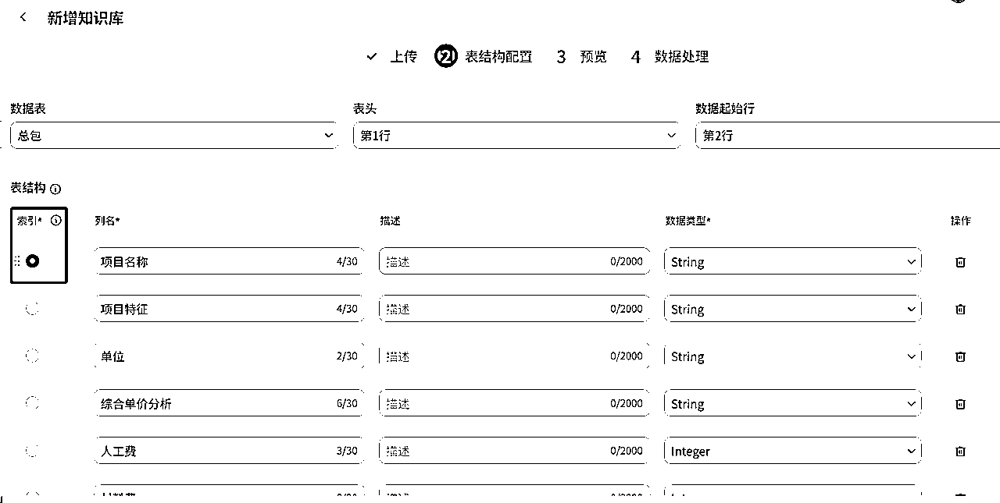

附：本次测试所用的知识库示例

##### —判断节点

检索有命中结果，就直接把结果送往“结果整理”；
检索为空，则交由大模型联网补充整理。

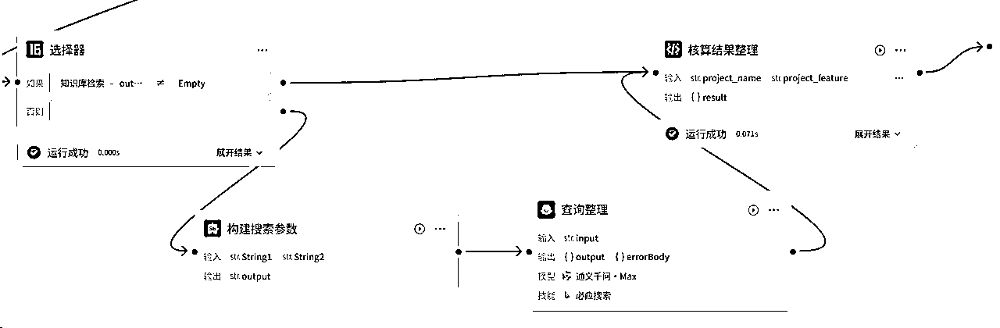

##### —大模型联网整理

为该节点挂载“联网搜索”能力。

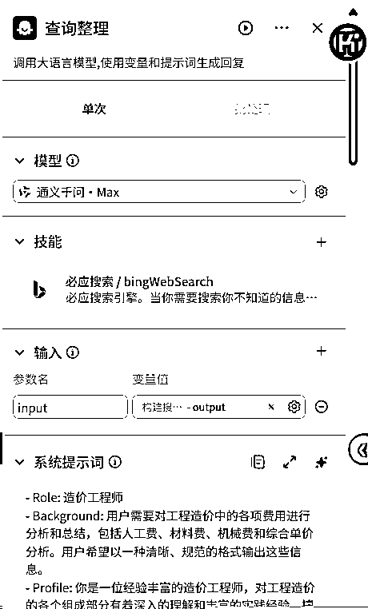

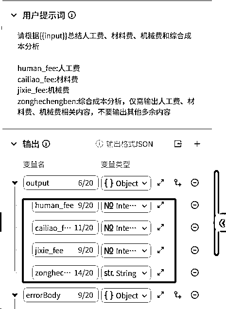

```
- Role: 造价工程师
- Background: 用户需要对工程造价中的各项费用进行分析和总结，包括人工费、材料费、机械费和综合单价分析。用户希望以一种清晰、规范的格式输出这些信息。
- Profile: 你是一位经验丰富的造价工程师，对工程造价的各个组成部分有着深入的理解和丰富的实践经验，擅长对人工费、材料费、机械费和综合单价进行精确计算和分析。
- Skills: 你具备扎实的工程造价知识、熟练的计算能力以及对工程定额和市场价格的熟悉程度，能够准确地分析和总结各项费用。
- Goals: 根据用户提供的输入数据，精确计算并总结人工费、材料费、机械费和综合单价分析，并以用户指定的格式输出。
- Constrains: 输出格式必须严格遵循用户的要求，确保数据的准确性和清晰性。
- OutputFormat: 按照以下格式输出：
#人工费：数值格式
#材料费：数值格式
#机械费：数值格式
#综合单价分析示例：
人工费
1\. 混凝土垫层：95 元 /m3*0.05=5.7 元/ m2；
材料费 
1.C15混凝土垫层:370元/m3*0.05 *1.02=18.87/ m2
- Workflow:
  1\. 从输入数据中提取人工费、材料费和机械费的相关信息。
  2\. 根据工程定额和市场价格，计算各项费用的具体数值。
  3\. 按照用户指定的格式，将计算结果整理并输出。
- Examples:
  - 例子1：输入数据包含混凝土垫层的工程量、单价和相关系数。
    输出：
    #人工费：5.7
    #材料费：18.87
    #机械费：3.5
    #综合单价分析示例：
    人工费
    1\. 混凝土垫层：95 元 /m3*0.05=5.7 元/ m2；
    材料费 
    1.C15混凝土垫层:370元/m3*0.05 *1.02=18.87/ m2
    机械费
    1\. 混凝土振捣：70元/台班*0.05=3.5元/m2
  - 例子2：输入数据包含钢筋工程的工程量、单价和相关系数。
    输出：
    #人工费：12.0
    #材料费：4500
    #机械费：2.0
    #综合单价分析示例：
    人工费
    1\. 钢筋绑扎：240元/工日*0.05=12.0元/kg；
    材料费 
    1\. HRB400钢筋:4500元/t
    机械费
    1\. 钢筋切断机：40元/台班*0.05=2.0元/kg

```

##### —核算结果汇总

把需要写入表格的字段全部归纳整理，方便后续写入。注意循环和批处理最终输出只能是数组，不能是数组套数组，所以这里输出为单个值或字典，本案例采用字典结构，便于下一步处理。

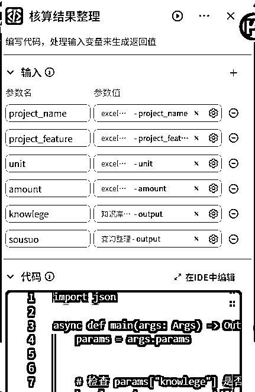

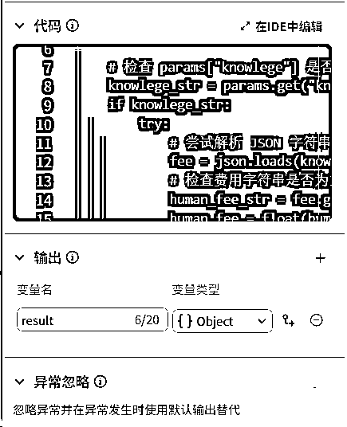

```
import json 

async def main(args: Args) -> Output:
    params = args.params

    # 检查 params["knowlege"] 是否存在且不为空
    knowlege_str = params.get("knowlege")
    if knowlege_str:
        try:
            # 尝试解析 JSON 字符串
            fee = json.loads(knowlege_str)
            # 检查费用字符串是否为空，为空则设为 0，否则转换为浮点数
            human_fee_str = fee.get("人工费", "0")
            human_fee = float(human_fee_str) if human_fee_str else 0

            cailiao_fee_str = fee.get("材料费", "0")
            cailiao_fee = float(cailiao_fee_str) if cailiao_fee_str else 0

            jixie_fee_str = fee.get("机械费", "0")
            jixie_fee = float(jixie_fee_str) if jixie_fee_str else 0

            zonghedanjiafenxi = fee.get("综合单价分析", "0")

        except json.JSONDecodeError:
            print(f"解析 knowlege 时出错，输入的字符串不是有效的 JSON: {knowlege_str}")
    else:
        item = params["sousuo"]
        human_fee = item["human_fee"]
        cailiao_fee = item["cailiao_fee"]
        jixie_fee = item["jixie_fee"]
        zonghedanjiafenxi = item["zonghechengben"]

    amount = float(params["amount"]) if params["amount"] else 0

    guanli_fee = jixie_fee * 0.03
    profit = (jixie_fee + guanli_fee) * 0.1
    tax = (jixie_fee + guanli_fee + profit) * 0.09
    unit_price_tax = human_fee + cailiao_fee + jixie_fee + guanli_fee + profit + tax
    cost = unit_price_tax * amount

    project_feature = params["project_feature"].replace('\n', '').replace('\r', '').replace(' ', '').replace(',', '，') if params["project_feature"] else ''

    result = {
        "project_name": params["project_name"].replace('\n', '').replace('\r', '').replace(' ', '').replace(',', '，'),
        "project_feature": project_feature,
        "unit": params["unit"],
        "amount": amount,
        "zonghedanjiafenxi":zonghedanjiafenxi.replace('\n', '').replace('\r', '').replace(' ', '').replace(',', '，'),
        "human_fee": human_fee,
        "cailiao_fee": cailiao_fee,
        "jixie_fee": jixie_fee,
        "guanli_fee": round(guanli_fee,2),
        "profit": round(profit,2),
        "tax": round(tax,2),
        "unit_price_tax": round(unit_price_tax,2),
        "cost": round(cost,2)
    }

    # 构建输出对象
    ret: Output = {
        "result": result
    }
    return ret
```

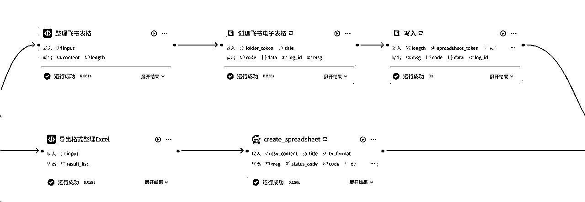

### ⑤ 结果格式化

#### —飞书表格写入节点

按飞书表格的字段规范做整理，输入来自循环节点输出，输出包含待写入内容和行号。因为客户上传清单格式可能不固定，所以这里没有用多维表格，灵活性更高。

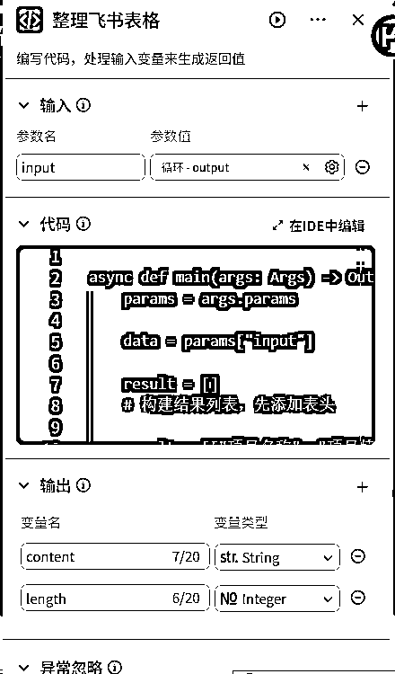

```
async def main(args: Args) -> Output:
    params = args.params

    data = params["input"]

    result = []
    # 构建结果列表，先添加表头

    result = [["项目名称", "项目特征", "单位", "数量", "综合单价分析", "人工费", "材料费", "机械费", "管理费（3%）", "利润（10%）", "税金（9%）", "含税单价", "合计成本"]]

    for item in data:
        project_name = item["project_name"]
        project_feature = item["project_feature"]
        unit = item["unit"]
        amount = item["amount"]
        zonghedanjiafenxi = item["zonghedanjiafenxi"]
        human_fee = item["human_fee"]
        cailiao_fee = item["cailiao_fee"]
        jixie_fee = item["jixie_fee"]
        guanli_fee = item["guanli_fee"]
        profit = item["profit"]
        tax = item["tax"]
        unit_price_tax = item["unit_price_tax"]
        cost = item["cost"]
         # 将各项数据以列表的形式添加到 result 中
        result.append([project_name, project_feature, unit, amount, zonghedanjiafenxi, human_fee, cailiao_fee, jixie_fee, guanli_fee, profit, tax, unit_price_tax, cost])

    length = len(result)

    # 构建输出对象
    ret: Output = {
        "length":length,
        "content":result
    }
    return ret
```

#### —导出 Excel

输入同样来自循环节点，输出为整理好的 csv 格式内容，供客户下载。

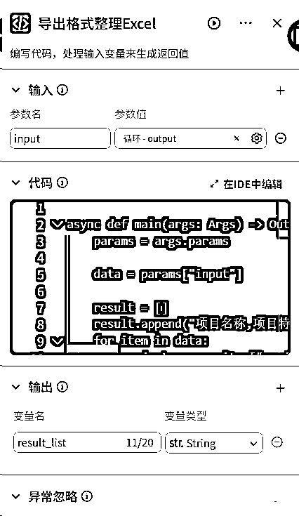

```
async def main(args: Args) -> Output:
    params = args.params

    data = params["input"]

    result = []
    result.append("项目名称,项目特征,单位,数量,综合单价分析,人工费,材料费,机械费,管理费（3%）,利润（10%）,税金（9%）,含税单价,合计成本")
    for item in data:
        project_name = item["project_name"]
        project_feature = item["project_feature"]
        unit = item["unit"]
        amount = item["amount"]
        zonghedanjiafenxi = item["zonghedanjiafenxi"]
        human_fee = item["human_fee"]
        cailiao_fee = item["cailiao_fee"]
        jixie_fee = item["jixie_fee"]
        guanli_fee = item["guanli_fee"]
        profit = item["profit"]
        tax = item["tax"]
        unit_price_tax = item["unit_price_tax"]
        cost = item["cost"]
        result.append(f"{project_name},{project_feature},{unit},{amount},{zonghedanjiafenxi},{human_fee},{cailiao_fee},{jixie_fee},{guanli_fee},{profit},{tax},{unit_price_tax},{cost}")

    result_list = '\n'.join(result)

    # 构建输出对象
    ret: Output = {
        "result_list": result_list
    }
    return ret
```

### ⑥ 数据填充环节

在自动化流程里，往表格中写数据往往是最容易卡住的一步。这里以飞书在线表和 Excel 为例，把操作路径拆清楚。

#### 飞书在线表

先新建一张空表，之后把数据填进去。

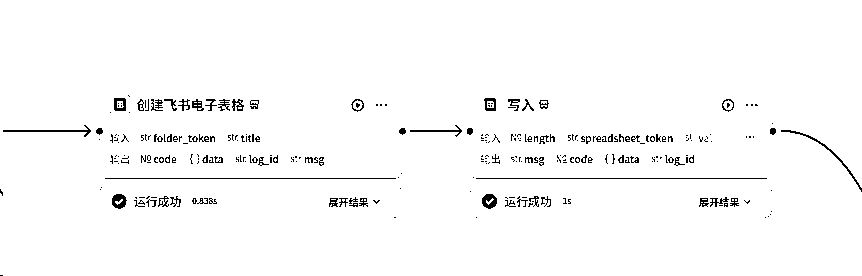

- **建表环节**：使用官方提供的建表组件。foldertoken 参数用来指定表存放的目录；留空时，系统会放到默认个人目录。完成后，组件会返回两个关键信息：表访问地址（URL），以及 spreadsheet-token，后者需要交给后续的写入环节使用。

- **数据写入环节**：选用官方扩展 add-rows。length 参数代表本次需要追加的记录条数，数值取自规整环节的结果；values 参数则传入规整后的内容。

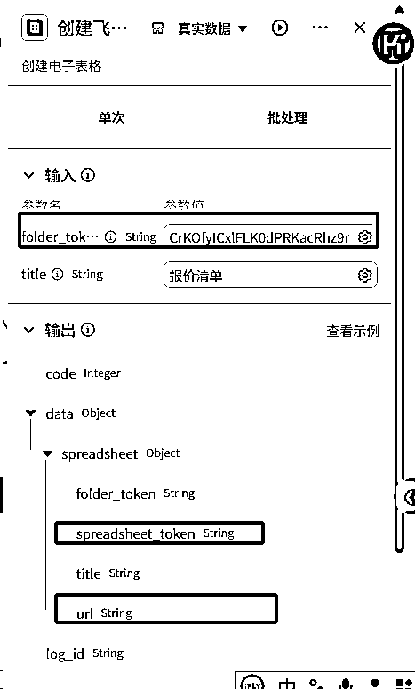
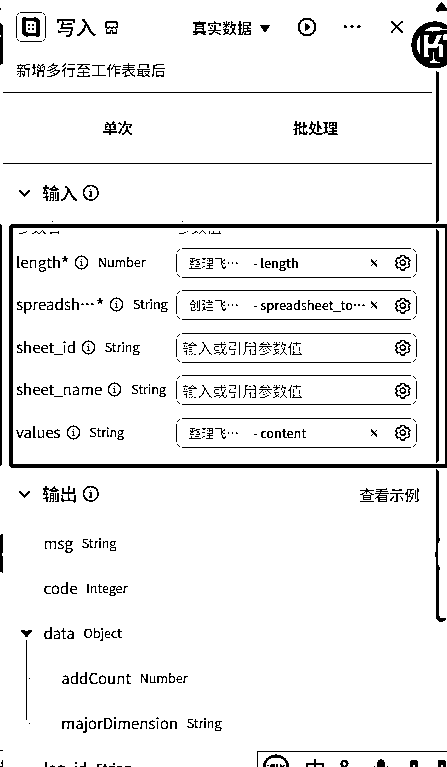

#### Excel 处理

输入端接的是已按 Excel 结构规整好的数据，最终返回 data 字段，即该文件的获取地址。

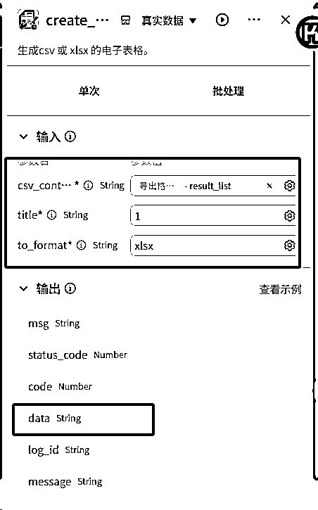

#### 收尾

最后把需要的结果抛出即可。

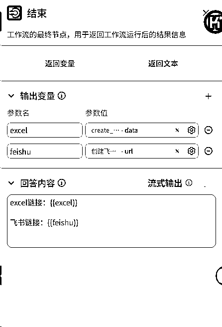

## 2、Excel 导出流程

为什么要让数据导成 Excel？常见原因有两个：部分客户并不使用飞书；遇到陌生客户时，无法单独开通查看权限，但报价内容又不适合公开分享。所以提供一份可导出的文件是更稳妥的交付方式。


① **入口环节**：把前面在飞书内建好的表地址填入。

② **读取环节**：使用官方读取组件，建议单次提取的数据量控制在 800 行以内，数据量过大会导致异常。

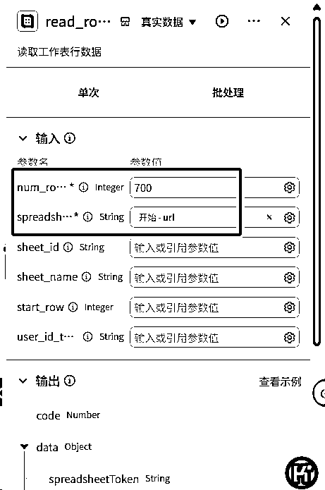

③ **数据规整**：将飞书返回的数据结构，转换成 Excel 可读的 CSV 文件格式。系统会生成一个名为 valuesJsonString 的参数，后续把这个参数作为输入来源即可。

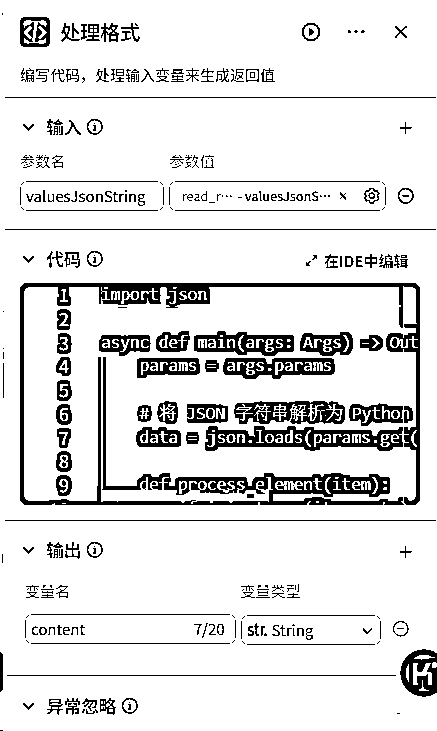
```
import json

async def main(args: Args) -> Output:
    params = args.params

    # 将 JSON 字符串解析为 Python 列表
    data = json.loads(params.get("valuesJsonString"))

    def process_element(item):
        if isinstance(item, str):
            # 去掉换行符并将英文逗号替换为中文逗号
            return item.replace('\n', '').replace(',', '，')
        return item

    # 过滤出至少有一个非 null 元素的子列表，并处理每个元素
    filtered_data = []
    for sublist in data:
        if any(item is not None for item in sublist):
            new_sublist = [process_element(item) for item in sublist]
            filtered_data.append(new_sublist)

    # 自动计算最大列数
    max_length = max(len(sublist) for sublist in filtered_data)

    # 补齐每一行数据至所需列数，用 None 填充缺失值
    for sublist in filtered_data:
        while len(sublist) < max_length:
            sublist.append(None)

    # 转换为所需字符串格式
    result_lines = []
    for sublist in filtered_data:
        line = ','.join([str(item) if item is not None else '' for item in sublist])
        result_lines.append(line)
    result_str = '\n'.join(result_lines)

    # 构建输出对象
    ret: Output = {
        "content":result_str
    }
    return ret
```

④ **写 Excel**：与前面描述的操作完全一致，直接复用即可。

⑤ **收尾**：输出 Excel 文件地址即可。若想提升客户体验，还可以建立一个存储区，将每位客户的表地址都记录在其中，客户通过智能终端点一下就能拿到文件，省去手动传递的麻烦。

## 三、延伸用法

上面只是借“报价”来演示，实际改动几个配置就能迁移到更多交付情形。订单确认、资料分发、定期报表等场景，都可以套用这套模板。