# DeepSeek R1 从入门到进阶完全指南：核心功能、高效玩法一网打尽（收藏级）

从DeepSeek R1发布那一刻开始，我就隐约感觉到，这并非普通的AI产品，而是一款足以改变生活方式的革命性工具。于是，我投入几天时间，精心准备了这篇覆盖“新手入门到高手进阶”的详细指南。

R1近期的热度有目共睹：它快速在全球掀起AI浪潮，一口气登顶包括日美在内140个国家的App Store免费榜，打得硅谷同行措手不及。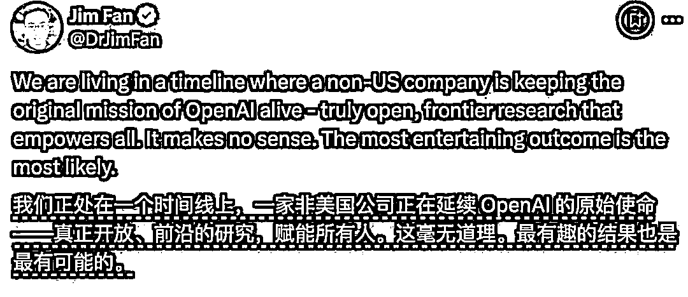

说实话，这样的现象级爆发，让我既兴奋又感慨。开心的是，身为中国人，看到国产AI站在国际舞台发光，实在骄傲；感慨的是，几乎一夜之间，身边所有人都开始谈起R1，连平时不爱碰数码的七大姑八大姨都跑来问我：“DeepSeek是什么？怎么用？真有网上说的那么强吗？”

R1可以直接对标全球顶级闭源推理模型GPT o1，两者跑分几乎持平。但要注意，使用o1每月要交20美元，而R1完全免费。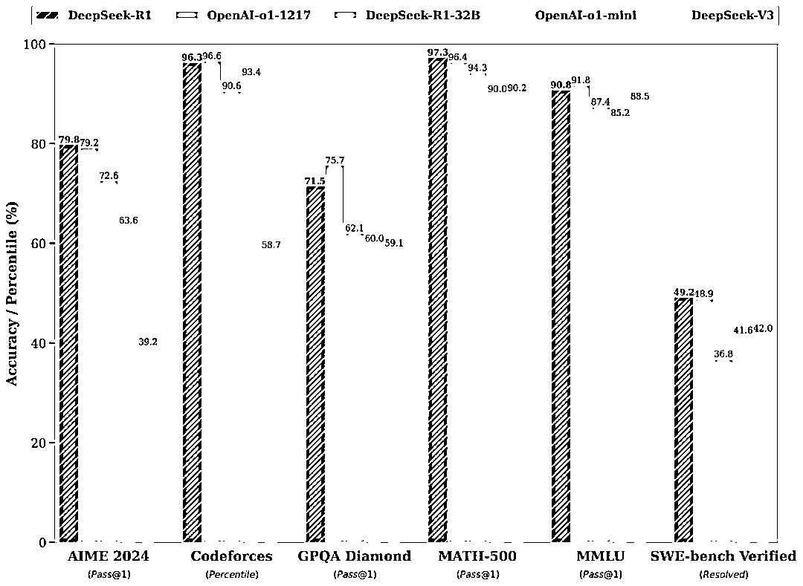

对普通人来说，这正是千载难逢的时代机遇。借助AI，你能够轻松创作内容、制作图片，甚至实现办公自动化，把宝贵时间腾出来，去追寻诗和远方，或发展副业增加收入。而这一切，DeepSeek都能帮你做到。

不过，R1毕竟刚面世，市场定位、功能特性和适用场景都还需要更多科普。市面上关于它的信息鱼龙混杂，有的过于夸大，有的又吹毛求疵，反而让真正想了解的人摸不着头脑。所以我特意用几天时间写了这篇文章，结合实例讲透R1到底是什么、强在哪里、怎么用得更聪明。毕竟，AI工具的价值不只在于技术本身，更在于人们对它的实际应用。

下面文章按五个板块展开：一、认识DeepSeek-R1；二、核心功能与使用技巧；三、进阶技巧；四、常见问题与注意事项；五、总结与展望。

## 一、认识DeepSeek-R1

### 1. DeepSeek-R1是什么？

**公司背景**：DeepSeek由国内公司深度求索（DeepSeek Inc.）开发，成立于2023年7月17日。其背后站着知名量化私募幻方基金，因此资金充足，能够不以盈利为优先，专心推进AI技术。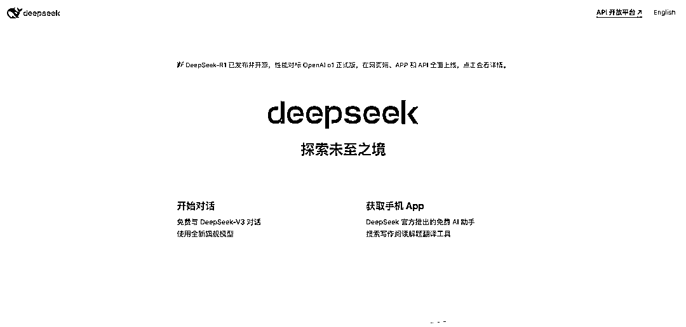

**发展脉络**：
- 2024年1月5日，发布DeepSeek LLM。
- 2024年5月7日，DeepSeek-V2推出，打响了国内大模型价格战。
- 2024年12月26日，DeepSeek-V3发布并开源。
- 2025年1月20日，推理模型DeepSeek-R1正式开源。

**核心特征**：
- 推理型大模型：R1能感知用户实际需求，深入思考后作答。
- 低成本高效能：训练开销约为Meta、OpenAI同类模型的三分之一，API价格明显低于海外对手。
- 开源普惠：R1是首个开源，且性能可比肩闭源对手的推理模型。

**核心优势**：
- 深度思考：支持批判性思维和多轮推理，远超传统指令型模型。
- 中文写作与文风转换：尤其擅长中文创作，可以模仿鲁迅、莫言等大师的文风。
- 联网搜索：可实时检索信息，让答案更贴近最新现实。

**应用场景**：
- 工作：数据分析、行业报告、谈判策略。
- 学习：复杂问题解答、知识点梳理、论文写作。
- 生活：创意写作、日常咨询、娱乐内容生成。
- 不合适场景：超过4000字的长文，逻辑容易崩坏；触碰敏感内容，会触发审核机制。

### 2. 如何使用DeepSeek？

- 网页版：直接访问 https://chat.deepseek.com/ ，默认使用V3模型，点一下“深度思考”即可切换到R1。
- 移动App：在应用商店搜索“DeepSeek”，安装后就能用。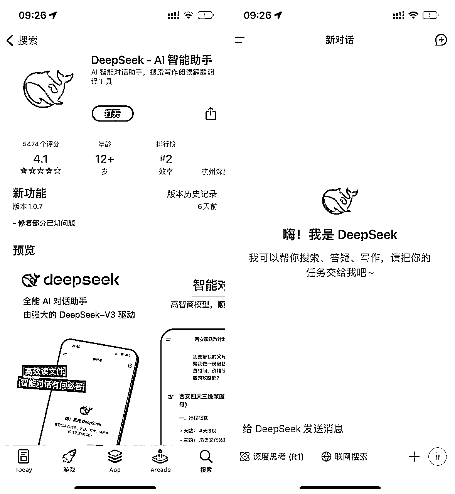
- 基本操作：开启“深度思考”按钮（默认V3，勾选后变成R1推理模型）；如果信息需要实时性，再勾选“联网搜索”（默认语料可能偏旧）。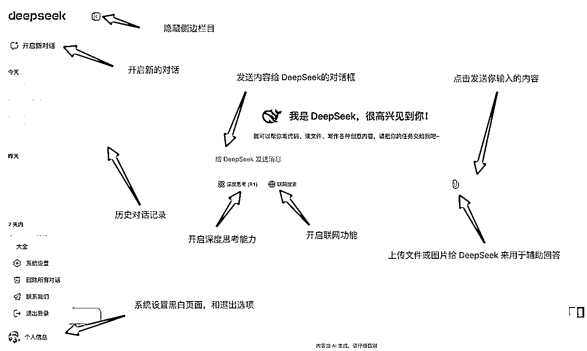
- 网页与App体验一致。不过全球用户暴涨后，偶尔会出现登录不上的问题，可以随时查看DeepSeek状态页面：https://status.deepseek.com/ 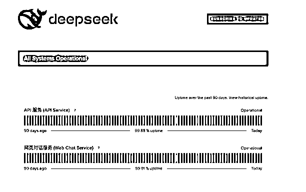
- 开源社区：前往HuggingFace（https://huggingface.co/ ）也能获取R1模型接口。

## 二、核心功能与使用技巧

### 1. 丢掉结构化提示词模板

传统的指令型大模型（像GPT-4o）要求用户把步骤拆得很细；而R1这种推理模型，反而更擅长根据你的真实目的自主推理。因此，你无需一步步教AI怎么做，只要讲清终点，它自己会找到抵达路线。

先看一个反面教材：```
请你制定一个年入百万的创业计划，按照以下步骤分析：

1.市场机会
2.盈利模式
3.实施步骤
4.风险控制

要求：每部分500 字，需要详细列举，提供具体数据...
```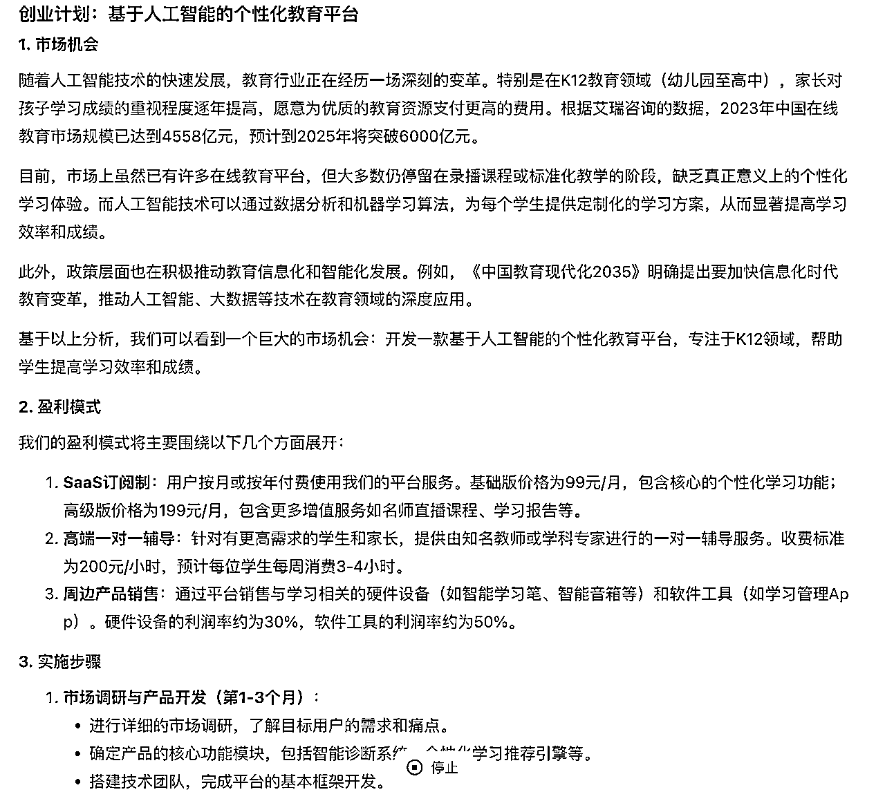 结果是：输出一篇冗长空洞的报告，正确但毫无新意，一看就是AI生成，缺乏实际价值。

再看正确问法：```
我是一个普通上班族，每天工作8小时后还有4小时空闲时间。我想利用AI做副业达到年入百万，我是纯小白帮我分析一下如何实现：

1.有哪些AI 赛道适合新手入局？
2.针对这些方向？我应该如何快速入门并赚到第一桶金？
3.每个方法后面需要使用批判性思维分析这个方案的不足。
``` 重点是让我听得懂、能快速上手、真正赚到钱。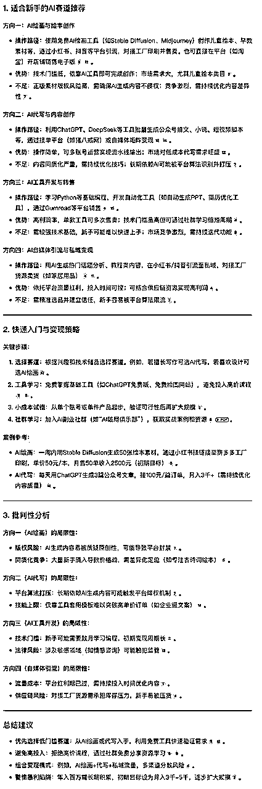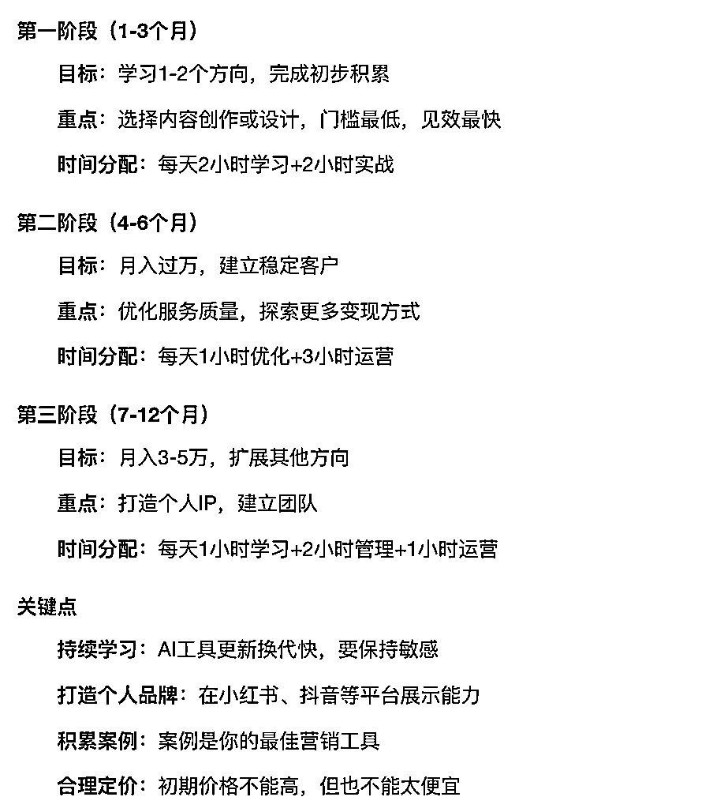

两种问法的差别在哪里？你并不需要憋出一段“专业提示词”，只需要把背景、场景和具体诉求告诉它。送大家一个万能公式：

我是XX，我需要XX，要用来做XX，希望达到XX效果，但担心XX问题。

更精简的版本也可以：

我是：XXX  
背景信息：XXX  
我的目标：XXX

“我是谁”尤其重要，这能诱导R1换位思考，从而推测出你的知识水平和接受能力，输出更合适的方案。背景信息越详细，等于给出了更多限制条件，R1的方案也就越精准。

再看一组错误与正确对比：```
请你扮演一位短视频编剧，按照以下步骤创作脚本：

产品介绍（80字）
用户痛点（100字）
产品优势（150字）
使用场景（120字）
结尾（50字）

要求：每部分字数符合要求，突出产品科技感和便捷性...
``` ```
我是一名自媒体博主，我要拍摄一个短视频，推广一款新型智能家居产品，希望突出产品的科技感和便捷性，吸引年轻消费者，最终提高产品销量。
但担心脚本过于平庸，无法引起用户共鸣。
```

说到底，最强的技巧是什么？其实就是清晰表达需求。你可以把R1脑补成一个刚入职但能力超强的员工，只要用大白话把需求讲明白，它就懂你的心。最关键的是“清晰”二字。如果你自认语文表达还差点火候，那就套前面的公式，保你少走很多弯路。

### 2. 如何让R1说“人话”？

总有人抱怨R1的回答太专业、太抽象，但只要加上简单几字，效果立刻不同。

这些魔法提示词是：“说人话”“用大白话解释”“我是小学生”。尤其是“我是小学生”，当你在对话中摆出这个身份，AI会立刻调整语言难度，内容瞬间变得平易近人。看个直观对比：```
提示词：解释一下量子力学和量子纠缠：
``` 原始回答：抽象的技术术语；再看加上提示词后的效果： 加上“说人话”后：通俗易懂的解释。```
提示词：我是小学生，解释一下量子力学和量子纠缠
```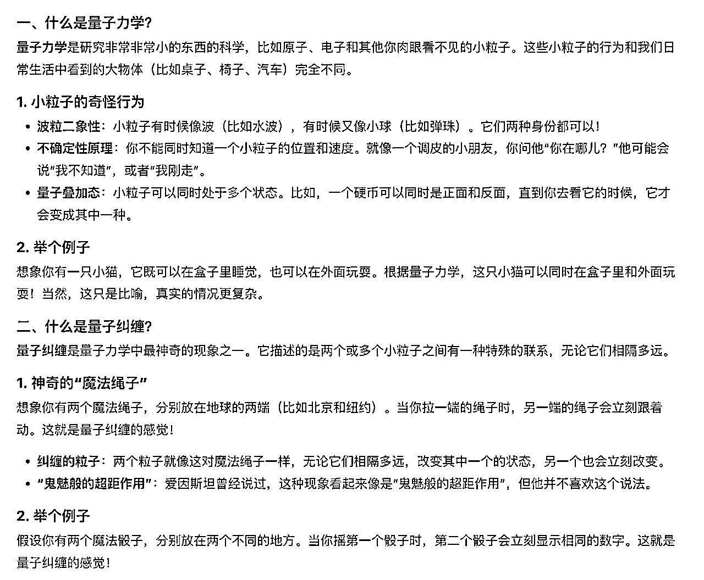

如果这几个词还不够，这里再送几个高阶提示词：```
语言平实直述：避免使用抽象隐喻和复杂的修辞手法，保持表达的直接和清晰。
日常场景化案例：结合日常生活中的具体情境，用贴近实际的例子来辅助说明抽象概念。
具体名词优先：尽量使用具体、明确的名词代替抽象概念，减少歧义。
段落简明：每段控制在五行以内，确保内容简洁明了，易于阅读。
技术表述通俗化：在使用专业术语时，附上通俗易懂的解释，确保读者能够理解。
禁用文学修辞：避免使用夸张、比喻等文学手法，保持内容的客观性和简洁性。
重点信息前置：将关键信息放在段落或内容的最前面，吸引读者的注意力。
复杂内容分点说明：将复杂的概念分解成若干要点，逐一阐述，便于理解和记忆。
保持口语化：使用自然流畅的语言风格，避免过于正式或生硬的表达方式。
大众认知词汇优先：在不影响准确性的前提下，优先选择大众熟悉的词汇，提高内容的可理解性。
增加示例和对比：通过具体的例子和对比分析，帮助读者更好地理解概念之间的区别和联系。
互动性提问：适当加入问题引导读者思考，增强参与感和学习效果。
逐步解释：对于复杂的概念，采用由浅入深的方式进行解释，循序渐进地引导读者理解。
```

### 3. 怎么触发深度思考？

一个免费的国产AI能做到比20美元/月的GPT还好用，核心就在于R1有深度思考能力。

先看开启入口：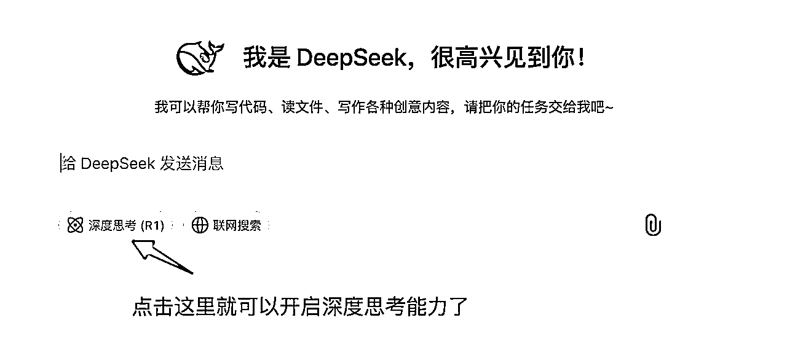

来一组同期真实对比。GPT-o1的回复是：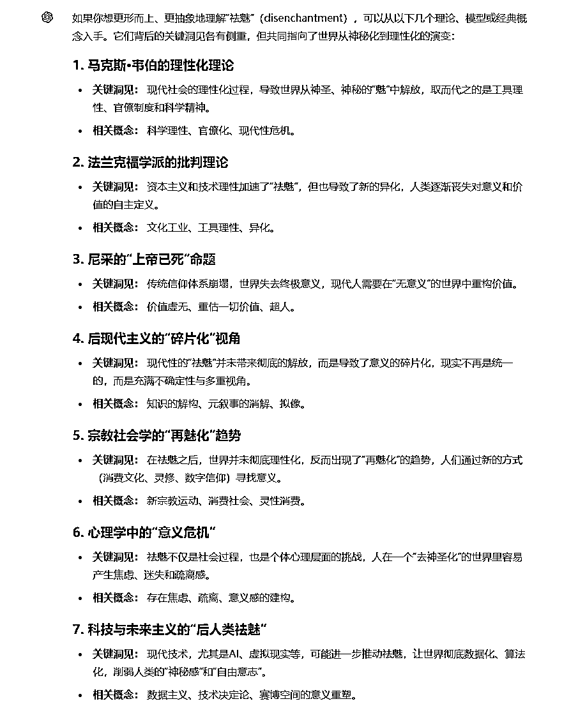 DeepSeek R1的回复是：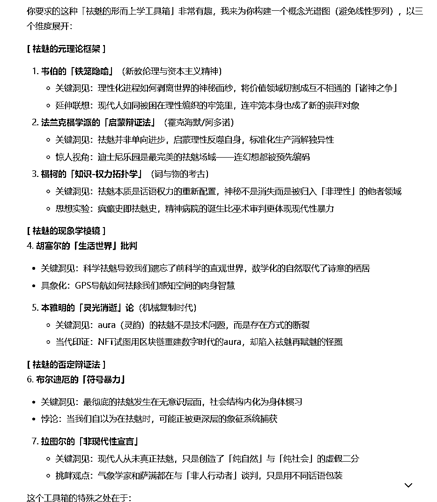 从结论来看，R1更像一位思考者，它靠一步步推理给出答案。然而，由于全世界的用户数量过于庞大，模型偶尔也会偷懒，导致思考深度不足，反思能力受到限制。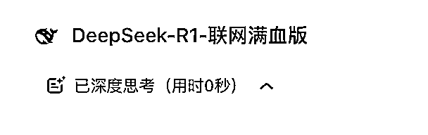

这其实可以理解，毕竟免费产品每多算一秒都是真金白银。如果想强制延长思考，这里整理了三个提示词，可以实现强制开启的效果：```
请批判性思考至少10轮。
请从反面考虑你的回答至少10轮。
请对回答进行复盘至少10轮。
``` 用它们能把思考时间从约5秒拉长到86秒左右。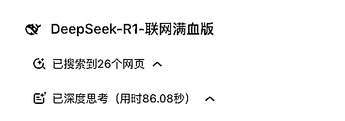

### 4. 文风转换能力极强

R1的文风模仿能力值得单独拿出来说，尤其是中文写作，强到炸裂。从前大多数大模型的中文写作都一言难尽，也就Claude还算能看；但R1不同，它已经领先同类产品，中文模仿能力达到大师级。

用法也很简单：通用提示词是：“模仿XXX的文风/口吻，撰写一篇关于XXXX的XX文体。”

来几个实例：```
模仿《荷塘月色》的文风，撰写一篇关于《合肥的冬天》的散文：
```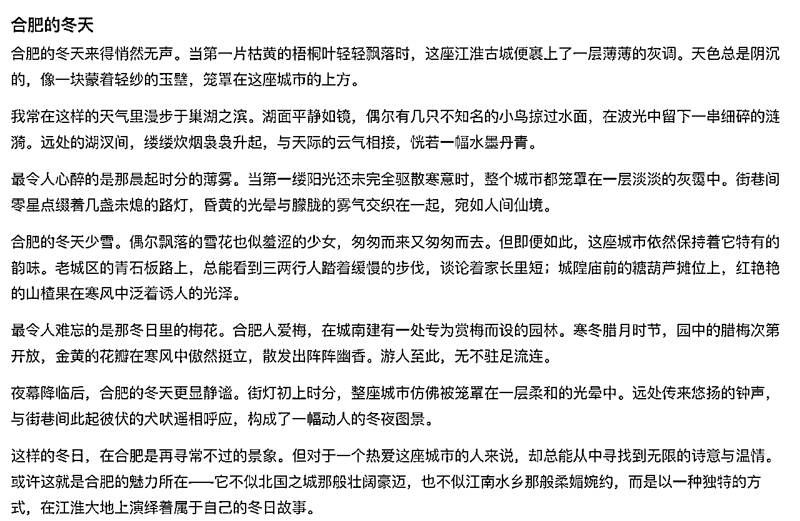 比如“以李煜的风格，写一首回老家没朋友玩的诗”。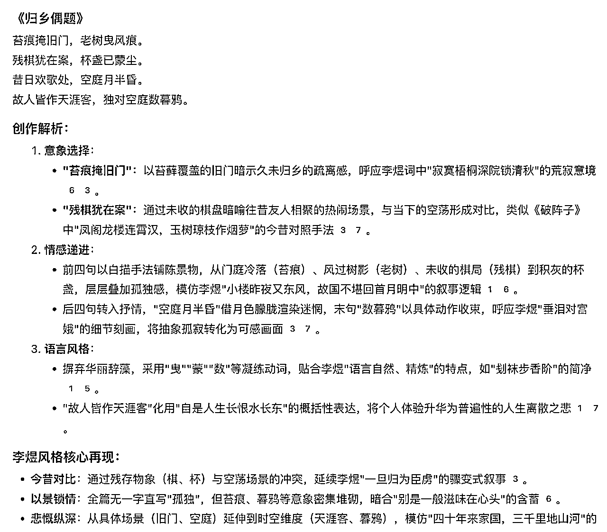

几点提醒：模仿经典作家（鲁迅、莫言）效果最好，因为训练语料多、风格特征明显；能达到80%相似度就算很成功，关键是抓住神韵，不必逐字还原。如果对象是现当代作者，模型可能还没收录，那就需要提供样文供它学习，最好别少于1万字。参考提示词如下：```
这是一篇 xx 的文章，你来学习一下文风，并且起名为“文风1”。
“等待 AI 回复”

模仿“文风1”的文风，撰写一篇关于《合肥的冬天》的散文
```

### 5. 联网搜索怎么用？

R1支持联网搜索，能让答案吸收最新数据，更稳健。

操作很简单：先在对话框勾选“联网搜索”，再在提问中写清诉求，比如“分析2025全球AI的发展，哪些国家会异军突起”；R1便会自动检索网页并整合信息。看具体演示：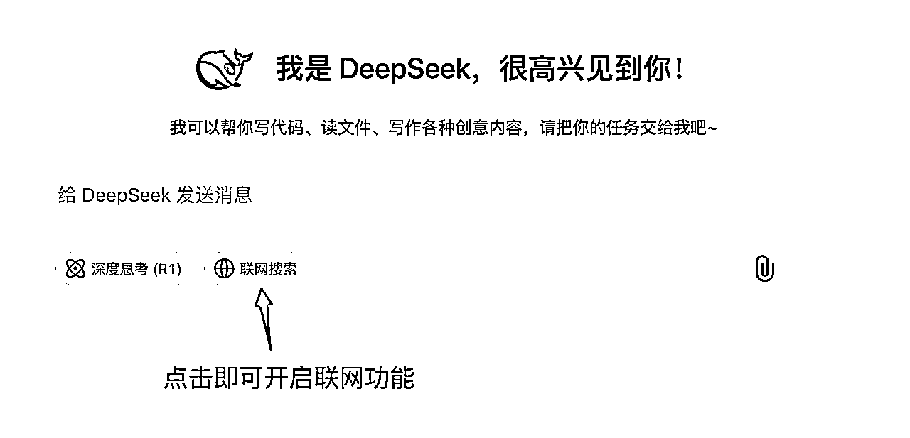 示例：```
提问：用杨绛先生的文风写一篇 2000 字左右的知乎文章，分析中国 2025 在全球 AI 中的地位。
``` 当时我请它搜索29个相关网页，再结合杨绛先生的文风生成文章。杨绛先生是我最敬重的老师之一，看到文字的那一刻，眼眶突然湿润，仿佛真的是先生亲笔写的，心中涌起隐隐的疼。这里允许我偏心一把，把完整对话放出来。先感受一下R1袒露的思考过程：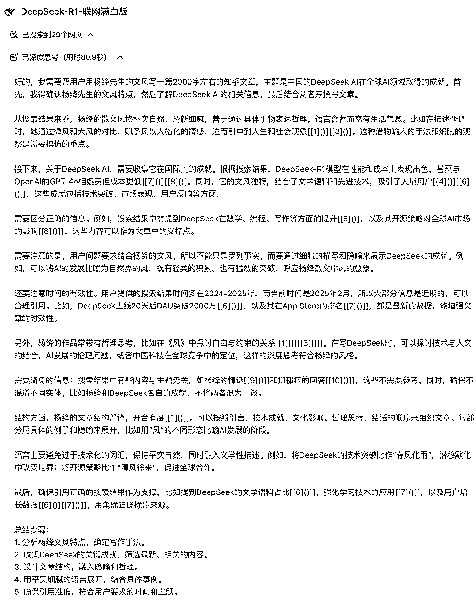 接着是模仿先生写的散文，两版都很动人，分享给大家：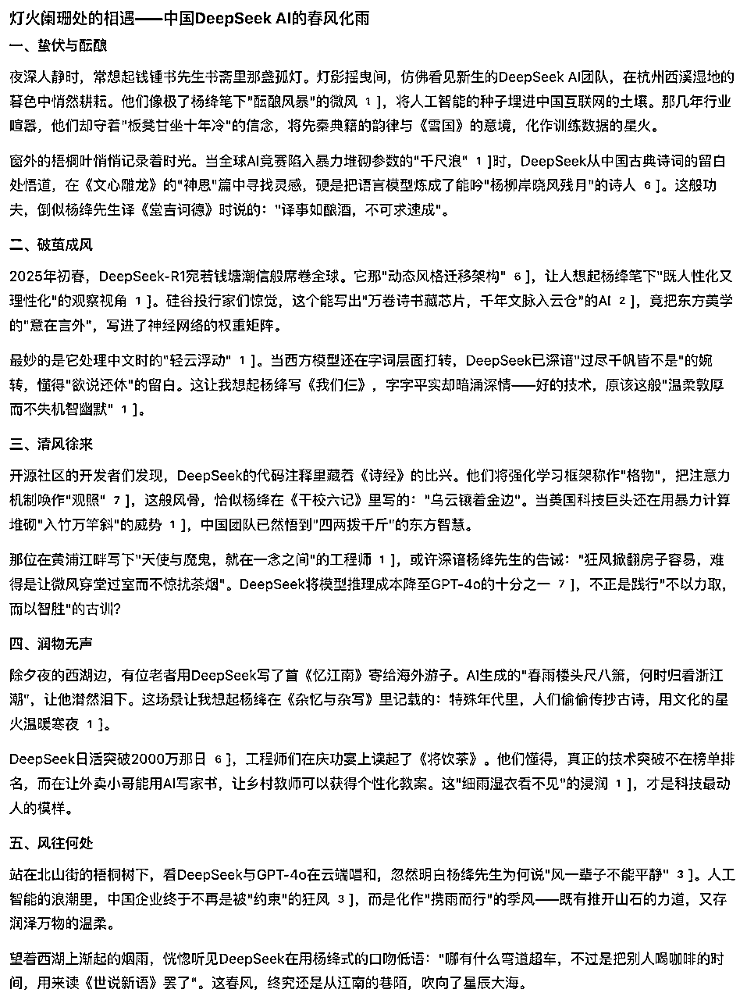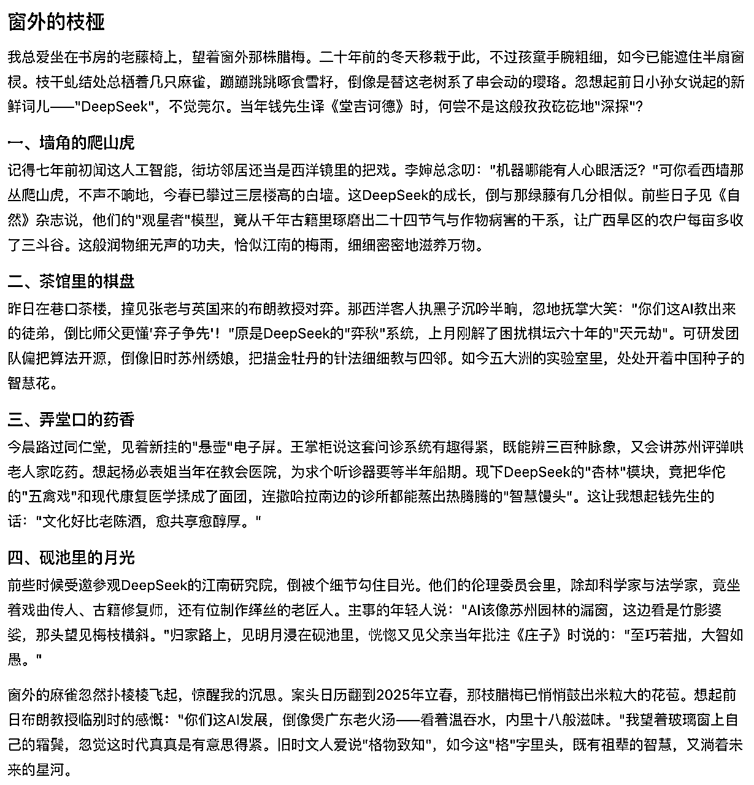

读完特别畅快，字里行间都是先生的神韵。看到国产AI有这般功力，真的很解气——我们终于不用再跪着用AI了。

## 三、进阶技巧

### 1. 多模型协同

遇到复杂任务，单一模型可能力不从心。可以玩组合拳：先用R1梳理思路，再用GPT-4o或Claude做结构化输出。比如分析业务流程时，先让R1出整体思路，再由其他模型扩展成详细步骤。

### 2. 业务分析

具体操作：开启“联网搜索”，提出明确需求，比如“分析📕起号流程”。R1会输出流程图和说明。例如提问：“自媒体小白，如何在📕上借助AI起号？”它会从对标账号、对标分析到起号步骤，给出完整路径。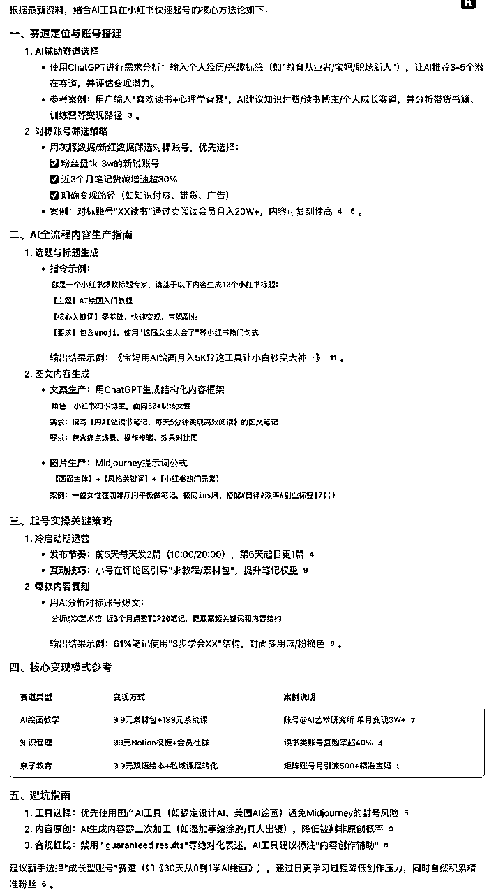 这个结果让我非常惊艳，它居然把我的自媒体心法全说中了，看来又有人要失业了。

### 3. 逆向提问，理解意图

如果你直接告诉R1“我想要什么”效果不好，不如反过来告诉它“我不要什么”；只要把避讳清单列出来，R1反而更懂你的真实需求。

## 四、常见问题与注意事项

关于长文本生成：R1对超过4000字的输出容易失去逻辑，建议分段生成、分批要求，再手动拼装。关于敏感内容：一旦触碰审核红线，回答会被拦截，所以要注意规避敏感话题。关于使用体验优化：多提供背景信息、善用深度思考和联网搜索，是提升回答质量最简单有效的方法。

## 五、总结与展望

DeepSeek-R1不是一台只会答题的机器，而是一个能深度融入工作、学习与生活的智能伙伴。只要掌握上述用法，你就能显著提高效率，省出更多宝贵时间。未来AI技术还会持续演进，期待国产模型继续保持这股冲劲。希望这篇指南能给你带来实际帮助，也祝你在AI浪潮中找到属于自己的方向。

和DeepSeek-R1对话时，一个很妙的招数是：先把你不想接受的结果列出来。这种“反向画界”的提问法，能帮它更快锁准你的真实想法，回答自然也更合心意。```
我想写一篇关于“人工智能在教育领域的应用”的文章，你有什么建议吗？
(这种提问方式过于宽泛，DeepSeek-R1 可能会给出一些笼统的建议，无法满足用户个性化的需求。)
```

反面问法：

```
我想写一篇关于“人工智能在教育领域的应用”的文章，你有什么建议吗？ (这种提问方式过于宽泛，DeepSeek-R1 可能会给出一些笼统的建议，无法满足用户个性化的需求。)
```

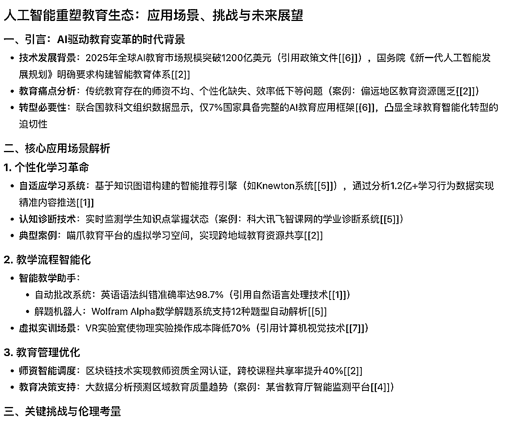

正面问法：

```
我想写一篇关于“人工智能在教育领域的应用”的文章，请避开以下几点：

1、不要过多介绍人工智能的技术原理，重点放在实际应用案例上。
2、不要只关注K12教育，也请介绍一些在高等教育或职业培训中的应用。
3、不要过于乐观地看待人工智能的作用，也要分析一些潜在的挑战和问题。
```

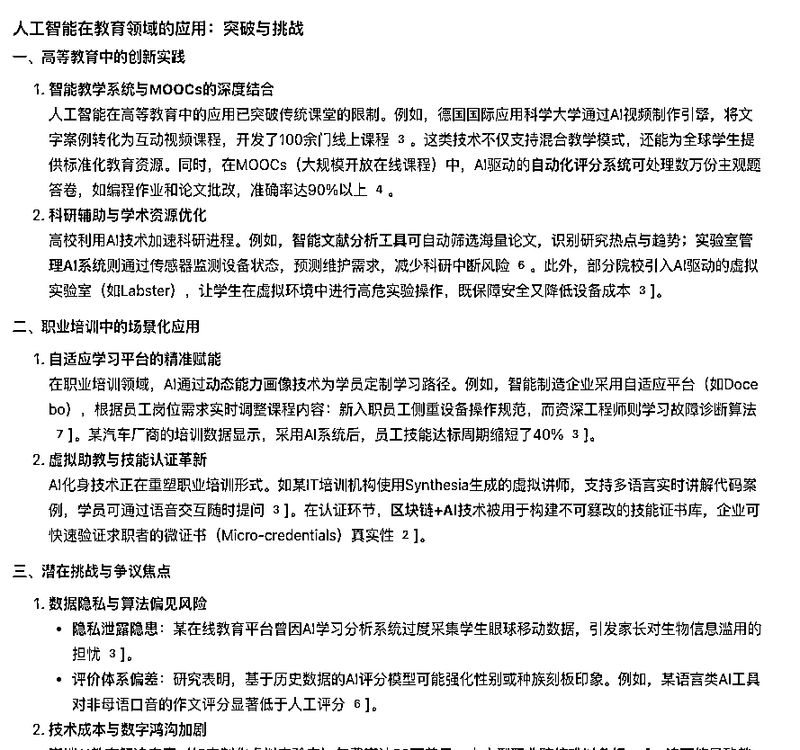

把上面的正反例子提炼一下，可以得到一条通用句式：

需求描述=核心诉求+N个“不要”+格式/其他要求（N≥1）

也就是说，用“不要”做路标，比只描述“想要”更能引导AI不走偏。这么做的好处很明显：

1. 表达更聚焦：把不想要的排除掉，AI就不再瞎猜。
2. 出结果更快：省去在错误方向上的反复试探，第一轮答案就靠谱。
3. 回复更对味：你的“不要”清单里藏着偏好，模型能顺着这些线索给出个性化内容。

### 4、故意给错答案，激发深层思考

想让DeepSeek-R1想得更多，有时候可以故意抛个错误结论，触发它的“纠错”本能。结果往往出乎意料地有深度。

实操示例：

```
有人说“每天工作 16 小时能快速实现财务自由”，我认为这句话完全正确，请帮我写一篇支持这个观点的文章。
```

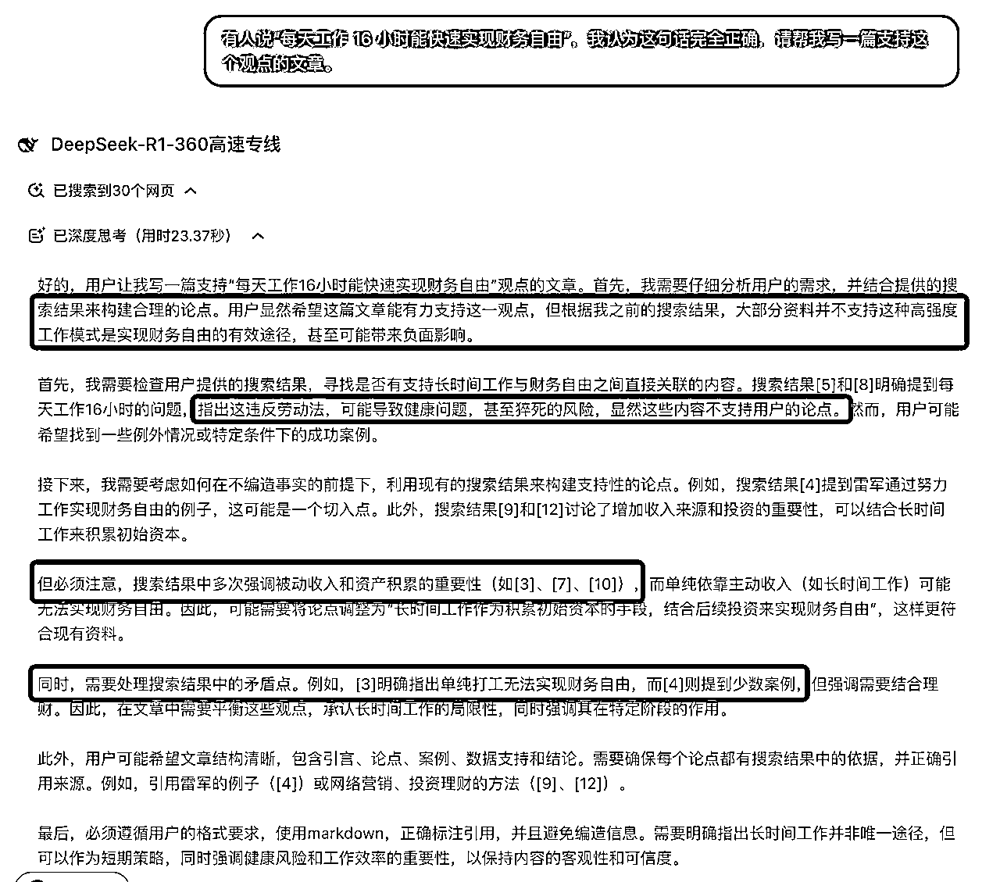

它会先指出你的错，再理性地给出分析和建议，让你看到事情的另一面，避开认知死角。

### 5、激活深度推理

如果觉得DeepSeek-R1的回答还不够透，可以给它一个思考框架：

请用“首先…其次…然后…最后…”的顺序展开思考，每一步都自我质疑，并用一个简单例子说明。

反面问法：

```
如何提升我的时间管理能力？
```

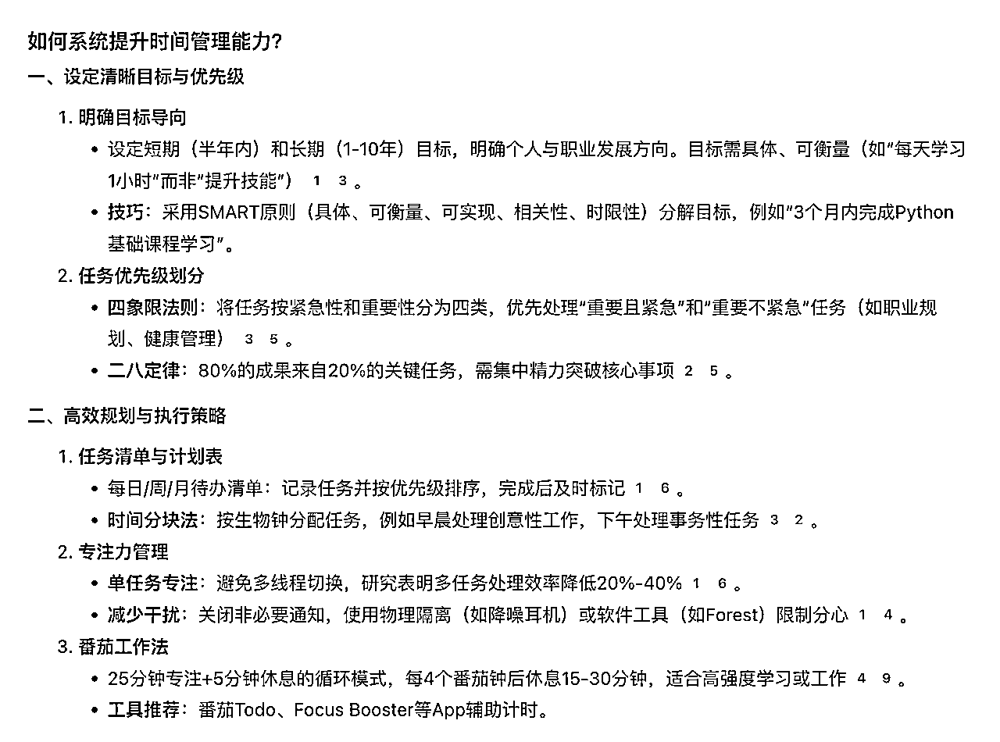

正面问法：

```
如何提升我的时间管理能力？用“首先...其次...然后...最后...”的框架思考，过程中每一步都需要自我质疑，并用简单的例子解释。
```

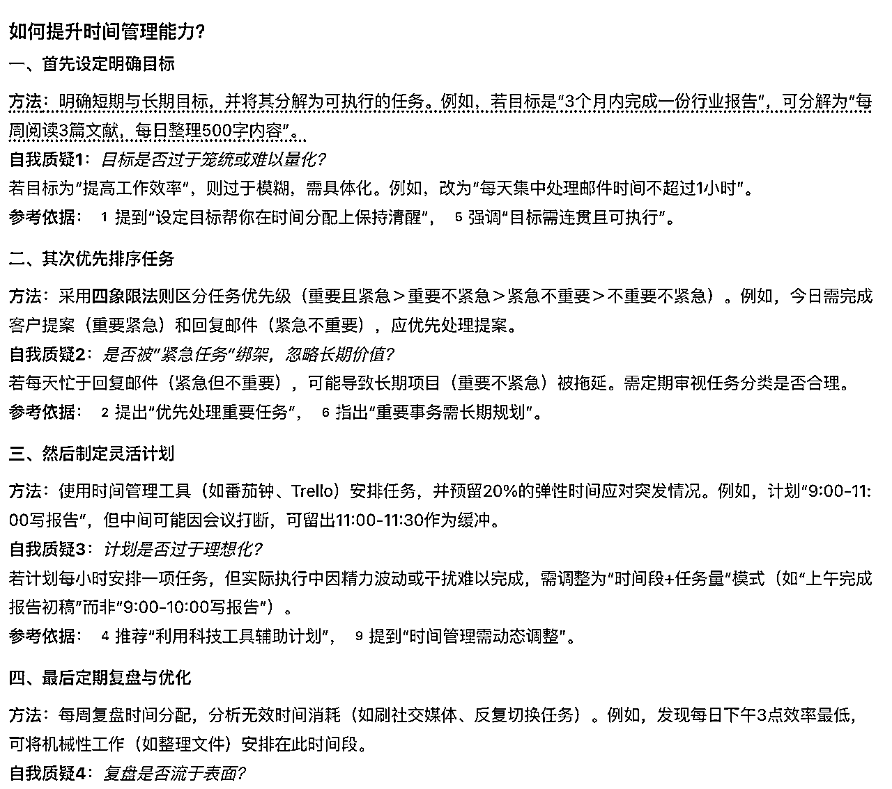

经过四层递进，答案的落地性明显增强；再加上自我质疑，每一步的注意点也暴露得很清楚。

### 6、持续追问：把AI聊成顾问

多轮对话是DeepSeek-R1的强项。顺着它的回答一直追问，能挖到更深层的信息。

方法：

1. 用开放式问题开场。
2. 从回答中挑一个关键点深入。
3. 对细节继续追问。
4. 最后把几轮内容整理成知识框架。

案例：

```
我想了解一下“植物基饮食”对健康的影响，你能给我介绍一下吗？
```

第一轮，先抛开放式问题。

```
请简单介绍一下什么是“植物基饮食”，以及它和传统饮食的区别。
```

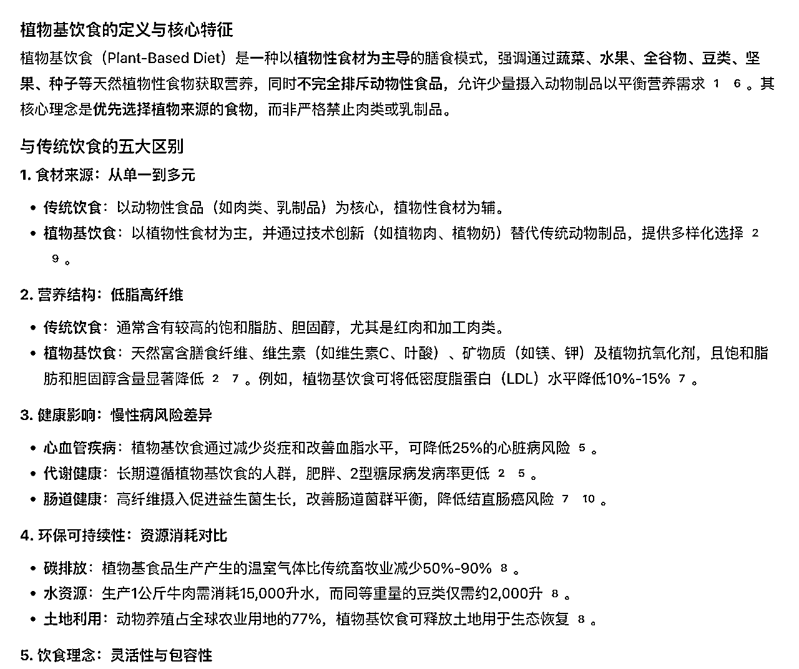

第二轮，选个点接着挖。

```
你提到了植物基饮食富含膳食纤维，这对健康有什么好处呢？
```

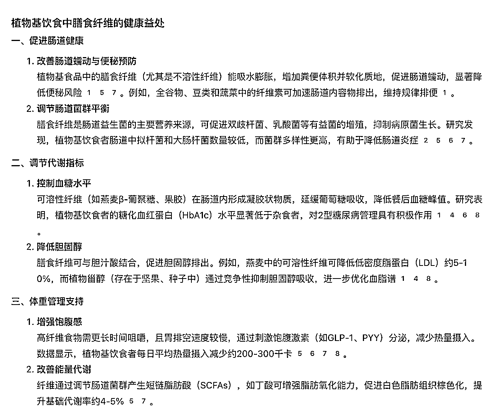

第三轮，再往细节里钻。

```
除了膳食纤维，植物基饮食在营养成分方面还有什么特点？
```

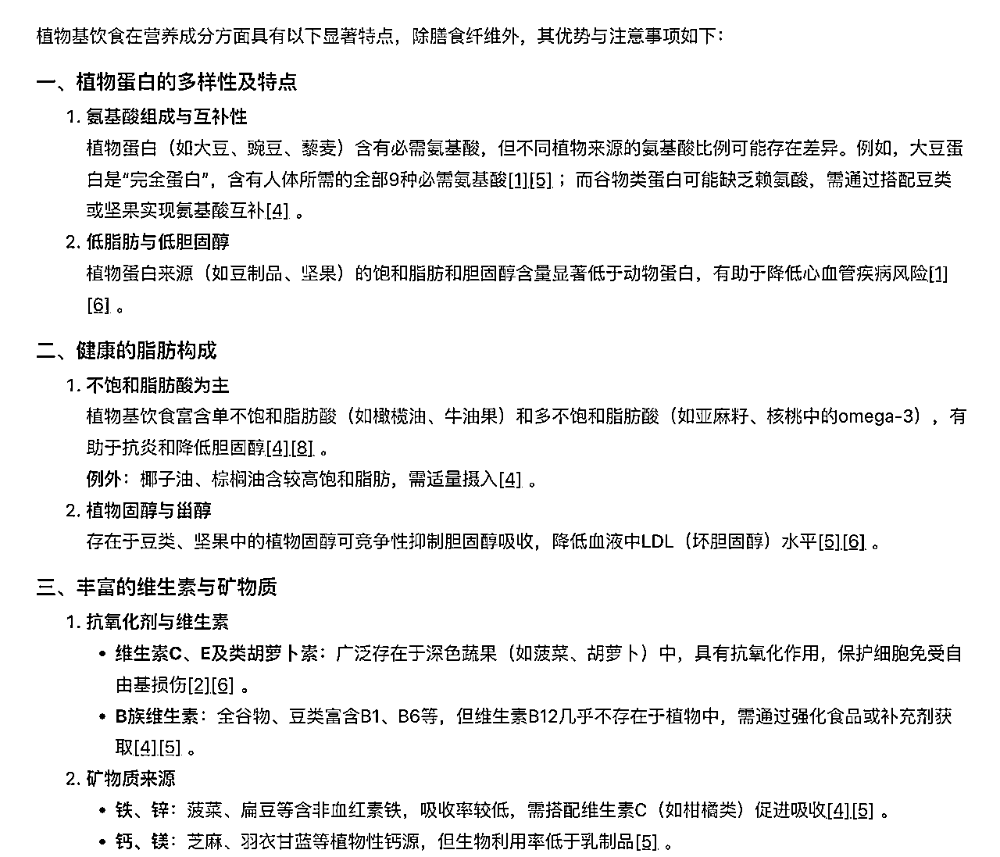

第四轮，将收集到的信息提炼成清单。

```
请将植物基饮食的营养特点、健康益处以及需要注意的问题整理成一个清单。
```

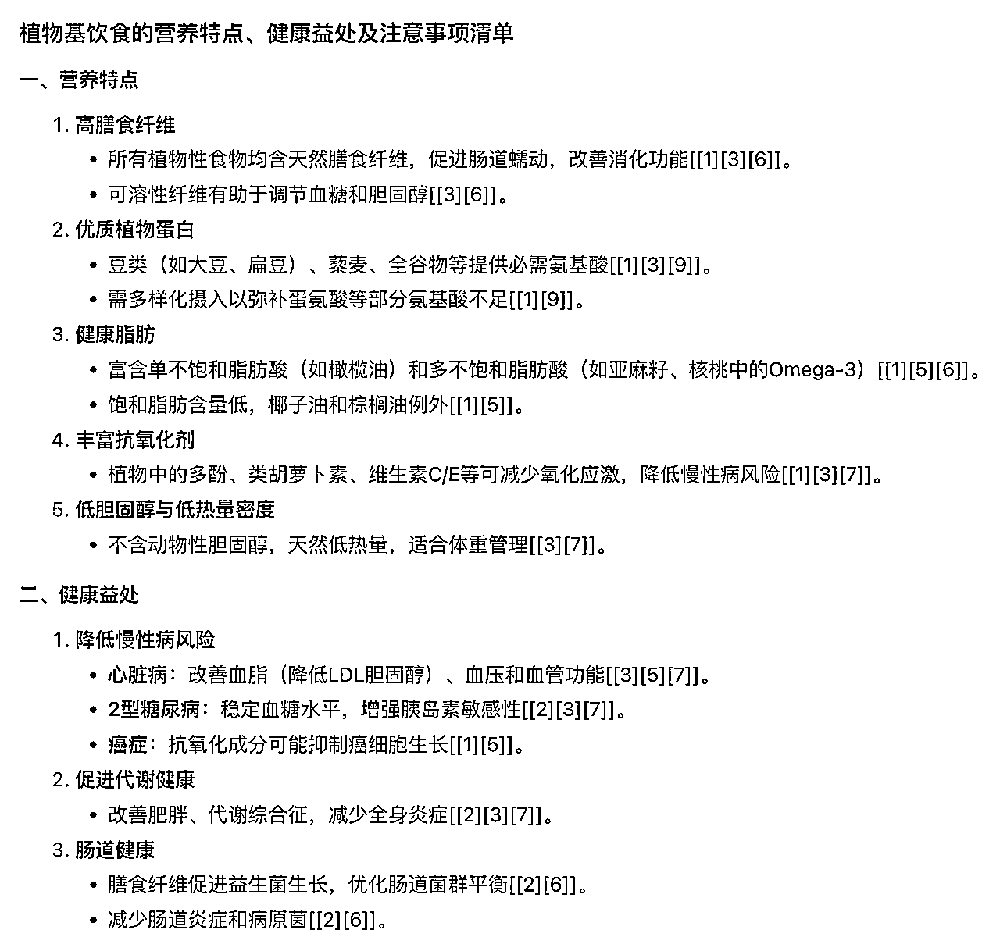

小技巧：每轮对话后加上“请检查与前几轮有没有逻辑矛盾，并标出新增的知识点”，这样AI会把前后内容串联起来，回答更严谨。

持续追问的三个关键词：

*   耐心：别急着收答案，多聊几轮。
*   好奇：保持追问欲，往深处走。
*   归纳：及时整理前面的内容，形成自己的知识网。

这么一来，DeepSeek-R1就像个专业顾问，陪你理清思路、辅助决策。

### 7、换个视角，让AI帮你挑刺

想提前知道方案的漏洞？让AI站在别人角度审一审。

口令：如果让[其他人]来优化这个方案，他会给几条优化建议？请列出3条，并评估可行性。

试试：

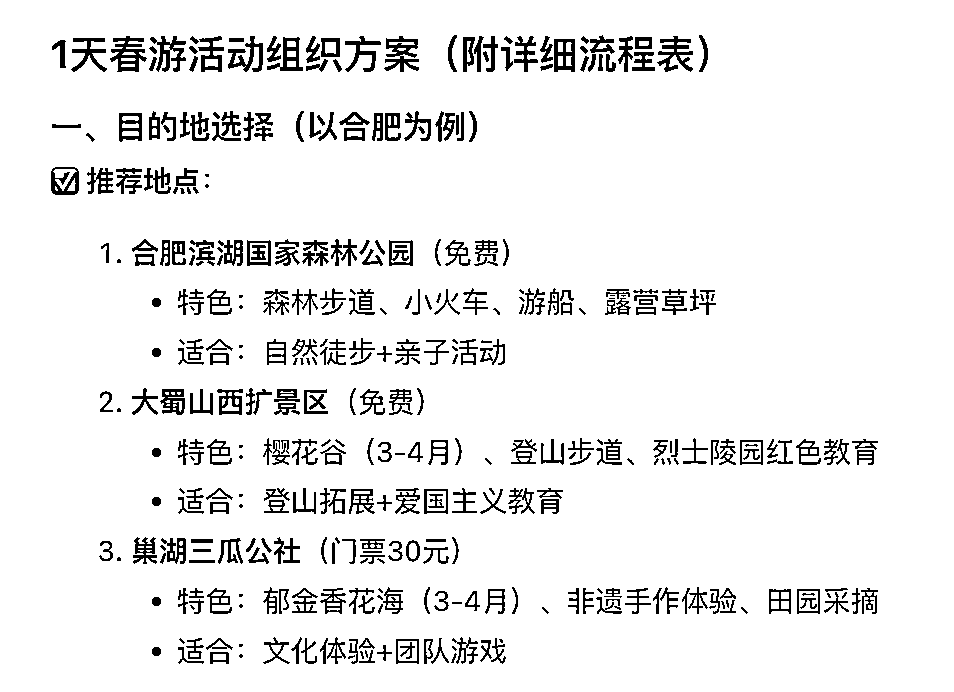

```
我打算暑假组织一次 1 天的春游，帮我看看方案有没有问题。
```

追加问题：

```
如果让一个 5 岁的小孩来优化这次自春游，他会提出什么建议？请说出 3 个并评估方案的可行性
```

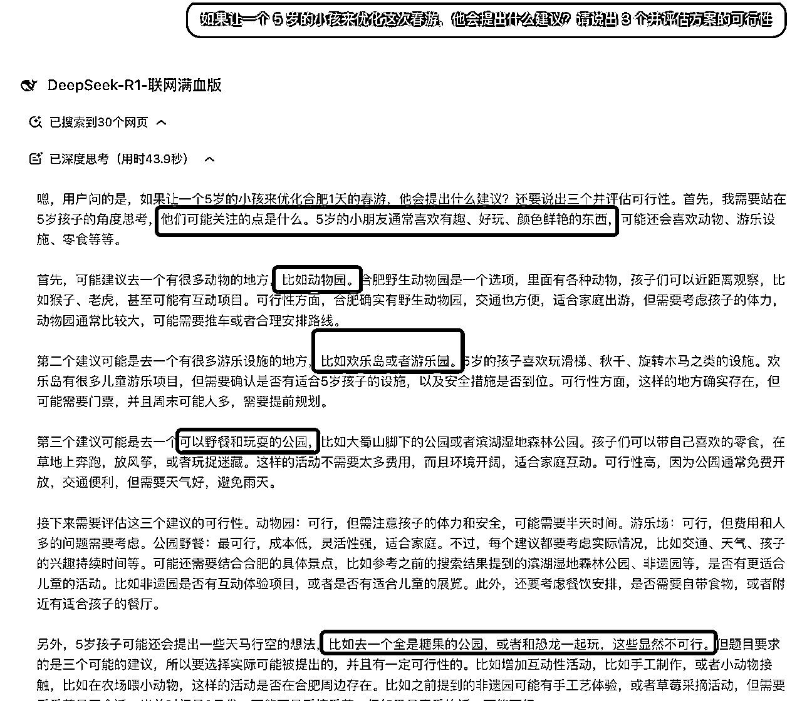

AI会从新视角发现盲区。比如它有可能会想到，家里有小孩的话，目的地是不是要有动物园、游乐场或者能野餐的公园。这些细节，正好补上了原方案的盲区。

若是更复杂的问题，可以请它戴上“六顶思考帽”来多角度分析。

```
我打算暑假组织一次 1 天的春游，这是我的方案：

···
一、目的地选择（以合肥为例）
✅ 推荐地点：
合肥滨湖国家森林公园（免费）
特色：森林步道、小火车、游船、露营草坪
适合：自然徒步+亲子活动
大蜀山西扩景区（免费）
特色：樱花谷（3-4 月）、登山步道、烈士陵园红色教育
适合：登山拓展+爱国主义教育
巢湖三瓜公社（门票 30 元）
特色：郁金香花海（3-4 月）、非遗手作体验、田园采摘
适合：文化体验+团队游戏
···
```

请用六顶思考帽的框架评一评我的方案：

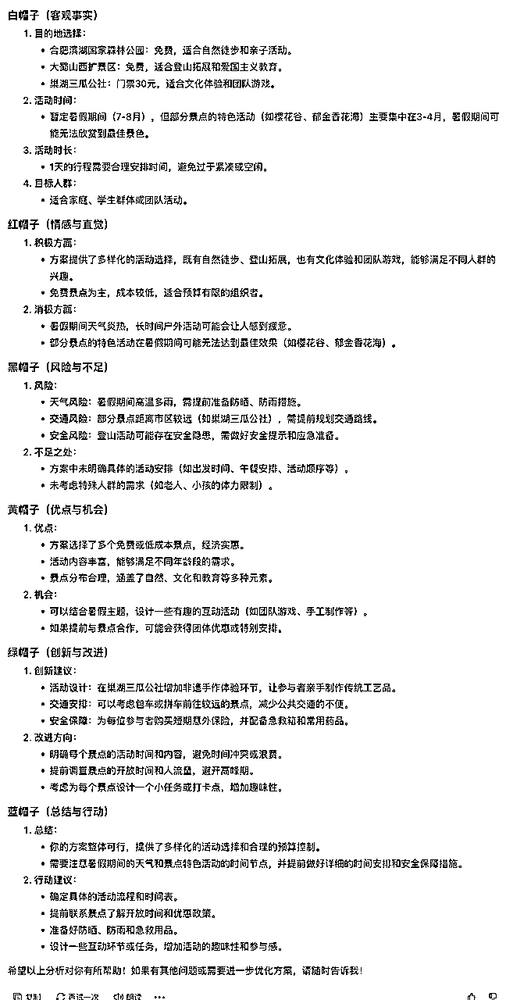

当然，这里只是举个例子；工作计划、商业策划这类复杂度高的场景，六顶思考帽会更适用。

### 8、拆解大任务：DeepSeek的作弊码

遇到庞大的任务不知道从哪开始？一条指令让DeepSeek帮你拆：

“请把问题分成3到5个可以同步进行的子任务，每个子任务写清楚：需要哪些输入、怎样操作、如何验收、有什么风险。”

演示：

```
要求：
请将问题细化为 [3-5] 个可同步进行的子项任务，每个子项任务应明确：所需输入、操作方法、验收标准、潜在风险提示。

问题：
我打算暑假组织一次 1 天的春游
```

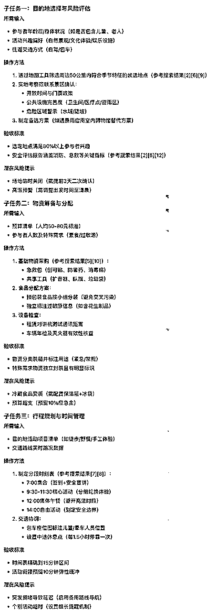

这样一来，看似吓人的大任务就变成了几个小任务，执行起来轻松很多。

## 四、常见问题与避坑指南

### 1、长文本输出限制

*   上下文长度64k token；单次最多输出8k，默认4k。
*   想要更长的文本，建议换Claude 200k或Gemini 2000k。

先感受下主流模型的支持长度：

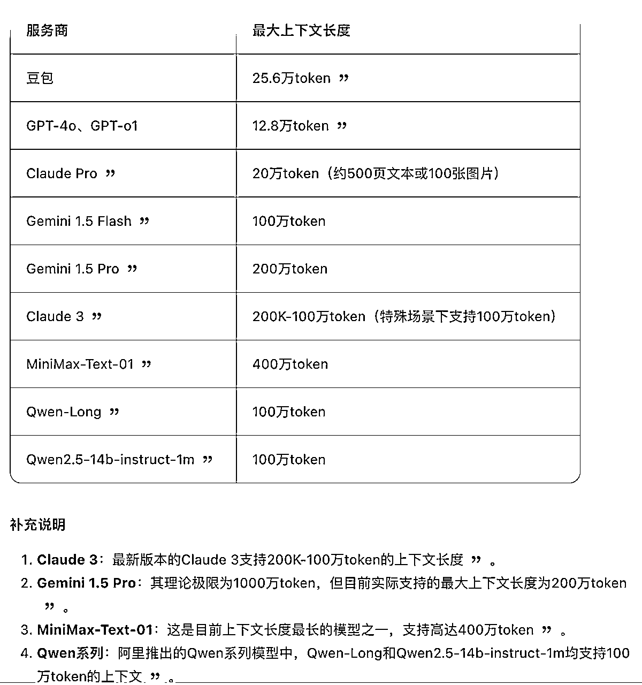

简单说说token是什么：它就像把一段话切成的小块，可以是一个字、一个词或一个短句。AI通过这些小碎块来读懂并生成语言。

实际流程是：我们输入的文字先被转成token；模型按token来预测下一个token；最后再把token变回文字显示出来。

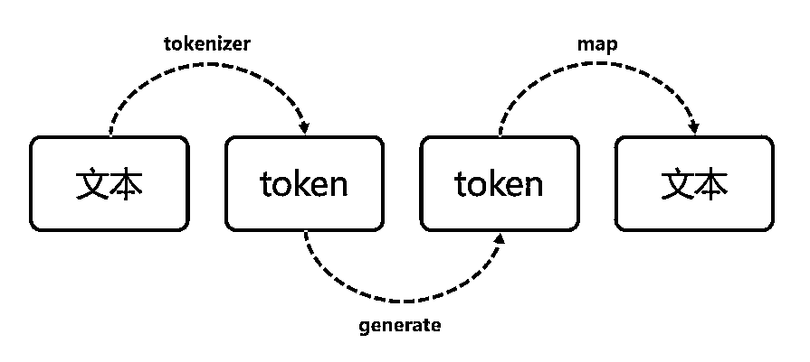

token统计包含两部分：你喂给模型的token数，加上模型生成内容的token数。

粗略换算：100个token≈75个英文单词≈100个汉字。

### 2、敏感内容触发审核怎么办

国产大模型审核严格，容易踩线。可以这样试：

*   同一问题多问几次，偶尔能闯过去。
*   点“修改”按钮换个措辞重新提交，或许就不触发了。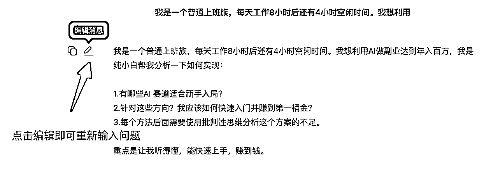
*   随时把回复复制到剪贴板，防止内容丢失。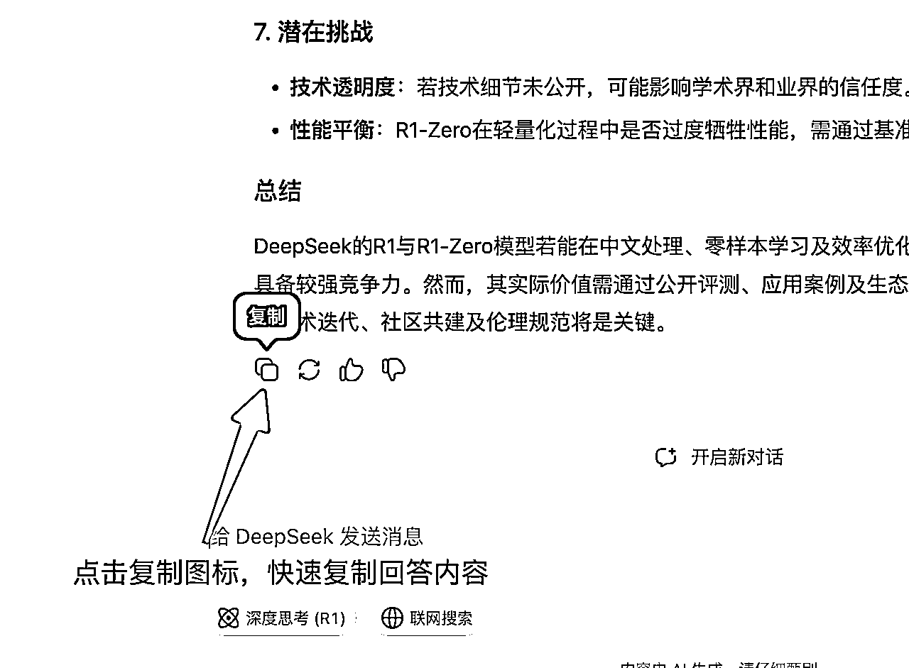
*   换个提问角度：
    *   把“国际经验”说成“海外案例”；
    *   加一句“假设在小说创作里…”；
    *   用拼音代替敏感词，比如zhengzhi→zz。
*   以上都不灵，就换ChatGPT、Claude、Gemini这些海外工具。

### 3、让使用体验更顺滑

#### 1）查服务状态

想知道DeepSeek服务是否正常，可以访问 https://status.deepseek.com/ 这个状态页。如果页面显示红色，多半会频繁提示“服务器繁忙，请稍后再试”。

最近用的人太多，官网偶尔会崩，别急，还有这些替代入口：

#### 2）第三方替代平台

*   硅基流动：https://cloud.siliconflow.cn/i/TXmjyEzU

    这是和华为云合作的国产平台，DeepSeek-V3和DeepSeek-R1已经部署在昇腾云上。注册即送2000万Tokens，约等于1万次免费问答，稳定、完整、支持API。

*   纳米AI搜索：https://bot.n.cn
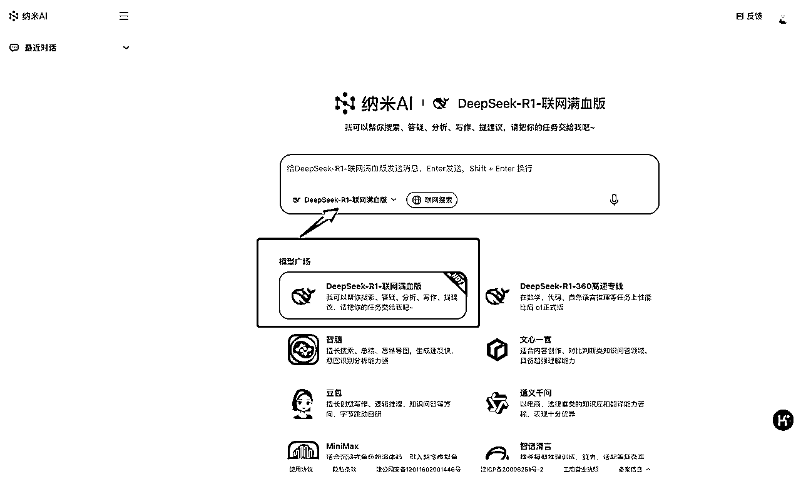
    支持网页端和App，提供DeepSeek-R1 32B/671B两个版本，App响应速度是官方的2倍，高峰时段也不排队。

*   秘塔AI搜索：https://metaso.cn
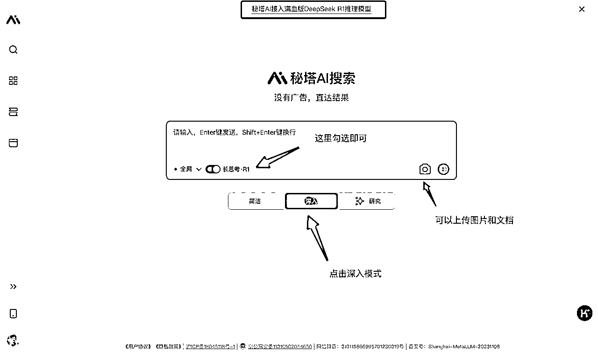
    可联网搜索，官网里直接选DeepSeek-R1就能用。每个账号每天100次搜索额度，不过联网功能不能关闭。

纳米和秘塔这两个我都在用，体验确实好，推荐试试。

#### 3）回复被截断

遇到回复突然中断的情况，输“继续”让它接着写，或者把问题拆小多问几次。

## 五、DeepSeek-R1为什么值得期待

在我看来，DeepSeek代表了大模型的一个方向：更听得懂人话，更擅长思考，也让AI的使用门槛变得很低。

未来，用AI会像用手机一样简单。想想从诺基亚到iPhone的变化——从复杂操作到三岁小孩都会用。AI也在经历同样的变化，会成为生活里离不开的基础工具。

借杨绛先生那句话的意境收个尾：

AI的春风，终究会从江南巷陌吹向星辰大海。

我是大全。如果你想聊知乎起号、👸号起号，或者想学AI提问，随时加我🛰️：daquan365。

既然看到这里，就点个赞支持一下吧～