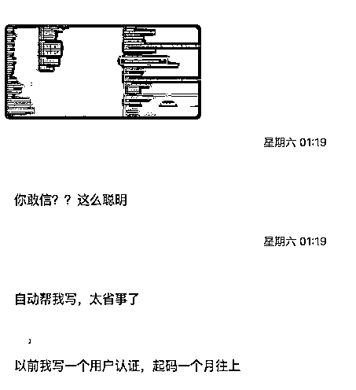

# 零代码上手！靠 Cursor + 一个工具，我把俄罗斯方块做出来了
作者：龙哥

上次聊到用 LocalIssues 来驱动项目开发，评论区有不少朋友说概念有点抽象看不太懂。所以这次我直接录了个实操演示，用最直观的方式给大家讲清楚。

先说下实际效果：

*   AI 编程群里有伙伴按照这个思路，先在项目启动前就规划好几十条甚至上百条 Issues，然后全程跟着跑通

*   还有完全没有基础的小白用户，跟着这个流程也能一步步把一个完整的应用做出来

如果你对 LocalIssues 的用法还是一头雾水，我把整段讲解视频放出来了，看一遍基本就能 get 到精髓。

工具地址：LocalIssues 请访问 https://github.com/yinwm/LocalIssues