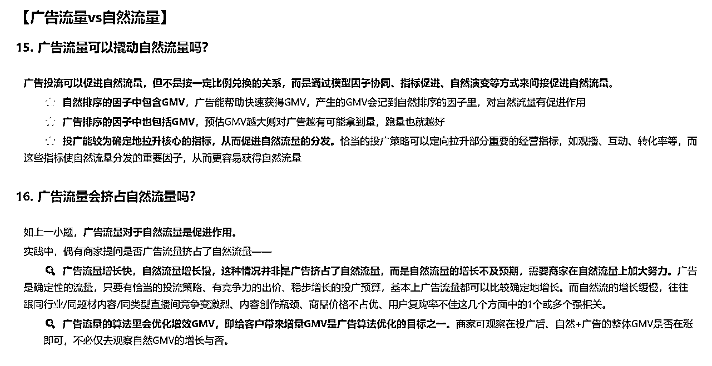
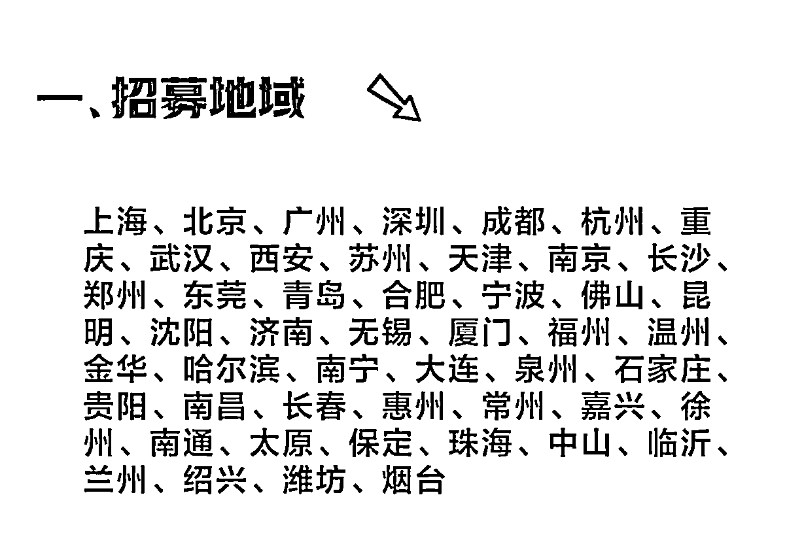

# 2025年小红书电商、投放、获客、本地生活有哪些机会？

2025年小红书还有哪些红利？电商、投放、获客、本地生活，一次讲透

各位圈友，我是更绪，00后，一直扎根小红书，做的事情无非是内容加投放，帮人拿客资、卖货，自己也跑了不少副业项目的0-1。前几天我专程去福州，参加了2025年龙哥盟福建见面会。整场下来，我的感受就一句话：赚钱团队是真的用心，活动质量完全符合我对他家的“刻板印象”——靠谱。

上午四位嘉宾的分享，刚好覆盖了做事创业绕不开的四种素质：心态、对外链接、获取信息、团队管理。这里也真心建议一句：线下活动一定要多去，尤其是赚钱办的，收获常常在预期之上。

下午茶话会我组了个局，和十多位圈友一起，围绕2025年小红书电商、投放、获客、本地生活的话题聊了个痛快。结合手里的数据和各位做业务的实际体感，下面把共识和判断做个复盘。认同的欢迎点赞，有不同意见的，评论区聊。

01 电商：目标三倍，机会仍在

先看数据。2023年小红书电商GMV大概是398亿，2024年涨到800亿左右，翻了将近一倍。抖音那边，2023年是2.7万亿，2024年约3.98万亿，同比增速46%。月活上，抖音大约10.3亿，小红书大约3.3亿，差了3倍左右。但电商GMV，小红书只有抖音的五十分之一。也就是说，单看数据，小红书的电商GMV还有16倍以上的想象空间。当然，考虑到平台之间体量和执行力的差距，理想化的倍数不现实，但增长个3到5倍完全有戏。所以小红书自己把2025年的目标定在2000亿到3000亿之间，差不多就是奔着3倍增幅去打的。

我的结论很直接：2025年小红书电商至少还有3倍增长，但竞争激烈程度不会同步放大3倍。所以不管你是做无货源、虚拟电商，还是手里有自营货盘，现在进场都能搭上平台增长这趟快车，跟着起飞。

再看平台近期的动作，我的体感就两个字：正规。从店铺注册流程、商家后台UI改版，到资质要求更新、投放工具“乘风”的优化，再到各种漏洞修补，全都能看到“正规化”的影子。虽然整体还是有点潦草，但小红书想把电商GMV做上去的决心，是摆在明面上的。2000亿到3000亿的目标，不是喊口号，3倍增长也不是吹牛，平台确实在真金白银地发力。

直播这块也值得说。目前小红书电商大盘里，直播销售占比超过60%，笔记和视频约占30%。但小红书的直播，跟抖音那种直接拉起流量带货的成熟模式不同，更多是靠笔记把客流引进直播间，再由直播来做转化收口。所以，在小红书做电商，只要你有直播条件，能开播就一定开播，数据告诉我们，开直播能让销售额提升大约2倍。尤其是有自己货盘的业务，用“直播+轻人设”的路子，GMV提升会非常明显。

02 投放：聚光跟投不亏，乘风还需等待

聚光是2023年5月开始全量公测的，到现在一年零八个月，攒下了大量用户数据，功能也相当完善，可以说是一个非常成熟的客资投放工具。虽然进场的人一年比一年多，蓝海红利没以前厚，但跟红海还差得远。从我们操盘过的不少行业来看，同行变多，无非就是获客成本慢慢涨一点、利润空间被压薄一些，亏钱的情况很少见。

所以，只要有资质，有同行在投聚光，直接跟着投就行，基本不存在亏钱的可能。特别是客单价高的行业，根本不用太精细化的策略，预算花得出去，就不会亏。退一步说，聚光投放还能撬动自然流量，就算保本投放，也等于在赚。

乘风就要另说了。它是2024年9月才开始全量公测的，刚出来那阵子确实糙得不行，就像把聚光的电商板块硬拆出来一样，投放效果也是一言难尽。当时我们讨论后的一致看法是：本质还是小红书电商GMV太低，用户的电商行为少，数据没沉淀出来，人群画像不够精准，投放效果自然拉胯。现在这个节点，比刚上线时好了一些，但也只是好“一些”，离理想还很远。

不过随着GMV增长、电商用户增多、数据越攒越厚，再加上乘风工具本身持续迭代，预计等小红书电商GMV做到抖音的十分之一时，乘风投放会迎来真正的好效果。现阶段，如果做乘风能保本，那也可以放心投，因为投放能撬动自然流量，这个结论不只来自我们的实测，官方在最新版的乘风投放手册里也给了同样的答案。官方的结论直接看：

详细的乘风投放手册自取👉doc.weixin.qq.com

03 获客：投放别慌，矩阵废号流依然能打

2025年的投放获客，大概率会进入一个平稳期。不管是工具还是竞争环境，都不会有特别剧烈的波动；获客成本会缓慢往上走，但不会有明显的跳涨。该进场的，基本都进场了。所以完全不用被“红海”“越来越卷”这些词吓住，大多数人都和你一样在观望，真正下场的永远是少数。只要你的行业里有同行在投，你就跟着上，早投早受益，晚投少赚钱。

另一条路线，是矩阵废号流获客。这段时间平台确实出手了，封了一大批内容同质化的矩阵号，还出了新规，要求必须通过专业号的私信工具留联系方式，目的就是打击白嫖平台流量的行为。这些动作，确实对白嫖党构成了不小的威慑。但影响真没那么大——这套玩法本质上就是跟平台规则做对抗、在夹缝里拿流量，特别适合那些不支持投放的类目。限制变多、打击变严，无非是效率降低一点、转化率波动一点，上有政策下有对策，从来如此。

核心永远记住：内容才是撬动客资最好的支点。找到一套好用的获客模板，批量买号，配合矩阵工具批量发内容就行。平台管得严，影响的顶多是转化率数字。这个操作本身一点都不复杂，偏偏有些人把简单的事情搞复杂，还发明了一堆新名词。如果有需要，评论区留言，我后面专门出一篇详细的教程贴，让简单的事回归简单。

04 本地生活：探索期的蓝海，值得提前卡位

2024年9月，小红书开放了全国49个一二线城市的本地生活团购，覆盖城市如下：

从用户心智来看，小红书天然适合做本地生活——“你的生活指南”这句slogan不是白叫的，用户本来就带着“找好吃好玩好用”的目的来逛。但以这家公司的调性来说，这块业务要快速铺开，恐怕没那么容易，毕竟内部离成熟体系还有距离，想围观小红书团队的内部状态，可以翻翻脉脉那篇《复盘“小红书病”》。

我的结论是：2025年小红书本地生活还处在探索期，竞争相对蓝海，判断可以先入场。最简单的打法，就是把美团上一些小众类目直接搬过来。如果你本身有线下实体业务的盘子，那更不用犹豫，直接进场，配合聚光投流，是个不错的方向。

复盘到这里就差不多了。最后再次感谢龙哥盟团队，线下聚会在办，以后更要多多地办。线上聊一千遍，真的不如线下见一面。