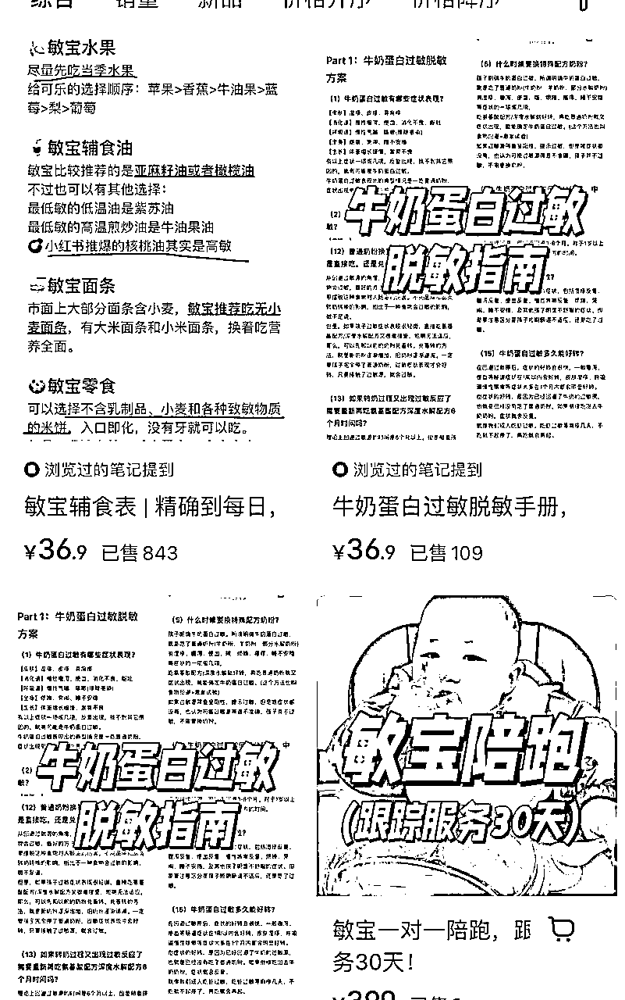
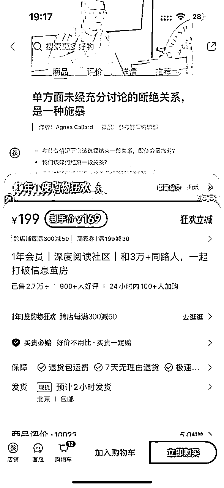
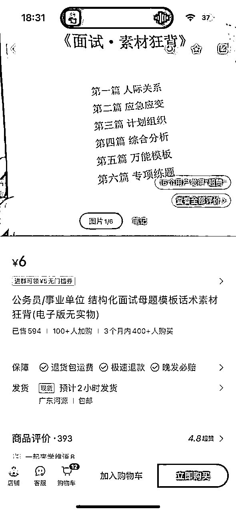
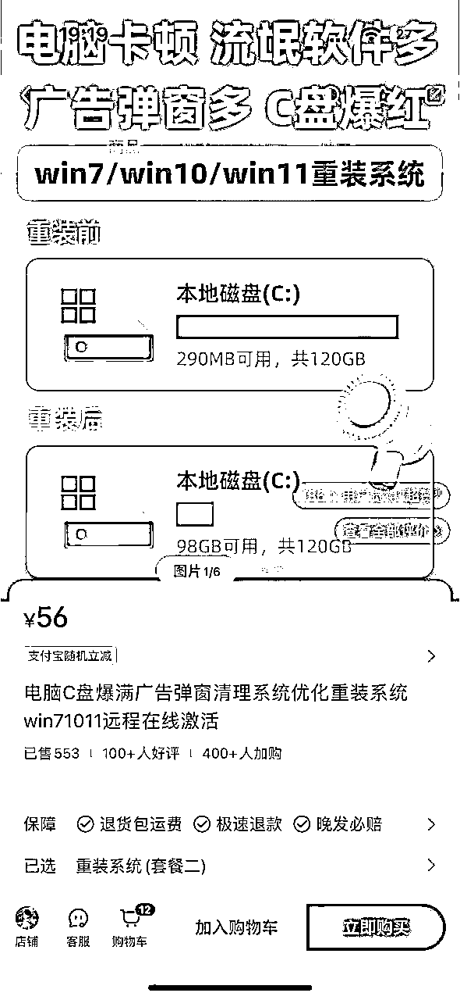

# 1年卖了2000多单数字产品，作为普通人的我1.1w字复盘

一年前，我开始尝试在互联网上做那类被叫做“知识变现”的事，但说实话，我更愿意管它叫“数字内容生意”。回头看看这整年，我真觉得自己没什么特别的——不是名人，学历普通，没在大企业待过，履历放在人群里基本看不见。但就是这样平凡的我，在过去12个月里卖掉了将近两千份虚拟内容产品。

我相信自己能代表一个群体：和我一样资质平平、毫无精英加身的那些普通人。我们究竟该怎样在网络世界里，赚到那些职场条条框框之外的钱？下面是我的完整复盘。

**01 专业门槛是假象，你能解决具体问题才关键**

太多人脑子里有个顽固想法：想在这行赚钱，必须修炼成专家，粉丝成群，才有资格谈变现。但现实根本不是这样。

虚拟产品的核心逻辑其实很简单：你不需要在所有事情上都很厉害，只要有一批人愿意为某个特定问题掏钱，而你恰好能解决——哪怕你只是比他们多懂一点点。你要做的事就两步：第一，找到这个足够细分的需求点，并且在这件小事上确实比目标用户更懂；第二，把解决办法整理成能卖出去的东西。

至于产品形式，别被传统观念束缚。很多人一想到卖东西就以为是卖课，那是应试教育留下的条件反射。课程当然有它的价值，但对普通个体来说，做一套完整课程意味着海量时间、精力和资源投入，不现实。虚拟产品的最小形态，完全可以是一份简历模板、一张30天不重样的食谱、甚至某篇外文文献的翻译稿。别嫌东西小——中文互联网的盘子足够大，再偏门的需求也能找到足够多的受众。

**02 动笔前，先盘点你手里有什么牌**

新手最容易犯的错就是一上来就找对标、抄同行。但真正该做的第一件事，是安安静静坐下来，放下所有偏见，把自己从头到尾审视一遍。

我见过不少博主，表达能力其实很强，但因为没有想清楚自己的优势在哪里，就贸然冲进一个完全陌生的领域，最后悄无声息地放弃了。想在📕这类平台做虚拟产品，前期最重要的功课就是梳理自己的资源、找到自己的生态位。

为什么这两步如此关键？因为如果你不先搞清楚自己手里有什么牌，后面一定会陷入“不知道发什么”的困境。打个比方，假设你是个资深HR，却非要去挤美妆赛道——HR才是你的主场，你过去的经验、案例、方法论全都在那儿，写起来自然不费劲，选题源源不断，起号轻松得多。你做的事情，本质上只是把过去积累的东西搬上新媒体。这样的内容鲜活又有说服力，平台和用户都愿意买单。等账号立住之后，再顺势推出配套的虚拟产品和服务，商业闭环自然就转起来了，你也从打工心态切换成了老板心态。

具体怎么盘？先问自己几个问题：有没有哪件事，你从零做起、中途遇到不少坎、但最后还是做成了？这件事你是不是特别想讲给别人听？讲出来能否帮到别人？这些问题的答案就是你挖不完的素材库。但有一条硬标准：这个经验必须“利他”。如果只是自己很爽、别人用不上，那既难引起共鸣，也做不成生意。

讲几个目前仍有红利的典型场景。

先说宝妈方向。有人可能觉得，这个人群还有空间吗？我们回到那个原则——“把经验碎片变成别人的必需品”。第一次当妈的人太多了，辅食怎么做、宝宝生病怎么处理，全是焦头烂额的问题。你经历过的坑，就是新妈妈的刚需。把自己养娃五六年攒下的那些“生活算法”——怎么判断过敏、怎么安排辅食、什么情况要去医院——整理出来，就能打包成产品。

真正的竞争力，往往藏在这种地方：没有被数据化的生活经验、跨领域的认知迁移、以及从痛苦经历里熬出来的解决方案。你回想一下当妈这些年，是不是积了一堆这种“没人教但很有用”的东西？除了妈妈这个身份，你还有别的角色：做过HR、考过研、上岸过考公、拿过证、装修过房子、甚至从大厂被裁员后成功转型……每一段经历，只要拿到过结果，都值得被记录下来。

每个角色背后都对应着一套知识体系和靶点痛点。把显性的和隐性的痛点拆开，生活经验就能变成可售卖的商品。当然，整理出来的东西必须具体、鲜活、成系统，不能是泛泛而谈。

举个真实例子。📕上有个宝妈做“过敏宝宝辅食表”，定价36.9元，卖出了800多份；接着又出了《牛奶蛋白脱敏手册》，卖出100多份；还有一对一咨询服务，185人买单。

是不是很直观？就抓住“过敏宝宝”这一个点，衍生出好几个产品，数据都很好看。所以当妈的人，要学会在带娃过程中刻意记录问题和解法。

“但我经历不够丰富怎么办？”这是很多人第二句会问的话。那就去借力——大量加相关社群，👸号读者群、行业大V的讨论组、宝妈育儿交流圈，看大家每天都在为什么焦虑、反复问什么问题。那些提问，就是你做产品最好的原料。再加一道：刷📕，目光专门盯求助帖和评论区的问答，特别是高赞发言，那都是真实需求的声音。

另一个方向是职场。泛泛的职场技巧（怎么做纪要怎么跟老板汇报）受众广归广，但竞争实在激烈，早已有不少专业玩家在场，并不适合新手切入。更聪明的做法，是“具体行业+个人优势”的组合。

具体有两种玩法。一种是靠资源沉淀：每个行业都有自己独特的方法论和资料包，比如广告行业里的方案模板、报价表格、行业报告。我看过一些粉丝量不高的博主，就是靠卖策划表格卖了几百份，还有卖报告和模板的，成绩也不错。这类产品拼的是你有没有刻意积累过不同场景下的文件——比如活动策划的表格、年终汇报的PPT结构、特定节庆的PSD素材。关键是让用户一眼就联想到某个具体使用场景，产生“我现在正需要”的感觉。如果只是一堆文件孤零零放在那儿，很难激活购买欲。

另一种玩法是经验封装。不需要你什么都懂，某个切面足够准就行。我曾经花三天时间整理了一份“广告人作品集制作思路”，本质就是把我在这个细分问题上的经验沉淀成文字，最终也卖出了300多份。它的逻辑和宝妈案例完全一致：一个切面，精准解决一类问题，形式可以很短，但必须有用。

**03 公开表达，是普通人最划算的信任积累方式**

社交媒体上，不表达就等于不存在。这句话基本可以概括“Build in public”的价值——它同时解决两件事：让更多人看见你，以及让别人相信你。

中文平台五花八门，但门槛差异很大。我比较推荐新手重点经营两个：微信👸号和📕。两个都可以承载图文内容，👸号适合长文深度输出，📕适合轻量短文快速触达。对你来说，更关键的是这两个平台目前的推荐算法对新人相对友善，只要你的内容足够扎实、网感和写作技巧在线，找到第一批受众并不难。

公开表达还能帮你积攒信任。你有一个账号，账号里的每篇内容都是证明。一个用户可能从某篇笔记认识你，顺手点进主页翻了其他几篇，觉得你确实有两把刷子，于是点了关注。某天你发出一个产品，正好戳中他的需求，下单就显得很顺理成章。

内容有很强的长尾效应。你发布的东西不会消失，它们会不断被翻出来、被看到。你留下的内容越多，滚的雪球就越大。所以，不必太在意一篇笔记发出去石沉大海，给时间一点耐心，回报可能在未来某个时刻超预期。

**04 写得不好？先写起来再说**

阻止很多人动手的，往往是“我怕写不好”的心理。这个心理的来源可以追溯到学生时代——800字的作文，太吓人了。

但社交媒体写作的门槛和规则完全不同。它不需要文采飞扬，只需要你把一件事讲明白：怎么搭建一个Notion页面，怎么整理一个表格，怎么给作品集排版——把你知道的、验证过的方法，用大白话说清楚就行了。

也不必非要走文字这条路。拍视频、录播客都是表达，每个人适合的方式不同。前期可以多试几种，找到自己顺手的那个，再持续深耕。

**05 别做一锤子买卖，把产品长成体系**

我一开始做的时候，思路也很线性：搞流量、做产品、卖出去，完事。这套逻辑本身没错，但结果往往就是“一次性生意”——辛辛苦苦做内容，最后只换来一单交易，没有围绕顾客的长期价值做文章。

更聪明的做法，是做“人群生意”，不是做“单次产品生意”。你把第一个产品卖给用户，本质上是你和他完成了一次初步信任的交付。如果之后就不再出现，那这段关系就断了。有复购、有后续的生意才值得做。很多项目表面GMV很好看，但流量全靠买、利润薄得可怜，最后只是虚假繁荣。

怎么理解“体系”？我自己的路径是这样的。最初做📕专栏，并没打算建群——怕麻烦，也怕自认没经验。后来发现太多付费读者主动来问“有没有群”，于是才下了决心建。这是我的1.0版本：专栏+群。再到后来，这群本身变成了产品的一部分，在做宣传的时候，也直接把它作为卖点：你买的不仅是专栏，还附赠一个同频交流的圈子。

社群还有一个巨大的好处：信息和灵感的密度极高。大家碰撞出来的点子，单独靠一个人是想不到的。就比如在📕引流这件事，群里贡献过的有效策略就有十多种。

不过我也踩过坑：建群初期没做人群分层，也没想清楚以后必然会扩张这回事，500人的上限一下子就满了，后来的读者根本进不来。这里想提一个“邓巴数”的概念——150人以内的群体，每个人表达起来都更自在，互动质量更高。人多到500，新人融入难，老人也会因为人多而不想说话，输出量自然就降下来了。所以合理做法是建多个小群，让各群人数保持均衡。当然，这前提是你的流量和产品能力扛得住，不然群建好没新人进来也是白搭。

后来我又发现一个痛点：📕的行业资料，尤其是月报，其实每月都在更新，但大多数人都不知道去哪儿找。有些信息明明免费，却有人拿它卖钱。于是我在社群里搭了个共享知识库，专门更新热门笔记、平台动态、官方课件和报告，偶尔也把自己的公开分享放进去。现在这个库反而成了引流入口——每天有上百人访问，累计浏览已经超过1.1万。从专栏到社群到知识库，这条链路是我一开始完全没想好的，是慢慢“长”出来的。现在它不需要我刻意推广，也会每天带来自然咨询。非要说原因，大概就是因为它完全公开，人人都能用。

很多人做知识生意，坚持不下来。要么交付烂尾，要么内容断更，最终放弃。我想，原因很可能是他们的动作是完全利他、没有利己的，长期得不到金钱正反馈，就丧失了动力。我之所以能持续，首先因为我本身就是📕重度用户，写东西不算折磨；其次，这1000多篇笔记发下来，正反馈始终在累积。当然，更重要的还是内心自洽——你得相信它最终能成，才能撑过那些没有声响的日子。

**06 虚拟资料并不是数字产品**

不少人把这两者混为一谈，但它们的底层逻辑完全不同。

先说的是虚拟资料。它们往往不是自己原创的，而是从网上东拼西凑整合出来再打包出售。这种模式在早期可能靠信息差赚到点钱，但因为没有门槛——你找得到，别人也能找到——很快就会陷入价格战，整个市场内卷得厉害。更麻烦的是，如果这个领域你自己并不真的懂，就很难做深，最后只能别人卖什么你跟着卖什么，变成“照葫芦画瓢”。比如你硬做K12教育资料，你虽然上过学，但你对今天的教学大纲、考试政策又能理解多少？没理解，就只能模仿表面。

数字产品则不同。它不要求你一定亲自原创，它的关键是真正解决了一部分人的问题。就算你是“整合者”或者说“信息买手”，只要整合出来的东西真的解了用户的燃眉之急，它就有价值。

举一个典型的例子：📕上有个叫“参考阅览室”的知识库产品，销量已经过了2.5万份。它就是通过内容策展的方式，将国外优秀的信息源整合、翻译并结构化呈现。它的成功直接证明了内容策展这种模式的价值。当然，模仿者也来了，也有不少模仿账号获得了不错的点赞数，但仔细看实际成交数据，其实不尽如人意。

为什么？我认为“参考阅览室”已经建立了自己的壁垒——先发优势叠加2.5万+的销量。对大多数顾客来说，一个价格不高的产品摆在面前，最能传递安全感的就是销量数字。销量本质上是信任度的量化凭证。所以我给新手的建议是：前期别拼单价，拼销量。哪怕自己让利，先把量起上去，让你的“信任积分”滚起来，之后再推高客单价产品也更容易成交。

至于怎么学“参考阅览室”的做法？它验证了一件事：用户愿意为高质量信息付费。那把这个思路平移到一个更垂直的行业里，是不是就开辟了新战场？比如运营人有没有知识库需求？产品经理呢？考研党、考公党呢？工具的普及成本已经极低，Notion、飞书随随便便就能上手，去做一个垂直人群的知识库，长期来说既帮自己也帮别人。

简单总结一下：
1. 虚拟资料门槛低、竞争血腥，能跑就要快跑，别恋战。
2. 数字产品不一定要求你原创，解决问题是硬道理。
3. 数字产品的构建难度更高，但天花板也更可观。

**07 少啃方法论，多拆案例**

方法论这个东西，容易让人上头。它会把世界写得特别顺畅：沿着步骤走，你就能成功。但你读着爽完之后，真正下场试，你会发现每一步都充满书上没写的意外——比如理论告诉你怎么做矩阵号之间互相导流，实操时你光要解决“手机号不够”“实名认证卡住”“营业执照去哪儿办”这些鸡毛蒜皮就已经焦头烂额。

我不是说方法论没用，它有价值，但价值更接近“辅助驾驶”，真正握方向盘的时候，还得靠自己的判断力。那些真正的“实操智慧”很多时候很难用文字准确传递，但它其实是最关键的部分。

那怎么找需求、找优势、找机会？答案很简单：去看正在发生的事。案例是鲜活的，正在发生的案例说明需求是“当下真实存在”的。想做虚拟生意，你就可以直接去扒📕销量最高的前10个商品，再倒推对应账号的内容策略——笔记角度、标题写法、封面设计、文案结构、关键词埋放和成交引导。我当时也特别想知道什么类型的笔记能火、什么内容的转化率高。刷了无数篇后，我发现一个规律：“粗糙感”。把一个产品目录直接打印出来，用手机随手一拍，要的就是这种略带回声的、类似“私人真实截图”的感觉。这样的封面，恰恰因为“不完美”，反而比精修图更具信息浓度和真实感，点击率往往出奇地好。

记住：观察案例的要点是“带入现场”。深处的门道，身在局中的人根本来不及写出来，你得自己去看、去抽离、去总结、去复用。方法论适合解决被精确描述出来的难题，比如刚才说的手机号、执照这些具体问题；而不是用来学那种“如何做好📕”之类的宏大命题。

**08 低客单价与高客单价：一个先开后深的关系**

这两个概念看似对立，其实是先后关系。早期你没有信任积累，就可以用低客单产品作为接触点，让最多的人以最低的成本体验你的价值，快速积累销量和口碑。这个阶段的目标不是利润，是信任积分。当你攒下一定数量的忠实用户，再推出高客单服务——一对一咨询、训练营、深度陪跑——就水到渠成了。低单价负责连接，高单价负责深化。

一句话总结：别盯着自己手里的那一单生意。你要经营的，是那个从你这里持续买东西、持续得到帮助的人。让同一个人反复为你买单，比不停寻找下一个新客户要重要得多。

这就是我这一整年走下来最深刻的体会。希望这份复盘，能给同样普通的你带来一点参考和向前走的勇气。

很多人以为，高客单价和低客单价是两条路，只能二选一。实际上，它们完全可以服务同一群人。

一个常见的误区是：总想着做一次性买卖，于是拼命推高价服务。结果呢？每次都要费尽口舌解释产品价值，转化一次累到不行，用户还未必买账，情绪价值也几乎为零。

换个角度想：如果你卖一个低价产品，用户愿意下单，就意味着他第一次信任了你。这时候，你把他加到微信，就相当于沉淀了一个潜在的高价值客户。接下来，你持续发朋友圈、持续输出专业内容，逐步建立信任，就能把他慢慢转化为高价产品的买家。

所以，从获客角度看，低价产品本质上就是一种引流工具。如果你的利润产品是高客单价的，那么完全可以走“低价获客、高价转化”的路径。

一句话总结：搭建数字产品体系时，低客单和高客单的合理配比，才是最高效的打法。

## 01 定价50元以下，最好卖

如果你不是大名鼎鼎的KOL，也不是圈内公认的技术大牛，就别把产品价格定得太高。价格一旦上去，而你还没有足够的信任背书，用户下单时就会犹豫很久。

所以，你需要思考的是：怎么让产品在不需要你反复解释“它有多好”的情况下，用户就愿意买单？根据我的观察，定价50元以下的产品最好卖——比如19.9元、39.9元这类。

我访谈过不少买过我产品、但并非我粉丝的用户。他们中有相当一部分人的下单逻辑是“逛着逛着看到了，顺手就买了”。如果你的产品定价太高，对这些非粉丝用户来说，下单阻力就会明显增大，很可能直接流失。

如果你想把产品卖给非粉丝人群，并且希望他们轻松下单，那就必须做两件事：一是认真设计你的定价策略；二是在社交媒体上持续表达，扩大自己的知名度。说白了，就是build in public，让更多人看见你、认识你、信任你。

## 02 📕，为什么是数字产品的首选平台

如果你是新手，📕几乎是最友好的起点。为什么？因为📕的用户画像非常鲜明——聚集了一大群爱学习、付费意愿强、而且事儿少的人。

就凭这一点，📕就是最适合做数字产品的地方，几乎没有之一。

而且📕的算法对新人很友好。只要你专业积累足够深厚，做一个账号，在里面搭建起你的数字产品体系和内容体系，就能形成有效的商业闭环。

更不用说，📕还为站内商家提供了乘风、千帆等推广工具，可以让你持续触达那些有购买意向的用户。所以，如果想做数字产品，📕是绕不开的最佳阵地。

## 03 在核心课题里，找到你的利基市场

数字产品是有生命周期的。什么意思？

在内容蓬勃的互联网知识付费市场里，各种数字产品层出不穷，但很多很快就过时了。对个体来说，辛辛苦苦开发的产品如果迅速被淘汰，综合性价比其实很低，也违背了纳瓦尔说的“边际成本为零”的优势。所以，开发数字产品之前，一定要考虑它的生命周期。

举个例子：你耗费心血做了一门《微信👸号运营笔记》，可现在根本没人买。为什么？因为它过时得太快了。它不是核心课题，只是一种中间态的知识，很容易被更新替代。

那什么不会过时？写作。从小到大，写作需求永远存在，这就是核心课题。

再延伸一层：如果你开发的是《社交媒体写作课》，教大家在不同平台写内容，那它一定比只教👸号写作活得久、生命周期更长。因为写作是核心课题，社交媒体也不会消失，这个产品就几乎不会过时。

你会发现，互联网上长期畅销的课，往往是最基础的课——口才课、演讲课，甚至教人唱歌的课都能卖爆。

除了这些，还有很多利基市场：健康、个人成长、职场、升学考试……几乎是每个人的核心课题。

想让产品拥有永恒的生命力，你要做的就是在核心课题里找到属于自己的利基市场。

问自己两个问题：在这些核心课题里，你擅长什么？你擅长的部分，能不能体系化地梳理出一套方法论、技巧、SOP、模板或知识库？

比如，有人特别擅长考试，尤其是考公。那他就可以开发考公领域的数字产品。📕上这类产品特别多：有人整理面试话术，有人整理必备素材，都是数字产品。他们可能没在公务员考试中拿到什么显赫结果，但他们很会总结需求，也是很好的产品经理，所以就能持续开单。

总结一下：如果想开发一个能“一劳永逸”的数字产品，关键要看两点。第一，它是不是核心课题——这个领域里要有大量细分的需求，包括已经被挖掘和还没被挖掘的。第二，你在这个核心课题里能不能找到利基市场。

什么是利基市场？就是你的擅长、你的优势所在。在这个领域里，你没有对手；你永远有源源不断的干货和经验积累；你在这个领域里表达起来毫无压力。

## 04 别用精英视角去猜需求

我经常听到有人说：“这居然也能赚钱？”

会发出这种疑问，归根到底，是因为我们习惯从自己的视角去找需求——比如，假设自己是消费者，我会为什么产品付费？

但问题是，每个人的背景不一样，对需求的认知也不一样。你可能觉得某件事很简单，但对方因为没你那么优秀，就是解决不了。

他想完成某件事，就会有卡点；有卡点，就有需求。这时候，产品和服务就有了存在的意义。

所以，你要思考：在你的职业和擅长里，有没有一些场景能帮用户解决卡点？这些事对专业人士来说也许小菜一碟，但对普通人来说，就是一道门槛。

举个最典型的例子：C盘清理。

清理C盘看起来人人都会，但对很多小白来说，这真的很难。当然，花点时间百度一下，或者去📕搜一搜，肯定能找到详细教程。可为什么他们不自己学呢？

因为要考虑学习成本、时间成本，还有紧迫程度。很多人付费的触发点，是“我马上就要解决这个问题”。他们不是不能学，而是时间不允许、太着急了，所以宁愿找专业的人来帮忙。这时，付费需求就顺理成章地产生了。

## 05 真正有价值的情报，只能靠自己

真正能让你赚钱的机会，没有人会告诉你。如果某个机会被大张旗鼓地宣扬，那要么是红海厮杀，要么是知识付费的陷阱。

想做好📕，你需要亲自去刷📕，而不是只看《如何做好📕》之类的教程。刷久了，你自然会对爆款形成自己的认知。

还有一个地方特别值得看：评论区。尤其是一些高赞评论，基本代表了一类人的真实需求。如果你想卖数字产品，就去刷热销商品笔记，看别人怎么发笔记、怎么写文案。

再比如，你是个设计师，想开发自己的数字产品，最好的办法就是去看同行在做什么、小白在关注什么、付费用户在买什么。

只有这样，你才能拿到真正有价值的情报。

## 06 deepseek，如何成为你的数字产品外挂

我用过不少AI大模型，在中文表达和语言精准度上，表现最好的是claude和deepseek。但claude使用门槛高，还容易封号。

deepseek的出现，补上了这个短板。几乎谁都可以用，非常方便。

那对📕玩家来说，deepseek到底能怎么帮到你？

**第一，大幅提升内容生产效率。**

deepseek能解放一个人的内容生产力。以前，很多人只够精力做一个账号；现在，deepseek能轻松帮你搭建起个人📕矩阵。

一个人至少可以运营3个📕账号、开3家店铺——比如你和爸妈，每人一个。具体怎么操作？把你大号上已经被验证过的爆款内容、标题、选题，交给deepseek做二次开发。

举个例子，你可以把标题和选题发给deepseek，提示词可以这么写：

“目前我想做📕矩阵账号，但账号内容丰富度不够。这个标题是已被算法验证、数据较好的标题，希望你能基于它再延伸出20个变形标题，字数控制在20字以内，并给出理由。”

可能它第一次给出的答案不尽如人意，但没关系，你可以不断深入提问、优化，从目标受众、行业、痛点等各个角度去追问。

这就是📕矩阵账号的内容生产思路。

**第二，加速单个虚拟产品的落地。**

很多人都有一个idea，但具体落地时细节不够、没有骨肉。说白了，就是思维发散不开，总卡在第一步。

deepseek的优势，就是能帮你先做出一个粗糙的产品，让你尽快跑起来。同时，它还能帮你打开思路，解决卡点。

比如，我想做一份“广告行业阿康求职宝典”，我有了最初的想法，但不知道该怎么落地。这时候，我就会问deepseek：

“我想写一份广告行业的阿康求职宝典，在📕上售卖，配合我的内容带来曝光，吸引潜在买家购买。你能给我内容上的建议，以及这个虚拟产品（以PDF形式呈现）的内容逻辑建议吗？”

提问时，说清楚背景、目的、需求，以及你期待它帮你做什么。问完之后，deepseek会给你一个相对完整的框架。你基于框架再做后续调整，一个相对专业的数字产品就能落地了。

## 最后，说点掏心窝的

为什么我建议每个人都去试试做数字产品、在📕上构建自己的小生意？因为它是普通人能接触到的、少有的真正零成本创业。

你可以亲身感受“一份时间卖出多次”是什么体验，也能看到——除了打工之外，你的人生还有另一种可能。