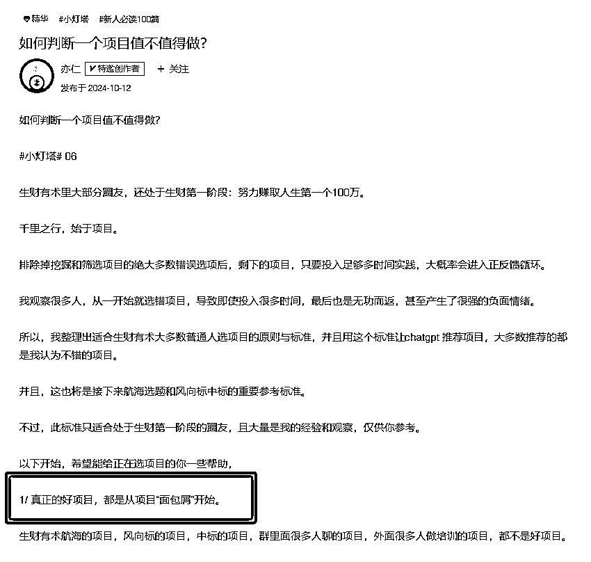
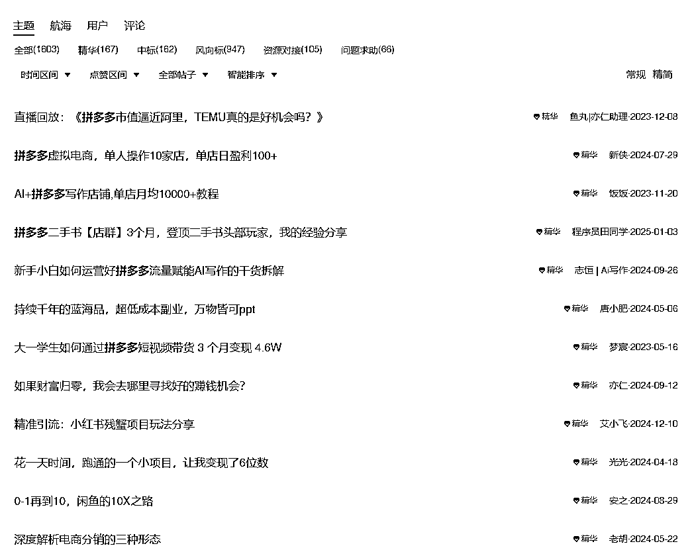
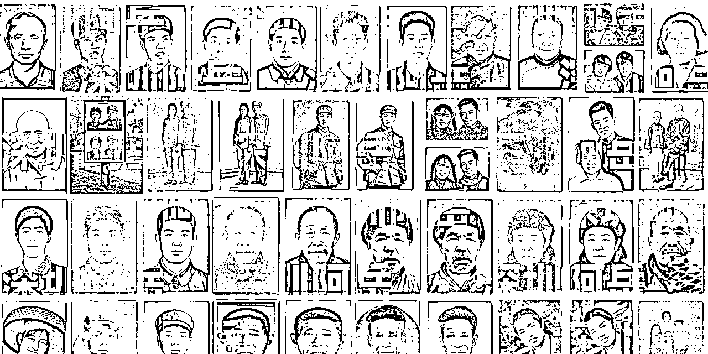
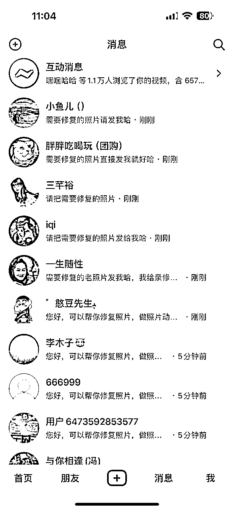
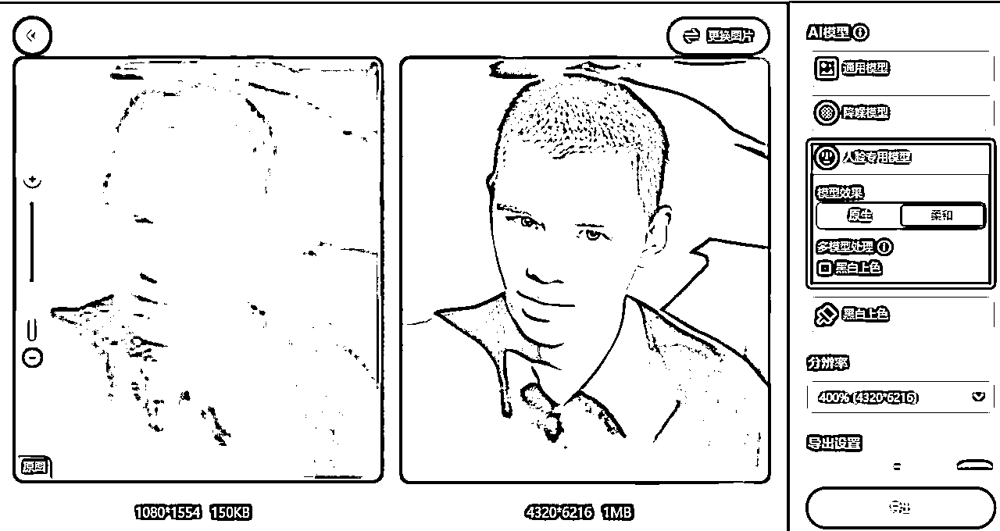
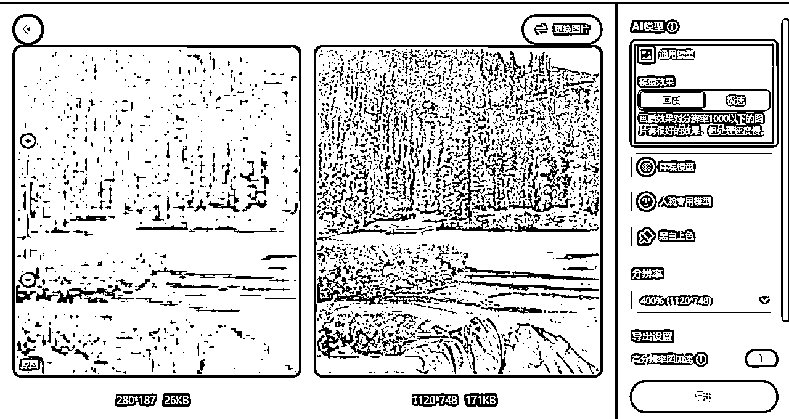
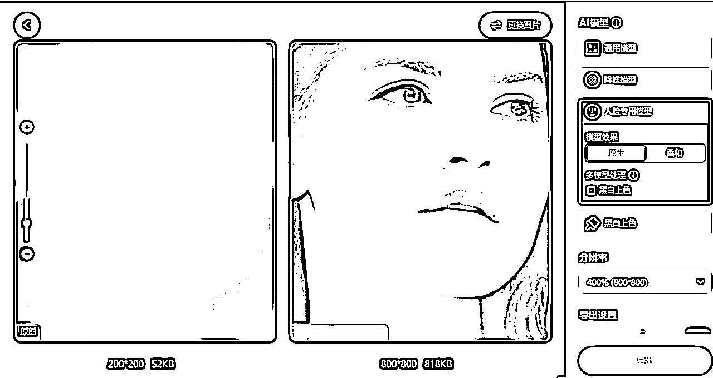

# 从赚钱“面包屑”到AI老照片修复的财富蜕变

一年前，我还坐在亚马逊的工位上，每天琢磨的是产品图怎么拍、视觉怎么调。现在，我的日常变成了帮别人“复活”那些泛黄的老照片。从视觉总监到AI老照片修复创业者，这个转变，我自己都觉得有点魔幻。

这一切，要从我加入龙哥盟说起。

刚进来时，我其实挺迷茫的。但里面的航海活动让我第一次体验到了什么叫“团队作战”。记得参加《中老年视频号知识付费》那次，大家把各自的思路和方法都摊开来讲，遇到问题一起扛。虽然最后项目没赚到什么钱，但那种毫无保留的交流氛围，让我学到了一堆实战里才有的门道。更重要的是，我开始意识到：机会，往往藏在别人随口说的一句话、偶然看到的一个帖子里。

就这么泡在大佬们的分享中，我偶然撞见了“AI老照片修复”这个词。当时脑子里“叮”的一声——这不就是一座还没被人挖的金矿吗？于是，我二话不说跳了进去。

后来我才知道，真正让我开窍的，是龙哥那篇《如何判断一个项目值不值得做？》。看完那篇文章，我整个人像被通了电一样。这里要提一个概念：“面包屑”。

“面包屑”这个词，说白了，就是赚钱项目里那些看似不起眼、东一个西一个的小细节。单独拎出来，你觉得啥也不是；可一旦你把这些小碎片按顺序拼起来，它们就能变成一套完整可行的赚钱打法。就好像电商里的选品思路、定价策略、引流方法、客服话术，每一个都是碎屑，但组合在一起，就是一个能落地的生意模型。

从那以后，我开始有意识地去“捡”这些碎屑，并且给它们分类整理。

最丰富的碎屑来源，是赚钱的精华帖。我像寻宝一样翻《AI应用：从百万到亿级收益的超级机会》《AI自媒体：抓住AI领域热钱与自媒体广告投放的新机遇》这些文章，看得脑子嗡嗡响。但我不光看热闹，我更想从里面抽出共性的规律。

比如，我在电商引流帖里看到“打造爆款”的逻辑：先精准定位目标客户，分析他们的需求和痛点，再反复用数据校准人群，优化详情页、设计促销活动、打磨客服话术。我就想，这套玩法能不能搬到老照片修复上？于是我开始研究客户到底想要什么——他们不只想让照片变清晰，更想找回照片里的那份情感。宣传的时候，我也学电商那套，把修复前后的对比图做成一大堆真实案例，让人一眼就看到效果。

自媒体板块也给了我不少灵感。我看到那些博主靠内容养粉，再用信任度转化生意。我就试着在社交媒体上发老照片修复的故事，分享修复技巧，还放一些名人、民国美女的修复前后对比，配上几句戳人心的文案。没想到评论区直接炸了，很多人私信问我怎么收费。流量和信任，就这样一点点攒起来了。

我还拆过一个线上教育项目的完整复盘。那位圈友把启动、课程研发、推广渠道、踩过的坑全都写了出来。我分析他每一步为啥这么做，然后对应着优化自己的业务。比如，他说要做市场调研，我就多去问客户需求；他说要测试多个渠道，我就把视频号、抖音、📕都试了一遍，看哪个更划算。

风向标板块也是我盯得最紧的地方。AI技术日新月异，图像识别和图像处理能力越来越强，修复效果也越来越逆天。而且我发现，随着社会节奏加快，人们对老照片承载的家庭记忆越来越珍视，需求明显在涨。于是我赶紧跑到抖音和视频号发了几条修复作品，后台很快就有人私信来问。方向，够了。

确定方向之后，我没有豪赌，而是先用最小的成本跑通模型。

第一关是选工具。市面上Photoshop、醒图、美图秀秀都试过。PS功能强大，但操作复杂、批量处理太慢，只适合后期微调；醒图和美图上手快，可遇到严重褪色、图像缺失就拉了胯。反复对比之下，我选了一款叫HPE的AI修复工具——是个境外小众公司做的。它在细节还原和色彩恢复上简直惊艳，模糊到妈都不认识的老照片，它能给你修出高清质感，速度快得离谱，界面还简单，新手也能两小时上手。

工具定了，我就开始死磕技术。官方文档一页页啃，在线教程一条条跟，遇到实在搞不定的问题，直接付费请教专业技术人员。钱能买时间，这钱花得不冤。慢慢我就摸透了深度学习算法怎么识别和重建损坏区域，修复水平也上来了。我开始挑战那些年代久远、破损严重的照片，修完把对比图发到网上，评论区一片“卧槽”，信心直接拉满。

光技术够还不够，还得想清楚自己的差异化在哪。

我的定位很明确：不只是一张照片修好，而是给客户提供情绪价值和增值服务。修复完成后，我会把照片做成动态视频GIF送给客户，再打印一份实物照片快递过去。这一套下来，客户拿到的不只是修复图，而是一份有温度的礼物，回购率自然高。情绪价值方面，我会认真听客户讲照片背后的故事。有人想留着一些岁月的褶皱，不要修得太新；有人希望给照片加个背景、调个色调，做出艺术感。我就按他们的想法，定制化处理，让每一张照片都成为独一无二的回忆。

我的目标客户分两类。一类是普通家庭用户，他们手里的老照片多，对价格敏感，但更看重修复效果和情感满足。我就推一些性价比套餐，到社交媒体和社区里去讲他们的故事。另一类是博物馆、图书馆、档案馆这类文化机构，他们讲究真实性和文物修复标准。为此我专门学习文物保护知识，跟专业修复师交流，还去参与项目招标，争取长期合作。

推广引流上，我的打法分线上线下两条线。

线上主要靠视频号和抖音。我专门挑反差最大的案例，甚至故意把修复前的照片再修模糊一点，这样修复后的冲击力更强。标题也往人心里戳，比如“修复了死去3年爷爷的照片，奶奶看到后哭成了泪人”——这种视频不火都难。🛰️👸号则用来做深度内容，写修复技巧，写照片背后的故事，然后想办法把读者导流到个人🛰️。

线下我找摄影工作室合作，他们拍婚纱照、全家福时，顺便把我的老照片修复服务推荐给客户，成交后给工作室返佣。一个月下来，光这个渠道就带来了三成左右的客户增长。我还跑到老年社区办修复讲座，现场展示对比图，帮居民免费修一两张。老人们又惊又喜，口碑就这么传开了。

服务上，我也特别较真。客户咨询的第一时间，我就详细了解照片的背景和他们想要的效果。修复过程中，我会定期发阶段性成果，遇到不确定的地方就拿出来和客户商量，绝不擅自做主。修完后还会制作一份精美电子相册，配上温馨的音乐和文字，作为惊喜彩蛋。有一次客户说色调和他记忆中的不一致，我连夜用AI调整好发过去，成本低、速度快，他二话不说又给我介绍了几单。

现在，我的月收入已经稳定在五位数，副业彻底变成了主业。客户遍布全国，甚至还有从TikTok和YouTube找来的海外华人。看着大家在评论区晒出的对比图和感谢语，我真心觉得自己在做一件有价值的事。

当然，路还长。技术端，我还在琢磨怎么把HPE和Photoshop更好地配合，是先粗修再AI，还是先AI再微调？每一种组合都要反复测试，也经常和其他修复师交流心得。业务端，我准备拓展照片数字化管理服务，帮客户分类、标记、存储海量照片；还计划和老照片故事创作结合，把照片背后的经历写成文字、做成音频或视频，让每一张照片都不只是一张图，而是一段可以讲给人听的故事。

回头看，这一路走来，全都是靠一个个“面包屑”串起来的。从龙哥盟的帖子，到大佬的一句话，再到自己测试出来的数据，每一块碎屑看似微不足道，但正是它们铺成了我这段时间的路。只要你像猎犬一样，时刻竖起耳朵、瞪大眼睛，去嗅那些别人忽略的细节，你也一定能顺着这些“面包屑”，找到属于自己的那份宝藏。

愿你也能在赚钱的路上，捡到属于你的碎屑，跑通属于你的项目。