### DeepSeek R1 深度使用手册：这 30 个技巧，多数人还没掌握

从 DeepSeek R1 上线的那天起，我就明白，这不只是一款新 AI 工具，更像是一把钥匙，重新打开工作、学习和生活方式的想象空间。短短几周，它的热度炸裂式增长：在包含日本、美国在内的 140 个国家和地区，一路冲上 App Store 榜首，甚至让硅谷那些靠着 AI 吃饭的巨头们都有点坐不住。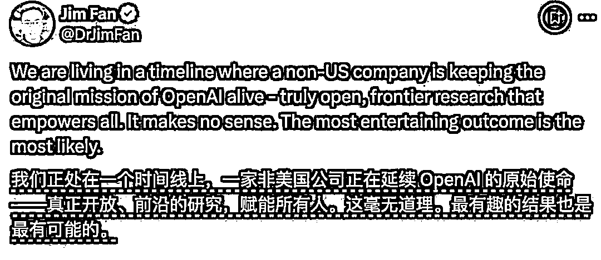

我更愿意把它看作一个信号：国产模型已经不再是追赶者，而是开始定义未来。作为长期混迹科技圈的人，这种变化让我又兴奋又感慨。兴奋，是因为我们自己人做出的技术，终于能让全球用户眼前一亮；感慨，是因为连从前不关注科技产品的亲戚朋友，都来问我“DeepSeek 到底是什么？真的那么神？”这大概就是技术真正走进日常的样子。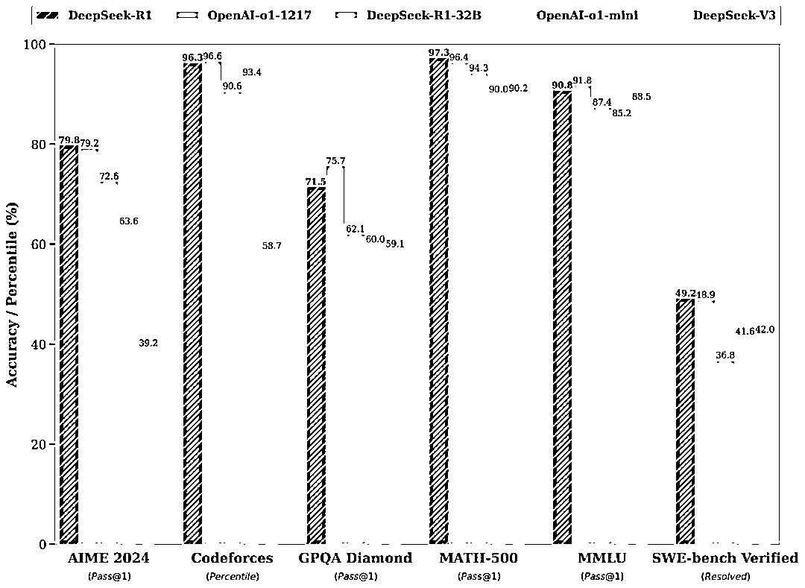

很多人知道它厉害，却被网上的信息绕晕了。有人把它吹成全能神，有人吐槽它这里不好那里不行。为了让想上手的你少走弯路，我花了好几天把 DeepSeek 的能力、用法和进阶技巧重新梳理了一遍，剔掉噪音，只留干货。这篇文章会从基础认知讲到实战技巧，帮你把 R1 真正用起来，让它变成你的“第二大脑”。

### 先把 DeepSeek 看明白

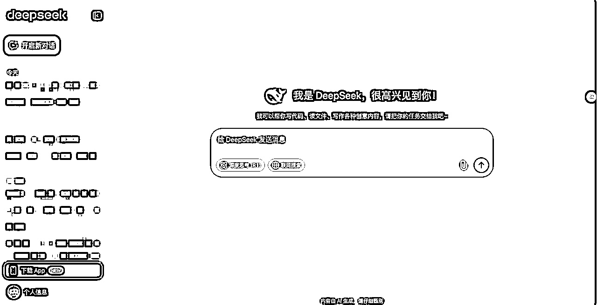

DeepSeek（深度求索）是一家 2023 年成立的中国科技公司，目标直指通用人工智能 AGI。核心团队里有多名 AI 领域的顶尖科学家和工程师，主攻大语言模型、多模态等方向。它最受关注的产品包括：

- R1 系列：提供 7B、67B 等不同规模的对话模型，长上下文、复杂推理、多轮对话都能扛，部分权重已经开源。
- V2 系列：把高性能和低成本做到了一个惊人平衡，推理速度更快，API 价格比 GPT-4 便宜得多。
- 多模态模型：不仅能读文字，也能处理图像和音频。

技术上最值得记住的三点：第一，上下文窗口最高支持 128k tokens；第二，采用 MoE 混合专家架构，计算效率更高；第三，开放部分模型权重，研究者和开发者可以免费商用。在应用层面，它已经进入智能助手、代码生成、数据分析、教育、医疗等领域，也跟不少企业达成了合作。价格方面，API 成本大约是同类产品的 1/100，对比 GPT-4 优势非常明显；中英文能力都很强，中文场景更是做了深度优化。2024 年发布的 V2，还拿过中文权威榜单 C-Eval 第二名。

### 上手 DeepSeek，其实很简单

使用入口有三个：网页版打开 deepseek.com；手机到应用商店搜“DeepSeek-R1”；开发者用 `pip install deepseek-sdk` 就能接入。企业用户配置时，可以按需要调安全等级（比如三级等保模式）、接入内部知识库、选择极速响应模式。

基础对话是起点，日常提问、头脑风暴、写作灵感都可以直接丢给它。```
[系统指令] 你是一个严谨的科研助手，所有回答需附带参考文献
[用户输入] 解释Transformer架构的创新点
```

文件处理能力非常实用，比如上传论文 PDF，直接让它“提取方法论缺陷”；多模态交互支持图像和音频输入，适合分析产品截图、解析报表、整理会议录音。```
response = model.multimodal_query(
    image="实验数据图表.jpg",
    text="分析图中显著性差异"
)
```

再往上是进阶玩法：针对法律、医疗等特定领域做微调；把录音转写、摘要、翻译串成自动化流水线；还可以把私有知识库和模型融合，打造出真正懂你业务的专属助手。```
[知识库检索模式]
检索范围：公司2023技术白皮书
查询：找出智能客服系统的优化建议
```

学术研究场景下，可以用严谨模式拆解文献、梳理创新点；商业分析场景中，它能按结构化模板输出市场判断和竞争策略。```
research_assistant = {
    "文献综述": "对比分析近5年NLP顶会论文",
    "实验设计": "设计三组对照实验验证假设",
    "论文写作": "按ACL模板生成方法论章节"
}
``````
[商业智能模式]
输入：2023Q4销售数据.csv
指令：预测2024Q1趋势，输出可视化图表
```

参数调节也有门道：想要速度与质量平衡，可以把 temperature 设为 0.3、max_tokens 设成 2000、top_p 设成 0.9；创意类工作建议温度 0.6-0.8；涉及敏感内容时，务必开启隐私过滤。```
!deepseek config --privacy strict --audit_trail enable
```

企业级部署层面，可以在本地服务器用 Docker 做私有化部署，同时配置好权限管理，让不同角色只能访问对应功能。遇到响应慢，就切换极速模式或清理历史；知识库检索失败，重建向量索引；API 超限，申请企业级令牌或改用分级响应。注：部分高级功能需要企业版权限，具体参数以官方文档为准。```
rbac_config = {
    "部门权限": {
        "研发部": ["代码生成", "技术文档"],
        "市场部": ["竞品分析", "文案创作"]
    }
}
```

### 30 个进阶技巧，建议收藏

#### 一、把问题问得更清楚

1. 大问题拆小问题。与其问“自媒体账号怎么运营”，不如拆成“账号定位→内容选题→流量获取→变现方式”，逐个击破。

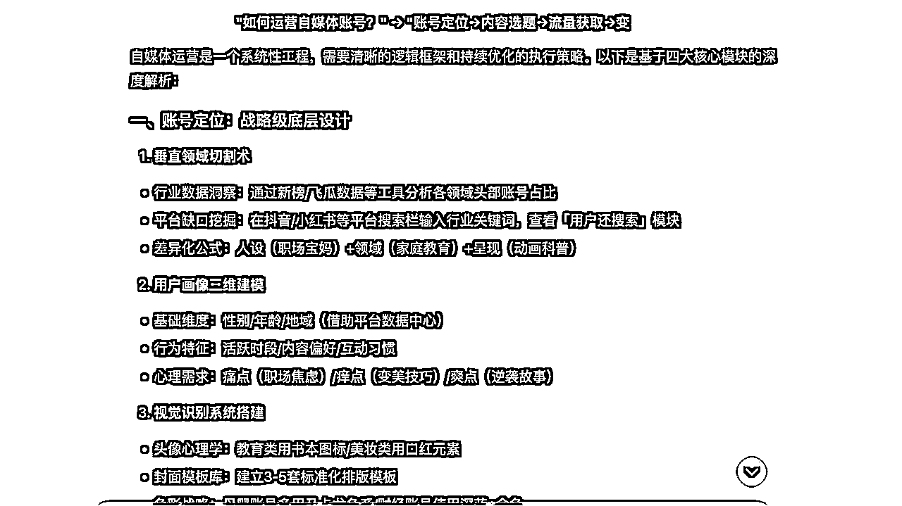

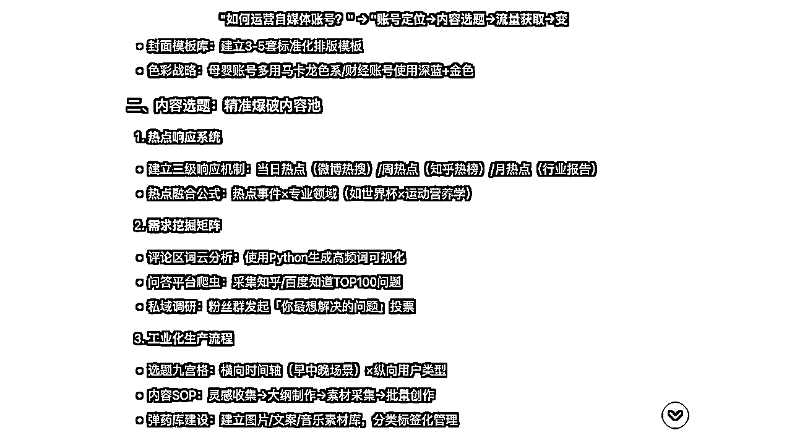

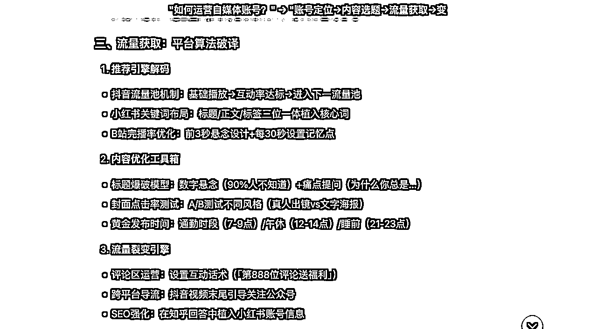

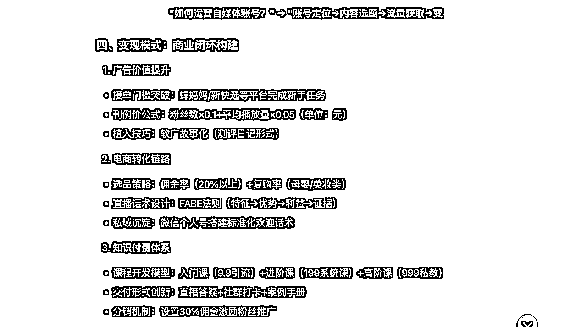

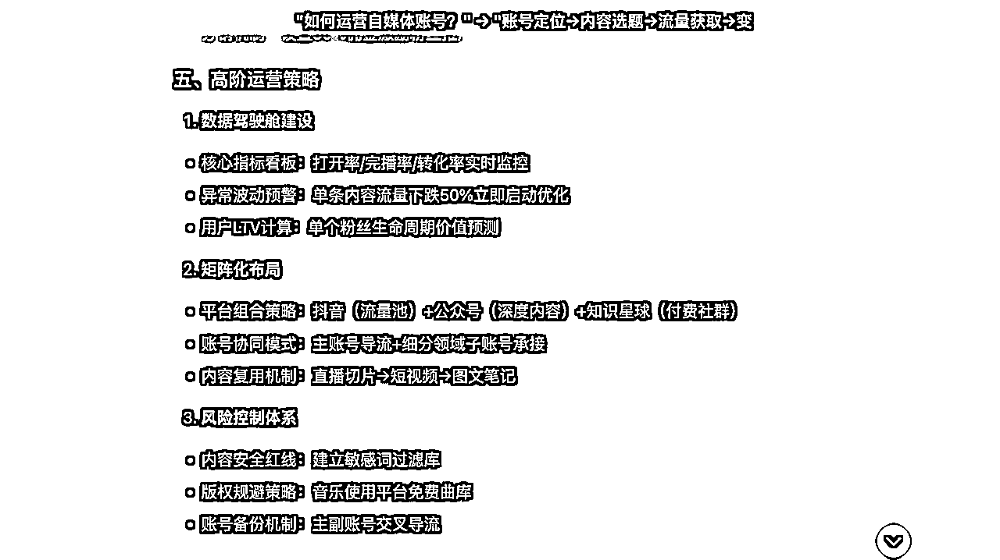

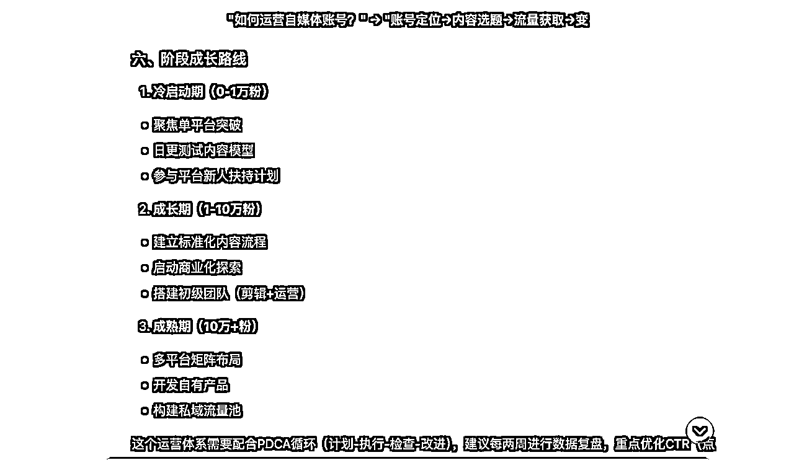

2. 用 5W1H 追问细节：Who、What、When、Where、Why、How，把模糊问题变成具体问题。
3. 先问“是不是”，再问“为什么”。比如提到“这个方法无效”之前，先确认“它有没有被正确执行”。

#### 二、高效沟通要讲策略

1. 预设场景法。不要空泛地问“怎么提升转化率”，要问“在用户日均 UV 不到 100 的情况下，怎么提升转化率”。

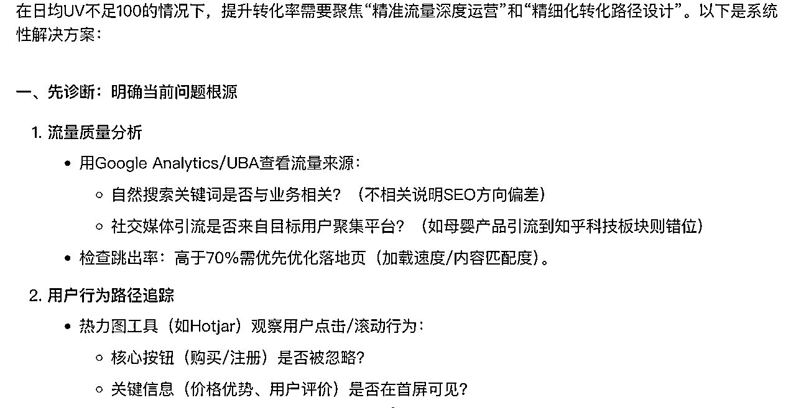

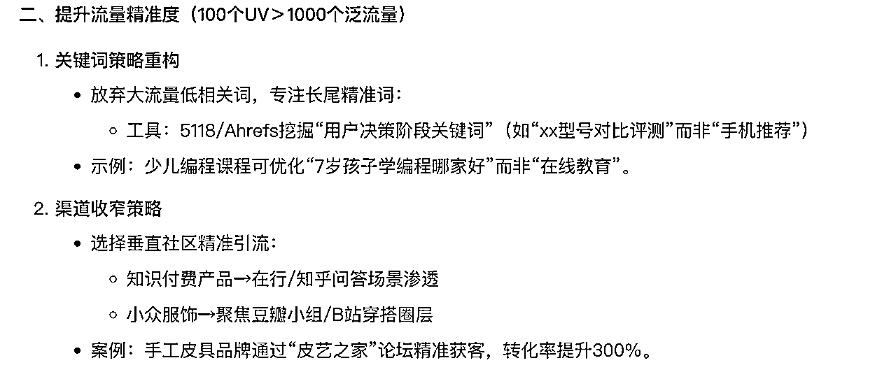

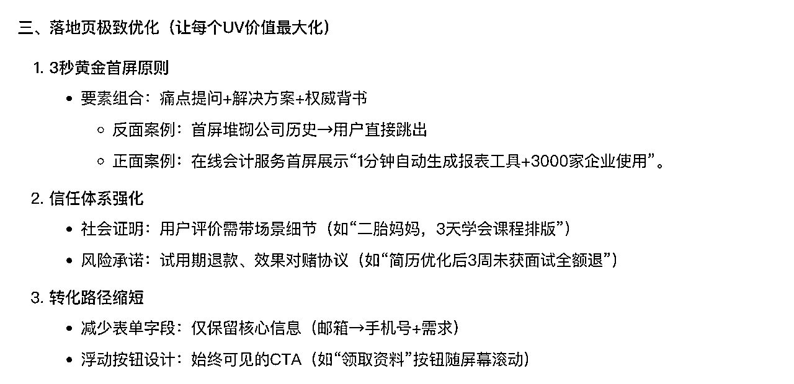

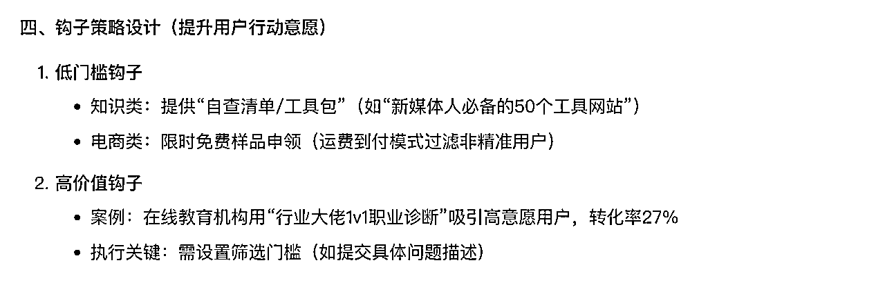

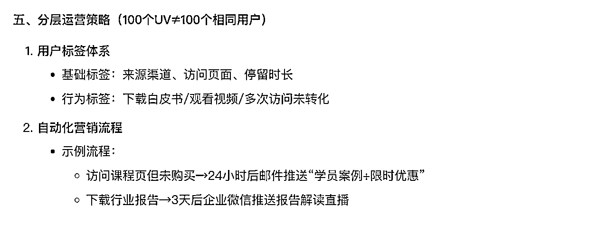

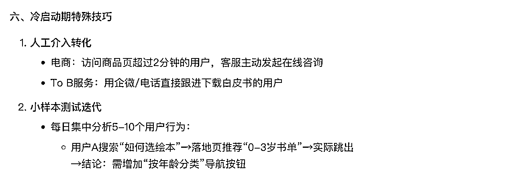

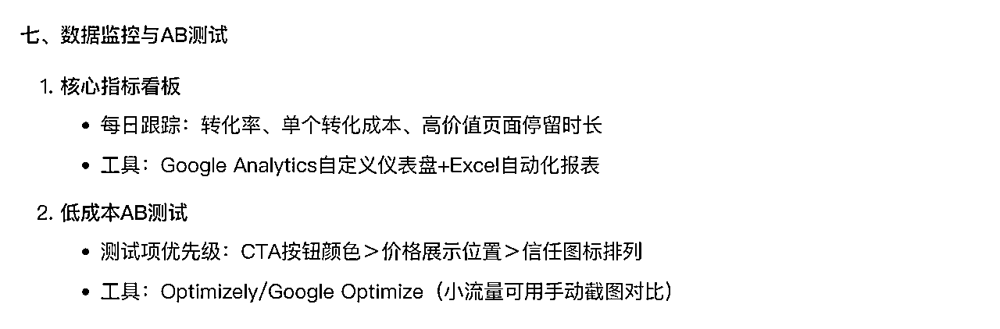

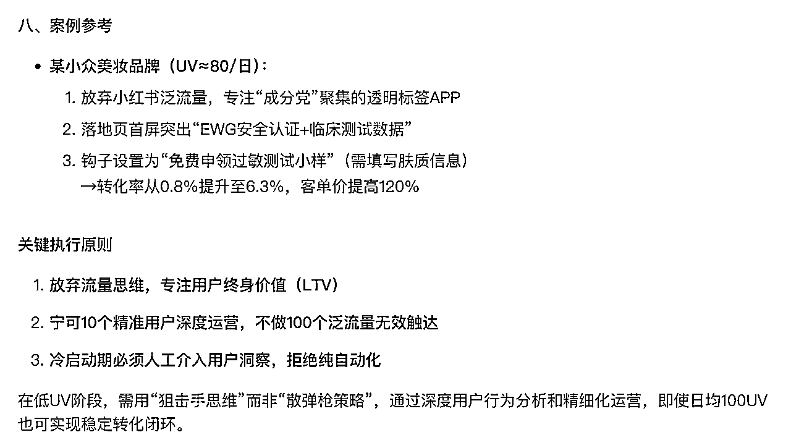

2. 提供选择式提问。比如“这个问题更适合用 SWOT 分析，还是 PDCA 模型解决？”把答案范围缩小，回答质量更高。
3. 阶梯式追问。从“数据下降了”开始，一路问到“哪个指标最严重→关联哪些部门→当前应对措施是什么”，层层深入。

#### 三、让逻辑思考更深一点

1. 反向验证。再安全的方案，也要追问“在什么极端条件下会失效”。
2. 假设推演。比如“预算减半，这个推广策略哪些部分必须动”。
3. 跨领域类比。把医疗行业的精准诊断逻辑，迁移到用户画像分析里，经常能打开新视角。

#### 四、从对话里拿到有效资源

1. 锚定关键人。先搞清楚“这个决策是 CTO 提出的吗？他更关注性能还是成本”，再决定怎么聊。
2. 激发分享欲。先认可对方的方法有意思，再追问“你具体怎么定义种子用户”。
3. 要求结构化答案。直接让对方用“问题点-根本原因-解决方案”的格式回你，信息更可用。

#### 五、带一点批判性提问

1. 数据溯源。不要被“用户满意度提升 30%”吓到，先问“样本量多少，渠道怎么选的”。
2. 前提条件检验。方案成立是不是依赖“市场不断增长”？如果遇到黑天鹅，有没有备用计划。
3. 边界限定。同一个方法在 ToB 和 ToC 场景里，实施效果很可能完全不同。

#### 六、不同场景有不同的提问姿势

1. 紧急事件：用“现状+影响+资源”快速聚焦，比如“系统崩溃影响多少用户？能调用多少技术人力？”
2. 学术研讨：抓“创新点+可复制性+理论依据”，问“这个算法和已有研究的本质区别是什么？跨数据集测试表现如何？”
3. 求职面试反提问：了解“团队当前最大的技术挑战是什么？新人需要具备什么破局能力？”

#### 七、处理反馈和矛盾信息

1. 模糊回答澄清术。当对方说“优化体验”时，追问“具体是加载速度、交互流程，还是视觉呈现？”
2. 矛盾信息验证法。A 部门说确认了，B 部门说还在改，那就直接要最新版需求文档。
3. 情绪化回应处理。先接住对方的情绪，再把话题拉回“卡点在哪里、需要协调什么资源”。

#### 八、借助工具把问题设计得更好

1. 思维导图法。把中心问题拆成分支，比如政策影响、技术难点、用户反馈。
2. 矩阵分析法。横轴“实施难度”，纵轴“见效速度”，把所有问题丢进四个象限，优先级一目了然。
3. 流程图追溯法。顺着“用户点击到支付完成”的全流程，找出流失最严重的三个节点。

#### 九、心态管理也是提问力

1. 突破安全区。主动问认知盲区，比如“关于区块链底层逻辑，我最应该修正哪三个错误认知？”
2. 示弱式高阶提问。以新人的姿态请对方“用最直白的话解释这个商业模式的盈利关键”。
3. 压力测试型提问。请对方直言“如果按我这个方案执行，最可能在哪些环节翻车”。

#### 十、持续优化你的提问系统

1. 做好提问复盘。记下问题、对方的反应、回答质量，定期分析哪些提问有效。
2. 建一个话术库。决策类问“如果必须舍弃一个要素，你选哪个？”预测类问“按历史数据，这个趋势半年后会发展成什么样？”
3. 注意跨文化沟通。西方文化更接受直接问“这个计划最大的缺陷是什么”，东方语境下更适合说“如果要进一步完善，哪些方面还可以加强”。

最后送大家三条心法：提问后给彼此留 3 秒思考时间；一次对话里，提问只占三成，倾听占七成；每次开口前，先判断这个问题能不能让对方进入深度思考。日常聊天就可以开始刻意练习，每周再做一次复盘，总结三个最有效和最无效的提问。

在我看来，DeepSeek 代表的不是某一项技术的升级，而是 AI 与人类协作方式的转折点。它已经能听懂更复杂的指令，也能进行更深的推理，把 AI 的门槛拉到普通人也能轻松跨过的高度。未来 AI 的使用，会像今天的手机一样自然——从需要复杂操作的诺基亚，进化到三岁孩子都会用的 iPhone。那个时候，善用 AI 的人，已经赢在了起点。

好了，如果今天的内容对你有启发，记得点个赞。你的反馈是我持续输出的最大动力，也愿每一个看到这里的你，都能乘上 AI 的春风，走向更远的星辰大海。