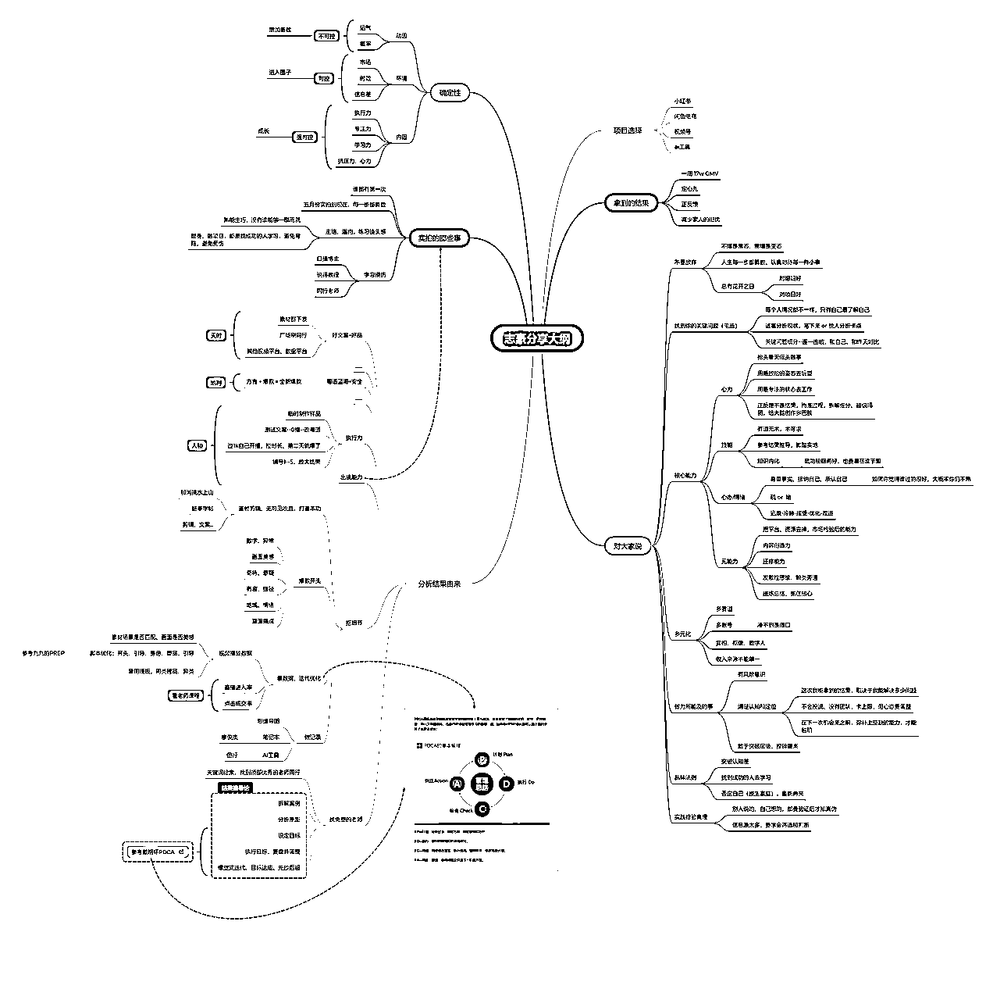
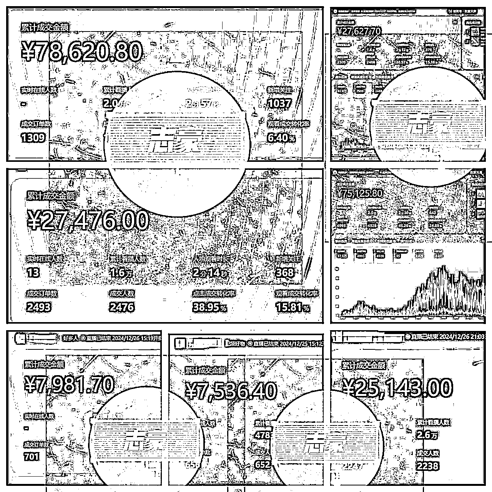
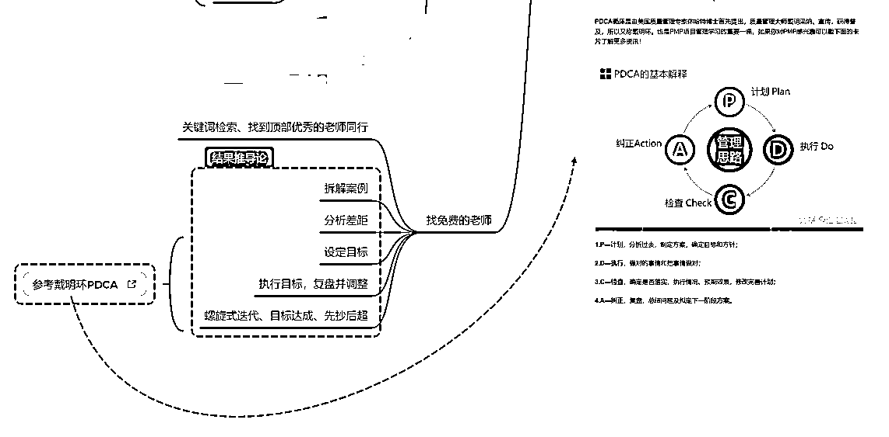
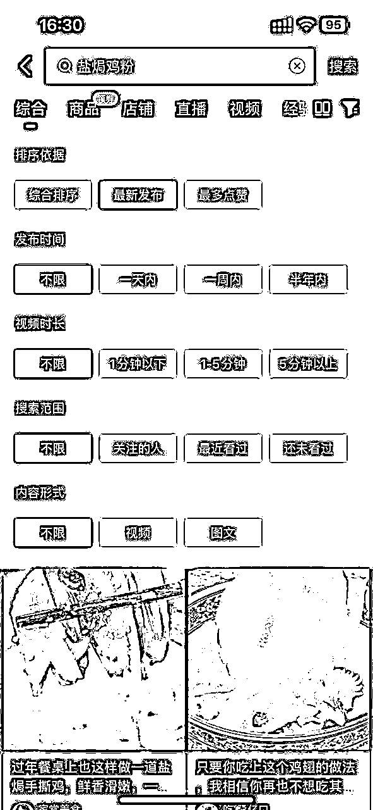
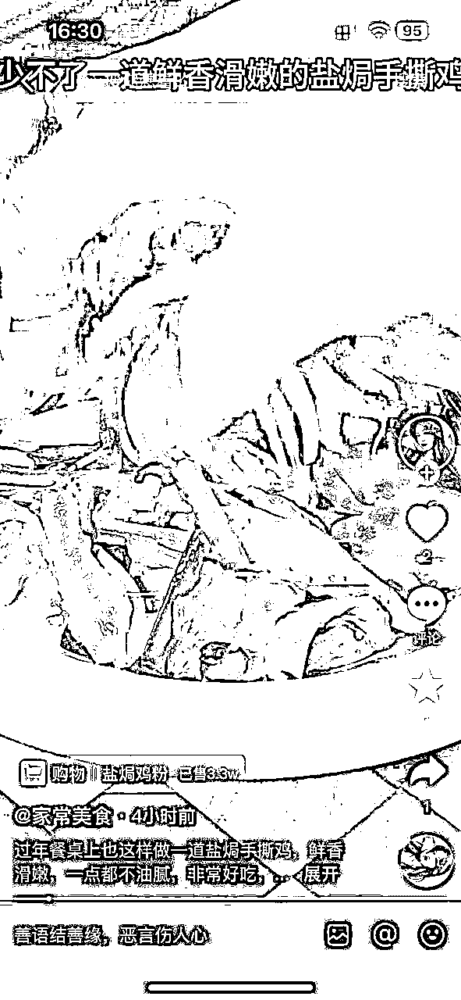
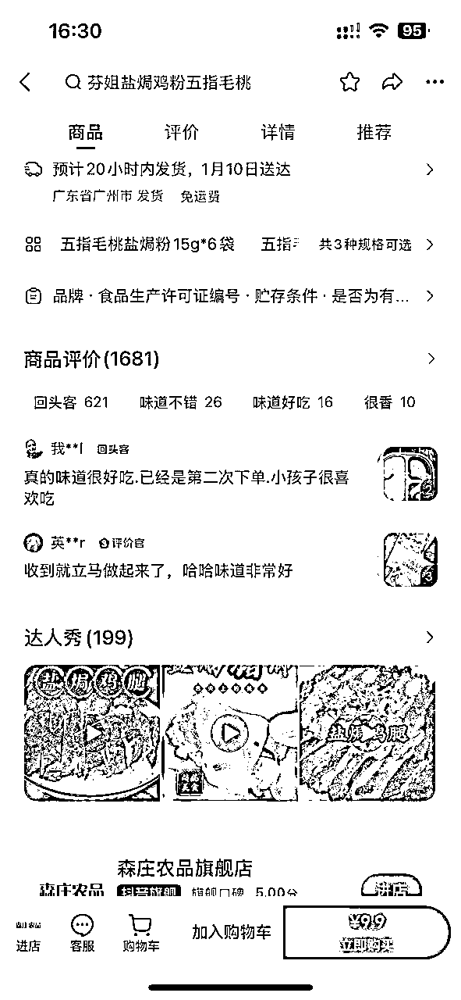
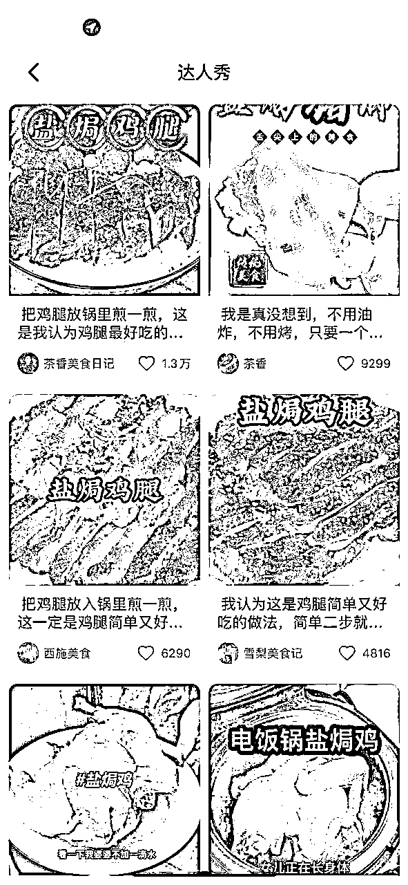
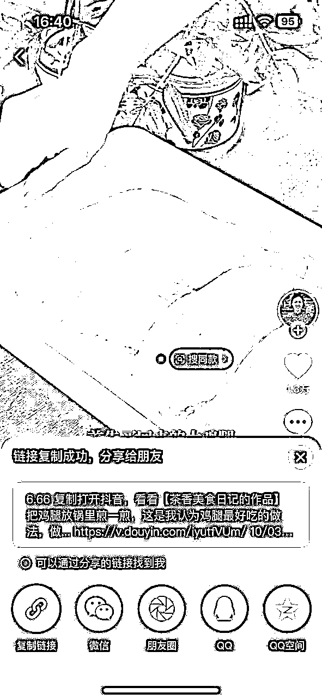
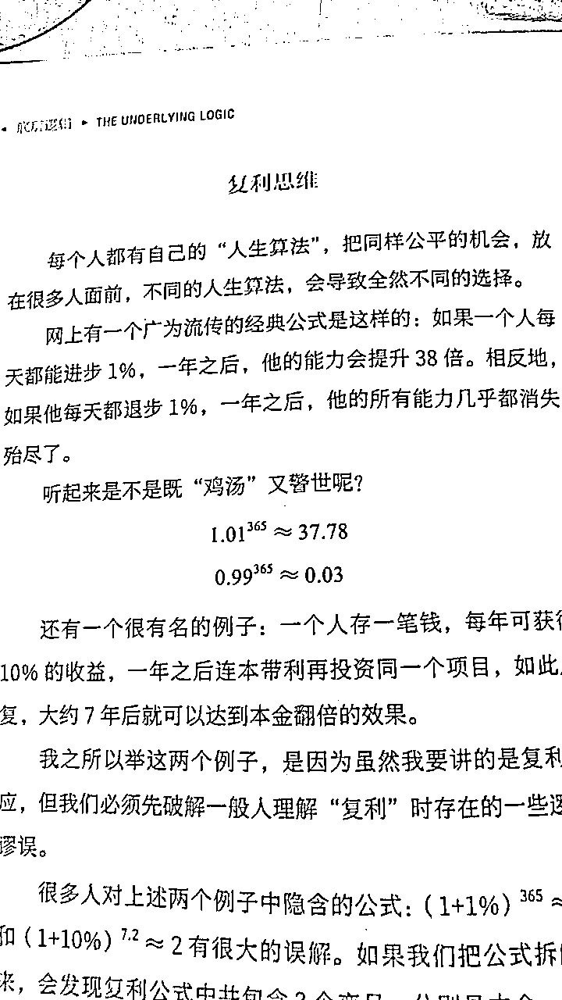

# ('在不确定的市场，如何拿到自己的确定性？', (2, 21))

市场越不确定，越要修炼自己：被裁后半年，我在视频号拿到第一个10w+

大家好，我是志豪，95年惠州人，现在定居广州。做云计算技术售后7年，今年4月被裁员。5月我开始做视频号，参加了两期视频号带货航海。平台规则一直在变，但我没有离开牌桌，最后拿到了一些结果——2024年赚到10w+，也初步跑通了项目流程。2025年，我准备把全部精力投进视频号带货，争取更大的突破。

这篇文章不展开讲具体操作，往期航海手册里都有；我真正想分享的，是这大半年来反复踩坑后沉淀下来的思路、方法和心态。

接下来我想从三个维度来聊：我是怎么一步一步拿到结果的；过程中怎么管理情绪和心态；以及在大环境不确定的情况下，如何抓住自己可以掌控的部分。先放一张半年总结的思维导图，让大家有个全貌。

一、怎么把结果一步步做出来？

第一个关键词：熬。

做过视频号的朋友应该知道，这平台大概90天就要经历一次大洗牌。我入场时最火的是抠像玩法，后来人脸不可解控、数字人霸屏、批量封号、关联封号、微付费里的硬广和口播……一波接一波。要是你中途受不了、提前退场，那后面再有机会也跟你没关系了。

在此之前，我试过很多互联网副业：知乎好物、公众号引流、淘宝/拼多多/抖音/闲鱼电商、AI工具等等，但都是玩两天就停手。视频号是我唯一一个认真深耕的项目，也是第一个让我赚到10w+的项目。要说最大的原因，就一个字：熬。

最近总有人问我：自然流还是微付费？硬广还是口播？我的态度是：都做做看。只有把鞋弄脏，踩进泥里，你才知道哪一种适合自己。我现在以自然流为主，因为自己在文案、剪辑和出镜上有些积累，可以先用自然流测试内容，等测出爆款，再用微付费放大。自然流的好处是投入低，坏处是冷启动难；微付费则相反，能带动免费流量，但成本高，一场直播可能烧两三千。

最近一个月我用自然流做了一些原创素材，战绩见下图。特意加水印，是防着有人拿这些图去割韭菜。

带我入行的领路人是拾柒老师。她在《32岁负债50w，重头再来》里写过一句话：“挖一米宽，一米长，深耕一万米。”这句话是支撑我坚持到现在的重要力量。中间我当然也有过崩溃、有过放弃。可在大环境的压力下，我确实找不到比这更适合我的选择。正是那一次次的反复挣扎，让我练出了“屡败屡战”的韧劲，也让我在面对困难时，有了重新出发的勇气。

第二个关键词：PDCA。

在PMP项目管理体系里，有个著名的“戴明环”：计划、执行、检查、纠正。于是我把这套循环变成自己做项目时的总纲，慢慢衍生出属于我自己的目标结果推导模型。

视频号带货的本质是内容电商。拿卖“盐焗鸡粉”来说：你可以下厨实拍，也可以找素材混剪，还可以口播加画中画。但选哪种方式之前，得先搞清楚三件事：这产品是干嘛的？谁会买？我怎么把它卖出去？这些问题，市场早就给了答案，最快的方法就是拆解同行。

找对标：在抖音、快手、小红书搜关键词，能直接找到正在卖货的同行，他们就是最好的老师。以抖音为例，右上角筛选时，我一般看两个维度：“最新发布”意味着素材新鲜，做画中画不容易同质化；“最多点赞”是已被市场验证过的好素材，可以重点学它的画面、脚本结构和剪辑手法。找到挂购物车的视频，点进商家主页，再往下翻，你会看到一个“达人秀”，这个商品相关的带货视频全在这里，你的参考案例就齐了。

拆解：把对标视频下载到本地，我用的电脑工具是IDM，方便逐帧分析画面；脚本用微信小程序就能解析，一段完整的带货文案很快就到手。

设定目标：一比一模仿爆款。如果是真人出镜，衣服、画面构图、人物在镜头里的占比、语气语调，甚至环境光线，都尽量向爆款看齐。因为爆款是同行已经验证出来的结果，前期别急着加入自己的想法，先抄后超。

执行和复盘：执行中一定会遇到各种问题，比如目标定太高、素材找不到、找到的又不够好。遇到这种情况，先别急着否定自己，要复盘，要调整。觉得“找不到好素材”太难，就把它拆成具体的小目标：我该怎么在短时间内锁定一个优质素材？带着这样的目标去练，能力才会长出来。等你能稳定做出合格视频后，再挑战进阶目标，比如一个月做出一个挑不出毛病的视频。到那时候，你的剪辑、找素材、出品效率，全都会跟着上一个台阶。

螺旋式迭代：一个闭环跑完，把目标调高一档，再重复这四个步骤。我就是这样循环往复了半年，拿到了想要的结果。这个思路的好处是，能让你沉浸式地做好每一件小事。过程当然苦，但它能让人脚踏实地。成功可能还很远，可每一步走下去，都不会白走。把基本功打扎实了，后面的路自然稳。

第三个关键词：执行力。

同一个圈层里，信息差其实已经被抹平了。那为什么一起起步的人，结果却天差地别？最大的差别就是执行力。这7个月里，只要市场上出现了爆款，我跟品总是很快。我的性格是：一个事要么不碰，碰了就要尽最大努力做好，无论结果如何，下了场就不后悔。

这次Wi-Fi放大器的爆款，一周做到17万GMV，全是自然流。能成，首要原因就是跟品足够快；其次，我做了大量脚本测试和账号测试。市场上既然已经有了爆款，说明这个品本身没问题。我做的，就是把正在爆的视频全部下载下来，逐条分析内容，再结合自己的粤语优势重新演绎。于是就有了“粤语+爆款=全新爆款”的案例。

写到这的时候是2025年1月19日，这周我又用同样的文案结构，套了一个新品“电视U盘影视贴”，结果自然流单条最高播放量85万，GMV已经10w+，还在涨。

第四个关键词：及时正反馈。

很多人把“赚到钱”或“视频爆了”当成唯一正反馈。但赚钱是最后那个大Boss，如果只看它，中间的路会很难熬。更好的做法，是学游戏设计思路，在每一小步里设置低门槛奖励。

想想超级玛丽：顶起一块砖头，蹦出一颗蘑菇，吃下去有清脆的音效，角色变大，还给你多巴胺。哪怕还没到Boss关，你已经玩得很爽了。做项目也一样，不能一上来就要求剪了个两分钟视频就出结果。你得“骗骗”大脑：我今天把视频做完了，这是正反馈；我今天找到一个完美素材，这也是正反馈。把这些小动作都定义为奖赏，告诉大脑“这件事能让我开心”。于是，无论是写脚本、拍视频、剪视频还是拉直播，我都能从每一个环节里获得快感。事情不枯燥，兴趣就不会断，执行力自然也不会差。

我现在做的小细节、小事情，可能都看不到确定收益，但它们让我的基本功越来越扎实，也在为未来那个“成功”默默铺路。

第五个关键词：蓝海思维。

“方言+爆款=全新爆款”。当时满屏都是普通话爆款，我也试过跟拍普通话，结果发出去直接被限流。后来我转而想：粤语人群基数非常大，一旦跑通，传播面也很广。我为什么不把好脚本、好画面、好出镜和感染力全部保留，用粤语重新表达一遍呢？互联网现在最难的是搞流量，这个蓝海思路，真的建议大家好好琢磨。

第六个关键词：出镜能力。

不管你做视频号还是做别的，趋势已经明摆着：知识载体从文字到图文，再到短视频。想吃到短视频红利，出镜能力几乎是门槛。我们要敢于把自己拿到台面上来——如果连镜头都不敢面对，后面销售的动作就无从谈起。

我从5月开始自己做实拍，中途也想过放弃。但长远来看，这件事必须做，它属于重要但不紧急。它没法一天练成，而是在时间里慢慢沉淀。比如那阵子，我每天下楼遛狗，都会举着手机对着自己。一方面记录生活，一方面练镜头感，让自己不再畏惧镜头。我也会看那些口播博主分享的练习方法。

练了半年，现在哪怕镜头怼到脸上，我也不会紧张，眼神更不会到处躲。就算让我带着自己的产品去做演讲、做售卖，我也有底气直接出镜。这半年里，实拍没有带给我任何看得见的收益，但这次爆单，它帮了大忙。爆款脚本需要配上有情绪、有感染力的画面，才会戳中用户痛点，产生一种“我在跟你说人话”的交流感。

如果你以后也打算做短视频、卖自己，我建议你尽早开始练出镜。它就像10年前的写作能力，越练越香，越积累越有沉淀，而且它是未来的趋势。

二、心态、情绪和动力，是怎么维持的？

1. 持续锻炼。

健身做过力量训练的人都知道，卧推一开始可能只能推10公斤，半年后能推50公斤，两年后能推80公斤。生物都有“用进废退”的规律，体力是这样，心力也是。当你刻意去锻炼自己的心力，一开始做一件事只能坚持两周；但咬牙撑过去之后，下一次就可能坚持三周、四周、一个月、两个月甚至半年。

当然，它也有消极的一面：一旦你松懈，能力就会退化。所以要把自己放在一个螺旋式上升的过程中。刘润老师在《底层逻辑》里提过一个数学模型：如果你每天都退步1%，一年之后，基本归零；如果你每天都进步1%，一年之后，是37.78倍。

心力不足怎么办？
- 记录自己，不管好坏，先停下来、慢下来，分析现状。
- 接纳那些不好的情绪，但绝不能颓废，要有重新出发的勇气。
- 多运动、去户外、唱歌、打游戏，做让自己开心的事。
- 找一个模仿对象，分析差距，定一个追赶计划。
- 给自己绑上炸弹，做不成就要完蛋。当退路被堵死，你会发现原来自己这么耐打。推荐大家看《面对巨人》里的“死亡爬行”。

2. 认清自己，也接纳自己。

教员四渡赤水，三万红军怎么突破重重包围？我的理解（不一定对）是：第一，敌我实力悬殊，所以不能硬拼，要看清楚战局，逐个击破；第二，进入包围圈后没有后援、信息封闭，这时候要发挥游击战特长；第三，军情瞬息万变，随时都要调整打法，“摸着石头过河”，这考验的是决策能力。

迁移到个人身上：你解决多大问题，就能拿到多大收入。想做出正确决策，第一步永远是了解自己。风险与收益从来并存，脚踏实地做当下的事。承认自己不足，没必要过分苛责——如果昨天的自己不是个“sb”，那大概率说明今天还在原地踏步。没有谁能一直靠运气吃饭。只有真正有能力的人，才能穿越周期，吃到红利；否则凭运气赚到的钱，最后也会凭实力亏掉。

3. 通过复盘做调整。

几个月前，我听说一位在视频号拿过大结果的大佬，每天都会做笔记。我看见、相信、于是也照着做。以前我总觉得自己脑子够用，什么都能记住。但自从我开始把事情写下来，无论是计划还是复盘，翻开本子就能看到自己的优点、缺点、目标和规划，一切都清晰完整。

人脑的容量是有限的。把事情写下来，相当于给大脑清内存。每天、每周复盘，既能看到进步，继续优化，也能及时发现短板，要么避开，要么用优势去弥补。再参照《毛选》里的思路，找到自己的关键问题，然后用全部精力去攻克。每个人情况不一样，最懂你的，一定是自己。

三、在动荡的形势里，如何拿到自己的确定性？

1. 动态因素：概率。

概率这东西，我们干预不了。比如账号能不能爆，有随机性，我们能做的就是用多个账号去测试，把概率提高一点。

2. 环境因素：市场、时效、信息差。

市场层面上，做过视频号的朋友都知道，去年八九月之后，自然流变得非常难，很多团队都转向付费。可如果你没有资金、没有团队、没有经验，也没有打付费的心理准备，那就不太适合普通人。做自然流还是微付费，前提都是看清当前市场。知己知彼，才不至于白白烧钱。

时效层面，视频号带货的本质里，快很重要。看到同行正在爆，你马上去跟品，大概率也能起来。但注意，不要把一个自然流的素材原封不动拿去跟付费流。可以用微调、爆款框架套内容（也就是“移花接木”）的方式去跟品、跟框架。

信息差层面，牌桌上永远存在圈子差异。不同圈子之间确实有信息差，但同一个圈子里，信息基本面是平的。前提是，你别下牌桌，要躬身入局。

3. 内部因素：执行力、专注力、学习力、心态。

执行力是所有项目里最底层的素质。你会发现，真正做成事的人，没有人缺执行力。如果项目选对了、方向走对了、执行力也够强，拿结果只是时间问题。相反，如果你执行力很强，也坚持了很久，身边同伴都出成绩了，你却还没有，那就要反思：是不是某个地方出现了卡点，或者方向早就跑偏了。

专注力的差距就更明显了。有人能一天16个小时扑在一个项目上，有人三天打鱼两天晒网。一两个月后，结果几乎是可见的。

学习力也一样。有人天赋高，有人靠后天努力，最了解自己的人只有自己。狗哥那天直播说：“连志豪那个XX都能做成，凭什么你不可以？”我自认学习能力不怎样，上学时永远坐在最后一排，大家都懂。但这没关系，只要不是文盲，只要知道怎么用手机、怎么搜索，哪怕学得慢一点，我可以用更多时间去换。用时间换距离，慢，也是快。

最后是心态。别总觉得别人过得风光。你看到的光鲜，多半是因为你不了解那个人背后的狼狈。每个人都会有伤心、挫败、无助、失望的时刻。不用逃避，试着把它们写下来，冷静分析原因，等情绪过去，再慢慢优化改进。记住一句话：只要人还在局里，就别先认输。视频号上，不火才是日常，经常火反而是罕见，那背后是近乎“变态”的投入。好问题才会有好答案，而好问题来自深入执行；目标清晰，行动力才不会散。人生没有白走的路，再小的事，都值得你认真对待。

4. 沉淀核心能力。

知识内化。市场上、圈子里、互联网上，从来不缺知识和干货。但同样一份干货，不同人看完收获完全不同：有人看完就忘，有人看完打了一针鸡血，有人看完去实践，把它内化进自己的知识体系，于是他就做成了。

元能力。很多人会有一种错觉，觉得在公司做到高业绩，就是自己的能力。可一旦把平台、资源剥掉，把自己扔到市场里去检验，你会发现，真实能力和自我认知之间存在很大差距。所以不管你是上班族还是做副业，都要有意识地提炼自己的元能力。比如我前面说的PDCA螺旋上升思维，就是我从工作里提炼出来，迁移到视频号项目里的。现在它已经内化在我的体系里，不管未来做什么，它都能指导我的行动。

发散性思维。这有点像触类旁通。拿“盐焗鸡粉”举例：我从一个关键词出发，找到一个爆款视频，顺藤摸瓜找到爆款店铺，再找到同品类所有爆款。这种“从一个点扩散到整张网”的做法，和思维导图、树状图是同一个原理。

提取关键信息。我在开会时能快速提炼中心主题，在文档里能总结核心内容。同样，看一条带货文案时，我会问：开头是怎么设计的？结构是怎么衔接的？卖的是什么？怎么样一步步引导下单？把这些抽出来，你就得到了“开头—引导—塑造身份—塑造产品—引导下单”的框架。再加上你在项目中积累的内容力，就足以复制出新的文案。比如盐焗鸡粉的框架，完全套到洗衣粉上，换内容，不换骨架。这就是迁移能力。

最后，做力所能及的事。能力边界不必硬撑，但能做好的眼前事，请一定做好。确定性，往往就藏在这些一件件“力所能及”的小事里。

你有没有认真想过一个问题：一个人能走多远，其实不取决于他多努力，而取决于他清不清楚自己站在哪一级台阶上？

真正聪明的人，从来只做自己能力边界允许的事。这听起来有点保守，但恰恰是一个人最扎实的底气。你被羡慕的那些结果，本质上就是你解决问题的层级的镜像——你能解决多大问题，才能端住多大的碗。

这阵子我拍了一周的素材，发什么火什么，数据看起来很美。但我心里清楚，换成那些真正的大佬做同一批内容，他们接得住五倍、十倍甚至更高的爆发量级。而我不行。因为我没踩过他们踩过的坑，没付过他们付过的学费，所以自然够不着他们所在位置能触达的收益。

想明白这一点，就不会怨天尤人。懊恼“差一点”没意义，把缺的功课补齐才有意义。在所有不可控的外部变量里，唯一可控的变量就是我自己。所以，我会在下一个机会降临之前，默默把那些缺失的能力补上，确保到时候我能稳稳握住它。

已经发生的，就别再反复咀嚼了，那是内耗；真正值得投入的，是下一步往哪儿走。每翻过一个目标，就主动把自己打碎，重新捏成新人，像第一天入行那样去听、去看、去学。这不是自我否定，而是自我刷新。

这个市场，说到底就是一套丛林法则。没人会因为你可怜就放你一马，你唯一能做的，就是让自己一次次强大，直到别人动不了你的底盘为止。

还有一件事，希望你务必放在心上——现在的信息源多到爆炸，但“人多”从来不等于“对”。一个道理放在别人身上成立，放你身上未必成立；别人验证过是好用的方法，直接抄可能就是你翻车的起点。所以，凡事先存疑。我说的也好，别人口中的权威也罢，都不要全盘接收。你亲自下场验证，撞过墙也尝过甜头，那才叫真正属于你的判断力。

当然，你大可以把我今天这一整段话，当作某种过于自信的说大话现场。真的，别急着相信我。等你哪天自己走了一遍，回来看，你想要的答案其实早就藏在你踩过的每一步里了。

最后，祝读到这里的你，2025年平安、欢喜、身体倍儿棒，口袋里满满当当，心里也亮亮堂堂。