# 没学过设计的工科生，如何用生成式图像接单赚到第一笔副业收入

## 一、我为什么会进入这个领域

大家好，我是龙哥，圈名BCC。坐标天津，刚从机器人工程专业毕业。严格来说，我和绘画、设计几乎没有交集，平时也只是有一点普通审美。

真正把我带进生成式图像领域的，是对新工具的好奇。

此前我也试过其他副业，比如跟着群里的管理员抢优惠商品。刚开始觉得挺新鲜，后来发现省钱多于赚钱，群里真正有收益的环节往往是拉新，投入时间不少，实际回报却有限，所以很快放弃了。

后来我看到，只要输入一段描述，软件就能生成一张完整画面。这个过程让我产生了兴趣：既能满足好奇心，又可能发展成一项实用技能。于是我开始查资料、做练习，还参加了相关训练。之后通过BOSS找到两份兼职，从最初不敢接活，到后来陆续获得一千多元收入，算是我除工作之外最有成就感的一次尝试。

## 二、工具选择与入门准备

### 1. 本地部署工具和在线工具，各有什么特点

我最早使用的是Stable Diffusion，简称SD。

它最大的优势有两个：

**第一，开放且无需购买授权。**

软件源码公开，用户可以查看、修改，也能安装社区持续开发的扩展功能。相比之下，Midjourney采用订阅制，不同套餐每月大约需要10至120美元。

**第二，调节空间很大。**

SD拥有丰富的参数、控制插件和模型体系，可以对人物姿态、面部、构图以及局部细节进行调整，也支持训练专属模型。因此，在角色动作复杂、主体之间的位置必须严格对应，或者用于产品、建筑等商业场景时，SD通常更灵活。

Midjourney的优势则是省事。它不需要用户自己搜集和管理大量模型，对电脑显卡也没有太高要求，只要准备好账号和稳定的海外网络环境即可使用，生成速度和成片质量都比较稳定。SD则更依赖本地硬件，我当时就经常遇到显存不够的问题。

### 2. 我是怎么安排学习时间的

当时每天大约抽出一到两个小时，持续了二十多天。等我对基础工具、常用参数和工作流程有了大致了解，就开始尝试寻找兼职。

有些接单群会让新人先提供作品。我通常挑一两张自己相对满意的图发送过去，门槛并没有想象中高。那时我加入得比较早，群里只有两百多人，如今已经发展到900多人。

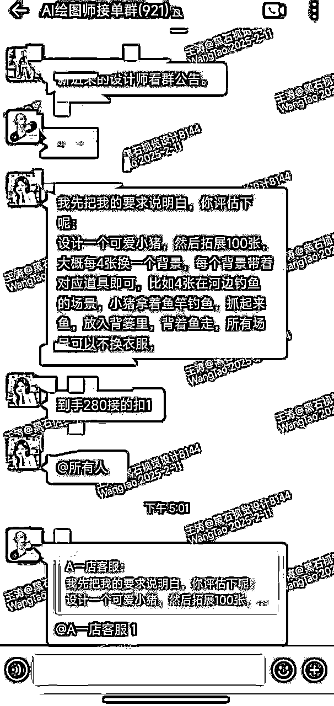

### 3. 硬件和软件准备

如果想在电脑上学习SD，至少要准备：

- 一台能够运行相关软件的电脑；
- 400GB以上的可用硬盘空间，用来保存基础模型、LORA和插件；
- 最好拥有12GB及以上显存的显卡。

我的设备情况可以参考下面的内容：

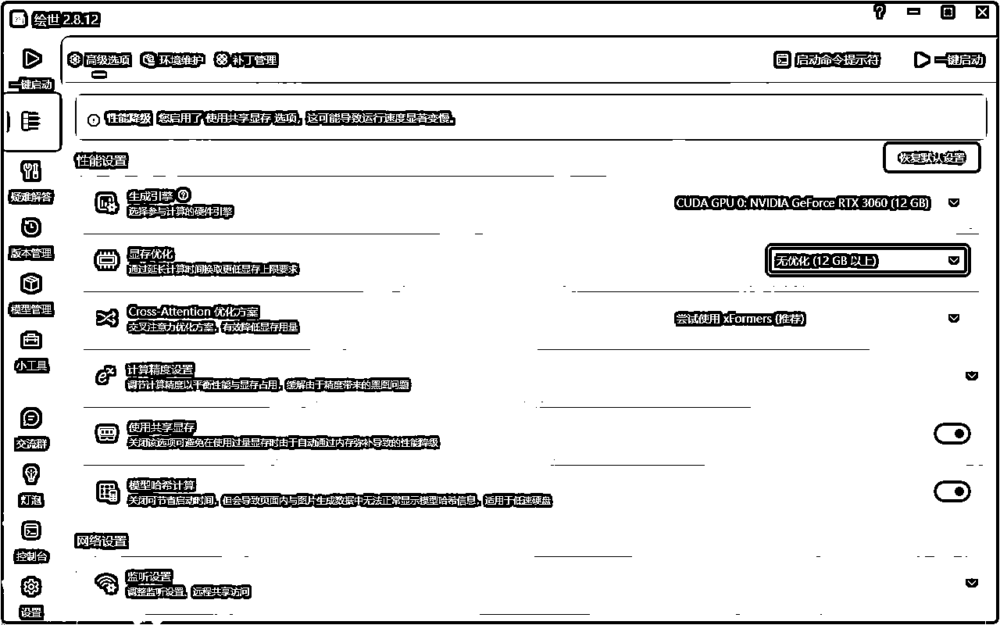

我使用的是秋叶制作的一键启动整合包，其中已经集成了不少常见模型与扩展。安装完成后即可运行，比较适合新手。

日常生成时，我会先采用一套相对稳定的参数：

- Steps：25；
- Sampler：DPM++ 2M；
- CFG：7；
- 高清放大：R-ESRGAN 4x+；
- 高清修复强度：0.3。

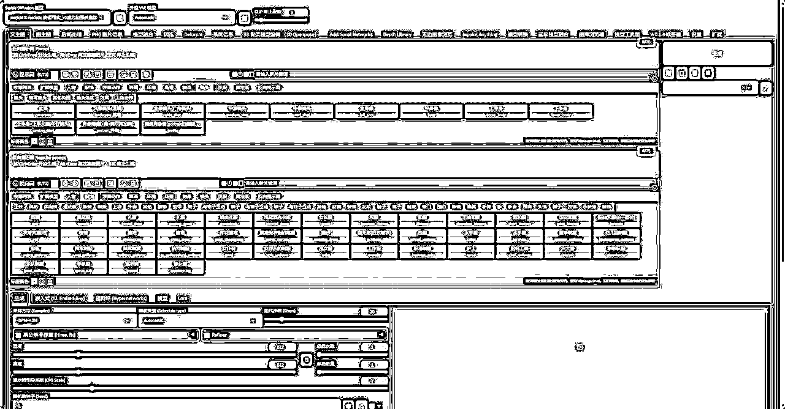

## 三、从学习到接单，我走过的三步

### 第一阶段：先把基础流程跑通

时间大约是第1至第7天。

这一阶段不用急着研究复杂功能，重点是熟悉操作界面，理解文字生成、图片重绘以及采样步数、CFG等参数分别会带来什么变化。

我的练习方式很简单：跟着视频教程复刻一些常见案例，例如国风人物、未来城市等。先完成，再逐步理解。

### 第二阶段：学习控制画面

大约是第8至第20天。

这时开始接触ControlNet等控制类扩展，重点处理人物动作、透视、手部结构等常见问题。

例如，可以用OpenPose读取人物骨骼姿态，也可以用Depth信息辅助建立前后层次。通过这些工具，画面不再完全依靠随机生成，而是能够按照参考结构进行约束。

### 第三阶段：把练习转成服务

大约是第21至第30天。

这时可以开始观察市场需求，例如商品视觉、角色设定、图片修改等，再针对不同风格研究模型，逐渐整理出自己的素材和工作模板。

### 我常用的学习来源

视频平台上有不少适合新人的教程。我当时关注过“Nenly同学”的相关内容，他会把基础操作、参数影响和常见扩展拆开讲解。之后如果要学习具体插件，也可以直接搜索对应教程。

比如：

- ADetailer：辅助处理面部细节；
- Tile：将画面分区域处理；
- GitHub：寻找社区扩展、模型训练脚本和相关资料。

### 新手最容易卡住的地方：模型选择

对我来说，最耗时间的环节不是操作，而是判断该用哪个模型。

不同模型有自己的训练倾向。写实类任务需要选择偏照片质感的模型，动漫类任务则应使用卡通风格模型。如果模型方向和需求不匹配，后面再怎么调整参数也很难达到预期。

我的做法是先确定目标风格，再集中测试同一类型的模型。与其盲目下载，不如边用边记录，慢慢建立自己的模型清单。

## 四、如何找到第一批订单

### 1. 在BOSS筛选岗位

搜索相关岗位时，我会重点看三个条件：

1. 明确属于兼职，而不是包装成高薪兼职的全职职位；
2. 支持远程或居家完成；
3. 最近三天内仍有招聘动态。

发布时间过久的职位，很多已经停止招人，继续沟通的价值不高。

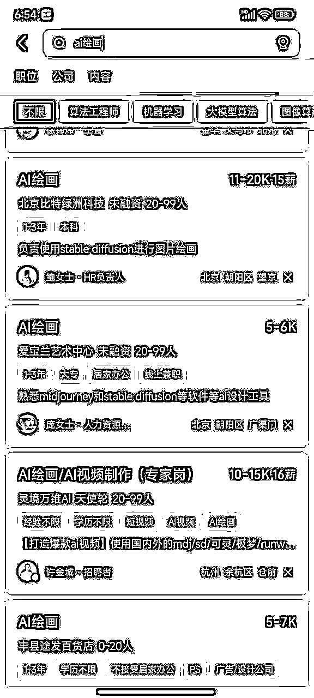

### 2. 我的第一单只有15元

刚进入接单群时，我并没有马上报名，而是观察了差不多一周：别人接什么需求、客户预算是多少、交付流程怎么走。

我一直担心自己做不好，被客户退回或投诉。后来有一单报价只有15元，交付时间也比较宽松，我想着即使失败，损失也有限，于是决定试一次。

没想到这单顺利完成，金额虽然不大，却让我获得了继续做下去的信心。

下面是当时的一次沟通案例：

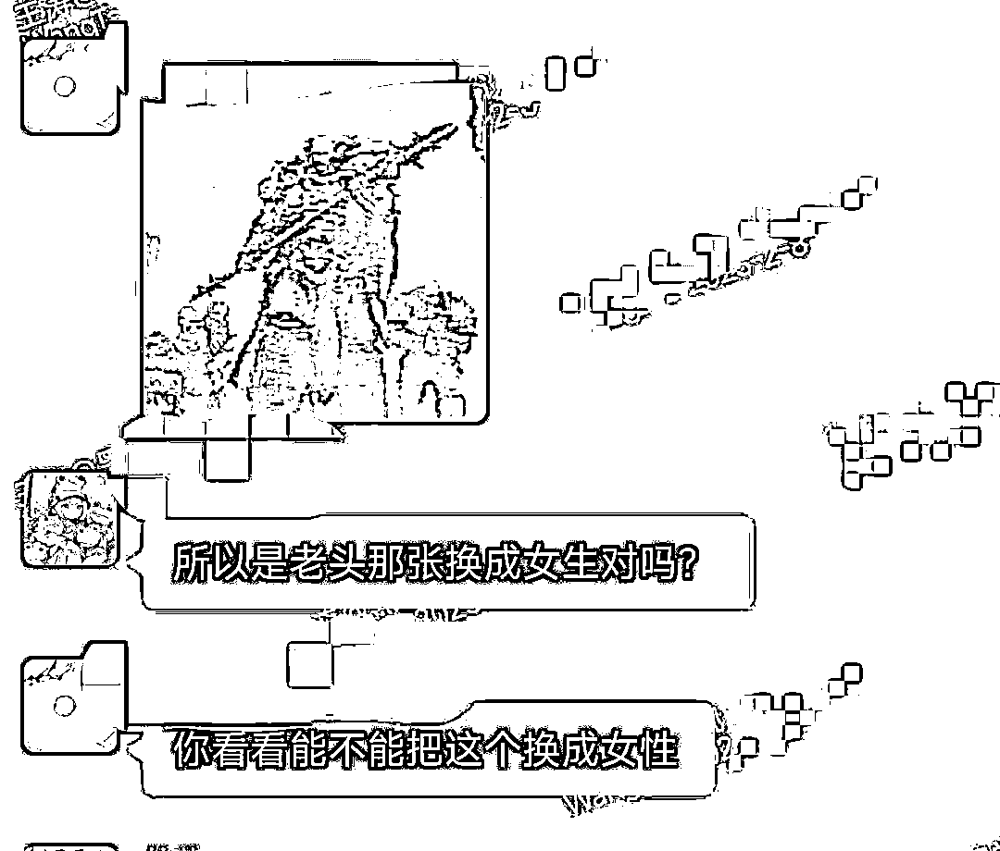

原图：

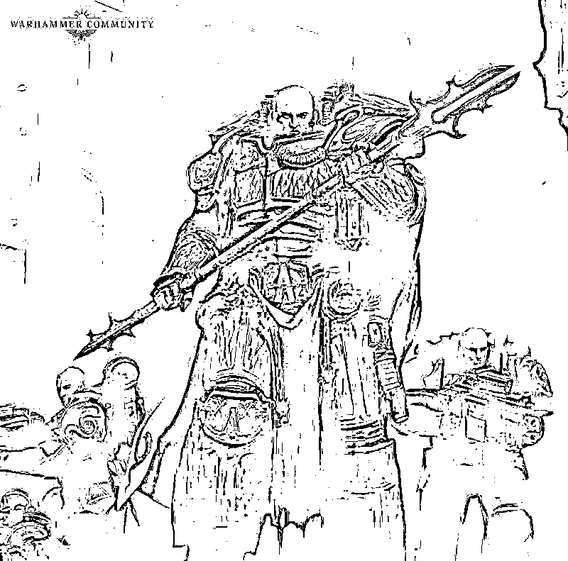

客户希望把画面中的三名男性角色改成女性，同时尽量维持原本的空间布局。

我的处理思路是：

1. 先判断原图的风格类型；
2. 使用ControlNet中的线稿提取功能，尽可能锁定原有构图；
3. 选择适合动漫风格的模型；
4. 用提示词反推工具读取原图信息；
5. 再根据客户要求修改角色性别、视线和细节；
6. 多轮生成并筛选结果。

反推得到的描述大致包括：明亮环境、中心人物、头盔护甲、长矛、蓝红配色、城市背景、两侧还有其他持械角色，以及高细节、绘画质感等信息。

随后，我将核心人物改为女性，并重新整理画面关系，保留服装配色、武器、背景和整体氛围。负面描述则采用常用的英文排除词，用于减少低清晰度、错误肢体、异常五官、多余身体部位、水印和画面污染等问题。

经过反复修改文字描述、调整参数并筛选结果，最终交付如下：

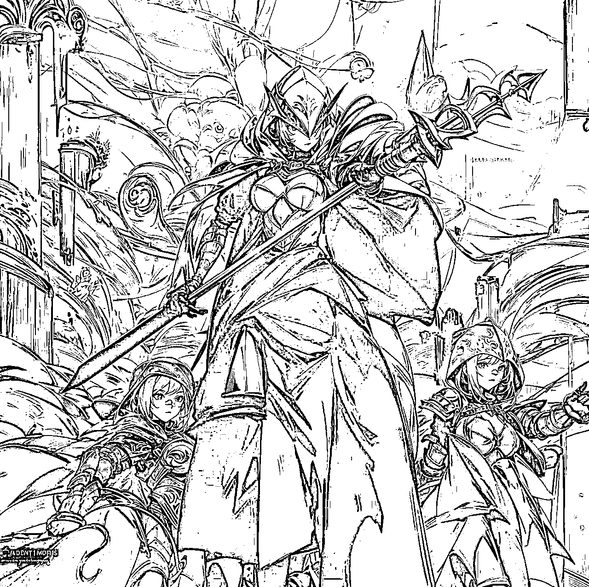

交稿前我其实很忐忑，因为之前已经有几位群友表示难以满足客户要求。直到客户回复“很满意”，我才真正放下心。

这次经历让我记住了一句话：作品是否合格，最终标准不是创作者自己的判断，而是客户是否认可。

### 3. 其他做过的项目

后来我还尝试过故事类内容和古典诗词相关的视觉创作，下面放一些成品作为参考。由于这些项目属于甲方委托，图片中可能带有版权信息，请勿直接使用。

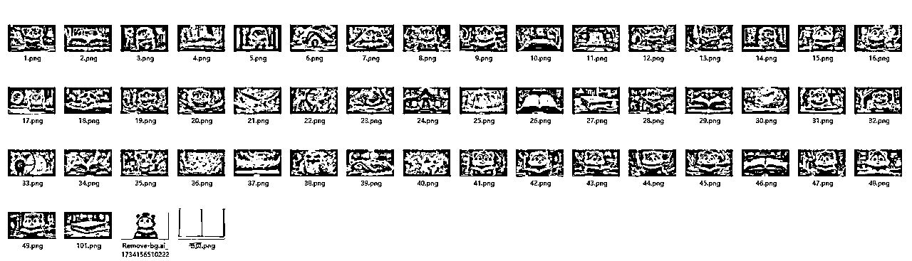

上面这个项目使用的是Midjourney。它在维持人物外观和整体风格方面比较省力，通过`--sw`、`--sref`等指令，并配合对应图片链接，就能较方便地延续角色特征和画面风格。

虽然过程并不完全省时间，但完成后确实积累了不少经验，收入也比最初的小单更可观。

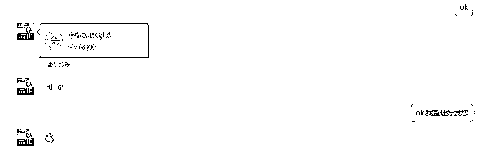

宋词成品：

## 五、真实投入与收入情况

### 1. 时间安排

我没有固定的每日工时。下班回家后，通常先查看接单群，看看有没有自己能够完成的需求。如果有合适项目，就和派单人员确认，再进入与客户沟通的小群。

有些项目我感兴趣，但当时能力还不够，也会先报名旁观，观察其他人的制作过程和阶段成果，把它当作免费的实战学习。

我觉得，副业和传统学习的区别在于，副业通常会带来更及时的反馈。每完成一个小目标，就能看到自己的进步，这种正反馈会推动人持续投入。

### 2. 收支明细

| 项目 | 金额（元） | 具体情况 |
|---|---:|---|
| 总收入 | 1037 | 独立订单5笔，共212元；视频相关制作55分钟，共825元 |
| 工具支出 | 75 | Midjourney两个月订阅费用 |
| 最终剩余 | 962 | 按当前统计，收益率约92% |

网络工具使用的是朋友提供的账号，因此没有另外计入费用。

## 六、给新人的实用建议

### 1. 不要一开始就急着报高价课程

如今很多产品已经把操作门槛压得很低，文字生成图片、图片转视频等功能越来越普及。对主要服务普通客户的新人而言，网上的免费教程、社区资料和实操练习通常已经够用。

与其先花钱报名课程，不如拿出时间多做案例，边做边记录问题。

### 2. 准备作品时，少而精就够了

寻找合作方前，先整理一个简单作品包即可，不需要堆几十张图。挑选自己最满意、风格差异比较明显的几组案例，例如：

- 卡通人物写实化；
- 为文字内容补充视觉场景；
- 人物或服装细节调整；
- 原图结构保留式修改。

卡通转真人：

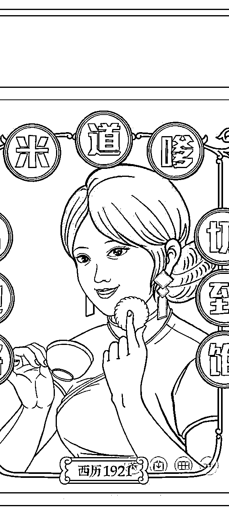

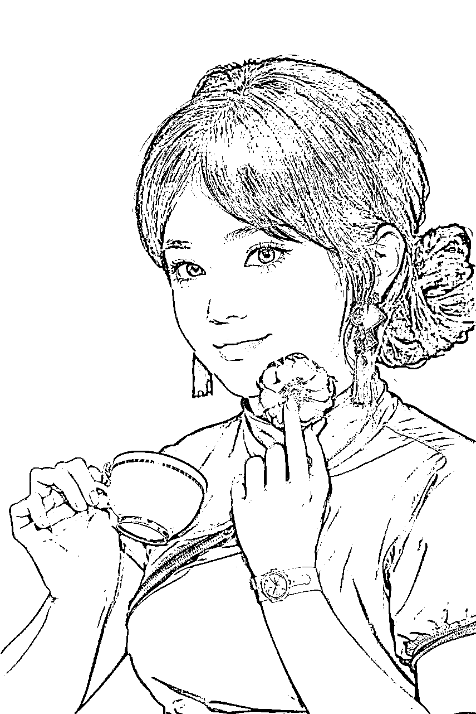

文字添加背景：

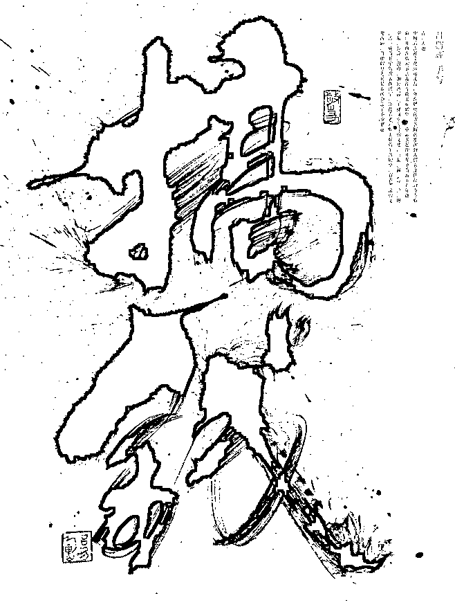

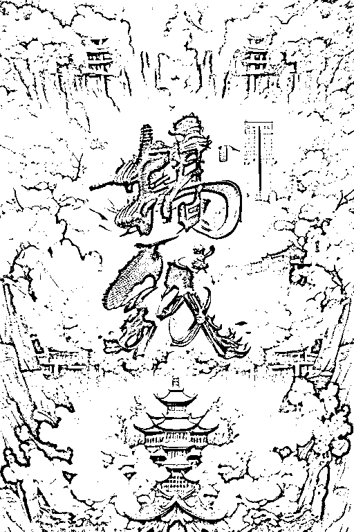

进入接单群后，通常会先在大群查看需求和预算，选中合适项目后联系负责人，再进入小群与客户确认细节。记得提前阅读群规，避免触碰禁止事项。

### 3. 客户沟通比闷头制作更重要

不要从头到尾只按照自己的理解完成。最好在关键节点发阶段成果，让客户及时指出偏差。

这样既能确认方向，也能减少做完后大面积返工的情况。

### 4. 新人要练习观察能力

刚开始时，多看别人的案例、多听客户反馈非常重要。我的第一次交付，自己原本觉得没问题，后来才发现画面里仍有不少细节错误。

这些问题并不可怕，关键是每次交付后都做复盘，逐渐形成自己的检查清单。

### 5. 自学能力和抗挫能力缺一不可

没有人会每天督促你学习，所以必须有持续探索的动力。

另外，生成结果带有一定随机性，并不是每次都能一次成功。遇到连续失败时，可以依次尝试：

- 更换模型；
- 重写描述；
- 调整采样相关参数；
- 改变参考图或构图控制方式；
- 缩小一次性修改的范围。

把失败当作排查变量的过程，心态会稳定很多。

### 6. 想获得更高收益，还要补营销能力

生成式图像适合作为低成本副业：工具上手相对容易，服务需求也在增加。但想长期做下去，不能只停留在软件操作，还要持续寻找更高效的工具和工作方式。

如果通过中间团队接单，通常只能拿到项目利润的一部分。我当时所在的团队，个人大约获得四成收益。未来如果想自己经营，就需要继续学习获客、内容推广和客户维护，才能提高议价能力与整体回报。

这就是我从一个没有设计基础的工科毕业生，到完成第一批订单的全过程。它不代表人人都能轻松赚钱，但至少说明：只要愿意持续练习、认真沟通，并把每次项目当成一次升级机会，普通人也能找到适合自己的切入口。

感谢阅读，也祝大家新的一年少走弯路、持续进步，找到真正适合自己的副业方向。