# 零基础0代码，用AI搞定📕爆款内容采集
作者：龙哥


新年好！先来个喜庆的开场。大家好，我是龙哥，ID就是宋老师帮你做课。过去三年我带过的知识付费赛道创作者超过2万，靠多平台多账号矩阵沉淀了将近10万私域。

在当下这个内卷到极致的自媒体环境里，我的实战结论很直白：抄、超、钞这套打法，比死磕原创起号快太多。我自己也发布了数千条短视频，最大的感悟是，稳定拿流量的根本是爆款选题。别总想着自己创造一个从未出现过的爆款，复刻已经验证过的选题才是正道。

做过短视频的人都懂，爆款从不是偶然的，但怎么把爆款找出来始终是硬伤。之前我分享过，市面上常用的采集工具是八爪鱼和后羿采集器，可现在各平台反爬机制越来越精，操作起来越来越吃力。

最近团队里一个00后小伙伴自学上手，直接用AI搭出了一款油猴插件——《📕信息采集器》。


这东西把我之前卡住的点一次性解决了，上手极快，代码我已经放后面了，感兴趣的可以直接拿去跑。我们现在也在持续迭代迭代，目标是把AI、知识付费和团队协作真正融在一起。不止教别人用AI，我们自己也要做AI的深度使用者和体验者。

# 一、采集插件实操指南👇

*   今天重点拆解一个油猴插件的脚本用法，可以批量抓取作品链接、作者昵称、作品点赞量、转发量、收藏量、作者粉丝量、发布时间、作者主页链接，数据能一键导出到本地，也可以直推到飞书表格里。

## 1.油猴插件

*   我用的Tampermonkey，如果你已经装过油猴，可以直接跳到开发部分。

*   安装方式很简单，打开浏览器右上角菜单，找到扩展程序。

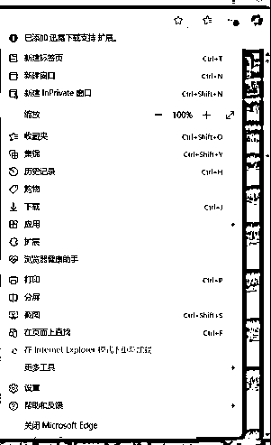

*   然后去商店里获取插件。

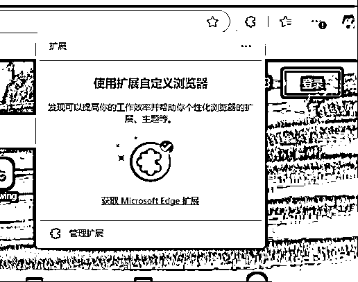

*   在搜索框里输入油猴或篡改猴，就能找到官方版本，点击获取即可启用。

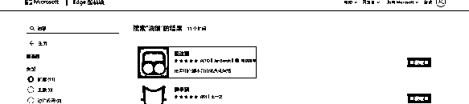

*   回到浏览器主页，就能看到扩展图标了。

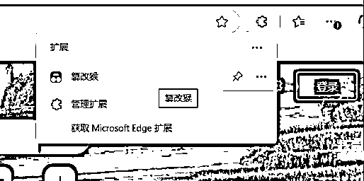

*   点开油猴，选择新建脚本，就能把代码粘进去了。

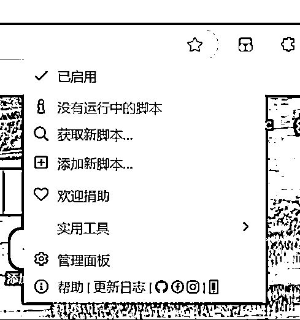

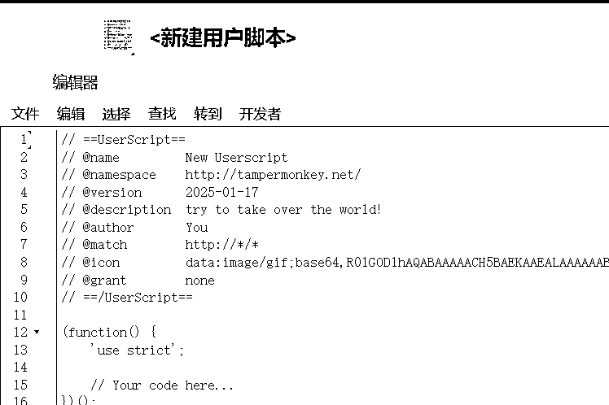

## 2.开发过程拆解

#### （1）初版功能搭建

*   最开始我们只是在GPT里说：我要用油猴采集📕数据，它就直接返回了可用代码。

*   之后再把具体的采集字段一条条喂给它。

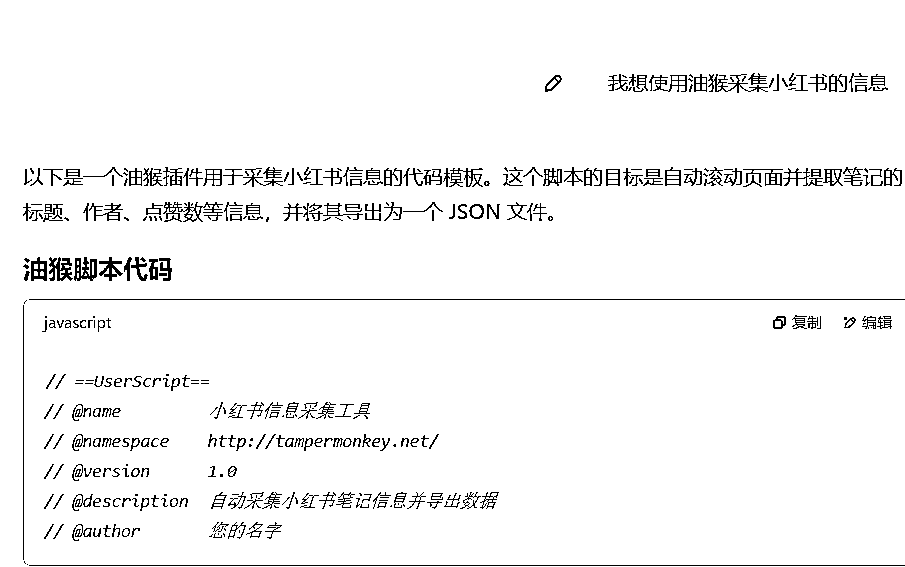

#### （2）功能逐步打磨

*   📕是无限滚动加载的，所以必须让GPT在代码里加上滚动触发和动态抓取的逻辑。

*   不同页面URL结构不一样，我们把所有可能用到的链接类型一次性丢给它，效果如下。

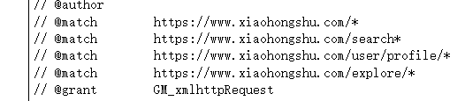

*   接着是路径修正。刚生成的脚本并不知道具体DOM结构，这时需要在📕页面按F12，把目标元素的HTML结构复制给GPT，让它来改路径。

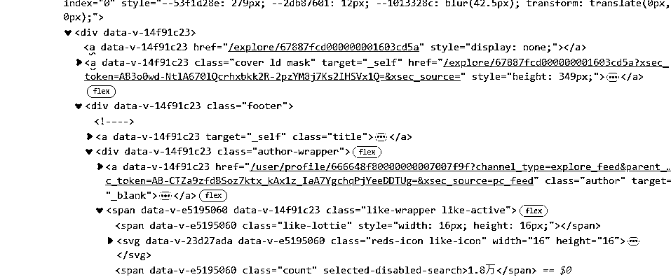

#### （3）进阶功能开发【仅限在线同步使用，离线可忽略】

*   后续可以在脚本里加上导出Excel和推送到飞书多维表格的功能。注意表格里的字段名必须和飞书表头一致，顺序无所谓。

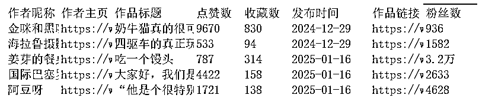

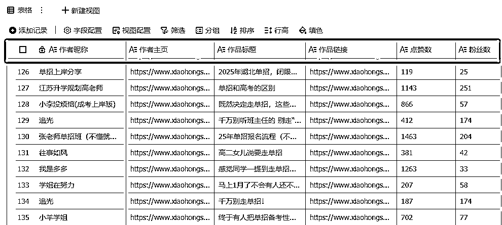

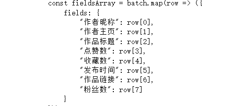

*   推送到飞书多维表格时要修改的部分代码，可以直接在飞书多维表格里找到对应的设置，替换成自己的就行。

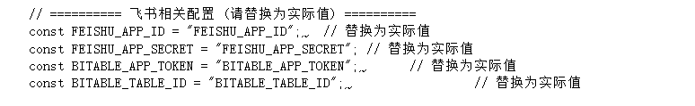

#### （4）体验优化

*   之后给脚本加一个前端操作面板。

*   开始/暂停按钮。

*   最大采集条数和点赞门槛自定义。

*   采集进度实时显示。

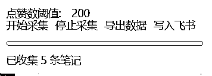

#### （5）代码迭代与扩展

*   到这一步雏形就已经出来了，之后不断把代码丢回给GPT，让它持续优化和扩展。

## 3.简易版代码【可直接拿去测试】

```
// ==UserScript==
// @name         📕采集工具
// @namespace    http://tampermonkey.net/
// @version      1.0
// @description  采集并导出为Excel
// @author       您的名字
// @match        https://www.xiaohongshu.com/*
// @grant        none
// @require      https://cdnjs.cloudflare.com/ajax/libs/xlsx/0.16.9/xlsx.full.min.js
// ==/UserScript==

(function () {
    'use strict';

    // 全局变量
    let isRunning = false;
    let stopScrolling = false;
    let collectedData = [];
    let statusElement;

    // 工具函数
    function delay(ms) {
        return new Promise(resolve => setTimeout(resolve, ms));
    }

    function updateStatus(message) {
        if (statusElement) {
            statusElement.textContent = message;
        }
        console.log(`[Status] ${message}`);
    }

    // 采集数据函数
    function collectNoteInfo(note) {
        try {
            const author = note.querySelector('.name')?.innerText.trim() || "未知作者";
            const linkElement = note.querySelector('a.cover');
            const noteLink = linkElement ? `https://www.xiaohongshu.com${linkElement.getAttribute('href')}` : "无链接";
            const likeCountStr = note.querySelector('.like-wrapper .count')?.innerText.trim() || "0";
            const likeCount = parseInt(likeCountStr.replace(/[\D]/g, ""), 10) || 0;

            return { author, noteLink, likeCount };
        } catch (e) {
            console.error("[Collect] 收集笔记信息时出错", e);
            return null;
        }
    }

    async function scrollAndCollect() {
        const seenLinks = new Set();
        collectedData = [];

        updateStatus("开始滚动页面采集...");
        let attempts = 0;

        while (!stopScrolling && attempts < 100) {
            attempts++;
            window.scrollBy(0, window.innerHeight);
            await delay(1500);

            const notes = document.querySelectorAll('div[data-v-14f91c23]');
            notes.forEach(note => {
                const data = collectNoteInfo(note);
                if (data && !seenLinks.has(data.noteLink)) {
                    collectedData.push(data);
                    seenLinks.add(data.noteLink);
                }
            });

            updateStatus(`已采集 ${collectedData.length} 条数据`);
        }

        updateStatus("采集完成！");
    }

    function exportToExcel() {
        if (collectedData.length === 0) {
            updateStatus("无可导出的数据");
            return;
        }

        const headers = ["作者昵称", "作品链接", "点赞数"];
        const rows = collectedData.map(item => [item.author, item.noteLink, item.likeCount]);
        const worksheet = XLSX.utils.aoa_to_sheet([headers, ...rows]);
        const workbook = XLSX.utils.book_new();
        XLSX.utils.book_append_sheet(workbook, worksheet, "📕数据");
        XLSX.writeFile(workbook, "📕采集数据.xlsx");

        updateStatus("数据已导出为Excel");
    }

    // 创建 UI
    function createUI() {
        const container = document.createElement('div');
        container.style.cssText = `
            position: fixed;
            top: 20px;
            right: 20px;
            z-index: 9999;
            background: white;
            padding: 10px;
            border: 1px solid #ccc;
            border-radius: 5px;
            box-shadow: 0 0 10px rgba(0, 0, 0, 0.1);
            font-family: Arial, sans-serif;
        `;

        const startButton = document.createElement('button');
        startButton.textContent = '开始采集';
        startButton.style.marginRight = '10px';

        const stopButton = document.createElement('button');
        stopButton.textContent = '停止采集';
        stopButton.style.marginRight = '10px';

        const exportButton = document.createElement('button');
        exportButton.textContent = '导出Excel';

        statusElement = document.createElement('div');
        statusElement.style.marginTop = '10px';
        statusElement.textContent = '状态: 就绪';

        container.appendChild(startButton);
        container.appendChild(stopButton);
        container.appendChild(exportButton);
        container.appendChild(statusElement);
        document.body.appendChild(container);

        startButton.onclick = async () => {
            if (isRunning) return;
            isRunning = true;
            stopScrolling = false;
            await scrollAndCollect();
            isRunning = false;
        };

        stopButton.onclick = () => {
            stopScrolling = true;
            updateStatus("已请求停止采集");
        };

        exportButton.onclick = exportToExcel;
    }

    // 初始化
    createUI();
})();

```

# 二、借助ChatGPT十分钟改写爆款文案

拿到高赞的采集数据后，下一步就是把别人的爆款改成自己的表达。

## 用ChatGPT做仿写

ChatGPT的写作能力很强，给到它清晰的指令就能输出可用的爆款文案。

前提是你的指令要够精确。

这里我就不展开说了，直接送一个我常用的ChatGPT写文案指令模板，大家可以自己试。

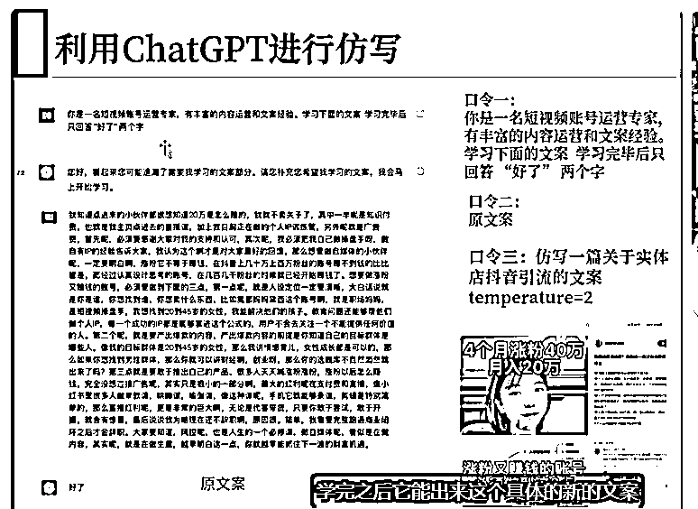

## 用自己的风格重写别人的文案

还有一个玩法我挺喜欢的。找一段别人的爆款文案，让GPT用我自己的口吻去改写，如图：

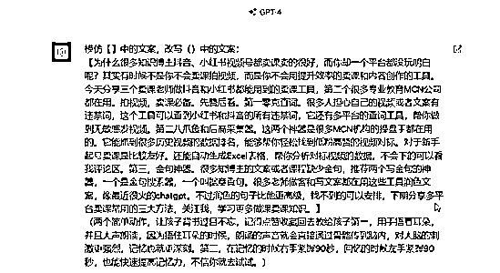

效果非常接近，几乎完全还原了我短视频的文案结构和语言习惯。

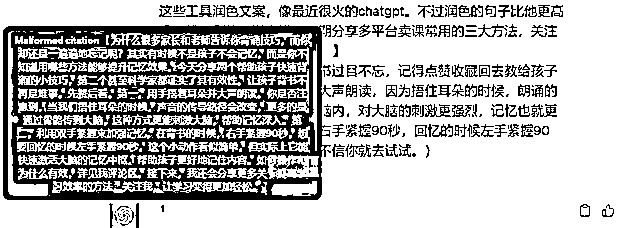

这就是AI工具的价值，效率远超人工，而且不会拖延、不会情绪化。

# 三、矩阵化运营引爆公域流量

有了采集和改写工具加持，3小时写100条爆款文案对我来说很轻松。

这时候别再单账号慢慢熬了，直接上矩阵。我和团队最近刚起一波矩阵号，公域上的账号已经铺得很多，每天新增流量持续在涨。

矩阵打法里有很多细节，今天篇幅有限就不细讲，感兴趣的可以私聊交流。

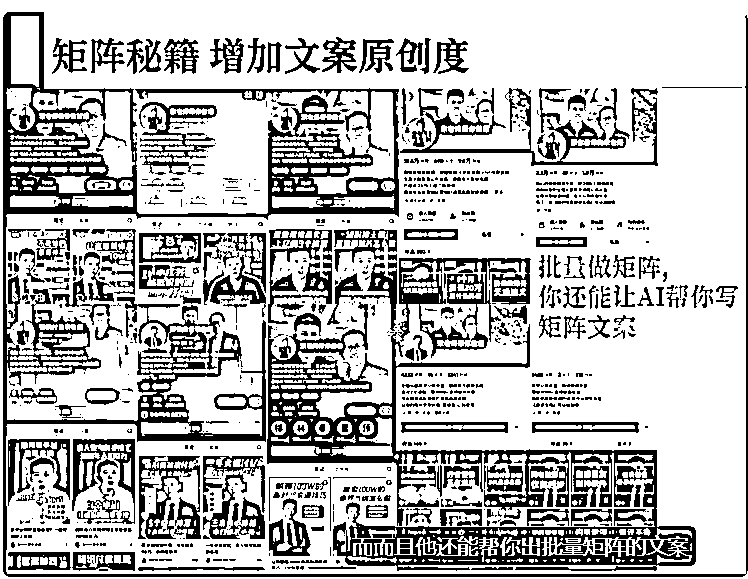

# 四、实战避坑总结

最后分享几个我踩过坑提炼出来的核心建议。

## 避坑1：没有爆款框架，就没有稳定流量

要在公域长期稳定引流，必须先沉淀出一套可批量复制的爆款文案结构。

已经爆过的选题和结构，会反复被市场验证，这点一定要信。

我们矩阵起号快，逻辑并不复杂，就是文案结构是固定的。

先让AI学会我们的爆款结构，然后让它稳定产出内容，批量分发到各个矩阵号。

这样效率最高，流量也最稳精准。负责私域转化的小伙伴只需要专注接量成交，业绩自然有保障。

知识类账号的爆款本质上都是在重复，只是你还没拆解出结构。

持续重复、稳定产出，你的流量才会持续增长，变现才会稳定。

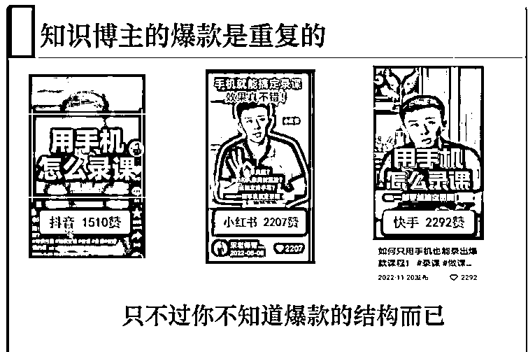

## 避坑2：别沉迷流量虚荣

很多知识付费从业者最大的误区就是追数据、追热点、要曝光。

结果是数据好看，播放高，但来的用户不精准，变现极难。

记住一个底层思维：

不要迷恋流量的繁荣，流量只是表面的繁荣。

为什么你的视频有流量却没成交？别再盯着点赞数了

做短视频卖课，最怕用错衡量标准。数据再好看，都不如实实在在的购课咨询量有用。我自己的例子：一条300赞的视频，看起来并不火，结果有将近100人顺着内容加我🛰️，开口就问课程怎么买。这种转化率，比百万播放却一单不卖要香多了。

秘密就在于，文案里安放了诱饵。这条诱饵会引导用户完成“看到内容→产生兴趣→主动联系”的路径。主动上门的全是高意向人群，后续根本不用我多费口舌，课程就卖出去了。这样卖课，又轻松又高效。

下面这条，是新手最容易踩的第3个坑。

## 避坑3：写作靠公式，别迷信人工

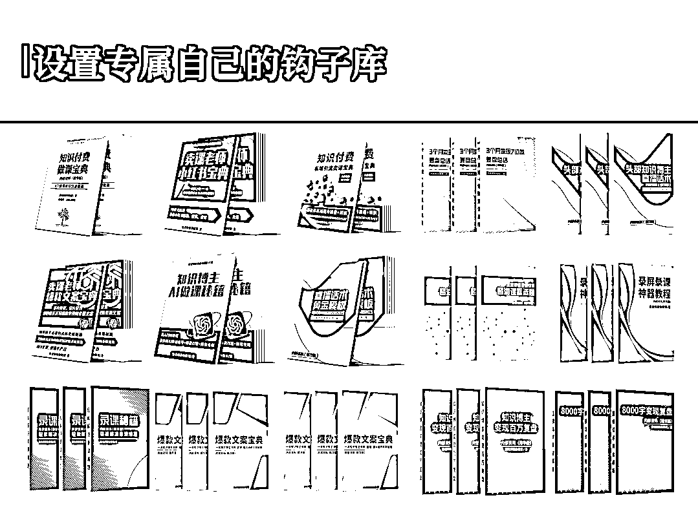

刚起步的时候，许多人容易陷入一种迷之自信：坚持“原创”，非要写出别人没说过的话。可现实很残酷，这种所谓的原创往往没有播放量，热情很快被消耗殆尽，开始怀疑自己，慢慢就拍不下去了。有个扎心的事实：绝大多数只做原创的知识博主，最终都成了烂尾工程。

而真正跑出圈的爆款文案，反而都是照着公式做出来的。越严格地套用，效果越出彩。我习惯这样解释：直播卖课像一场倾泻而下的瀑布，短视频卖课则是山间的小溪，流量虽然不大，却能一直流。一条好文案，相当于你的24小时自动售货员。我们团队就经常靠这种短视频日入过万，有时候还能破三万。

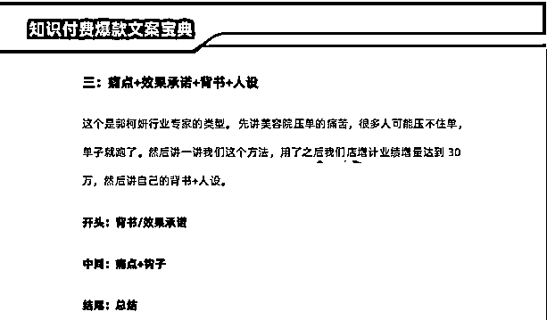

说到底，短视频的胜负手，永远在文案。文案也不用从零开始憋，用AI工具锁定热门选题，再照着爆款公式进行改写，内容自然就顺了。

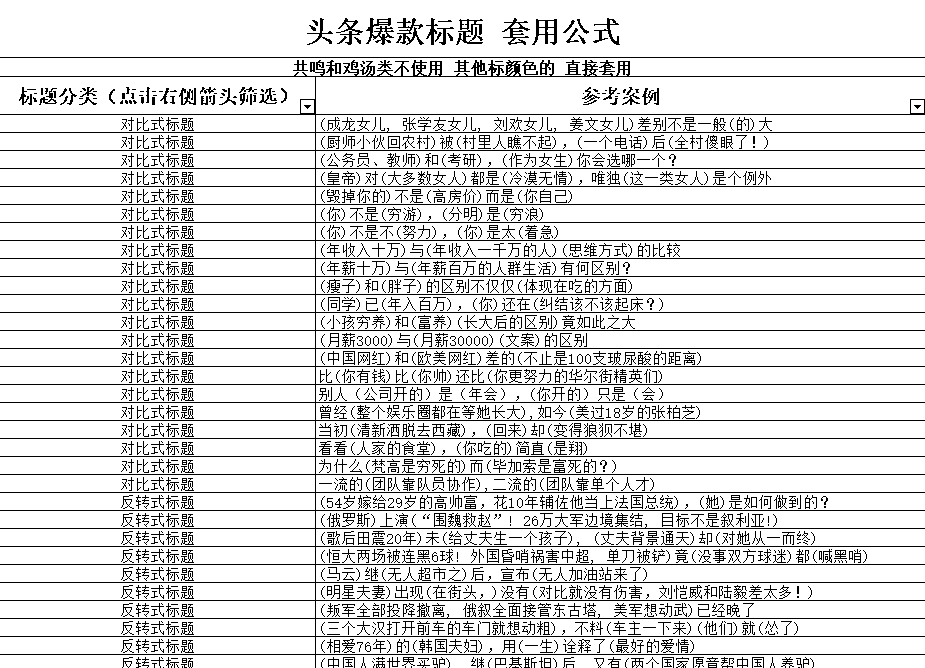

我整理了几十个爆款短视频文案公式，需要的朋友说一声，马上安排。

## 写在最后

不管你现在是刚开始尝试的知识博主，还是已经在知识付费行业拿到结果的人，都应该记住：凡是能靠工具迅速搞定的环节，就别拿时间去死磕。懂得借力、会利用工具的人，才跑得比同龄人快。比起埋头努力，你更需要抬头找路。

愿我们都能不依赖直播，只凭短视频达成百万变现。做课、卖课中遇到什么问题，也欢迎随时来找我聊聊。

往期精华帖：
《用【钩子打法】1年引流30000私域粉，卖课300w是什么体验！（附钩子制作全流程）》
《30天私域卖课60w是什么样的体验？》
《用Chatgpt 7天做了一套课，单月卖了1300单（变现52w）》