# 20篇笔记做起来，帮家里牛肉打包店干出持续不断的同城客流

大家好，我是蓝子鱼，从22年第一届📕航海开始就系统玩📕，到现在一直没停。

起步那会儿做教育号，两月涨粉30万，现在同样的方法，一个月也就勉强1万。竞争白热化，流量成本水涨船高，规则也越来越紧。

转折点在24年，我开始用📕做同城本地获客。做过几个线下交付的项目才发现，跟纯线上比起来好太多了。

我给家里人操盘了一个同城号，是一家潮汕牛肉现切打包店，肉在店里切好打包带走，不提供堂食。今年年初上线📕后，营业额同比多出来20万，最夸张的一个老客一年消费就超过8000。

# 一、为什么现在同城是红利

在我看来，📕本地流量的优势大致有这四点：

1、门槛低，容易复制。比起抖音、视频号必须拍视频、还要精细化运营，📕图文就能跑。制作成本低，普通人也能坚持做下来。

2、信息差明显。一线城市已经玩烂的打法，放到二三线还是降维打击。那里的人这两三年才开始大量用📕，店家也基本没布局。

3、搜索习惯变了。越来越多人用📕查吃喝玩乐，关键词只要被搜到，就能吃到精准的搜索流量。

4、用户质量高。评论区里基本都是直接问价格、问地址、怎么买，购买意愿非常强。

下面就聊聊我做本地同城的实操经验和踩过的坑。

# 二、同城项目怎么做

## 1、启动期

### 项目调研

家里的店是标准的潮汕牛肉打包站，每天早上从屠宰场进新鲜肉，客人来就现切打包。这种就是典型的社区生鲜小店，覆盖面很小，厦门不少小区底商都有，基本都是县城过来的人开的，卷得很。

社区店的痛点也很典型：客户基本就锁在周边几栋楼。刚开业新鲜，买的人多，后面变成周周买，再变成一个月一次，生意自然下滑。

要想活下去，必须不断补新客+做老客复购。📕正好能把覆盖面从几栋楼扩到全厦门，近的到店，远的用达达、滴滴送。

年初接手时，我先去搜了下厦门的潮汕牛肉笔记，全站就一家，内容质量还很差。看了下广东其他城市，笔记也不咋样，但评论区全是咨询。由此判断，这题很简单，优化一下就能出效果。

### 账号准备

养号套路网上很多，厅卡注册早中晚各刷15分钟、看流量的那种。我只说几个实操点：

老号没发过内容可以直接用，之前发过不相关内容的建议注销重来。尽量别多号同登录，用切换登录，长期跑流量会差很多。

②主页搭建

用户点进来先看主页，信任感就看这几秒。昵称最好带品类+地域，比如 厦门+店名+品类。

头像可以用门头照，或者老板和产品的合影。

简介别写废话，要写清身份、经验、优势和位置。

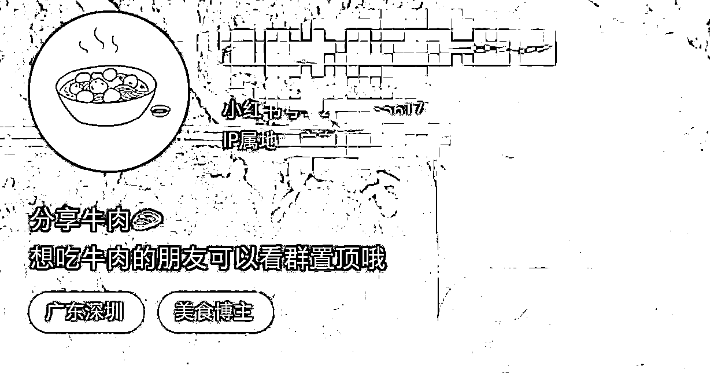

建议写法：写明身份、从业年限、产品优势、门店位置。
举例：
我是一位土生土长的潮汕人
专注新鲜牛肉已经超过10年
肉都是当天现到现切
店在……

## 2、内容搭建

第一步永远是找对标。去找同城里做得好的账号，直接抄作业。

本地获客比纯电商好做，商家内容普遍很土。

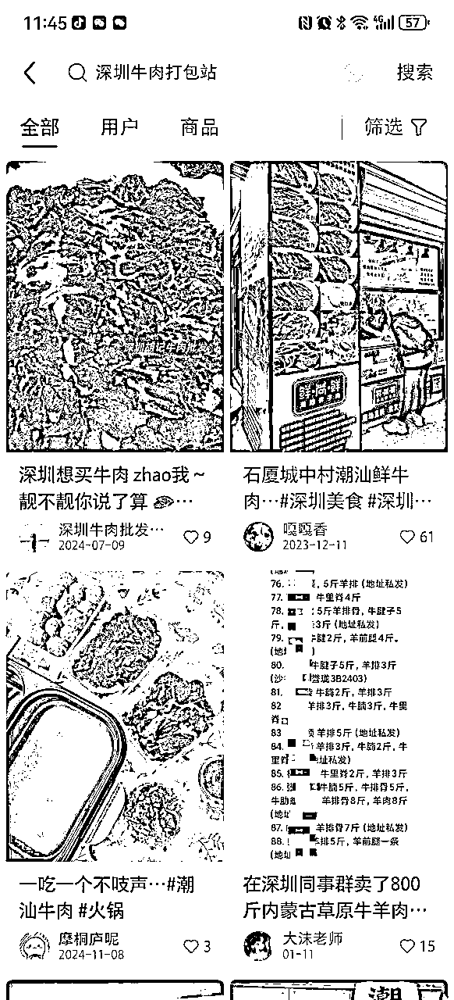

看对标时我会一篇篇点进去，先看评论区，咨询多的就是有效笔记。然后拆封面、标题、文案结构。

📕是双瀑布流，用户感兴趣才点开，所以封面和标题比抖音重要得多。

同城引流可以拍实物，但封面必须好看，📕女生审美高，光线、手机都是细节，苹果拍出来更通透。

美食照片一定要有食欲，下面这种一看就觉得不新鲜。

其他类目封面参考：
服装类：挑几套爆款搭配，暖调光线。
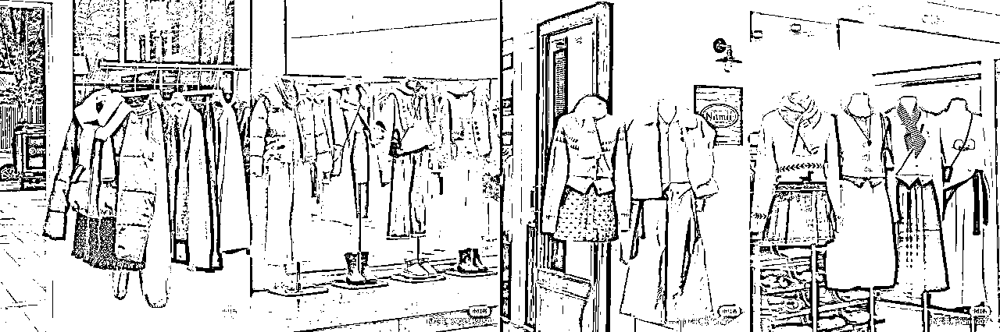
同城活动：线上海报线下成交，直接把活动照拼图。

美食商家：把食物拍得诱人。
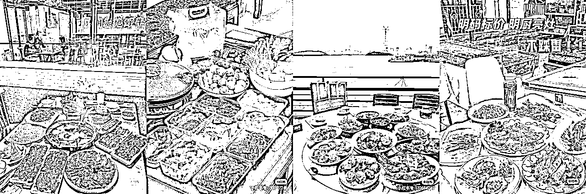

笔记标题：最省力的部分。找同类探店号抄，再把关键词换成自己的，可以重复用。

文案内容：同城笔记就是一篇销售信，把用户顾虑提前讲清，看完不犹豫就直接问价。

牛肉打包客户最关心三点：新鲜、价格、方便。

突出新鲜：
（这家店的肉每天都是新鲜现杀，早上屠宰场送来还是温的。很多潮汕火锅店的肉都是从这家老板批发出去的。到店可现切，品质看得见，吃得放心。）

突出便宜：
（这家肉比火锅店便宜太多了，火锅店一盘2两的量，到店能买半斤。两个人吃到撑，人均50+，比吃火锅划算太多。）

突出方便：
（老板直接切好打包，回家就能开吃。店里每天现熬牛骨汤，香到离谱，还免费送辣椒酱、沙茶酱，味道跟在潮汕吃的一样。不方便到店可叫达达/滴滴，懒人福音。）

制作极简：每天把打包好的肉排桌上拍一张，把上面的段落排列组合，十分钟一篇。

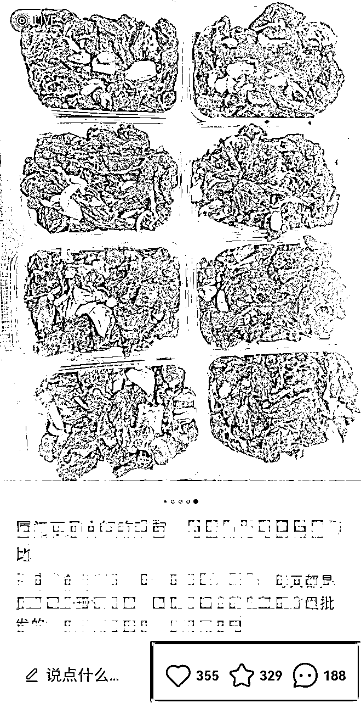

其他品类也一样：把客户痛点列出来写成问答，就变成引流文案。十几个行业都验证过，效果都不错。

提升搜索曝光
有些品类靠推荐，有些靠搜索。像桶装水配送这种，非刚需时根本没人刷，只能靠搜索。

提升曝光的关键：不违规限流+笔记互动+发布数量+关键词布局。

关键词在：
1️⃣账号昵称
2️⃣笔记标题
3️⃣正文文案
4️⃣蓝色标签
5️⃣门店地址
6️⃣评论区

新手写几篇就能上手，至少比90%的同行强。

# 三、如何把流量转到店/私域

官方对引流管得很严，流量起来后很容易被重点关注。我一个号三天涨千粉，发几次🛰️就被永久限流了。

只能说流量好的号不开聚光，引流没有百分百安全，做好随时被限的准备。下面是我在同城项目里用的相对安全的做法：

1、笔记带地址
有实体店一定要在地图上认领门店，发布时带上地址。用户能一键导航到店，搜索附近店铺时也会优先推。地址旁会显示手机号，习惯用美团/大众点评的人会直接打电话，电话里再引导加🛰️。

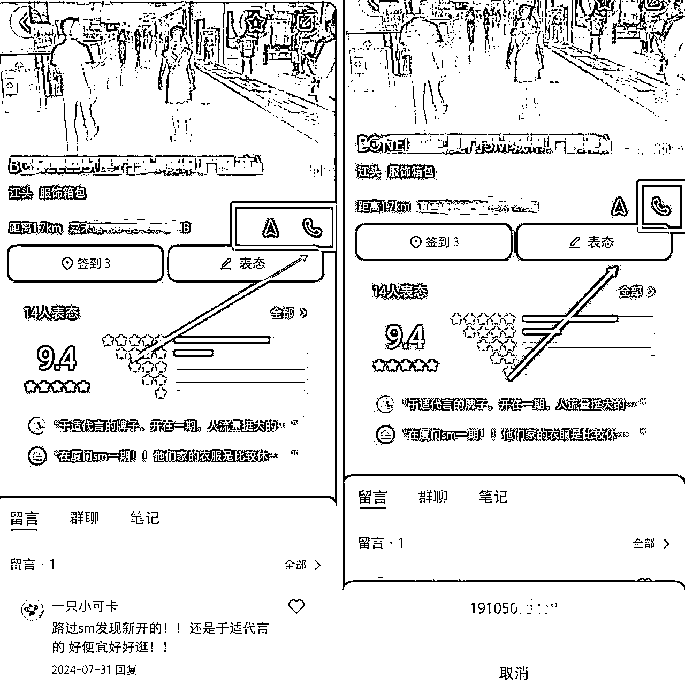

2、门头带手机号做头像/笔记
把带手机号的门头照当头像，或者直接发成笔记，存活时间很长，不容易违规。

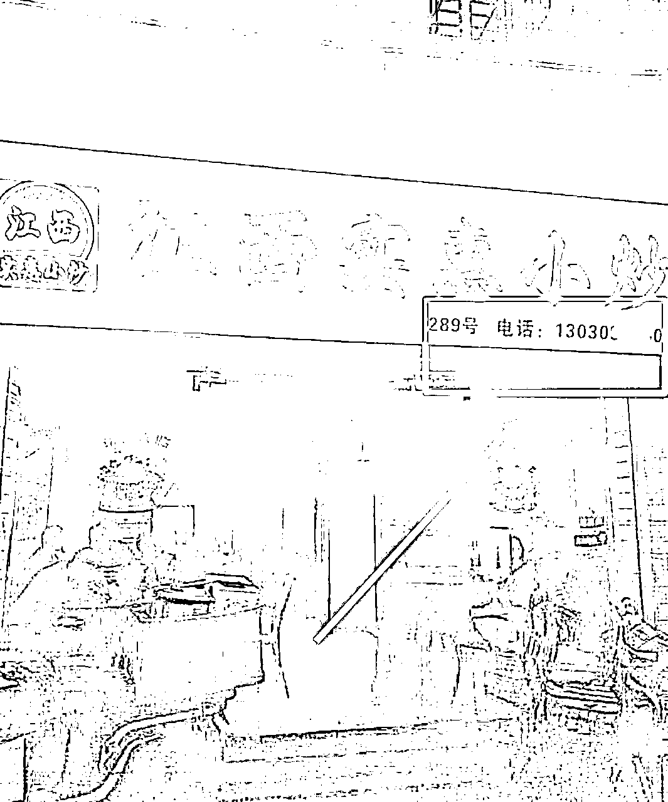

3、粉丝群
建个粉丝群，把意向用户拉进去，用小号在群里发带🛰️的图片或表情包。

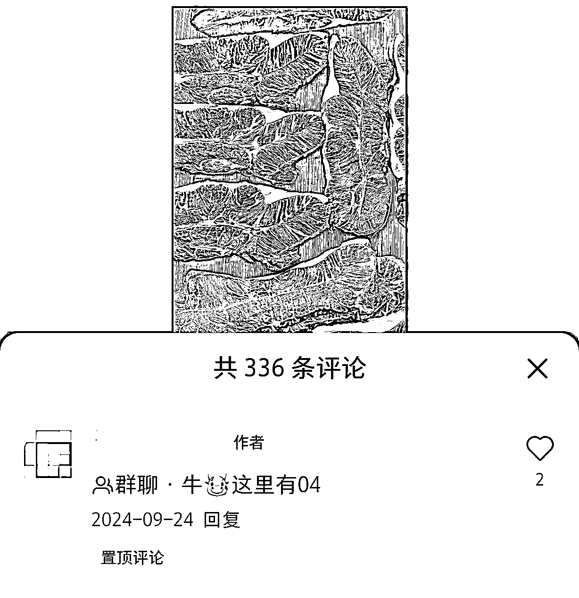

群内引流示意：
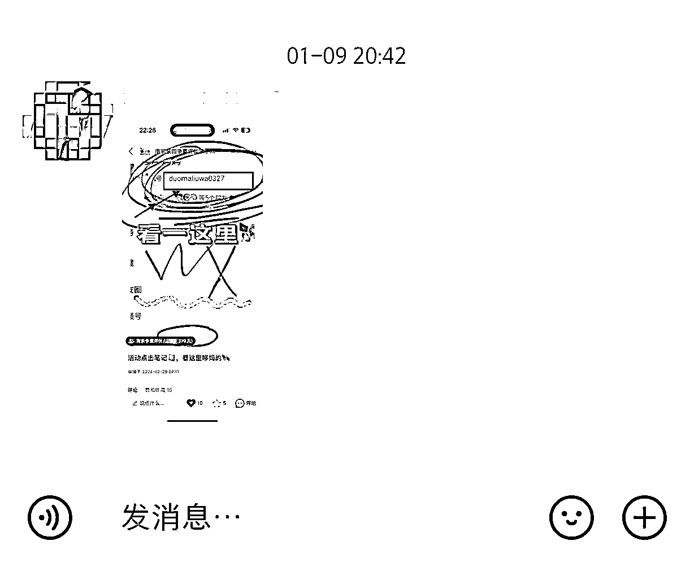

也可以直接把群昵称改成🛰️号，群头像换成🛰️图标。

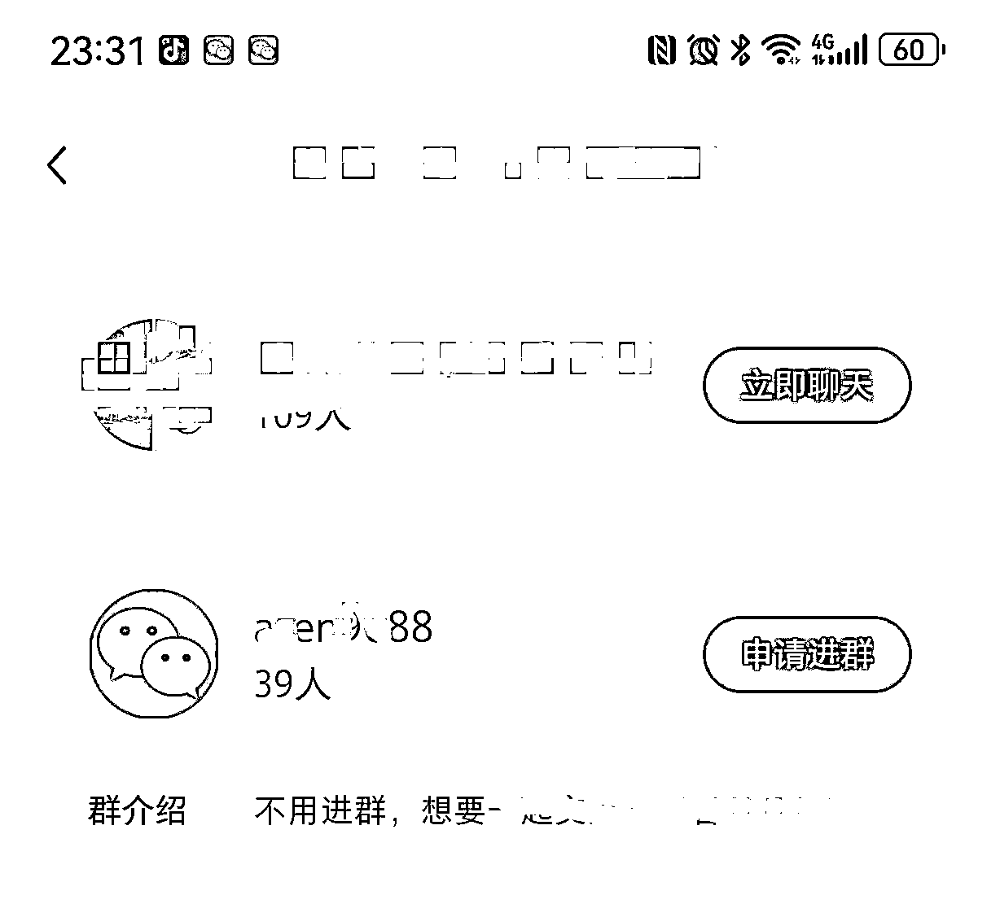

4、账号瞬间
手写🛰️号做成瞬间，风险相对低一些，🛰️号集中在一个瞬间里。

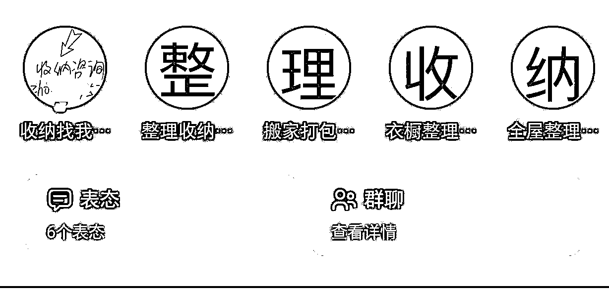

# 四、做同城的体感

以前做纯线上，转化率低，还要跟全国的正规军拼。现在实体商家连图都拍不好，更别说文案了。

📕做同城，只要图片素材拍得像样一点，套个固定模板，坚持一个月就能看到效果。成交率高，用户能到店或知道地址，线下交付的品类加🛰️成交率基本能到50%+。

算法对同城推得也很准，记得带城市，纯到店类的外地基本成交不了。下面是我们账号的地区分布。

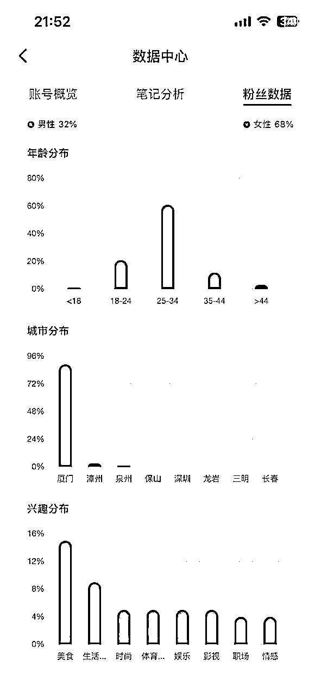

用户都很直接，看完就评论私信问价格和怎么买。

现在不做线上获客，新店很难活。隔壁看我们生意好直接开对面，三个月就关门了。身边朋友两三个月倒闭的也不少。

我们靠📕引流了2000多人，爆的时候后台根本回不过来。

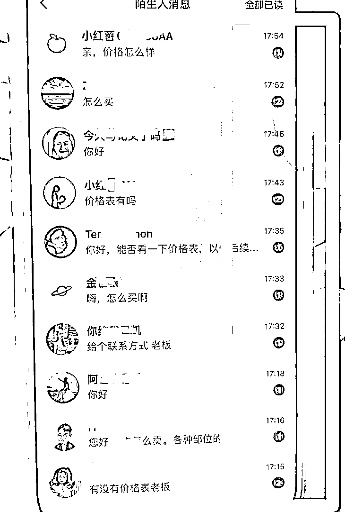

号跑通后就交给店里人运营，期间两次违规引流被限流两周，主要是用户咨询时直接发🛰️被抓。解限后流量还在，现在不发笔记每天也有五六个咨询。这个号一年才发20多篇。

目前门店肉经常断货，周末节假日下午五点就没了，很多是私域老客提前预定。所以没继续放大，也没投聚光。如果是可规模化品类，可以用聚光放大+矩阵。

后面我又测了多个项目，发现同城流量更友好，客单价还能做高，还能延展出新利润点。很多美业、服装店都从临街搬到写字楼，因为临街贵没流量，全靠线上引流。

如果你有门店、有产品、有服务同城用户，一定要做📕。很多城市很多类目还是空白，纯线下做生意太难了。

本地同城也能孵化出新的商业机会：帮商家做📕，或自己深耕一个赛道。欢迎交流。