# 做了1年多AIGC工具，月产11万条视频后，我们把这些踩过的坑都讲清楚

> 我们的产品上线一年半，迭代了20多个版本，现在每个月大概会帮用户生成11万+条视频。很多圈友也在用，趁着24年底，把这一年多攒下来的经验、掉过的坑，一次性和大家聊聊。

## 一、我们为什么做这个产品：被“素材荒”逼出来的

很多人问，为什么做AIMIX智剪？说白了，最早就是解决我们自己的问题。

21年我们在生财跟着做了抖音带货短视频，一开始靠自然流，便宜但不稳定，后来账号多了，又上了千川投放去放大爆品，结果素材需求量暴增。每天要么在找素材，要么在剪视频，根本没时间去优化选品和投放。

当时想偷懒，就在Boss上找了几个兼职剪辑，我把素材给他们——一部分是我自己买的，一部分找商家要，不够的他们再自己找。价格已经压到很低了，一条成片5到15块，看时长算。但一天素材生产成本也要一两百，一个月下来几千块，这哪受得了。

我们就琢磨，有没有低成本做素材的工具？市面上试了一圈，要么太复杂，要么功能不对路。后来自己动手拆解生产流程，发现这东西其实没那么玄乎，关键问题是很多产品压根没把业务模型抽象好。有的产品上百个功能、一堆参数，用户一看就懵，连我们用户都吐槽：“这是给程序员用的吧。”

所以我们就用第一性原理重新拆了一遍：一条视频就是多个素材叠一起，比如画面、解说、BGM、字幕、标题、贴纸。要批量生产，就得有个脚本来定规则，每个脚本里有分镜，每个分镜指定用什么素材。想产得多、还能重复，就得准备好足够多的分镜素材，排列组合越多，成片越多。

如果只看剪辑这一步，它只是整个流程的最后一环。真正完整的流程可以分成四步：编、拍、剪、投，对应四个岗位。编就是编导创意，这个最关键，脚本质量直接决定成片好坏。影视飓风也说过，编导是他们流动性最高的岗位。拍就是拍摄/摄影，二创的话就是素材收集，最好顺手做粗剪、分镜、归类。剪反而是最后一步，把前面准备好的素材按脚本批量合成。这个流程各行各业都能套，老板和达人可以在上面搭自己的玩法。

## 二、创业这件事，更像开车，不是造火箭

说实话，我们一开始也没规划得多详细。白手起家，没资源没经验，哪能一步到位？《精益创业》里有个比喻特别好：创业是开车，不是造火箭。开车走错路口，你不会掉头回家，你会接着开，不断修正方向，最后到公司。造火箭不行，得提前把每一颗螺丝都算好，错一点都不行。

开车上路，导航不精确也没关系，先有个大概方向就踩油门，路上再慢慢调整，总能到终点。所以你要是想创业或者搞副业，先干起来再说。生财里项目那么多，总有一个适合你。没思路就常来逛逛，遇到问题也能在这找到答案。

创业路上不可控因素太多了，尤其做AI产品，技术一天一个样。我们有两个心得：第一，别盲目追风口，风口变得太快，你可能产品还没上线，风就停了。第二，一定要做有门槛的产品，否则大模型下一次更新，可能就把你干掉了。这其实也是个管理问题——既要保证功能正常交付，又要管理各种风险。而且“交付”不光是功能本身，还包括售前介绍、用户使用、售后服务，整条体验链路都得让用户觉得丝滑。

用户觉得你的产品有价值，才会愿意付费，才会帮你背书，口碑慢慢积累，品牌就出来了。这是做长期产品的路子。如果只想赚快钱，那是另一套玩法，不在这聊。

找产品价值的过程，其实就是在找PMF。这个过程可能很漫长，但一旦找到了，增长是指数级的，前期慢一点没关系，爆发的时刻总会来。YC创业导论给的思路也是：先做好产品，听用户反馈不断迭代，找到增长点，再用黑客增长去放大。但要记住，黑客增长只是放大器，不是杀手锏，得在PMF已经成立的基础上用，否则反而会起副作用。

没有产品是一开始就全部规划好的，都是边做边调，这叫“干中学”。你对比一下我们最初的版本和现在的版本，核心功能只是优化，其他部分早就换了不知道多少轮了。

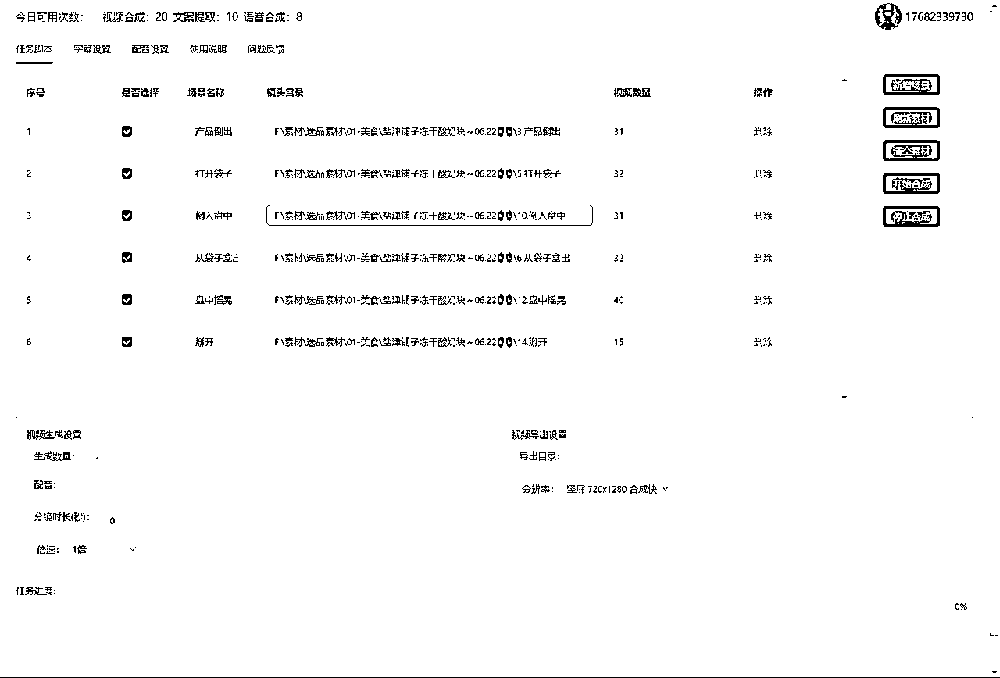

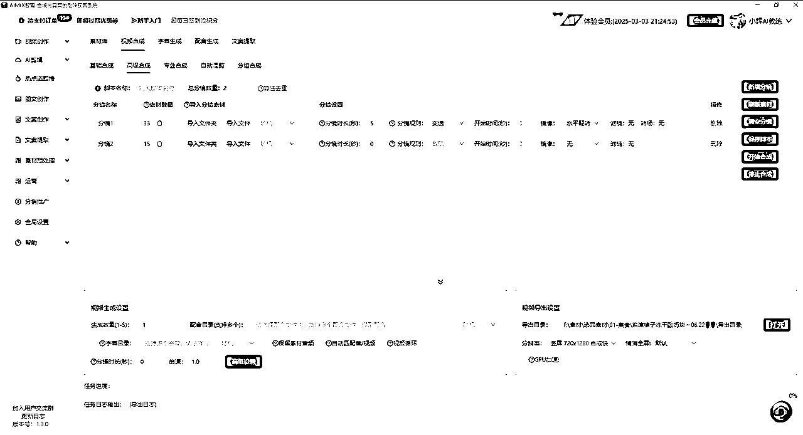

## 三、做之前没仔细调研，后来补了份市场分析

坦白讲，一开始没做详细市场调研，一个是自己确实有需求，另一个是觉得同类商家和达人肯定也不少。但后来要跟投资人聊融资，也要让团队成员认知对齐，就专门补了一份分析，摘几段出来分享：

互联网发展到现在，内容创作方式从PGC、UGC一路走到AIGC。基建越来越完善后，AIGC的优势就很明显了，能从基础素材到成品内容提供一站式服务，大大降低了创作门槛和成本，让普通网友也有机会展示自己。以前只有专业创作者才能做内容，现在中国10亿多网民，都可能轻松做出文字、图片、长短视频。AIGC让潜在创作者规模暴涨，内容产量也是指数级增长。

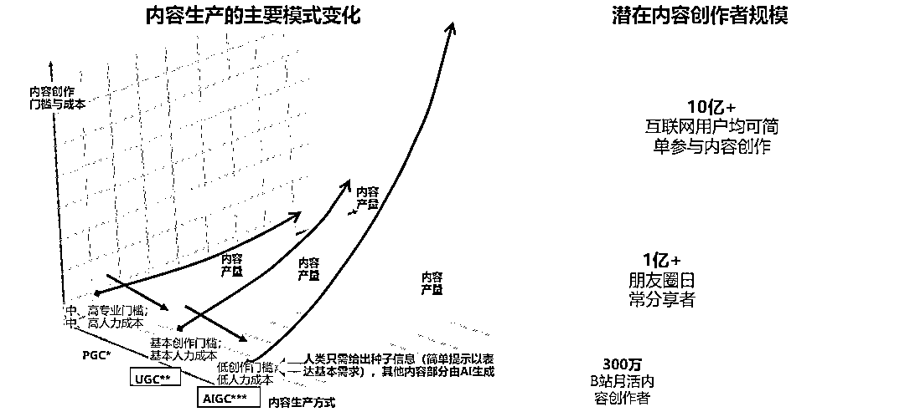

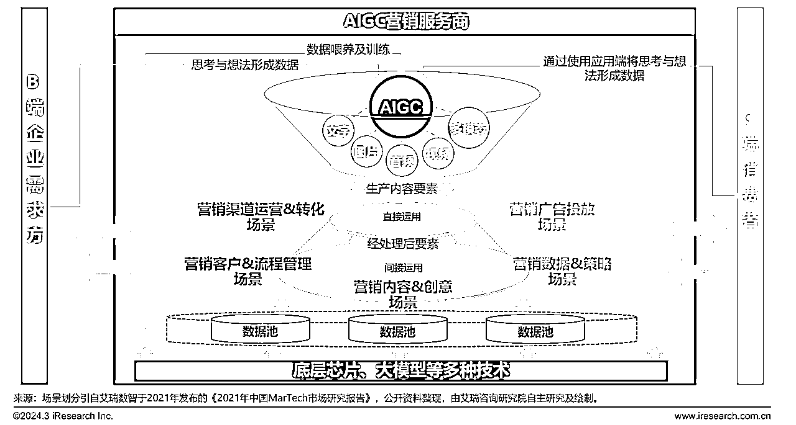

AIMIX智剪目前盯的是营销场景的两块：内容生成&创意，还有广告投放。营销内容生成是整个链路的第一环，必须先把创意定了，后面方案才好落地。内容生成的效率和质量，决定了营销方案的上限。广告投放则是放大器，能把方案效果放大好几倍。

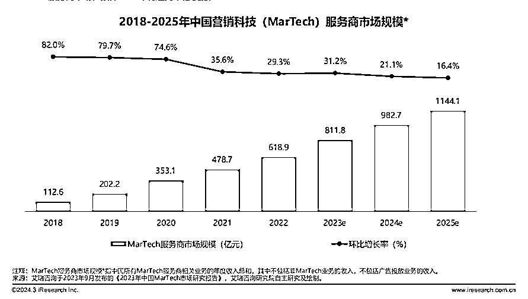

## 四、产品功能怎么设计？从工作流里长出来

需求清楚了，才开始设计功能。不过我们产品一开始没那么全，体验也一般，毕竟做的是客户端，挑战比SaaS大多了，这个后面细说。

正常做产品的套路，是先做数据分析和竞品调研，比如看关键词的需求量、竞品的盈利空间。这些我们当时都没做。一是本身就懂行业和业务流程，二是对这个需求有预判，市场正在AIGC红利期，能干，就干了。

设计前也简单看过几个客户端竞品，当时连筷子这类SaaS产品都没了解过。看完感觉他们既不懂产品设计，也不懂用户需求，那我们就有信心了。

### 量产合成

产品设计主要从两方面入手。

第一，按工作流做“单点功能”。这样通用性最好，用户可以自由组合自己的工作流，不会被预设流程绑死。

第二，把批量合成抽象成几种需求：一是顺序混剪，可以在成片里加标题、配音、背景音乐、字幕；二是无序混剪，也就是随机组合素材；三是AI成片，用户操作很简单，系统自动批量生成音画匹配的视频，本质是把整个流程自动化和智能化。

批量混剪满足了量产需求，但还有个新问题：素材重复使用，视频重复度会很高。人工根本看不过来，所以得靠算法去重，我们就自己设计了一套去重算法：

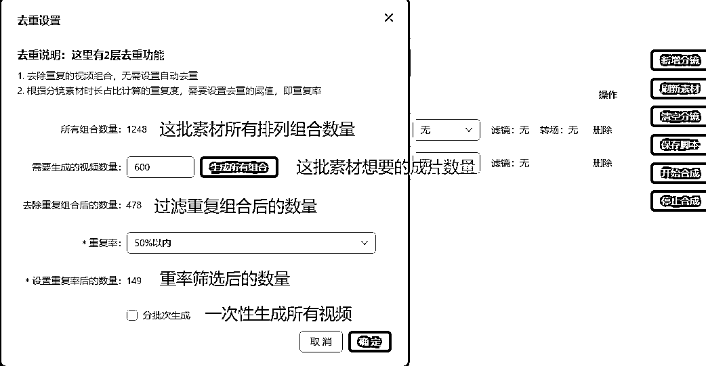

### 素材预处理

原创素材可以直接合。二创素材就得先“洗”，多两道工序：一是分镜，把长视频切成很多短视频素材；二是去重，提升素材原创度。

**素材分镜：** 二创混剪的核心是重新组合，所以先拆。我们做了多种分镜方式，按画面、按时长、按数量、按口播都能切，基本覆盖常用需求：

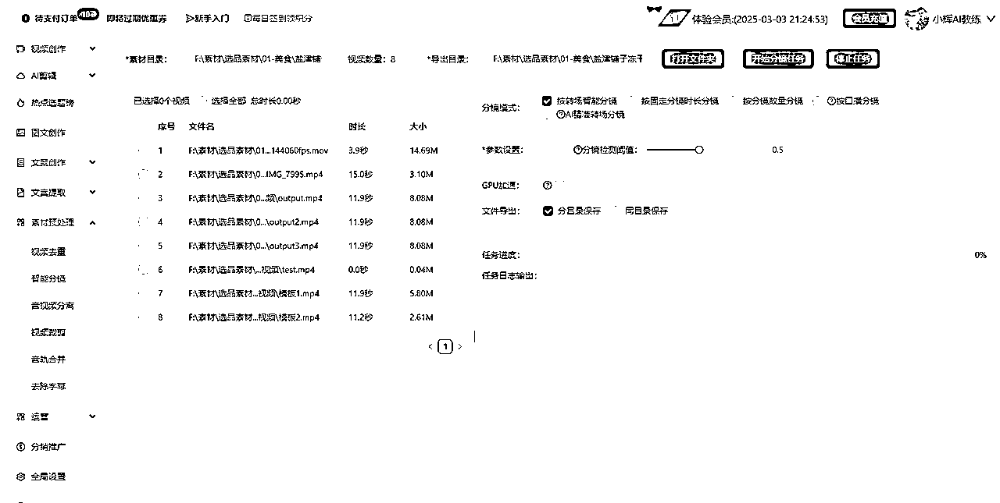

**视频去重：** 混剪本身就是最好的去重，但数据显示，真正有能力原创素材的人还是少数。那就从素材层面提高原创度，成片自然更稳。具体做法就是改变原画面的表现：调色、叠加图片/视频、随机变速、抽帧、加特效……既变了画面，又不太影响原素材：

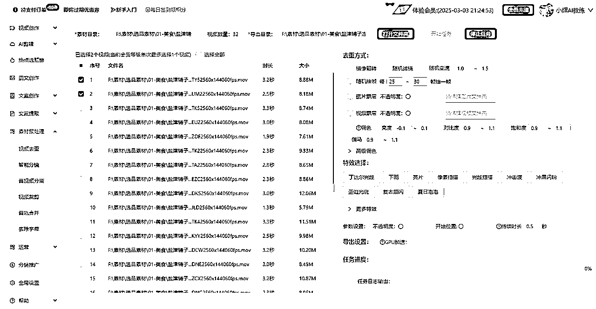

### AI成片

AI成片几乎成了AI剪辑产品的标配，但很多都是营销噱头，没什么真AI，有的只是拿音频文案去匹配和剪辑，这种只适合口播，营销带货根本没效果。我们的思路是尽量通用，让AI真正“看懂”画面和音频文案，再根据用户给的文案去匹配素材，这就要用到多模态大模型了。国内模型效果还差点意思，我们也在找效果好又便宜的方案。这个功能刚上线，准确率还不太行，营销类视频效果尚可，圈里有好方案欢迎来聊。

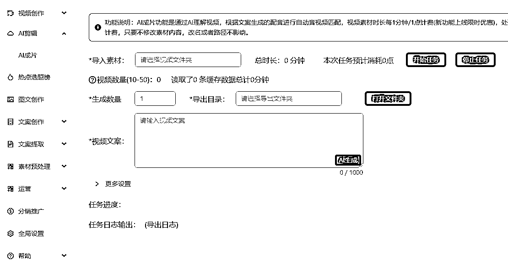

## 五、编码实现：AI已经干了1/3的活

产品设计定下来，编码反而简单，照着实现就行，而且现在AI能写大部分代码。但产品要持续加功能、优化，可能多人协作，所以技术架构设计和工程化工作流还是得提前做好，比如敏捷开发，不然代码根本没法维护。

现在我们开发流程是这样：

每个功能设计其实就是一个假设，要通过用户反馈或埋点数据去验证。做完看数据，再决定是优化还是砍掉。

流程里能自动化、能交给AI的，绝对不手写：

### 用户需求收集

除了跟用户聊、看竞品，我们还会用自动化方式收集需求。比如用AI智能客服，把用户没被回答上的问题全部记下来——这些大概率就是真实需求，只是产品还没满足。我们专门用扣子搭了个客服工作流：先识别用户意图，是产品问题就去检索产品知识库，把问题和回答记到多维表格。这有两个用处：一是人工可以辅助回答，AI学完人工答案后下次答得更准；二是能发现哪些需求还没被满足。

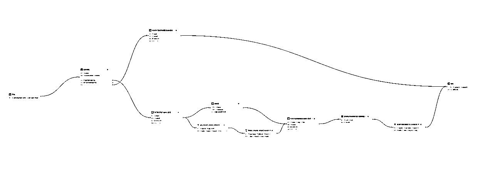

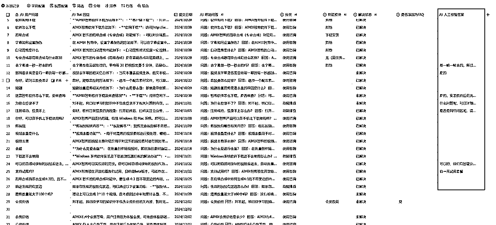

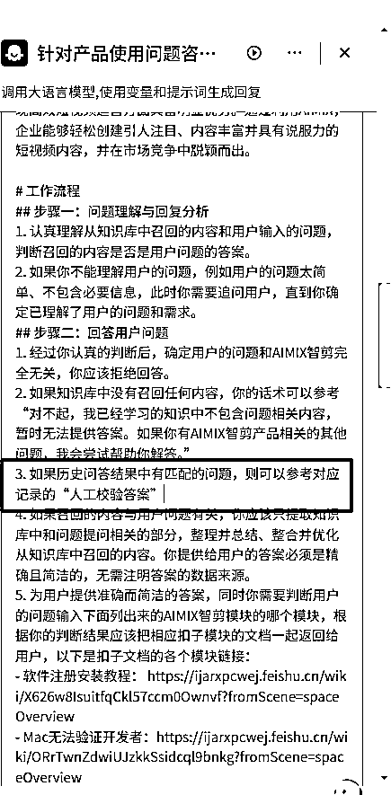

### 代码开发

我们的客户端代码有7万行，去掉格式化文件大概四五万行，其中大概1/3是AI生成的。模型和工具也换了好几轮：最开始用ChatGPT生成再复制粘贴，挺麻烦的，尤其改测试代码的时候；后来用Copilot插件，能在编辑器里提示补全，但还是不够顺滑；直到用上Cursor，直接就能在编辑器里生成和修改代码，还能通过代码评审的方式改，效率一下子起来了。

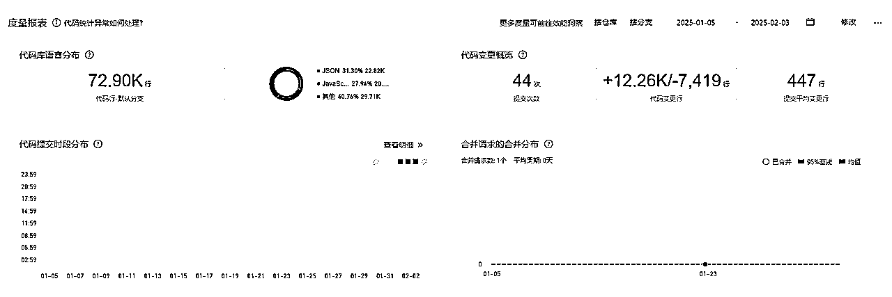

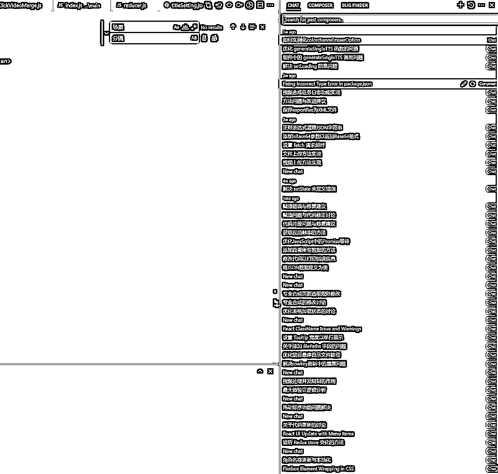

写前端页面的时候，用Cursor直接生成HTML+CSS+JS一步到位。排查Bug也很爽，可以把多个代码文件一起丢给大模型当上下文，效率极高。比如我把页面报错直接扔给AI，它自己就能分析出代码里的缺陷：

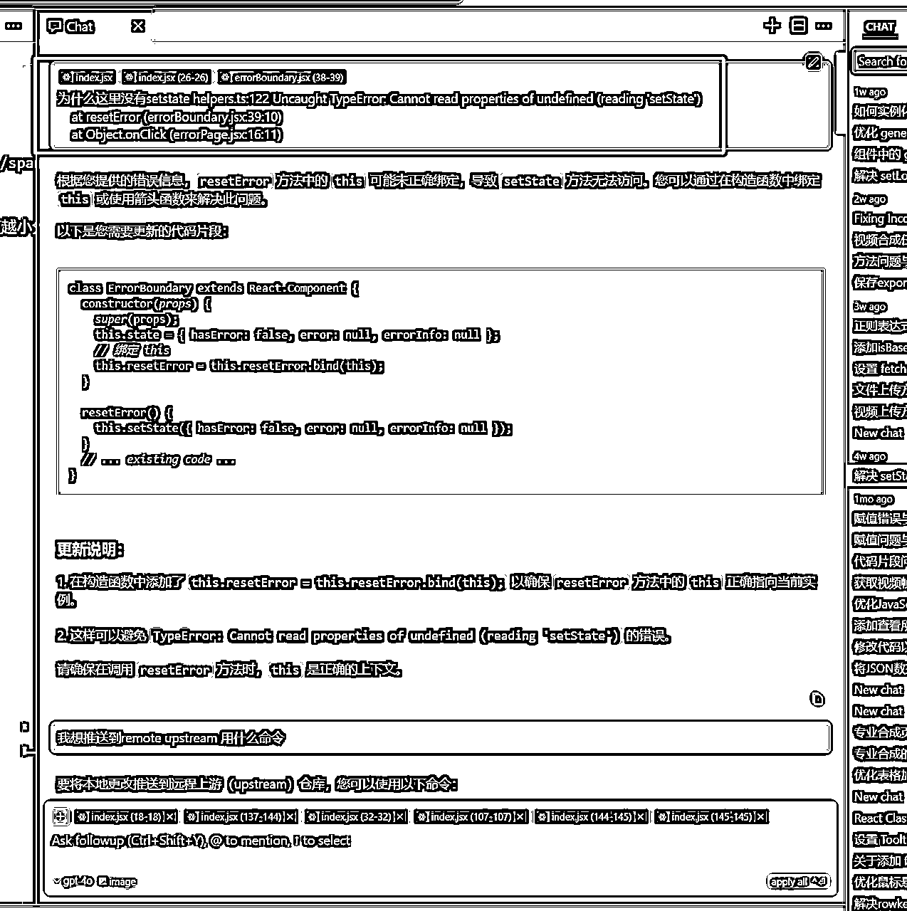

再比如我不擅长写正则，这种活AI干特别合适：

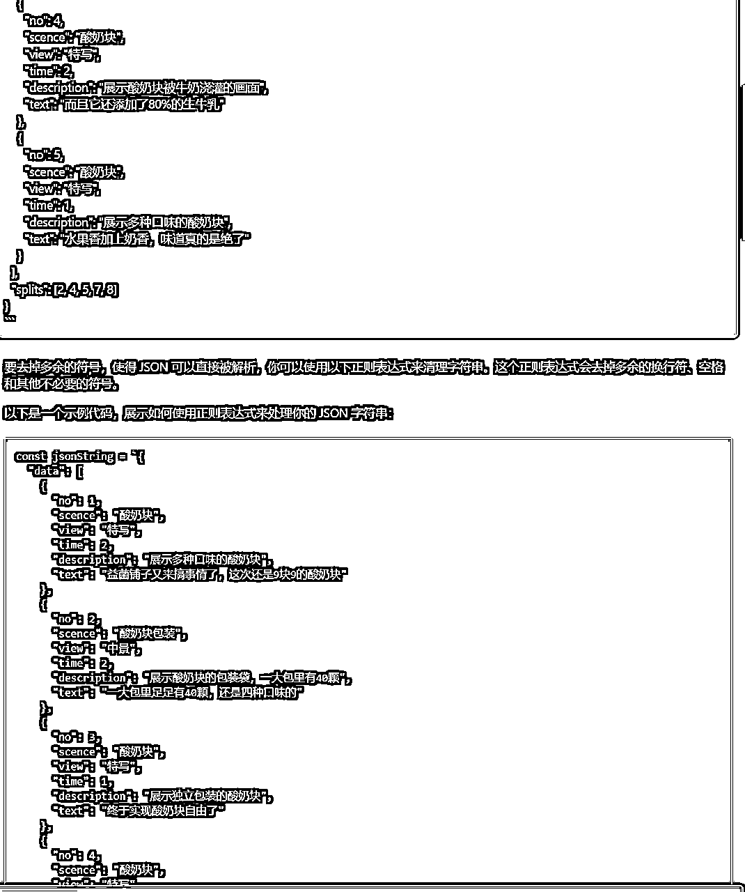

模型方面，Cursor里可以选很多模型。大部分时候Claude 3.5效果比GPT-4好一点，o1是最强的——它真会推理，遇到逻辑复杂的代码，别的模型容易死循环，o1会推完再给你好几个方案。我们不少关键技术问题都是靠o1解决的。

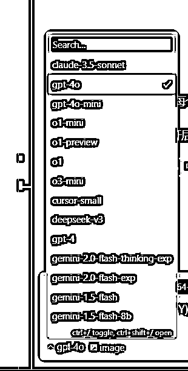

Cursor收费，试用到期后只能用简单模型。不过它支持自定义API，可以自己配OpenAI、Anthropic、Google或Azure的key，按量付费，用得不多比包月便宜，而且包月还限次数，这个坑要注意。

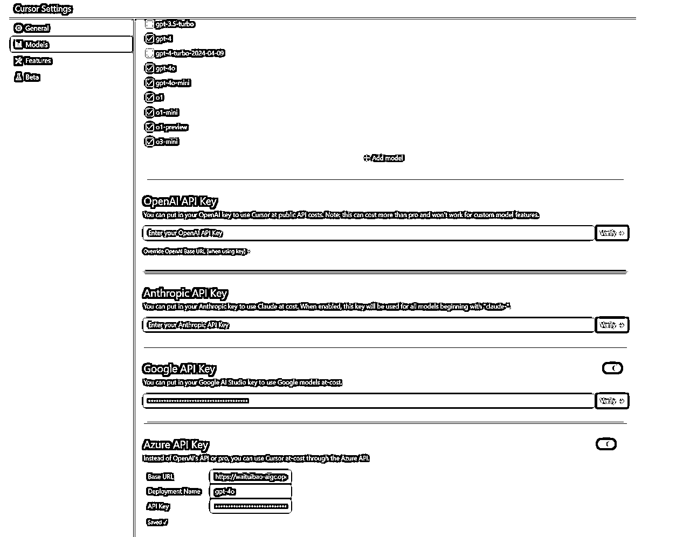

### CI/CD

开发过程中要频繁发布、测试，上线之后还要持续迭代，这些流程都可以自动化。我们用代码托管平台的CI能力做持续交付，比如阿里云效的流水线：

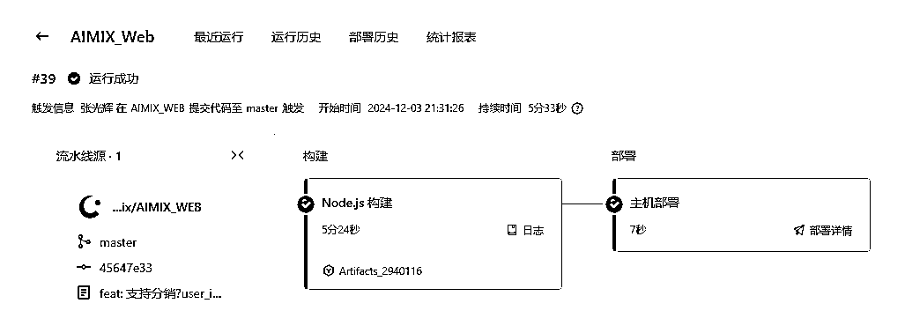

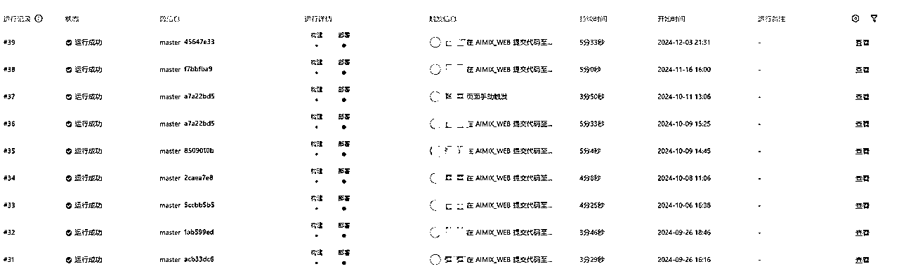

发布后会自动推微信通知，人不用一直守着等构建。

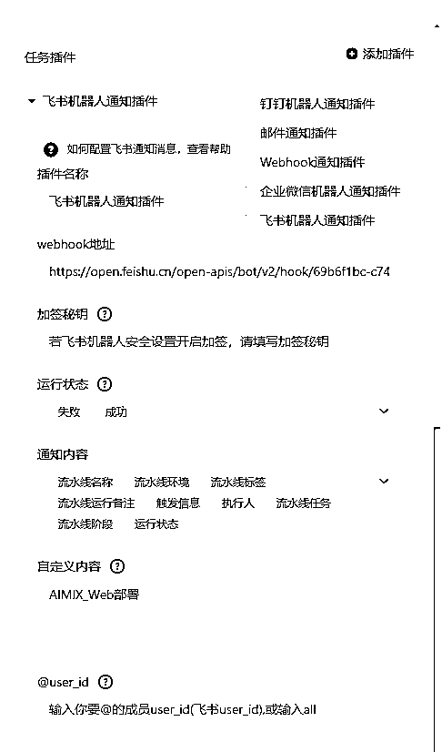

另外特别推荐GitHub Action，灵活又强大，还支持SSH发布。我们有个功能要部署到AutoDL，因为那是Docker容器，装不了Runner，就用Action构建。这里有个坑：GitHub服务器在国外，往国内服务器部署经常超时，文件一多更明显。我们的解法是：先上传到腾讯COS（COS支持全球加速，也可以直接选国外区域存储），再从COS下载到服务器，就顺多了。

---

以上就是我们一年多来的一些实战心得，希望对你有点启发。做产品不容易，但干中学，一直调整，总会越来越接近那个对的答案。

```
 # 压缩 temp 目录
    - name: Compress Public Directory
      run: |
        tar -czf public.tar.gz -C temp_dir .

    # 使用腾讯云 COS Action 上传压缩文件
    - name: Upload Compressed File to COS
      uses: XUEGAONET/tencent-cos-action@v0.2.0
      with:
        args: upload -sf public.tar.gz /
        secret_id: ${{ secrets.TENCENT_CLOUD_SECRET_ID }}
        secret_key: ${{ secrets.TENCENT_CLOUD_SECRET_KEY }}
        bucket: ${{ secrets.COS_BUCKET }}

    # 从 COS 下载并解压到服务器
    - name: Download and Extract on Server
      uses: appleboy/ssh-action@master
      with:
        host: ${{ secrets.DEPLOY_HOST }}
        port: 13490
        username: ${{ secrets.DEPLOY_USER }}
        password: ${{ secrets.DEPLOY_PASS }}
        script: |
          # 设置下载路径和目标目录
          mkdir -p /root/autodl-tmp/app2
          curl -o /root/autodl-tmp/app2/public.tar.gz https://${{ secrets.COS_BUCKET }}.cos.na-siliconvalley.myqcloud.com/public.tar.gz
          # 解压
          tar -xzf /root/autodl-tmp/app2/public.tar.gz -C /root/autodl-tmp/app2
          # 删除压缩包
          rm -f /root/autodl-tmp/app2/public.tar.gz

    # 重启 PM2 服务
    - name: Restart PM2 Service
      uses: appleboy/ssh-action@master
      with:
        host: ${{ secrets.DEPLOY_HOST }}
        port: 13490
        username: ${{ secrets.DEPLOY_USER }}
        password: ${{ secrets.DEPLOY_PASS }}
        script: |
          export NODE_PATH=/usr/local/node20
          export PATH=$PATH:${NODE_PATH}/bin
          cd /root/autodl-tmp/app2
          /usr/local/node20/bin/pm2 delete all || true
          /usr/local/node20/bin/pm2 start /root/autodl-tmp/app2/ecosystem.config.js

```

关于第二个推荐理由，其实很大程度上解决了我们这类团队的痛点。我们的产品属于客户端应用，而且还必须跨平台运行，这就意味着每次打包都要同时处理Windows和Mac两套环境。GitHub Actions刚好在这一点上特别给力——它原生支持Windows、macOS和Linux三种主流系统，甚至连具体版本都可以自由挑选。这样一来，整个持续交付流程变得异常流畅，再也不用来回折腾构建环境了。

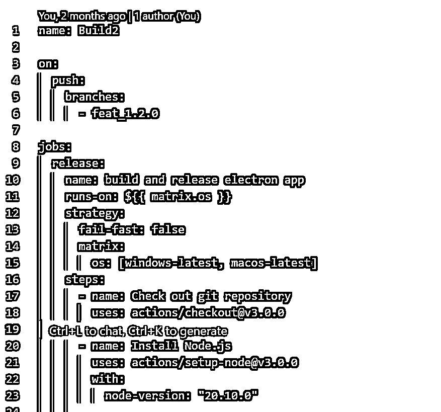

### 快速迭代：把用户反馈变成产品引擎

说实话，以前我们对用户沟通这件事是有点抵触的。总觉得用户问题太多、太琐碎，很多都是重复咨询，回答起来既费时间又费精力。可后来我们真正开始做用户社群、认真和用户深聊之后，才意识到之前的想法大错特错。那些看似麻烦的反馈，恰恰能暴露产品里很多隐藏的问题。举个最直接的例子：我们产品里相当一部分bug，都是用户帮忙发现的。毕竟开发团队的测试覆盖不可能面面俱到，而用户的使用场景千奇百怪、五花八门，他们提出来的建议往往特别有价值。把用户反馈和产品开发深度结合起来，产品才能真正跟上市场需求的变化。

#### 用户交流群：让老用户成为“外挂测试团”

我们团队清一色是开发出身，没有专业的测试人员。所以在正式发版之前，一般会先做一个测试版，放到用户群里让大家抢先体验。群里基本都是陪伴我们很久的老用户，他们对产品很熟悉，也特别包容，遇到问题会非常主动地告诉我们。这种模式其实帮我们省掉了大量测试成本，还能更快地把版本打磨稳定。

#### 深入交流：让价值在用户之间流动

另外，我们的用户来自不同行业，平时在群里聊天时会自然聊起各自的行业经验，经常能碰撞出不少灵感。后来我们干脆定期组织用户交流会议，用直播的形式把大家聚在一起。这样一来，用户与用户之间的经验可以互相传递，产品也能从中吸收更多养分，整个生态就活起来了。