# 想用AI写网文赚钱？这套保姆级流程，新手照做就能上道

很多人跑来问：我也想用AI写小说赚钱，但脑子里一片空白，不知道写什么。别急，我们一步一步来。

## 第一步：先把平台定了

首选推荐番茄小说。为什么？因为番茄对AI作品签约非常友好，成功率相当高。其他平台都是真人编辑审核签约，新人稿子不够硬，很容易被拒。对小白来说，最核心的目标不是一鸣惊人，而是快速签约、快速拿到第一笔稿费，让自己有动力继续写。等你对网文圈子熟悉了，再去冲别的平台也不迟。

市面上还有其他小说平台，比如17K小说网、七猫小说、起点中文网、晋江文学城、纵横中文网、红袖添香、潇湘书院、掌阅小说网、书旗小说、刺猬猫、飞卢小说网、创世中文网、云起书院、阿里文学、网易云阅读、逐浪网、咪咕阅读、火星小说、黑岩阅读网、磨铁中文网、奇迹作品网、不可能的世界、有毒小说网、息壤中文网、寒武纪年、豆瓣阅读、爱奇艺文学、书山中文网、香网、天地中文网、蔷薇书院、万读小说网、凌云文学网、甜悦读、朵米阅读网、九库文学、小说阅读网、白马时光中文网、雁北堂中文网、若看文学、塔读文学、看书网、言情小说吧、逸云书院、四月天小说网、魔情小说网、栀子欢文学网、龙若中文网、青果阅读、点众科技。另外也不只有小说平台，还有第三方渠道和各种工作室，只要作品质量稳定，永远不愁渠道。

## 第二步：选男频还是女频

这个看个人口味就行。平常刷哪个频道追更，就选哪个频道，作者选的是男频。

同样一个题材，在男频女频呈现出来完全不一样。拿“四合院”举例：女频通常是穿越到原著角色身上，写邻里纠纷、家庭关系这些生活流；男频则喜欢给主角开金手指或者超能力，后面经常奔向大国重工等宏大叙事，感情线反而少。

## 第三步：定题材，用数据说话

打开“网文大数据”网站：[https://www.wangwendashuju.com/](https://www.wangwendashuju.com/)

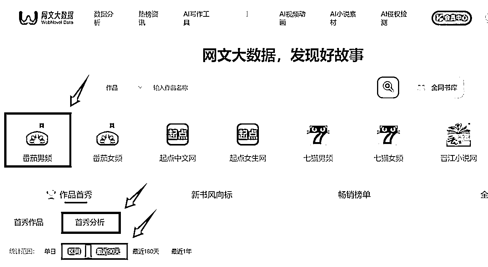

操作很简单：选“番茄频道—首秀分析—区间最近90天”。

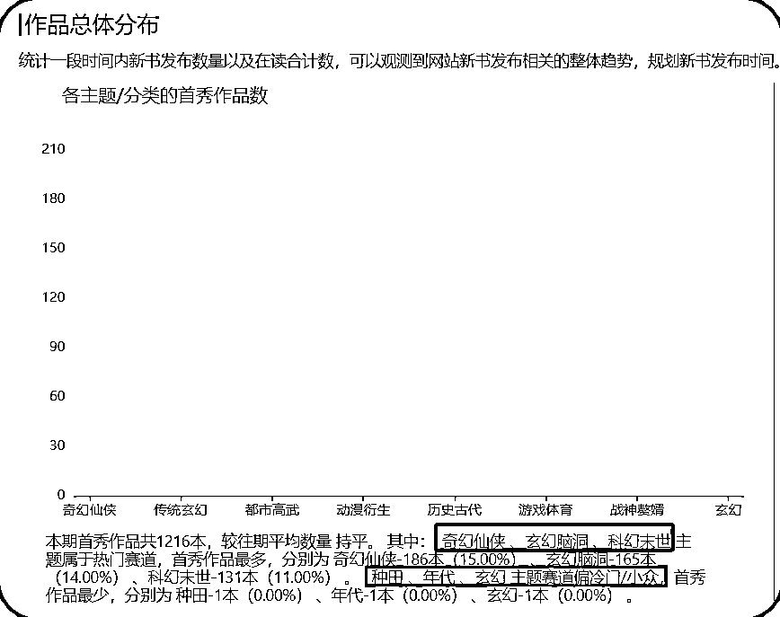

把最近90天首秀数据拉出来，你就知道哪些题材冷、哪些题材热。像种田、年代、玄幻这些赛道已经偏冷，读者不多，首秀作品也少，不建议新人碰。更推荐的是奇幻、脑洞玄幻、都市高武、同人、末世、历史穿越。你可以从这些热门题材里找感觉，看看有没有自己爱看的，或者里面有没有让你上头的书。

选题材还有个诀窍：尽量选自己熟悉且喜欢的。作者选末世，原因就是爱看末世文。如果你本身爱看种田文，那写起来也事半功倍。反过来，最近哪吒2很火，但如果连《封神演义》都没看过，硬写洪荒流，越写越痛苦。

关于番茄的规则，官方帮助中心（https://fanqienovel.com/writer/zone/help/article?rank1=10000&rank2=10091&rank3=0）里写得很全，全勤、签约奖励、签约申请都能查到。这里挑几个重点：

书一旦开始更，就千万别断，断更对流量伤害极大。

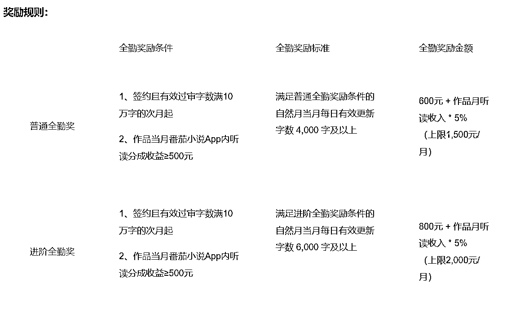
全勤要求以官方说明为准。

怎么申请签约？官方页面有完整指引。

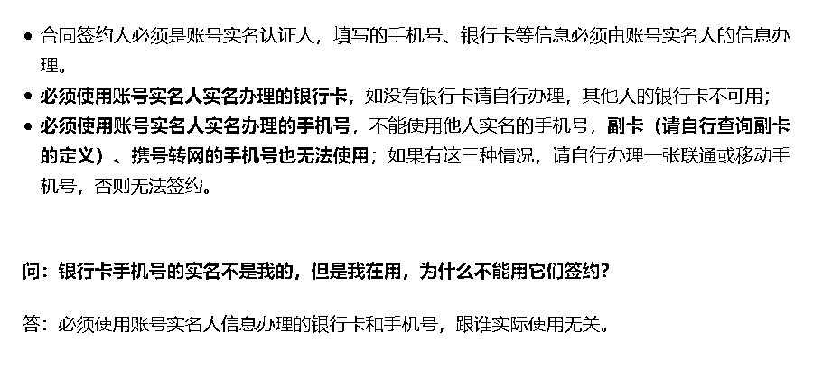
签约要求也要提前看清楚。

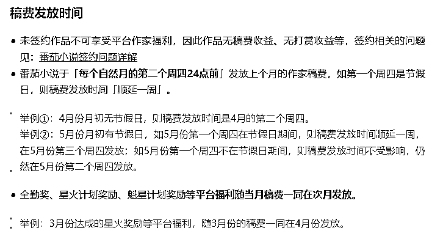
提现时间是每月第二个周四。

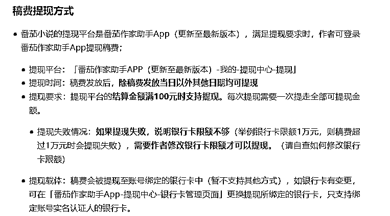
提现门槛是满100元，且一人一卡一号。

## 第四步：确定题材流派

这一步得自己到平台里淘。比如你喜欢末世，就在番茄搜“末世”标签，然后一本一本翻，找那种“第一眼就看到、而不是想划走”的书。

男频题材优选：奇幻、脑洞玄幻、都市异能、囤物资、求生、末日求生、网游、都市高武、同人、末世、历史穿越。

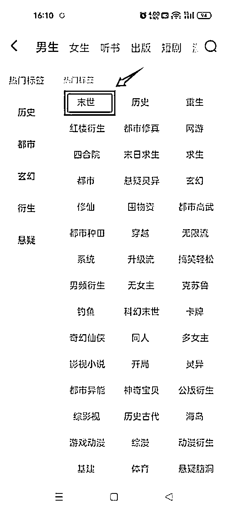

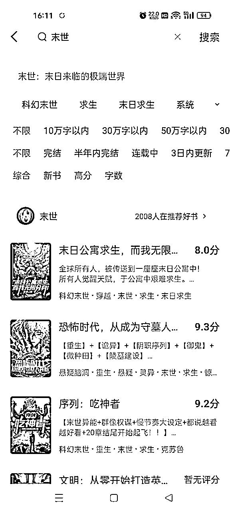

作者翻了一圈，喜欢上了《冰河末世，囤货无数坐看风云变幻》。

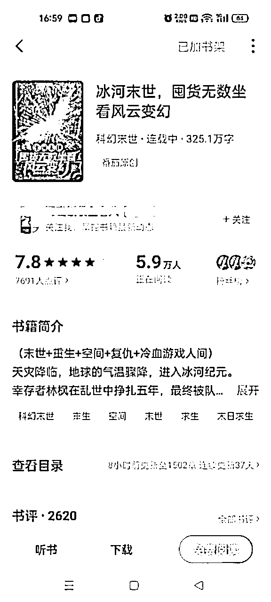

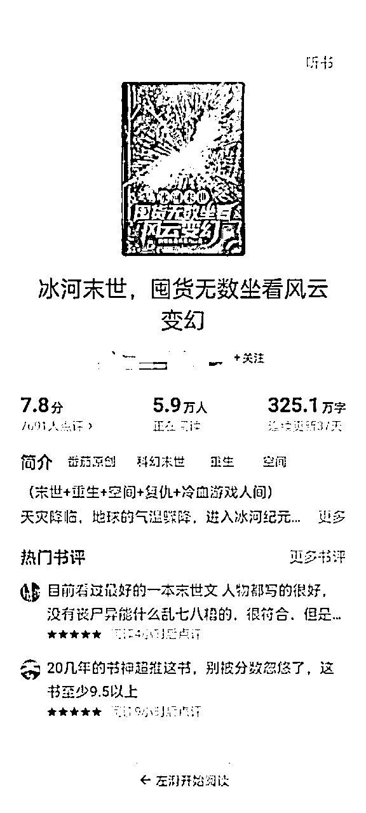

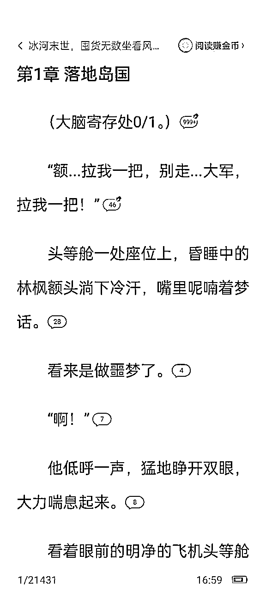

挑书有三条硬标准：第一，最好找一万在读以上的书，只有几千在读的别碰；第二，别找番茄大神，找作家等级1到5级的作者；第三，要找一眼就能看出套路的书。比如那本《冰河末世》，明摆着就是末世题材+空间异能随便囤货+主角冷血杀伐果断。金手指和爽点都写在脸上。

像《十日终焉》这种就算了，作者笔力强、智斗多，你模仿不来，AI也想不出来。一句话：最好找套路清晰到一眼就能看穿的。

## 第五步：找对标作品（低粉爆款）

找对标有两个方向：一是靠“推荐榜”的大数据，二是看“读这本书的人还在读”。推荐榜多刷一会儿，就会冒出大量同类型书。

“读这本书的人还在读”可以换一批。作者刷了两三次，就刷到《重生冰封末世疯狂洗劫千亿物资》《全球冰封：我打造了末世安全屋》《空间系老六，末世先屯一万吨猪肉》《极寒末世开局囤积一个港口》。

这些书的结构一眼就能识别：末世灾害+空间异能囤物资+心狠手辣的主角。

如果找不到这么清晰的文，变种文也可以对标。比如番茄上很多玄幻脑洞，本质都是《凡人修仙传》“凡人流”的变种：修仙世界+小人物一步步崛起+金手指。金手指可以换成词条系统、轮盘系统、签到系统，但内核是同一类。

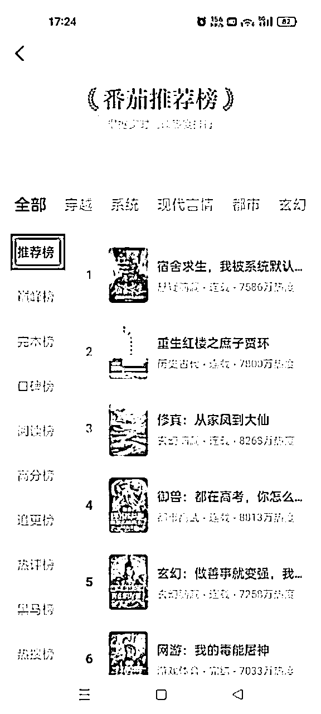

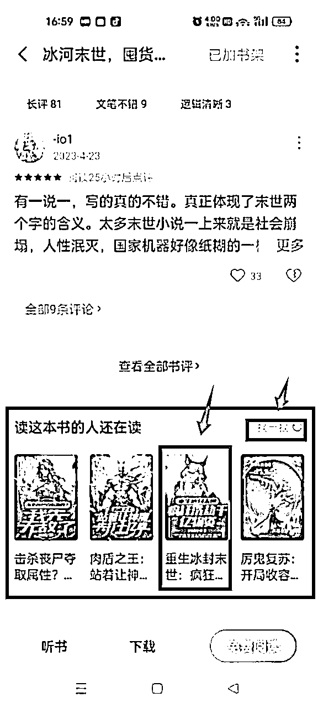

## 第六步：认真做对标

对标书不能只翻目录，每本至少读三四十章，读完后要能用一段话把整本书讲明白。

比如《冰河末世》：主角被仇人害死，重生回冰河末世半个月前，开局用空间异能搬空日本人的物资仓库，然后极度冷血地一路杀杀杀。

前五章尤其要精读，看它是怎么通过一个事件开局的。

网文里有“黄金三章”的说法，最常见公式是：

1. 先把主角出场时的环境和事发背景交代清楚。
2. 金手指到账。
3. 顺势扔出一个矛盾或隐患，最好让冲突直接炸开，而这个金手指又正好能摆平，之后自然就是打脸装逼。

最常出现的开局模板就是生死危机，主角靠金手指救命。

还有另一种公式：

1. 一样先交代环境事件。
2. 让主角进入一个让人羡慕、有戏剧性和爱情线纠缠的状态。
3. 随后出现的矛盾冲突，必须和这个状态紧紧绑在一起。

年代重生文里，主角一睁眼看到初中课堂和漂亮女同桌，就属于这种。或者开局直接被绑架/同居。这类强情绪开局不好模仿，也不建议新手硬仿，得靠练。更稳妥的办法是仔细观察对标书怎么开头，直接模仿。也可以用“星月写作”的黄金开篇生成器。

## 第七步：心里先搭好故事

看完四五本小说的几十章，大致情节就都有数了，你心里那个模糊的想法也有了参照物。

《冰河末世》的开局是空间异能盗仓库；《全球冰封》的开局是回到末世前三天，疯狂贷款、抵押房子，把钱全换成物资，再用空间异能收走。等极寒真正降临，主角穿短袖吃美食，看外面零下40度的人们在雪里挣扎。

爽点拉满。然后就是一层一层往上叠冲突：居民楼抢物资，小区抢物资，市区抢物资，省城抢物资，国家之间抢物资，最后不同文明抢物资。据说写到文明冲突时已经更了429万字。

写长篇的精髓就是“套娃”。

作者自己的思路很简单：前世被前女友所害，重生回来复仇。觉醒空间异能后，开局疯狂囤物资，顺便贷款、抵押房子——凭本事借的钱凭什么还？路上还被前女友和她富二代男友嘲讽打压。三天后暴雨末世降临，小区楼道缺粮，黑社会大哥来“均富济贫”。光是这个开头就能写三四十章、七八万字。之后无限套娃，50万字前的主线就是把前女友和富二代连带安保一起干死。

这么设计有几个好处：因为对标过，故事走向成熟，不会写到十万字就崩；同时把极寒末世换成了大洪水末世；同行是最好的老师，爽点也能直接借鉴，比如“贷款”。

## 第八步：书名要对标

把所有对标书名列出来：

《重生冰封末世疯狂洗劫千亿物资》

《全球冰封：我打造了末世安全屋》

《空间系老六，末世先屯一万吨猪肉》

《极寒末世开局囤积一个港口》

《冰河末世，囤货无数坐看风云变幻》

自己起名没经验？可以交给AI。笔灵、DeepSeek、Kimi、Claude、Gemini都用得住，有专门的起名智能体更好。如果没有智能体，也可以把所有对标书名和你的思路填给AI，让它生成符合番茄风格的爆款书名。你可以给它一个“网文爆款书名策划专家”的人设，要求生成10个20字以内的候选标题，避免低俗、简洁好记。第一次对话时最好让它先回复：“您好，我是网络文学爆款书名策划专家。请提供对标书名和您的创作思路，我将为您生成10个番茄小说爆款书名。”

这里推荐用“星月写作”的爆款书名生成器（https://xingyuexiezuo.com/?inviter=347#/register），创意功能里的生成器免费，新账号送3万字，每天签到再送5000字，轻量用户换几个号就够用。

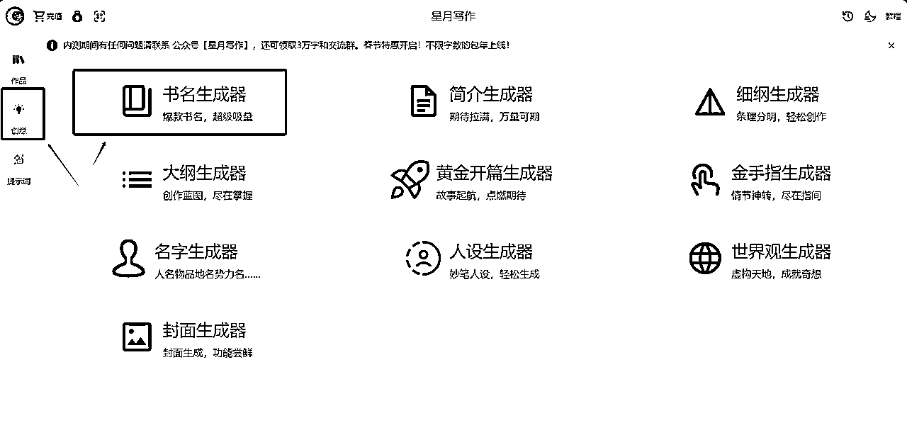

把自己的思路填进去，等它出书名。氛围版对应Gemini，细腻版对应Claude，DeepSeek质量也不错，可以多抽几次。

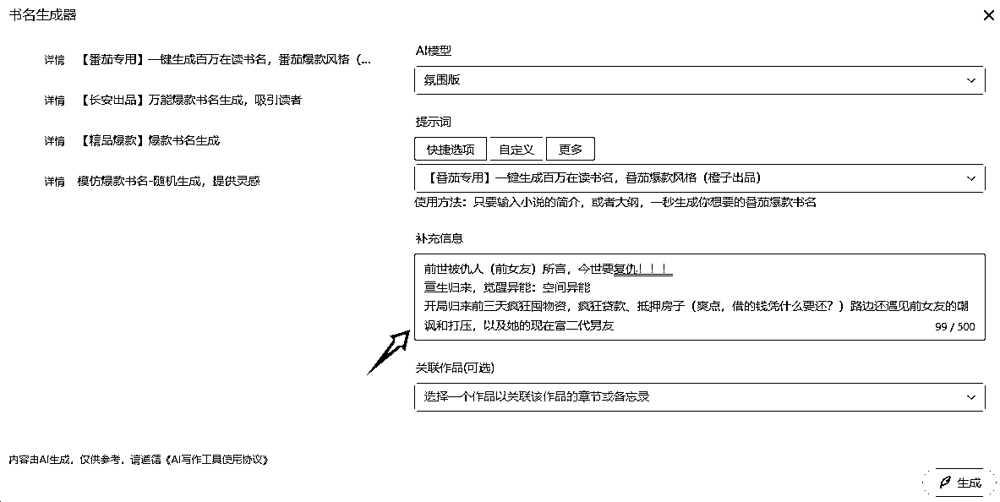

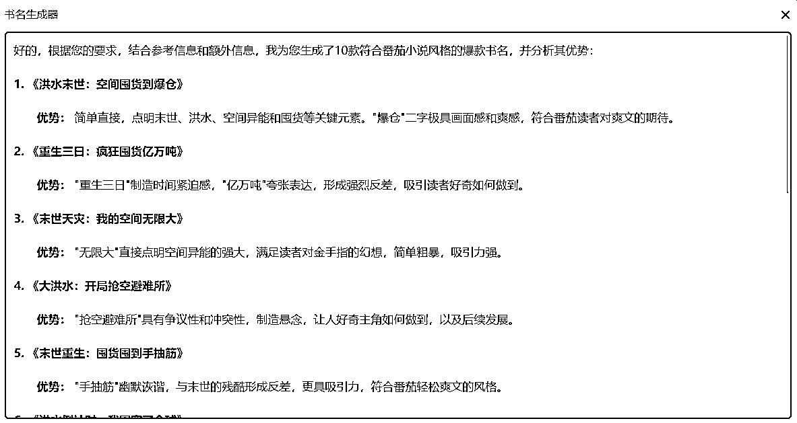

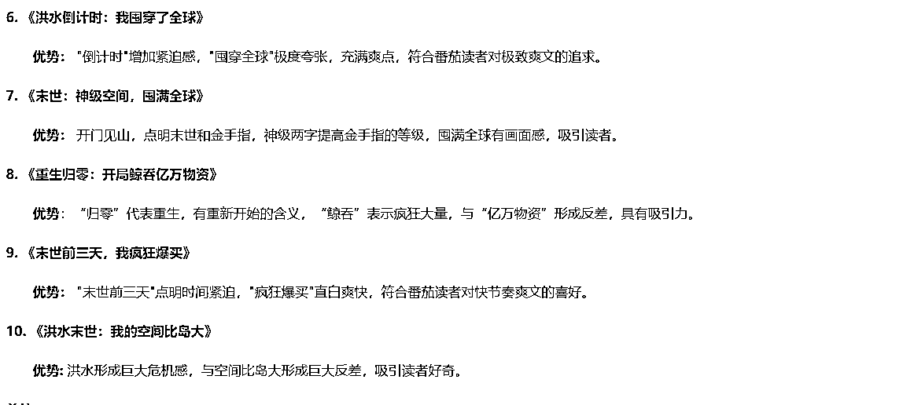

作者挑中的是《洪水末世：空间囤货到爆仓》和《重生归零：开局鲸吞亿万物资》，最后结合成了《洪水末世：开局鲸吞亿万物资》。

## 第九步：简介也要对标

对标简介的核心就是“标签词+基本故事概述”。这类书的标签通常都是：末世+重生+空间异能+心狠手辣杀伐果断。

做法很简单：把所有对标简介和你的思路一起丢给AI，让它生成5段简介供你挑选。给AI的人设可以写成“番茄小说简介生成专家”，背景、技能、目标、限制都交代清楚，让它生成150-300字、有悬念、能勾人的版本。提示词里最好带上对标简介作为示例，这样AI更容易模仿出你想要的味道。

到这里，从平台、题材、对标到书名、简介的全流程就齐了，剩下的就是动笔写。祝早日签约。

最近不少作者在后台问我：“末世+重生+空间”这个老套题材，到底怎么写出爆款？我把完整的方法论全拆开了，从简介、开篇、大纲到评论区运营，一条龙讲透。本来想做成付费课，想想还是免费公开吧。

先看三个高热度简介模板。

第一个模板：八月飞雪，冰河纪元突袭，无数异兽从海里冲出来，人类瞬间进入末日模式。主角姜哲在末世降临前两个月重生，明明有空间却穷得叮当响，只能靠偷抢囤物资。几百个超市和工厂仓库被他搬空。结果因为一个小失误，被警察堵住了。他咨询过狂徒张三，按盗窃金额算，无期起步。他正纠结怎么减刑，万一末世不来呢？警方的谈判专家喊话：“姜哲，只要不伤害人质，我们可以给你有利证词。”他淡定啃完鸡腿，突然一架飞机带着火球砸下来。无期？末世都来了，还扯什么。

第二个模板：气温骤降，地球进入冰河纪元。幸存者林枫挣扎了五年，被队友背叛，死在兽群里。上天让他带着空间异能重生回末日前半个月。这一世，他要好好活下去，让每个伤害过他的人都付出代价。一切从囤物资开始。“看过动物世界吗？狼捕食绵羊的时候，旁观者不会出手救羊，否则会害死同为地球生灵的狼。我不会和羊共情，因为我也是狼。”

第三个模板：全球冰河时代，95%的人类灭绝。张奕上辈子太善良，救的人反手把他杀了。重生回末日前一个月，他觉醒无限空间，搬空价值百亿的商场仓库，打造末日堡垒。别人冻成狗，为一口吃的不要尊严，他却过得比末世前还舒服。白莲花说让我进房就当你女朋友，富二代说用全部家产换一顿饭，邻居说你应该分享物资。张奕躺在安全屋里：“你们死不死的关我什么事？我的东西喂狗也不给你们。”

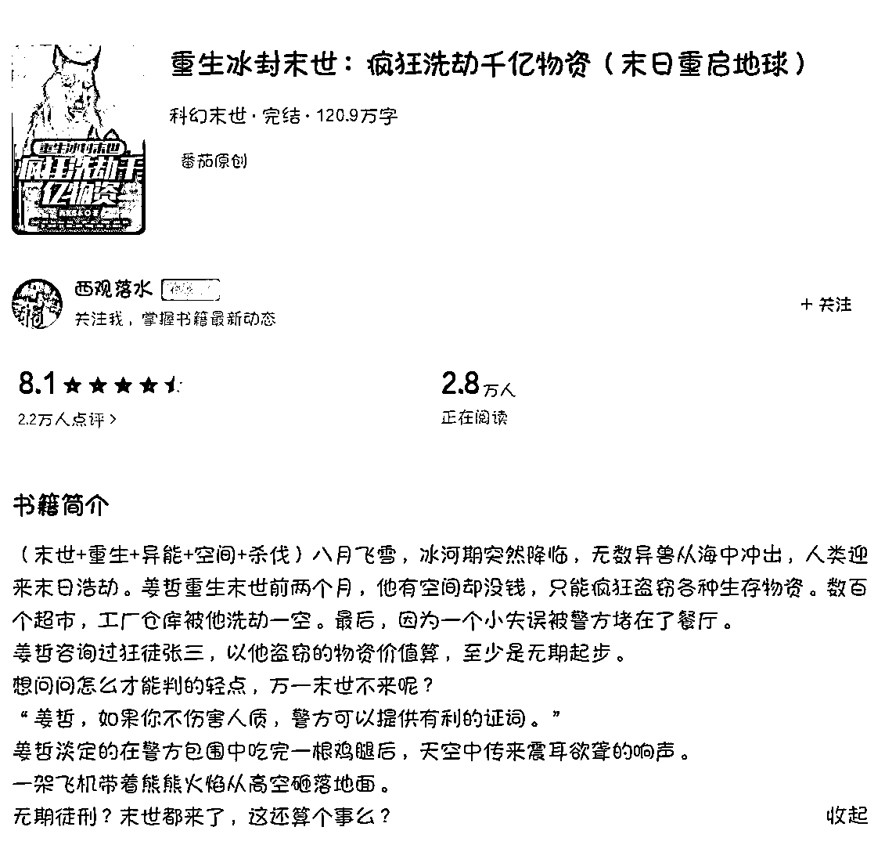

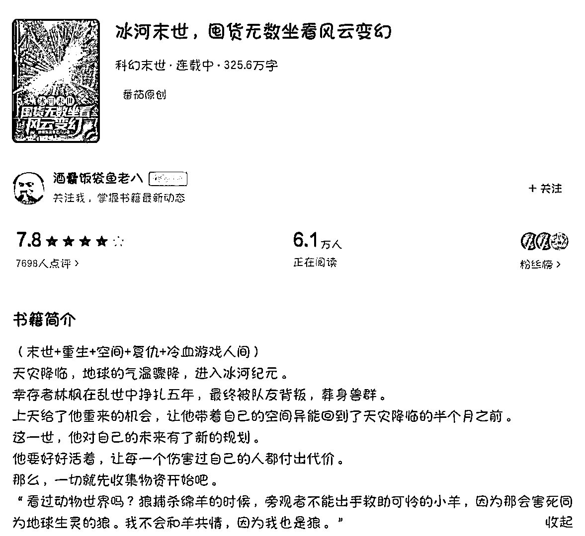

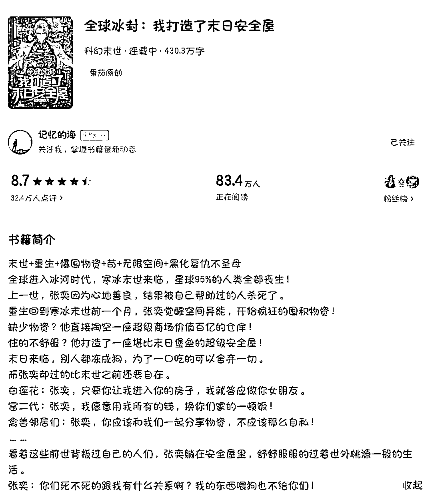

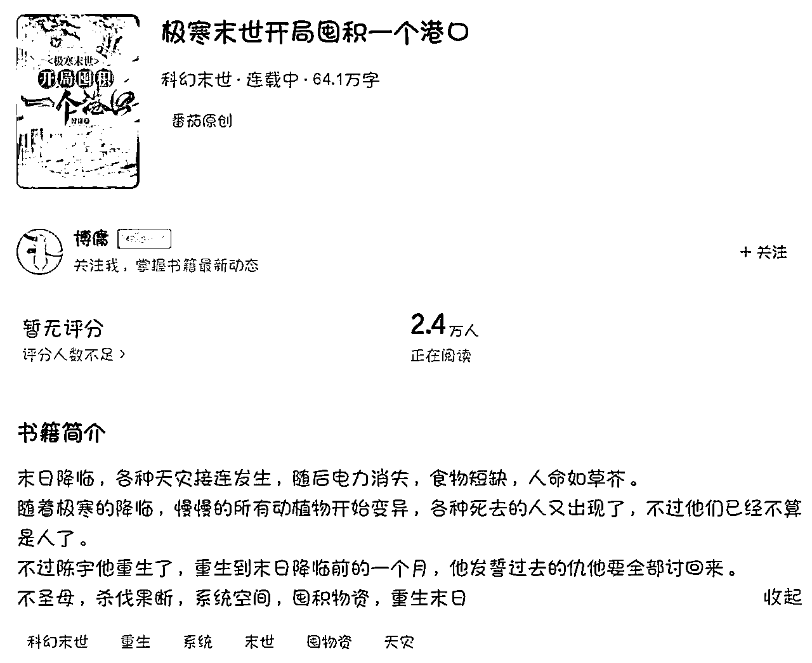

第二个玩法是“星月写作简介工具”，免费版就够用。

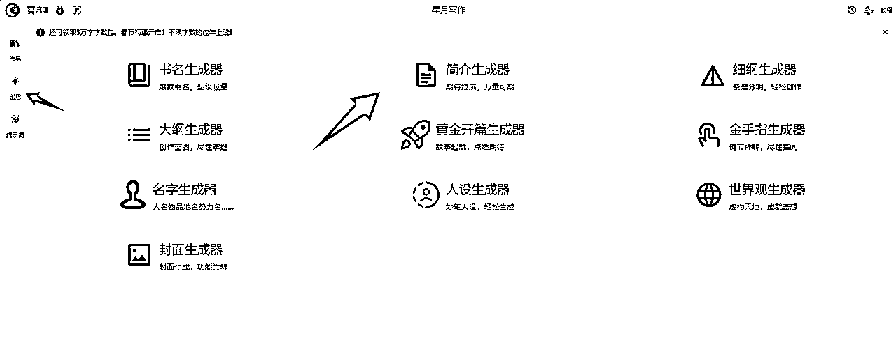

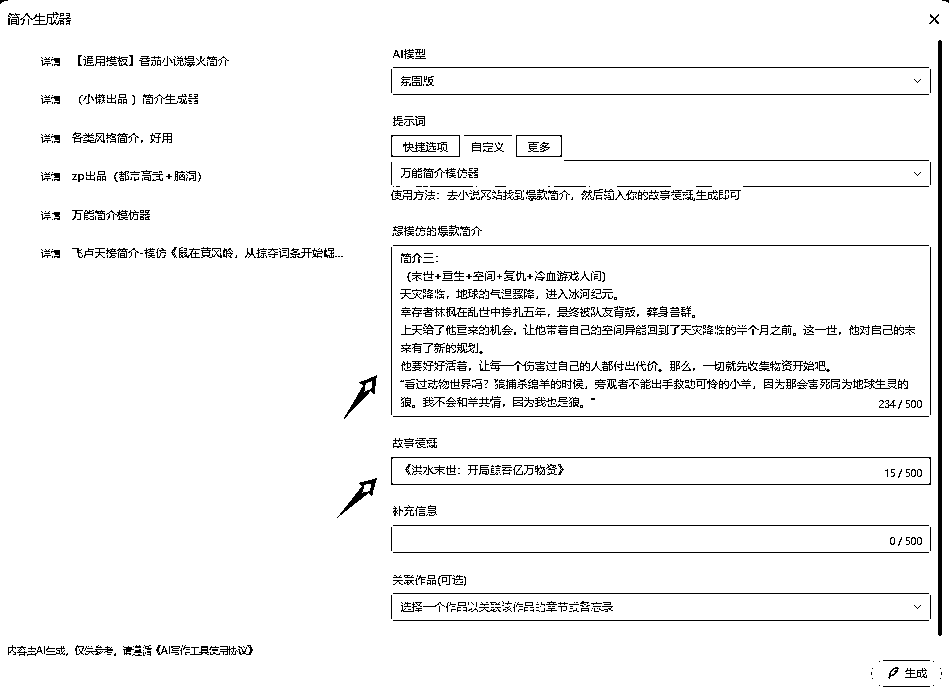

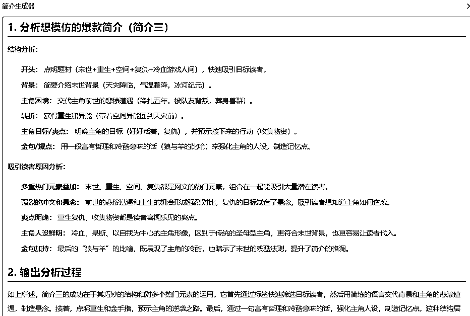

用这套方法生成的成品也不错。比如那本《洪水末世：开局鲸吞亿万物资》的简介：洪水滔天，陆地全成水泽，人类文明摇摇欲坠。许靕在末世挣扎三年，被“同伴”推下巨浪，尸骨无存。没想到重生回末日前一个月，还觉醒了超级空间。这一世他谁也不信，只信手里的物资和堡垒，他要让背叛者跪在绝望里忏悔。“末世生存法则第一条：别相信任何人，连自己也别信。第二条：储备！储备！还是储备！你永远不知道明天和洪水哪个先来。”

接下来是重头戏：黄金三章。开篇必须把主角丢进一个强情绪事件里，跟短视频一样，最炸的镜头要放最前面，不然读者秒划走。这个环节我用AI辅助，Gemini写氛围感，Claude写细腻心理，DeepSeek写脑洞，模型要频繁抽卡，提示词也要换着试，抽到好的就收下。

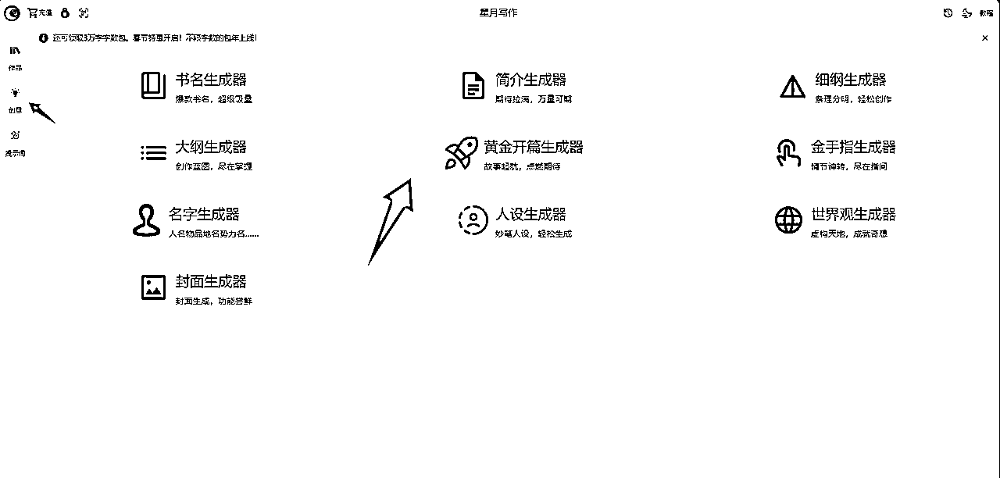

记住，一定要抽卡！换模型、换提示词，反复抽，抽到适合自己风格的为止。

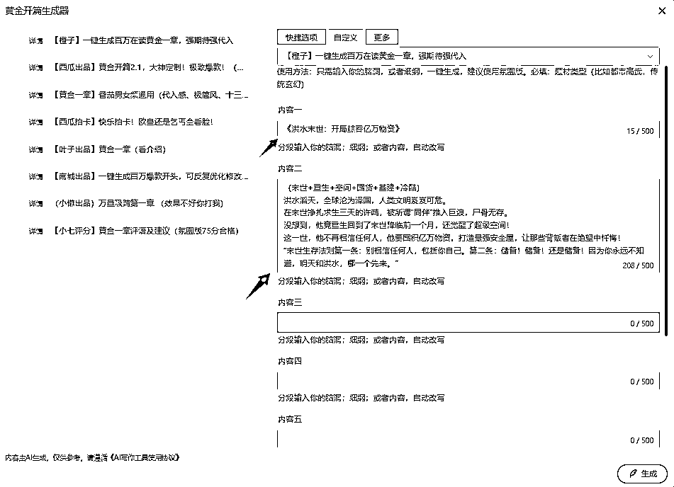

我抽到一个能直接用的开篇示例：许靕被冷水呛醒，掉进一个快灌满水的破木柜，又臭又腥。他摸到一件硬物，用空间异能收进去，居然是一块压缩饼干。记忆疯狂涌来：洪水末世、三年挣扎、同伴把他推下巨浪。他重生了！破柜而出，墙上的日历写着7月15日——距离8月15日末世还有一个月。走廊尽头传来脚步声，几个男人堵住去路。为首的人拿着钢管狞笑。这时他看到对方手机屏幕上的新闻：“特大暴雨预警！”许靕眼底一狠，这辈子，他不会再让任何人踩在头上。

长篇小说的大纲到底怎么搭？精髓就是“套娃”。一栋楼里，为了物资打；一个小区里，为了物资打；一个城市里，为了物资打；一个省份里，为了物资打；国家层面，为了物资打；种族之间，为了物资打。中间随便穿插爱情线、复仇线、装逼打脸、学院线、拍卖会、帮派火并、宗门拜师……每一层套娃写三四十万字，几百万字的篇幅不是问题。拿《洪水末世》来说，前五章生死逃脱，后面二十章疯狂收物资，三天后洪水灌进出租屋，整栋楼变生存竞技场——水往上涨，人都被赶往顶层，空间和食物成为最稀缺的资源。加上冰山女医生、带孙子的圣母大妈、抢房的黑社会大哥、五十多岁的退伍军人……第一个20万字妥了，再开始套下一层。

封面怎么搞？预算党直接淘宝花三块钱买一张。免费党可以用豆包的图像生成功能，或SD/MJ出图，然后拖进星月写作的封面生成器里改。虽然我随手生成的图质量有点拉胯，但修一修照样能当封面。

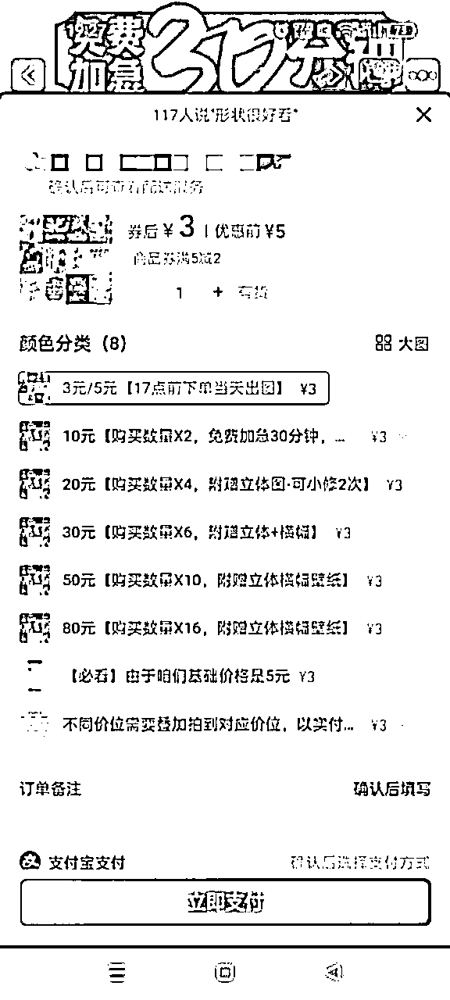

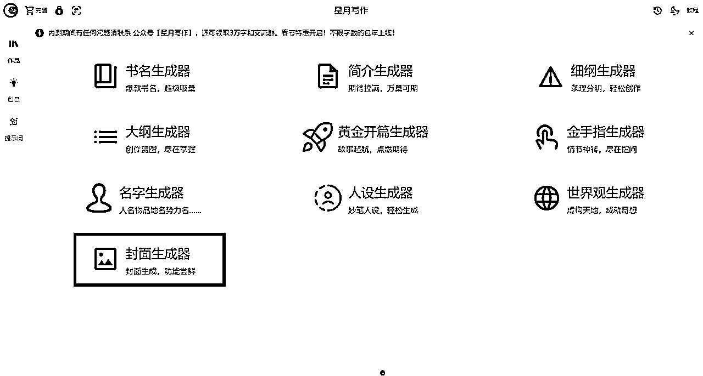

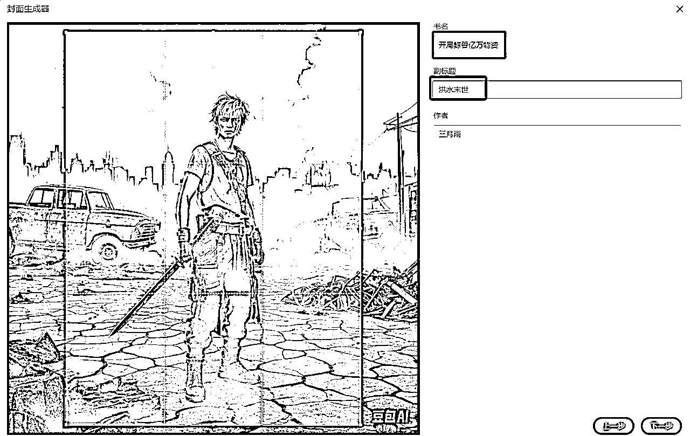

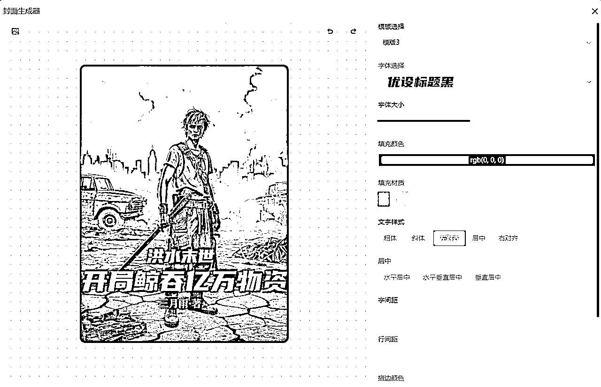

稳定更新后想提高收入，要么开矩阵多本一起推，要么把单本质量拉上去换更多推荐。核心逻辑是：赚更多钱→要平台给更多流量→平台为什么给流量？因为数据好→数据好是因为吸引人、互动多→所以重点就是引爆评论区。

第一个办法：开局先打上“脑子寄存处”。读者看到就知道不用带逻辑，评论区会自动排队发图。

第二个办法：写玄幻修仙时突然来一首定场诗。比如“九转玄功惊鬼魅，六道轮回慑诸天”“眸含阴阳吞日月，指划虚空定乾坤”。你想不想评论？每个配角配一首，DeepSeek能写一百首。女频一样适用。

第三个办法：制造极致反差。比如传统双修都是异性，你写同性，评论区立马炸。还有“借钱凭什么还”之类的梗，多收集多安插。

第四个办法：蹭经典。抖音上大火的大爱仙尊、古月方源、炼天魔尊，或者极道天魔的“深蓝”、十方武圣的“石灰”、斗罗斗破……你在文里稍微暗示一下，书友就自发刷屏“是大爱仙尊！！！！”这类名场面全是评论量。

第五个办法：蹭热点。比如“老蒯～带派”这类口音梗，马上带出一堆评论。但注意尺度，别写深了，小心封书。

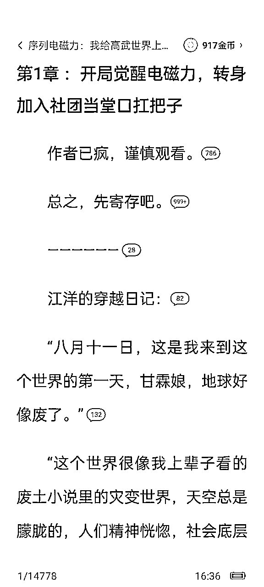

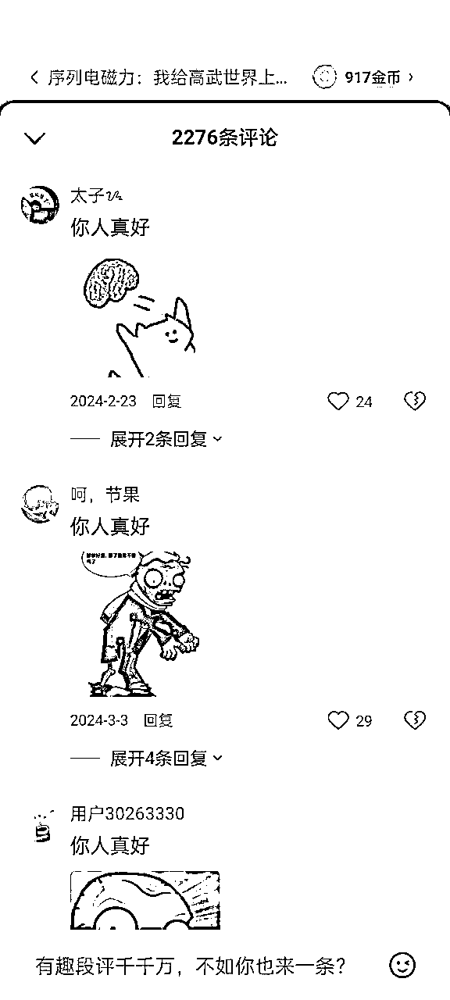

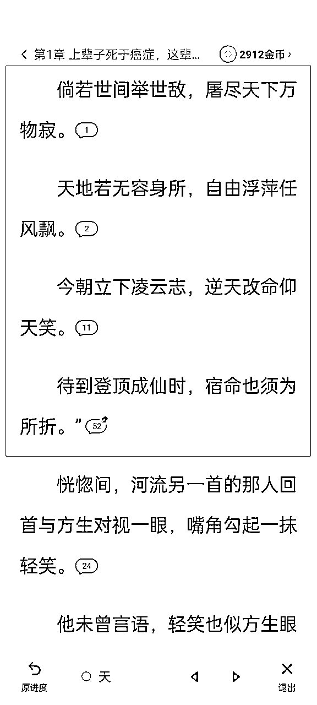

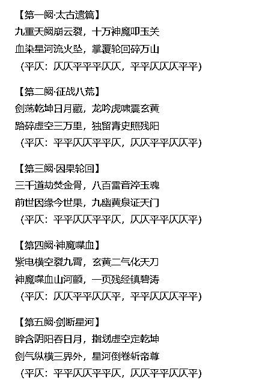

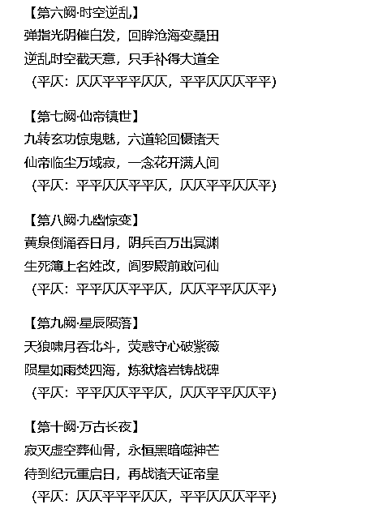

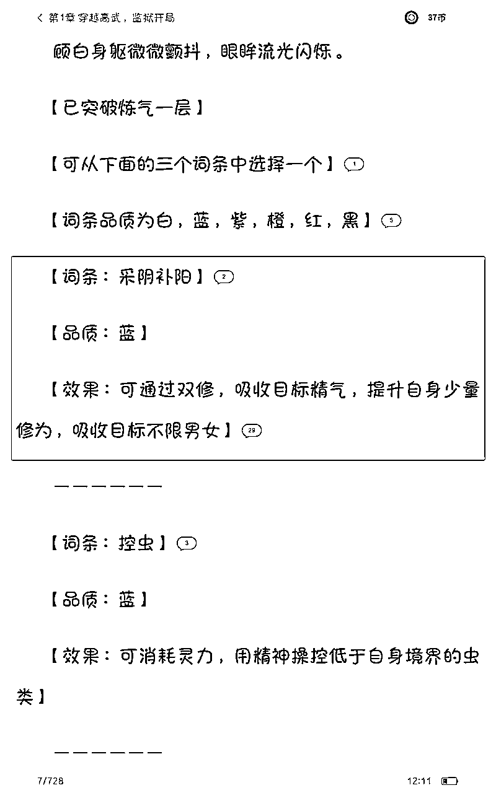

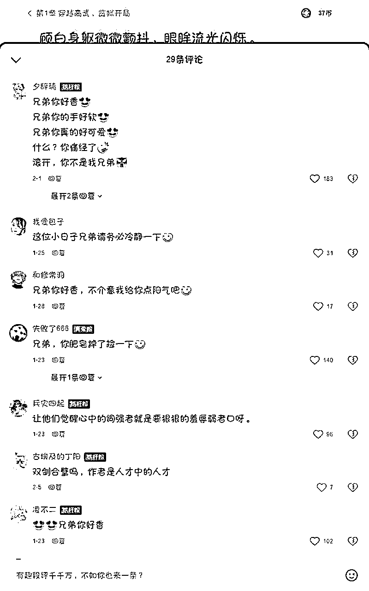

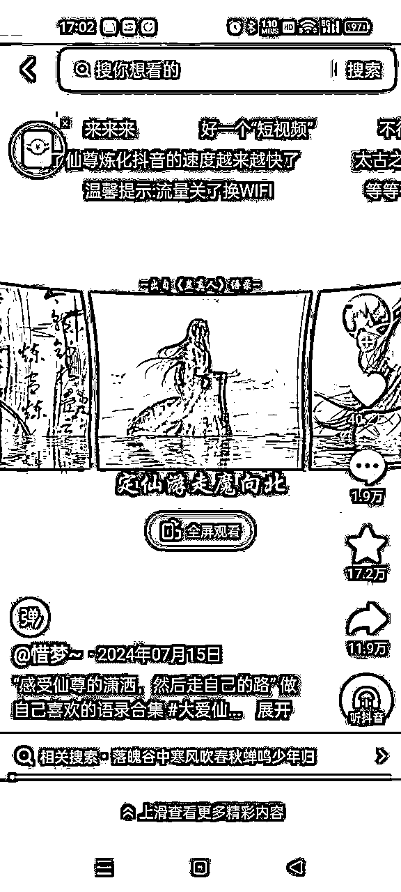

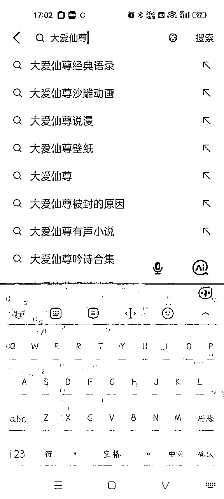

再划一遍重点：长篇小说的命根子是“套娃”，一层层扩大斗争范围，再辅以各种支线，三十到四十万字稳拿。番茄小说网作者后台有官方帮助中心，链接在 https://fanqienovel.com/writer/zone/help/article?rank1=10000&rank2=10091&rank3=0 ，99%的平台问题都能在里面找到答案，首秀、推荐、签约、提现、机制全都有。这个手册一定要看。

最后聊聊大家常问的。有人问：“黄金三章用AI仿写，后面剧情也照仿，会不会被判定洗稿？”你要做的不是抄剧情，而是吃透五本同类型书，拆解它们的共同骨架，再长出属于自己的血肉。宫斗文读熟了，你自然知道套路，没必要跟着别人走。流派相同但剧情不同，新人靠这个框架也能写出合格的商业作品。那怎么判断AI写得好不好？很简单，把自己当读者，连读几十章，能不能一口气看完。如果能，那一定有读者、有市场、有稿费。读者画像如果是小白，就把文写白写爽写简单，像都市龙王歪嘴一笑；如果是老白，就写复杂、写跌宕。当然不可能又爽又虐。要不要搞AB测试？不建议。网文是连续叙事，读者能一眼看出风格突变，很容易弃书。评论区说某段毒，就老实修改；说太小白，那不用改，因为那不是你的目标群体，服务好你的核心读者就够了。

很多人问我，靠AI写网文到底能不能赚钱？我的答案是：能，而且我已经在番茄上稳定更新三本书了。这三本我都只投一家平台，因为网文圈默认规矩就是一稿单投，除非你跟某平台有独家合作，否则多投会很麻烦。

说到选题材，其实没有绝对的“最好”，只有“适合”。都市娱乐类流量大，看的人多，但单价偏低；玄幻修仙、古代言情这类竞争稍少，读者虽然没那么庞大，但付费单价反而更高。所以关键不在于追热点，而在于你擅长写什么、能坚持写什么。

写AI小说需要大纲吗？需要，但不能把几百万字全部规划完。我的做法是：一本书分卷，每卷大概8到15万字，只把这一卷的细纲列清楚就够了。更长的结构，后期再慢慢调整。

很多人担心AI写的东西会不会被判抄袭。我自己的经验是：不要直接拿对标小说的剧情来用，而是只借鉴它的框架——比如一卷里怎么起承转合，支线怎么穿插，伏笔怎么埋，铺垫怎么设计。这些都从结构层面学，不碰别人的具体情节。为此我封了两三本书才摸清边界，但到现在基本不会出现系统判抄的问题。

也有人问：AI写出来的内容会不会很“人机”？说实话，用Claude或者Gemini配合好提示词，完全不会。如果输出还是很生硬，说明你的提示词还需要迭代。我刚起步时，改一章要花20分钟，现在基本5分钟就能改完。

那情节怎么设计才吸引人？第一靠积累。想写灵异悬疑，至少先把同类型的五本热门小说读完，哪些毒点读者讨厌，哪些桥段很出彩，心里要有数。第二靠结构，起承转合、手弩理论、十三节拍这些套路，既可以看书学，也可以在龙空上翻翻老作者的心得。另外，一定要有题材边界感。你写灵异悬疑，就别突然开出个修炼功法变成修仙文，很多读者就是冲题材来的，你一换题材，他们转头就走。

要不要根据读者评论调整方向？我不会。因为评论区里发声的其实只是很小一部分，大部分读者都是默默来看、觉得好看就继续，觉得没意思就悄悄离开。你听到的声音，不一定代表真正的主流。与其讨好所有人，不如服务那些看得舒服的沉默读者。

至于新人不确定题材有没有市场，有个很简单的验证方法：去网站上搜一下有没有同类型作品，看它们的成绩。如果找不到同类，基本说明这条路走不通；如果对标作品很少、数据又差，也同样别冒险。比较稳妥的标准是——至少有一万在读，而且作者本身没什么名气，这才能证明题材本身有市场，不是靠作者自带流量。

整个创作流程里，AI和人的分工很明确：AI负责解决“怎么写”，人负责解决“写什么”。比如宏大的战争场面，别说新人，80%的熟练作者都写不好；中世纪城堡的内部装饰，自己查资料可能要几个小时，AI几分钟就搞定了。你只需要想剧情、定结构、决定故事走向，然后把细节交给AI扩写。检验标准很简单：AI生成的几十章，你自己愿不愿意一个字一个字地读下去？如果你能看进去，那市场上一定有和你口味相同的读者，你也能赚到稿费；如果连自己都看不下去，那就继续打磨吧，别急着上架。

想入这行，门槛真的没想象中高。大胆迈出第一步：找一本你喜欢的类型，读上几本同类作品，然后和AI一起设计主角配角、世界观、势力分布和人物关系。AI永远不会不耐烦，24小时在线，而且设计这些时会很快乐，因为你正在创造一个小世界。接下来就是把细纲喂给Claude，让它按提示词扩写。这一步可能需要自己琢磨提示词，我比较推荐“星月写作”，那上面的网文提示词生态做得不错。最后，去平台上传，等签约就好。

平台要选哪个？我始终推荐新人先试试番茄。因为番茄签约最容易，正反馈来得快。做视频或小红书，连着发一个月可能流量还是几百，很容易放弃；但在番茄，只要你字数够了，基本一定能把合同签下来。看到合同的那一刻，成就感真的很足。之后等你写作功底稳了，再去起点或者其他平台，也能从容应对。

所以，别想太多，先写起来，AI可以是你最好的搭档。