# 零代码，开发一个类Copycoder编程提示词插件


社区里最近刷到一篇自述，讲一位做 AI 产品运营的从业者邬轼，如何从被编程教材劝退的普通人，靠着生成式编程工具一路搞出了一个接近 Copycoder 思路的浏览器插件。整个从小白到作者的跃迁脉络，细节很值得拆解。

先说起点。邬轼此前想给团队搭一个展示页，于是埋头啃了不少前端书籍，结果写出来的代码依旧混乱不堪，面对一整个前端技术栈的复杂度直接望而却步，差点就认定自己和编程无缘。直到代码生成式编程开始流行，他才发现自己一直想做的站点、插件、Python 脚本，都可以用 Cursor 这类工具快速落地，这段经历也是他近期最有成就感的部分。

## 一、灵感怎么来的

这个工具的雏形，是在做网站的过程中冒出来的。邬轼对 Cursor 的评价是功能实现上很顺手，可在视觉还原上总差点味道。当时他常用的组合是 V0 先出界面，再交给 Cursor 补全交互逻辑。

用 V0 的过程中，他注意到它可以对输入的网页链接做截图，并据此生成相似度很高的前端页面。唯一的槽点是，页面过长时需要手动滚动，V0 只截取首屏视口，后续内容丢失，导致复刻出来的页面永远缺块。

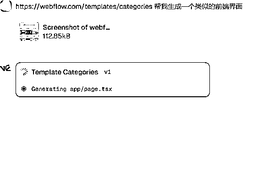

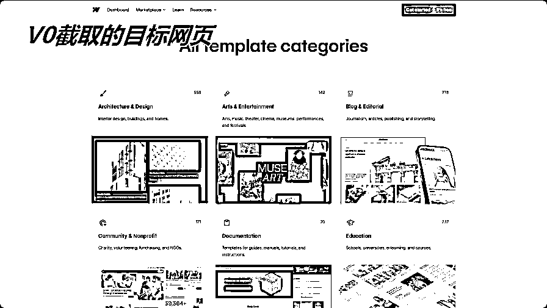

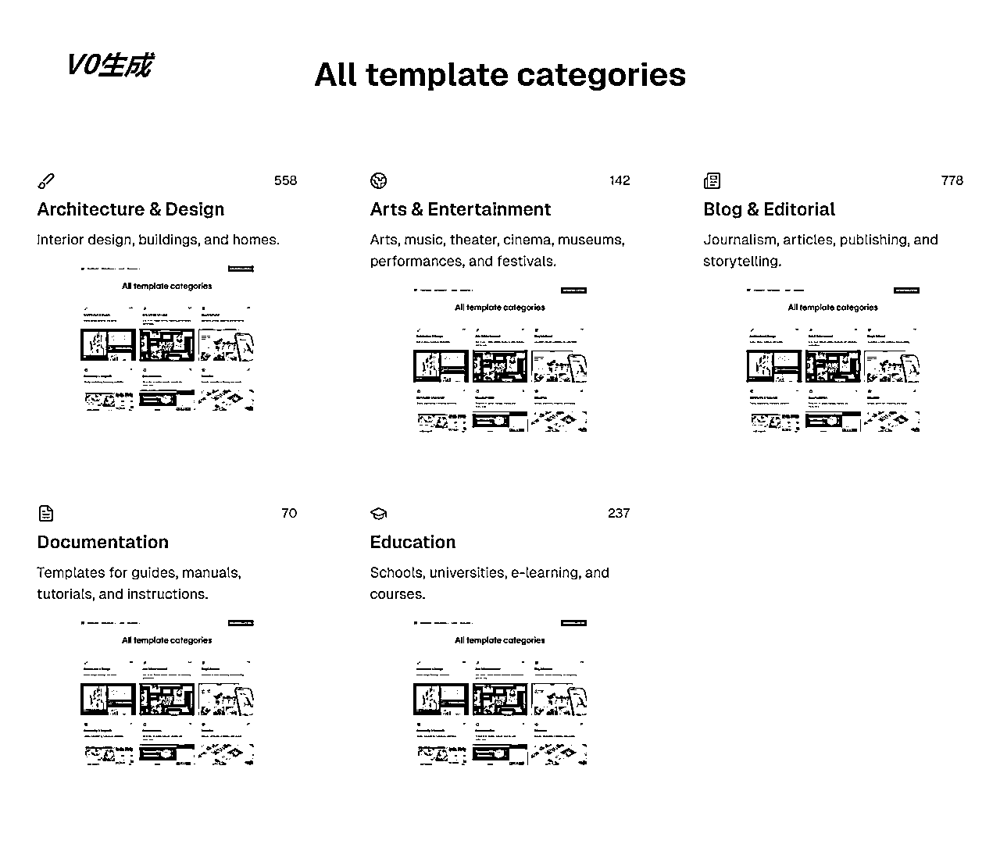

起初他设想做一个可以对长页面做完整抓图的工具，让 V0 能基于全量图生成完整页面。后来去 Chrome 插件商店逛了一圈，发现类似的完整截图方案已经存在了，这是后话。截图相关的演示长这样：

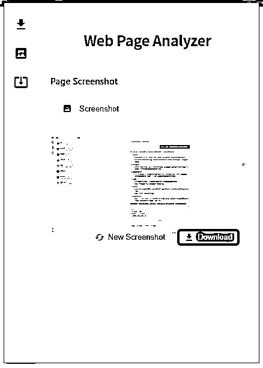

之后在 YouTube 看到有人做网页克隆的 AI 编程插件，思路是抓取目标站点的 HTML 和 CSS，合并后重新渲染，就能得到一个视觉高度接近的副本，某种程度上相当于自制 V0。邬轼注意到，很多站点并不是纯静态的 HTML/CSS，而是运行在各种技术框架之上，这一点上 V0 的通用性反而更高。基于这个观察，他给自己的插件追加了第二项能力：抓取、合并、渲染目标站点的 HTML 与 CSS，实现特定页面的复刻。

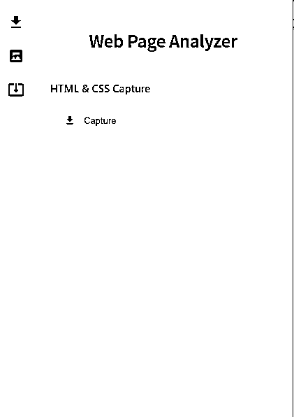

完成截图和代码复刻两项后，他又产生了一个延伸想法：把前面的截图和代码一起喂给大模型，让模型输出一段编程提示词，帮助完全不懂代码的人更快用 Cursor 把网页产品做出来。于是第三项能力 —— 用 AI 自动生成提示词 —— 就这么确立了。

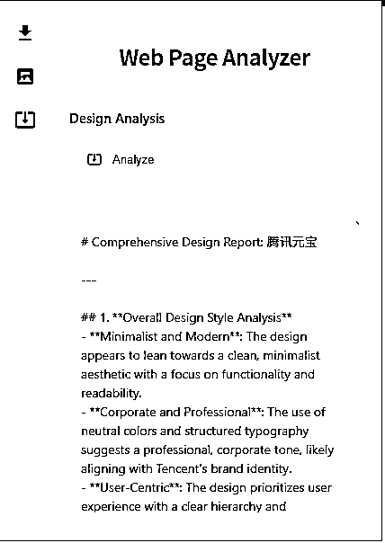

上线尝鲜后发现效果不理想，很多细节没打磨好，他就把项目搁置了。

转机出现在 B 站刷到的一条 CopyCoder 加 Cursor 的教学视频。邬轼这才顿悟，自己真正想做的不是学会编程，而是降低和大模型协作的门槛。他回忆起学 AI 写作、生图、视频时就得出的结论：作品质量好不好，关键在于提示词的调教水平。

他意识到，对非技术用户而言，生成式编程的核心并非是否精通编程，而是能否有效地与模型沟通，沟通效果则完全取决于提示词的好坏。

Cursor 航海活动里，阿紫教练做的恋爱网站项目给了他启发。回看思路，教练先是用和模型对话的方式得到一份像样的 README，再让模型按文档落地功能。传统 README 是给程序员协作用的，搬到生成式编程场景里，本质上就是给大模型看的编程指令。

## 二、对标产品拆解

CopyCoder 的定位本质上是一个 AI 编程提示词的代理工具。简单分析一下它的特征。

官网：https://copycoder.ai/

主要用户是想了解生成式编程、却做不出高质量网站的零代码人群，是典型的卖工具思路。

核心在使用上传截图后一键生成网页复刻的提示词，提示词拆成两份，一份是单页生成的指令，一份是其它页面的结构指令，能够快速拼凑完整的应用，还能选择 App 形态，选择移动端就会输出移动应用的提示词，进一步拉低上手难度。

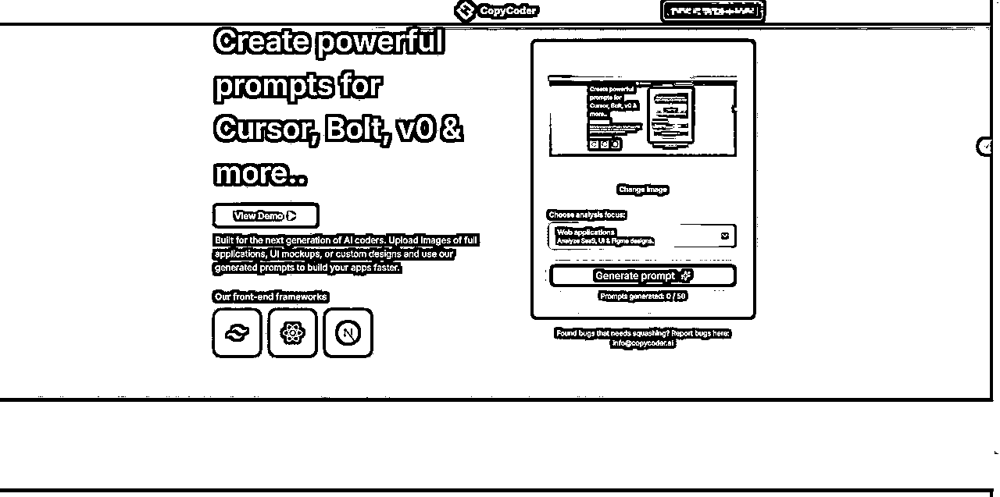

官方放出了几组复刻案例：

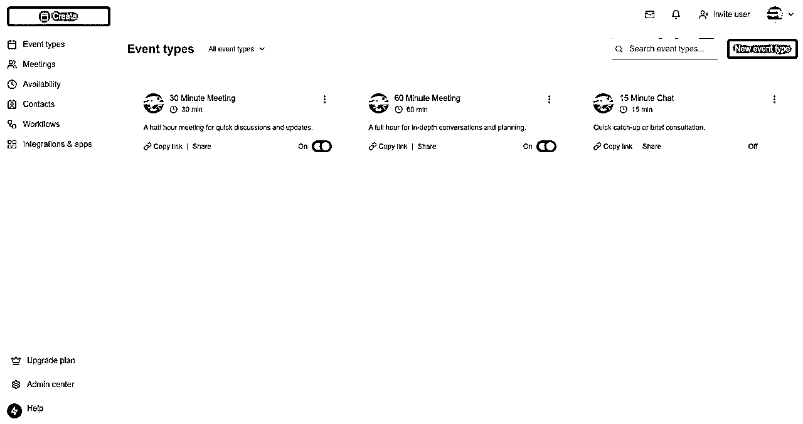

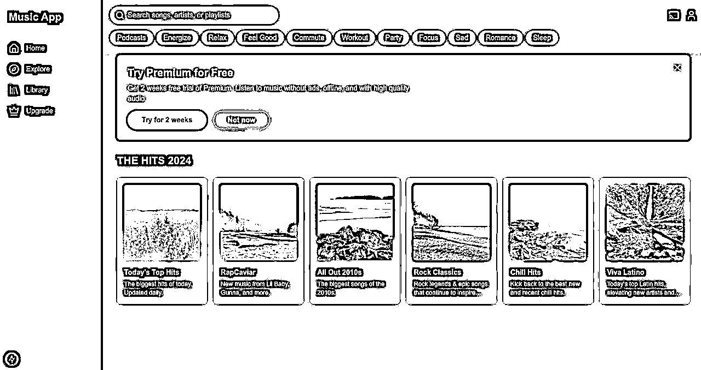

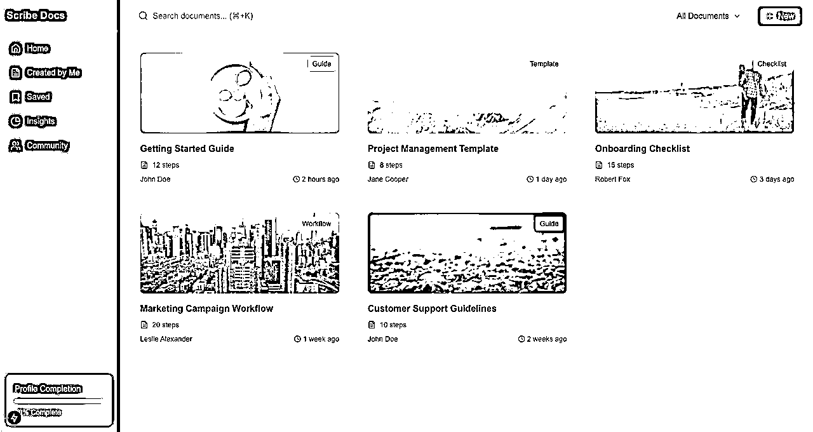

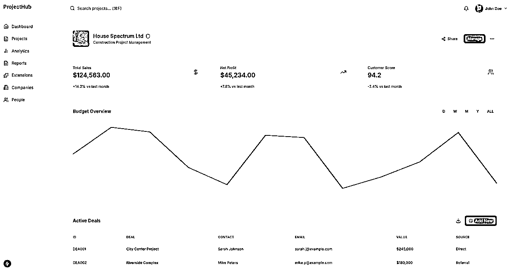

### 1、流量推广

流量从 10 月起明显抬头，到 12 月月度访问量约 12 万。Semrush 付费版数据显示 12 月访问 21 万，独立访客 10.7 万。

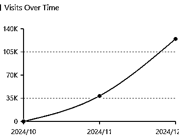

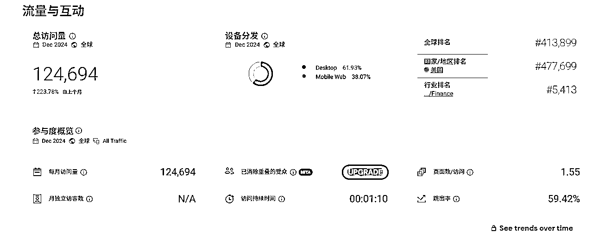


构成上直接流量占比最大，即直接输入网址或从其它应用跳转。域名是 2024 年 10 月 13 日才注册的，不太可能是品牌累积带来的。作者 Moritz Kremb 本人在做 AI 提示词相关的付费社群，很多 AI 领域的内容创作者也在非浏览器渠道的应用里帮他推，所以直接来源很重。

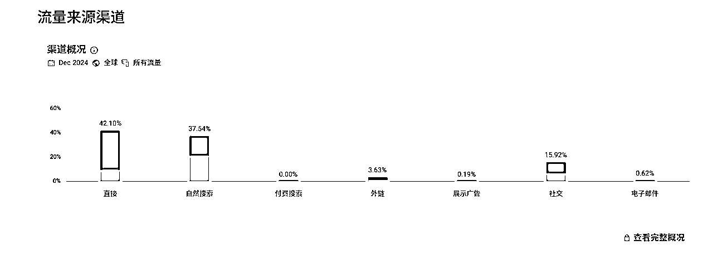

自然搜索第二，核心关键词是 copy coder，这个词本是新造词，是社媒传播把它带火，又给新产品词带来了搜索量。

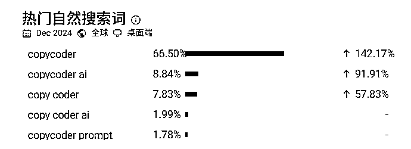

社交流量是第三块，Google 能统计到的社交渠道。作者在领英、油管、X、TikTok 都在运营，借 AI 编程的热度在社媒上获得不少关注。油管和 X 上还出现了不少带火的演示视频和帖子。具体数据如下：

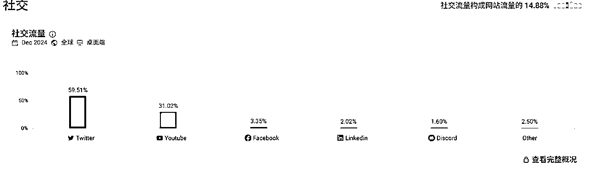

* 油管：粉丝约 3980，产品相关视频观看在 2 万以上，高于非相关内容，对网站有导流作用；
* TikTok：账号关注者 9 万，主要发 AI 编程科普，播放量普遍 4 万以上，个别达到 60 万到百万；
* X：个人账号 6.8 万粉丝，日常曝光几千到数十万；产品号 895 粉丝，日常曝光 2000 以上，还能看到不少 KOL 的体验评价和安利，曝光在 2 万以上；
* 领英：7k+ 关注；
* FB：关注者较少，仅 39；
* INS：690 关注，且未发布相关内容。

因此社媒矩阵里，TK、X、领英是主力，油管更多承担长视频演示的角色。

第四类是外链，https://copycoder.net/ 这个站点也是作者做的镜像站，点击后会导流回主站，也借此提升主站权重。

总体来看，营销主线仍是社媒投放，借助和 AI 编程的高关联性火了起来。

另外作者推出了网站推广计划，推广者可获 25% 收入分成，也刺激了 KOL 的推广积极性。

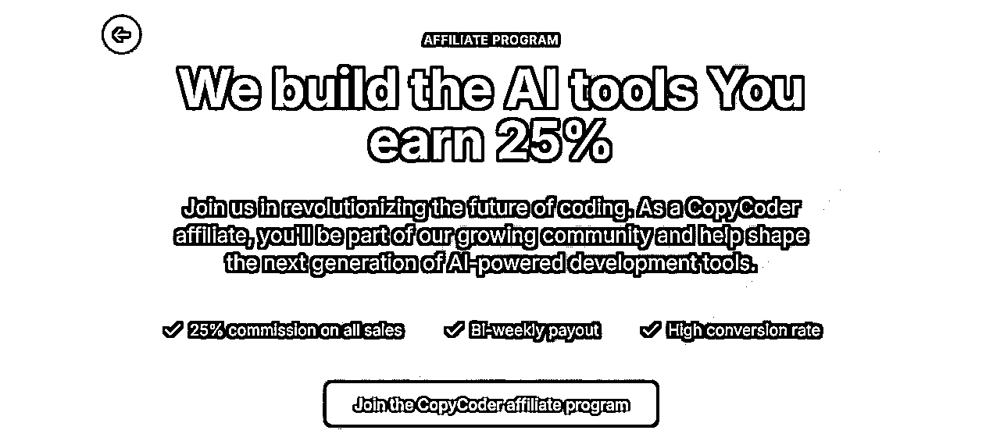

### 2、商业化

该网页应用不提供免费试用，以订阅为主，部分 KOL 帖子提到有 5 次试用，但实测并未获得。定价每月 15 美元，提供 50 次 AI 图像提示词和页面结构分析。

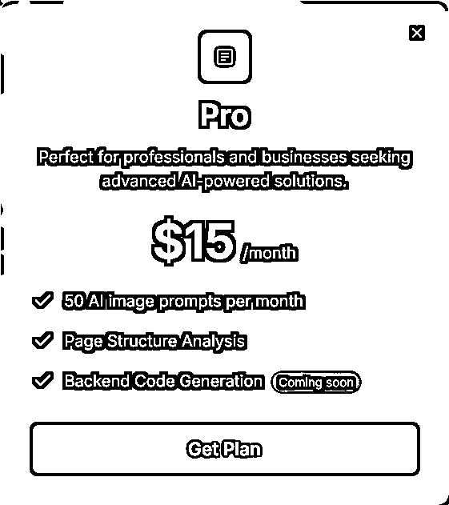

从技术栈看，支付用的是 Stripe。Semrush 显示约 70% 的入站流量会跳转到 Stripe 支付页，但这不等于付费人数，付费后用户会返回产品页继续使用。按 Stripe 页跳转回 Copycoder 的流量计算，12 月有 399 条，按 10 万访客算转化率约 0.399%，即约 399 人付费，月收入约 5985 美元。11 月 Stripe 入站 97，收入约 1455 美元。

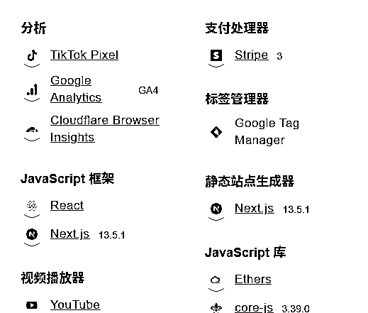

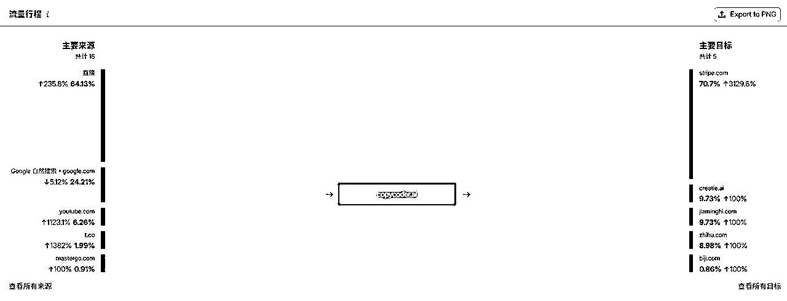

用户付费流程是先完成支付再回到产品页使用，所以统计回流流量更合理。上述数据已按此口径估算。


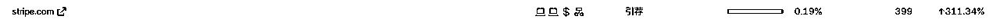

作者的联盟推广计划是 1 月后才上线，所以 11、12 月收入无需扣除分成。同时作者在 12 月 3 日开始招聘全栈开发者，也侧面说明项目盈利状况良好。

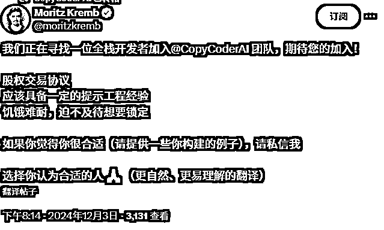

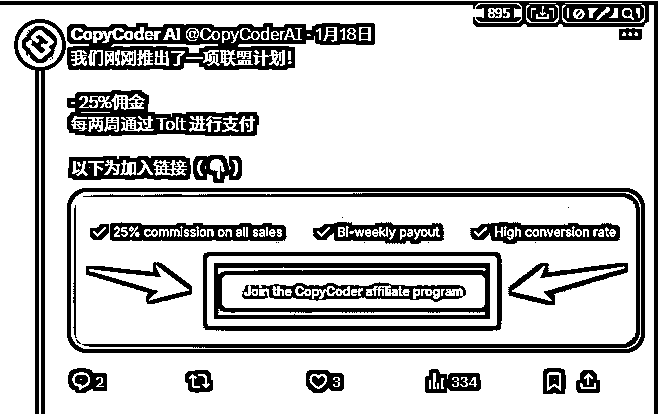

## 三、整体思路

在参考对标产品后，他重新梳理了 AI 提示词插件的生成逻辑。

## 四、功能实现

### 1、MVP

原插件的截图、代码提取、AI 分析三块最初是分散的，后来确定以 AI 编程提示词生成为核心目标，三者都服务于此。他把左侧三个独立功能重组，按一个网页项目的开发流程，拆成三类提示词的生成：技术栈初始化提示词、界面设计提示词、功能实现提示词。调整后的效果如下

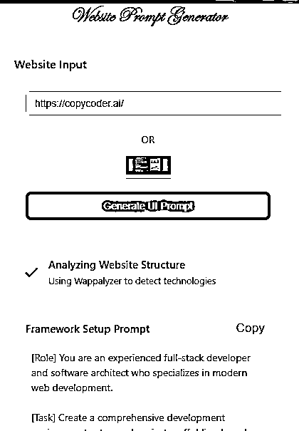

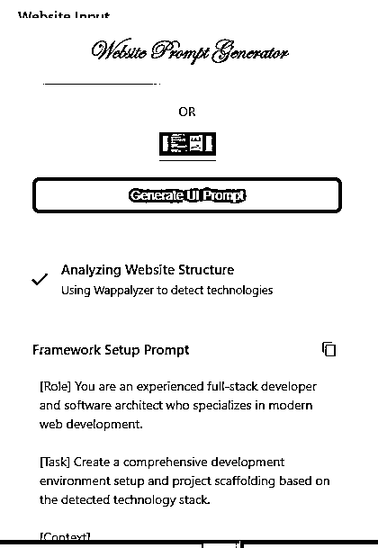

#### 提示词一：项目初始化

编程第一步是配置环境，需要通过站点分析为初始命令提供提示词。他引入了一个可以探测网站技术栈构成的开源工具，输入网址后能识别框架构成，再把技术栈信息作为大模型的输入，让模型据此生成一份初始化项目的指令，主要是引入技术依赖的命令。

经过多次调参，模型现在能基于开源工具的输出生成可用的初始化提示词，基本满足需求。

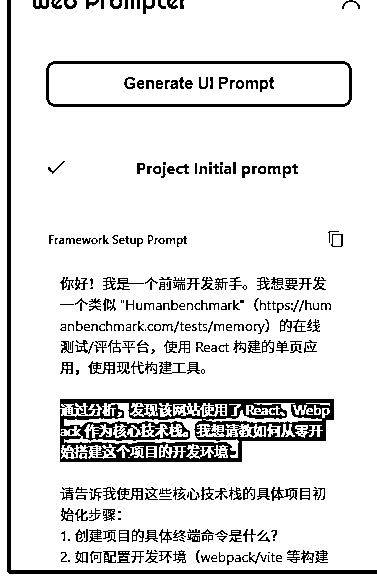

#### 提示词二：界面设计

界面提示词需要全屏截图和从 URL 提取的 HTML+CSS 代码，让模型根据截图识别页面元素和组件，并提取页头、页脚、主题色、配色、组件样式方式，在和上一个提示词保持一致的前提下，组织成系统化的界面设计提示词，方便编程工具理解并生成代码。

他为插件集成了一个新的图像识别开源工具，用于对截图元素做识别并提供输入，再借助大模型对输入做提炼和分析，优化后的展示如下。

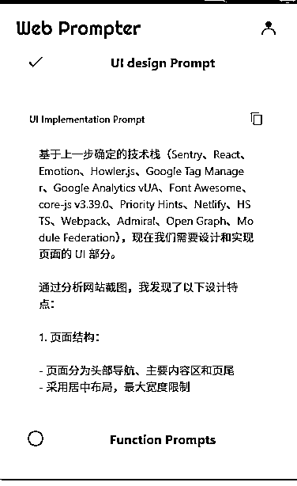

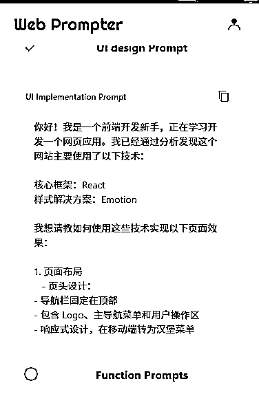

#### 提示词三：功能实现

功能实现提示词要为页面各组件、按钮提供具体行为，是三类里最难的，需要综合前面所有输入，对目标页面的功能模块做合理描述，并给出系统化的开发指引。下面是示例，功能尚不完善，还需继续打磨。

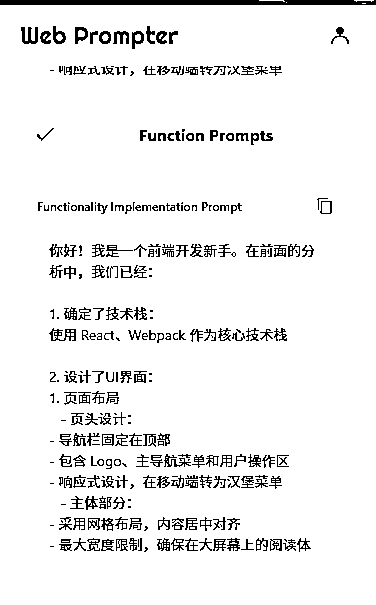

### 2、界面优化

#### 基础样式

1、提示词预览卡片右上角的复制按钮不需要文字说明，直接用图标即可。


2、参考当前截图界面的背景色设计及其边缘流动条，只需更换渐变色并做美化，核心功能保持不变。功能卡片的颜色需要和整体背景区分，可用灰色或灰色渐变。

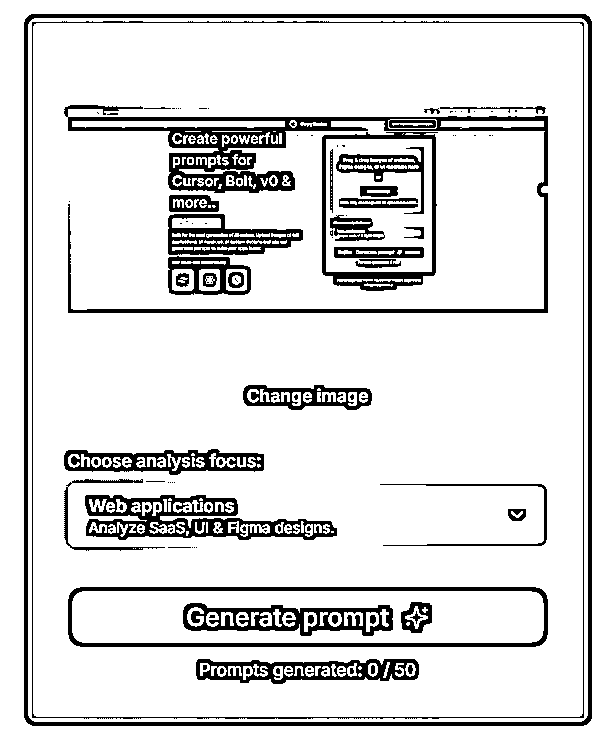

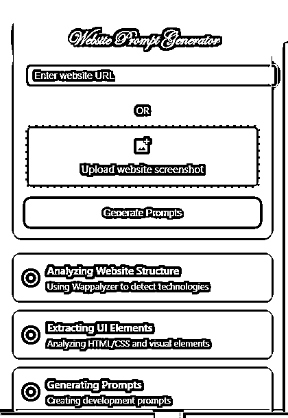

3、生成按钮的颜色建议改用更深邃的黑色。


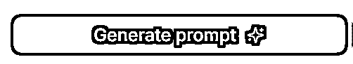

#### 导航栏优化

4、插件主体界面最上方固定一个导航栏，名称为 Web Prompter，采用艺术字风格，右侧放一个小人头像，点击后弹出菜单，可展示登录账户信息，其余界面不变。

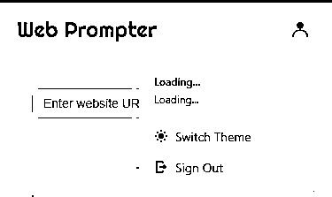

#### 主题切换

5、为头像菜单增加主题切换功能，实现亮色/暗色主题的切换。当前为暗色主题，需补充亮色主题样式，保持类似暗色的渐变风格，但在亮色下呈现。

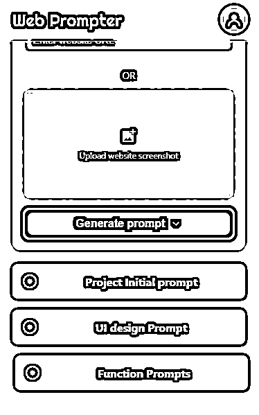

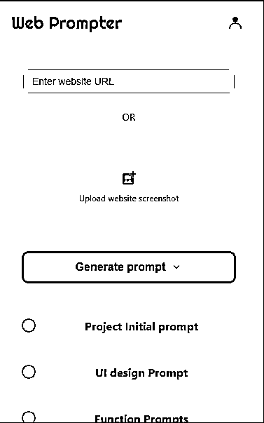

## 五、登录集成

这一步使用 Firebase 新建项目，配置登录方式，选择谷歌登录和邮箱验证登录。

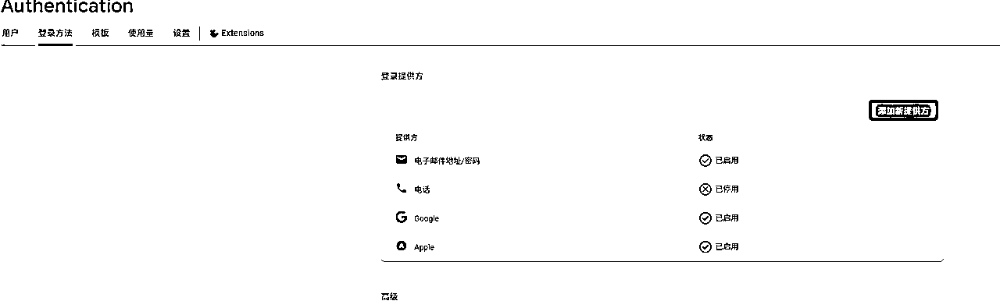

配置完成后在项目设置里复制 SDK 配置给 Cursor，并写入本地 .env 文件。

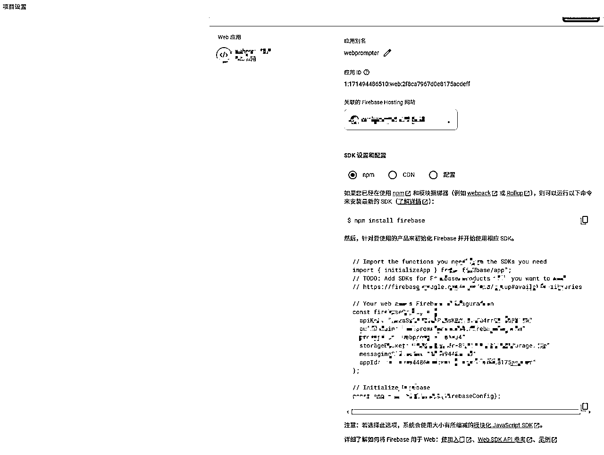

这一步卡了很久，根源是对插件登录的逻辑不清晰。不需要精通代码，但要理解代码的工作流程。他通过现学现用和大模型协作理清了插件项目的登录配置流程，形成认知后再指导模型落地，最终实现了登录配置。

### 插件两种登录方案的落地逻辑

1、邮箱密码验证

```
sequenceDiagram
    participant U as User
    participant E as Extension Popup
    participant B as Background Script
    participant C as Content Script
    participant A as Auth API
    participant S as Storage

    U->>E: 1\. 输入邮箱密码
    E->>B: 2\. 发送登录请求
    B->>A: 3\. 验证凭据

    alt 验证成功
        A-->>B: 4a. 返回访问令牌
        B->>S: 5a. 存储令牌和用户信息
        B->>C: 6a. 广播登录状态变更
        B->>E: 7a. 更新UI显示主界面
    else 验证失败
        A-->>B: 4b. 返回错误信息
        B->>E: 5b. 显示错误提示
    end

    Note over E,S: 登录成功后的状态维护

    loop 会话保持
        B->>A: 8\. 定期验证令牌
        alt 令牌有效
            A-->>B: 9a. 确认有效
        else 令牌过期
            A-->>B: 9b. 返回过期信息
            B->>S: 10b. 清除存储
            B->>E: 11b. 返回登录界面
        end
    end
```

2、Google OAuth 验证

从一个连前端框架都感到畏惧的运营人员，到做出对标 Copycoder 的 AI 提示词插件，最大的跃迁不是学会写代码，而是学会把需求表达清楚，再和大模型一起补齐工程化细节。这或许就是生成式编程时代典型的创作方式：想法、逻辑和审美，比语法和框架更重要。

```
sequenceDiagram
    participant U as User
    participant E as Extension Popup
    participant W as Web Login Page
    participant G as Google OAuth
    participant F as Firebase Auth
    participant B as Background Script
    participant S as Storage

    U->>E: 1\. 点击 Google 登录
    E->>W: 2\. 打开登录页面
    W->>G: 3\. 重定向到 Google
    U->>G: 4\. 确认授权
    G-->>F: 5\. 返回 OAuth Token
    F-->>W: 6\. 交换 Firebase Token
    W->>B: 7\. 发送登录成功消息
    B->>S: 8\. 存储 Token
    B->>E: 9\. 更新UI状态
```

我把 Firebase 的登录能力接进了这个插件，邮箱加密码的验证方式已经能正常跑通；不过 OAuth 这类第三方授权还没完全搞定，卡在了 Firebase 配置不一致上，后续还得继续调。

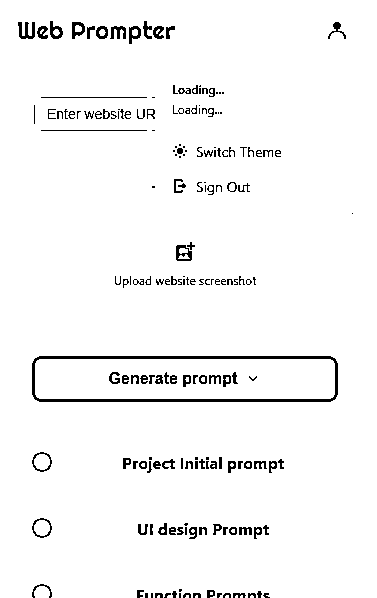

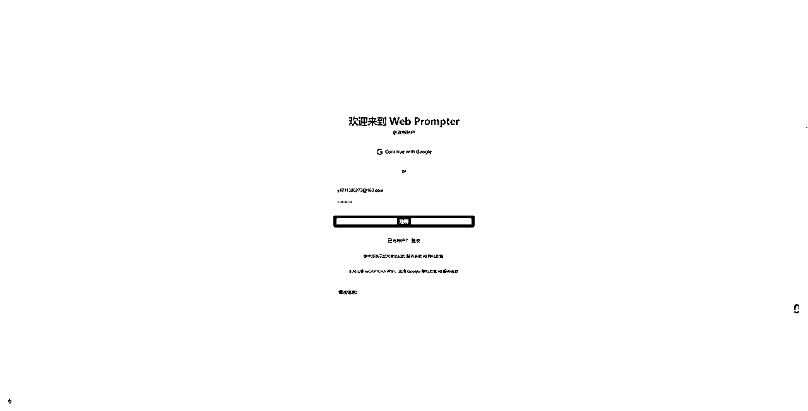

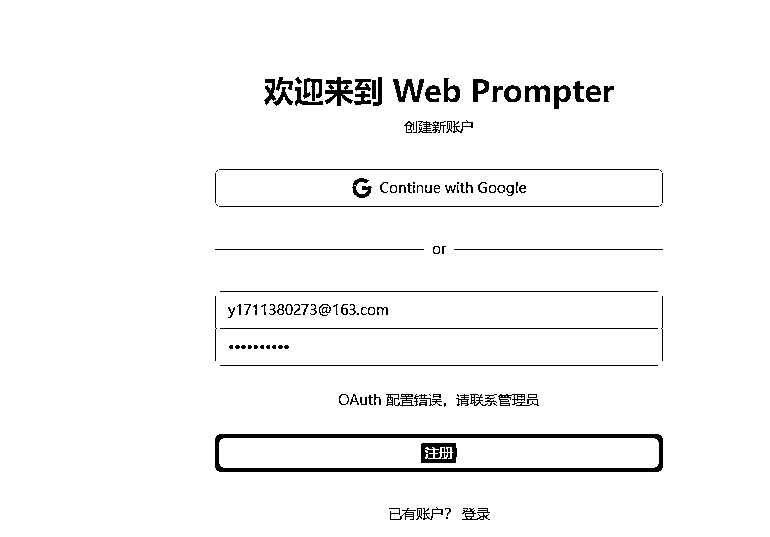

## 还没做完的几件事

1、三个 Prompt 还需要放到真实 AI 编程场景里继续打磨，让提示词更精准、更少出错，这样才能稳定复刻出用户真正想要的工程。

2、插件界面也要动一动：去掉手动上传截图的部分，换成开源的整页截图工具，用户一键就能截取目标网页，截图再自动作为输入，交互体验会好很多。

3、登录界面要重新设计，走更现代、更好看的路线，同时把登录状态区分开：第一次登录用全屏展示，之后再用小窗 OAuth 验证。

4、产品完善到一定程度后就要开始做推广了：开一个 YouTube 频道，搭好产品落地页，再用社交媒体营销给产品引流。

## 最后想说的话

我在这里先抛块砖，希望大伙读完能有所启发。说实话，这个项目是断断续续做下来的，要不然也不会拖这么久；现在仍有不少不满意的地方，实际效果也还得继续检验。可 AI 编程确实让普通人能很快上手做出满足自己需求的小产品，只要时机合适，把它扩展成服务很多人的产品也完全有可能。

马上要过年了，祝大家都能顺利上手 AI 编程，体验创造的乐趣，也祝各位蛇年大吉！