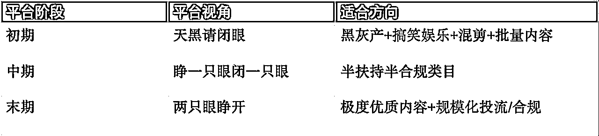
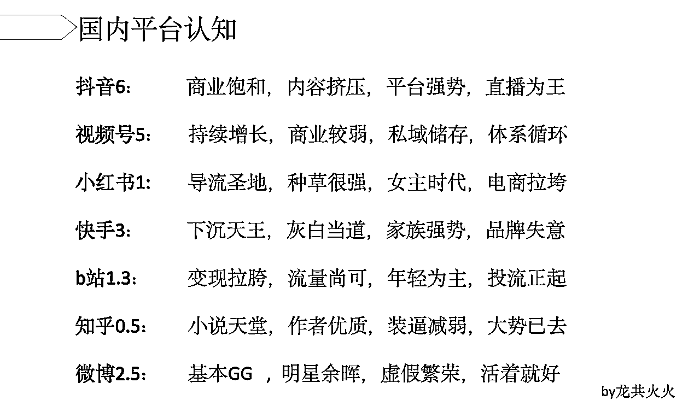
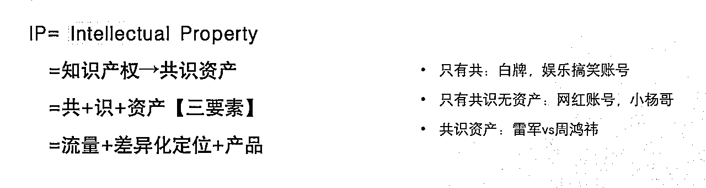
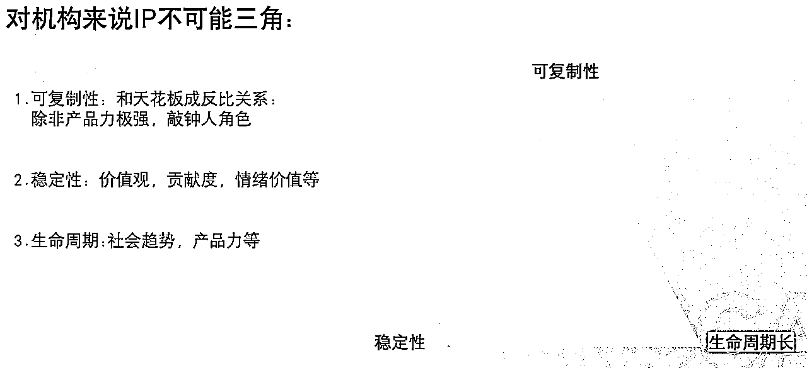
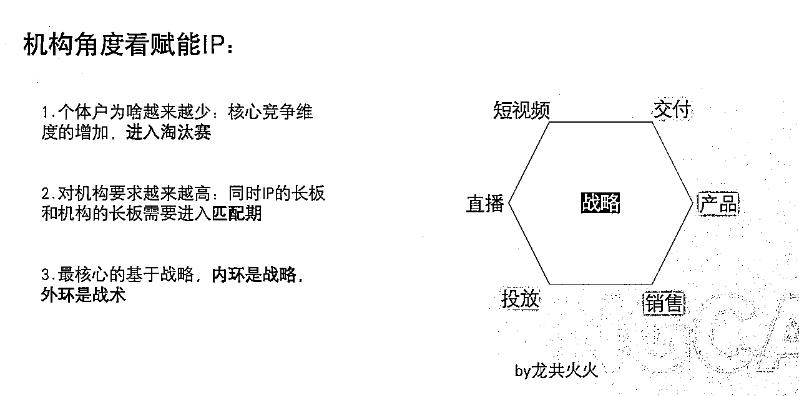
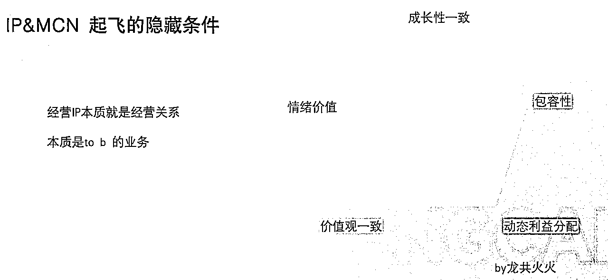
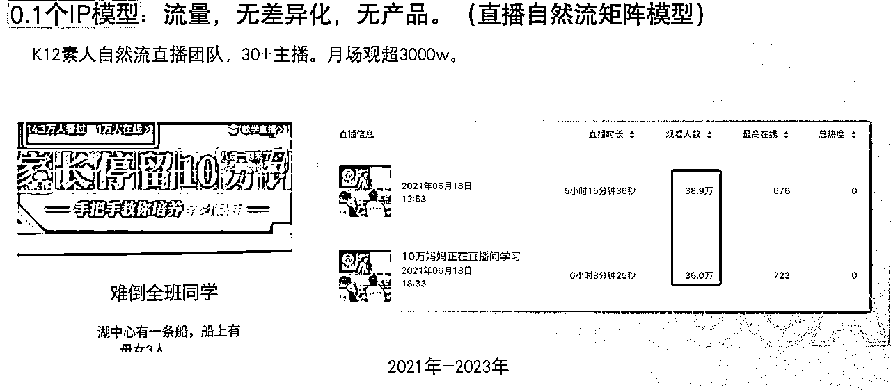
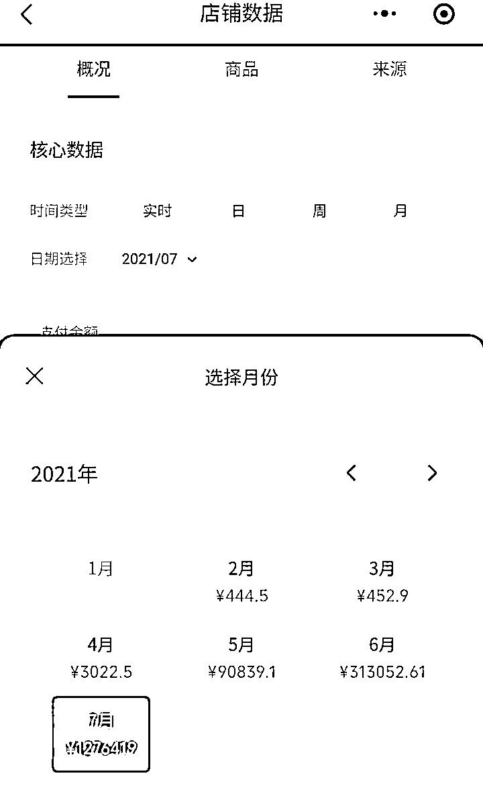

# 创业6年亿级反思：关于流量、平台、IP、认知成长及团队

创业六年，用真金白银换来的教训，今天一次聊透。

从2019年3月把睿翼互动做起来，到现在已经六年。比较幸运的是，我们活了下来。

这些年干过不少事：2019年，进入K12短视频MCN领域，算得上第一批玩家；2020年，在快手首创“直播卖案例”的玩法；2021年，打通视频号，做出素人直播矩阵；2023年，开始探索IP化路径。

也攒下一些家底：家长向短视频粉丝超过6000万；上过福布斯U30（没花一分钱）；拿过创新工场的融资。波折同样不少，比如“双减”就曾沉重打击过我们。

这些思考愿意拿出来分享。之前写过一篇《创业3年反思》，这篇算是续集。全文大约8000字，分四个板块：与平台/流量相关的经验11条，对IP/MCN的认知15条，个人成长层面的领悟35条，团队复盘13条。我有个坏习惯，几年才更新一次，得改。读者可以按模块挑着看，全部看完大约30分钟。放心，文末没有卖课广告，但小白请谨慎阅读。（联系请加 huohuo1616）

## 流量与平台

1. 流量窗口期的实质，是供给端远未饱和。与此同时，我们所做的每个动作都要踩在平台演进的节拍上。内容玩家普遍遵循这样的路径：先用泛娱乐内容吸引眼球，在热门赛道中做大，最终回归产业。

当某个机会被满世界宣扬时，反倒要留个心眼；如果它只在小圈子里流传，那就别再犹豫，迅速行动。

2. 平台没有大红利时，精细化运营和降本增效会成为主流；平台有大红利时，到处都在喊拉满消耗。互联网项目的信息差窗口正在收窄。公众号小说业务用了很多年才被广泛知晓，短剧却只花了一年就从闷声赚钱变成全行业蜂拥。不是媒体嗅觉变敏锐了，是优质项目太稀缺。所以谁跟你吹嘘好项目，先看实物，别信截图。

3. 进入什么赛道，几乎已经写好了结局。这话我要说三遍。别做红利猎人，红利只为那些早有储备的人和队伍准备。有些位置，生来就不属于你。

4. 有一种反直觉：花钱买的流量，往往比免费流量更划算。付费流量的好处是能在公开市场按需取量，像地主圈地，稳定可控。免费流量则像农民种地，看天吃饭，需要长期投入。二者没有高下之分，只是作战武器随阶段而变。

5. 把公司存亡系于流量身上，注定活不长久。街上那些用大喇叭招揽生意的餐厅，我一般不进去，除非门口真的在排长队。

6. 产品永远排在流量前面。产品力欠缺时，才会整天把“缺量”挂在嘴上。许多IP抱怨平台不给自己推荐，根源其实是没找到PMF。当年我做线下课，客户全靠转介绍，从没认真思考过用户画像和他们的隐性需求，反而怪平台没有我的用户。这就像马术师面对一辆跑车，跨上车头喊“驾”。可把产品做扎实太难了，身边的创业者里做到的不到1%。

7. 只做流量，迟早反噬自己。最直接的是心态崩坏：太想赢，小胜就膨胀，无胜就焦虑。聪明在此刻反而成了负担，因为选择太多，很容易拐进小岔路。

8. 私域是个绕不过去的关口，用户的价值只有放进私域才能称重。它被轻视，根子不在战术执行，而是战略层没想清楚。早在2016年，我就带公司搭过个人号矩阵；2018年写《高阶运营》时，也把“私域流量池部署”写进了书里，大概算国内最早。可我们坐拥6000万短视频粉丝，私域只积累了区区几十万。不是没能力，是没看见真相，没算过产值，于是随手放弃。好比开着越野车穿越沙漠，沿途明明有无数湖泊，却懒得停下来补水，直到驶入干涸地带。但别忘了，私域是租客逻辑，不是房东逻辑。没有谁会一直在你通讯录里，闺蜜都能拉黑你，何况没讲过几句话的用户。既然是租客，进场时就要规划好改造方案——租五年的房子，和租一个月的房子，投入当然不一样。

9. 很多生意算到最后，利润的大头都交给了平台。别迷信百分百确定的方法论。有些人突然起飞，不过是阶段运气好，或某个玩法恰好被选中，连本人都说不清缘由。平台对此毫无波澜——人面不知何处去，桃花依旧笑春风。如果走纯投放路线，你得找到平台难以核算你真实产出的模式：要么在私域里扑腾，要么在品牌上发力。

10. 平台红利不能一概而论，要落到具体类目。前阵子去硅谷，有朋友问起国内新媒体环境，我讲了些粗印象。他听完说，横批可以是四个字：内容至上。

11. 平台下一轮机会的叙事，大概率由AI主导——内容产能被放大，整个生产链路更加高效。

## IP与MCN

1. 短视频的红利期接近尾声，容易摘的果子都被摘光了，剩下的要回归生意本质。比流量机遇更肥的是人心红利，这正是IP崛起的土壤。

2. 什么是IP？在我看来，它是流量、差异化定位、产品沉淀三者的乘积，缺少任何一项都站不住。按这个标准，多数IP只是“数字分身”，谈不上真IP。

3. 绝大多数MCN机构，其实是门糟糕的生意，因为它们被不可能三角困住：可复制性、稳定性、生命周期，三者相互纠缠。

夫妻档和师徒制之所以比大部分MCN稳定，是因为它们建立的是社会契约，而不只是经济契约。MCN这个词发展至今，正在回归原意Multi-Channel Network，即频道逻辑。它的任务是为IP服务，而不是凭空创造产业。

4. 未来的MCN，竞争力不在签约规模，而在产业纵深。IP只能覆盖一部分，无法构成全部。这个名词会慢慢祛魅，叫“XX产业公司”也许更贴切。雷军就是例子：他在社交平台上不仅是账号，还代表了手机、数码、汽车两个大产业的符号。

5. 机构想留住主播，至少要满足六项：短视频、直播、投放、销售、产品、交付。内圈拼战略，很多IP会忽略“画一条线”的清晰度；外圈拼战术，要么没有致命短板，要么把某项长板拉到极致。

6. 可实际上，MCN要真正起飞，在上述六项之外还有一层水下模型。对机构来说，经营IP说到底是在经营关系。价值观、情绪价值、包容度、成长性、利益分配，都要对得上。且变量永远存在——即便强如俞敏洪，也留不住董宇辉，问题大概就藏在我们看不见的层面。

7. 从IP这项生意中能拿到的回报，等于：
用户需求与产品能力的最大公约数；
你的认知与IP认知的最大公倍数。
因此，你在专业领域的认知最好远高于你所服务的IP。

8. 不持有IP，不等于没有出路。2021年，我们做过K12赛道规模第一的自营素人直播矩阵，用一套可复制的主播培养模型，先后培训数百名主播，杭州同行送外号“黄埔军校”，同期在播人数超过30。正因为当时的利润高于一些同行IP公司，我们错过了纯IP那波红利。

9. 注意力市场已经饱和。用户的多巴胺引擎，正在从高频小刺激切换为大幅度共振。知识付费行业尤其明显：早年间靠10秒内的夸张表演（比如翻白眼）留住人；接下来，娓娓道来和认知颠覆会更有生命力。

10. 只有IP，是差生意；把IP当作触角，才是好生意。知识付费的卖课型IP已经撞到天花板，产业型IP正值窗口期。我们正朝心理学、家庭教育、传统文化等方向布局产业IP，有资源或感兴趣的朋友欢迎来找我（gongyan42）。

11. 有一句话，我们用了上千万学费才读懂：孵化IP很多时候是伪命题，放大IP价值才是真命题。你想要的是一个低概率游戏，还是一件确定性较高的事？

12. 对不少赛道而言，IP眼下最头疼的并非流量，而是公众情绪。这两年被砸碎的IP不在少数，更早的微博、公众号时代，“咪蒙式”的骤然消失也一再现。IP的体量越大，车速越快，如同以120码奔驰时，头顶悬着达摩克里斯之剑，压过一个小坑都可能车毁人亡。所以必须谨小慎微，适当收着点。大冰走红后的刻意低调，可以参考。

13. 公众号2012年问世，2015年商业化，2019年广告数据开始下滑，但它至今还在，寿命超过了10年。大潮退去后，小浪花不断涌现。2021年的公众号+视频号一体化关注（业内称“默展号”），我们借势涨了1000万公众号粉；去年有人靠GPT批量产文吃流量主收益，小绿书也出现了。抖音、视频号同理：真正优秀的产品，生命周期远比想象中长。生态一旦长成，大树倒了还能发出新枝。所以视频直播领域，无论IP还是电商都仍有空间，区别只在于：你要么成长为高手，要么静静等属于自己的机会。

14. 进场的时机极重要。除了掌握信息，更要相信常识，在关键节点上别被舆论带走。我们这些年遇到几个重要关卡。第一个是2021年的双减。政策出台前，我已察觉异样——年初网校对CPA的结算价从单个9元案例150元降到90元。那让我醒悟：渠道商吃到的，不过是资本溢价的甜头，这阵风早晚会停，就像滴滴和快的当年的补贴大战。于是2月起我们转做自己的录播课。等双减落地时，广告收入占比只剩20%。第二个是视频号。我们大概是最早跑通视频号的教育MCN。2020年视频号泡沫期，无数人离场，我的判断却相反，依据有二：一，微信月活11亿，抖音快手去重后约8亿，仍有3亿人上网但不看短视频，他们大概率会在视频号上补上这一课——简单推算即可得出，老年用户会成为基本盘。二，罗杰斯创新扩散曲线揭示，任何产品的扩散都有节奏，不会均匀推进；尾部的16%接受者，按11亿移动互联网人口计算，意味着近2亿人还没被短视频覆盖。两条线索交叉验证，视频号几乎就是唯一的答案。所以我们一直没撤，坚持了半年，2021年7月终于跑通，比行业公认的红利早了两年。

15. 关于IP产业公司，我见过最精准的表达来自新荣记创始人张勇（米其林摘星无数）：“从1995年开第一家店，我们对食材的追求高，慢慢形成了文化。我不希望厨师做菜标准化，而是他把菜当成一个作品来做，把这个工作当成自己的荣誉。”

## 认知成长

1. 和段位比你高两级的人深聊一次，可能胜过自己闷头琢磨一年。得到的答案，常常与周围人完全不同。

2. 高人最值得留意的，不是他做了什么，而是他推掉了什么。不动作未必是懈怠，往往意味着精力极度聚焦。我有一位朋友，前几年在外人看来闲得发慌，打高尔夫、偶尔写写公众号，送上门的合作全被他婉拒。起初我也以为他躺平了，后来才知晓他在埋伏笔。等跨进餐饮赛道，他一鸣惊人。

3. 我们确实吃过不少红利，可常常只啃到西瓜尖，没能把盘子做大。过去我归咎于组织力不足，后来想明白，是缺乏看向终点的眼光。人们常说，你赚不到认知之外的钱；我觉得更准确的是：你赚不到觉察之外的钱。错过机会，多半因为从未真正关注。去年有位群友来拜访，临走丢下一句“没事多买点XXX”。此后XXX涨了许多倍。不知道吗？知道，但从未放在心上。

4. 简单的东西，总是不被珍惜。底层规律往往朴素得吓人，你可能早在多年前就听过，但内心拒绝相信，觉得背后必定藏着更复杂的真相。能把复杂事讲简单的人，不是傻子就是高手。确认是后者，就安心当学生。

5. 臣服是一种态度，更是一种稀缺能力。我们的ego太大，总以为能力圈能无限扩张。当你肯正视自己的局限，其实已经赢了。改变命运的关键，通常不是让自己变成超人，而是找到一位愿意带你的高人。段誉习得凌波微步之前，也曾对菩萨磕过999个头。

6. 认真做事，是一项顶级能力。它代表全神贯注，代表以结果为导向，代表遇山开路。李小龙解释“速度”时讲，速度是身心同步，是去掉多余动作，是追求精准。快，无关急躁，只关乎效率。我们常感到手忙脚乱，根因正是身心拆成了两半。

7. 《更富有，更睿智，更快乐》既是书名，也能当座右铭，对应物质链、智慧链、幸福链三条阶梯。每个人所处阶段不同，记得及时止步。身边一些朋友财富积累惊人，家庭生活却谈不上幸福——他们在后者身上花的时间，恐怕不及赚钱的十分之一。围城内外互相张望，最难的是意识到墙的存在。

8. 许多人创业的原动力其实是消除恐惧：对缺钱的恐惧，对人际关系的恐惧。等恐惧消失，创业才算真正开始。反过来，如果只是想证明自己，迟早会摔大跟头。这趟硅谷之行，我注意到当地创业者身上那股powerful，根源是底层自信——他们真心热爱所做之事，而不只为了赚钱。从去年起，我开始在内心确认这一点。

9. 别把力气一次性用尽，别把期望值拉满，平常心是护城河。在挤满人的泳池里，想要最快抵达对岸，也许不是拼命游，而是步步为营；更妙的方法，是爬上岸，直接走到对岸。不少创始人开局太猛，透支身体与心力，之后要花漫长岁月来修复。

10. 心力是一种奇妙的东西，许多聪明人反而无法体会。聪明不直接产出智慧，他们并非没有心力，只是每次都差一点就转移阵地。

11. 要完整经历周期，好的坏的都别躲。绝望时保留希望，喧闹中懂得自我反省。

12. 看透三个月的行业动向并不难，难的是想清楚三年后的格局；可一旦想清楚，决策就变得非常简单。去年读到《10X than 2X》，深有启发，它逼你切换十倍速的视角——比如一个原本规划十年的项目，能否压缩进六个月？

13. 底层特质的分量，被低估了。论技能，人与人之间的差距并不悬殊；决定十年后高度的，是藏在冰山之下的底层特质。

14. 人真正要关注的是加速度。过去的成绩不能证明现在的战斗力，但若多年颗粒无收，就该检讨选择或打法。

15. 持续赚快钱的代价，是形成惯性，对轻易可得的机会过度痴迷。而丛林法则从不留情：迟早会有更快的猎手吃掉你。

16. 正确与艰难，并不必然绑定。“做难而正确的事”有它特定的语境。不少行业里，正确的事执行起来反而轻松，因为它自带势能。

17. 一个概念若炒了十年仍在炒，要么是真难，要么是真对。前者对应SaaS，年年都在喊元年；后者对应IP，从图文时代到短视频时代从未退潮。

18. 不必羡慕运气，要研究运气为何可被复制。许多高手的运气，本质上是精密计算。提升运气的最简单姿势：多花钱，攒人品。一位朋友今年捡到的机会，源于多年前在商学院认识的老大哥，对方观察了他十年。

19. 知止是核心能力。越早触碰到能力圈边界，心态反而越开放。过去我执拗于自营，吃过不少苦头；如今做产业IP，很多环节主动开放出去，交给合作方完成。

20. 太阳底下没有新鲜事。你以为的棘手难题，大概率已在其他行业、其他维度被解决过好几遍。

21. “道者，人之所蹈，使万物不知其所由。”许多事情的发生暗合规律，只是当局者迷。流量迁移、商业模式红利，皆有周期。普通人最难的不是掌握方法，而是尊重常识；比尊重常识更难的，是承认自己普通，并非天选之人。一旦接受这点，胆子反而大了——普通人有资格犯错。以前我几乎不找大佬聊天，怕提问太蠢。后来有朋友开导：你可以脸红，但一秒钟之后就该翻篇，然后恢复正常。

22. 当下经营公司，要始终盯住三个词：增长、效率、风控。营收决定面子，资产决定里子，现金流决定日子。

23. 多与反复穿越周期的过来人交流，他们的手感更真实。一时风云激荡，不如长年坐在牌桌上。

24. 终局思维与逆向思考，都是稀缺品。

25. 看上去像赌博的操作，也许是无数次计算后的出手。别只看利润率，要看ROE——它是利润率、杠杆率、周转率三者相乘的结果。当年一个生意月利润20%且周转极快，一位大佬借了八千万、年化24%的高息资金杀进去，一把定乾坤。但请别模仿，那有特定时代背景。

26. 在功成名就之前，先打磨出绝对长板，长到足以让资源主动向你汇聚。

27. 想要指数级增长，需求侧要尽量满足：刚需、稳定、向上、抗周期、能延展。同时占住的项越多越好。

28. 圈层决定收入天花板，你所在圈子的平均收入，约等于你的收入。一位顶级投资人总问创业者两个问题：你的靠山是谁？你过去赚的钱花到哪儿去了？（如果答案只顾享乐，直接淘汰）

29. 从外界获得新知，要养成付费习惯，而且是随手付费。我常在周日晚上的直播里“PUA”观众：听到有价值的内容就刷个礼物，一是加深记忆，二是培养习惯。微付费的杠杆极大。早年关注一位大佬的公众号，当时他还没什么阅读量，我把他每篇历史文章都打赏200块。加了微信后，他极为感动，像遇到知己。按常规渠道，你大概永远接触不到这种人。

30. 玩过一次“财富流”游戏：六人一桌，用3小时模拟一生。体感有两点。第一，终局意识；若在开局就见过山顶的景色，更容易进入顺流层（游戏里即被动收入远超主动收入）。第二，精力是隐形资本，花在哪里，人生就在哪里结果。有位朋友赚到钱后想入手兰博基尼，被投资人劝住。对方说，问题不在600万，而是买车之后你要费心思研究它，还要花更多心思炫耀它，不如把这部分精力投回公司。

31. 只要不下牌桌，你就还有机会；可以暂时待机，但永远别关机。

回头看这些年创业，最大的分水岭，其实就藏在一道题里：你能不能在迷雾里，一眼分清眼前的岔路和真正的归途。

很多人不是不努力。聪明人尤其如此——他们总能找到一条又一条支线解法，每次都侥幸通关。但这恰恰是诅咒。因为太擅长活着，反而忘了问自己：我到底要去哪。

谁痛，谁改变。这句话我品了很多年。出去混圈子、加私董会、找咨询，前前后后花了几百万。你问我会员费贵不贵？我的答案可能让你失望了——真正的问题，从来就不是“哪个私董会值得”。是你为什么去。

每个阶段，去的理由都不一样。早期怕错过风口，后来才明白：信息早就泛滥了，缺的是方向感。

见过太多人在错误的地图里拼尽全力。游得很卖力，抬头一看，原来自己在沼泽里。能游到海水变蓝的人，不是体力最好，而是先看准了哪片是海。

怎么看准？

三个关键词：算力，算法，数据。

算力是你的底层操作系统——能不能扛住复杂的局面；算法是你的思维模型库——有没有足够多的分析框架；数据是你的信息源——手里是不是高质量的情报。

幸运的是，AI多少能补上一点盲区。我现在的日常，几乎离不开GPT了。以后如果时机合适，想做一个AI新媒体相关的俱乐部，把这里面踩过的坑和心得都摊开讲讲。

——

关于团队，这些年我攒了十一条心得。

第一，别高估“共苦”的难度，低估“同甘”的杀伤力。人性这东西，顺着它做事，逆着它修心。苦难让大家抱团，利益才真正考验人品。

第二，太高的利润率不是好事。利润高，招人眼红；如果没有组织壁垒兜底，这就是一场灾难。普通公司别急着挖护城河——真相是，你在看不清全局时挖的，可能不是护城河，是马奇诺防线。你之所以觉得它是护城河，仅仅因为你在上面砸了太多钱。

第三，使命、愿景、价值观。刚创业那会儿听这些词，觉得虚。直到去年，突然通了。它们不是墙上的大字报，是锚点——定目标，给动力，立规则。一艘船从同一个港口出发，有人成了哥伦布，有人成了海盗。航向不同，命运天壤之别。

第四，筛选比培养重要。但前提是，你得配得上你想要的人。你只能找到跟你目前段位匹配的伙伴。别骂团队不行，先照照镜子。

第五，冰山下的东西，比冰山上的重要。最初招人看技能，恨不得拿来即用。后来发现，招错一个人，代价远超想象。真正要看的，是他底层的价值观、人生观这些东西。技能能练，心性难改。

第六，很多公司死掉，不是说业务一点点萎缩，而是创始人的燃料烧完了。硅谷在聊创始人模式，雷军做小米汽车前问李想：“给一条建议，就一条。”李想说：“你必须all in——没有别的，这就是小米汽车成功的唯一条件。”

第七，组织怎么才算升级？李想给了四个任务：一是能不能有效感知并获取全面真实的信息；二是能不能做出好的判断与决策；三是能不能确保执行过程不走样；四是能不能有效复盘。四个里做好两个以上，就已经很难。继续修炼。

第八，长期主义，不是一个选择，而是一道看清真相的题。没看透之前别天天喊长期主义，它反而有害。我当初也纠结，自己在做生意，还是在做事业？后来想明白了，没有短期和长期，只有真相。就像打一局MOBA，你不能只顾着补眼前的小兵，要看整张地图，知道水晶塔才是终点。

第九，带团队要守好中道——别被纯利益推着走，也不能只谈理想不谈钱。这两边失一侧，都会翻车。

第十，远离那些持续输出负能量的人。别以为自己能改变谁。将军赶路，不追小兔。别被情绪绑架，也别被沉没成本打劫。

第十一，《悉达多》里，商人惊讶地问那个僧人：你什么都不会，怎么活？僧人回答，我会三件事：会思考，会等待，会斋戒。

会思考，是能看清真相；会等待，是看清之后的耐心，主动也好，被动也好；会斋戒，是耐受挫折的能力。黄仁勋说过一句话，大意是：期望越高，耐力越低。而成功恰恰最需要耐力。他至今在内部说“痛苦和磨难”这个词时，都会无比欣喜。

本质上，这就是一部西游记——真正的经书不在西天，在路上，在你遇到过的每一难里。

——

利他，是一件该一直做下去的事。

我这些年习惯随手帮人，短期看确实没什么回报，但放大到十年，很多机会都从这些无意间种下的因里长出来。圈子里有朋友开玩笑说“近火火者富”，20年我拉过一票朋友做教育、做CPA，好几个结果都还不错。

今年，公司也在转型——从一家纯粹的K12 MCN，转向产业IP公司。方向上，重点看心理学、家庭教育、人文领域。我们正尝试用AI和数字人技术帮助IP放大，目前已经跑出了几个案例：小红书有两个月涨50万粉的纪录；某位心理学头部大V的AI化程度，也已经到80%了。

我依然信那句话：做对的事情，然后把事情做对。

下一波浪潮是AI+IP。坐标杭州，正在招短视频、直播、产品、私域、管培生等各类人才。如果你有IP资源，或想一起合作，欢迎联系。

联系方式：gongyan42，或公众号【龙共火火】。和我愿意的人一块取经，也取你自己的真经。

——

最后说一个彩蛋。

每周日晚上，我都在视频号【龙共火火】直播碎碎念，已经坚持了四年，纯公益的，想来随时来。

今年我准备做一档成长类的公益栏目，叫《巨人之书》。灵感来自国外一位博主蒂姆·费里斯，他采访了横跨体育、金融、文学、艺术等领域的几百位顶尖人物，做出了《巨人的工具》《巨人的方法》。我也想去找身边那些穿越过周期的朋友，把这些年的智慧和心得录制成一个系列，给更年轻的奋斗者一些参考。

如果你有兴趣，欢迎来聊聊。咱们一块，把各自的经书取回来。