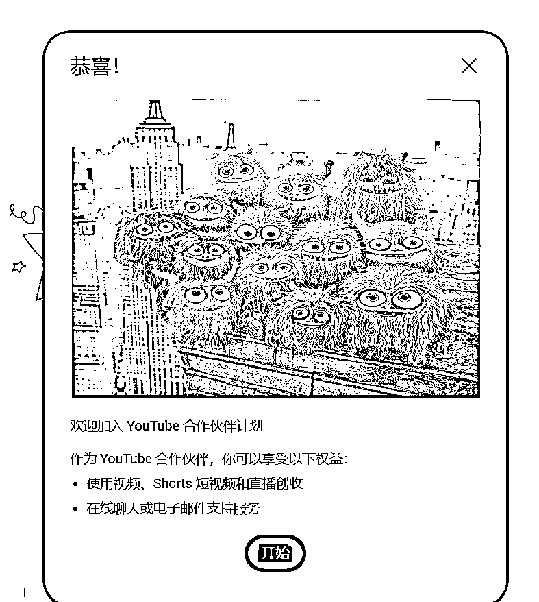
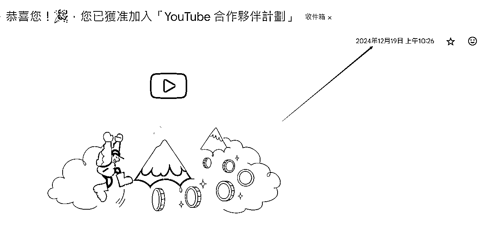
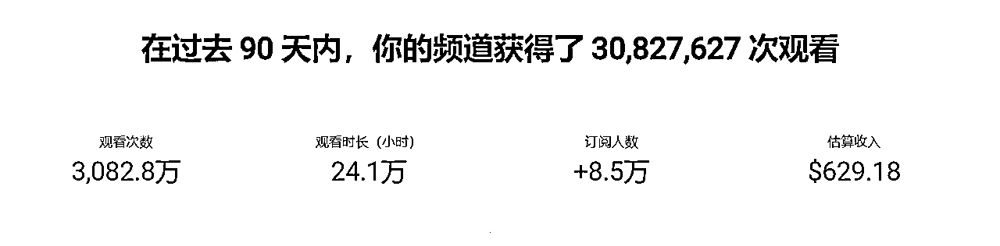

# ('YouTube航海14天开通YPP，我用的是同中求异', (2, 28))

今天想跟你认真聊点实在的。

先说个背景：我是时光。这轮航海我上了YouTube的船，没想到14天就收到了YPP开通邮件。趁着刚有空，也正好被圈里刘小排那篇“越快乐越成功”的文章戳中了，那就干脆把这段经历好好拆一遍。

说实话，这篇复盘早就该写了。一直没动笔，一方面觉得自己文笔实在一般，另一方面也是觉得这点成绩算不上什么大成就。但今天想了想，还是写出来吧，也许对正在观望的人有点用。

12月4号扬帆，19号那天，YPP的确认邮件就躺在了邮箱里。

YouTube Shorts那些基础操作的坑，星球里很多前辈已经讲得很透了，我就不重复浪费大家时间了。我想重点聊聊自己琢磨出来的一个词：同中求异。

先交代下我这个人：做过二奢生意，当过多年的币圈老韭菜，也曾经是AI绘画的早期玩家。所以这趟航海的前期准备工作，比如指纹浏览器、谷歌三件套这些，对我来说倒不陌生，算是熟门熟路。

先给你看看账号目前的实时状态：

中间因为杂事缠身断更了一阵子，再加上目前AI类频道播放大头都来自印度地区，账号现在的收益只有600多刀，我已经开始动手把流量权重往欧美方向调了。

说回正题。这轮航海开船前，我刚好刷到亦仁老大发的“超级标”，当时就果断行动，注册好YT账号、提前铺路，航海一启动，我几乎没犹豫就报了名。

开干之前，我把星球里前辈们的分享翻了个遍，对整个赛道有了粗框架的认知。接着看完航海手册里那个细分详尽的类目推荐，我最终锁定了AI视频这个方向。

我的判断逻辑很简单：AI视频确实门槛不高，所以大概率会挤进来一堆人。事实也跟我猜的差不多，绝大部分人首选就是AI赛道，攻略里最热的还是动物融合、达人秀这些玩法。

但我心里咯噔了一下——这种赛道注定是红海中的红海啊。你算算，这期航海光人数就2000+，哪怕只有500个人涌进AI视频赛道，每人操作3个号，那就是1500个新号在同一片水里捞鱼，大家拼的还是一样的资源，盯的还是一样的那几家头部账号。这种感觉我太熟悉了，凭直觉，这里面能出成绩的绝对是少数。

所以最初几天我没急着发布，而是花了大量时间去刷内容——国内的，国外的，只要是AI生成的视频，几乎每一种类型我都被喂了个遍。然后是做归类和拆解，把不同素材和风格打乱重组，变成新的可能。

举个例子：有些只是AI生成的一张静态图，我觉得它可以嵌入另一种YouTube上很受欢迎的风格框架里，于是就试着去缝合混搭。

反复试了几天，真的让我摸到了一个当时YouTube上几乎找不出同款的素材形态。我直接拿一个之前就注册好的账号发出去。结果跟我预判的一致——爆了。每天早上醒来，后台都是十几万、几十万的播放。做到后面，一天两三百万播放已经是常态。

这就是我那句话的核心：同中求异。

一个赛道能火，说明它本身就踩中了某种内容逻辑，大家跟风模仿其实不傻，甚至是聪明的选择。但如果你只是单纯地复制粘贴别人的内容，套用拿来主义，那效果大概率会让你失望。

更聪明的做法是——研究这个账号的底层结构，拆解它的内容生产流程，在开始之前，完全可以用模仿去验证自己的工作流是否跑得通。

但如果视频素材做到像素级的复刻，结果只会是：同质化严重得吓人，而且原作者的版权投诉可能就在路上了——这一点我自己亲身体会过，因为我后台已经看到一堆模仿我的账号了。

所以“同中求异”想表达的是：你可以选择同一个赛道，但千万别做一模一样的内容。

大家都在做达人秀变身，动物和美女玩融合——那你能不能试试美女和静物交融、和花朵共舞、和雕塑玩变装？
大家都扎堆做宝宝走秀、动物拟人化——那你为什么不做动物走秀、宝宝干家务的反差剧情？

门槛越低的赛道，未来门槛一定会被推得越高。这句话我以前只是知道，这轮航海算是真真切切地悟透了。

最后还是那句老话：仿其形，不如画其骨。同中求异，祝你也能早日开通YPP，每天躺着赚美金。

一个理工男，文笔有限，各位将就着看吧。