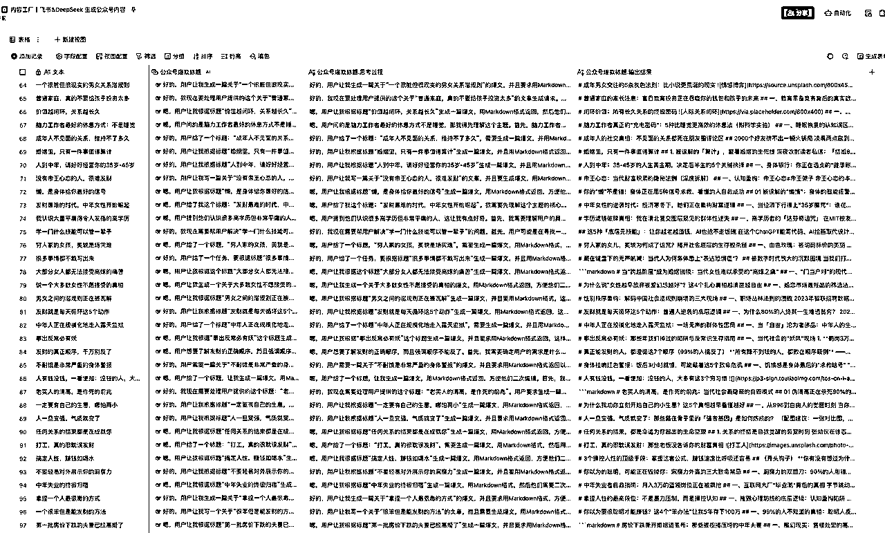
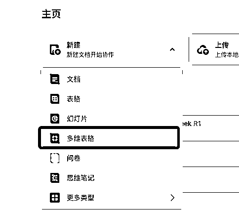
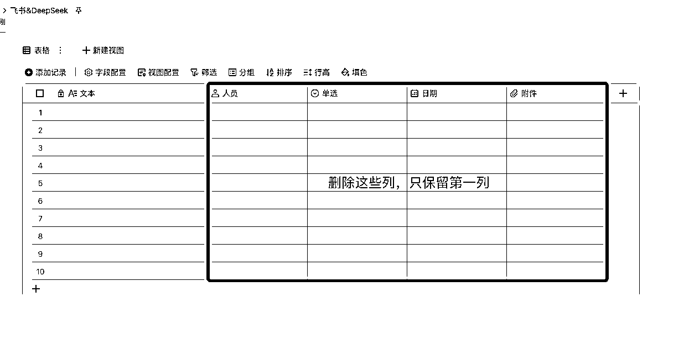
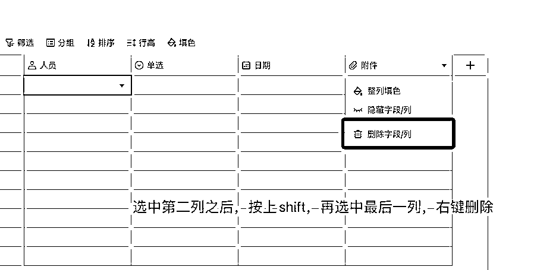
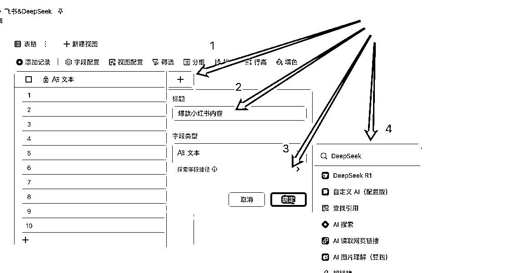
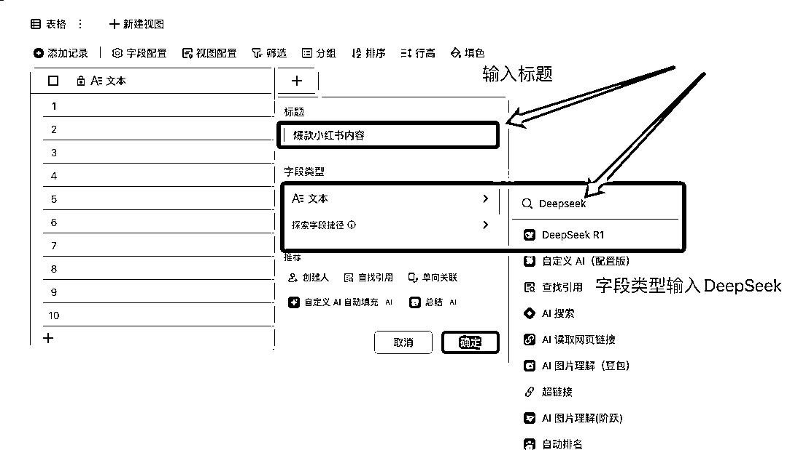
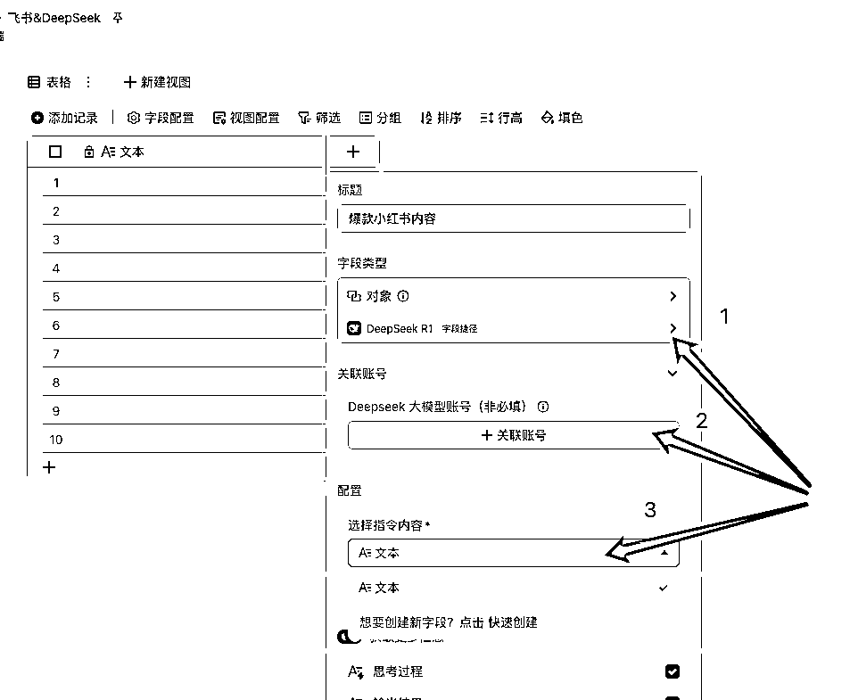
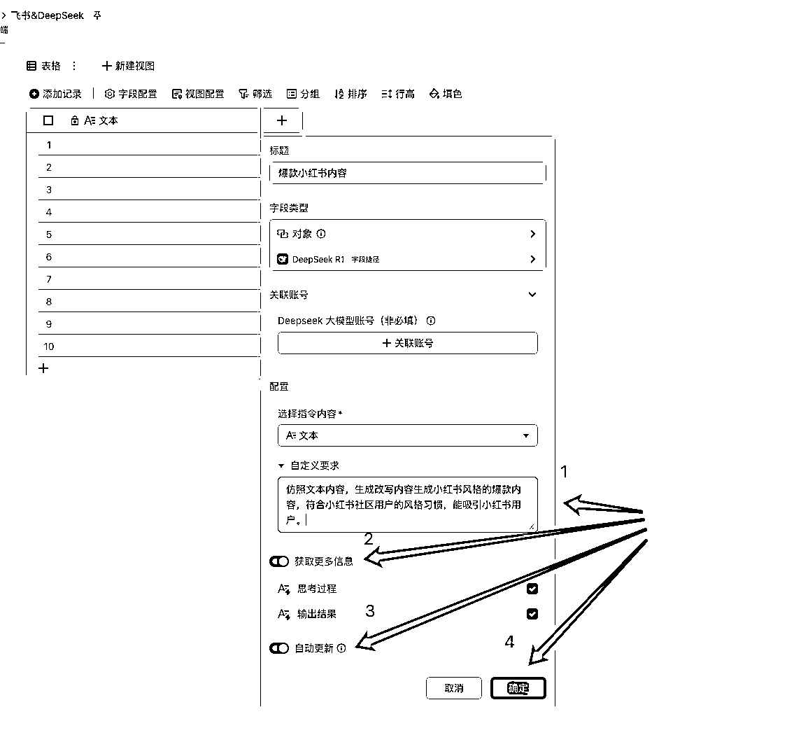
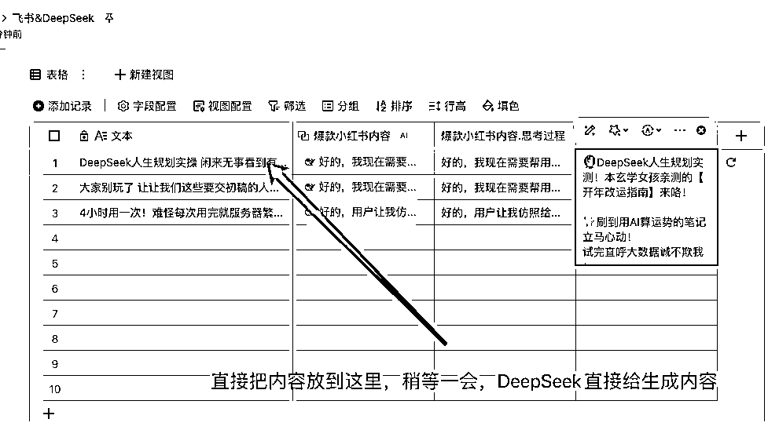
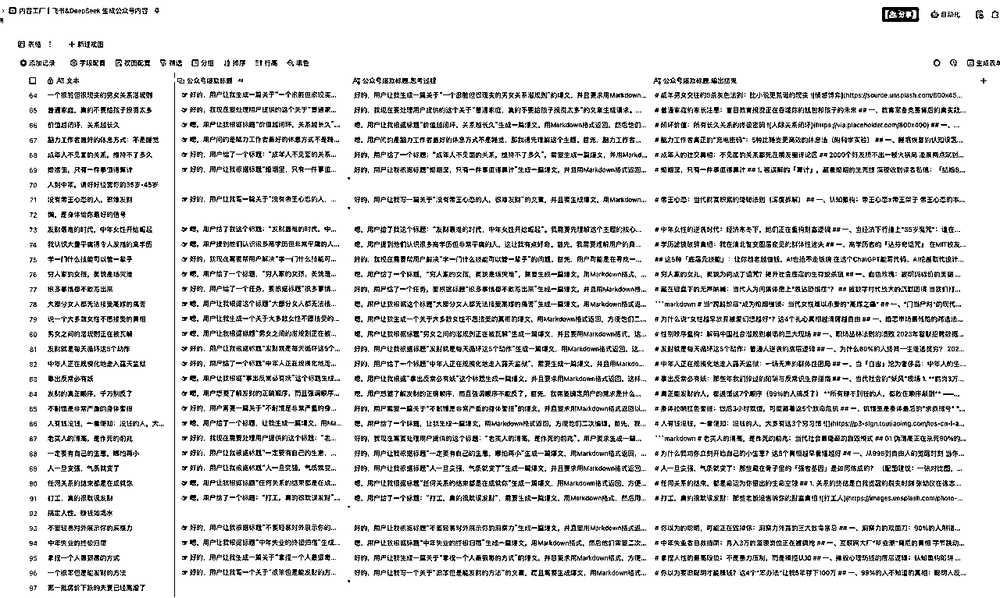

# 内容生产的新上限！飞书多维表格 x DeepSeek R1 组合出击

最近社区里都在刷飞书多维表格搭配 DeepSeek R1 做批量出文的用法，效果真的猛到离谱。

我自己也上手跑了一遍，直接变身内容流水线。

先看效果图：

搭建方法很简单，直接跟进。

一、搭好飞书多维表格

建好表格后，只保留最左边的那一列，其他多余的表全部删掉

具体操作

1.  点右侧的➕号新增字段
2.  字段名称就写 小红书爆款内容
3.  字段类型选 文本搜索字段捷径，关键词输入 DeepSeek 回车

配置流程

1.  选定 DeepSeek R1 模型后回车确认
2.  关联账号先空着，后面需要再补充
3.  指令来源指向第一列的文本

配置流程

1.  在指令区写入你的需求，例如 把第一列的文本进行改写，输出全新的版本
2.  其余参数保持默认即可
3.  其它选项也无需调整
4.  确认后保存

到这里，一套自动化出稿的闭环就完成了，可以直接去实操。

我拿一批公众号爆款标题丢进去，一键就批量产出了多篇新稿：

