这段时间总有人问我：普通人做YouTube科普解说号，到底还能不能跑通？我的答案是，能，而且路径比你想的更简单——只是很多人没走对。

今天把我两个多月的完整实战经历整理出来，从被卡在千次播放，到做出720万播放的爆款，再到顺利通过YPP审核，每一步踩过的坑和用对的方法都摊开讲。希望能给还在坚持的你一些参考。

**回头看，整个过程其实分四个阶段**

第一阶段，照着手册做，但做得“四不像”，视频死活卡在千次播放不动；
第二阶段，回炉重读手册，才发现细节全藏在里面，认真执行后播放稳定破万；
第三阶段，铁了心死磕对标，结果迎来了自己的第一个现象级爆款；
第四阶段，初级YPP到手后又被拒，申诉成功，接着顺利达标高级YPP。

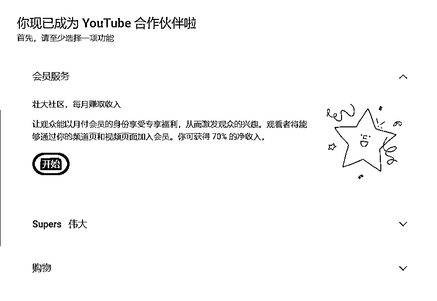

从发出第一条视频到现在，满打满算两个多月。今天写这篇东西，想达成三件事：第一，复盘自己踩过的坑和优化思路；第二，给那些还在几千几万播放徘徊的同行打打气；第三，把科普解说赛道真正适合普通人的玩法讲清楚——说白了就是死磕手册、极致对标，爆款的秘密就藏在这里面。

# 第一阶段：手册看是看了，但没执行到位，视频卡在千播

关注到YouTube这个赛道，是因为亦仁发了一条超级标。当时想法很简单：大佬指路，跟着走就是了。后面也刷到波妮教练的保姆级教程，但自己总想着“明天再说”，一拖再拖。这里劝大家一句，别学我，能下场就别观望。

等到航海开营才真正动手。手册倒是通读了一遍，觉得科普解说赛道比较适合自己，就定下来了。结果又磨蹭了好几天，第一条视频拖到12月9号才发出去。

当时选【面向内容】的时候压根没多想，随手选了儿童内容，流量惨淡才发现选错了。在这里也提醒各位，群里有人举手问问题，很快就有人答，比自己瞎琢磨高效太多了。

航海手册对科普解说赛道的介绍其实已经讲得很透了，但我当时没把这些细节当回事，导致成片质量不过关。最初几条视频播放只有一两千，后来对照手册一点点调，才慢慢摸到破万的及格线。具体优化方法下面细说。

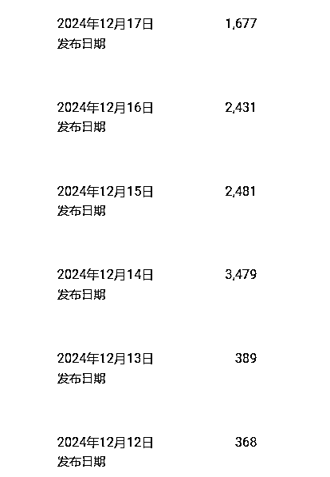

# 第二阶段：回头重读手册，才发现“秘籍”就在里面，播放稳了

## 1、转场和气口，一个都不能忽视

第一遍读手册只看了个大概，做视频完全按自己的惯性来：素材拼一块，配个音就发。更离谱的是素材本身就糊，画面放的什么内容，观众根本看不清。

发出去的数据冷静又残酷，直接教做人。教练说破万才叫及格，我连及格线都够不着。

于是老老实实重翻手册，才发现自己漏了多少关键要求。转场特效、跟着配音气口切换画面——这些我统统没做。基本功都没到位，平台凭什么给你推量？

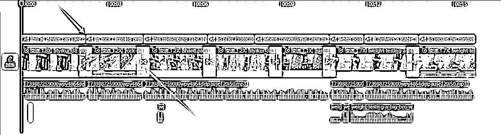

具体操作其实不难：先把字幕识别出来，在每句话的停顿处换画面，一句话结束转场到下一句。遇上长句子，中间多插几个画面，别让观众盯着同一画面看得发闷。转场特效和音效也配上，整体质感一下就上来了。

优化完之后，播放量终于稳定破万。

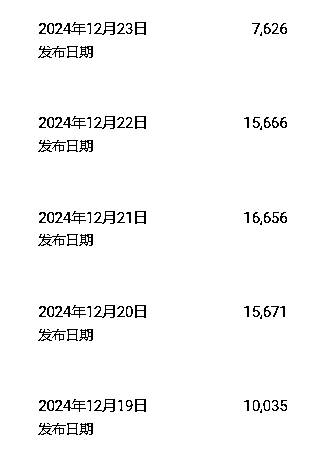

心得就是：先把手册里的标准一条条对照着执行，别急着“发挥”。教练给的方法本身就是走过一遍的成熟路径，照着走不会错。如果数据不达标，先回头看自己的动作是不是变形了；看不出问题就问教练，自己看自己永远是盲区。

## 2、数据一不好就断更，是我最大的错误

连续日更了十来天，播放一直停在万次上下，没有任何正反馈。心态崩了，觉得是不是自己压根不适合做这个项目，干脆停更。

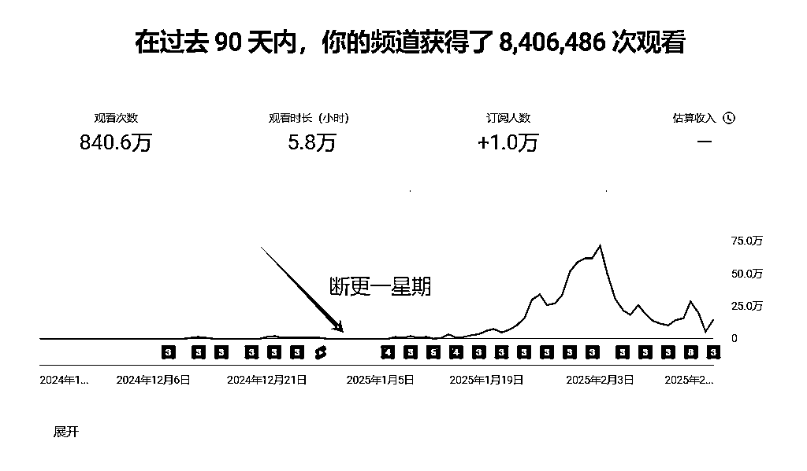

后来刷到圈友晒出漂亮的数据，才冷静下来——别人能行，说明方法没问题，问题一定出在自己的执行上。于是重新理了流程，硬着头皮继续更。

# 第三阶段：彻底对标爆款，终于迎来属于自己的700w+爆款

## 1、先从开头3秒下手

之前做抖音就特别看重前3秒完播，YouTube的逻辑本质上是一个道理，只是对应的是“平均观看百分比”和“选择观看率”这两个指标。

我做的是科普解说逆练，那就从对标入手：人家能爆，说明整条视频经过市场验证是没问题的。那我就把它的开头掰开揉碎地学。

开头文案几乎一比一复刻，画面节奏也严格对齐——把对标视频的开头关键帧截图，用谷歌识图搜原片，找到后下载下来，比对着看对方放了哪几秒、用了什么箭头、加了什么元素，我们都照着做，尽量不做多余动作。

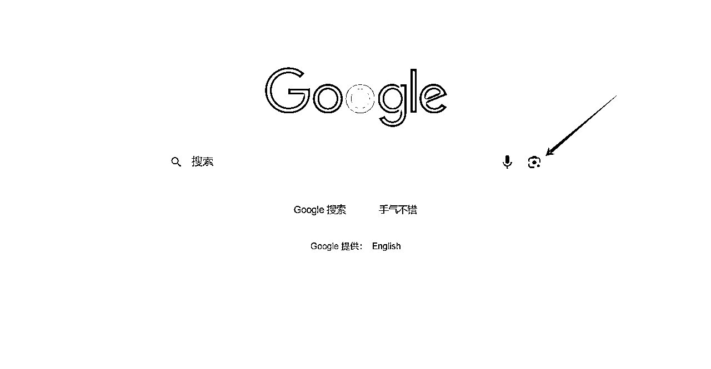

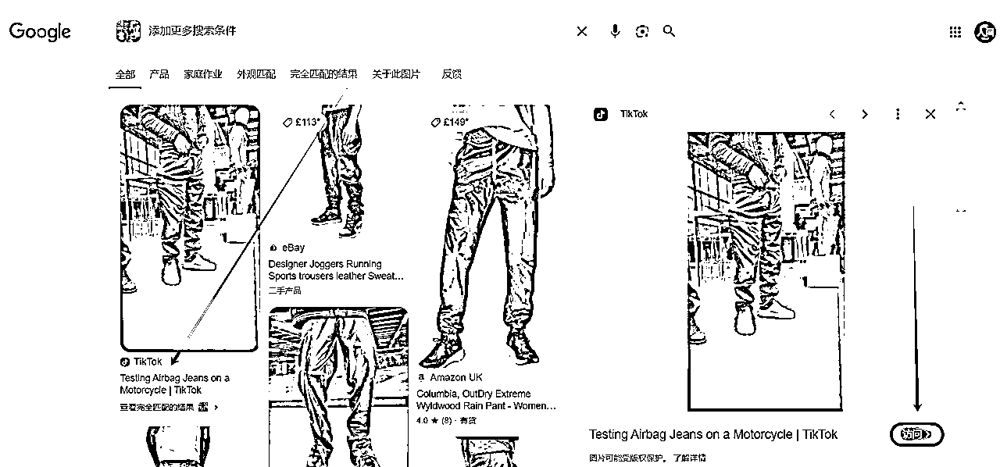

来看对比：左边是对标视频，右边是我的。结果很明显，爆款的选择观看率直接甩开普通视频一大截。

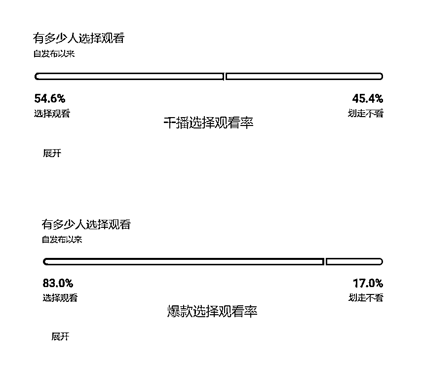

优化完开头之后，又坚持更了十几天，终于等到第一条爆款。截至目前播放量已经达到720万。

这张数据图也说明一个事：爆款基本都不是发出去就立刻起飞的。我这条前期也安静了好几天，直到一周后才开始爆发。所以别急着焦虑，把能优化的地方都做到位，剩下的交给系统。

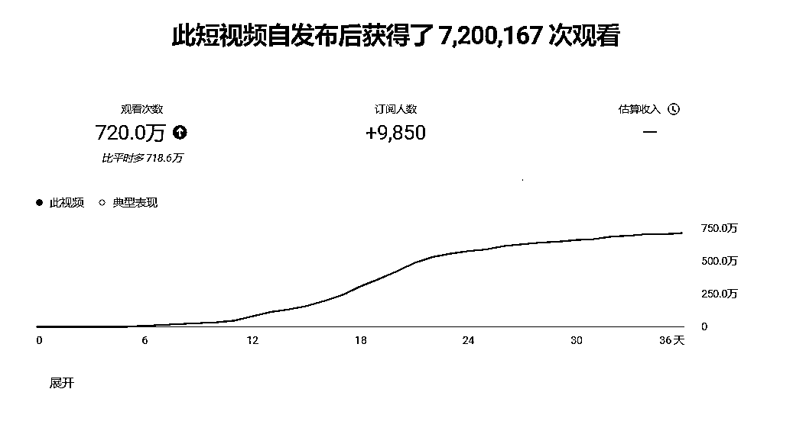

总结一下：数据丑的时候不要慌，更别断更。多从自己身上找原因，手册不是看一遍就完事的，定期拿出来对照一遍，审视自己的动作有没有走形。坚持发下去，下一个爆款也许就在明天。

# 第四阶段：从初级YPP被拒到申诉成功，再到达标高级YPP

## 一、初级YPP被拒，心态崩了之后怎么翻盘？

好不容易满足门槛，结果申请YPP直接被拒，那一刻真的整个人都不好了。

赶紧找波妮教练求助。教练发给我一条帖子，我照着上面的思路递交申诉，结果两天就通过了。

这里直接把申诉流程整理成步骤，给同赛道的朋友做个参考。

用腾讯会议录屏，开摄像头露脸，人像放右下角，别挡住屏幕内容。

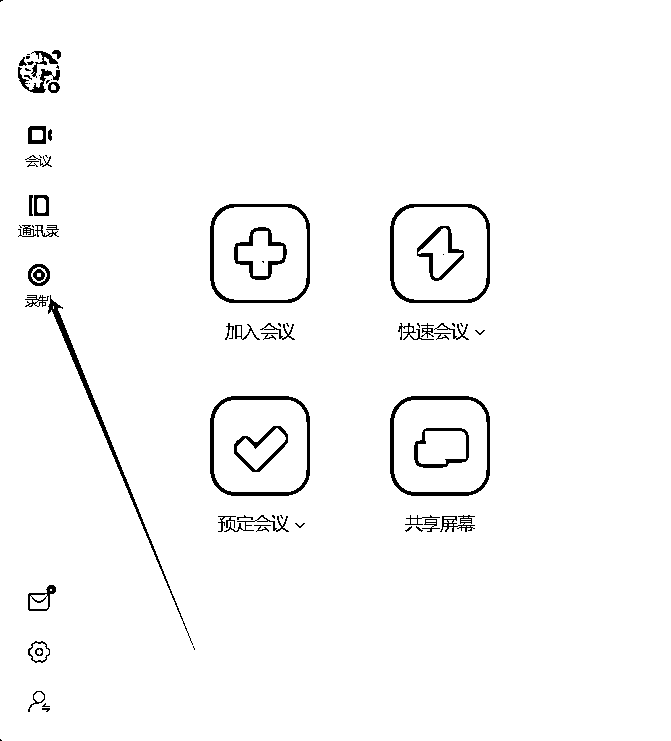

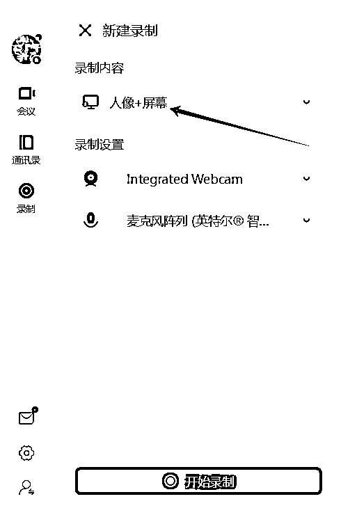

内容用中文说没问题。分几个部分来：

**1. 前面30秒，介绍频道主页、简介和现有视频。**  
比如这是我的频道主页，这是我的频道简介，这是发布的短视频和长视频，挨个过一遍。

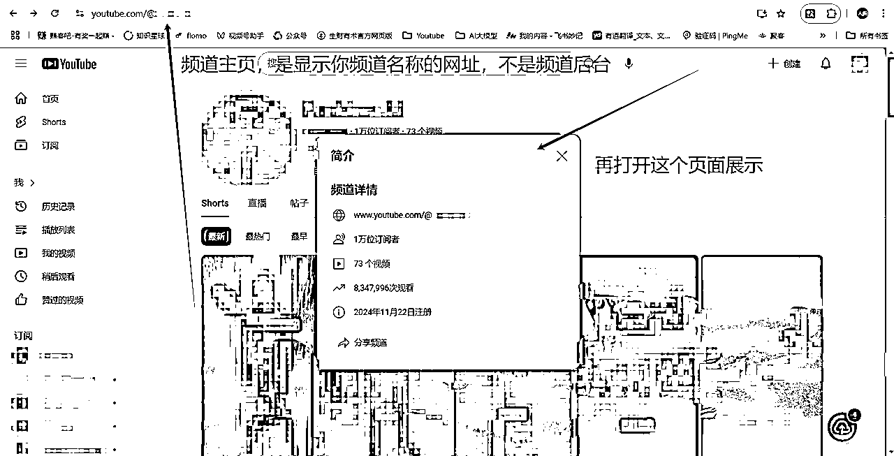

**2. 展示被拒的原因页面。**  
明确说，这是我申请创收功能时被拒绝的提示，原因是“再利用他人内容”。

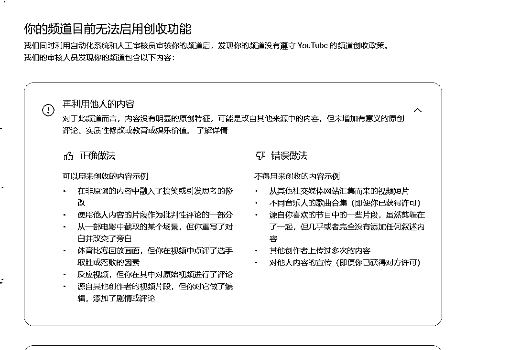

**3. 解释为什么你的内容符合创收资格。**  
可以点页面上的“了解详情”，照着它的标准来讲。我是科普解说号，就说我的视频虽然使用了其他创作者的素材片段，但通过二次剪辑加入了故事情节和评论，属于符合创收的内容。

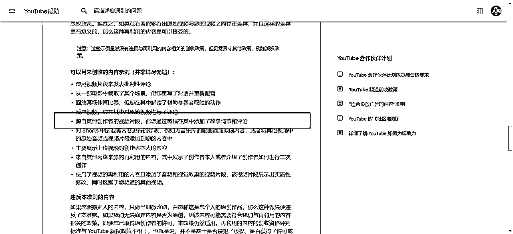

**4. 展示创作流程，打开剪映或CapCut的草稿箱。**  
我是做逆练的，但这里肯定不能露馅，于是拿正练的方式走了一遍流程，再展示草稿箱，证明视频确确实实是自己剪出来的。可以多开几个草稿箱，增加说服力。

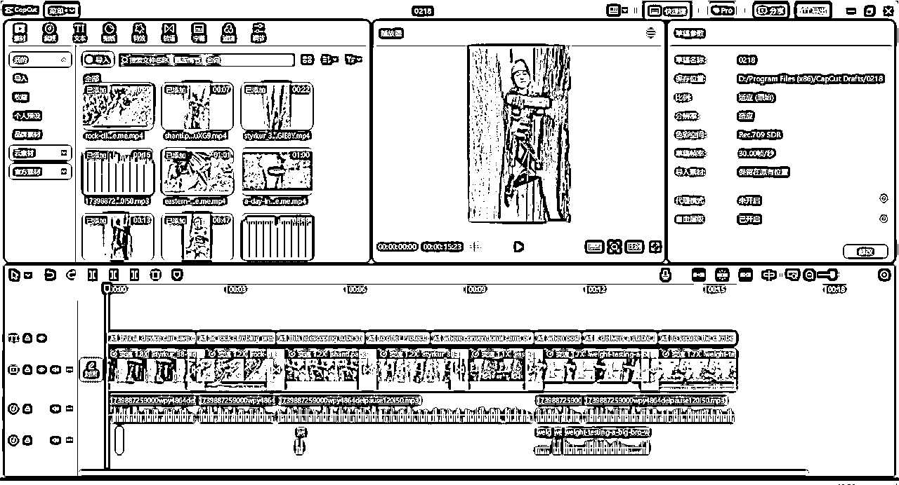

**5. 展示素材分类文件夹。**  
录完这些之后给视频加上中文字幕，申诉就完成了。

现在回头看，最难的时候真的不要一个人硬扛。自己费劲研究半天，不如教练给的一句点拨来得有效。

## 二、高级YPP达成

后面通过私教陪跑教练分享的玩法，目前已经过了高级YPP的门槛，只等下周数据更新就能正式开通。等开通后我会再回来更新这个帖子的收益情况。做科普解说这条赛道的人不少，但能开通YPP的，我应该是生财圈里除老马教练之外的头一个。我很清楚大家对这类号的变现数据有多好奇，等有了稳定数据我一定第一时间来汇报。

# 最后说几句掏心窝的

1. 写这篇复盘，说白了就是想给还在reddit故事或科普解说赛道挣扎的朋友一点信心和干劲。
2. 对标、执行、迭代，这六个字是全部答案。爆款不是天生的，背后是一次次修正。哪怕现在数据很烂，也要抱着“下一个视频就会爆”的信念。
3. 科普解说赛道的正确玩法就一句话：跟着手册走，极致模仿对标。别自创，别偷懒，爆款就在这些基础动作里。

如果你正在这条路上摸索，不妨今天就开始——

1. 翻开手册，逐条对照检查自己的视频差在哪；
2. 先坚持日更10天，拿数据说话；
3. 遇到瓶颈立刻找教练，别一个人钻牛角尖。

坚持下去，属于你的爆款也许明天就到。

# 致谢

特别感谢生财有术的平台，这次陪跑力度真的可以，信息反馈又快又及时，希望这样的活动多多益善。

感谢方波妮教练和Gary教练，每次遇到麻烦都能第一时间帮忙解决。

感谢老马教练提供科普解说赛道这么适合普通人的方向。

也感谢七天老师、方波妮教练和Gary教练对这篇文章的指正。

等后续有了新的进展，我再来跟大家汇报。祝各位早日开通YPP，一起赚美金。