# 一键把 DeepSeek 搬进 WPS，办公效率直接起飞

> 来源：[https://ys8xnr7kn3.feishu.cn/docx/HIwzd2nW1ooudix0MrncQONhnTu](https://ys8xnr7kn3.feishu.cn/docx/HIwzd2nW1ooudix0MrncQONhnTu)

## 让 Word 和 DeepSeek 组合办公，工作流彻底改变

当 DeepSeek 在熟悉的 WPS 界面里就地待命时，整个办公体验会被重新定义。无需跳窗切换、无需复制粘贴，你只需要在文档里选中一段内容，点一下就能让模型帮你查资料、润色改写、跨语言翻译。告别多软件来回折腾，信息处理变得像呼吸一样顺滑。

## 操作后的呈现效果

按步骤设置完成之后，WPS 的功能区顶部会多出 DeepSeek 的专属生成按钮。选中任意文字后点击，就能立刻得到模型的反馈。举个例子，把中文原文一键转成英文：

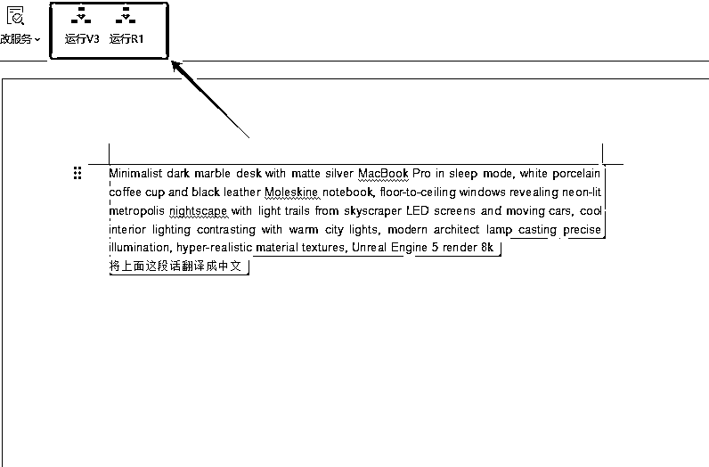

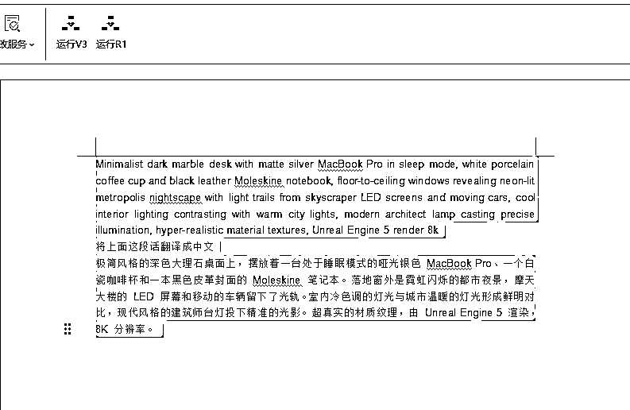

下面分两种常见方案，手把手教你把 DeepSeek 接进 WPS。

# 方案一：Office AI 插件接入

# 先给 WPS 开权限

打开 WPS，新建一个文档，点击左上角“文件”-“选项”-“信任中心”

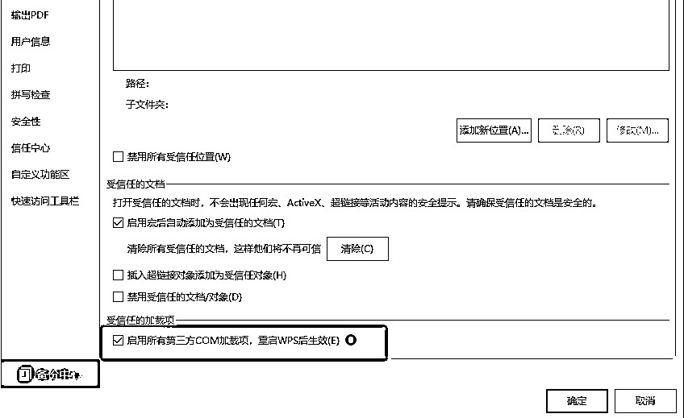

勾选启用所有第三方 COM 加载项，重启 WPS 后才会生效，然后确认

## 安装 Office AI 助手

前往下载 OfficeAi 助手：https://www.haiyingsec.com/static/introductions/officeai/introduction.html

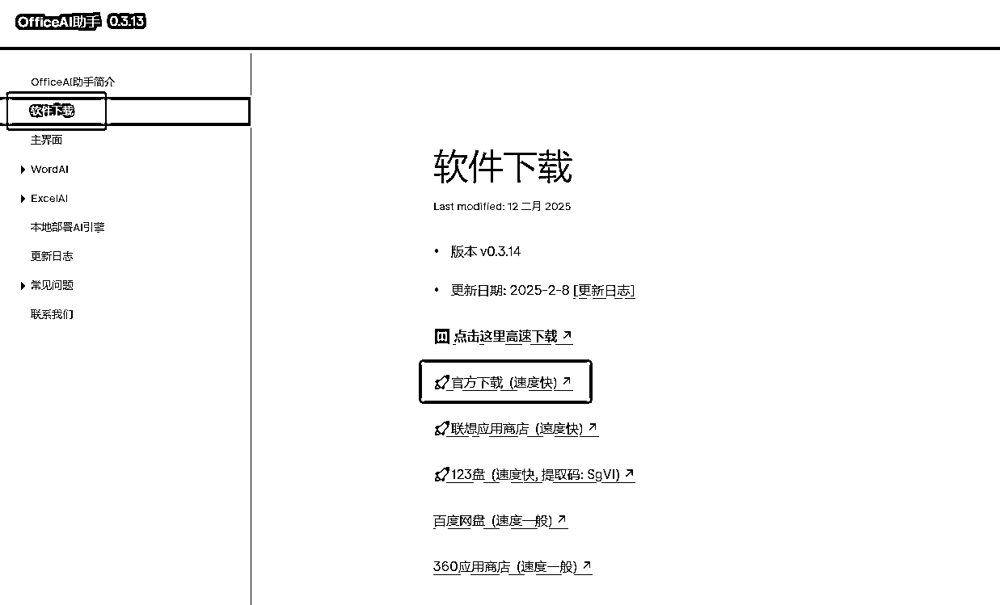

下载完成后开始安装，安装前记得先彻底关闭 WPS

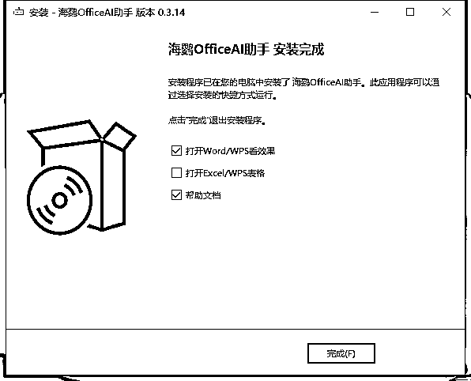

安装结束会自动启动 WPS，顶部会出现 officeAI。点击登录，再点设置

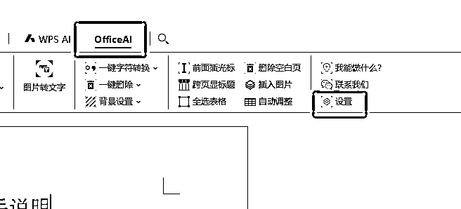

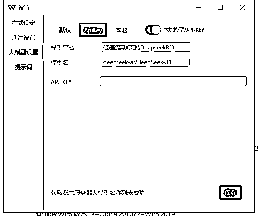

在平台处选择硅基流动的 R1，模型也选 R1，同时需要填入一个 API_key

## 去哪里拿 API Key

打开硅基流动官网：https://cloud.siliconflow.cn/i/FSIqvgQd

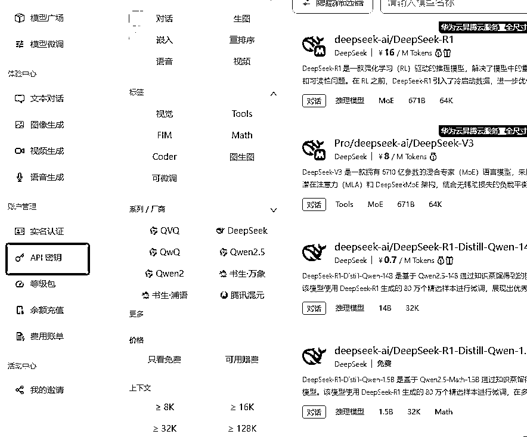

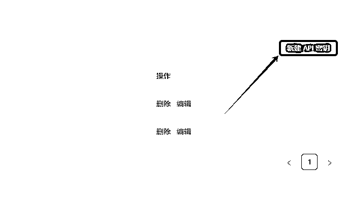

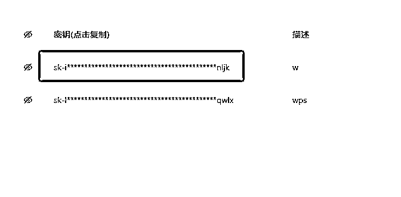

进入密钥管理-新建密钥-随便命名-复制密钥到 WPS 设置里保存

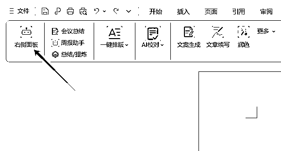

至此，WPS 就可以直接调用 DeepSeek-R1 了

# 方案二：VBA 插件自制方法

## 同样先配置信任

和前面一样的信任中心设置，操作前务必先完成

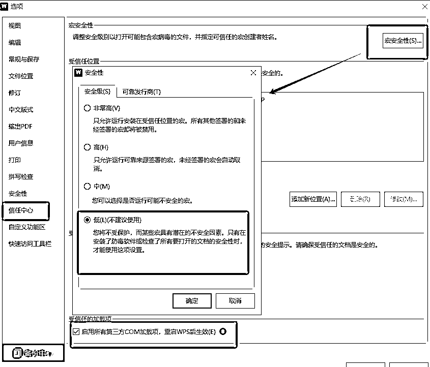

设置完成后点确定保存

## 部署 WPS VBA

下载 wps.vba 安装包：https://pan.quark.cn/s/f0e6145a1ab0

打开工具-开发工具-进入 VB 编辑器

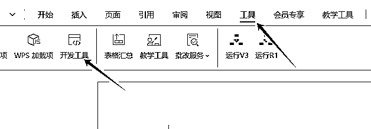

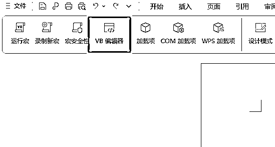

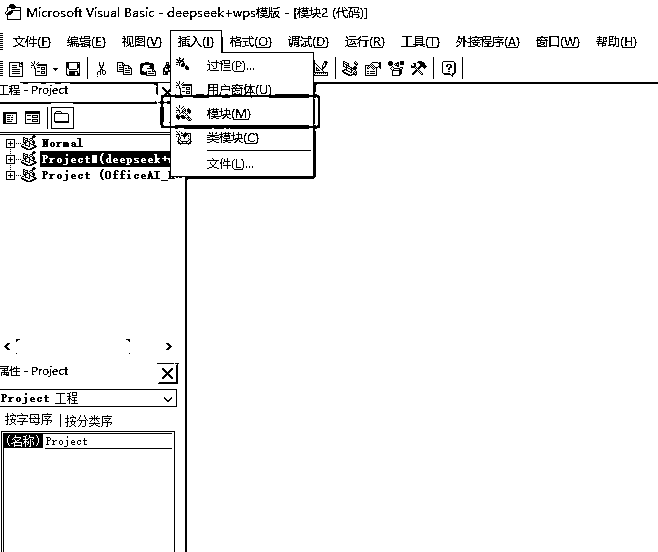

DeepSeek-V3 的代码片段：

```
Function CallDeepSeekAPI(api_key As String, inputText As String) As String
    Dim API As String
    Dim SendTxt As String
    Dim Http As Object
    Dim status_code As Integer
    Dim response As String

    API = "https://api.siliconflow.cn/v1/chat/completions"
    SendTxt = "{""model"": ""deepseek-ai/DeepSeek-V3"", ""messages"": [{""role"":""system"", ""content"":""You are a Word assistant""}, {""role"":""user"", ""content"":""" & inputText & """}], ""stream"": false}"

    Set Http = CreateObject("MSXML2.XMLHTTP")
    With Http
        .Open "POST", API, False
        .setRequestHeader "Content-Type", "application/json"
        .setRequestHeader "Authorization", "Bearer " & api_key
        .send SendTxt
        status_code = .Status
        response = .responseText
    End With

    ' 弹出窗口显示 API 响应（调试用）

    ' MsgBox "API Response: " & response, vbInformation, "Debug Info"

    If status_code = 200 Then
        CallDeepSeekAPI = response
    Else
        CallDeepSeekAPI = "Error: " & status_code & " - " & response
    End If

    Set Http = Nothing
End Function

Sub DeepSeekV3()
    Dim api_key As String
    Dim inputText As String
    Dim response As String
    Dim regex As Object
    Dim matches As Object
    Dim originalSelection As Object

    api_key = "替换为你的api key"
    If api_key = "" Then
        MsgBox "Please enter the API key."
        Exit Sub
    ElseIf Selection.Type <> wdSelectionNormal Then
        MsgBox "Please select text."
        Exit Sub
    End If

    ' 保存原始选中的文本
    Set originalSelection = Selection.Range.Duplicate

    inputText = Replace(Replace(Replace(Replace(Replace(Selection.text, "\", "\\"), vbCrLf, ""), vbCr, ""), vbLf, ""), Chr(34), "\""")
    response = CallDeepSeekAPI(api_key, inputText)

    If Left(response, 5) <> "Error" Then
        Set regex = CreateObject("VBScript.RegExp")
        With regex
            .Global = True
            .MultiLine = True
            .IgnoreCase = False
            .Pattern = """content"":""(.*?)"""
        End With
        Set matches = regex.Execute(response)
        If matches.Count > 0 Then
            response = matches(0).SubMatches(0)
            response = Replace(Replace(response, """", Chr(34)), """", Chr(34))

            ' 取消选中原始文本
            Selection.Collapse Direction:=wdCollapseEnd

            ' 将内容插入到选中文字的下一行
            Selection.TypeParagraph ' 插入新行
            Selection.TypeText text:=response

            ' 将光标移回原来选中文本的末尾
            originalSelection.Select
        Else
            MsgBox "Failed to parse API response.", vbExclamation
        End If
    Else
        MsgBox response, vbCritical
    End If
End Sub
```

DeepSeek-R1 的代码片段：

```
Function CallDeepSeekAPI(api_key As String, inputText As String) As String
    Dim API As String
    Dim SendTxt As String
    Dim Http As Object
    Dim status_code As Integer
    Dim response As String

    API = "https://api.siliconflow.cn/v1/chat/completions"
    SendTxt = "{""model"": ""deepseek-ai/DeepSeek-R1"", ""messages"": [{""role"":""system"", ""content"":""You are a Word assistant""}, {""role"":""user"", ""content"":""" & inputText & """}], ""stream"": false}"

    Set Http = CreateObject("MSXML2.XMLHTTP")
    With Http
        .Open "POST", API, False
        .setRequestHeader "Content-Type", "application/json"
        .setRequestHeader "Authorization", "Bearer " & api_key
        .send SendTxt
        status_code = .Status
        response = .responseText
    End With

    ' 弹出窗口显示 API 响应（调试用）

    ' MsgBox "API Response: " & response, vbInformation, "Debug Info"

    If status_code = 200 Then
        CallDeepSeekAPI = response
    Else
        CallDeepSeekAPI = "Error: " & status_code & " - " & response
    End If

    Set Http = Nothing
End Function

Sub DeepSeekR1()
    Dim api_key As String
    Dim inputText As String
    Dim response As String
    Dim regex As Object
    Dim matches As Object
    Dim originalSelection As Object

    api_key = "替换为你的api key"
    If api_key = "" Then
        MsgBox "Please enter the API key."
        Exit Sub
    ElseIf Selection.Type <> wdSelectionNormal Then
        MsgBox "Please select text."
        Exit Sub
    End If

    ' 保存原始选中的文本
    Set originalSelection = Selection.Range.Duplicate

    inputText = Replace(Replace(Replace(Replace(Replace(Selection.text, "\", "\\"), vbCrLf, ""), vbCr, ""), vbLf, ""), Chr(34), "\""")
    response = CallDeepSeekAPI(api_key, inputText)

    If Left(response, 5) <> "Error" Then
        Set regex = CreateObject("VBScript.RegExp")
        With regex
            .Global = True
            .MultiLine = True
            .IgnoreCase = False
            .Pattern = """content"":""(.*?)"""
        End With
        Set matches = regex.Execute(response)
        If matches.Count > 0 Then
            response = matches(0).SubMatches(0)
            response = Replace(Replace(response, """", Chr(34)), """", Chr(34))

            ' 取消选中原始文本
            Selection.Collapse Direction:=wdCollapseEnd

            ' 将内容插入到选中文字的下一行
            Selection.TypeParagraph ' 插入新行
            Selection.TypeText text:=response

            ' 将光标移回原来选中文本的末尾
            originalSelection.Select
        Else
            MsgBox "Failed to parse API response.", vbExclamation
        End If
    Else
        MsgBox response, vbCritical
    End If
End Sub
```

择一复制到新建模块中，记得把代码里的 API key 换成你在硅基流动复制的那串

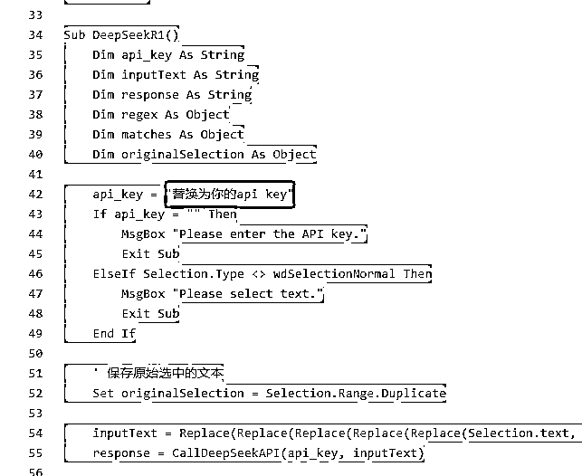

进入 文件 -> 选项 -> 工具

新建一个自定义组，右键重命名为“DeepSeek”

在左侧命令列表里选择“宏”

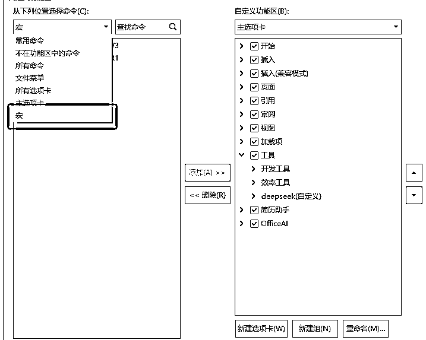

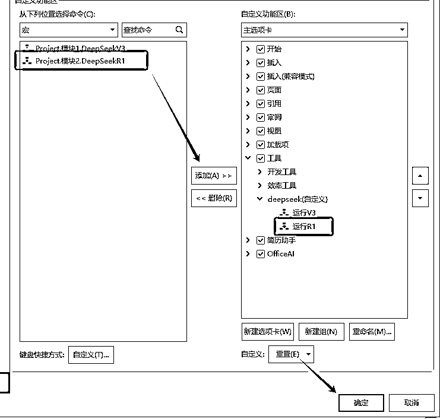

找到“DeepSeekR1”，点添加，再重命名为“运行 R1”，确认保存

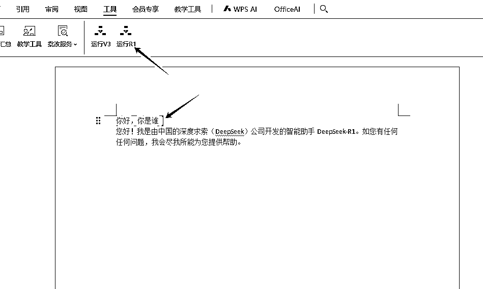

在文档里输入问题并选中，点击刚添加的“运行 R1”，等待片刻即可得到结果

## 把文档固化成模板，下次自动可用

文件 → 另存为

保存类型选“Microsoft Word 带宏的模板文件 (*.dotm)”

放到 WPS 的启动模板目录，一般是 C:\Users\用户名\AppData\Roaming\kingsoft\wps\startup，例如 C:\Users\Administrator\AppData\Roaming\kingsoft\wps\startup

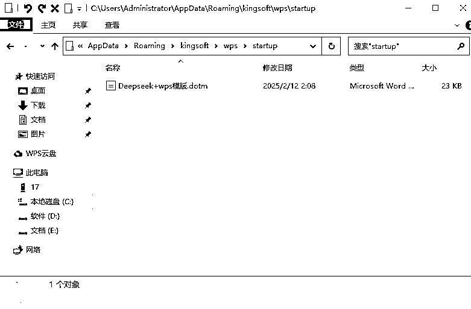

从此每次启动 WPS，宏就会自动载入，不用重复配置