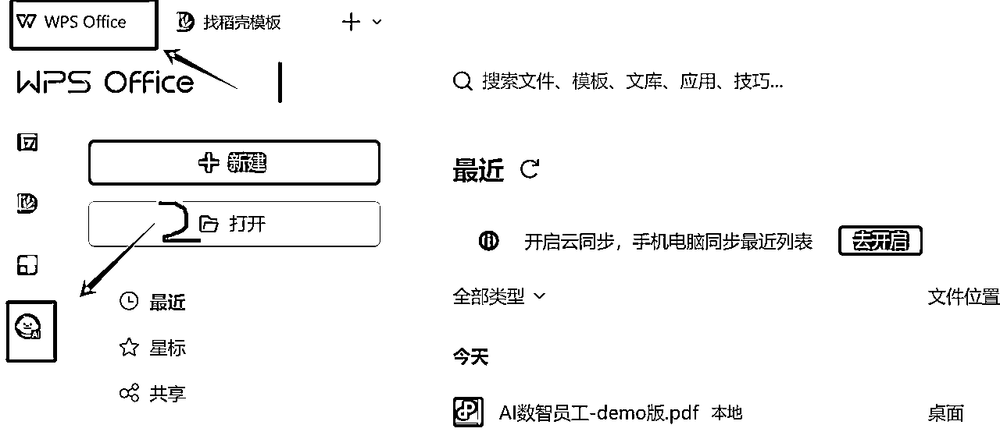
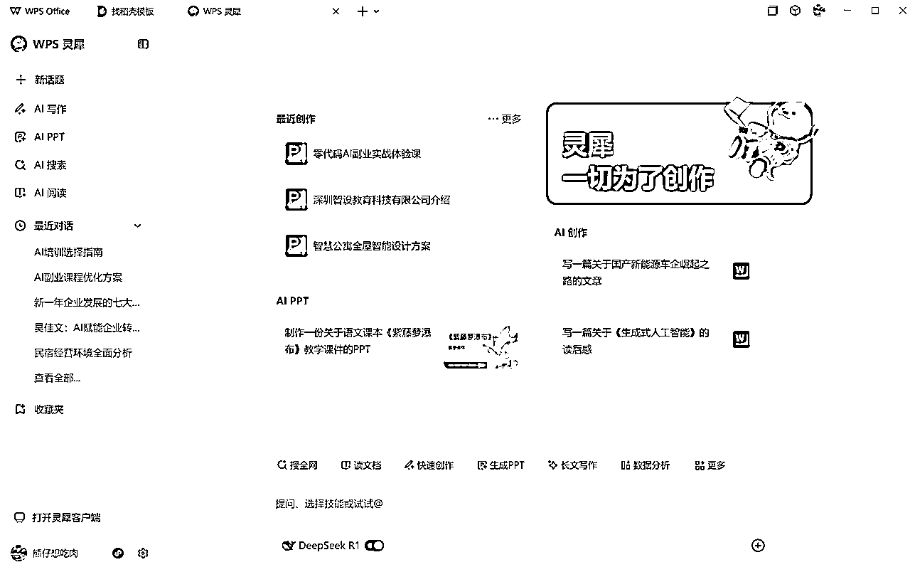
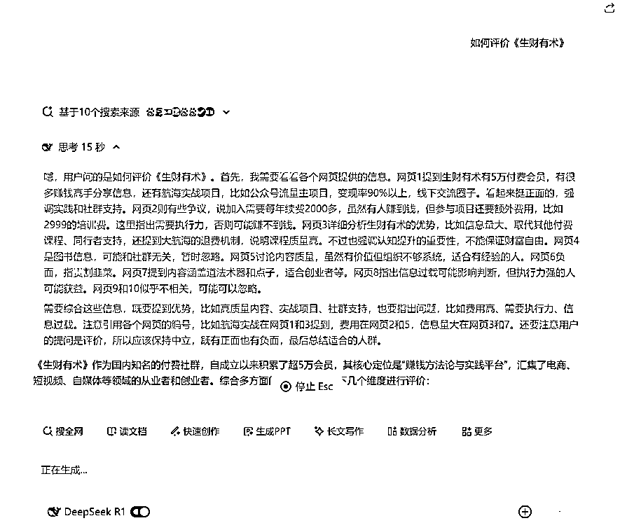
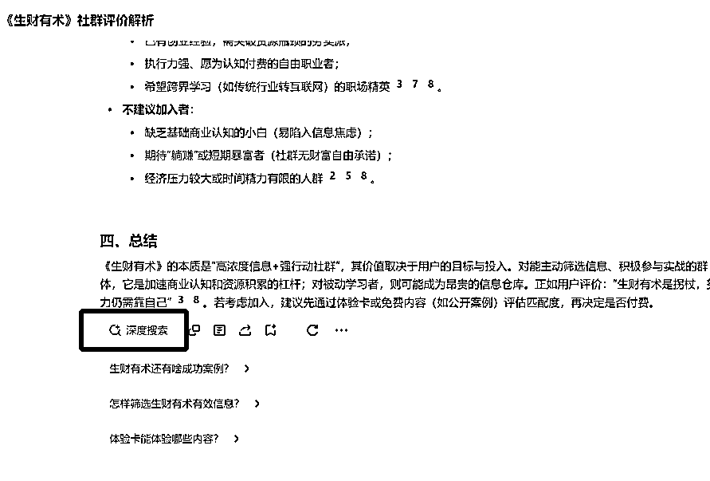
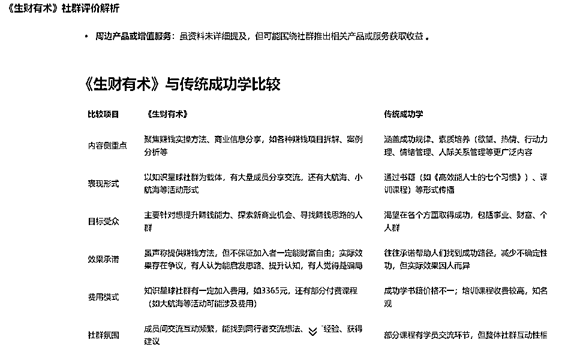
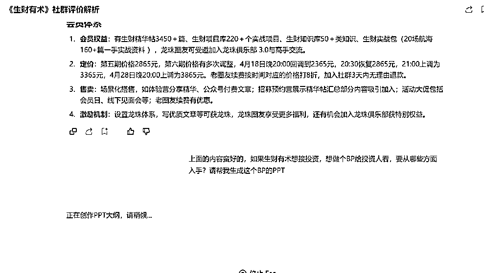
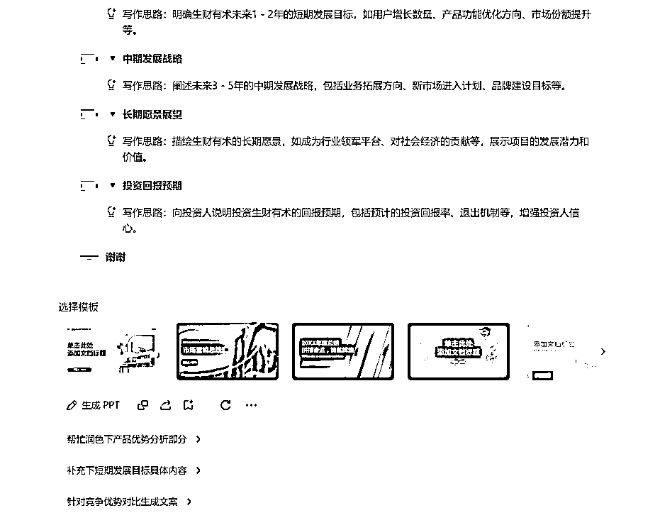
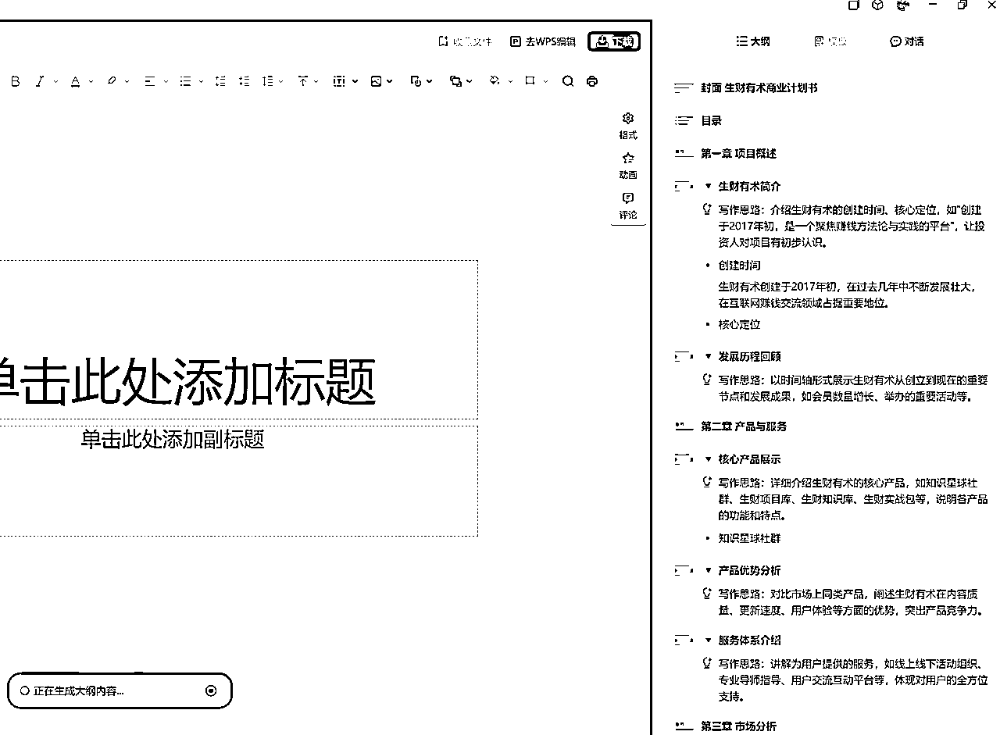
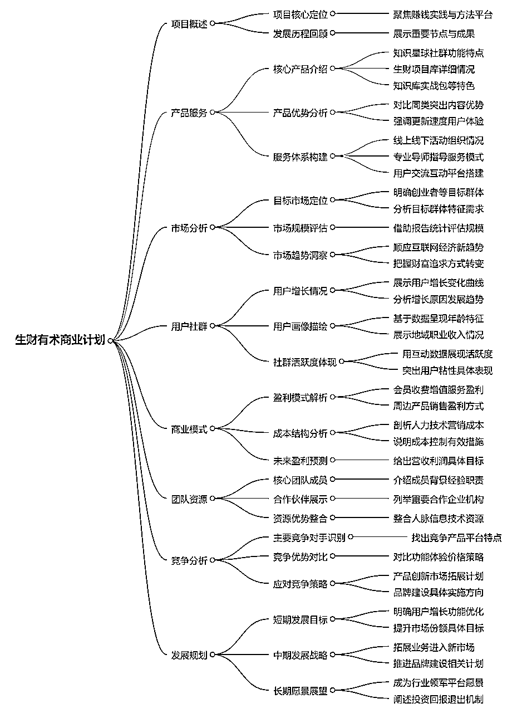
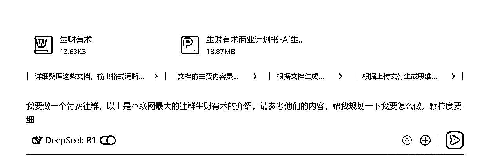

# 牛马们有救了！DEEPSEEK x WPS 组合拳，把办公效率拉满

哈喽各位，我是做AI企业赋能的佳文，也是龙哥盟的GPT提效导师、coze和ComfyUI的带练教练。

对，就是那个零基础被阿紫教练手把手带起来做小游戏的非程序员。

最近DEEPSEEK彻底炸了，企业方来找AI提效课的单子也井喷了。你一旦真正接触到企业侧的需求，就会发现和个人玩家的需求完全不是一个物种。企业要的不是会聊天，而是能直接嵌进业务流程里，实打实落地降本增效。想做好企业服务，教练本人最好是混过职场、管过团队，对公司运转、岗位分工有体感，才能把AI真正用成生产力工具。

而PPT、文档这类办公产出，几乎是所有岗位的通病级刚需。今天就借着DS的热度，拆一遍DEEPSEEK如何借助WPS把PPT这类文件玩出新高度。

# 一、为什么先选WPS

在国内的办公生态里，WPS基本等于标配。

DEEPSEEK大火后，WPS把自家的AI能力全面接入了DS，相当于给原本就很强的办公套件装了个性能放大器。

想用也不难，WPS客户端里藏着入口，也可以直接上网页版体验，地址是 https://copilot.wps.cn/

那为什么不去用现在很火的纳米AI、秘塔这些呢？

我的判断就三点：

1、金山的产品稳定性是经过多年考验的，企业里经得起折腾
2、办公本身就是WPS的主场，顺手程度不是别的工具能比的
3、WPS接入的不仅有DS，还有一整套更丰富的指令生态

# 二、WPS版DS到底怎么玩

按上面说的路径打开网页版或者APP版就行。

进到界面后，下面会有一个DS开关，打开它就行，实测联网检索是正常的。

用起来和普通聊天没区别，你就当跟一个会办公的同事在对话。

响应速度很在线，比官网有时候卡顿的体验要顺滑不少。

内容出来后，还可以让它继续做“深度搜索”。

经过几轮追问和补充，它给出的素材质量会越来越扎实，用来做下一步加工非常舒服。

有了这批靠谱的原材料，就可以往更深层的办公功能里走了。

# 三、从对话到成品：一键出PPT

网页看久了眼睛累，我们直接做个PPT。

指令不用复杂，随口一句就能启动。

大纲很快就整理好了，接下来挑个模板让它开工。

稍等几分钟，一个成型的PPT就出来了，源文件我也放帖子里了，想要的可以直接拿去改。

# 四、PPT之外还能干嘛

有文字就有图，先把前面内容转成思维导图吧。

指令依旧简单：把上面这些内容帮我做成思维导图。

再来一篇👸号文章，指令逻辑一样简单。

排版懒得弄，直接生成内容丢到文档里了。

如果不是从零生成，而是已有资料怎么办？能不能做二次加工？

答案是可以的。新开一个窗口，把之前生成的内容当成基础资料上传，再提问就行。

这样出来的优化方案和再创作结果，我也一并放下面了，大家可以对照参考。

# 五、最后的点

上面讲的案例来自付费社群的商业规划实操。

如果换成实体产业呢？是不是可以做更多横向对标、行业拆解和分析？

去年那句口头禅说得好，每个行业都能被AI重新做一遍。

放到企业内部看，每个岗位、每套SOP，都可以借助AI重建一遍。

现在企业端的AI服务环境已经非常成熟了，这波红利窗口抓住了，上限会完全不一样。共勉。