# YouTube Shorts AI新爆点：天使狗狗赛道从0到爆的实操拆解

> 来源：[https://lijv5pnbdb.feishu.cn/docx/IWNkdCEWIonehhxE0g7cWHeMnad](https://lijv5pnbdb.feishu.cn/docx/IWNkdCEWIonehhxE0g7cWHeMnad)

# 开场白

大家好，我是轻舟，混迹全栈工程10年+，现在主攻YouTube Shorts的AI内容，也在玩AI编程。

最近Shorts上一个叫“天使狗狗” Angel Dog 的AI题材彻底炸了。对标账号才开播两个多月，47条视频总播放就冲破3亿5千万。

不少同行也闻风而动，接下来我就把我踩过的坑和成型的打法，给你们掰开了说。

# 整体框架

# 对标账号表现

对标账号起号期一定要看：https://www.youtube.com/@dog-cute-animals/shorts

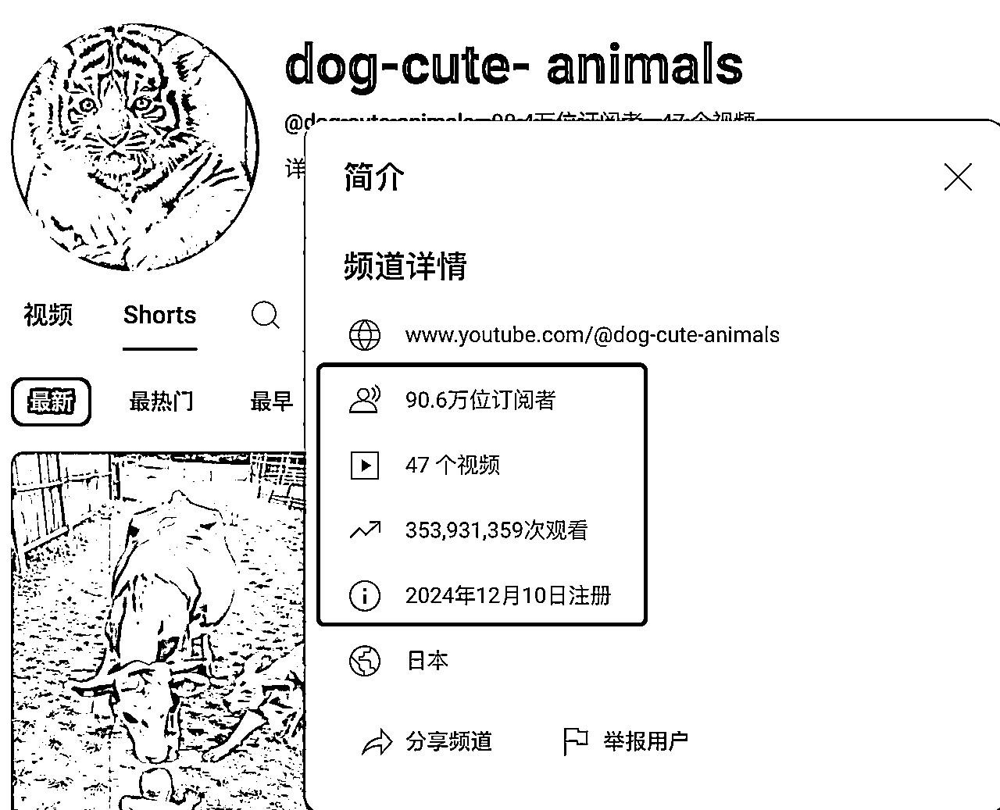

按热度排序

有两个视频破五千万，八个破一千万，天花板非常高

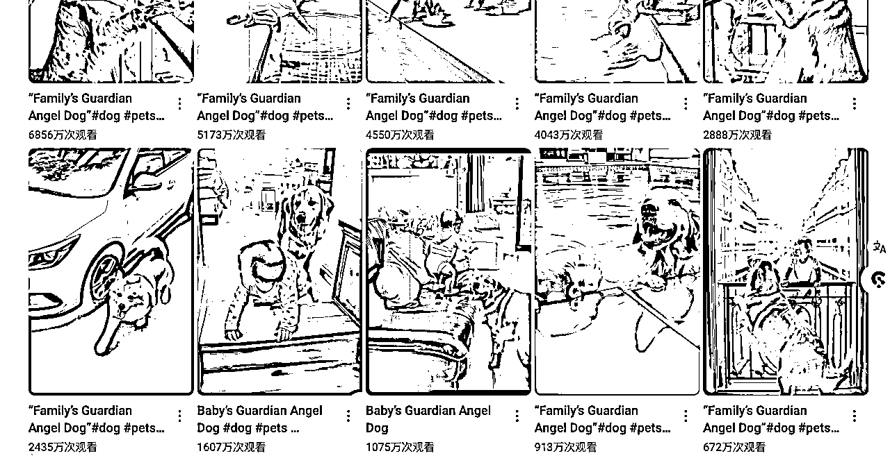

按最新排序

一周内还能刷到千万播放的作品，百万级常态，现在入局完全不晚

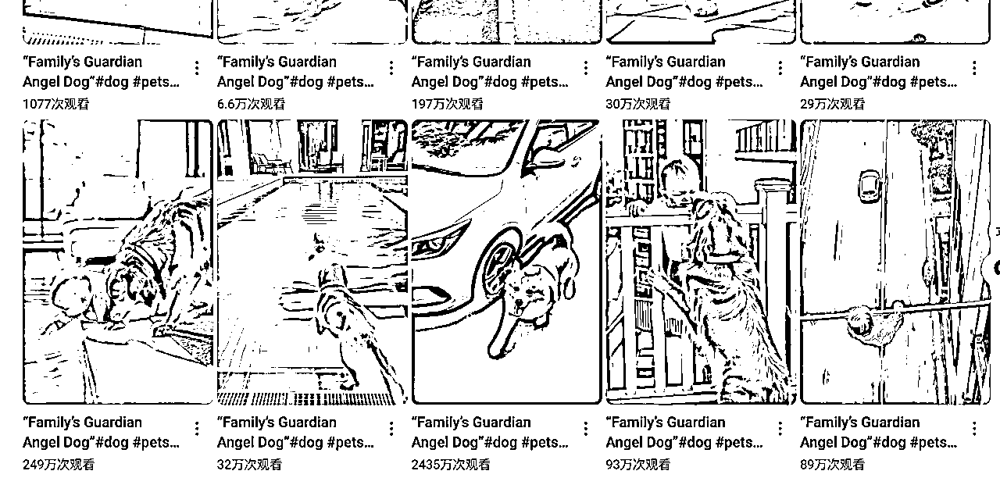

# 时间轴梳理

*   对标号首条视频上线是24年12月17日，我第一次刷到大概是1月23日
*   我第一条测试片发出是1月29号，闷头做了整整一周才成型😒，到现在已发22条同类内容
*   该赛道在生财首次被提到是2月14日路大的帖子，《太好用了! DeepSeek+YouTube油管影视解说变现》
*   2月17日，Gary教练发了私教陪跑中期复盘，我去咨询，教练直接点名这个赛道可做且有持续性——YouTube Al shorts私教陪跑中期复盘
*   2月19日，赛道出现在中标，中标作者@徒步通过Gary教练介绍找到我来请教制作方法 中标帖
*   同一天，YouTube上一个14.3万粉的号在评论区找我取经，目前还在邮件沟通中，不确定是不是圈内人

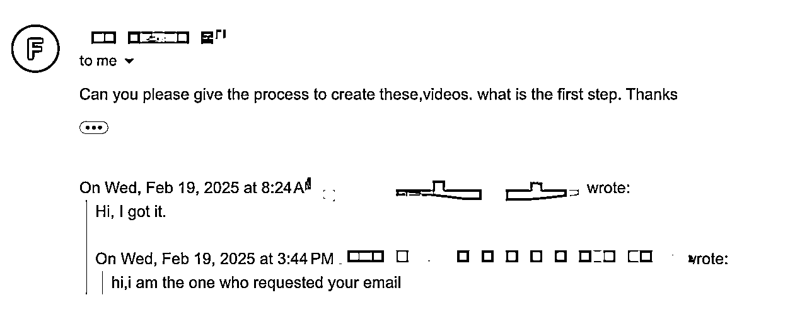

# 我的号现在怎么样

*   发了22条后，终于吃到第一波推流，目前28w+播放
*   教练说可以冲小百万😄
*   对标那条五千万播放的作品，我在观看率和数据上还有明显差距，优化空间很大
*   目标就定在千万播放！

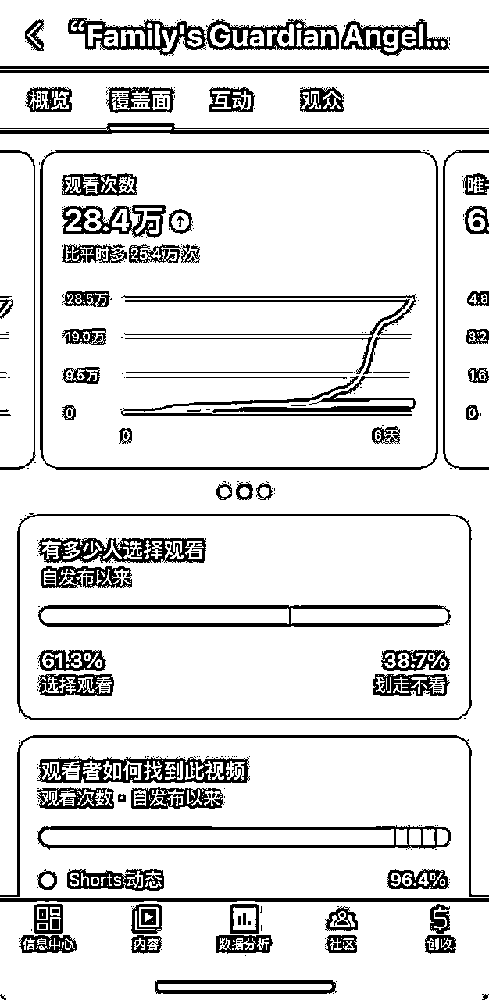

# 怎么做

赛道已验证有效，关注的人越来越多。下面以我自己的账号和作品为样本，分三个维度讲清楚：

🚩如何提前卡位一个蓝海爆款赛道

🚩爆款背后的底层逻辑

🚩从脚本到成片的完整执行与难点处理

## 怎么找到蓝海爆款赛道

这是我跟Gary教练沟通时他最先问我的问题

1）每天刷YouTube，专门盯AI类频道，哪个号数据稳定就先点赞，点进主页整体数据健康就订阅，我的订阅清单就是这么来的

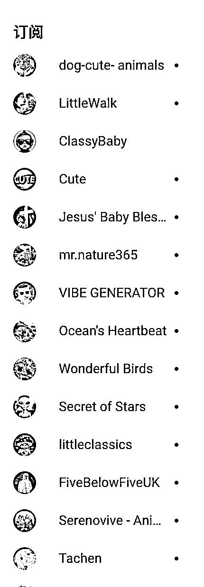

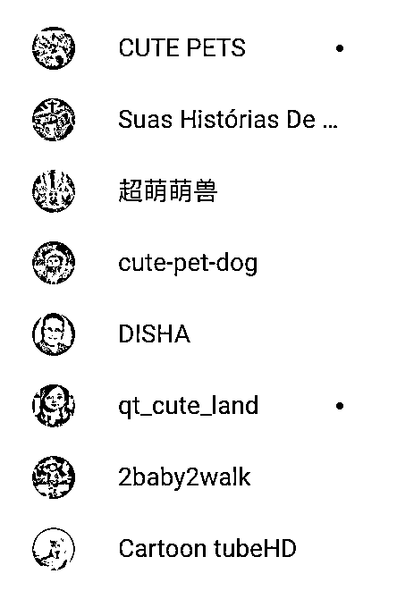

2）每天看一遍我的订阅Shorts列表，这个列表是按发布时间排的，能第一时间看到刚发不久播放就很高的视频，那就是近期爆款。顺带说一句，上图里其实还藏着一个可以关注的新赛道

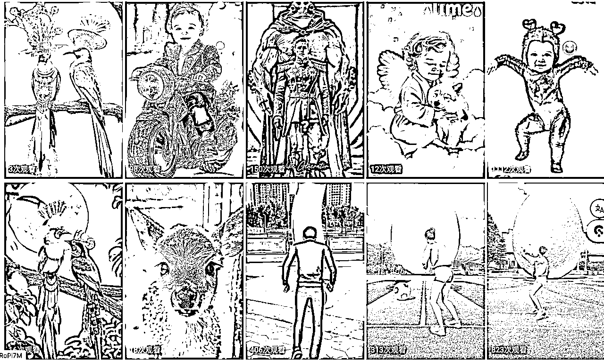

3）坚持每天花几分钟刷，感知会越来越敏锐

## 爆款原理拆解🔥

这是我个人的总结，我的作品基本都遵循这套思路

用户心理

刷Shorts时什么会让人停下来：好笑、惊奇、共情

欧美家庭养大型犬很普遍，而且把狗当家人对待

天使狗狗属于哪类内容，这决定了点击率

共情向，刷到的人心里会一紧：这个宝宝好危险，会不会出事

底层逻辑，决定完播率

给用户情绪价值，15-30秒内情绪走完一遍：担心→期待→松一口气或会心一笑

这里不展开了，大家可以自己琢磨，也可以来找我交流。

留个思考题：按这个情绪曲线，你会怎么分配15-30秒？有想法的话说明你get到了！

## 实操教程与难点解析

### 先看成品效果

### 制作难点总览

1、这个题材最大特点是一镜到底，人物和场景一致性要求极高，这是最难的
2、狗狗是救援者，开场时往往不存在，怎么让它自然无缝入场，图里也有人来问我
3、尽量做得真实，最好评论区有人骂你，这也拿出来拍，图里示例😂

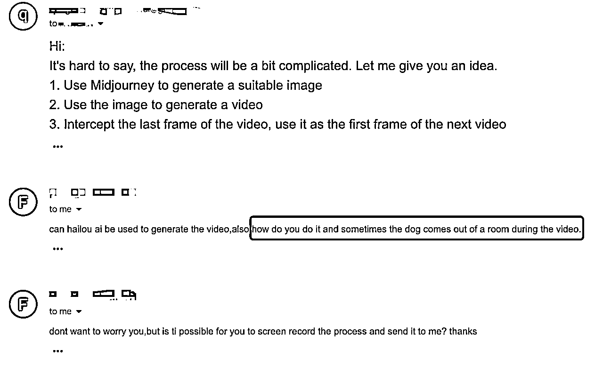

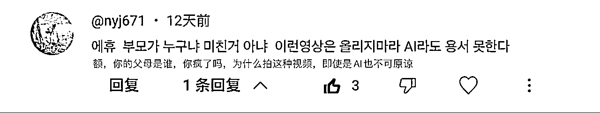

### 故事创作

把自己当导演，安排好两个演员演一个小惊险故事

可以用AI帮你写剧本，故事一定要简单，复杂了制作会很痛苦
开始前脑子里要有画面，评估下够不够吸睛

### 首图制作

首图决定生死，情绪曲线要记住：担心→期待→松口气或会心一笑

要点：第一秒必须把用户的担忧情绪勾起来
但也别过分，毕竟是小孩，要兼顾真实感，别出现刀、血腥等易限流内容

1）先想好构图，孩子放哪，狗放哪，狗怎么走到孩子面前，空间够不够用
2）第一次出图，可以用对标视频截图做垫图，方法航海手册和很多帖子都有讲，用midjourney的/describe

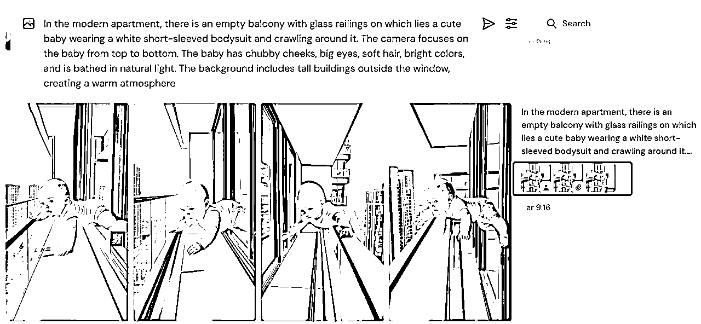

我就是拿对标图垫的，咒语参考如下

In the modern apartment, there is an empty balcony with glass railings on which lies a cute baby wearing a white short-sleeved bodysuit and crawling around it. The camera focuses on the baby from top to bottom. The baby has chubby cheeks, big eyes, soft hair, bright colors, and is bathed in natural light. The background includes tall buildings outside the window, creating a warm atmosphere. --ar 9:16

常见问题：

出图是怼脸，或者整体不错但狗狗出现位置太挤

我的解决办法，举例说明：

整体画面可以，但婴儿后面空间太窄，场景不够

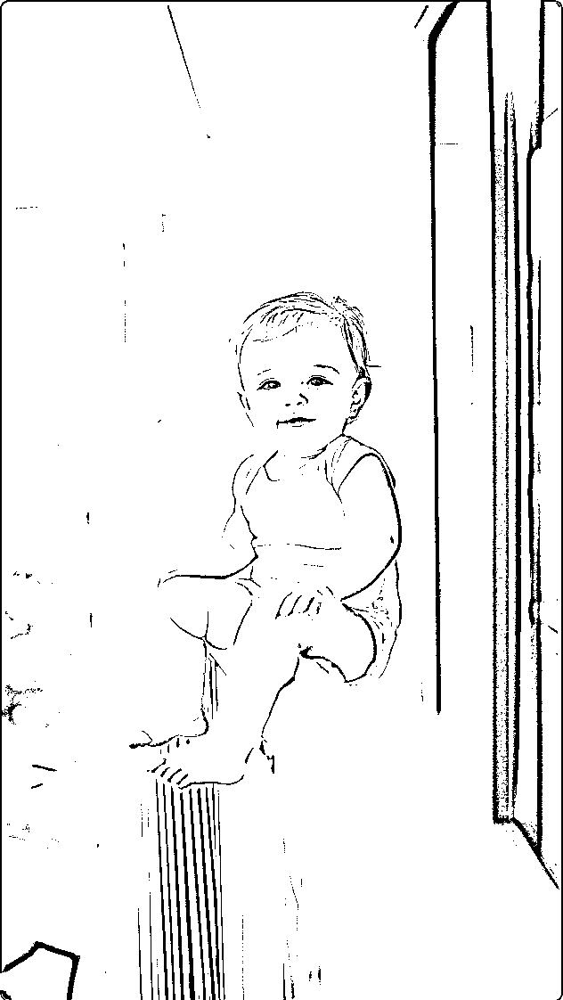

1）用midjourney的Edit功能，需要年费会员，把左侧内容隐藏，切到9:16后右侧会空出来。点Suggest Prompt再Submit Edit，右侧会重绘

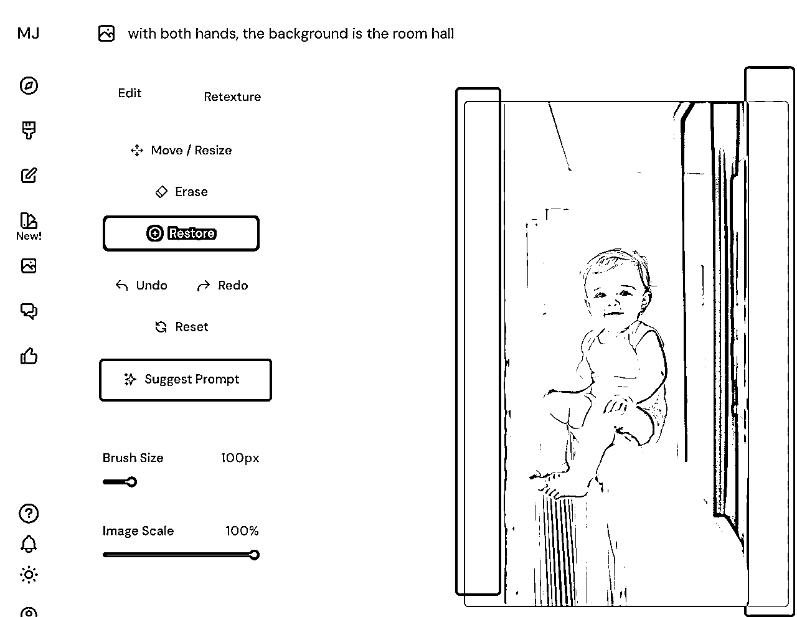

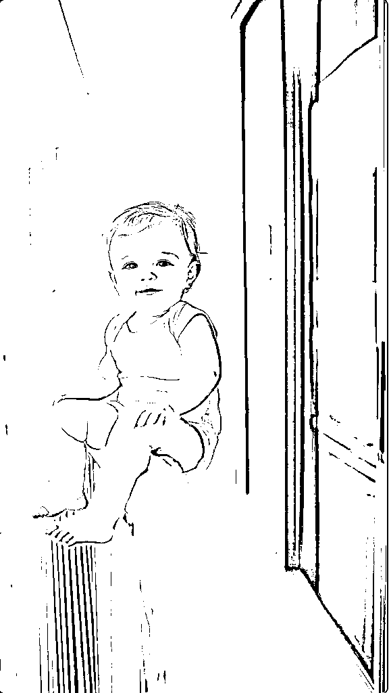

2）即梦智能画布也能实现同款功能，而且免费，可以试试

### 视频制作

一张图怎么开始做视频？一镜到底嘛，继续往下看😭

工具效果排序：可灵≈海螺>runway

#### 生成第一段视频

第一次尝试，我让金毛出场，结果视频播完了狗也没出现😭

也没浪费，加速当开场，能省则省。。。。。

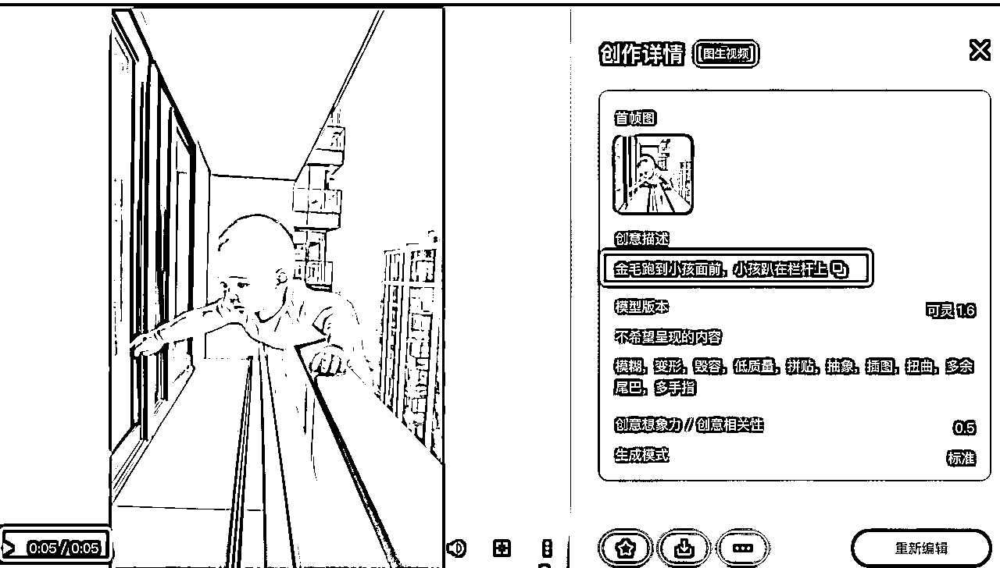

这就引出关键难点：怎么让狗丝滑进场

方案1：反复调提示词试运气，可灵太贵了不划算
方案2：

*   用midjourney Edit在首图合适位置先加一条模糊的狗头就行，参考下图
*   即梦智能画布局部重绘也能做

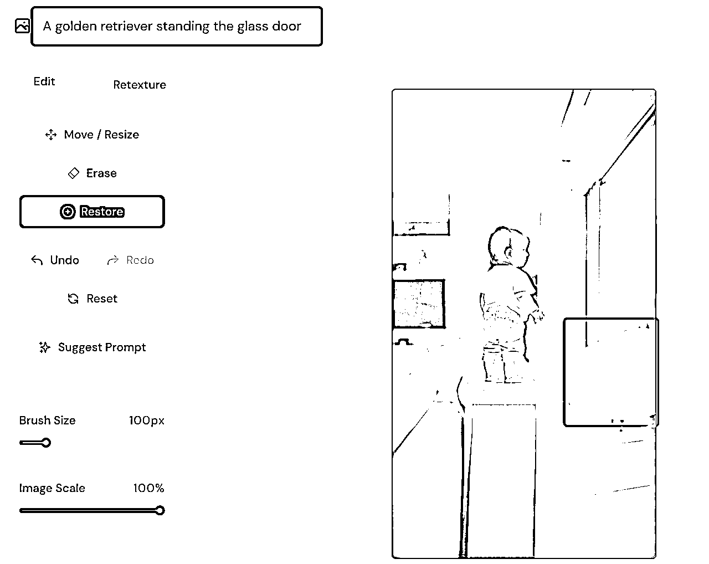

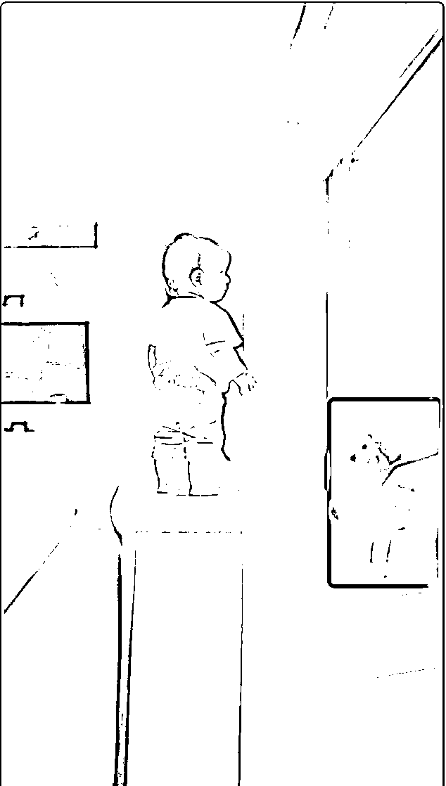

这两种方法都带点运气成分，有大神知道更稳定的办法欢迎指点

我用第一种，改了下描述，第二次生成
金毛顺滑出现，还和宝宝互动了，运气爆棚感动。。。
经验是提示词里把金毛当主角，描述越简单成功率越高
比如：金毛狗快速跑到小孩面前，带上“狗”字是因为有一次AI把金毛当成小孩的金色头发😅

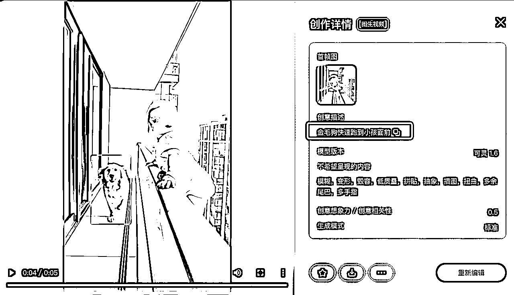

#### 生成第二段视频

核心思路：用第一段视频的尾帧当第二段的首帧，相当于续写
注意：如果尾帧有错位、模糊、明显遮挡，要往前找合适的帧。用了不合适的帧，后面就很难接

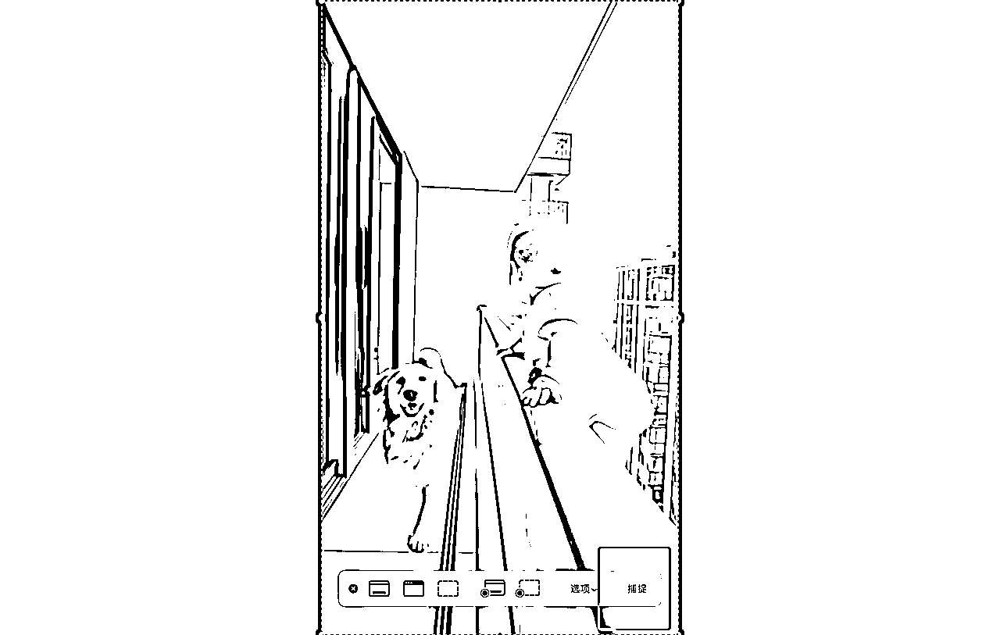

截取上传，循环这个操作就行

问题汇总

问题1：动作没做完就断了
例子：狗狗手伸到一半前一段结束，后一段手又缩回去了
解法：避免用这种中间帧生成，如果必须用，通过明确提示词强控，比如：金毛伸手抚摸孩子

问题2：上一段尾帧被遮挡，下段人物就变了
比如上一段尾帧狗狗抱住小孩挡住头，下段小孩换人了。下图里小孩脚跨栏杆时莫名多出一双鞋

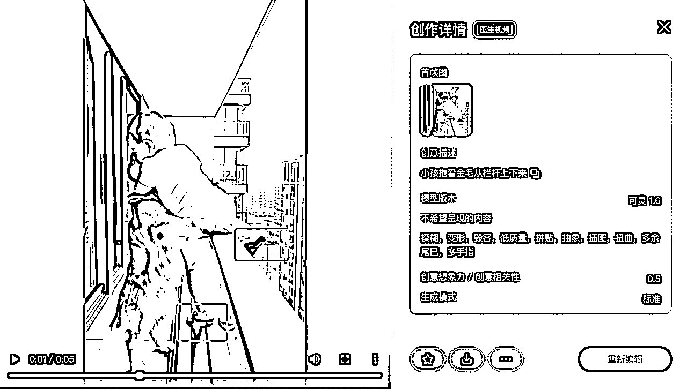

解法
方案1：丢弃被遮挡的部分，选未被遮挡的帧，提示词里让它把丢弃的部分补回来，相当于往后延长
方案2：下段提示词里加上小孩穿着和外貌特征描述，但别加太多，会影响生成

问题3：非会员水印
可灵、海螺非会员都有水印，剪映会员现在也去不掉
解法：生成阶段别纠结水印，先全生成完，最后统一在剪映里处理，水印处理见剪辑章节

### 视频剪辑

剪辑就是拼接几段素材，我重点说问题和解法

问题1：节奏步调不统一
比如上一段在跑，下一段变成走路
解法：在剪映里先截取不统一的部分，调整倍速

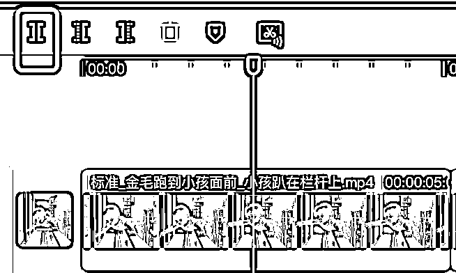

问题2：非会员水印
剪映里调整缩放即可，可灵调108%，海螺调111%，水印就被遮住了

缩放后会出现新问题，前后衔接处会抖动，怎么处理？
前一段衔接处：用关键帧让前一段平滑缩放，实现无缝衔接，参考下图
后一段衔接处：给后一段做同比例缩放

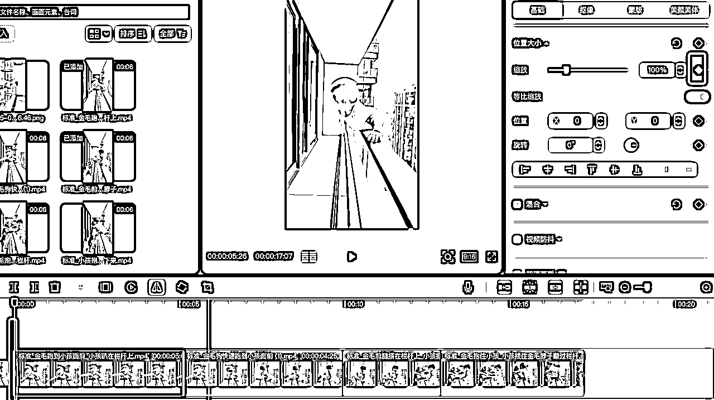

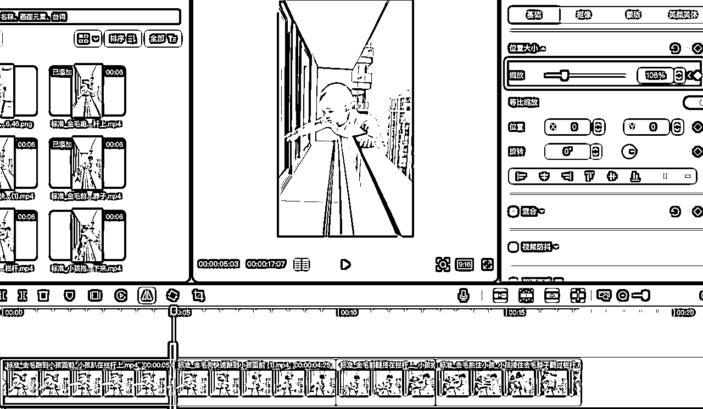

问题3：配音
全凭感觉，我把我常用的音频整理出来供参考

# 结束语

我现在的操作还很野路子，优化点很多，分享出来只是给大家一个起点
做内容要先抛弃完美主义，先完成再完美
想入场的别想太多，直接开干就行
希望这篇文章能帮到几个同路人，我也愿意一起交流，一起冲YPP！

最后特别感谢Gary教练，耐心指出我的问题，在我提出分享心得时他大力支持，还主动把关
他是我软关系里的第一个贵人！