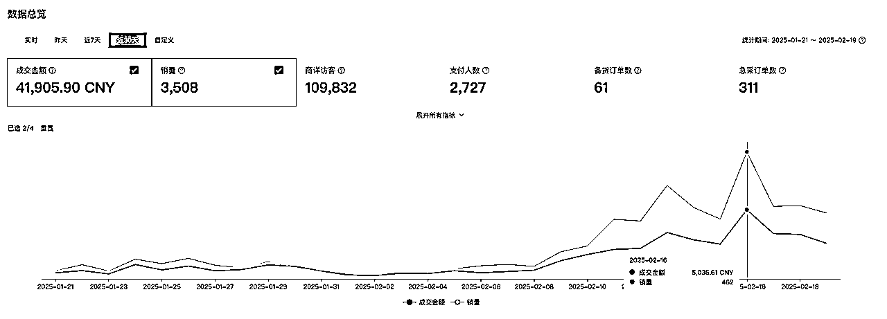
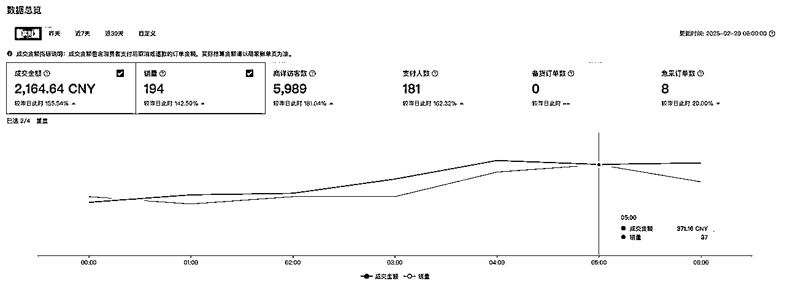
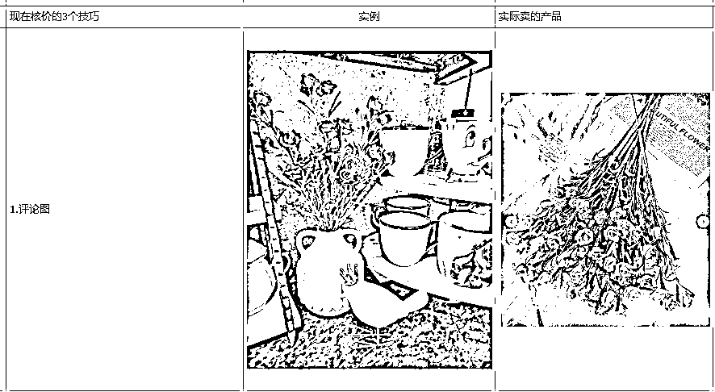
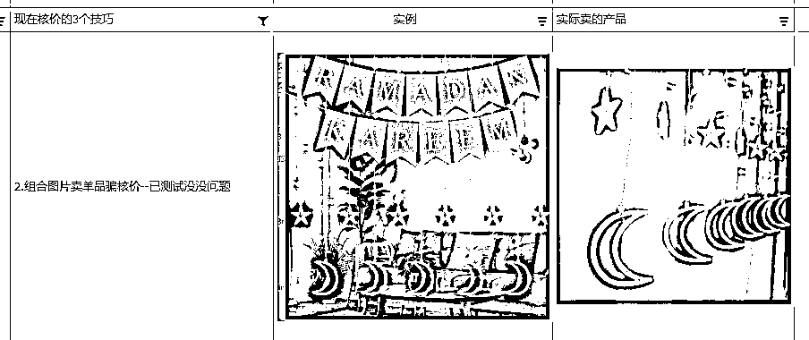
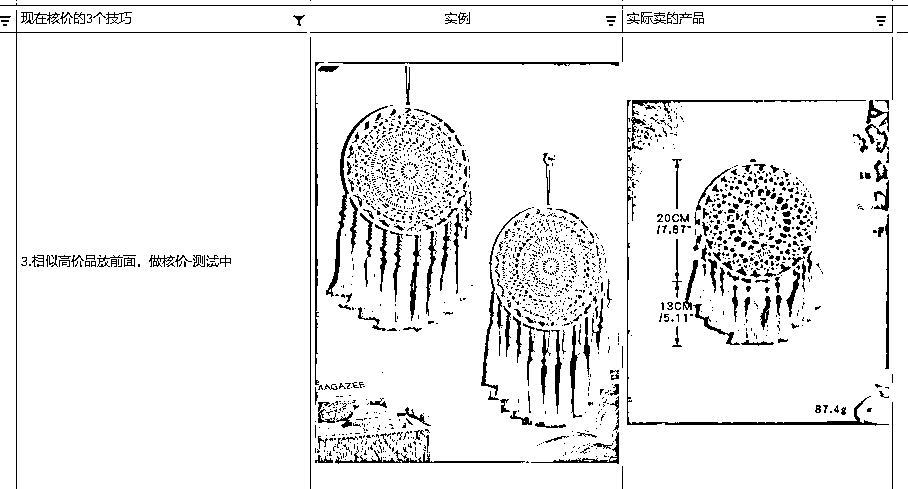

# ('【航海好事】Shein 航海的收获，两个月从Shein新手到月销售额人均破万', (2, 40))

最近刷到好多人在聊跨境出海，我也来分享一下自己这两个月带着团队做 Shein 的真实经历——从几乎是零基础起步，到目前四个人人均月销售额突破一万块，整个过程比我预想的要刺激得多。

先简单介绍下自己吧，我叫 rain，目前人在深圳光明区。日本硕士毕业，学的计算机，之前和朋友一起做过中东跨境电商，从零开始两年做到年销 2000 万，我主要负责数据抓取、电商工具和数据分析这块，当年爬虫系统日抓取百万级 SKU，稳定跑了两三年。

所以这次看到跨境航海活动，我整个人挺兴奋的——这不就是专业对口吗？当天就报名了 Shein 航海，主动联系了小善。趁着活动还没正式开始，我已经埋头开始做平台的数据分析了，算是提前抢跑。正因为动作快，航海一开始我成了第一个进入高中组的人，只花两天时间就完成 5 个选品并通过审核。

我们组的店铺是去年 12 月 20 日上线的，到 2 月 20 日正好满两个月。不过中间过年工厂放假停了 20 天，所以实际有效运营只有 40 天。4 个人都是兼职操作，其中两个队友之前完全没碰过电商，另一个做过 Ozon，有一定跨境经验。40 天下来总成交额 41905 元，单日最高冲到 5035 元，店铺毛利差不多是销售额的 20%，单日毛利最高 1200 元。看近 30 天的历史销售数据，增长趋势还是挺稳的：

当然，踩坑的地方也不少。最大的教训就是过年期间备货太保守了。有一个款式当时只备了 15 天的量，结果第二天就卖光了，等想补货才发现工厂全都放假了。链断供了，最后只能下架，白白浪费了一个大爆款。这也让我意识到，Shein 这门生意选品选得再好，没有稳定高效的供应链也白搭。后面还有两个爆款也遇到类似问题，生产速度跟不上，导致供货断断续续（参考图里 2 月 17、18 日的数据）。

另一个不足是带团队的经验不够。开始只带了 3 个人，这两天又新增了 5 个。说实话，Shein 这个项目最大的门槛在“入门”阶段——语言要适应、平台规则要熟悉，而且上架失败要等 10 天才有反馈，这个过程真的磨人。但只要进了门，里面的竞争其实没那么卷，销售额基本能保持稳定增长。

关于选品，我觉得这是 Shein 的重中之重。对我这种程序员思维的人来说，逻辑其实不复杂：就是去盯海外各个电商平台近期的热销新品。老品别碰，因为人家供应链强、评论多，我们拼不过。所以我们的思路是找那些刚火起来的新品，越早捕捉到平台需求，利润空间越大。具体操作上，先看平台的机会商品，了解平台最近主推什么方向。比如平台要推中东斋月品，机会商品里就会冒出一堆斋月相关需求，我们就去 Temu、亚马逊沙特站/阿联酋站、noon 上找那些刚上架的热销款。最近平台在推复活节的品，我们就去 Temu、亚马逊美国站/英国站扒复活节相关的新品。

筛选新品可以用市面上现成的工具，比如 Temu 选品助手、卖家精灵这些都行。还有个小技巧：平台早期推新活动时，相关产品很少，核价时我们能有话语权；等到大批卖家涌进来，平台就开始挑品了，价格也会被压得很低。所以，手速就是利润。

选完品，上架同样不能马虎。因为全托管没有付费推广，想拿流量就靠点击率，说白了拼的就是上架质量。

先说标题。标题结构可以参考：数量/容量 + 核心关键词（亚马逊）+ 卖点词 + 组合词 + 长尾词（Temu）。注意英文书写要规范，关键词一定要跟产品实际相关，别硬凑不相关的词。拿不准的就去扒同行的优秀标题，多看几个就知道规律了，无非是换顺序、换组合，按这个框架写基本不会差。

再说规格。像相册、挂画、灯串这类尺寸影响很大的产品，一定要把大小标清楚。上新时尽量聚合操作，文字统一用英文，能多设几个规格就多设，建议两到三个小规格，给后面留操作空间。

图片方面，平台目前要求 1340*1785（3:4）和 900*900（1:1）两种比例。制图分几类：核价图可以用 AI 来做；尺寸图要单独出。不同的图放在不同位置，作用也完全不同。轮播图第一张是骗点击的，一般点击率到 4% 就算不错了。主图第 2 到 5 张是给系统核价和促进转化用的，可以放浴室、厨房、墙上、桌面等不同场景图。第 6 到 11 张主要促转化，放细节图和尺寸图。有视频一定要放，视频对转化帮助很明显。简单总结就是：点击图两张（主图+轮播图），核价图一张或三张。下面是我们当时做的一些参考例子，最后一列是实际售卖的产品：

整个上架流程其实就 5 步：第一，找图，必须带尺寸图，有视频就一起加上；第二，找核价图，可以用更贵的实物当背景来衬托；第三，写标题，结合图片场景来写更自然；第四，上传图片和视频，注意顺序；第五，设置规格和变体。

至于仓库贴标、活动报名这些环节，难度不大，跟着平台的教程过一遍基本就会了。

总的来说，Shein 并没有想象中那么玄乎，核心就是选品思路 + 上架细节 + 供应链稳定。这次航海最大的收获不仅是数据上的增长，更是一帮能一起干事的伙伴。感谢生财，感谢航海，感谢小善的团队，也希望大家都能找到适合自己的项目，一起赚钱同行～

如果你也在做 Shein，或者对跨境有兴趣，欢迎私信鱼丸找我或者小善团队多交流。未来我打算继续深耕 Shein，慢慢做自己的产品和品牌，也希望遇到更多志同道合的搭子，一路同行。