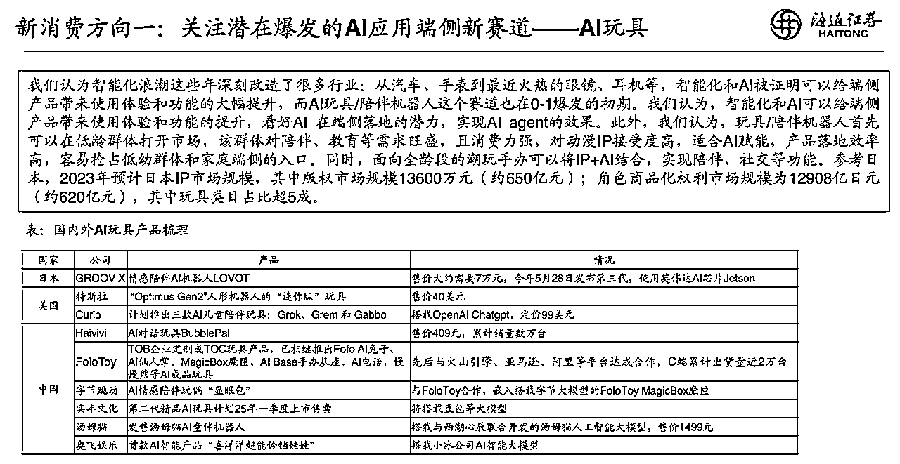

# 一面会思考的镜子，照出的是生意还是未来

大家好，我是龙哥，喜欢笑，做增长。

今天是2025年2月14日，跟情人节撞个满怀。礼物清单还没想好？前一天我也在发散，脑子里蹦出一个有点疯的设想：一块长了摄像头和算力的镜子。

它能看清你今天的穿搭，给妆面和配饰出方案；它内置了Deepseek R1与豆包视觉理解的组合；它拥有多组Agent协同工作；它还能陪你闲聊，给点情绪价值。它会捕捉你的小心思，递上鼓励和具体做法。

这篇文章就是顺着这个灵感往下拆：灵感从哪来，能不能做，落在哪里，怎么变现。

# 一、灵感从哪来

## 1、研报里反复出现的AI+硬件信号

春节期间Deepseek火遍全网，信息流里全是关于新机会的讨论。跟多数人一样，我也在找落点。

上图里，多家券商同步点名了AI硬件与AI玩具的方向。2024年我也折腾过几款DIY智能硬件，体验尚可但总觉得缺口气。随着基座模型越用越顺手、接口越开放，真正能玩的玩具才开始冒头。这里只拿来借鉴赛道机会与风险，不作投资建议。

## 2、豆包视觉理解能力的补齐

2024年12月，豆包发布视觉理解大模型并接入火山引擎开放平台，开发者可通过API直接调用。

看过演示后才意识到，模型从“能听会说有脑子”升级到了“会看”。教育、广告、电商、游戏等行业的交互将被重写。靠大模型+提示词+Agent+知识库的组合去做垂类App，重塑场景交互，是我看到的切口。

## 3、智能眼镜的热度与迁移

现在智能眼镜很卷，也很真实。它负责向外扩张视野，让世界更大、更丰富。

AI镜子恰好反向操作：向内聚焦，让你更了解自己。技术内核相通，差异在知识库与工作流的定制。眼镜普及后，把同一套能力搬到镜面，不必重复造轮子，只需换场景、换流程，就能开出新的消费品类。

## 4、客厅场景与礼物场景的交集

一年到头送礼的节点不少，中国人讲究礼尚往来。春节刚过这个问题更明显：送什么既有心意又不落俗套。

口红、包、鲜花、金饰、红包、衣服，送一两次是惊喜，送多了就平淡。若换成稀缺度高、可DIY、搭上最新模型的会看会听会思考的玩具，感受就不同了。

梳妆台恰好是最合适的载体。大量数据和我的观察都指向同一结论：对女性用户而言，除了手机，梳妆镜是居家高频私密空间。一天至少两次，单次停留常超一小时，留存极高。它有机会成为大模型进入家庭的第一入口。

## 5、当镜子有了Agent，价值是什么

想到AI镜子后，我在问：它能解决什么具体问题。

比如坐到梳妆台前，镜面根据当天衣物推荐妆面与饰品，已有的物件自动录入数据库。再根据素颜状态给出分步教学。再根据行程给出穿搭建议，并实时投射到屏幕上。读懂面部微表情，喜悦时共鸣，安静时陪伴。给出决策的勇气与依据，成为闺蜜般的存在，却不会泄露隐私。

美的东西人皆有之。若把镜子定义为“让你变好的镜子”，智能眼镜让你看见更广阔的世界，智能镜子让你看见更好的自己。越聊越久，它越像另一个你。

# 二、技术上通不通

1、豆包视觉模型：既能观世界，也能观自我
2、Coze智能体：可把Agent当API调用
3、Deepseek R1：负责语音/图像的深度推理对话
4、硬件集成：整合供应链，别重复造轮子

概念上，镜面内置开关，启动后自动连上模型栈：豆包视觉先解析图像与语音，路由到对应的Coze Agent，每个Agent自带知识库与提示词，再接入Deepseek R1做分析与回应。多模型、多Agent、多库协同。目前只是思路，还没MVP。

# 三、落地与价值

这是一面能把转化率做上去的镜子。

## 1、居家

除美妆外，Deepseek算命与身心灵疗愈最近也很热。

如果镜子会看面相、手相，并结合穿搭给出建议，会不会被解读为“优化气场”？在身心灵赛道，拥有一面会回应的镜子，相当于请了个家庭导师。睡前可以对镜子复盘、感恩、表白、忏悔，随时切换镜像为观音、释迦牟尼等意象。

## 2、美业

理发前能提前看到烫染后的效果，用户犹豫会大幅降低。做法也不复杂：镜面抓拍→垫图→工作流出图。看见即相信，相信即下单。买一面镜子，等于多一个会卖货的员工。若成交率提升个位数，ROI自己算。

## 3、时尚零售

买衣服卡在“要不要买”。若镜面实时呈现你穿上它在写字楼、海滩、谈判桌的画面，场景感直接把人拉进去。不是靠想象，而是眼见为实。包包也一样。

## 4、医美与健身

先看见再相信。比如健身教练对你说：这是30天后的你。AI当场生成未来图，并给出可执行的计划，再配上定制化鼓励，心动率会飙升。医美逻辑相同。

## 5、可定制化

更进一步，它还能成为“赚钱镜”。不仅让你变美，还能觉醒赚钱思路。定制知识库与工作流，个人与商业场景皆可。变美变富，一面镜子承担仪式感加持。

# 四、变现路径拆解

1、个人礼物：情人节、生日等节点，DIY定制礼物
2、美妆品牌联名：如“神仙水”类大单品
3、奢侈品牌合作：只赠不售的高端定制
4、订阅付费：基础功能免费，高级功能年费

AI玩具最先打的是送礼，解决关系质量；其次是与大牌合作提升用户粘性；最后渗入大众消费场景提升现场成交。成本可控，扩张稳健。

# 五、收束

点个心思，也许就能撞开新品类。聚焦人群与场景，叠加新质生产力，就有机会诞生新赛道。AI不只是提效，还能提质。把转化率做上去，就是效果的提升。

Deepseek爆火像当年电的出现，旧体系被拆解，新产品等着被创造。生产力过剩后，想象力变得稀缺。也许一次随意的脑洞，就能改写某个场景的交互方式。

以上是个假设，必然有漏洞，欢迎碰撞。

祝大家2025情人节快乐，有情人终成眷属。

感谢龙哥盟，一起龙哥盟！