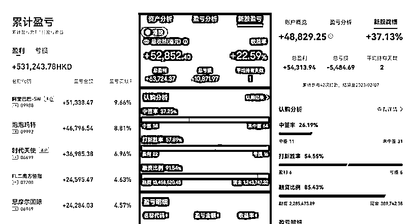
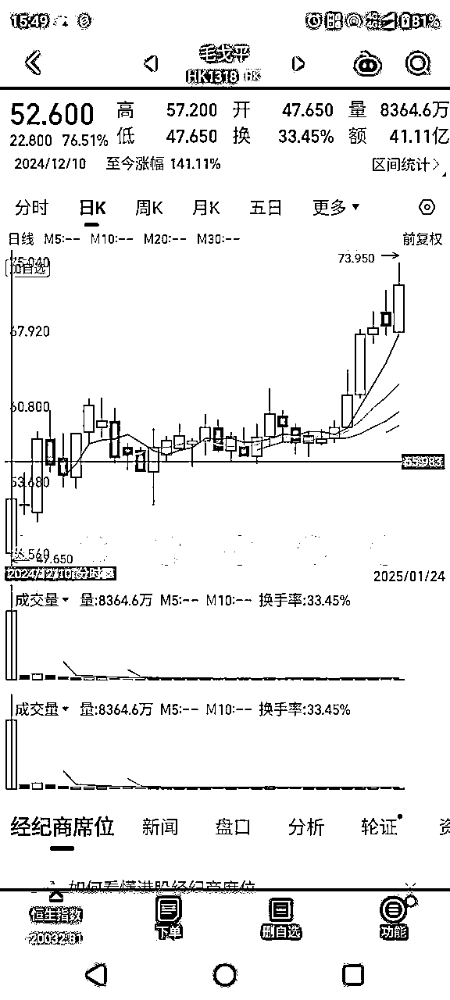
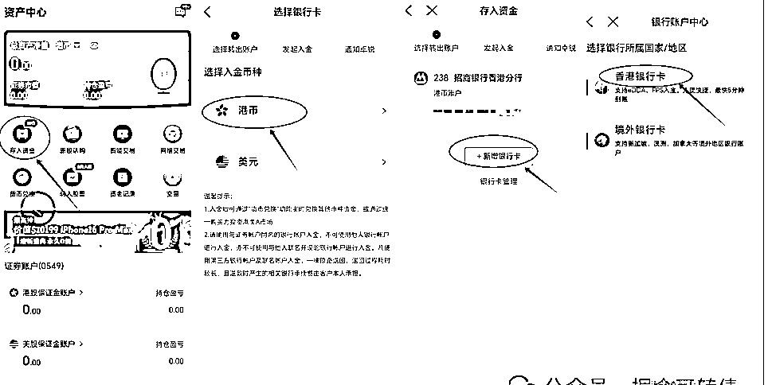
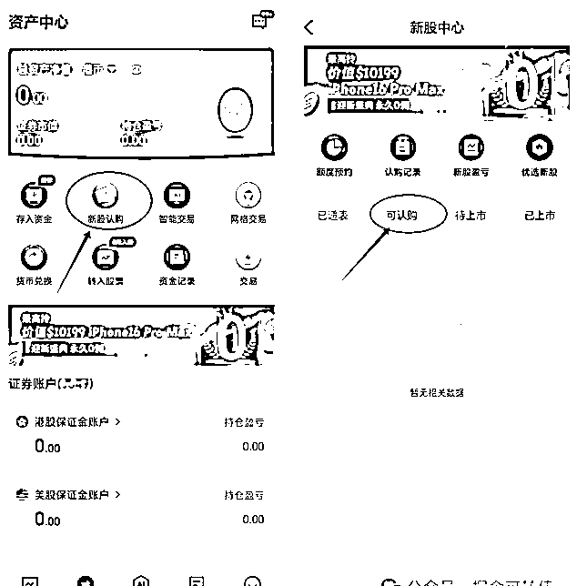

# 港股打新方法论的复盘与再出发
作者：龙哥

# 前言

回看2019到2021这三年，港股打新可以说是躺赢的典型样本。那段时间多账户操作被允许，几乎只要参与就能赚钱。我们当时也全程在场，最终落袋的利润相当可观。

转折发生在2021年之后。港股迎来一波近乎腰斩的调整，打新的赚钱效应戛然而止，玩法从稳定盈利转向了高频亏损。打新的人数、申购热情一路下探，到了谷底。直到毛戈平回归市场才让这套沉寂的打法重新被讨论。毛戈平一手中签率达到100%，上市首日涨幅76%，累计涨幅冲到92%，打满的账户无一落空，赚钱的效率让人侧目。

当下又有一批新面孔涌入港股打新。对老玩家而言这套流程已经熟到不能再熟，对新手来说门槛和细节却不少。彼时很多人特地跑去香港开卡，机票住宿餐饮都便宜，顺道玩一趟回来就开户打新。早一批吃到红利的人已经赚得盆满钵满。下面我们把港股打新的整体思路梳理清楚。

# 合作打法

## 合作细则

1、按阶段合作，收益分成64开，客户拿60%，我方拿40%，合作期通常一年。资金全程放在香港券商账户内。期间账户保持不动，资金自动做理财。理财收益不参与分成，也不计资金成本。

2、资金可投理财，理财产出不分配，境内利息差也不算，汇率涨跌也不承担。

3、合作建立在相互信任基础上，目标是双赢。

4、分红节奏：按月或按季度结算，盈利部分按64分成。若账户出现盈利，保证金原数退还。下只新股中签所需保证金若充足则不另外收取，若不足再补足。

5、亏损兜底：若出现回撤，亏损部分由我方全额补齐。

结算依据阶段性整体盈亏，而非单只标的盈亏。

6、保证金标准：在有安全垫盈利的情况下，每手中签金额可交20%保证金，例如中签10000港币，只需垫付2000港币。有盈利后保证金按盈利水平提供。

7、账户规模：每人可名下开5家左右券商账户，预计薅羊毛收益在3000-4000港币。

操作方式：

若你没时间操作，可委托我方代为操盘；

每个账户均为小额操作，严格执行“打新不炒新”，不碰任何流通个股。

账户安全：代为操作结束后可自行修改账户密钥，确保资金安全。该环节不参与分成。

8、打新预期收益：参考历史表现，年化收益区间在30%-80%之间，具体受资金量、策略选择、运气影响而波动，但整体属于值得配置的方向。

# 港股打新是什么

港股打新即参与港交所IPO新股认购。和A股打新相比，差异非常明显：

1. 门槛更低：不需要市值配售，只要有港股券商账户，账户里有可用资金即可申购。
2. 中签概率高：中签率远高于A股，规则上会优先保障一户一签，给散户更多机会。
3. 可融资申购：券商提供融资额度，常见杠杆10-20倍，热门标的更高。融资能放大申购规模，提升中签几率，但需付利息并承担风险。
4. 账户限制变化：早期可一人多户申购，当前规则趋严，同一人同一只新股只能用一个账户申购，重复会被取消资格。

其他特有规则与风险：

* 破发常态化：港股首日破发率明显高于A股，2024年破发率约36%。
* 暗盘交易：上市前一日16:15-18:30可通过券商系统进行场外暗盘交易。
* 申购成本：主要为券商手续费约1.0085%，以及融资利息。

# 如何上手港股打新

参与并不复杂，核心就三步：办香港银行卡、开港股券商账户、入金。

## 第一步：香港银行卡

能向港股账户进出资金的关键是香港银行卡或其他海外银行卡，可说这是参与的唯一硬门槛。

若能赴港办理，流程很顺畅，也可线上申请省去排队。常见材料有：

1. 身份证原件；
2. 港澳通行证原件；
3. 通关小票；
4. 地址证明，如信用卡账单、房产证、水电账单等；
5. 几千港币现金备用，部分银行会要求存入。

不同银行要求略有差异，建议出发前先与银行确认。中国银行、众安银行等均支持线上开卡，效率较高。

## 第二步：开通港股账户

办好银行卡后，开通港股券商账户即可。需注意，A股券商开通港股通有50万门槛，仅能交易，不能打新。

现在券商开户补贴很常见：

* H盛证券：约1400港币补贴；
* 老H证券：500港币补贴；
* 长Q证券：终身免佣+600港币补贴。

一般存入1万港币即可拿到一千多港币奖励，基本可覆盖来回差旅成本。

A股已开多个账户不影响港股开户，两者监管独立，港股没有数量限制，按需多开以拿满奖励。

## 第三步：账户入金

开好账户后即可入金。以卓锐为例，APP内有“存入资金”入口。

各家界面略有差异。港股主流入金方式是eDDA和FPS。eDDA类似单向银证转账，到账快约5分钟内，但只支持入金不支持出金，无需上传凭证。FPS需先在银行APP转账，再把凭证上传券商，对新手稍显繁琐。香港金融体系的特色就是这种新旧并存的操作感。

完成上述三步后即可开始认购。在券商APP的“新股认购”入口，能看到可认购列表。

目前暂无新股发行，无法展示完整截图，但各家操作逻辑相近，很快就能上手。

# 港股打新的核心规则对比

1. 申购周期：A股仅一天，15点截止；港股招股期3-6天不等，全天候可下单。
2. 定价机制：A股发行价固定；港股为区间定价，如13.5-14.5港元，招股结束后再确定最终价。
3. 一手单位：A股100股，科创板200股；港股不固定，200/500/800股均有。
4. 缴款时点：A股信用申购，中签后再缴款可弃购；港股申购时冻结资金，中签自动扣款，未中签解冻。
5. 分配机制：A股按比例中签；港股偏向小额投资者，一手中签率更高，具体由发行人与承销商决定。
6. 暗盘：上市前一天16:15-18:30可交易，为首日表现提供参考。
7. 甲乙组：认购额<500万港元为甲组，>500万为乙组，两组配额大致均等，乙组中签率通常更高，创业板不分甲乙。

# 风险提示

任何只谈收益的策略都不靠谱，港股打新同样有明显风险：

## 破发风险
A股新股首日破发极少，2024年破发率约1.3%；港股2024年71只新股中24只破发，破发率约34%。盲目申购很容易亏损。

## 融资风险
券商常提供10-20倍杠杆，热门标的可达50-100倍。1万港币本金用50倍杠杆可申购50万市值。涨则放大收益，破发则放大亏损。对冷门股使用融资风险极高。

## 炒新风险
打新原则是中签后首日卖出，不长期持有。历史数据显示多数新股首日即见顶后回落。我们坚持“打新不炒新”。空窗期去炒小盘股波动极大，易将打新赚来的钱亏回去。

总体来看，港股打新仍有机会。比如只选超购200倍以上的热股，15只中有10只上涨，胜率约67%。

稳健做法只有两条：多开账户拿券商开户奖励；聚焦行业热、概念热、认购热的新股，不炒新，少碰冷门。

# 过往表现与未来预期

部分账户去年十几万港币的本金，策略打满后收益率约10万港币，按当时汇率折算人民币3-8万元收益。

进入美国降息周期，资金回流预期增强，港股打新有望迎来新一轮窗口。配置十几万人民币的账户即可产生不错产出，大资金50万港币以上可享受乙组优势更明显。

码字不易，麻烦点个赞再走。