# 【AI 编程零基础】5 分钟上手 Cursor，跟着做一个 2048 小游戏

> 来源：[https://lw0qdvkpi9l.feishu.cn/docx/JFUcdPn5tostdXxcIcMcTxu5ned](https://lw0qdvkpi9l.feishu.cn/docx/JFUcdPn5tostdXxcIcMcTxu5ned)

嗨，朋友们好！

先简单做个自我介绍，我是虎哥，现任世界500强的前端架构师，同时也在做 AI 智能体、AI 写真教学相关的工作。日常基本都在和代码打交道，我的开发环境也早已从 vscode 切换到了 cursor，开发效率直接拉满。市面上主流的 IDE 和编程插件我基本都研究过，对其中的优劣还是挺清楚的。

今天继续聊 AI 编程，不知道之前那两篇你跟上了没？

内容都比较入门，不涉及高深概念。已经在写代码的同学可能觉得很基础，但对零基础的小白来说，这些认知还是很有必要的。

AI 编程最关键的就是动手，不光看理论，光看不练很容易半途而废。

今天我们就做点实际的，直接带你用 AI 在 5 分钟内做出一个 2048 小游戏，先看看成品效果如何

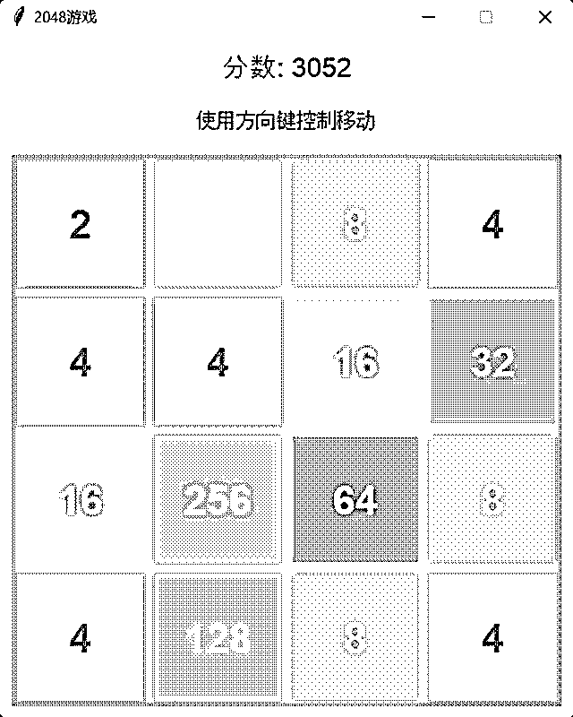

跟着本篇走完，你也能复刻出一模一样的游戏，我们直接开始。

## 先把需求理清楚

先来拆一下 2048 到底是什么。

很简单，就是一个用方向键操控数字方块合并的休闲游戏，最终目标是拼出 2048。

在动手前，我们最好先有一份需求文档，不知道怎么写没关系，唤起我们的老伙伴 Kimi 就行。

入口：https://kimi.moonshot.cn/

告诉它你想做一个用 Python 实现的 2048 小游戏，让它帮你整理一份完整的需求说明书。

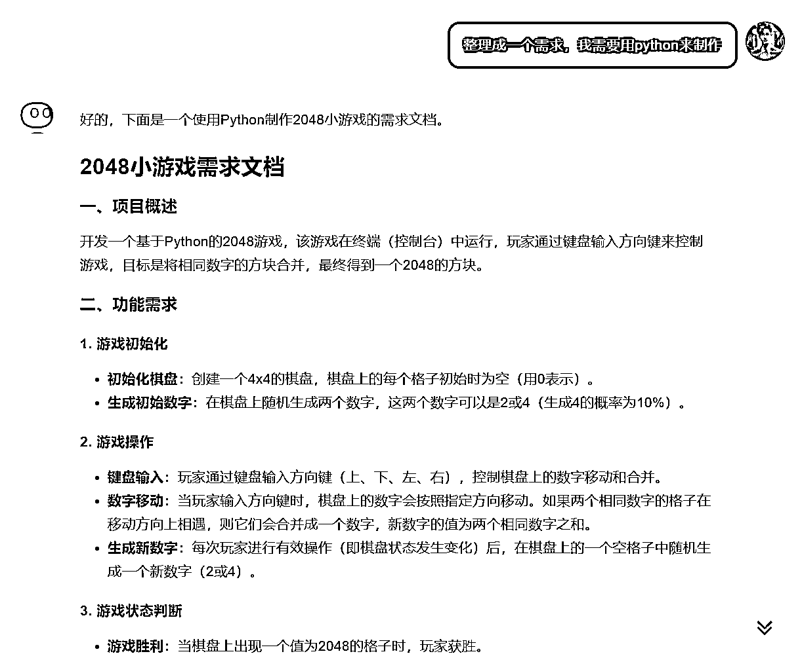

整理好的文档包含了项目概述、功能点、界面呈现等要素，里面详细说明了技术选型和实现思路。

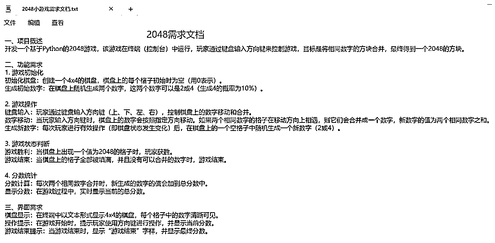

我把相关资料都整理到网盘了，需要的可以直接领取

0117-2048 小游戏

https://drive.uc.cn/s/113511301d724

密码：P86R

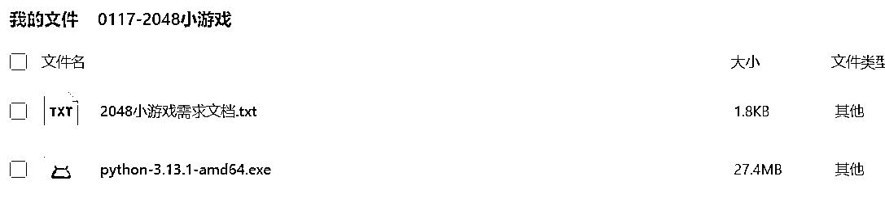

## Cursor 实战流程

开干之前先熟悉两个高频快捷键，以 Windows 系统为例：

*   Ctrl+I 打开 Composer 窗口，可以同时对多个文件进行批量修改，适合让 AI 帮你生成整个项目
*   Ctrl+L 打开 Chat 窗口，可以向 AI 提问、解释代码、优化逻辑，或针对选中代码块进行改动

### 第一步，准备项目目录

我这里以 D 盘为例，新建一个 CursorCase 文件夹，再在里面建一个 2048 小游戏的文件夹。

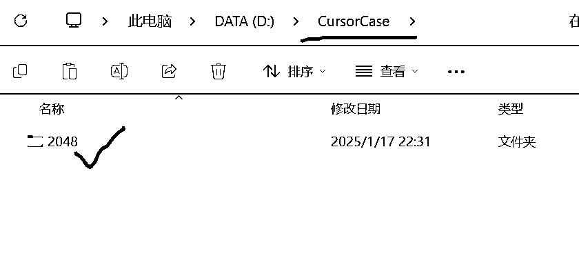

### 第二步，让 Cursor 按需求生成代码

打开刚建好的文件夹，菜单栏 文件 -> 打开文件夹，或者直接按 Ctrl+M+O。

打开后按 Ctrl+I，右侧会弹出 Composer 窗口。把刚才的需求文档复制进去，让它开始生成代码，输入完点右下角的 submit 即可。

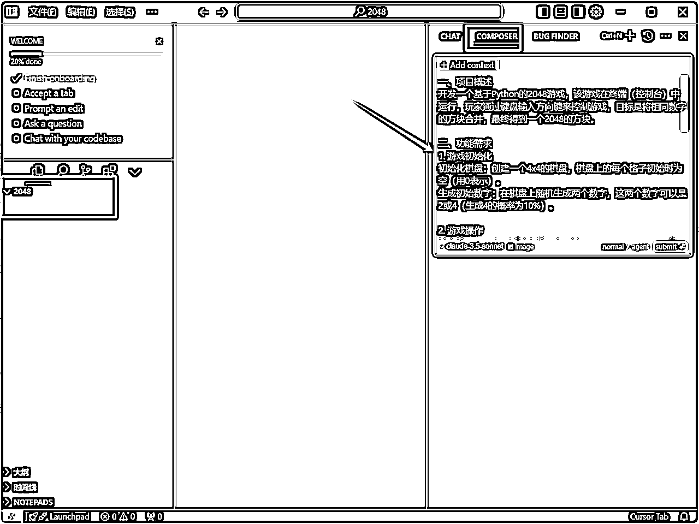

Cursor 会根据需求自动写代码，生成完成后如下图所示。

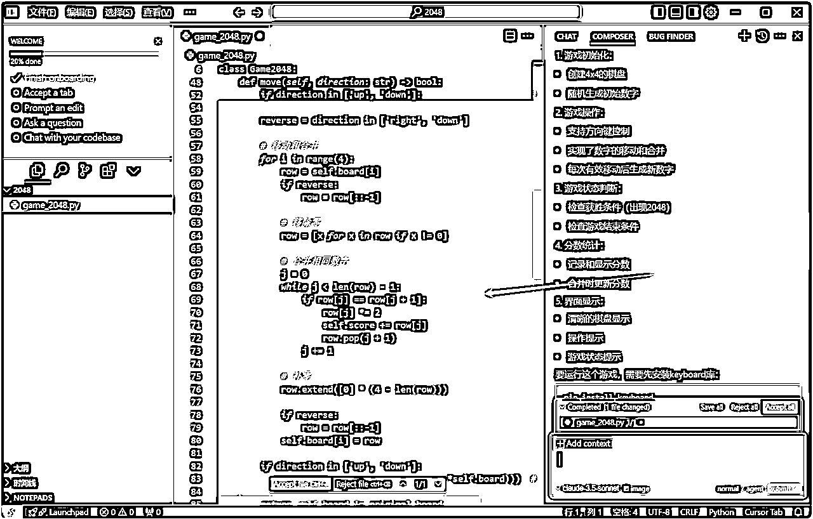

看不懂很正常，没关系，直接点右下角蓝色的 “Accept all” 一键接受全部文件。

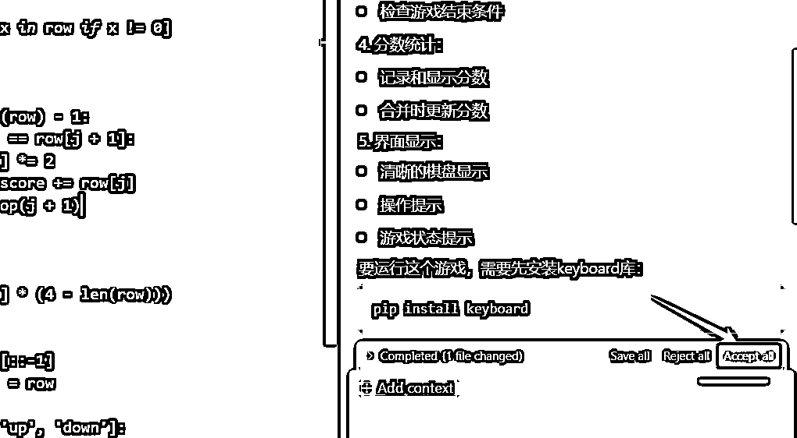

这时提示需要先安装 keyboard 库，把鼠标移到代码区点一下 Run 按钮就能执行安装。

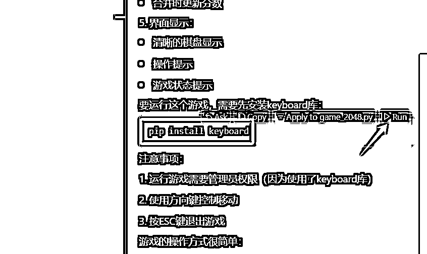

执行后终端一片红，报错了，程序跑不起来，这很常见。

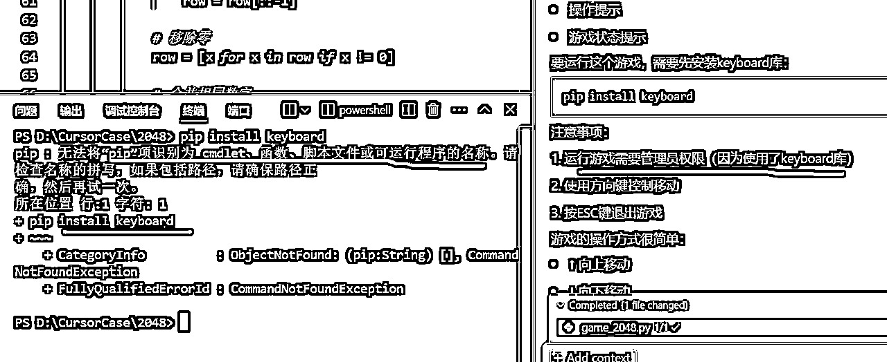

别慌，把报错信息全部选中，点击右侧的 Add to Chat，就会跳到对话窗口。当然你也可以直接按 Ctrl+L。

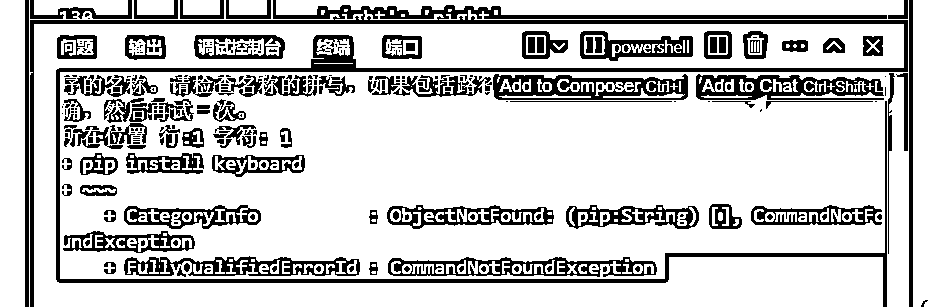

在 Chat 里输入“这个报错该怎么解决”，AI 会给出排查步骤。

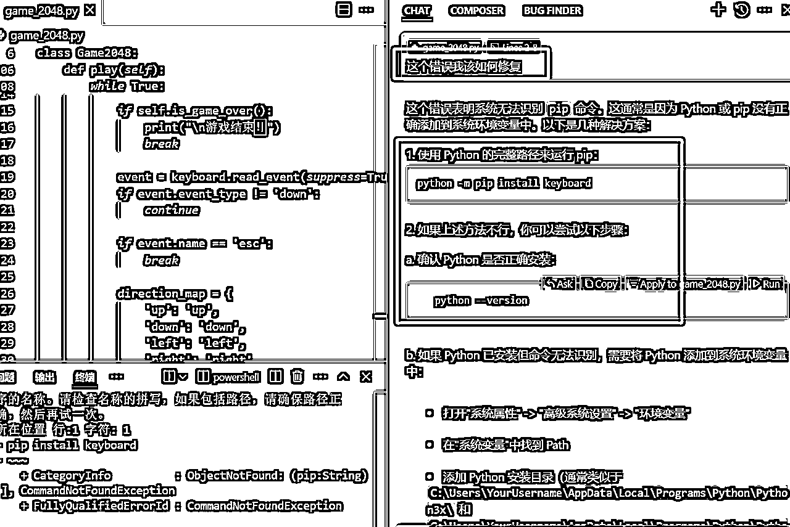

其中一步是检查 Python 是否已安装。照着提示在终端里执行检查，还是用 Run 按钮，终端会返回信息。继续问 AI 怎么修，会发现是 Python 没装好。

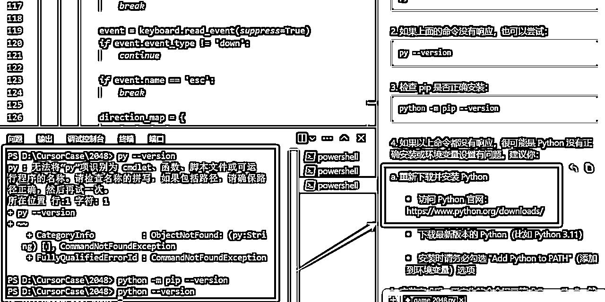

### 第三步，安装 Python 环境

按 Cursor 给出的地址复制后打开官网下载安装包

python 安装包下载：https://www.python.org/downloads

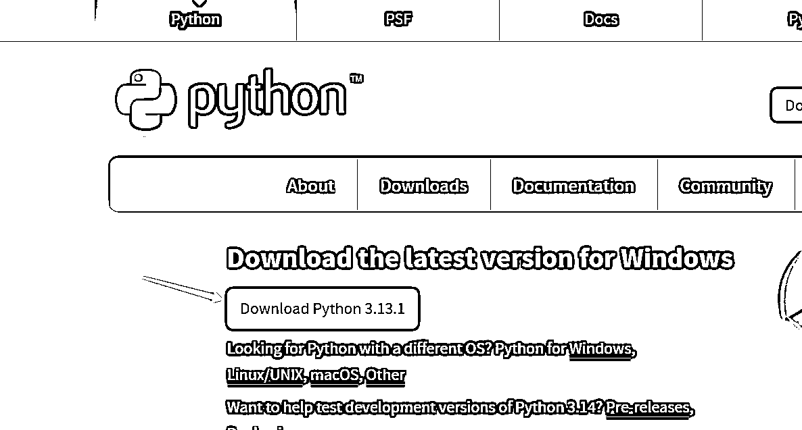

打不开官网也没事，我已打包好，网盘自取

0117-2048 小游戏

https://drive.uc.cn/s/113511301d724

密码：P86R

下载 exe 后开始安装，记得勾选 “Add python.exe to PATH” 添加环境变量，然后点 Install Now。

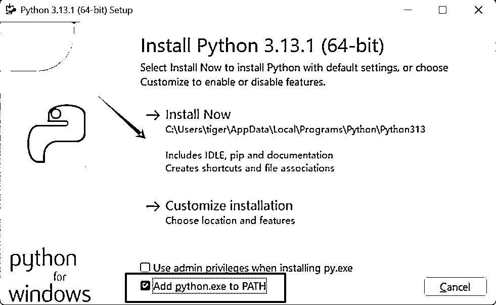

怎么验证是否装成功？关闭 Cursor 重新打开，然后在终端输入 `python --version`，能看到版本号就说明成功了！

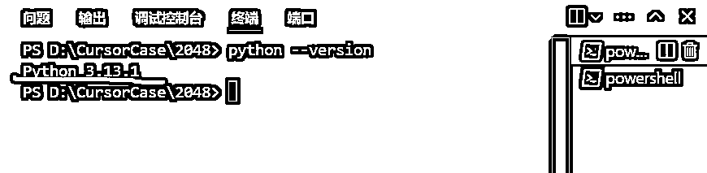

接着执行 `python -m pip install keyboard` 完成依赖安装。

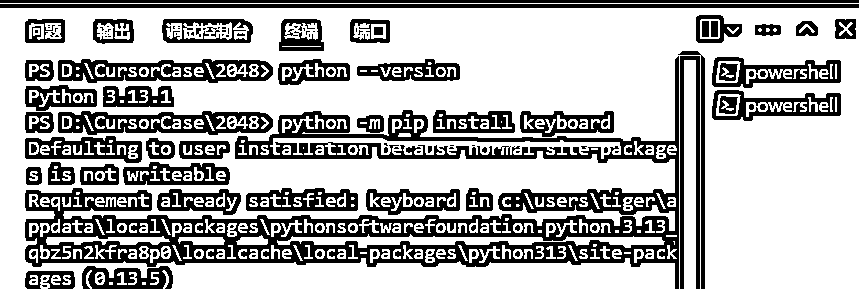

### 第四步，运行游戏并优化界面

到这一步就可以试玩了，在终端输入 `python game_2048.py` 启动。

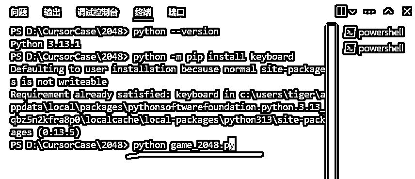

注意文件名是 Cursor 自动生成的，如果你的文件名不一样，请改成你自己的。

启动后终端里会出现 2048 的格子，用方向键就能玩，想退出按 ESC 即可。

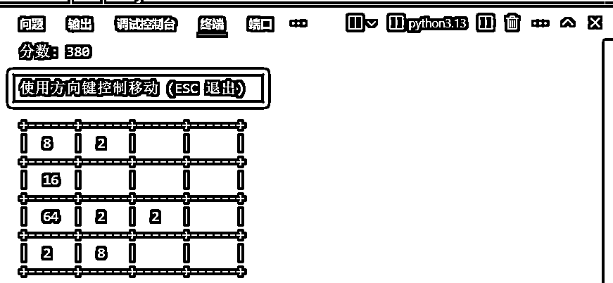

总在黑窗口里玩有点单调，想让界面好看点、新窗口打开？

没问题，按 Ctrl+I 打开 Composer，输入提示词让它帮你美化界面并单独开窗运行。

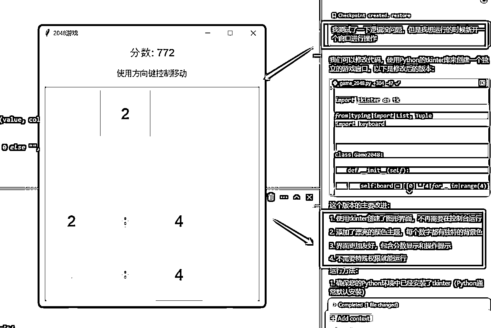

到这里整个制作流程就结束了，收工！

## 收尾总结

看懂了吗？整体步骤并不复杂，熟练后真的几分钟就能搞定。做完之后还能让 AI 帮你打包成安装包发给朋友一起玩。

是不是感觉编程在 AI 加持下也变得挺好玩的。AI 到处都在变革，哪里还觉得它没用呢？

今天就到这里，有任何问题欢迎留言讨论。