# 自由职业卡在瓶颈，如何做一个小而美的“一人公司”，用团队杠杆撬出百万利润

我是理白，一向专注于帮你降本增效的老朋友。

年初做过一场复盘分享，把2024年从一个超级个体到一人公司的完整路径拆开了讲：如何用4个线上兼职，带动40多人的志愿者网络，把团队跑起来、管起来。今天把文字版整理出来，专门给还在人效瓶颈里的老板和IP看。全文约1.6万字，预计阅读10分钟。

# 为什么听我的？

我医学背景出身，对精力管理和身心养护特别敏感。

一天只工作4-5小时，我照样能撬动500万以上的营收，靠的就是一人公司打法。

线上兼职团队4人，志愿者接近40人，整个人力成本一年控制在10万以内，链路已经稳定。

最长15天出差，期间完全断网，团队也能自运转，营收仍能保持在70%以上。

团队每月都在纳新、筛选、淘汰，保持高流动性。

我的内容全部实现一鱼多吃，一场直播剪成公众号、社群、星球帖、朋友圈和视频切片，多平台反复复用。

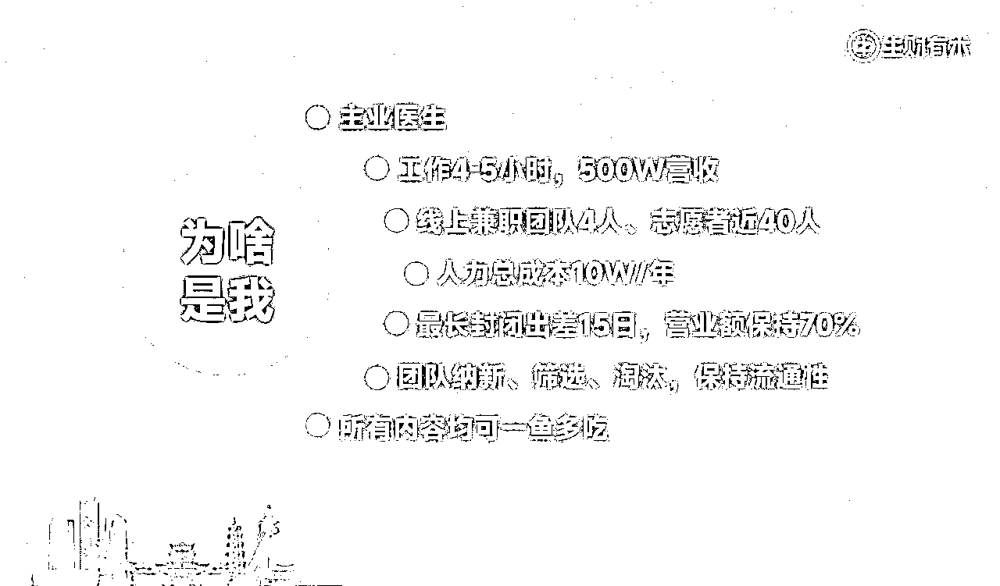

因为我长期主副业并行，所以总结出这套实操方法论，先分享给大家。

# 一、从自由职业到一人公司，先问自己4个问题

个人产出终有天花板。在交付用户、做个人品牌的过程中，你会慢慢发现一个人扛不住。

这时必须借助外部资源、开启合作、搭建核心小队。这就是从个人IP向一人公司的进化。

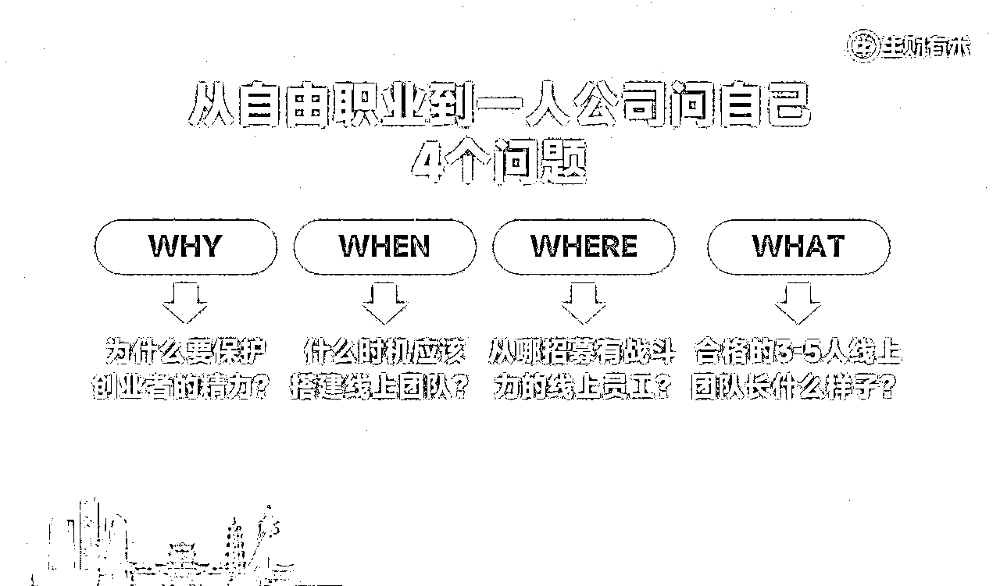

## （一）WHY：为什么要死守创始人的精力？

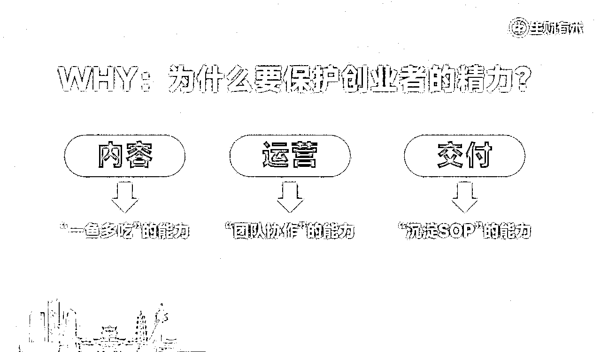

### 1、守住精力就是守住财力，就是守住创始人交付的稀缺价值

从内容看，守精力就是“一鱼多吃”的能力：一次输出能否做到100%复用效率？

从运营看，守精力就是“团队协作”的能力：能否淡化主理人存在感，让团队自动跑？

从交付看，守精力就是“SOP沉淀”的能力：用户量变大、客户多元化，能否按不同梯度节奏分层服务？

### 2、实操策略

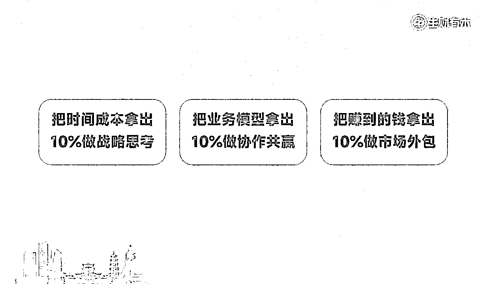

#### （1）拿出10%时间做战略思考

创始人要时刻保持战略感。读战略书，听顶级创业者的观点，看同行在做什么，能给你什么启发。

你每天可能要打5个客户电话，写2条内容，发10条朋友圈，准备一堆课件，8-10小时就没了。

其中挤出1小时深度思考，让不重要的事缓一缓，就能多出复盘、总结、提炼、规划的空间。

业务模型小步快跑，逻辑向上迭代。

#### （2）拿出10%业务做协作共赢

很多业务复杂，需要跨界合作。但一开始就深度绑定合伙人并不安全。合伙做生意风险高，业务存续期不明，缺乏保底机制。

一旦合作占比过大，对方出问题就会满盘皆输，还可能伤口碑、伤IP。

我见过一起开班合作，最后反目分崩的案例。所以不建议初期用合伙制做大生意。

一人公司更适合以你为主导，合作伙伴是员工助理、助教角色，是主从配合，不是平等合伙。

为什么要拿出10%做协作？

这10%是业务不同板块上的合作触点。

举例：靠谱老师的核心是销售培训，客单万元内；我的核心是IP孵化，客单也在万元内。这是各自利润品。但我们各拿出10-20%时间精力，联合做了一个4万元的组合产品。

协作共赢有三点：流量、内容、交付逻辑互补。比如我擅长战略规划，他擅长营销转化。大会议我主刀定规划，大促他给出精准内容点位。重要客户一起交付，各自省50%精力，还能拓展其他业务。

#### （3）拿出10%利润做市场外包

个人IP必须持续追求外包。重复、消耗、无意义的劳动，都能梳理成SOP后外包。

比如公众号排版，以前自己做，后来只要写好稿子，10-20元/篇外包给编辑，一个月几百块成本。

再比如直播转文字、内容整理，都可以外包。

业务里每3-5天需要提醒用户、统计表格、做数据复盘，这些都可以请兼职助教。

创始人的精力要不断释放，凡是重复、收益趋零的工作，花小钱撬动别人做，就是闭环。

## （二）WHEN：什么节点该建线上团队？

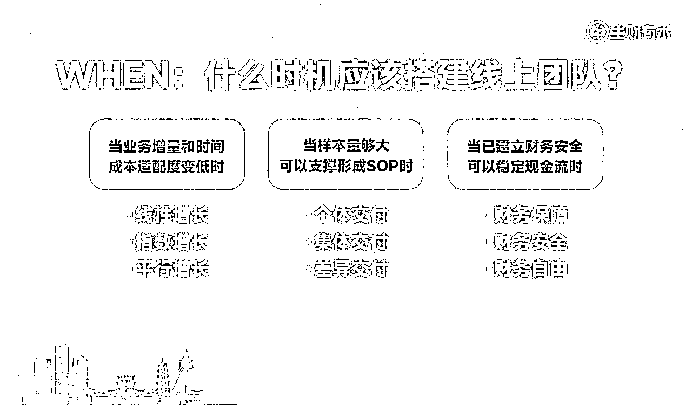

满足以下任一维度就可以启动。

### 1、业务增量与时间成本匹配度下降

原来交付10个客户时，时间成本线性上升。到临界点后，边际效益递减。

交付期集中在社群、标准课、训练营，需要人财物支撑。一个人的时间消耗变大，收益却波动，这就是建团队的信号。

比如项目A，每天投5小时，月入1-2万；投8小时，月入2-3万；再投到10-20小时，增长有限。这多出来的时间就是无效时间，应该交给团队。

当个人时间投入不再带来业务增量，这部分就该外包。

线性增长是投入一分多一分，指数增长是质量升级后利润跃升。等到单账号、单人精力的天花板出现，工作量重复消耗、收入不涨，就是该请1-2人帮你破局的时候。

### 2、样本量够大，能沉淀SOP

初期是“个体交付”，靠个人记忆、情感能量服务3-5人甚至10-20人。你能记住每个客户是谁。

客户增多后，必须建立SOP：听完课才能约电话，完成作业才能进入下一环节，设置问卷、关卡、福利游戏，让用户进入流程化、集体化交付。

靠团队完成这些重复动作，主理人精力才被释放。

SOP后的下一步是差异化交付。团队承接80%基础问题，你只处理20%核心矛盾，回到个体交付，但势能完全不同。

### 3、财务安全足以支撑现金流

参考《财务自由之路》的三个层级：财务保障、财务安全、财务自由。

财务保障：有6个月现金流可保命。

财务安全：月收入覆盖支出且有结余，不是持续消耗。

财务自由：被动收入大于日常消耗。

团队搭建最低门槛是财务安全。很多公司倒闭就是因为每月支出远大于利润。没有安全垫就不要扩张。

满足财务安全后，用团队完成业务闭环，你再带新团队做新事业。

## （三）WHERE：哪里招到有战斗力的线上员工？

### 1、团队搭建方式与渠道

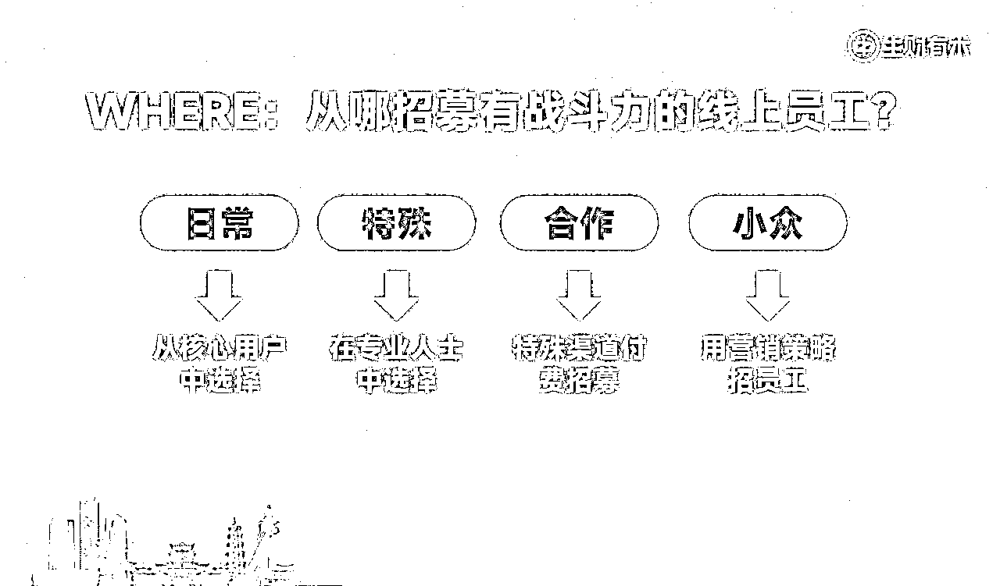

#### （1）核心用户

从核心用户里选助理，最快上手。

我的一号员工小宇宙老师，买过两个万元产品后持续深度连接；二号员工微微老师同理。现在他们已成为管理者，甚至比我更关键。

核心用户优势：熟悉价值观、上手快、粘性强、已学会方法论，可直接做运营、交付，成为你的“嘴替”。

#### （2）特殊渠道

日常运营招不到的专业事，需要外部人才：出书、剪辑、财务官、税务股权设计等。

能力型合伙人、流量型合伙人，也是此渠道。

龙哥哥说过：给得起配得上高薪，就能找到合适人。员工不踏实，大概率是钱给不够。

通过正式招聘从专业人群里选，是第二种方式。

#### （3）机构合作

买现成的人才。比如赚钱的助理助教培训体系，我直接买了一个内容编辑北川，现在公众号排版全由他负责。

也可以在优秀社群招人，比如赚钱志愿者培训体系里出来的志愿者，直接被我招进运营负责人。

自己员工需要技能升级，也可花钱请外部机构培训。

#### （4）营销策略

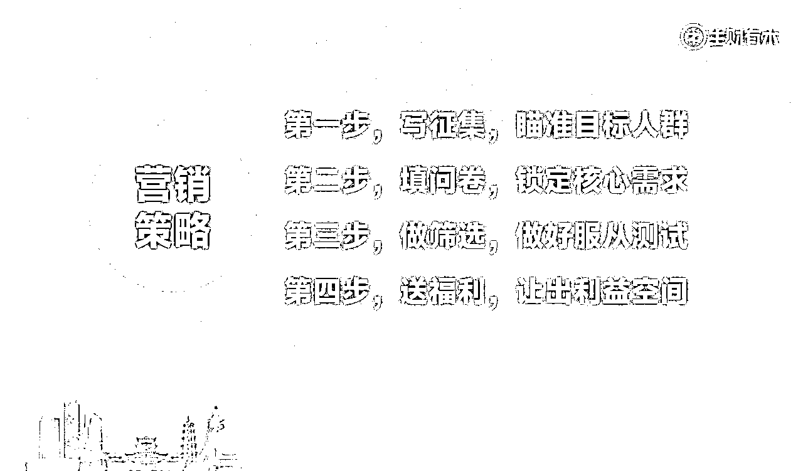

第四种是我原创的招人即营销。

我是IP营销顾问，所有动作都要有营销逻辑。招聘本身就能让市场认识你的业务。

案例：

##### 1）征集文案

比比老师做小红书培训，我们写了征集文案：团队需要员工交付C端和B端客户，工作包括业务调研、市场调研、爆款选题调研、数据分析、问卷收集等，公布薪资范围，开放报名。报名人数达100-200人。

##### 2）填问卷

很多人问我：怎么用最少的钱，组建一支能持续干活的线上兼职团队？今天我不讲虚的，直接把我压箱底的筛选方法、用人策略和激励机制拆给你看。

一、招人到底在招什么？先搞清楚这四个动作

第一步，先摸底。看这个人的日常开销和收入来源，基本就能算出该给他开多少薪水；再看他的年龄和家庭结构，就能判断他每天能挤出多少时间干活；最后还要测他的实际业务能力。这三关是一层套一层的，不是随便问问。

怎么测能力？比如我会让他根据一个选题，先找出市面上最火的四篇笔记；再让他判断这四个封面里，哪一个最有爆款相。这样的小考题我准备了很多，目的就是考察他最基础的业务敏感度。这个过程，我一边出题，一边通过年龄、月收入、期待薪资、家庭环境这些维度做背景调查，就像填一份问卷。

第三步是筛选。这里我做了很多小心思。比如我会直接问：如果必须是我们付费用户才能来做兼职，你愿意吗？有人干脆写“愿意”，有人写“不愿意”，还有人写了一大套理由，但核心就是不愿意。这其实是在探测你的服从边界——他到底能接受你到什么程度。

再比如问期待工资，会出现一个很有意思的现象：很多能力不行的人，开口要价高得离谱；反倒是一些能力强的人，说“我不在乎工资，只要能跟你学三个月就赚了”。每个人的小算盘都不一样。第一种人直接pass；第二种人可以帮你大忙，但你得做好他三五月后单飞的预期；第三种人比较务实，往往就成了你的长期员工。最后你招到的大概率是第三种。

哪几类兼职员工最稳？一类是大二、大三这个阶段的学生，毕业前两年基本不会跑。原因也简单：校园环境单纯，多一笔零花钱能显著改善生活，而且离毕业还早，不着急另谋出路。干得好甚至能直接转全职，要价也不离谱。另一类是孩子已经三岁以上的宝妈。这个节点很关键——孩子能上幼儿园了，白天时间基本可控，虽然晚上要陪睡、辅导，但白天空出来的时间足以承接大量运营工作。这类人一干可能干五年。还有一类非常少见但理想的全职太太。她家里不缺钱，但就是心中有团火，想找个有意义的事做。如果你的价值观能跟她同频，她甚至不在乎工资，只为完成自己那点追求。这种人可遇不可求。

最后一步，送福利。表面上我们在招聘，其实是营销。所有来应聘的人，先让他成为付费用户，这就是一层筛选。然后初试复试走完，哪怕没被录用，也送个小礼物或小课。那些标价799的核心课，给他半价权限，告诉他：学了这门课，以后更有机会加入我们。这样一来，他会觉得你不仅专业，还特别真诚。他自己做不出那些考题，就会想学、想提升，于是买了你的课，甚至买了私教。你既招到了两三个合适的长期员工，又成交了一群极度信任你的用户。整个过程没办一场公开课，他们却已经“验过货”了——因为一开始他们代入的是“交付方”的视角，等成了被成交方，自然心甘情愿掏钱。

二、不同招募方式的坑和甜

核心用户，知根知底，用着放心。但可能技能点需要你亲手培养，非常耗主理人时间。不过别急，你把第一个人教会后，让他去教别人，你就轻松了。我的做法就是设管理者，管理者替我去对接更多的人，这叫贴身培养。

专业人士，自带经验，能马上盘活业务，甚至比你更强。缺点就是贵，可能请不起，也可能留不住。

特殊渠道，比如外包中介，省事省力，说清需求就能匹配。缺点就是保密性差，对方可能同时给好几家打工，你的业务机密容易外泄。

营销策略，就是我上面那套招聘打法，好处是一举两得——既招到人，又赚到钱，还相当于做了一次发售。坏处是，你把人家教会了，人家干三五月可能就走了，忠诚度一般。所以这种策略适合团队工作流简单、上手快的场景。

三、合格的线上团队，到底长什么样？

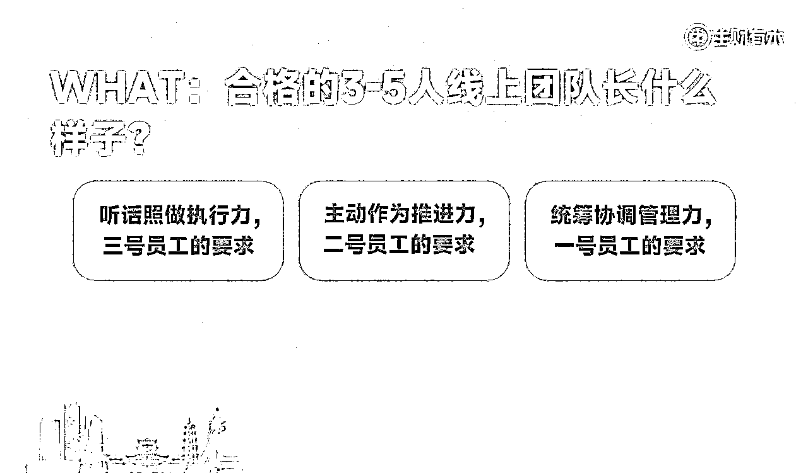

先看员工。我最看重三点：

第一，听话照做，执行力强。这是地基，甚至比后面两种能力还重要。愿意配合、忠诚度高，比什么都强。他可以不那么机灵，但动作一定要利索。

第二，主动作为，推进力强。这种员工会倒逼着你往前走。比如我团队里，每天都是不同的人催我干活，我反而是被推着走的那一个。

第三，统筹协调，管理力强。当我有三天交手机、联系不上的时候，得有一个人能帮我稳定大局，管好下面的人，这就是一号员工的角色。

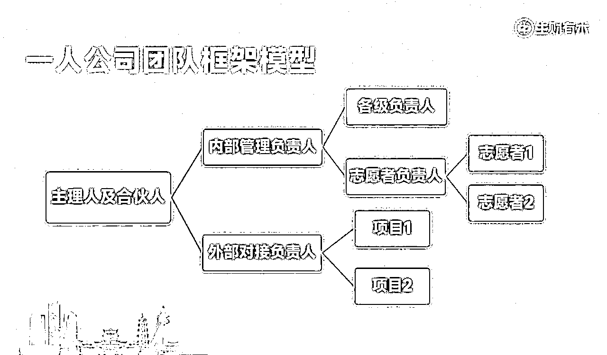

再看管理架构。最上面一定是主理人和合伙人，主理人负责所有事，合伙人辅助决策。往下再分内部管理和外部对接。

内部管理，就是按不同项目、业务线去分，比如内容组、流量组、运营组，还有专门的志愿者负责人。逻辑很简单：你一开始只需要一个贴身助理，活儿多了就给助理涨薪，再分出去，就得招第二个助理；等到第二个人也忙不过来了，又招第三个；当你发现自己要同时对接三个人很累时，就把第一个助理提成管理者，让他去对接另外两个。这就是层层递进的架构。

外部对接，适合短期的临时活。比如我要做一次操盘，就请专业的外包；要设计海报，就找设计师。但每次对接，我都会带上一个员工，让他跟着学。下次再用这个渠道，就不用我本人出面了，员工就能全权搞定。

四、从光杆司令到管理40人兼职团队，人力成本不到10万，我的秘密是什么？

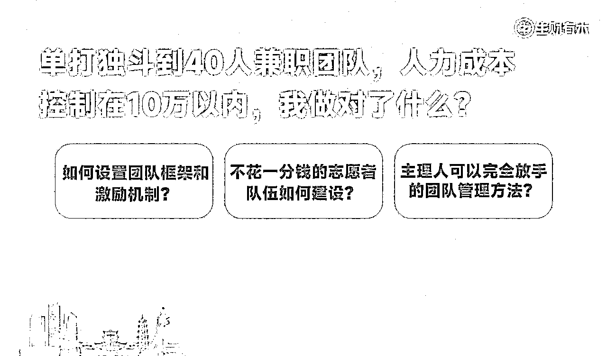

先说团队框架和激励机制。

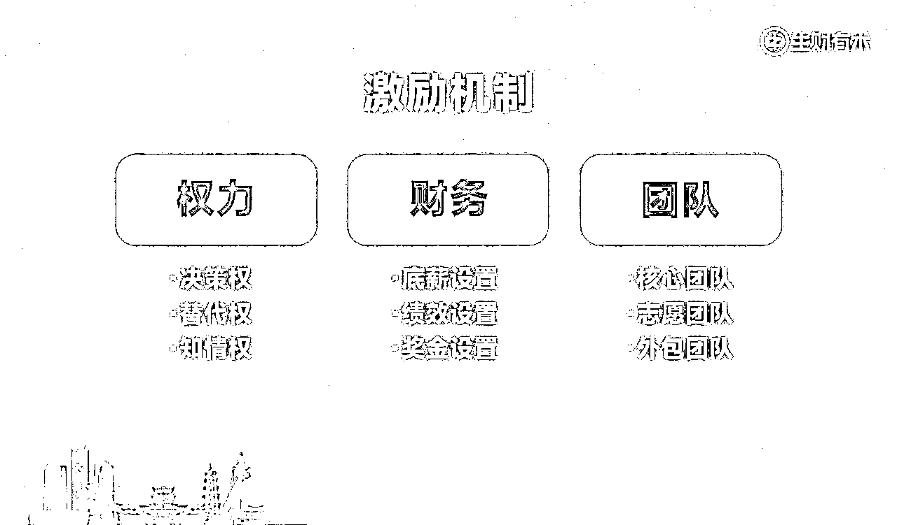

权力机制，我给员工三种权力。一是决策权。比如我从不亲自盯剪辑，让负责人自己判断内容是否符合我的标准。数据不会骗人，跑得不好就把数据截图给她，让她自己调整。久而久之，她决策多了，自然会为结果负责。不要替员工做决策，老板别太完美主义。二是替代权。就是要让每个人清楚：某个板块谁负责，谁不在时由谁顶上。比如我出差十天，所有决策由谁拍板，什么事必须汇报，什么事不用汇报，都要白纸黑字写清楚。三是知情权。对不同级别的人开放不同信息。志愿者只需要执行，管理者要知道怎么激励，核心成员则要理解我的底层逻辑。只有当员工知道你为什么要做这件事，他们推进起来才更有底气，也知道哪些话能说、哪些话不能说。

薪酬机制，我坚持“底薪+绩效+奖金”三块。底薪是保障，无论全职还是兼职，正式员工都要有，试用期可以给60%。只要没闯大祸，底薪雷打不动。绩效是跟具体指标挂钩的，比如每天在社群里提醒用户、每两周提交一份选题报告，达标了就拿钱，绩效可以设为底薪的一半或三分之一。奖金则是针对增量或单一项目设置的。比如某次项目多赚了50万，拿出几万分给大家；或者用户升级了高价产品，负责跟单的助教也有分成。这样既能激励他们认真服务，又能培养销转能力。底薪保底，绩效保证80分，奖金冲100分，这才是良性团队。

最后还要注意两点：定期按表现涨薪，以及，千万别舍不得开人。我去年就吃过亏，觉得跟某个人有感情，不好意思开口，结果工资照发，活却越干越差，其他团队成员还得帮着收拾烂摊子。后来我果断调整，把不合适的人请走，关系反而还很好。记住，别让感情凌驾于管理逻辑之上。

五、不花一分钱的志愿者队伍，怎么建？

我强烈建议大家一定要建志愿者队伍，我们团队有40多个志愿者。志愿者不用发工资，给些课程就行。但志愿者也是层层筛选的，先填问卷，让真正愿意付出的人留下来。至于具体要做什么？可以根据业务需要灵活分配，核心是让志愿者成为团队的外围支撑。用最少的成本，撬动最大的执行力，这才是线上团队管理的高境界。

有时候真正能跑起来的，并不是多高深的活儿，而是一些看似基础却持续性的打理——比如社群里的日常运营、简单维护、在线答疑、以及把零散文字梳理归档。这类事情门槛不高，但一旦累计到一定的体量，就能自然解锁我这边体系化的课程、交付或服务权益。做的越多、越深入的人，甚至会成长为最核心的长期用户。

### 3、志愿者的招募和培训流程

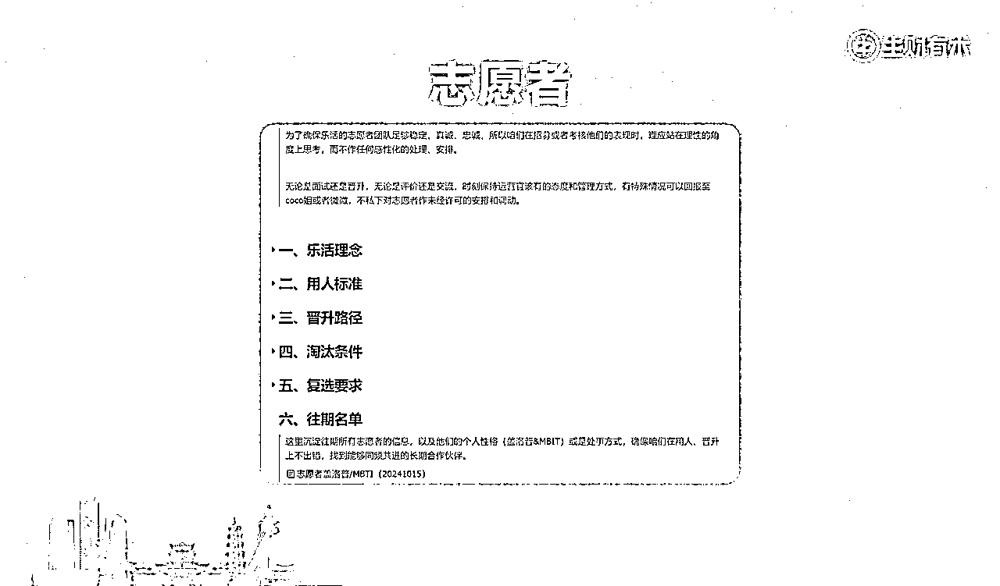

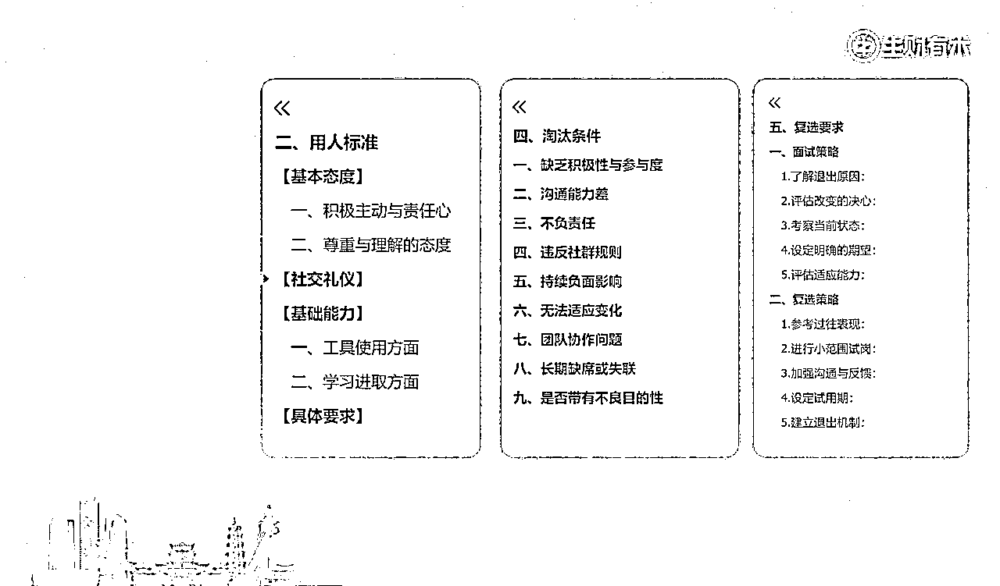

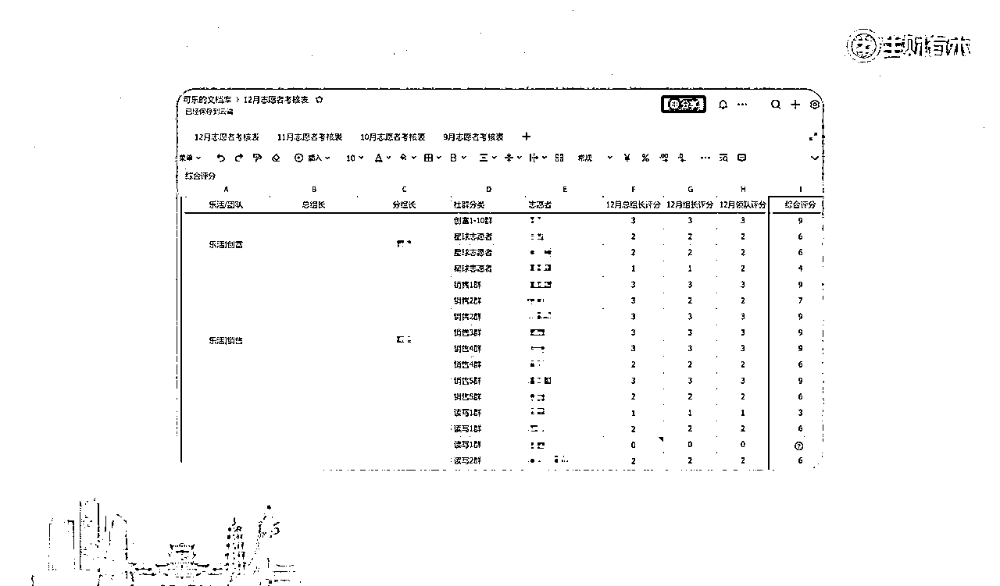

## （三）主理人可以完全放手的团队管理方法

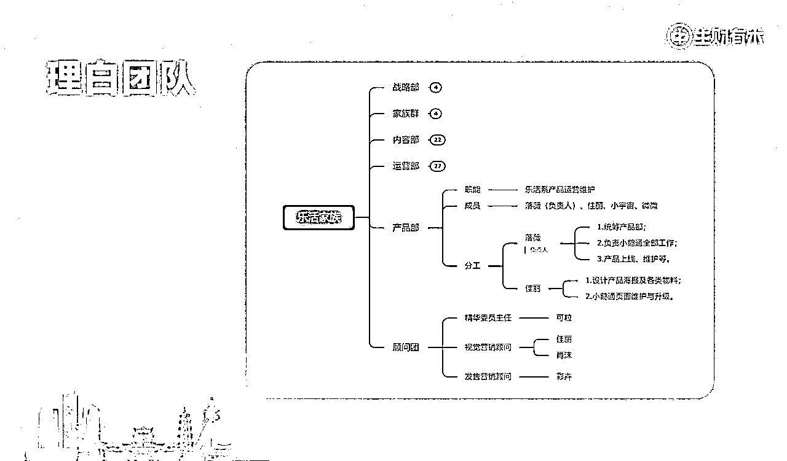

### 1）战略团队

战略层基本就是我最久的核心几位伙伴，加上几个我完全信得过的骨干，比如比比，我们就坐下来聊真正影响方向的决策。这套打法哪怕年收入做到一两千万的自由职业者也一样需要。不是我一个人拍脑袋就定，而是需要一个专门的议事圈来推演和校准要往哪走。

### 2）内容团队

接下来是内容部、运营部、产品部，外加外脑团和顾问团。内容部的职责是把我的公众号、视频号、朋友圈、社群的各种素材全部沉淀下来，并把我在群里的即时表达整理成可用资产。

举个例子，内容部里有专人管朋友圈，有专人管视频号剪辑的统筹。视频号那边我常年养着十几位剪辑手，由一个人统一调度。我直播结束后，这十几个人会同步开剪，我只需要按时发布。内容看起来很多，但本质是“一鱼多吃”，正是因为不同小组在帮我做拆解、重组和再生产，这就是内容团队的价值。

### 3）产品团队

产品团队负责的是对外呈现的执行面：海报设计、课程发售的操盘、上架链接，以及根据学员条件匹配赠课权益。还有志愿者达到标准后免费学习某些课程的开权限工作，也都归产品部管。

### 4）运营团队

运营部主要负责我每月两次的实战营落地。同时涵盖所有员工与新志愿者的培训体系。志愿者守则、员工培训守则、晋升作业、虚拟货币发放规则、解锁课程的门槛，全部是清晰的SOP和路线图。这些文件都是团队直接撰写并迭代形成的，我几乎没有插手过。

表面看像是单打独斗，实际背后有几十个人在协同运转。而这几十个人并不直接向我汇报，而是由各自的核心员工分层管理。

这就是我对团队的分工思路、标准和结构的一个简化版模型。也是一个相对可复制的小团队管理范式。

在这样的架构里，每个人往往身兼二到三个角色。比如某人在内容部是负责人，在产品部就可能是配合者。部门之间天然互通。比如我要出书，运营部会派人去搜集资料，内容部负责把过往讲稿整理出来，剪辑手把素材剪成段落，再交给外部顾问团来搭框架。每一个具体业务都是多手协作的成果。

把每个人的职责写到足够细，执行就不会乱。虽然比不上大公司的流程复杂度，但这个小团队五脏俱全，交叉产生的可能性非常多。

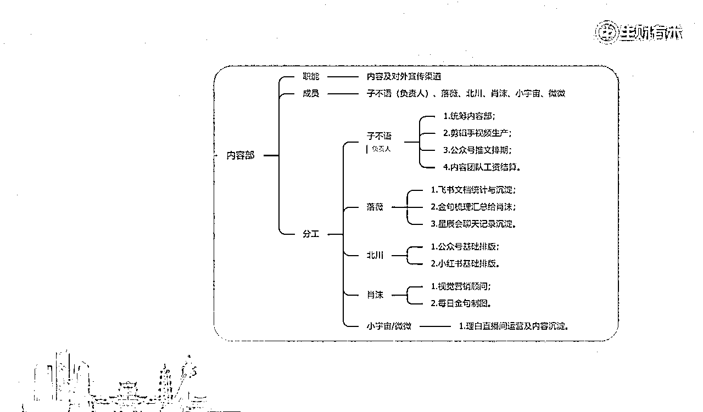

后面只要把团队带稳，把个人持续成长，薪资和激励保障到位，就基本不会出大问题。

最后我还是那句话，所有变现的困难，本质都是效率的困难。学会用杠杆放大效率，用制度沉淀利润，就能大幅降低主理人的人力损耗，让团队更快更好运转。