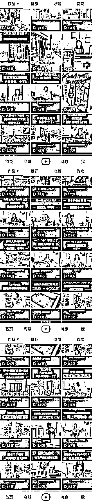
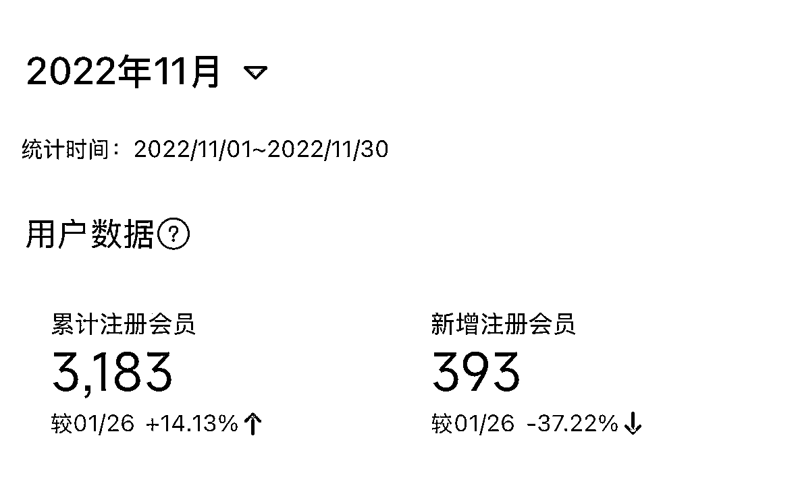
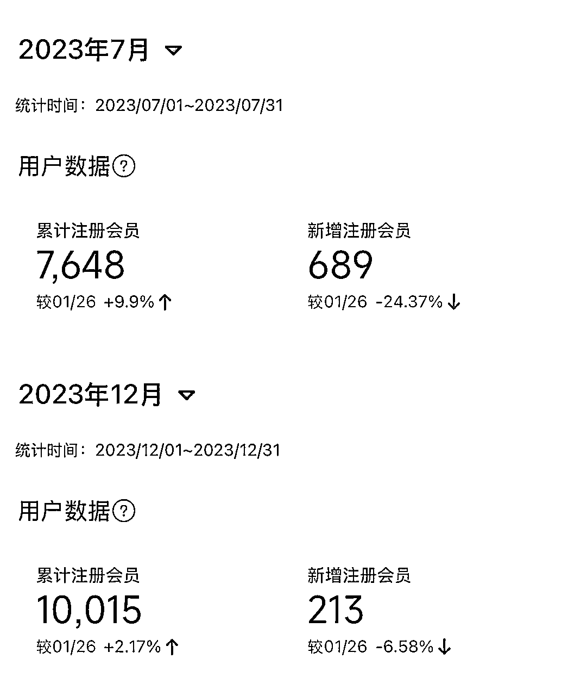

# 复盘笔记：我们如何用同城流量把一家社区咖啡店做成了10倍增长

做实体，绕不开一个现实：每一个公域平台从起势到衰竭，节奏都差不多。作为门店经营者，关键就在于读清平台走到哪一步，然后用对方法、踩准时机。红利来时要快，红利退时要收。

先把结论摊开说：

1. 公域平台的生命周期大致符合“时光机规律”——先是平台方和商家双赢，再是平台赚钱商家亏钱，最后双方都赚不到钱。看清自己在哪个节点，才能做对选择。
2. 实体生意，产品、服务、环境都只是手段，本质上是经营你和每个用户之间那种若即若离的弱关系。
3. 建立在🛰️生态上的私域经营，是穿越流量波动的核心能力。交易发生前的最后一公里，必须牢牢握在自己手里。

下面用我从2022年起盘的一个社区咖啡连锁案例，讲清楚不同流量池如何影响线下生意，以及商家该怎么驾驭流量，在正确的时间做正确的事。

2022年3月，第一家店开业。前后筹备了四个月，定位非常清晰：服务本地的下沉社区用户，主打便捷自取和配送，精品咖啡定价在10-15元区间，类似下沉市场的Manner。

商业模式的核心诉求只有一条：高复购。整个体系的设计都是围着复购转。没有能力像瑞幸那样做全覆盖，我们就做聚焦：深耕对精品咖啡有稳定需求的人群，用连锁的点位密度强化便利，形成差异化。支撑复购的关键要素我们也找准了：价格要亲民、自取要方便、配送要快、品质要稳定。

## 第一波冷启动：朋友圈+线下种草

模式验证从第一家店开始。首批获客我们没玩花活，就用本地熟人朋友圈口碑+社区地推+电梯广告，给服务半径画了一个清晰的物理边界。

4月首月，小程序就新增了687个注册会员，其中304人直接买了月卡。也就是说，除了堂食外卖，当月我们就收到了近1万元的会员预存，以及300多位高频核心用户。盈利模型初步跑通。随后三个月里，又连续开了另外3家店。

## 第二波爆发：抖音同城红利

门店在扩，触达需求在变大。2022年6月，我们正式启动抖音账号。后来才知道，抖音在2022年3月刚开启同城流量扶持，我们恰好踩中了窗口期。

那段窗口期非常友好。内容不用精雕细琢，最朴实直白的门店日常就能获得大量同城曝光。几乎每条视频平均播放都稳定在2万以上，我们保持每天2更的节奏。不到4个月，注册会员总数翻了5倍，逼近3200人，累计付费会员超过1500人，其中持续续费的超过1100人，会员费的月收入稳定在3万元以上。

那段时间我们的共识是：好产品搭配好模式，本身就是最好的传播。抱着这份认知，我们一路冲到2023年7月。

随后会员数再次实现翻倍，并在同年12月突破1万大关。

## 第三阶段：红利退潮，博弈加剧

数字还在往上走，但增速已经明显掉速。原因很现实：

1. 可服务区域的常住人口约10万，6家店已触达1万人，渗透率接近10%，天花板在逼近。
2. 2023年餐饮加盟爆发，库迪、T97等品牌大规模招商，吸走了大量广告预算，加速了抖音商业化。
3. 靠单一公域渠道的风险暴露出来。

2023年，服务商纷纷劝商户做低价团购、做本地直播。参与其中时我很困惑：用低价引来的人，真的会成为精准复购用户吗？薅完福利还会回来原价消费吗？我们已经有上万付费会员了，到底缺的是流量，还是别的什么？

反复权衡后我明白了：我们不缺新流量，缺的是与用户之间的关系。社群里每天只是机械地发产品、发福利，员工几乎不说一句像人一样的话。认识许久的“朋友”，每天只给你看一张冷脸，沉默和流失自然就发生了。

回头看2023年，我们把重心都放在了开店和抖音内容上，私域却没有成体系的打法。进到🛰️的会员，只有朋友圈的例行更新和生硬的群福利，社交感几乎为零。与此同时，公域的极速商业化让服务商和商家一起掉进低价内卷、短期引流、价值感稀薄的陷阱里。

对于像我们这样依赖高复购的模型，私域的持续运营能力才是命脉。几千上万用户如果能在私域里被精细运营，就能持续创造价值，也能为整个连锁体系提供抗周期能力，在流量波动时仍然稳住基本盘。可惜的是，这个认知来得有点晚。