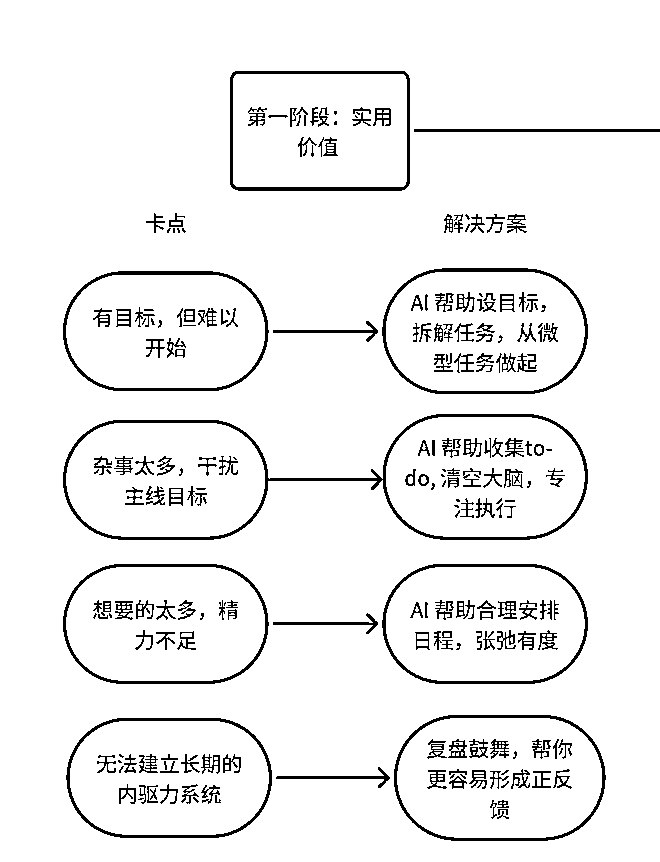

# 一个月做出AI目标教练：从想法到MVP的实战复盘

我们团队原本就带着个人成长的内容基因出发，我和PuleiPai各在小红书运营着一个万粉账号。基于这份积累，我们把第一站瞄准了 Productivity 赛道。

思路很直接：找市场已经验证过的付费需求，用 AI 重新做一遍，把体验做到更好。为了摸清变现空间，我们先去 paywallscreen.com 上扒了海外 App Store 的付费墙数据。

生产力工具大致分两派。

第一派是纯提效型：Todoist、习惯追踪、每日规划、专注锁屏这类。功能直白，使用门槛低，受众广，但天花板也明显。Todoist 月流水约 30 万美金，Habit Tracker、Structured 这类规划类 App 月流水在 20 万美金左右，Forest 这类专注工具也同属此列。

第二派是带成长属性的：像 Summit 这类主打陪伴、打卡、情绪价值的产品。它们更注重整体感和沉浸式体验，做起来难度更高，但收入上限也明显更高，是效率工具的 2 到 3 倍。

我们最终押注第二派。理由有三：我们更喜欢这个方向；非标品竞争没那么卷，不像传统效率工具大同小异；用户付费意愿更强。

## 定位：用行为科学做一个 AI 目标教练

在个人成长这个大类里，我们进一步拆解了现有 App 和训练营的打法，最后锁定了一个更具体的切口：AI 目标教练。

我们想做的，是把《福格行为模型》《原子习惯》等行为科学理论，翻译成可运行的代码逻辑，再结合大模型的能力，为正在为重要目标奋斗的人提供陪伴。PuleiPai 之前做过人工督导的目标训练营，反响不错，这条路对我们来说是水到渠成。

用户在追目标时遇到的“小怪兽”其实很典型：

*   想做的事一堆，却找不到起点；
*   琐事不断，主线目标被稀释；
*   计划做了一半就放弃，然后自我攻击；
*   缺乏一套能长期运转的内驱机制。

我们的答案是：把脑科学放进产品里，造一个 24 小时在线的成长伙伴。用 AI 的方式替代昂贵的人工教练，让更多人能轻松把目标落地。

## 怎么引流

我们用 ChatGPT 和 Deepseek 的搜索能力，叠加公开网站的数据，总结了这类个人成长 App 的获客套路：

*   ASO 优化：关键词、文案、视觉素材全方位打磨，提升商店曝光；
*   内容种草：持续输出自我成长、情绪关怀类的干货内容；
*   社交媒体运营：用励志内容在社媒互动，建立信任；
*   KOL 合作：找健康与成长领域的创作者扩圈；
*   社区感营造：App 内支持好友连接，形成共同进步氛围；
*   Freemium 设计：先给免费版降低门槛，再用高级功能转化付费。

## MVP 开发：先解决四个最痛的卡点

方向确定后，我们没有贪多。MVP 只聚焦在实现目标过程中最常见的四类阻滞：

1.  有目标却起步难
2.  琐事太多干扰主线
3.  贪多求全导致精力耗尽
4.  缺乏长期的正向反馈闭环

对应出来四个核心功能：

1.  AI 协助立目标、拆任务，从可执行的微任务开始启动；
2.  AI 帮用户收纳待办，大脑只负责思考和执行，不负责记忆；
3.  根据主线目标和碎片事务，AI 每天排程，保证主线不被挤掉；
4.  基于进度做复盘和鼓励，帮用户建立正反馈回路。

工具栈很简单：Cursor 负责搭骨架写基础代码，卡住的地方直接上 Claude 细抠。有趣的是，即使 Cursor 也在调用 Claude Sonnet，实际编程质量还是直接用 Claude 更高。几周的迭代后，MVP 基本成型。应用介绍视频：https://www.bilibili.com/video/BV11MNbeZEAb/?vd_source=c8a00d44633cbe4ad221262a311d31b7

## 下一步路标

*   把 MVP 打磨到可上线版本，并重构后端；
*   上线用户登录、AI 教练选择与个性化设置；
*   设计好 Onboarding 流程，同时在社媒开始预热，首批招募 50 人内测；
*   收集首批反馈后迭代 V2，扩展 AI 教练能力并开启付费。

一个月从 0 到 1，验证的不是技术，而是我们是否能用 AI 把行为科学变成一个真正陪伴人的产品。