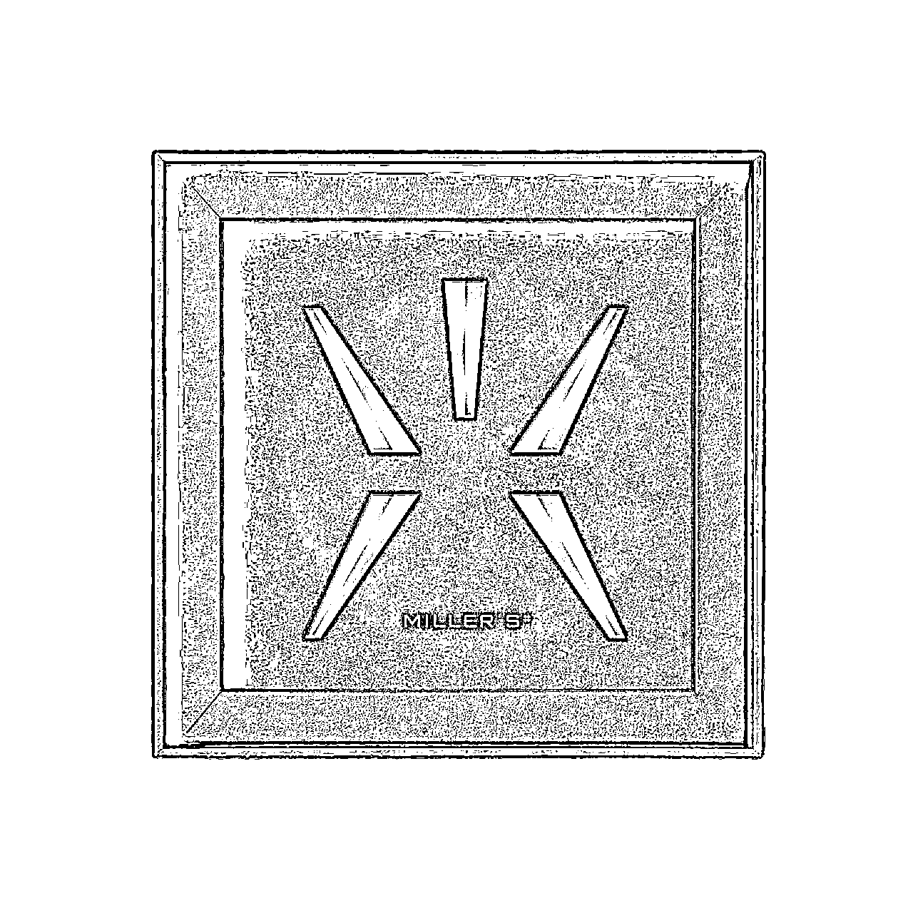
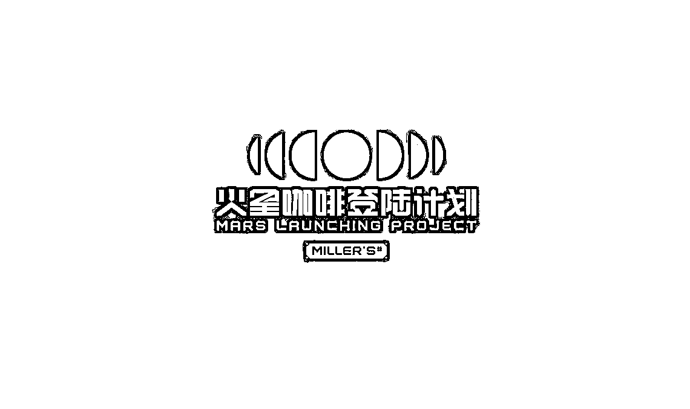
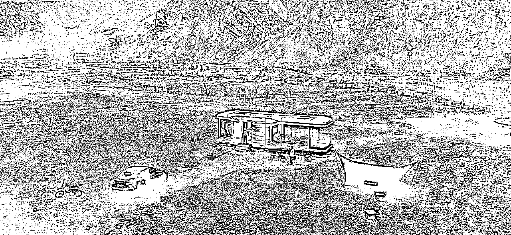
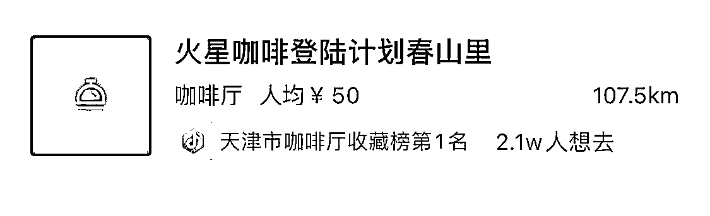
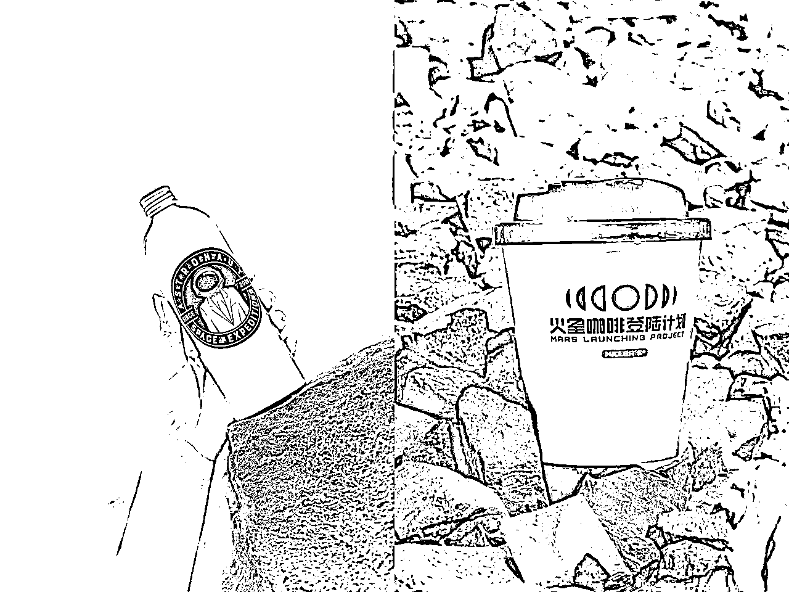

# 一个自然流破亿的文旅咖啡案例，拆解它的流量、品牌与变现逻辑

关于流量，我过去很长一段时间里带着一种惯性判断：项目本身过硬，流量自然会来。2022年之前我几乎没系统研究过互联网玩法，抖音、快手、小红书的第一波红利，基本就是在信息差里错过了。回头看，那段时间手上的项目靠自然UGC就能平稳运转，养成了「把产品做好就不缺客流」的思维。这种想法没错，但不够完整。

直到“火星咖啡登陆计划”这个项目出现，我才真正看到线下实体项目流量可以怎么爆发、怎么穿透圈层、怎么持续破圈。

这个项目走到了三个关键节点：

1、开业第3天，抖音POI播放就冲破500万，累计一年全网自然曝光超过1亿次；
2、上线半年内，小红书自然笔记量过万；
3、项目净利润率做到85%以上，整体利润回报超过10倍。

从策划到落地，我们集中做了四件事：

1、给项目定名并打造高辨识度VI，这后来成了传播的核心抓手；
2、和场地合作方谈到极致条件，零成本压力，经营上完全自由；
3、搭建一套从引流到升单的产品结构，客单价从30元起步，能拉升到500元，打开收入上限；
4、主动做内容、制造事件，对具备传播价值的客户需求优先满足并放大。

做完这轮复盘，留下四条感悟：

1、好内容永远是最高效的营销；
2、项目的精神内核与外在呈现必须统一，这就是传播的锚点；
3、清晰的商业变现体系是好项目的生命线；
3、保持谦卑，别自嗨。

2022年6月，我在考察时偶然撞见一片废弃采石场，后面是一道被开掘的断层山，几乎无人涉足，第一眼就被冲击到。联想到之前接触的太空舱形态，我开始构思把这里变成一个可以打卡的咖啡场域。当时正处于项目高频开发期，判断力还在线。

场地属于本地一家地产公司的矿山修复区，平常封闭管理。我们提出方案后，对方看到了为地产项目带来话题、曝光和到访量的价值，所以全程大力支持，不收任何费用也不分利益，拿掉了所有隐形枷锁。于是就快速推进落地。

一、流量飞轮是怎么转起来的

凭借多年文旅咖啡的经验，我预判如果市场买账，流量会形成自我循环。

项目风格极度独特且小众，很贴合小红书气质。开业前先邀请了几位熟识的小红书小体量博主来体验。飞轮的起点就是其中一篇内容的爆发。极具辨识度的视觉、高辨识度的小众感、苍茫又像外太空的拍照质感，迅速引发扩散。

真正把量级推高的，是三次破圈：

1、地域破圈：覆盖不止京津冀，最远的客人从河南自驾而来；
2、人群破圈：从普通大众一路破到大V和明星，进而带动粉丝跟进；
3、场景破圈：因场地独特性，被大量车企活动青睐，尤其是越野、新能源科技类主题。

买点非常清晰：能拍出差异化大片，赢在朋友圈。传播先从小红书起势，这个群体对流量最敏感、反应最快、内容质量也高。低粉爆文比例很高。开业两周内，来的人基本都是小红书博主。

抖音几乎同步引爆，3天POI总播放破500万，大众点评多项榜单登顶，直接撬动数万人想来看。

二、品牌塑造的思路

我一直认为，一个合格的文旅项目是「视觉面」「产品逻辑」「现场体验」三者合一。三个维度是否平衡，直接决定项目高度。

我的打法总结为五步：

1、根据场地气质，起一个有画面感、差异化、好记的名字；
2、找靠谱的设计团队做一套调性一致的VI，logo、核心元素、杯具和包装就够；
3、在场域里锁定1-2个最能代表调性的视觉锚点，让到店的人主动传播，并不断打磨锐度；
4、根据各平台用户传播反馈，持续优化消费者关注的传播点；
5、保持产品设定的统一性。咖啡是最契合年轻场景的低阻力入口，场景需要咖啡业态，咖啡也需要场景。

我们还坚持一个原则：提供恰到好处的体验。

我们清楚，坐感、温度、可达性、品类选择这些维度不可能十全十美。但在「震撼场景」「硬核视觉」「值得拍的元素」这三件事上，我们必须给满分。

“用户知道自己为啥来，我们也清楚自己卖的是什么。”

三、产品设定的方法

目标综合利润率要过85%，于是我们搭建了30元到500元的立体产品结构。咖啡作为引流品，几乎所有到店客人都会自愿购买，相当于隐形门票。二消环节围绕「拍出酷照」这个核心需求来设计。

这个结构可复制：现制饮品+零售商品+高附加值服务，三层叠加，才能同时突破营收、利润和人效的天花板。

项目成不成功，终究是天时地利人和加飞轮、品牌、产品三者咬合的结果。好项目的初始条件很难复制，但方法论和思维是可以借鉴的。

从我操盘经验里看，后期出问题的项目大多是背离了初心：比如把自愿消费改成强制消费才能进场、随意涨价或降质、售卖与调性冲突的产品。这些本质都是对消费者失去了敬畏。

流量是消费者一次次推动的正循环，场景本身不会自己产生流量。口碑一旦悄无声息滑向负面，就是项目走到终点的前兆。