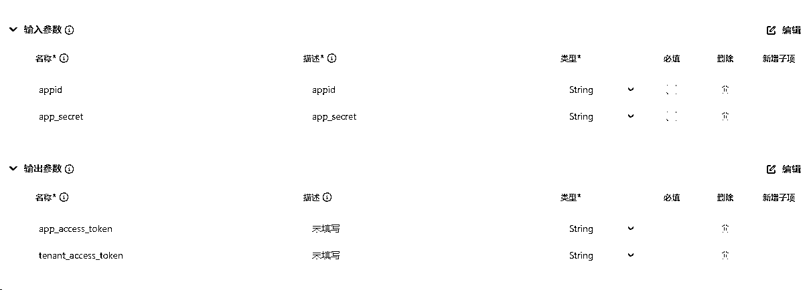
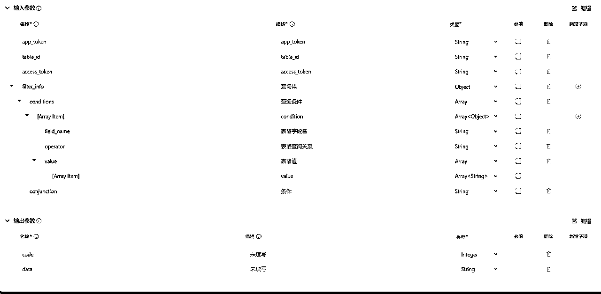
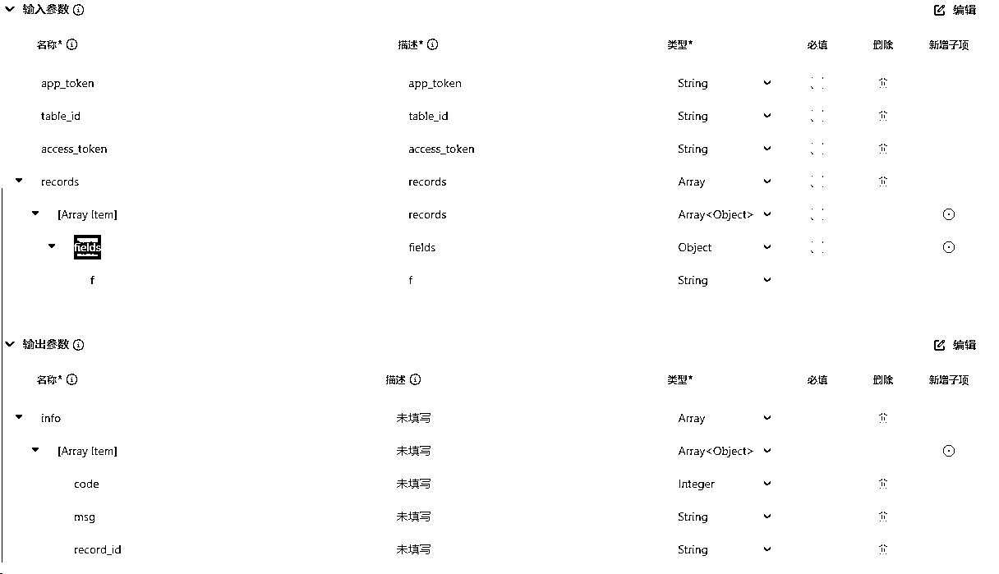
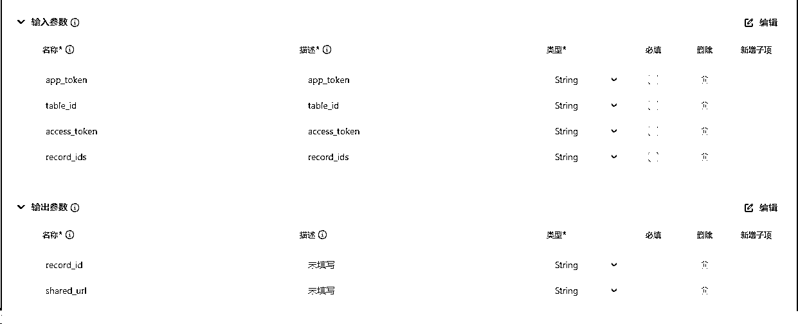
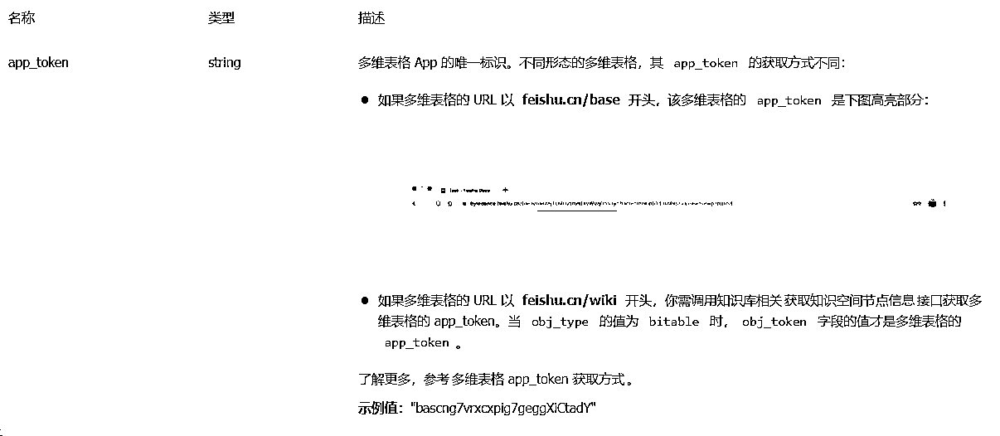
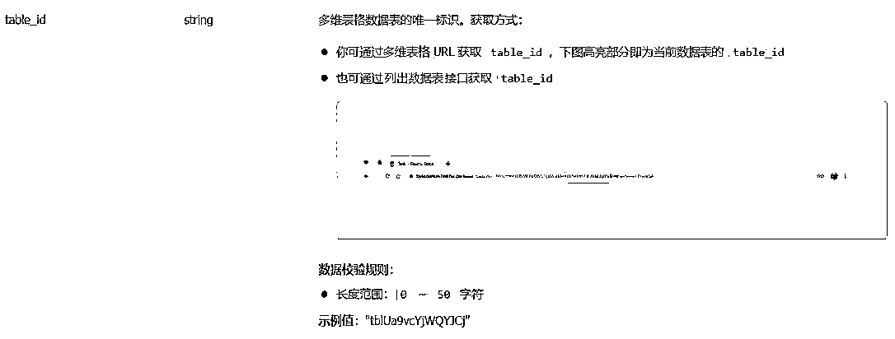
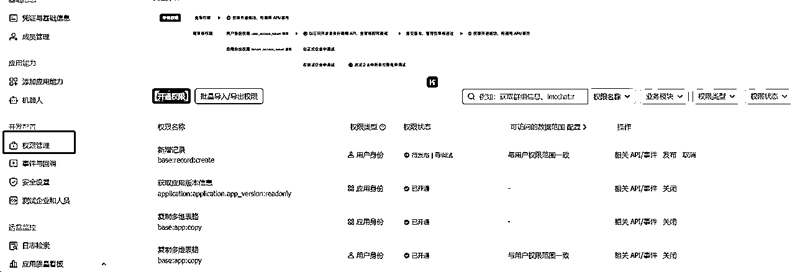
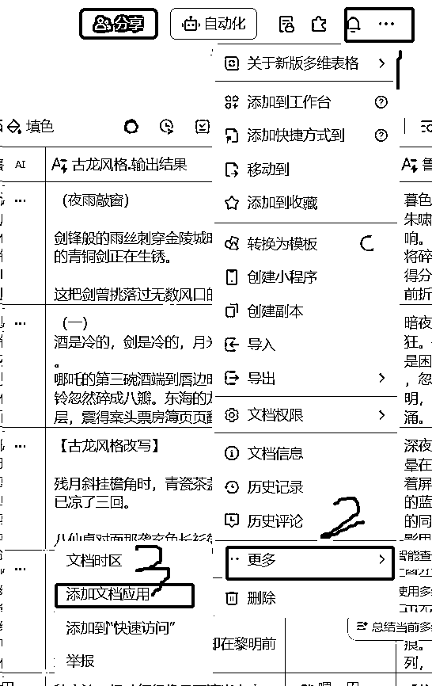

# 如何用AI工具撬动2000+智能体订单

从200块到2000+：一个产品经理靠智能体接单的“咸鱼”翻身记

2024年下半年，航海计划里新增了“扣子智能体”这个方向，我当时手头事比较多，错过了报名。私底下自己瞎鼓捣过一阵，确实觉得效率能提上来不少，但始终没想明白怎么靠它赚钱。直到有天刷风向标，看到圈友分享的coze变现案例，才一拍大腿：原来闲鱼上真的是“万物皆可卖”。

我是产品经理出身，写代码基本算是门外汉，但搞逻辑、搭架构算是我的强项；再加上大模型能帮忙写代码，我毅然决然踏上了智能体接单这条路。

刚起步那会儿，一点经验都没有，只敢接那种特别小、特别简单的需求，稍微复杂一点就心里发怵。报价更是低到尘埃里，妥妥的“互联网牛马”。当时想法很简单：边做边学，就当积累经验。

不少单子其实是其他AI公司外包出来的。有趣的是，只要第一个小需求做完了，客户常常会追着要求做2.0、3.0，这时候报价自然水涨船高。

那个传说中的2000+订单，最初也不过是一单200元的活儿。客户要做的是一个财务贴现报价智能体，刚听需求真觉得挺简单。结果呢？需求来来回回改了将近一个月，流程也被折腾了无数遍，我一度想直接撂挑子。可想想已经收了100定金，还有100尾款没拿，实在不甘心，只好硬着头皮继续磨。

当时的实现思路大概是：
- 文字消息，交给大模型直接抽取关键信息；
- 图片消息，先走一遍OCR，再把识别出的文字喂给大模型做总结（当时还没有现成的视觉模型）；
- 实时知识库用飞书来做，因为客户要随时调整利率，报价必须同步抓到最新数据；
- 结果计算，全靠代码完成；
- 最终记录，也一并落到飞书。

差不多撑了一个月，客户那边终于不再频繁提需求了。我也清楚，正常单子根本不会拖这么久，于是赶紧找AI公司把账结了，心里想：总算完了，后面有问题找外包公司去吧。

没想到，三天后客户又顺着项目群找了过来，表示想继续推进2.0、3.0。认真聊完新需求后，我报了个1500的价格——多少带点弥补1.0报价太低的意味。结果客户居然连犹豫都没犹豫，直接打款。那一刻我是真有点感动。趁着周末，我一路冲刺把大框架搭好，后面就是修修补补的收尾工作了。

coze这边，练了一个月已经很熟，很快就搞定了。真正难住我的是对接🛰️：一开始用的COW，但这玩意儿默认只支持文字，不支持图片消息，需要二次开发插件。我又花了好长时间找个人🛰️机器人项目，最后选定了wechatferry。

部署的时候又踩了个坑：工作流里的飞书官方插件反复提示授权问题。咨询了coze工程师，思路是必须自己创建应用，通过应用去调飞书多维表格的查询和写入。可coze插件商店里根本没有现成插件，我只好自己啃文档，自建了一个飞书插件。当时也去闲鱼问过价，单纯开发一个飞书插件，最贵居然要600，最便宜也要100，囊中羞涩的我只能自己上。好在最后成功上线了。

后来，客户陆续增加了“返回飞书记录查看链接”“多金融机构报价”等需求，熟悉之后，基本都是顺手的事。今年，客户又在2.0基础上提出了3.0需求：
1、收集员工在同行群里看到的报价信息和相关语料；
2、……；
3、……

下面把工作流和自建飞书插件分享给大家：


整个工作流和上方画布的流程图保持一致，代码部分涉及公司业务，就不展开细说了。

飞书多维表格相关的插件主要包含这几个：

1、获取飞书应用access_token

```
def handler(args: Args[Input])->Output:

    def get_app_access_token(app_id, app_secret):
        """
        通过给定的应用ID和应用密钥获取app_access_token以及tenant_access_token

        参数:
        app_id (str): 应用唯一标识，创建应用后获得
        app_secret (str): 应用秘钥，创建应用后获得

        返回:
        dict: 返回包含 'app_access_token' 和 'tenant_access_token' 键值对的字典，如果请求失败，字典中的 'msg' 键对应错误描述信息
        """
        url = "https://open.feishu.cn/open-apis/auth/v3/app_access_token/internal"
        headers = {
            "Content-Type": "application/json; charset=utf-8"
        }
        data = {
            "app_id": app_id,
            "app_secret": app_secret
        }
        try:
            response = requests.post(url, headers=headers, json=data)
            response.raise_for_status()
            result_json = response.json()
            return {
                "app_access_token": result_json.get("app_access_token"),
                "tenant_access_token": result_json.get("tenant_access_token")
            }
        except requests.RequestException as e:
            return {"msg": str(e)}

    result_token = get_app_access_token(args.input.appid,args.input.app_secret)
    app_access_token = result_token.get("app_access_token")
    tenant_access_token = result_token.get("tenant_access_token")

    return {"app_access_token": app_access_token,
            "tenant_access_token":tenant_access_token
    }
```



应用的appid和appsecret，在飞书应用后台就能查到。


2、查询飞书多维表格记录

```
def to_serializable(data):
    if isinstance(data, dict):
        return {k: to_serializable(v) for k, v in data.items()}
    elif isinstance(data, list):
        return [to_serializable(item) for item in data]
    elif hasattr(data, '__dict__'):
        return to_serializable(data.__dict__)
    else:
        return data

def handler(args: Args[Input]) -> Output:
    def query_feishu_bitable_records(app_token, table_id, access_token, user_id_type="open_id", page_token=None,
                                     page_size=20, view_id=None, field_names=None, sort=None, filter_info=None,
                                     automatic_fields=False):
        url = f"https://open.feishu.cn/open-apis/bitable/v1/apps/{app_token}/tables/{table_id}/records/search"
        headers = {
            "Authorization": f"Bearer {access_token}",
            "Content-Type": "application/json; charset=utf-8"
        }

        # 构建请求数据
        data = {
            "user_id_type": user_id_type,
            "page_token": page_token,
            "page_size": page_size,
            "view_id": view_id,
            "field_names": field_names,
            "sort": sort,
            "filter": filter_info,
            "automatic_fields": automatic_fields
        }

        data = {k: v for k, v in data.items() if v is not None}

        try:
            serializable_data = to_serializable(data)
            response = requests.post(url, headers=headers, json=serializable_data)
            response.raise_for_status()
            return response.json()
        except requests.RequestException as e:
            return {"code": -1, "data": str(e)}

    result = query_feishu_bitable_records(
        app_token=args.input.app_token,
        table_id=args.input.table_id,
        access_token=args.input.access_token,
        filter_info=args.input.filter_info
    )

    code = result['code']
    data = str(result['data'])

    return {"code": code,
            "data": data}

```



3、批量新增多维表格记录

```
def handler(args: Args[Input]) -> Output:
    def add_feishu_bitable_record_batch(app_token, table_id, access_token, records=None):
        url = f"https://open.feishu.cn/open-apis/bitable/v1/apps/{app_token}/tables/{table_id}/records/batch_create"
        headers = {
            "Authorization": f"Bearer {access_token}",
            "Content-Type": "application/json; charset=utf-8"
        }
        data = {
            "user_id_type": "open_id",
            "client_token": None,
            "ignore_consistency_check": False,
            "records": records
        }

        try:
            response = requests.post(url, headers=headers, json=data)
            response.raise_for_status()
            return response.json()
        except requests.RequestException as e:
            return {"code": -1, "msg": str(e)}

    # 定义一个函数用于将 CustomNamespace 对象转换为字典
    def namespace_to_dict(obj):
        if hasattr(obj, '__dict__'):
            result = {}
            for key, value in obj.__dict__.items():
                if hasattr(value, '__dict__'):
                    result[key] = namespace_to_dict(value)
                else:
                    result[key] = value
            return result
        return obj

    # 将 args.input 中的对象转换为可序列化的字典
    app_token = namespace_to_dict(args.input.app_token)
    table_id = namespace_to_dict(args.input.table_id)
    access_token = namespace_to_dict(args.input.access_token)
    records = [namespace_to_dict(record) for record in args.input.records]

    result = add_feishu_bitable_record_batch(
        app_token=app_token,
        table_id=table_id,
        access_token=access_token,
        records=records
    )

    info = []
    if "data" in result and "records" in result["data"]:
        for item in result["data"]["records"]:
            code = result.get("code", -1)
            msg = result.get("msg", "")
            record_id = item.get("record_id", "")
            info.append({
                "code": code,
                "msg": msg,
                "record_id": record_id
            })
    else:
        code = result.get("code", -1)
        msg = result.get("msg", "")
        info.append({
            "code": code,
            "msg": msg,
            "record_id": ""
        })

    return {"info": info}
```



4、获取飞书多维表格单条记录分享链接

从200块到2000+，这条路径其实并不玄乎：敢接小单，踏实交付，把大模型当成自己的外挂，缺什么就用现成工具补什么。希望这个真实经历，能给想靠智能体搞钱的朋友一点启发。

```
def handler(args: Args[Input])->Output:

    def batch_get_records(app_token, table_id, access_token, record_ids):

        # 构建请求 URL
        url = f"https://open.feishu.cn/open-apis/bitable/v1/apps/{app_token}/tables/{table_id}/records/batch_get"
        # 构建请求头
        headers = {
            "Authorization": f"Bearer {access_token}",
            "Content-Type": "application/json; charset=utf-8"
        }
        # 构建请求体
        data = {
            "record_ids": [record_ids],
            "user_id_type": "open_id",
            "with_shared_url": True,
            "automatic_fields": False
        }

        try:
            # 发送 POST 请求
            response = requests.post(url, headers=headers, json=data)
            # 检查响应状态码
            response.raise_for_status()
            # 返回响应的 JSON 数据
            return response.json()
        except requests.RequestException as e:
            # 若请求出错，打印错误信息
            print(f"请求出错: {e}")
            return None

    result = batch_get_records(
        app_token=args.input.app_token,
        table_id=args.input.table_id,
        access_token=args.input.access_token,
        record_ids=args.input.record_ids
    )
    record_id = result["data"]["records"][0]["record_id"]
    shared_url = result["data"]["records"][0]["shared_url"]

    return {"record_id": record_id,
            "shared_url":shared_url}
```



关于第2、3、4步中要用到的apptoken以及table参数，直接复制飞书链接里对应的值即可。





而accesstoken则需要从插件1返回的结果中获取。

有两处关键设置务必留意：

1、应用需要具备访问云文档的编辑能力。前往应用管理页面—权限管理，勾选云文档与多维表格相关权限；如果搞不清具体需要哪些，建议直接全部开启。

2、多维表格那边也要授权给应用。操作路径：打开飞书多维表格—右上角“三个点”—更多—添加文档应用—选择你创建的应用，并赋予“可管理”权限。





# 写在最后

其实前前后后还穿插着不少其他智能体的需求，比如🛰️👸号自动发文、数据采集与清洗、工程项目报价这类场景。有AI工具的加持，整个推进速度确实超出预期。

2025，继续保持节奏，冲！