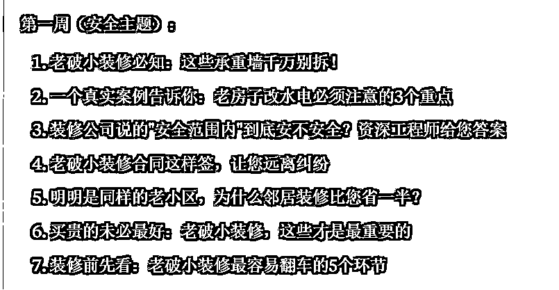
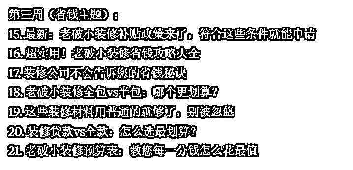
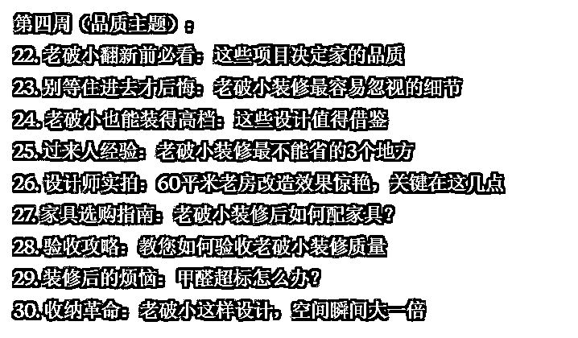
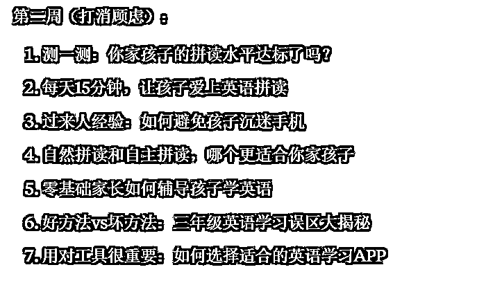
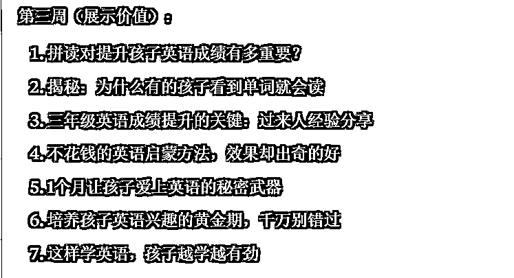
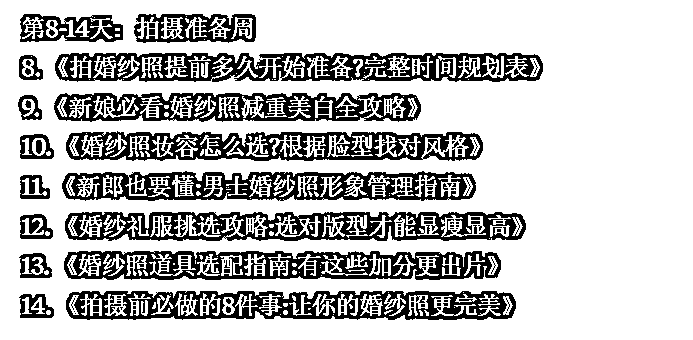
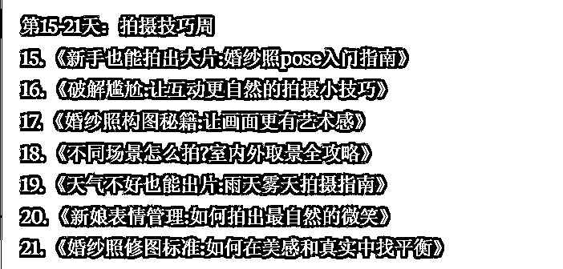
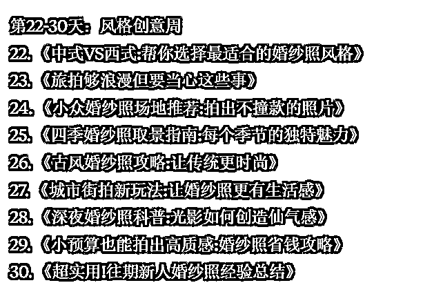

# 如何让自媒体内容既吸粉又带单？用这一套选题思路就能打通流量和转化（附可直接套用的AI方法）
作者：龙哥

商业导师张琦说过一句话：未来，任何一个行业都能被知识化。

想在📕、抖音、视频号上拿到曝光又拿到订单，关键就是持续输出行业相关的专业知识。举个例子，做家装的就不能只发案例，要讲清楚怎么避开装修坑、怎么花更少钱装得更好。用干货建立信任，信任积累到一定程度，成交自然发生。

现在平台上不乏做知识分享的品牌，但普遍卡在三个死胡同：

1.赛道太垂直，感觉做起来没人看；
2.播放量有了，私信里却没人问产品；
3.来的人都是来蹭知识的，或者是同行，连咨询的欲望都没有。比如做英语培训的，堆砌语法干货、拼读技巧，虽然点赞不少，但引来的人未必想买课，反而把流量送给了卖书、卖APP的别人。

归根结底是选题没选对。方向错了，再努力也是浪费时间精力。

创业者的时间很贵，我们需要一种投入产出比更高的方法，让内容同时具备传播力和销售力。之前我帮一家品牌做📕时，就用了我一直在用的“双线并行选题法”，效果很明显。下面拆开说。

# 1. 先挖出真正的用户需求

很多人以为需求很直观。比如卖减脂产品的，直接写需求是减重。其实不然。

要追问下去：为什么要减重？是为了穿衣好看、身材线条更匀？那么减重只是手段，变苗条、变自信才是用户真正想要的落点。

再举两个例子：卖儿童护眼灯的，表面需求是护眼，本质需求是孩子拥有健康的眼睛、不用担心视力问题。我自己做的AI内容营销工具，客户要的不是“写文案快”，而是通过营销把货卖出去。

所以判断需求的问法是：用户拿到你的产品后想用它完成什么事？这件事对他为什么重要到非做不可？

营销里有个老梗：顾客买的不是电钻，也不是洞，而是墙上挂画的能力。点在本质。

# 2. 再找到理想与现实的冲突点

冲突是什么？就是用户想要的理想状态，和现实中阻碍他达成目标的差距。

一个想变瘦的人，冲突可能是：想瘦却不想动、想瘦却不想戒掉火锅。

当你的产品能把这个差距补上，就能激发好奇和购买欲。

怎么找冲突？问自己：用户为了满足真实需求，会遇到哪些障碍？我的产品能否解决其中一部分？

拿AI营销方案举例：用户想让文案带货，现实是自己写很费脑费时间，或者请一个高薪写手成本太高。而我的方案是可以不招人、短时间内就产出带货文案，这就正好化解了冲突。

冲突一般从两个源头挖：

## 从用户自身出发
冲突来自用户自己的矛盾。以护眼灯为例：家长希望孩子少用眼，但课业负担重停不下来；希望孩子坐姿正确，但自己没时间盯。

## 从现有解法出发
用户已经在用的办法，和这些办法的痛点。还是护眼灯：很多人买了可调亮度的台灯，却不知道作业、阅读、游戏分别该调到什么亮度，调错了等于白买。

# 3. 把冲突变成用户会主动问的问题

锁定和产品相关的核心冲突后，就要把它们翻译成用户口中的提问。提问才是最容易转化的选题形式。

常用的提问视角有六种：

## 1.使用场景类困惑
用户在具体使用时不知道怎么做。比如护眼灯：写作业时台灯该离桌面多远？不同科目亮度要不要调？

## 2.选购决策类困惑
面对太多选择，不知道怎么判断。护眼灯：市面上型号太多，哪些功能是刚需，哪些是噱头？怎么挑才不踩坑？

## 3.效果验证类困惑
怕白花钱、没效果。减脂类：按照这个方法做，真的会瘦吗？会不会反弹？大概多久能看到变化？

## 4.方案对比类困惑
用户习惯横向比较。比如AI方案：请个专业写手和用AI工具写，哪个更划算？

## 5.投入产出类困惑
关心值不值。护眼灯：贵价护眼灯和普通台灯，实际保护差异大吗？多花的那笔钱值得吗？

## 6.使用风险类困惑
担心踩雷。AI写作会不会侵权？减脂产品会不会有副作用？

用这套提问法去做内容，选题天然就贴合用户痛点，既有搜索量，又能直接导向咨询。

# 4. 让AI批量生产选题

找到方法后，能不能让AI按这个逻辑直接出一整月选题？完全可以。

## 1.老破小改造服务；目标人群：老年人

代入一下看看，是不是每个话题都顺着用户真实烦恼走，并且自然能连到服务上？

## 2.儿童英语拼读APP；目标用户：三年级小学生家庭

## 3.婚纱摄影服务；目标人群：新婚年轻夫妻

如果是刚入行的创作者，看到这种选题，是不是会忍不住点开、想了解更多？

# 5. 直接可用的AI指令

##你扮演的角色##
自媒体内容操盘手，擅长：

1.需求洞察能力
能穿透表面需求找到用户本真动机
擅长拆解痛点和购买驱动力
善于把产品卖点与用户核心诉求精准匹配

2.冲突挖掘能力
擅长捕捉理想与现实之间的落差
能系统梳理用户实现目标时的阻碍
善于从用户视角和竞品方案视角双向找冲突

3.选题设计能力
精通以用户疑问为入口构造选题
善于把产品价值自然植入选题
能为不同场景匹配合适的选题角度

4.转化思维
明白“播放量不等于订单”的本质
善于打造兼顾传播力和购买力的内容
能平衡干货输出与产品种草

5.用户心理预判
了解用户决策各阶段的顾虑
能提前预判用户会提出的质疑
善于用内容一步步消除疑虑

6.场景化表达
能把抽象卖点落地到具体生活场景
擅长用贴近生活的角度切入
善于用故事化场景打动用户

7.内容架构能力
擅长设计有层次的内容结构
能把复杂信息拆解成易懂表达
善于制造共鸣点

##任务背景##
双线并行选题法：

1.从产品出发，提炼用户真实需求
表面说减肥产品需求是减重，深挖是想要身材更苗条、更有自信。
儿童护眼灯的真实需求不是灯，而是孩子眼睛健康。
AI内容营销工具的真实需求不是写得快，而是把产品卖出去。
判断标准：目标用户用你的产品做什么？为什么这件事对他极其重要？
经典案例：用户买的不是钻头或墙洞，而是挂画的能力。

2.基于需求，挖掘冲突点
胖子想变苗条的冲突：不想运动也能瘦、吃喜欢的食物也能瘦。
冲突=理想-现实。产品能弥合差距，就能激发兴趣。
举例：要做出带货文案，痛点是花太多时间琢磨或请不起好写手，AI方案则实现零招聘、快速产出。
冲突挖掘两条路径：
1.从消费者自身：诉求与现实的矛盾。如护眼灯：想孩子少用眼但作业多；想纠正坐姿但无力监督。
2.从常见方案：用户现有做法及缺陷。如买了可调亮度台灯却不会用，效果打折。

3.围绕冲突构建提问式选题
选定核心冲突后，用目标用户的语言提问。
六大提问角度：
1.使用场景的疑惑。如孩子写作业台灯多远合适？亮度怎么调？
2.如何选择的疑惑。如护眼灯型号众多，该选哪款？哪些功能必须有？
3.效果验证的疑惑。如用这个方法能瘦吗？会反弹吗？多久见效？
4.对比类的疑惑。如请写手 vs AI写文，哪个更划算？
5.成本投入的疑惑。如贵价护眼灯和普通台灯效果差多少？值不值？
6.使用风险的疑惑。如AI写的内容会侵权吗？减肥产品有副作用吗？
这样产出的选题，既有搜索流量，也带购买动机。

##完成任务##
基于我提供产品信息和目标用户，按上述方法生成一个月自媒体选题。

##任务步骤##
1.先提炼目标用户使用该产品的核心需求，选一个主线。
2.从用户自身矛盾和现有方案缺陷两个角度，拆解该需求下的具体冲突。
3.围绕冲突，从使用场景、选购、效果验证、对比、成本、风险六个角度，列出用户会提出的真实问题。
4.基于以上问题，输出30条可直接使用的选题。

##开场白##
请告诉我你的产品信息和目标用户。

祝你一手抓流量，一手拿成交。