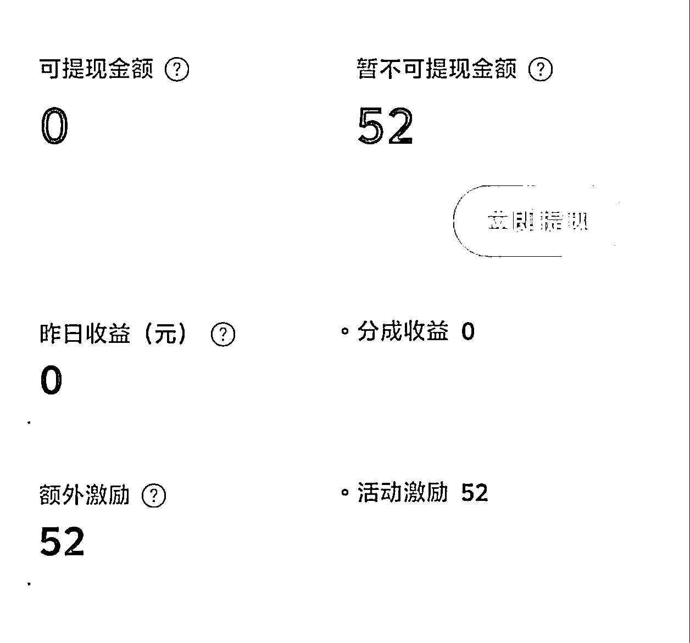
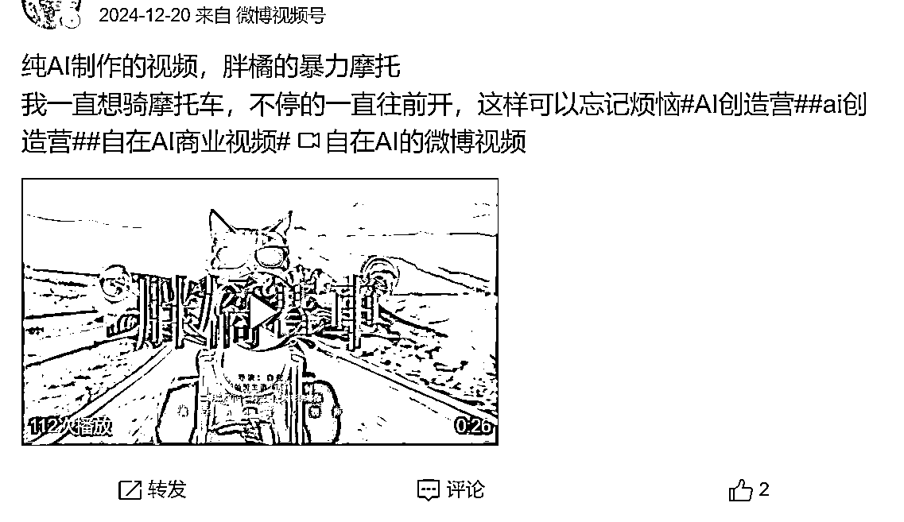
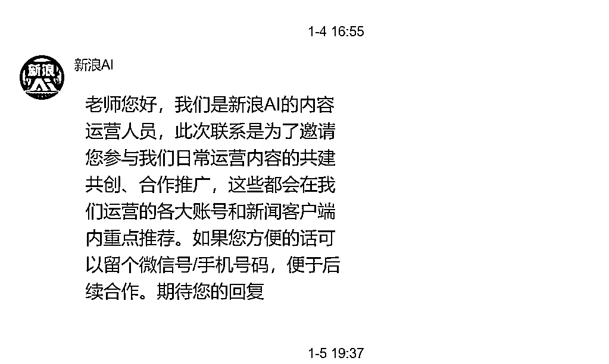
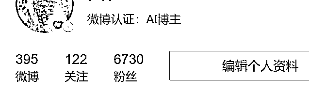
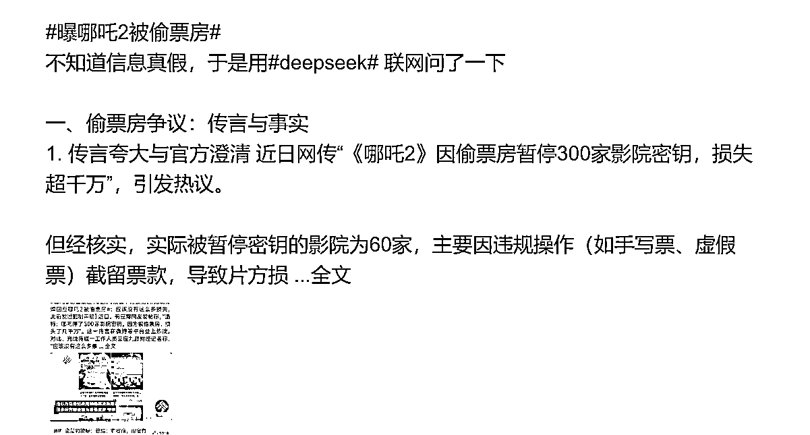
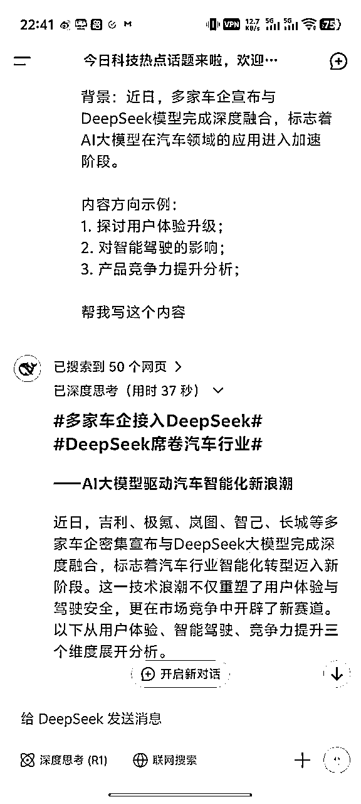

# 用AI在🧣上跑了54天，我涨了6600多粉
作者：龙哥

大家好，我是自在

🧣这边的变现到现在只到52块钱，可就是这52块，让我彻底踏实了，也想把这份踏实分给大家。

我之所以把经历写出来，是因为我太懂那种想快点看到回应的焦虑。前两天在群里分享的时候粉丝才四千出头，这两天又往上冲了。

早几年我也想搞🧣，报过写作课，连续更了大半年，结果粉丝只动了三十几个。

去年开始做AI相关的自媒体，顺手就把🧣也利用起来了。参加了平台活动后，我在2024年12月20号正式开始集中发AI主题的内容。

到1月4号的时候收到了站内的邀请函，应该是面向参与者的常规邀请。

之后就是雷打不动地去发，数量大概在每天1到10条之间波动。

54天下来累计涨粉6600多，其中有一天直接涨了1800多，单条最高阅读破15万，还有几条被官方账号转发过。

结合之前报课的笔记和这一个多月的实操，我把🧣做起来要注意的点梳理一下。

# 一、账号怎么起名字

在抖音、视频号这些地方，常见做法是领域+昵称，比如卖房的小张、保险红姐，这样一看就知道在干嘛。

🧣最好别这么玩，名字越朴实越好，别往里塞细分赛道的标签。

我自己的号带了个AI，现在回头看也不理想。

原因在于🧣的内容审核相对宽松，你要是把名字定位成爱美食的自在，下次发点娱乐八卦、科技新闻或法律科普，老粉丝就会觉得你跑偏了。

如果就叫自在这样的通用名，内容边界就很宽，想发什么发什么。以后哪怕要换赛道，迁移成本也低。

另外领域+名字在🧣里很容易被当成营销号。你去大V底下评论，大V看到一串一看就很像引流的昵称，第一印象就不好。真被多人拉黑，对账号权重是实打实的损伤。

换个角度想，如果你以后想成为企业家、公众人物、作家，你会用一个带行业标签的名字吗？

# 二、尽量避开的赛道

军事、时政、读书这三个方向。受众基数小，涨粉效率很低。除非你真的发自内心喜欢，不然不建议入局。

# 三、内容怎么写才让人愿意看

首先是阅读体验。在哪发都要让人看得舒服，排版是第一步。

最基础的就是分段、空行。手机端展示大概6到8行，你要在这一段里埋一个想点开看的钩子，不用刻意练习，把你在别的平台的写作习惯搬过来就行，开头抓一下就行。

第二是标点要规范。该句号就用句号，别一句话全靠逗号硬撑。中文标点就用中文标点，别中英文混用，阅读感会差很多。

第三是前戏讲故事。故事永远比干货更容易让人停留。

写不好故事怎么破？交给AI。你把干货丢进去，让它帮你包一层小故事，门槛并不高。

第四是蹭热点。打开🧣热搜页，挑你感兴趣的，带1到3个话题标签发出去就对了。

第五是和AI结合。任何主题都能跟AI挂钩。现在的热词是deepseek。

过去是AI+一切，现在是deepseek+一切。

我就是骑了deepseek的热度，单靠这个就拉来了一千多粉。

我长文基本都是AI代笔，deepseek、点点、豆包轮着用。要的并不是花里胡哨的提示词，现在的模型简单描述就能懂。

你能把事情跟人说清楚，跟AI交流就不会有问题。只有在特殊场景下才需要精细化指令。

# 四、粉丝怎么来

1. 多参加平台官方的活动，有曝光有扶持。
2. 日更，别断更。把🧣当成你的公开朋友圈，发起来没那么难。
3. 保留自己的判断力。

蹭热点、靠AI写都是捷径，可以用，但不能只用捷径。你得有自己的观点和思考。AI越强，越不能把你的独立思考给磨平了。

推荐几本我老师给的书，按顺序读，对思维有帮助：
《清醒思考的艺术》、《思考的力量》、《学会提问》、《超越感觉》、《麦肯锡教我的写作武器》、《结构化思维》

最后说一句，AI时代最大的红利就是多输出。敢持续输出的普通人，逆袭的概率正在变大。