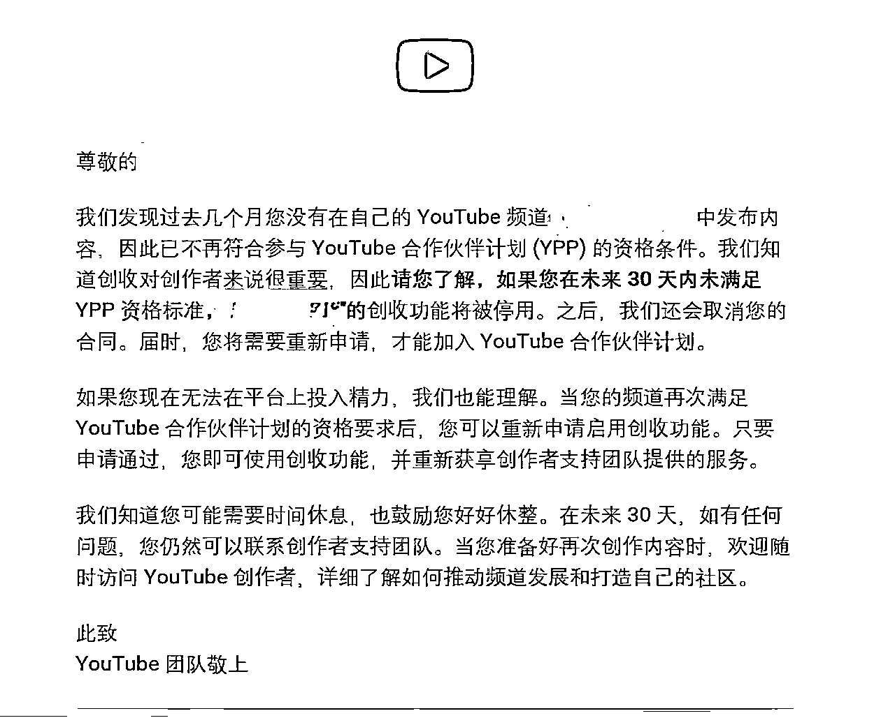
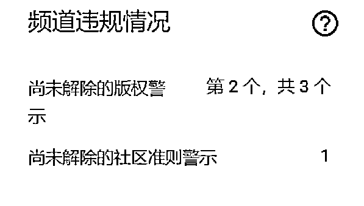
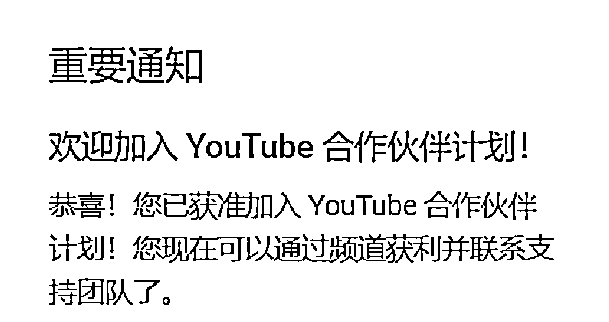

关于YPP，这14个错误认知该改改了

聊到YouTube赚钱，几乎绕不开YPP（YouTube合作伙伴计划）。可越是绕不开，误解就越多。今天咱们就一次性把这14个常见认知误区摊开讲清楚，看看你有没有被带偏过。

一、别被“门槛”吓住

1. “YPP太难了，普通人根本够不着。”
很多人一看到1000订阅、4000小时观看，做短视频还得90天内冲1000万播放，当场就想放弃。但这个门槛不是拍脑袋定的，背后有平台大数据支撑。实际上，大多数认真做内容的人，半年到一年内都能达标。现在Shorts热度高，用AI辅助生产内容，如果撞上一个爆款，这个周期还可能被进一步压缩。

2. “做Shorts比长视频更容易过。”
别以为短视频制作成本低，就一定会走得快。Shorts的播放门槛同样是基于大数据算出来的，凭感觉随手发，很可能根本起不来量。真正能快速跑出来的Shorts，要么短到让人来不及反应，要么信息量大到让人忍不住反复看，以此把完播率和互动量做上去。说白了，这是对观众心理和内容节奏的把握，长视频、短视频都一样。我也见过有人靠长视频蹭热点，几个爆款就把YPP拿下了。所以，能不能过，关键看内容质量，而不是形态长短。

3. “不露脸就过不了。”
完全不是。YouTube上有很多优秀频道，不露脸、不出镜，有的连手都不拍，全程用变声器，你根本听不出真实声音；还有的只靠一张机械感满满的图片或手绘漫画，从头到尾配解说，甚至分不清是真人还是AI。但只要播放量够高、完播率够好，平台照样把它认定为优质内容，给过审。

4. “先搬运涨粉，再发原创也能混过去。”
这是对审核机制的严重误解。YouTube评估你是否达标时，会重点看粉丝、观看时长或Shorts播放量主要是由哪些视频贡献的。如果这些数据主要来自搬运内容，就算你后来辛辛苦苦做了几个原创，核心播放时长依然不是原创贡献的，照样批不下来。

二、拿到YPP，不等于躺赚

5. “通过YPP就安全了。”
别大意。YPP资格不是一劳永逸的。如果你的频道出现违规行为，或者有观众反复举报，平台会重新检查你的频道，一旦查实，随时取消资格。

6. “不违规、有播放，广告费就会一直来。”
也不是。你要是长期不更新，系统会先催更；30天内还没能守住达标水平，频道的获利资格就会被停掉。

7. “过了YPP，赚钱就容易了。”
这就像“考进好大学，就一定能升职加薪、走上人生巅峰”一样不靠谱。YPP只是给你发了一张入场券，能不能赚到钱，还得看你后续能不能持续产出优质内容。说白了，这不是终点，而是一个新起点。

8. “过了YPP，收入会越滚越多。”
把时间拉长看，优质频道确实有增长空间，但短期内别抱这种幻想。有些频道靠蹭热点迎来一波高流量，收入也跟着涨；热点一过，播放下跌，收入自然缩水。YPP收入从来就不是固定工资，它是波动的，有波峰也有波谷。要预估一个频道赚多少，重点看播放量、播放时长和观众地区，每个月都得按当月表现重新算。

9. “订阅越多，YPP就越赚钱。”
真不一定。在YouTube上，一个1万粉丝的频道，可能比10万甚至100万粉丝的频道赚得还多。因为影响广告分成的因素太复杂了，赛道、观众地区、内容类型都会起作用。比如，踩中房价上升期的看房博主，粉丝不多但客单价高；教人赚钱的课程也同理，不需要海量粉丝照样变现。所以，别只盯着订阅数。

10. “靠YPP收入就能轻松全职。”
现实会给你泼冷水。YouTube官方的变现方式确实不少，有粉丝打赏、超级留言、超级贴纸、会员订阅，还有带货链接、T恤和马克杯等周边。可绝大多数创作者的真正大头还是广告分成，而且平台要拿45%，创作者只能拿55%。想靠这个稳定全职，非常辛苦。听我一句劝：趁早放弃只靠YPP吃饭的念头，把收入来源铺得越宽越好。

11. “过不了YPP，就没法在YouTube赚钱。”
这大概是最深的误会。哪怕你不是YPP成员，只要视频有人看，有人欣赏你、信任你，你就能把这份注意力和价值变现。例如在视频里号召观众打赏、捐款、买你的产品，或者在简介区放链接，把人引到你的微信、社群。反过来，只依赖YPP反而危险，因为资格随时可能被收回。健康的结构应该是：平台外的收入超过YPP收入。很多全职创作者都是这样，外部收入至少占总收入一半以上，YPP部分只占次要位置，并且原本就在波动。所以，与其死磕YPP收入多涨100%，不如想想怎么把非YPP收入提高50%到100%，后者不仅更容易，还完全由你掌控。哪怕YPP收入掉个10%到20%，只要外部收入大幅提升，整体依然更稳。归根结底，做内容的目标不该局限于“多拿广告费”，而是持续积累粉丝和潜在客户。把内容当免费广告发在YouTube上，既能给自家业务引流，还顺手赚点广告分成，这才是更健康的商业逻辑。

三、内容合规里最容易踩的坑

12. “把英文视频翻译成中文，就能申请YPP。”
请注意，这里说的是知识共享（Creative Commons）类视频。有人把它翻成中文，加上AI配音、内嵌字幕，就兴冲冲去申请YPP，结果通常被拒。官方理由很明确：重复性内容，看起来是大量或自动生成的内容，对观众没有太多教育或其他价值。翻译并没有构成对原作品的大幅更改，本质还是照搬，违背了重复内容政策。这种视频也并非没钱赚，只要有流量，走非YPP的变现渠道一样能获利。但如果有版权方的正式授权，情况就不一样了，比如音乐授权给频道使用，收益由授权人和创作者分成，这样的二次创作是有可能通过YPP的。知识共享内容为什么不行？因为它是公共免费资源，平台当然不愿意再额外奖励搬运者，否则会出现一堆钻空子的频道。其实YouTube自带自动翻译，多数场景下已经够用了。如果你想靠解说类内容过YPP，最好真人出镜，加入自己的点评和观点，那就是实实在在的原创，过审完全没有悬念。

13. “频道有社区警示或版权警示，就一定不能加入YPP。”
这个说法太过绝对。实际上，哪怕频道已经在“死亡边缘”徘徊

依然有可能被批准加入合作伙伴计划

只不过，想持续拿到广告费，之后得确保不再违规。想要更好地规避风险，建议花时间深入学习两件事：一是YouTube政策，二是YouTube的《社区准则》。

14. “用AI合成语音，会被YPP拒绝。”
问题从来不在“AI”本身，而在你是不是用AI批量生产低质垃圾内容。AI是提效工具，用在正道上，能帮你把内容打磨得更精良；用来无脑灌水，算法和人工审核都会高度怀疑你。核心是别让技术成了你偷懒的挡箭牌。

以上这14条，你听过哪些？又信过哪些？说真的，YPP只是一个工具，不是终点。少一点想当然，多一点对平台规则的理解，你的YouTube之路才可能走得稳、赚得久。