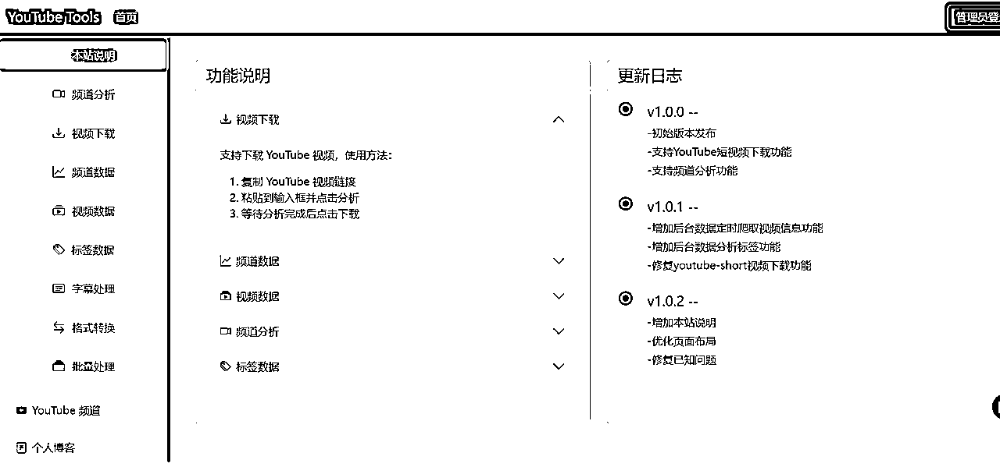
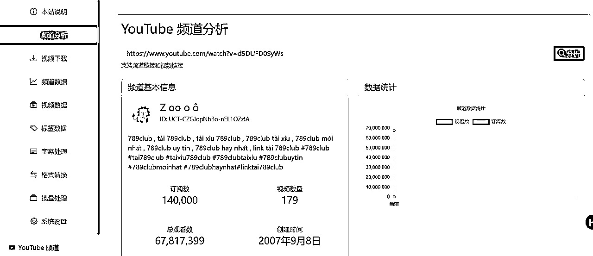
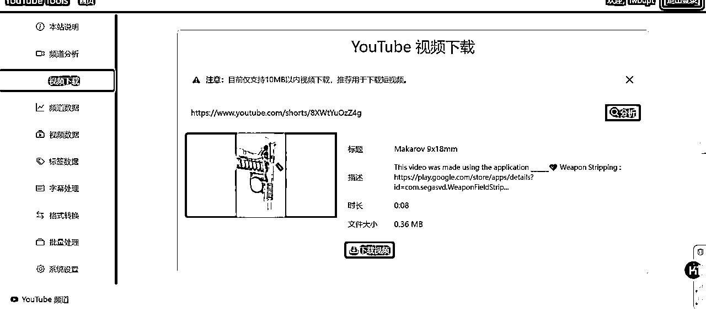
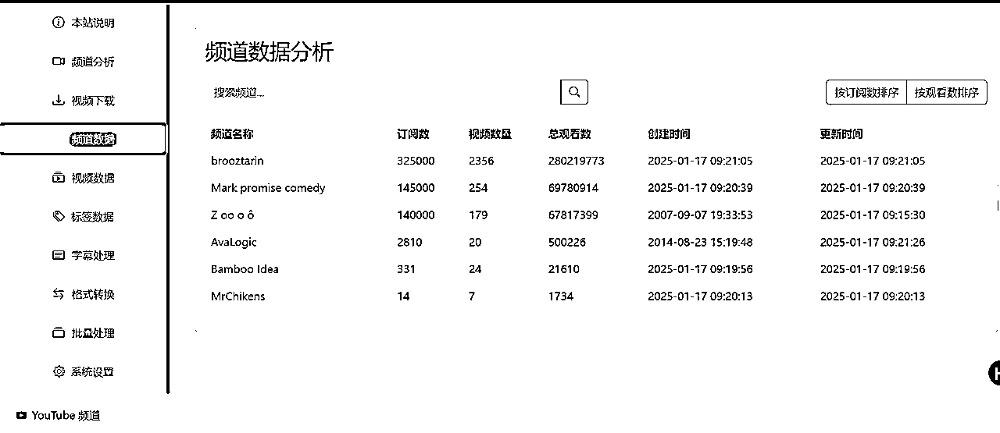
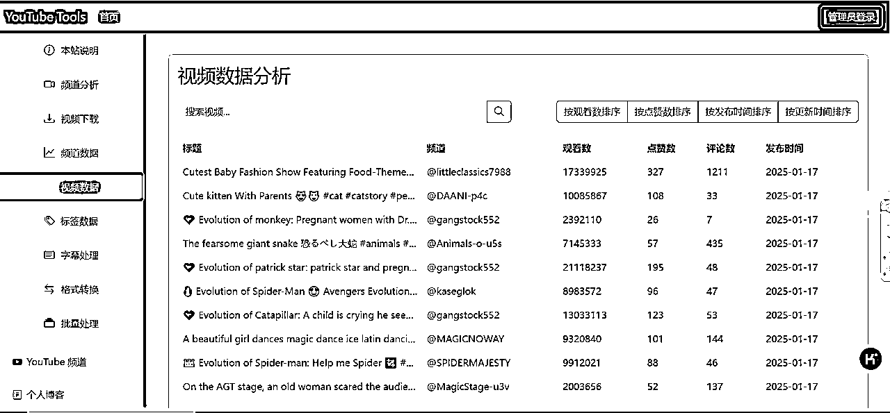
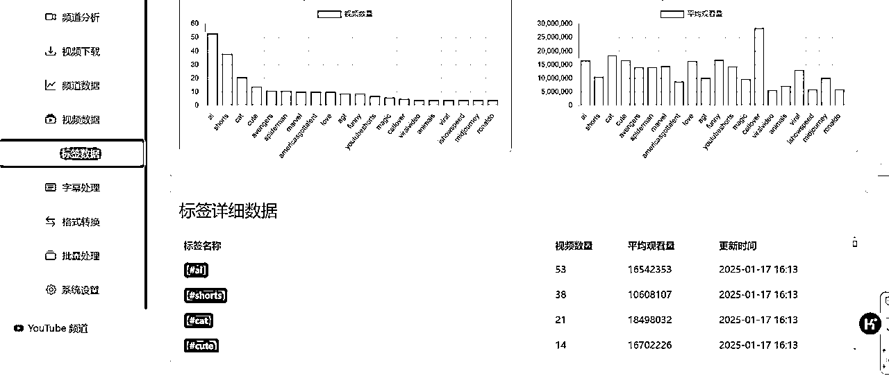
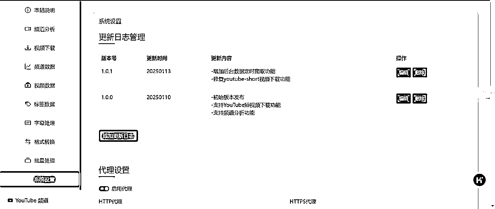
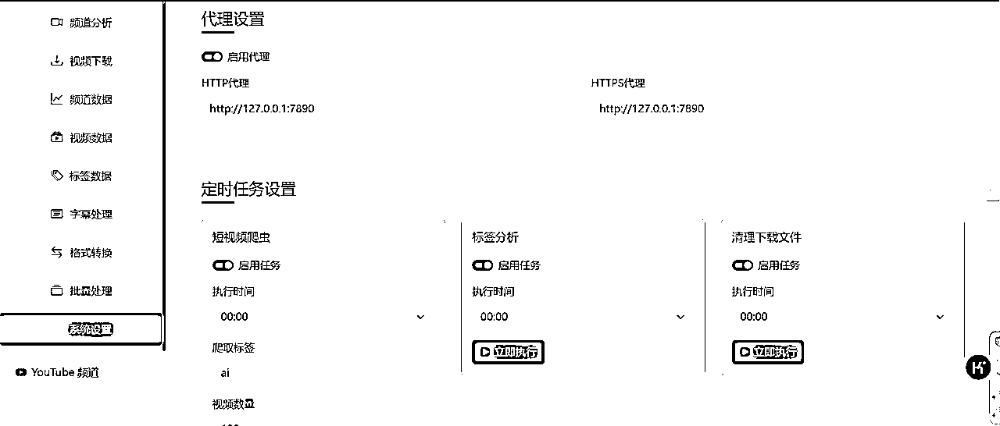

# 用 Cursor 打造的 YouTube Shorts 一体化工具站上线

> 来源：[https://v3m0vzf1tz.feishu.cn/docx/OaVSdVCIDoRew1xxKE5cbn2Enmd](https://v3m0vzf1tz.feishu.cn/docx/OaVSdVCIDoRew1xxKE5cbn2Enmd)

# 前言

大家好，我是骥哥。就在上周，我用 Cursor 搭了一个用于 YouTube 短视频对标分析的脚本，并把过程整理成文分享了出来。当时那版脚本做得比较简陋，能拿到的信息也很有限，而且部分功能还得调用 YouTube Data API，这就带来了每天 10,000 次调用额度的瓶颈，实际用起来消耗很快。

为了突破这些痛点，我充分发挥 Cursor 在编程协作上的优势，重新迭代开发，最终做成了一套完整的 YouTube Shorts 工具集合，并以网站形态对外开放。站点地址是 www.lworld.top，开发时间比较紧凑，难免存在一些隐藏BUG，欢迎大家在使用中反馈。

# 本站说明

下面对网站的核心模块、操作方式以及迭代记录做一个概括性介绍。

# 频道分析

输入一个 YouTube 频道的链接或具体的视频链接后，系统会自动抓取该频道的订阅数、累计上传视频数、总观看量、开站时间等核心指标。所有被用户分析过的频道信息都会自动存入本地数据库，方便后续回溯。

# 视频下载

粘贴视频链接，平台会即时解析并展示该视频的元数据。用户可根据需求下载视频文件。借助此功能获取到的视频信息同样会被持久化保存到库中。

# 频道数据

汇总展示平台历史上分析及爬取过的所有频道清单。当前已支持多维度筛选、查询和排序，后续计划引入更深度的频道数据解读功能。

# 视频数据

集中呈现已收录的视频记录，用户可自由筛选查看。视频库的数据会通过每日定时任务自动更新，目前爬取范围限定在指定标签下的短视频内容。

# 标签数据

基于已入库的视频，自动归类出其所属标签，并支持在站内进行热门标签排行等统计分析。标签相关的统计结果由每日定时任务对本地库进行一次全量计算得出。

# 系统设置

该板块提供代理服务开关设置、站点内容维护以及定时任务管理等后台功能，仅管理员账号登录后可见。

# 其他

在 Cursor 辅助生成前端界面时，额外衍生出了一些附加功能，推测也是 YouTube 内容创作者群体中的真实刚需，后续将根据实际使用情况逐步优化和补充。