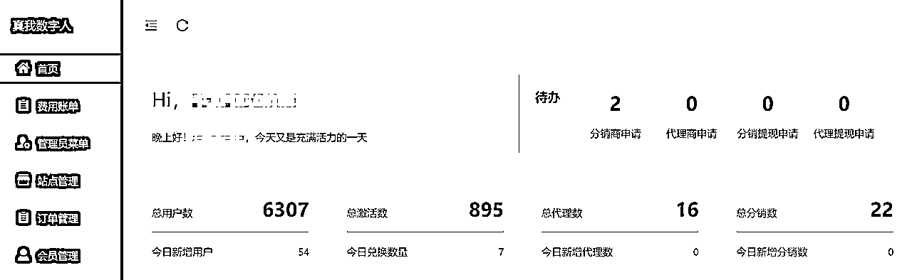
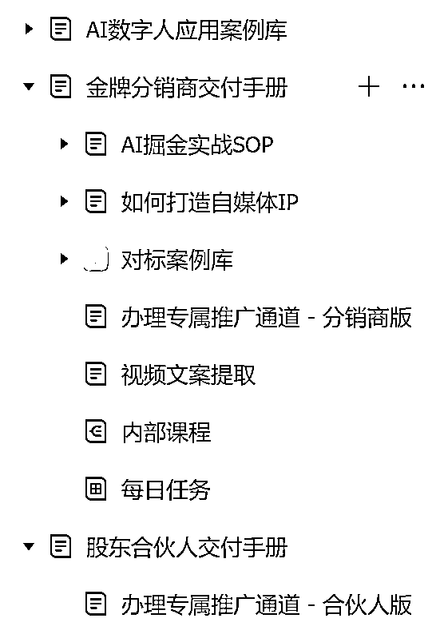
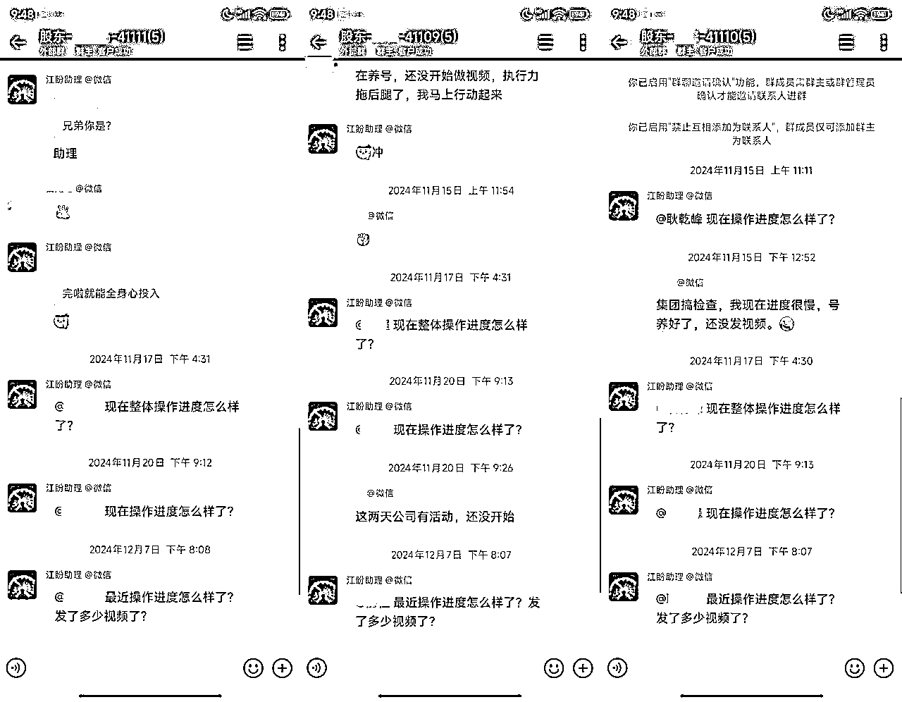
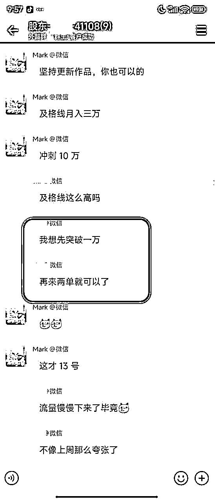
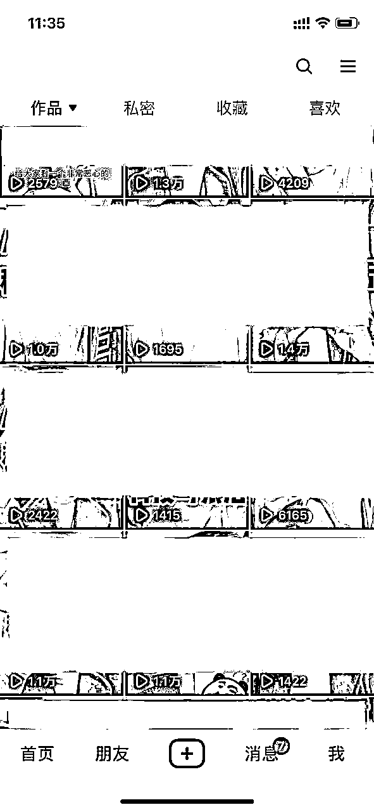
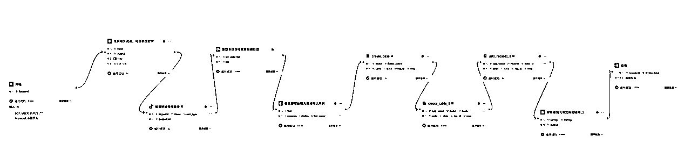
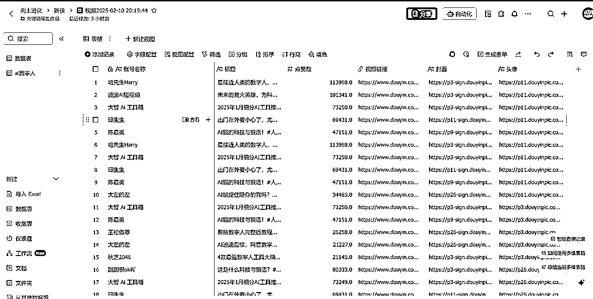
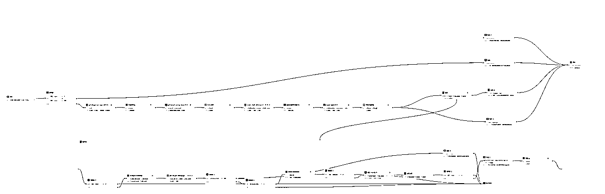
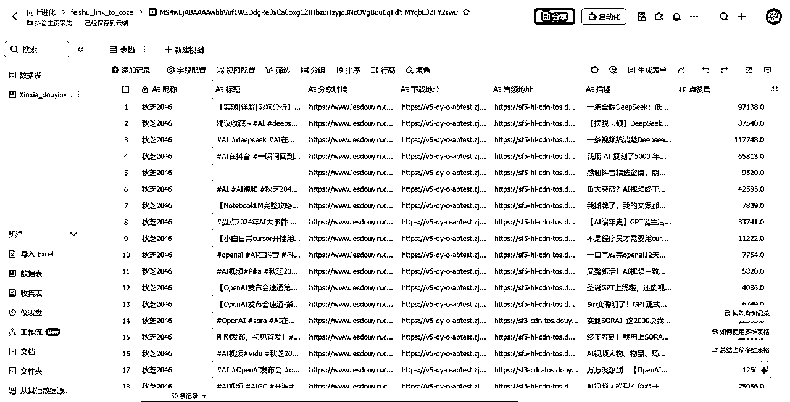
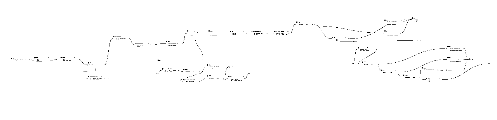

# 从0到0.5：我的数字人项目4个月复盘与踩坑记录

这篇文章其实我计划等一等再写。原意是等到这个数字人项目真正跑完“从0到1”的全流程，再踏踏实实做一次完整复盘。没想到过年一闲下来，脑子里关于项目的反思和规划反而一个接一个往外冒，索性就趁热打铁写出来。

这篇既是复盘，也算是我给2025年列的一份行动清单。

先给没看过前传的朋友补点背景：2024年10月，我锁定了“对口型数字人”这个异常值，花了一个月把工具搭建起来，初步走通了“流量→成交”的小闭环。现在又过了4个月，我刚把后台数据翻出来：总激活会员数是895，刨掉体验会员，正式会员大概200人。坦白讲，这个成绩只能算勉强跑通了0.5，离我心里那个“真正的1”还差得很远。

这中间踩的坑不少。最开始我以为只要站在风口上就能一飞冲天，后来才发现，风口是风，能不能飞起来还得看自己有几斤几两。

接下来，我把这段经历里最值得说的三个部分展开聊聊：两个大教训、一次回归正轨、以及接下来的具体计划。

## 一、没有流量基数，裂变就是空中楼阁

先说第一个让我亏了时间和机会的决策。

当初我用了不到一周时间打通了从流量到成交的闭环，整个人难免有点飘，满脑子想的都是“风口期必须抢时间、抢流量”。所以脑袋一热，做了个后来看起来特别不靠谱的决定：自己先停手，赶紧招代理，让代理去做流量和成交。

结果呢？几天之内确实拉起了20多个代理，可正式启动一周后我就傻眼了——每天还在执行的，只剩一个人。

我当时的反应是：是不是交付没做到位？于是马上补充交付手册，安排每日任务，甚至开了直播答疑，基本把所有能做的准备工作都做了。但现实半点面子没给——坚持执行的还是只有那一个代理，其他人就像人间蒸发一样。

我不信邪，又专门配了个助理，隔三差五去跟进代理、提醒做任务、督促执行。最后的结果也令人沉默，连助理的热情都在一次次的“无人回应”里消耗光了。

唯一坚持下来的那个代理，做了一个月，把业绩做到了一万块。

这段经历让我彻底明白了一句话：没有流量基数做前提，靠代理去裂变几乎就是空想。更扎心的是，你永远叫不醒一个装睡的人。一个项目里99%的人赚不到钱，根本原因往往不是项目不行，而是执行不到位。

## 二、没有SOP，就不要轻易碰投流

第二个坑更贵，因为那是真金白银买回来的。

踩完前一个坑，我居然又把自己的流量给停了，把希望全部押在付费投放上。我找到一个代投放团队，直接开跑AD投放。

前后烧了5万块，换来两个让我感到绝望的发现：

第一，人群根本不精准。我原本想投的是C端用户，结果进来一大半都是B端；我的产品是数字人视频，跑来咨询的却基本全是数字人直播。

第二，转化跟不上。5万投进去，最后的成交数据惨得没法看。人群不对是一方面，更关键的是我自己的承接转化也没准备好。

我以前一直擅长自然流，用户是靠“钩子”主动加过来的，所以哪怕我通过好友慢一点、回复随意一点、朋友圈发得少一点，转化率也不会太差。但付费流量的打法完全是另一套逻辑：

- 你必须第一时间电话沟通，主动添加对方🛰️；
- 要强转化，也就是隔三差五发“骚扰信息”；
- 朋友圈还得保持足够的更新频率和曝光量。

免费流量和付费流量，在内容和转化逻辑上完全是两种玩法。我既没有充足的投流经验，也没跑出一套经过验证的SOP，就把筹码全押在投流上，现在回头看确实不太理智。当然，如果你预算足够多，能靠烧钱烧出一套SOP，那是另一种玩法。

## 三、回归正轨：先老老实实把流量做出来

这两个坑让我在流量端白白浪费了将近两个月。后来终于想通了一个道理：0到1阶段的坑，大多出在流量端。与其天天找捷径，不如先按之前已经跑通的方式，自己去把内容做起来。等基础流量有了增长，再考虑裂变和放大也不迟。

于是我又重新捡起原来的打法，开始继续做视频。流量很快就稳住了，基本上每个作品都能跑出几千到几万的播放，还爆过一条800多万播放的内容，评论区里的意向反馈也很不错。

但我很快就发现一个奇怪的现象：视频播放量明明很高，🛰️进人数量却和流量完全不匹配。

之前的文案我一直是找到对标账号，直接进行二创。带着这个疑惑，我又重新把对标作品的文案仔细拆了一遍。很快，问题浮出水面：这套文案放在视频数据上几乎挑不出毛病，甚至算得上不错；但要是拿“🛰️进人数量”这个指标来衡量，它缺了一个最核心的东西——钩子。

抓住这个问题之后，我马上重新调整了文案方向，🛰️进人数量果然明显改善。这个项目总算被我拉回了正轨，也算是真正跑通了0.5。

## 四、接下来怎么走：矩阵+裂变，双线并进

### 1. 自建矩阵：把重复性工作交给自动化

我很认同一句话：高手都在拼概率，新手总想一盘赢。

做矩阵最高效的方式，就是把标准化流程跑通，再用工具去完成那些重复性工作。像对标账号/作品采集、文案改写润色、数字人生成，都属于这类任务。

为了把这些环节自动化，我花了一周时间自学Coze工作流，目前已经落地了三个自动化流程：

- **抖音关键词搜索热门视频**：设定关键词后，自动抓取关键词下的热门视频。基本流程如下：抓取结果最终会自动输出到飞书多维表格，方便统一管理。

- **抖音主页数据批量采集**：输入一批账号主页，自动批量采集相关数据。流程参考：数据最后会自动同步到飞书多维表格。

- **自动生成数字人**：输入一段文案后，工作流自动完成润色、分段、语音克隆、根据音频生成数字人，再调用阿里云智能剪辑进行拼接混剪，最后返回一条做好的数字人视频。

有了这三个工作流之后，矩阵的基本框架已经搭起来了。我计划到2月底完成10个账号的矩阵搭建。Coze这个工具我越用越觉得值得深入折腾，后面有时间再单独写一篇，把具体流程分享给大家。

### 2. 裂变体系：研究完龚文祥，我开始重做裂变

裂变这件事绕不过去，但这次我不会再把所有希望都押在代理模式上。

最近我研究了两个竞争对手，其中一个让我印象很深：龚文祥。他居然也做了一个数字人口播分身的工具——这倒是从侧面说明，这个方向确实有前景。工具本身没什么新奇，真正让我眼前一亮的是他的裂变体系。

坦白讲，我以前理解的裂变无非就是代理+分销。但龚文祥那套体系，他给起了个名字叫“师徒传承”。我把这套模式仔细拆了一遍，本质上就是“链动2+1”。这套规则讲起来有点绕，我直接让DeepSeek整理了一份说明，贴在这里供参考。```
链动2+1模式是一种基于社交裂变的分销策略，通过激励机制快速吸引用户参与并实现团队裂变，广泛应用于电商、零售、服务等行业。其核心是通过身份晋升和层级奖励，推动用户主动推广产品并发展团队，形成可持续的销售网络。以下是该模式的核心机制与特点：
一、模式核心机制
身份体系
用户分为代理和老板两种身份：
代理：用户通过购买指定产品（如499元礼包）成为代理，获得推荐资格；
老板：当代理成功直推两人购买产品后，晋升为老板，脱离原上级团队，独立发展自己的团队。
奖励机制
直推奖：代理每推荐一名新人购买产品，可获得固定奖励（如100元/单）；
见点奖：老板每推荐一名新人，除直推奖外，还可额外获得见点奖（如200元/单），激励团队裂变；
平级奖：当下级代理晋升为老板时，上级老板可提取下级收益的一定比例作为奖励；
帮扶基金：老板的部分收益（如20%）被冻结，需完成帮扶任务（如帮助下级晋升或团队达标）后才能解锁，确保团队持续发展。
裂变规则
走人机制：代理晋升为老板后，其前两名直推的代理归属原上级团队，后续推荐的新人则进入自己的团队；
留人机制：保证上级团队的稳定性，避免因裂变导致资源流失。
二、合规性与法律边界
链动2+1模式通过二级分销设计规避法律风险：
分销层级严格控制在两级以内（代理直接推荐的下级和下级的下级），符合《反不正当竞争法》要求；
以实际产品销售为核心，避免传销嫌疑；
通过第三方合作（如灵活用工平台）解决税务问题，确保合法纳税。
三、模式优势
快速裂变：用户仅需推荐两人即可回本（如499元礼包推荐3人回本），后续享受无限裂变收益。
低成本引流：依靠用户社交关系传播，替代传统广告，降低营销成本。
高用户黏性：通过晋升机制和持续奖励，激励用户长期参与团队发展。
灵活适用：适用于高毛利、高复购行业（如化妆品、酒类、医美），支持多行业定制化调整。
四、适用行业与场景
快消品：化妆品、健康食品等，依赖口碑传播和高利润空间；
酒类与食品：通过社交推荐快速占领市场；
服务行业：教育、旅游等，利用用户信任链拓展客源；
初创企业：快速起盘，积累种子用户并建立销售渠道。
五、潜在风险与解决方案
团队断层风险：若下级代理无法晋升，可能导致裂变停滞。通过帮扶机制强制上级协助下级完成任务，确保裂变延续9。
法律合规争议：需严格把控层级，避免变相多级分销。建议与专业法律团队合作设计模式框架。
链动2+1模式通过简洁的规则和强激励，在合法合规的前提下实现用户与销量的指数级增长。企业在应用时需结合自身产品特点，优化奖励机制与裂变路径，同时注重长期用户运营与合规管理。
```

基于这套逻辑，我已经重新设计了新的裂变体系和用户系统，下一阶段重点就是测数据、看结果。

最后说句实在话：这个项目目前给我带来的收益，离我最初的预期还有不小距离。但它是我第一次从“知识付费”转去做“AI工具”业务，过程中的挑战和压力，确实不是外人能体会的。希望这篇踩坑记录能给正在做类似项目的你一点参考，也欢迎大家随时交流。