# 从0到百万GMV：我用一年跑通二奢供应链的完整复盘

大家好，我是龙哥。进入二奢行业之前，我做了五年产品经理，负责过亿级流水产品线。2020年加入赚钱，潜水五年，今天总算发出第一篇正式分享。

先交代背景：作为二奢小白，我用一年时间把GMV做到百万。特别感谢翔叔、大刚、觅塘花开、文博、许无畏给我讲行业知识，更要感谢凡响的全方位帮助，如今他已经是我的合伙人。

先看二手奢侈品的底层逻辑。一件货从回收再到卖出，会经历五个价格：回收客户价、同行兜底价、同行贸易价、渠道供货价、客户销售价。这五个价之间产生四个价差，每一个价差都是利润。我最初在兼职状态下，同时测试了四条业务链路。

**第一阶段（2024.1-2024.4）：四路并测**

第一路，回收客户到同行兜底。这条路占了我70%的测试精力，因为两头都要找人——找卖家，也得找能接货的同行。

获客我试了三种方式。线上短视频，最好用的是奢侈品回收内容，能同时圈住卖家和买家，但爆款极难；一人分饰多角的内容容易自然爆发，可人群太泛。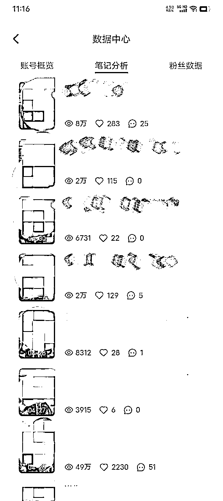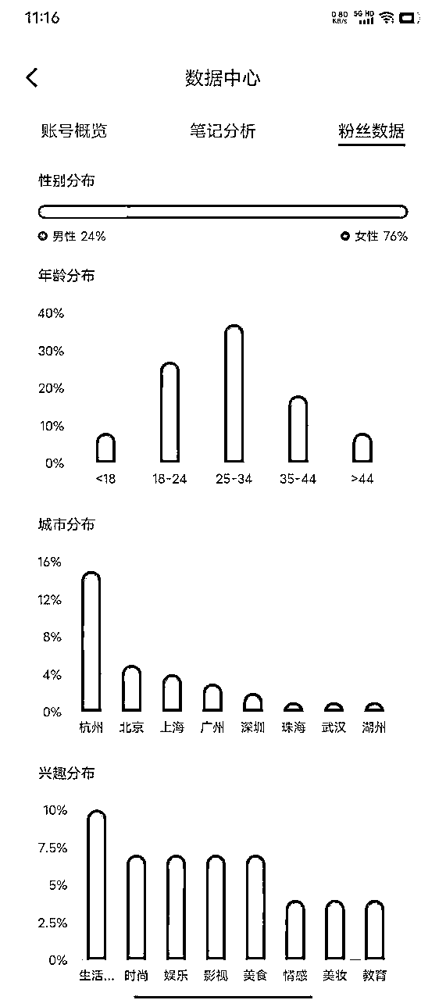把内容发到抖音、视频号、📕、快手后，我的体感是：视频号的用户成交意愿最强；📕那边，用户特别喜欢比价；抖音盘子更偏商业；快手用户的二奢商业价值有限。举个例子，同一条视频的引流数据：视频号播放10.2万、点赞72、新增关注47、引流4人，播放引流比2.55万；📕播放3701、点赞21、新增关注4、引流1人，播放引流比0.3万；抖音播放9.3万、点赞180、新增关注6、引流2人，播放引流比4.65万。显然，早期全职做这条路，投产比只能打平。

线下投放，我对比过菜鸟驿站和电梯间，最后选了人流量大且谈判难度低的菜鸟驿站，谈下10-20个，平均200元/月/个，回收需求最旺的小区房价在5-8万/平。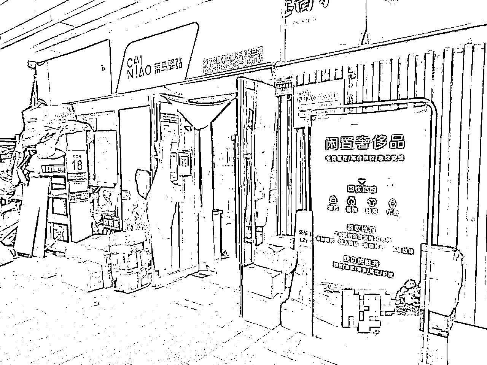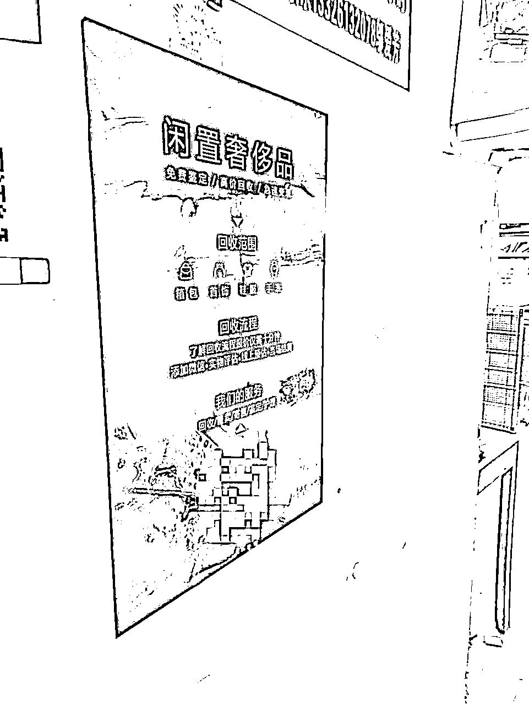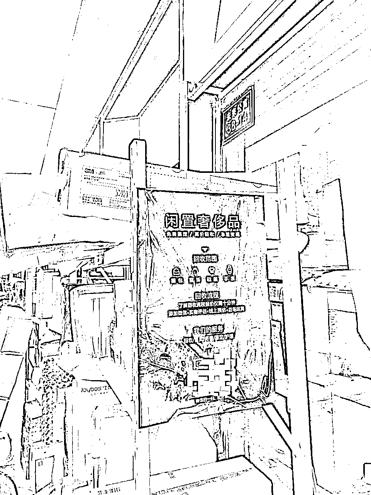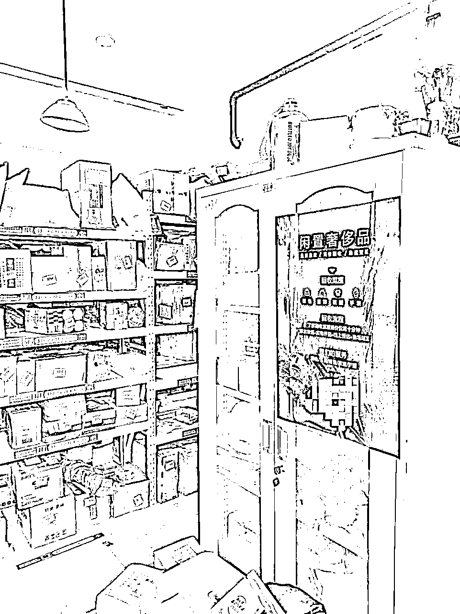我还跑到杭州大厦、in77、杭州万象城的地下车库，往车上塞小卡片。跑完发现线下上限太低，爆发力远不如线上。异业合作找过美发店、干洗店、医美店，但没有资源的人很难切入，因为合作要求用户体量相当、后端资源成熟、响应高效且专业。兜底同行是我一家一家陌拜杭州二奢店聊出来的，最后有两家回复快、报价合理。

第二路，回收客户/同行兜底到同行贸易。想要同行贸易，得先有足够多同行资源。办法有三种：行业群拉人、闲鱼卖货慢慢加、上奢侈品鉴定课认识同学。我用了第一种，7天进了100多个二奢同行群，去重后大约1万多个同行。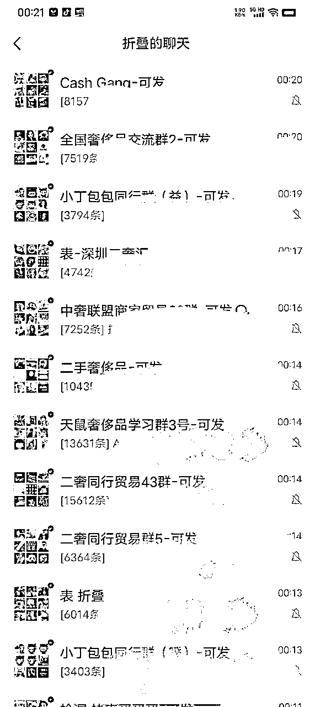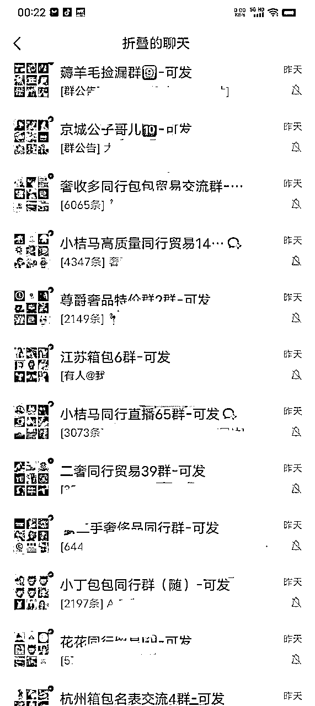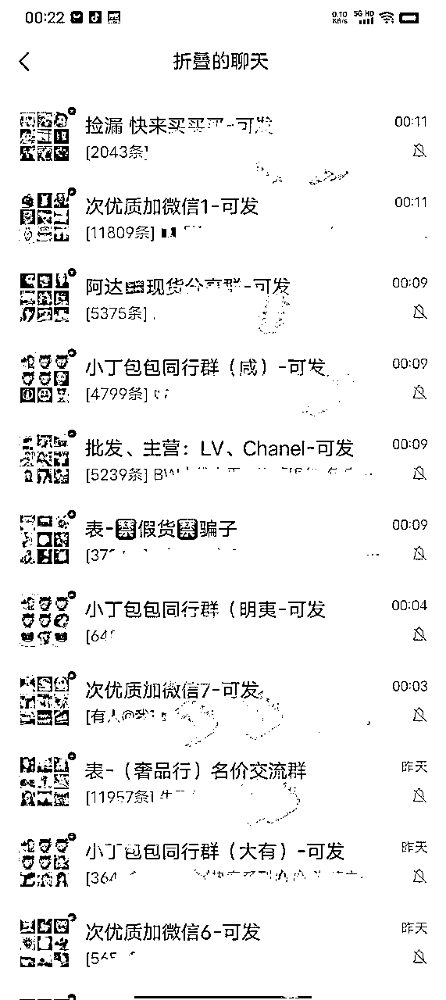然后每天在🛰️群和朋友圈发三轮回货品信息，连测一周，效果不好。回头看就是不懂行，拿货价甚至高于同行贸易价，当然卖不掉。但注意：我测试不行不代表链路不行，这条路其实是新手快速学行情的捷径。很多在二奢公司上过班、拿着几万块出来单干的人，首选就是它。

第三路，回收客户/同行到渠道供货。这需要资金、BD能力和运营思维。国内渠道有三类：二奢直播间、二奢私域销售团队、人流高的实体店。早期因为资金量大，我差点放弃。凡响让我弄点他直播间好卖的货，他来帮我卖。我拿了1万块，半信半疑，花了3天采购几件货送过去，再没管过。1月送去，4月全部卖掉，赚了1200元。这让我意识到，这条链路可能投产比最高，真是意外之喜。

第四路，同行价货品到客户销售。这条路不用压一分钱，跟同行谈好代理价，拿细节图，挂到闲鱼、95分、📕等平台，成交就有收益。最考验流量获取。实操下来，销售端比回收端要难上十倍，因为卖货要同时搞定信任和价格问题，早期没有实体店和口碑，信任就是最大的卡点。我测了半个月，有询单但没实际收益，流量能力不够。

**第二阶段（2024.5-2024.9）：All in 供应链**

四路测完，我锁定“回收客户/同行到渠道供货”。它是早期投入时间最少、收益却最高的链路。跑通它需要三个条件。

资金，有四种获取方式。股权融资，容易产生纠纷，但能共担风险，还能获得经营扶持；债券融资，需抵押物，无纠纷，成本低，没有控制权纷争，也躲开过度财务审核；政策融资，成本极低，但拿不到经营扶持；众筹融资，能拿到资金但容易纠纷。二奢是非标业务，很吃行业经验。没经验时，股权融资更合适；有经验后，债券融资更好。我短时间找不到合适股权方，又想跑快一点，最后选了杭州大学生创业免息贷款（毕业五年内），资金迅速到位。

收货渠道，我试过展会、闲鱼、奢当家、帮帮虎、实体门店、收客户。展会收货效率最高，全国每个月都有很多场。此后我基本每月参加10场展会。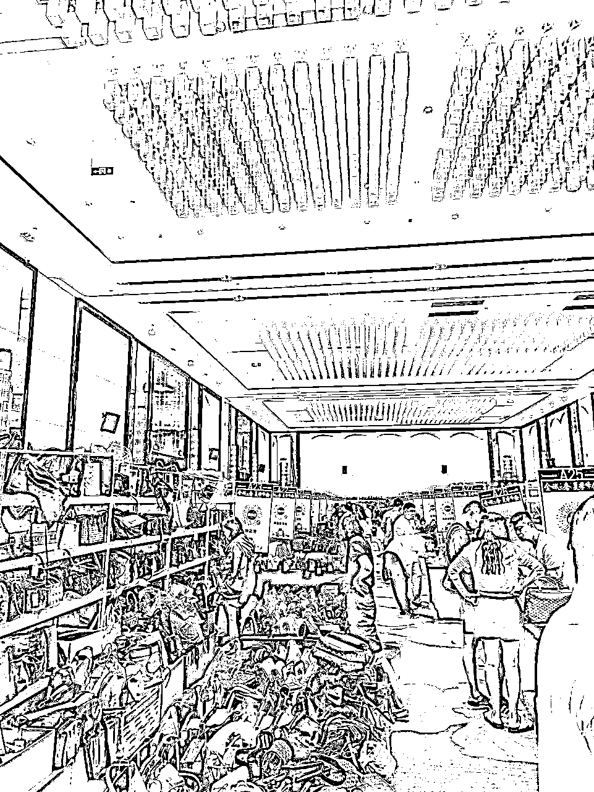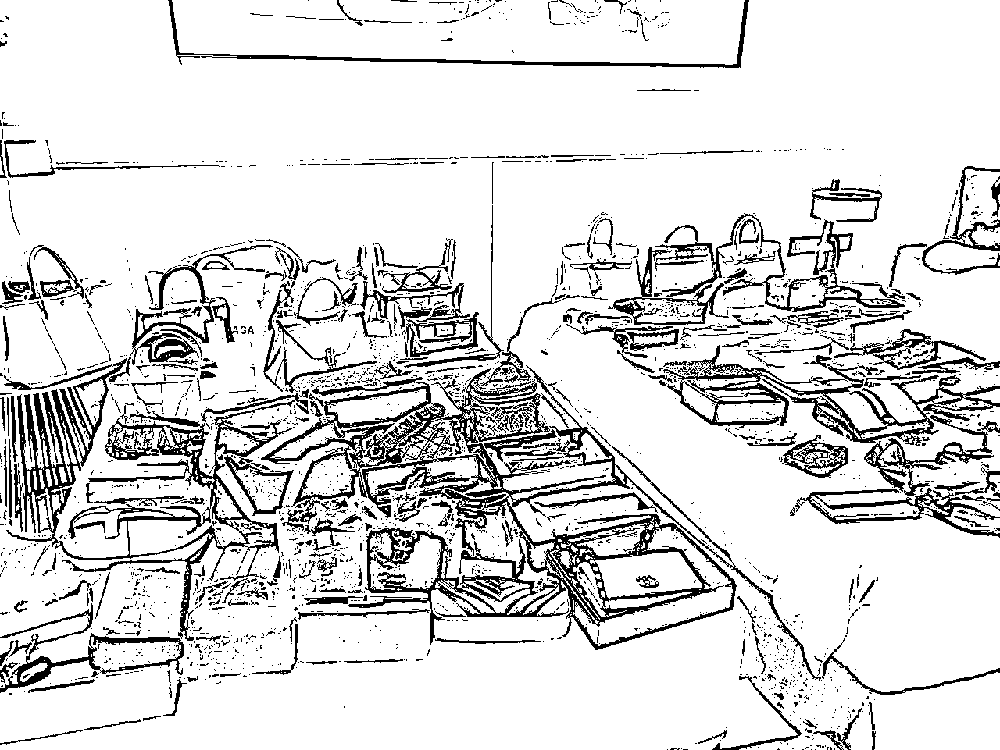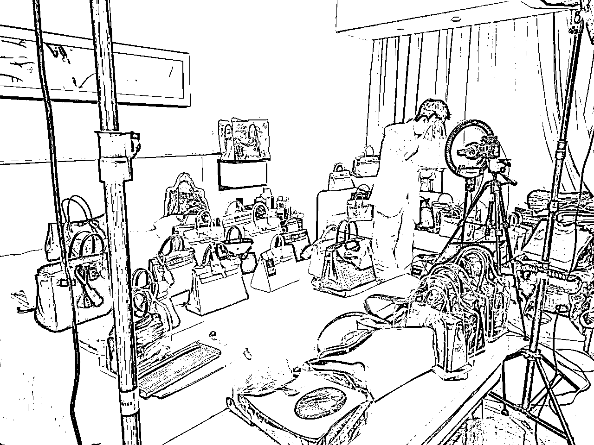线上用闲鱼、奢当家回收，一天能找到一件合适的就不错，只能当找货工具。帮帮虎是同行拍卖平台，认证严格，适合懂行的人批量采购。实体门店和直接收客户结果太不稳定，不适合早期。

销售渠道，我靠三种方式。第一，直播数据平台（蝉妈妈、抖老板、考古加等），筛出二奢行业卖得好的直播间，挨个建联；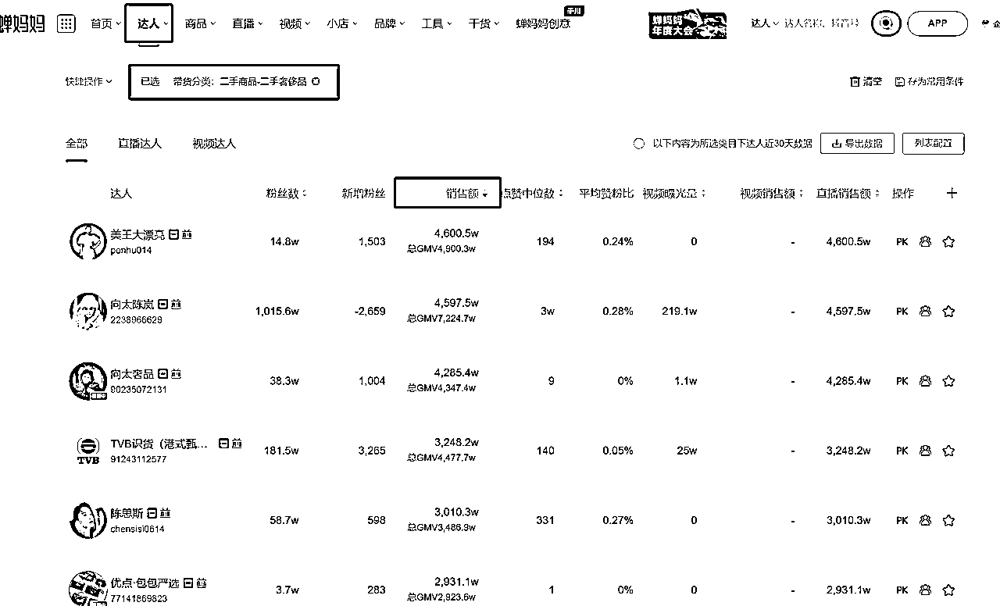第二，蹲直播间。蹲过一个二奢直播间后，抖音会自动推更多，而且推荐过来的大概率是近期销售能力增长快的；第三，同行交流。二奢同行贸易频繁，天天见面，聊天中也会得知一些公共平台看不到的强销售渠道。

三条件齐了，开始精细化运营。从1个人+2个兼职起步，大约每2个月销售额和人数翻一倍。到2024年底，二奢供应链GMV过百万。这条供应链不仅和国内渠道合作，也对接日本、东南亚、美国等海外渠道。

**第三阶段（2024.10-2024.12）：C端试水**

现金流业务稳了，我开始想长期正确的事。过去中国发展快，赚钱容易，奢侈品买成了全球第一，国内存量很大。2024年市场一变，许多人卖出奢侈品套现，但国内二奢需求不高，供给大于需求，拥有销售能力的公司就成了稀缺资源。

于是业务链路往前一步：同行拿货直接卖给客户，利润空间也变成“同行贸易价（——渠道供货价）——客户销售价”。C端销售需要三样：获客能力、价格优势、用户信任。我做供应链出身，价格有优势，就剩获客和信任。

获客是所有ToC企业永恒的命题。我现在也没能稳定获客，倒收获了不少教训。C端那三个月，我换了3波获客团队，全用矩阵打法，最高峰时80个账号、每天320条内容。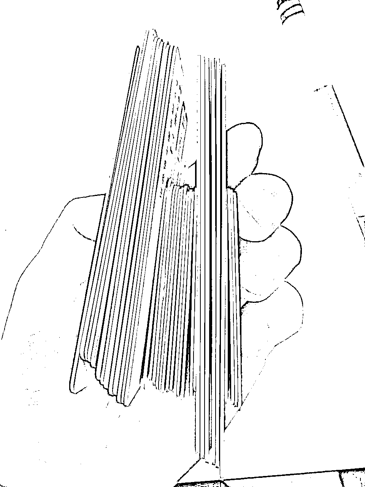团队小伙伴也产出过百万爆款。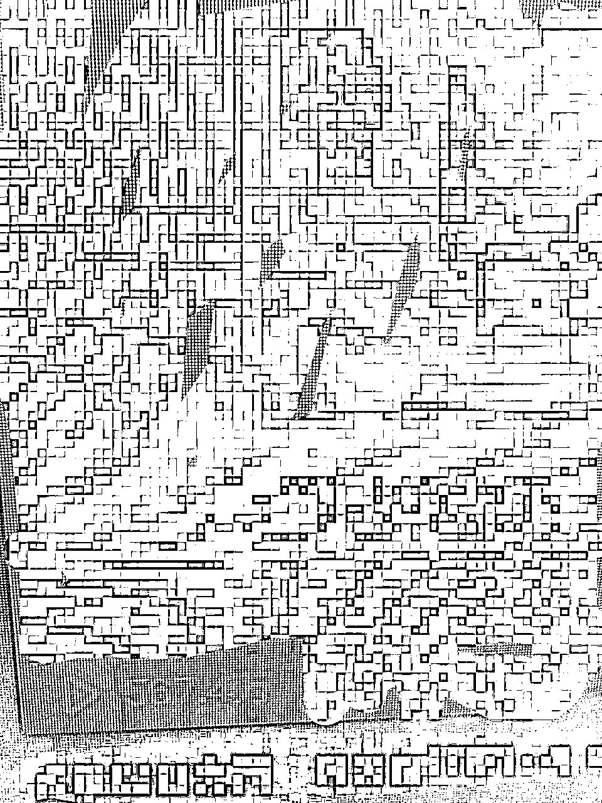各平台各账号都有询单，每天都有人加🛰️，但就是起不了量，成交惨淡。越做越明白：高客单客户决策周期长，会大范围比较。只有长期稳定地发高质量内容，才可能让ROI大于1。

信任问题本质上是真假问题。我的做法是卖出后、发货前，送到权威第三方鉴定机构过检。

原本我对C端的预期是3个月跑正，实际发现难10倍，真正做好要搭3年。所以我暂时砍掉C端，集中精力放大公司现金流。2025年会继续做供应链，深耕国内渠道，建联更多海外渠道，储备够做3年C端需要的资金和条件，再启动ToC。当然，如果期间能拿到一笔用于C端发展的融资，也会加速。

这就是我2024年零起步做二奢业务的完整经过，希望对你有用。如果你有海外渠道、获客能力或资金支持，欢迎深度聊聊。