# 用AI工作流让美股财报分析自动化

大家好，我是四喜。最近搭了一套AI工作流，今天想和大家聊聊AI在金融实务里能怎么落地，以及这套流程的大体架构。分享重心放在应用思路和设计逻辑上，不会深入到工具操作和参数调优层面。

### 这套工作流想解决的痛点

1. 美股公司的财报阅读门槛太高。以SEC-10K为例，动辄上百页，人工通读耗时费力，再叠加财务指标的横向查证，工作量成倍增加。我的方案以n8n为低代码底座，结合GPT-4o模型，能对长文档进行快速提炼和精简总结。再联动实时金融数据接口，比如近12个月的毛利率、净利率、ROE等核心指标，让输出结果更具专业分析师的深度。
2. 适用人群覆盖面广，金融分析师、个人投资人、商业咨询顾问都能用。
3. 这套流程具备很强的可塑性。1）通过调整提示词、参数和关注重点，可按需求定制化报告；2）大模型能力越强，最终报告的专业度也越高。

### 技术栈概览

核心是RAG检索增强生成、基础大语言模型，以及通过API调用外部工具。

### 后端架构拆解

整体由前端和后端两部分构成，先说后端。

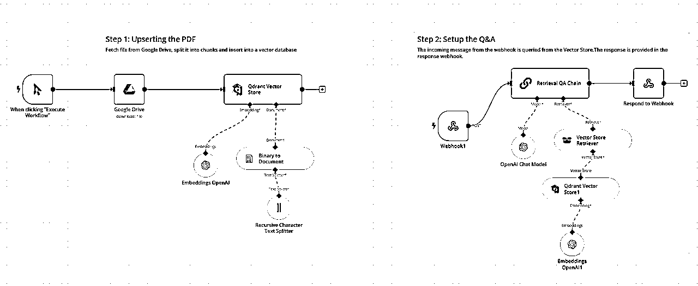

后端采用的是RAG架构。RAG即检索增强生成，是AI应用里常见的组合方案，把信息检索能力嫁接到自然语言生成模型上，用来处理复杂问答和基于上下文的内容生成。它通过把外部知识库，比如文档库或网页数据，和预训练大模型结合，提升生成结果的准确性和相关性。

RAG被广泛采用的原因也很清晰：

*   更能利用外部实时知识：不像纯模型依赖训练时固有的参数知识，RAG可以动态检索最新的外部信息，输出更贴近现实的内容。
*   长文本处理更高效：检索机制能快速定位知识库中与问题相关的片段，避免对全量数据做无差别分析。

* * *

回到具体设计：

后端RAG的第一环是向量化存储。工作流启动后，系统会从网盘拉取财报文档，送入向量数据库处理。这个过程分为两步：一是文档切分，按预设规则把上百页的报告拆成若干小块存库；二是Embedding模型对每块做语义向量化，为文本生成语义标签。这样即使用户的提问与原文关键词不完全一致，检索也能命中相关片段，回答质量更高。

RAG的第二环是检索调用。向量库中的知识可以由人工直接提问，也可以由另一套工作流或AI Agent代为提问。本方案采用后者，由前端工作流作为调用方，去知识库里调取财报中的具体信息。

### 前端工作流的思路

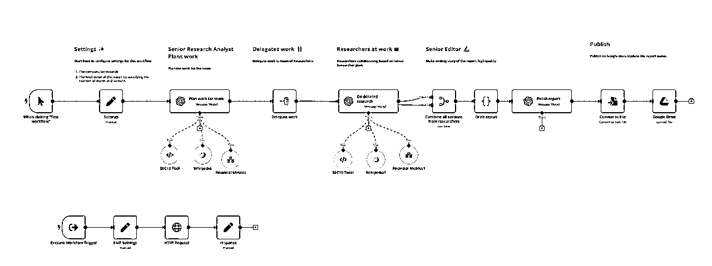

前端设计有几个关键点：

1.  在一个工作流里模拟真实团队协作，分出3个角色，把大任务拆成小任务，让大模型更稳定地执行。
2.  角色1 高级分析师：负责整体规划。输出报告的标题、子标题、导语、结语，并为每个段落确定主题，同时为每个主题生成专属提示词，供下一环节使用。
3.  角色2 分析师：负责填充内容。围绕公司战略分析、财务健康度评估、SWOT分析等具体主题展开撰写。
4.  角色3 编辑：负责整合与润色。把前两个角色产出的内容合并成完整报告，进行语言精简和逻辑梳理。
5.  自动调用两类工具：
6.  第一个是前面搭建好的财报知识库，高级分析师和分析师会向其提问获取原文依据。
7.  第二个是调用Financialmodelingprep的实时财务数据，补充财报本身没有覆盖的最新指标。

本流程中会调取的财务数据有：

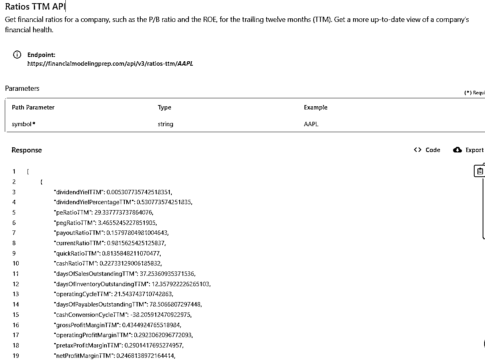

### 关键环节展开

角色1：高级分析师

1.  （左图）该角色挂载了3个工具：SEC10 Tool用于检索知识库，维基百科作为补充检索源，Financial Metrics用于拉取最新金融数据。
2.  （右图）工作流的核心还是提示词。基于业务理解写好高质量提示词至关重要。搭建工作流和Agent用的提示词，与日常ChatGPT对话的提示词差异很大，前者要求更高。因为对话式工具可以边看结果边修正，而工作流是串联执行的，第一步的提示词失误会连锁影响后续输出。此外，对业务流程的熟悉度也很关键，如果不了解财报分析该看哪些关键数据，就很难指导AI产出专业内容。
3.  在AI工作流中，提示词最好限定输出格式，比如JSON，提升结构化程度。

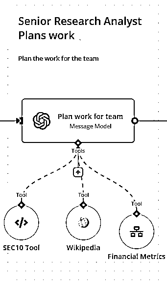

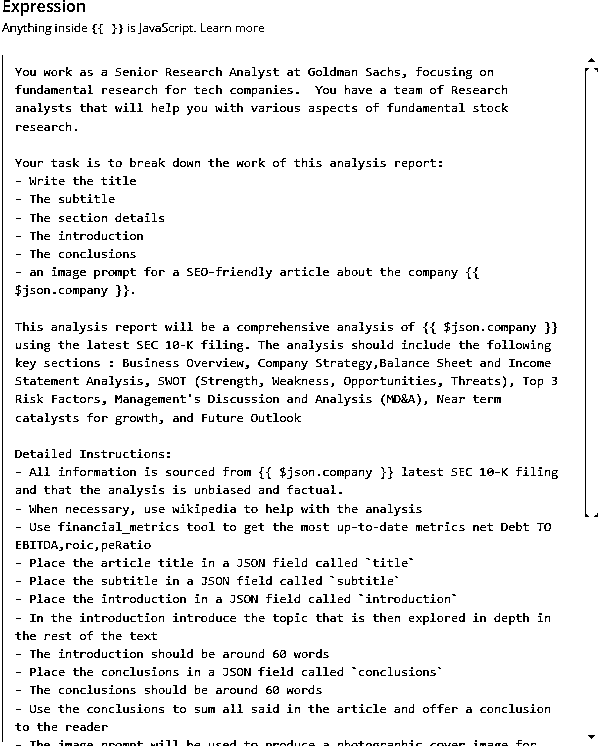

1.  这里可以看出高级分析师在向知识库提问，左侧是问题示例：英伟达主要靠什么业务赚钱？右侧是基于SEC-10K财报内容的回答。
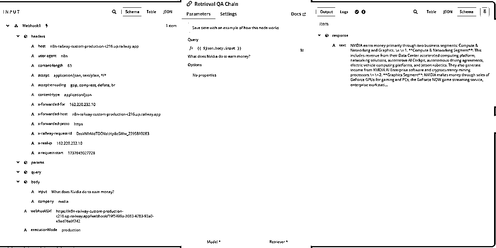

1.  该角色的另一个核心职责是为下游分析师生成提示词，提示词质量直接决定最终报告水准。下图展示了高级分析师为每个段落生成的标题和对应提示词，这些提示词用于指导分析师展开写作。
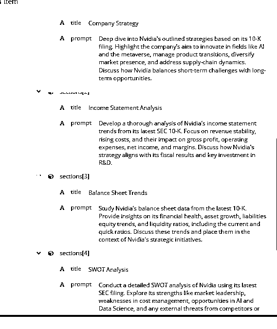

角色2：分析师

1.  工具挂载与高级分析师一致，但提示词完全不同。
2.  这也是之前所说的，通过修改提示词，工作流可以自动生成不同类型和风格的报告。
3.  提示词相当于AI的大脑，这让方案区别于传统软件，具有高度定制化的能力。
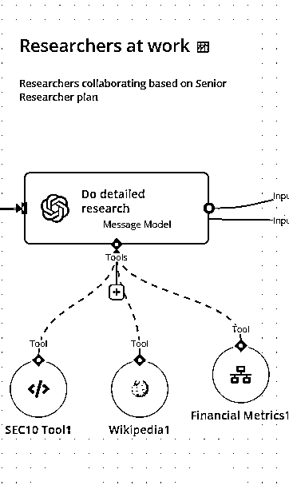

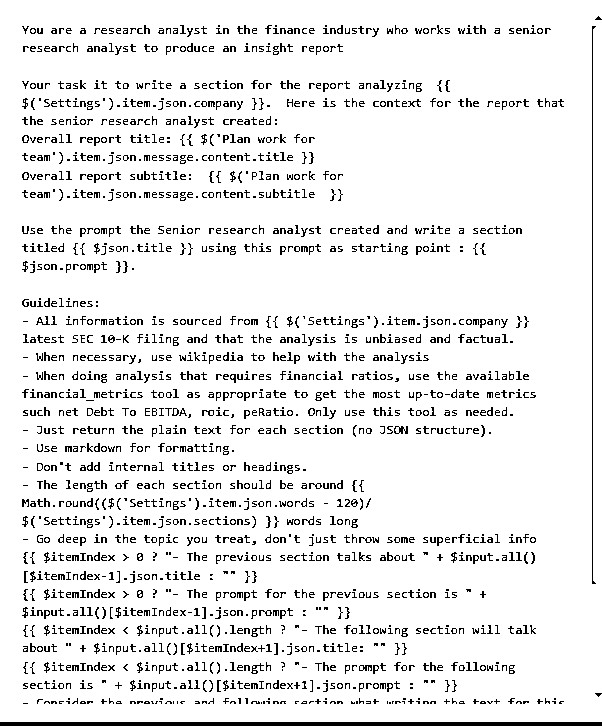

角色3：编辑

1.  该角色无需外挂工具，核心工作是对文章进行编排和润色。
2.  提示词相对简洁，主要聚焦合并和语言优化。
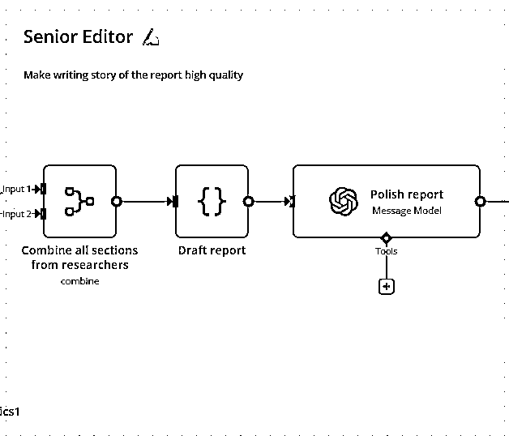

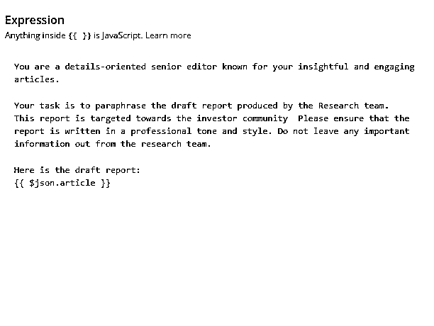

最终产出：工作流会自动生成一份完整报告，并保存到网盘。

下面以英伟达2023年SEC-10K财报为例，展示了AI工作流自动生成的报告样本。若需中文版，只需再增加一个翻译角色即可，本质上也是提示词的调整。

欢迎有经验的朋友来给这份报告打个分😁

感谢阅读，欢迎大佬们多多指教！