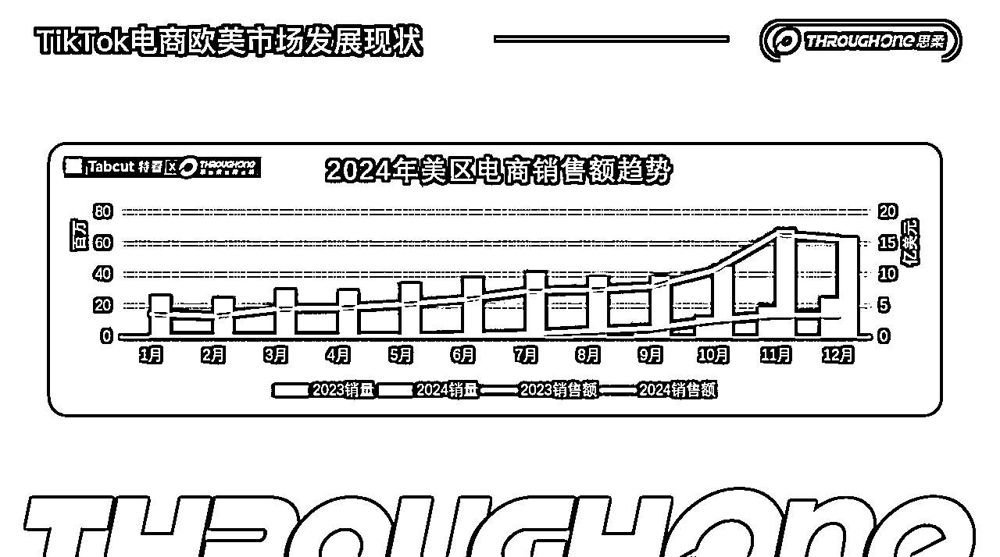
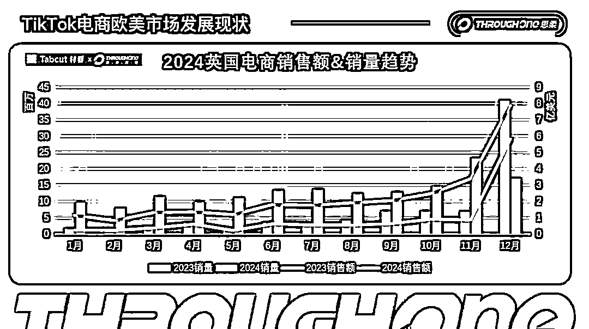

# 2025年，TikTok欧美市场还有哪些值得切入的机会？

大家新年好，开工顺利。这篇想把2025年TikTok在欧洲和美洲市场的机会重新盘一盘。内容会比较长，建议先收藏，再花10-15分钟慢慢看。如果你刚接触这个赛道，可以从头读到尾；如果已经有一定经验，可以直接跳到市场现状和机会部分。

## 一、先看清三个市场：美区、英区、墨西哥

从2017年上线至今，TikTok不仅在社交领域拿下了不小的份额，更靠着短视频和创作者生态，把电商这件事做出了新的想象力。欧美市场现在到底处于什么阶段？我们从美国、英国、墨西哥三个板块来看。

### 美国：有增长，但离“爆发”还差一口气

这是Tabcut特看统计的美区2024年销售额趋势图：青色线代表2023年，红色线代表2024年。

2023年下半年，从7月到年底，销售额曲线快速拉升，短短几个月单日成交额就翻了几十倍，这也是大量卖家选择在2023年底和2024年初杀入美区的原因。到了2024年，虽然整体曲线依然向上，但更多是线性增长，离大家期待中的指数级爆发还有一段距离，也没有出现特别明显的拐点。

更直白地说，TikTok美区的体量和亚马逊还不在一个量级：亚马逊在美国是千亿美元级的盘子，TikTok目前大概只有百亿美元级。可也正因为体量小，TikTok依然是公认的流量洼地，流量价格足够便宜，后续增长空间很值得想象。

### 英国：增速更明显，是欧洲市场的风向标

再来看Tabcut特看的2024年英国电商销售额趋势图。

英国市场给出的信号比美国积极不少：年初单日销售额大约200万美元，年底已经能到600万美元，相当于年初的3倍。TikTok对欧洲市场显然抱有很高预期，2025年德国、意大利、法国都会逐步开放，西班牙和爱尔兰也已经进入视野。

不过这里要给大家提个醒：西班牙虽然开放了快两个月，但基础建设和数据表现仍处于冷启动阶段，整体成绩不算亮眼，眼下并不是最佳入场时间。如果非要现在冲进去，需要投入更多资源和耐心才能把业绩做起来。换句话说，欧洲新市场的窗口期还没完全打开，可以再等等。

### 墨西哥：2025年最有潜力的黑马

如果说今年有一个市场特别值得高看一眼，那一定是墨西哥。

从大盘看，墨西哥电商整体规模约450亿美元，足够撑起TikTok内容电商的想象空间。人口接近1.3亿，其中三分之二都在用TikTok，潜在消费群体非常庞大；更难得的是，这些用户里将近一半购买力不错。

Shein和Temu在墨西哥增长很快，已经验证了一点：当地消费者对中国供应链接受度很高。TikTok完全可以顺着这条路，把更丰富的中国商品带进去。与此同时，墨西哥达人表现得非常积极，比美国达人更愿意靠短视频带货赚钱；达人愿意创作，整个电商生态就更容易转起来。

当然，墨西哥物流基建是一个门槛。好在TikTok平台目前自己承担了尾程配送，把商家的履约成本降了下来，也为新进入市场的卖家扫清了一个大障碍。综合来看，墨西哥极有可能成为2025年TikTok电商的重要增长引擎。

## 二、2025年的机会分两种：短期红利和长期复利

先厘清概念。

短期机会，是指现在开始做3-6个月就可能赚到钱，靠的是平台流量红利和补贴政策。这类业务好处是见效快，但往往缺乏复利效应，红利会随着时间推移慢慢变薄甚至消失。

长期机会，则是在日积月累中核心竞争力越来越强、盘子越做越大的业务。难点在于前期可能有现金流压力，甚至要熬过一段生存期；但一旦跑通，就是能把时间变成壁垒的生意。

## 三、短期机会：适合先跑起来拿结果

### 1. 新市场开放

新市场开放是TikTok电商最典型的短期红利。墨西哥就是典型：盘子不一定最大，但TikTok渗透率极高，约三分之二人口是用户，一半以上有电商购买倾向，短期机会很大。

西班牙这类欧洲新市场则相对平稳，开放两个月但增速没有达到预期。不过它的竞争比欧美其他市场更小，在本地物流和产品供给上仍有机会，中小商家可以考虑把它作为备选项。

新市场的机会窗口一般持续3-6个月。平台在这个阶段会给足红利，让商家低成本进入、快速获客。谁能抢先占住位置，谁就能为后续发展积累流量和客户。

### 2. 自孵化账号

在美区TikTok电商生态里，最稳定的盈利角色其实是达人，而不是商家或平台。达人靠短视频内容带货拿销售佣金，收入相对稳定可预期；商家反而容易被流量采购和广告成本吃掉利润，短期很难盈利。

所以，如果你没有合适的达人资源，不如尝试自孵化账号：自己动手做内容，用短视频撬动平台自然流量，同样可以带货。

### 3. TAP机构

TAP机构可以理解成国内电商里的“团长”，核心工作是帮商家寻找达人、撮合合作，然后从中介环节赚钱。

它的价值在于，大多数商家并没有庞大的达人库，只能借助TAP去快速匹配资源。尤其在新市场或内容供给紧张的时候，TAP的需求会非常旺盛。同时门槛也不高，只要你手上有人脉、有能力触达达人，就能入场；适合有一定资源积累、但暂时不具备规模化运营能力的团队。

缺点也很明显：利润空间不算厚，因为本质上是瓜分达人佣金的一部分；长期来看，TAP很难沉淀自己的达人资产，毕竟商家一直在变，不同商家对达人的需求也不同，很难持续为同一批达人稳定派单。

### 4. 短视频+付费投流的闭环打法

这是美区在2024年逐渐跑出来的一套打法，非常适合内容电商平台。

TikTok美区的单量主要来自短视频，但纯靠自然流量很难支撑起规模化盈利。把广告投放叠加到短视频上，既能放大曝光，又能拿到更精准的流量，转化率自然更高。这套组合拳跑起来，一个月就能把一个新品从0推到起量，有些卖家冷启动一个月后就能做到单日1万美元——我们自己的团队也验证过这个结果。

这种打法的好处是起量快、成功率相对高，不只是2024年，未来几年都值得持续关注。

## 四、长期机会：值得用时间换空间的生意

### 1. 生态MCN

MCN和TAP经常被放在一起说，但本质完全不同。两者的服务对象正好反了过来：TAP是替商家找达人，MCN是替达人找商家。

MCN手里先有一批稳定合作的达人，再帮达人对接商家、接商单。它与达人之间的关系绑定更深，能在长期合作中不断积累达人资源，商业变现也更持续。TAP带来的合作往往偏短期，而MCN可以在内容创作和流量积累上给商家提供长期价值。

放到TikTok生态里看，平台有两个很重要的生态位：供应链和内容。TikTok是内容电商，除了品牌和货，更依赖内容生产者。MCN一旦掌握一批达人，就等于掌握了内容生产的上游，自然能影响流量分配。流量背后就是商业收益，所以MCN相当于握住了一把持续变现的钥匙。

但MCN不是一门快生意。签约达人、维护关系、扩充达人池，都需要一天天积累。美国很多达人忙于处理各种带货邀约邮件，连回复都顾不过来，MCN的价值恰恰在于替他们搞定这些杂事——管邮件、接商务、做运营支持，让达人能专注做内容。

说到底，MCN业务模式并不复杂，真正难的是时间沉淀。没有足够稳定的达人库，机构就没有生存根基；一旦把达人库建起来，护城河会越来越深。

### 2. 私域电商+独立站

私域电商和独立站，走的是另一条长期路线：不追求一锤子买卖，而是把客户资产牢牢握在自己手里。

TikTok本身没有私域：平台流量完全由算法分配，哪怕你有100万粉丝，发一条视频能不能被他们看到，也不是你自己说了算。因此，想通过TikTok做私域，就必须把用户引到 Telegram、Discord、Facebook 这些更可控的渠道，建立起直接联系。

当用户沉淀到自己的社群或独立站之后，商家就能反复触达，做更精细化的运营。复购率高的、偏刚需的、或者带点擦边属性的产品，最适合放到私域里经营。长期来看，这种模式更容易沉淀出客户忠诚度和持续复购，比单纯在平台里卖货稳得多。

## 写在最后

2025年，TikTok电商依然不缺机会，短期、长期、长短结合，各有各的打法。如果实在不知道从哪里入手，就记住一个原则：最适合自己的那条路，才是真正能走远的路。先从自己的资金、资源、技术这几个维度做一次梳理，再决定切入点，远比盲目追风口更重要。