# ('小众冷门项目：骑手招聘，新手有哪些入局方式？', (2, 24))

你有没有发现，如今街头巷尾穿梭着越来越多穿着各色工服的骑手？这个行业火热的背后，其实藏着一条少有人注意的赚钱赛道——骑手招聘。

先说说我自己的经历吧。我叫青木，在人力资源领域摸爬滚打了十三年，2021年正式切入即时配送这个赛道，组建了自己的招聘团队。这几年的运营节奏，团队规模会随行业淡旺季灵活调整，常年维持在30到60人之间。每月能推动500到1000名骑手入职，最终按结算口径有220到400人左右，团队月营收大概在40万到72万这个区间。

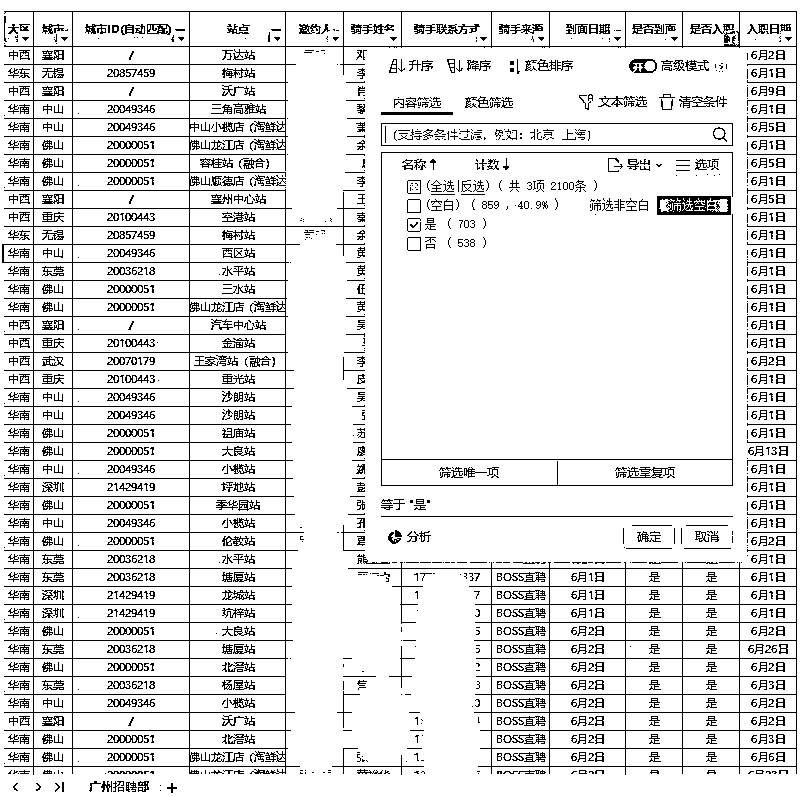

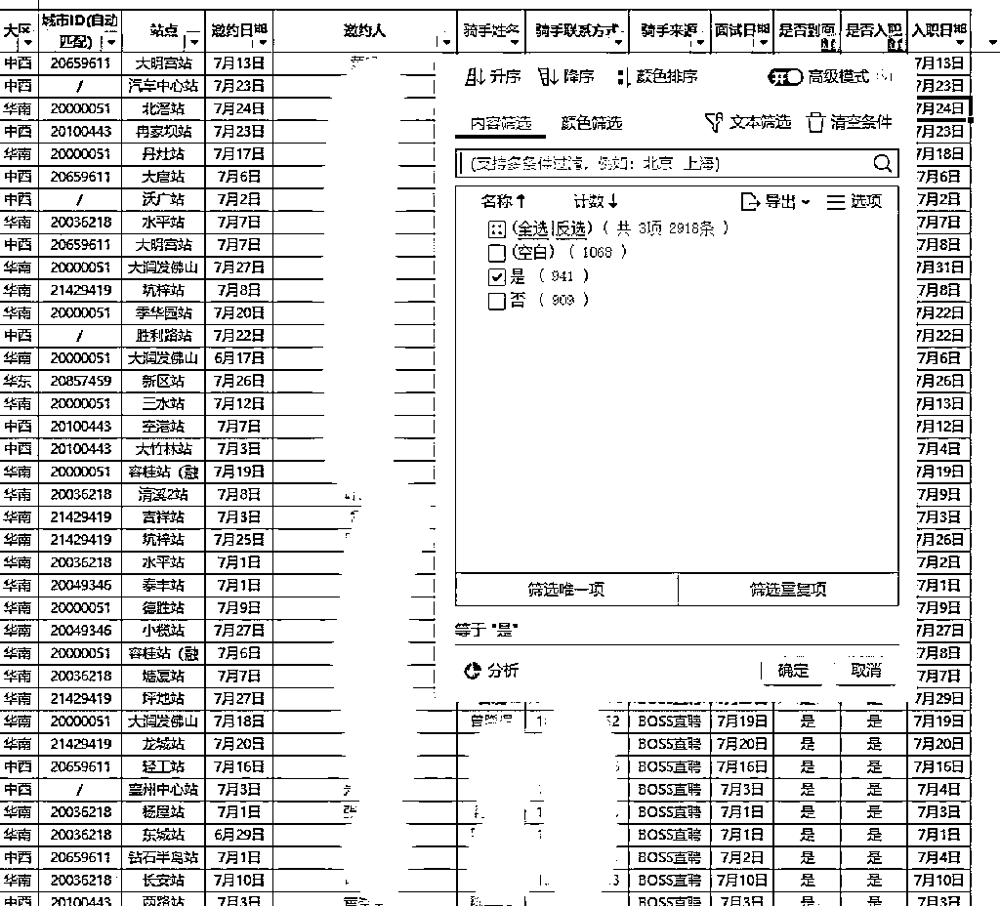

为什么这么多人涌进外卖和即时配送？一方面，电商和外卖单量年年攀升，平台对骑手的需求像无底洞；另一方面，骑手这份工作时间自由、收入不差，吸引了大批年轻人加入。于是很多圈友问我：这个行业有没有门槛低、回本快、容易上手的周边生意？其实，最典型的答案就是——骑手招聘。它几乎是整个即时配送链条里的硬刚需，因为平台和配送代理商永远缺人，而且这一行投入小、上手不难。

如果你只是想当副业试试水，通常需要找到官方代理商合作，因为这里面牵扯了大量资源对接，个人很难独立触达。具体操作流程大致是：每个月花800到1500元购买BOSS直聘的VIP权益，用来发布岗位、开聊求职者；把有意向的骑手约到线下，交给面试官去面试、办入职；你只需要紧跟进度，等骑手跑单满15天，就能拿到佣金。佣金一般是结算价的80%到90%，举例来说，如果招一个骑手的结算价是2000元，你到手就是1600到1800元。

接下来，我把它掰开揉碎讲清楚。

一、整个项目的链路是怎样的？

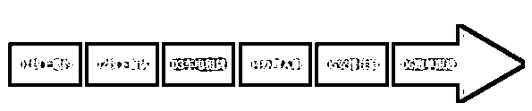

先说线上邀约：招聘专员通过各大招聘平台拿到求职者联系方式，介绍岗位，把他们约到面试点或者代理商站点。然后就是线下面试，由面试官或站长接待，解答疑问。遇到没车的骑手，还要安排他去合作车行租电车，签约领车。租好车，就去对应区域站点办入职，站长会安排培训和老师傅带跑。如果需要住宿，站长会对接给宿舍承包商。最后，线上团队要和站长配合，至少盯骑手前15天的跑单情况——每天有没有出勤、跑了多少单、有什么困难需要协调。

二、四种入局方式，你适合哪种？

从身份角色来看，基本可以分四类。

第一种：全职招聘专员。加入团队拿底薪，再加上结算费10%-15%的提成。比如结算价2000元/人，你提成就是200到300元。

第二种：兼职招聘专员。不用自己承担账号成本，没有底薪，提成按阶梯算，大概是结算费的40%-70%。同样是2000元/人，提成在800到1400元。

第三种：合伙人。自己掏钱买账号资源，把招到的骑手通过团队推给客户，收入通常是结算费的80%-90%，也就是单个人1600到1800元。

第四种：自己搭团队。投钱买资源，组建招聘队伍，当操盘手和老板，赚的就是剩下的利润。

三、决定成败的三大核心因素

整个项目说白了就是解决三件事：去哪儿找骑手？谁来负责找？找到的骑手给谁？

（一）招聘资源

目前主流的招聘渠道基本都靠线上流量。从配送平台的角度看，骑手分专送和众包，对应招聘平台上的全职和兼职。因此团队也有了侧重：有的专攻全职，跟结算价高的站点深度绑定，赚高额结算费；有的专攻兼职，因为兼职流量更大，通过自建或合作面试点，大量推送人去跑众包，再赚车辆返费、手机卡、装备这些周边钱。

我们团队以全职为主，前面列的数据就是全职的。但兼职流量进来也别浪费，可以自己搭面试点或跟同行合作，把返费也赚了。

主流合作平台有这几个：

BOSS直聘：目前在骑手和蓝领招聘里流量效果最好，年轻化、直聊加精准匹配，使用场景随时随地，占有率差不多七成。

58同城：当年在蓝领市场很风光，现在不行了。招聘成本高、竞价模式让成本不可控、资源真实性也差。华南团队基本不用了，华中地区因为结算价高，还有人用。

智联招聘：老牌平台，这两年也想做蓝领，但份额一直低，只能当流量补充。好处是便宜，一年招两个骑手就回本，坏处是专员花时间但产出效率不高。

抖音快手这类短视频平台：流量巨大，但它是娱乐平台，不是专业招聘平台，资源精准度低、简历意向度不高、转化率差。不过如果未来有平台能挑战BOSS直聘的地位，短视频平台的可能性最大。

这里有个关键认知：BOSS直聘改变了以前花钱买流量的玩法——大家出一样的钱，谁能获得更多流量，取决于账号能不能抢到。所以，账号活跃度就成了招聘骑手的命门。

（二）需求客户

真正买单的并不是美团、饿了么这些平台本身，而是他们的城市配送服务代理商。想做骑手招聘，要么你自己成为代理商，要么跟代理商合作。目前代理商基本饱和，平台对资质和资本要求极高，新公司和个人很难进去。最现实的路就是跟现有代理商合作。

这个圈子相对封闭，外人很难融入，拓客不容易。但行业内的人开发客户就简单很多。好消息是，已经有蓝领平台在打破壁垒——它们搭建了服务系统，把骑手、人资商、代理商、平台交付中心全部链接起来。这样一来，招聘团队不用自己拓客，直接推送骑手入职跑单就能结佣金。这个平台预计2025年正式推出，可以期待一下。

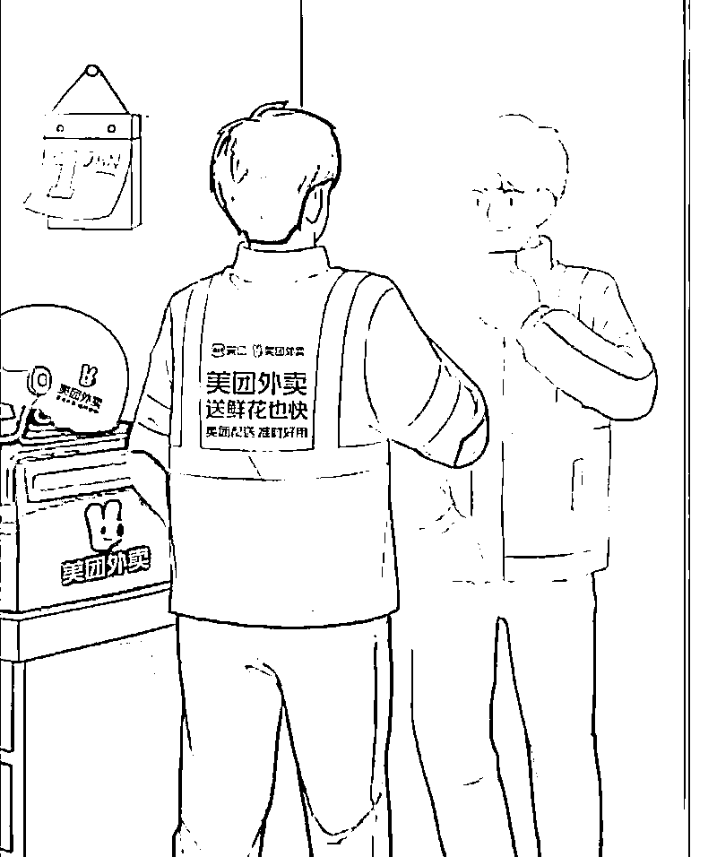

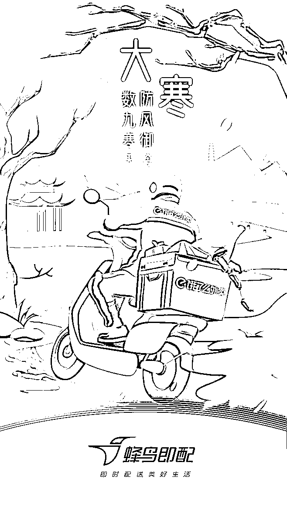

（三）招聘团队

这是最核心的环节。资源要变成骑手，中间全靠人执行。团队通常分两块：线上邀约团队负责引流、建联、邀约；线下面试官团队负责面谈、推荐平台和站点、安排租车和对接。

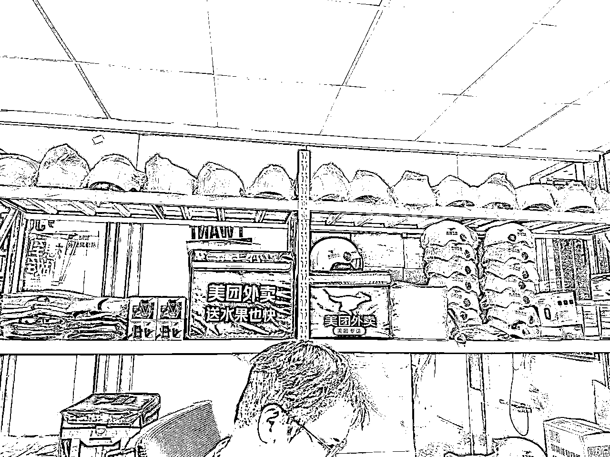

线上团队有四种成员：全职专员，管理强但人工成本高；无底薪兼职专员，成本轻但难管理；合伙人模式，不用承担成本但开发难度大；AI招聘，目前必须结合全职团队来用——优势是账号在线时间长、养号快，专员能同时操作多个账号，省成本又提效，缺点是容易封号限流。

刚开始起步或者规模小的团队，基本都是只做线上邀约，把人推到代理商站点或合作面试点。只有做久了、投入大了，才去自建面试点和面试官团队，因为面试点需要足够的推送量才能养活。

如果只推送代理商站点，风险不小：站长不是专职面试官，能力参差不齐，而且午晚高峰忙起来，根本顾不上仔细讲解，容易流失骑手。自建线下面试点，让线上团队和面试官配合，就能明显提高入职率和达标率。线上邀约时把骑手在意的信息，比如想跑哪个平台、哪个区域、租车费用、结算周期、出勤时间、住宿需求等，都同步给面试官，面试官再针对性讲解和匹配，成功率自然更高。

四、怎么把BOSS直聘的流量玩明白？

前面说了，BOSS直聘是主流渠道，核心就是提升账号活跃度，让系统给你更多曝光。具体来说：

（一）拿到平台资质

目前骑士招聘的VIP权益是2条帖+50个开聊数。通常一个专员配2个BOSS权益+1个智联或鱼泡网权益，每天能有200个开聊数。数据好的专员可以多配权益提高产值。

要拿BOSS直聘当主战场，得解决两个问题：一是企业要有配送资质，才能发布送餐员和配送员岗位；二是要拿到美团或饿了么的授权，上了白名单、加了黄标或蓝标，帖子才能拿到更多流量。所以，项目方一般都要跟代理商深入合作，但目前没有统一平台能找到各地代理商，只能靠人资三方公司转介绍。

（二）用好这些实操小技巧

聊天数：每天开聊数一定要用完，否则系统认为你不活跃。但别一口气打完，要分时段，因为求职者活跃时间不同。

先看简历再聊：点开在线简历后再打招呼，系统推荐会越来越精准。看简历数要大于开聊数。

标记功能：把不符合岗位的人标记一下，系统就会减少这类推荐，避免重复打招呼，越推越准。

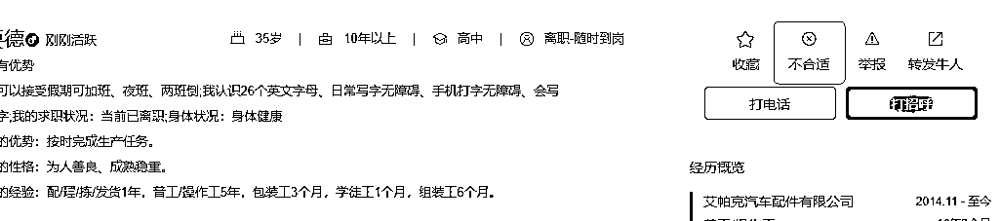

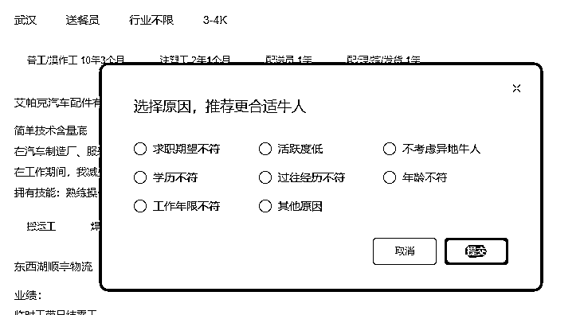

收藏功能：打完工后，要求专员每天收藏一定数量的简历。这个动作能提升活跃度，而且求职者能看到谁收藏了他。

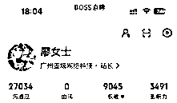

多用平台功能：要简历、交换微信、换电话号码，能用的功能都用上。

回复要及时：一分钟内回复，最后一条消息必须是我们发的。

复聊：已读未回的，隔天一定要跟进，至少联系三次。有时间的话，未读的也再沟通一下，相当于多一次权益，目的就是让他看到。

标题加关键词：在岗位标题里加“瑞幸”这类品牌名，搜索概率和吸引力都会提升。

分享职位增加二次曝光：每天分享到朋友圈可增加2个影响力，别人扫码浏览增加1个。分享到微信“文件助手”，每个职位挂满24小时才有效。

去“有了”社区互动：点赞、评论、点get、提问、回答，关联职位也能增加曝光。

（三）把流量导进私域

每天在平台拿到的线索，通过工作微信、招聘系统沉淀成私域。做得越久，手上的资源池越大，还能捞到换工作的骑手和转介绍。

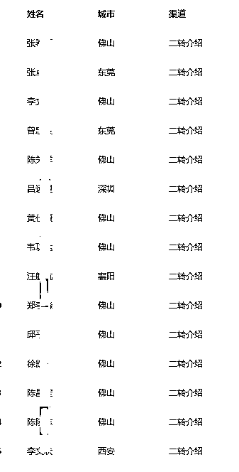

五、后端交付：从面试到收佣金的完整闭环

引流到私域后，怎么推进到最终拿钱？

（一）安排面试

BOSS直聘只用来引流，别在上边聊太深——聊多了容易招投诉，而且死活不加微信的人，大概率是同行来学话术的。加微信后，让求职者发定位，根据定位推荐就近的站点或面试点。邀约成功后，把信息同步到群里给面试官或站长，然后跟进求职者到店面试、办入职。

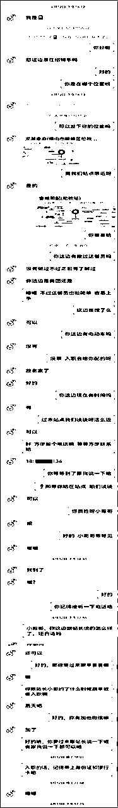

（二）结算佣金

骑手入职后，线上团队和面试官要配合跟进跑单。正常情况下，有效跑单满15天，代理商才给招聘团队结算。

结算流程是：次月初招聘团队提交上月入职名单→代理商核对达标情况并反馈达标名单和总金额→招聘团队开发票→代理商打款。达标条件一般是出勤15天且每天跑够代理商要求的单量，具体标准各城市不同。结算周期一般是次月底。

从邀约到最终达标，比例取决于团队能力和站点留存。按正常水平估算：专员用2个权益，一个月大约获得300条线索，邀约75人，到面38人，入职全职13人，最终达标6人。如果兼职做，达标人数打个折，按每月达标2-4人、一单1800元算，兼职收入大概3600-7200元/月。

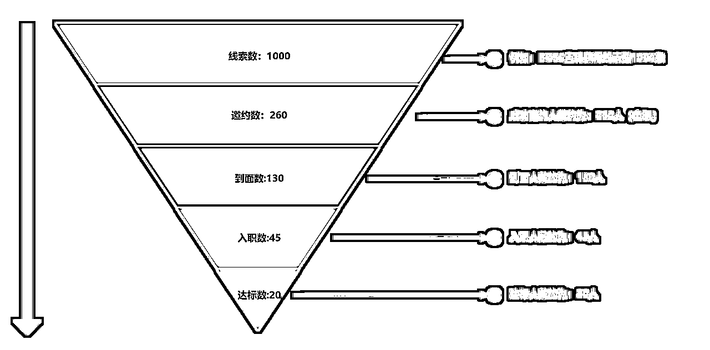

（三）衍生出面试点模式

有足够人才储备后，还能开辟三种玩法：自营面试点、面试点招商加盟、面试点联营。前提是手里有足够的招聘团队或合作团队，保证面试量。线下面试点可以说是目前该项目最稳的盈利模式。

六、新人入局：优势与挑战

先说优势。为什么说容易入门？核心是灵活度太高。

想做自由职业或兼职，可以选择合伙人模式，跟公司签协议，购买或租赁账号搞招聘，招到人通过公司送站点，拿结算费。想做小而美创业，也完全有机会：一间办公室、三五个员工、买6到10个BOSS权益、找一个代理商深度合作，主攻推送就行。门槛低、投入小、回本快。如果还能谈成账号分期采购，前期投入更少。

按广州市场结算价2000元（偏低取值）计算，一个5人团队、10个权益，人效4到6的话，在不计算租车返费和其他面试收入的情况下，收益也挺可观。所谓人效4，就是一个人一个月跑满4个达标骑手，平均7天一个；人效5大概6天一个；人效6就是5天一个。

再说劣势。没有圈子人脉的人，拓客成本会很高。这种情况可以考虑等平台统一开放端口、不用自己出去找客户的时候再进场。

总结一下：骑手招聘是一个很值得关注的人力资源创业切口。投入成本不高，客户需求量巨大，蓝领求职基数庞大，盈利模式还很多样，周边产品也不少。简单，好玩，有机会。