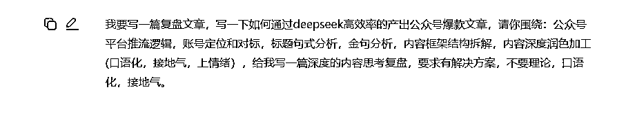
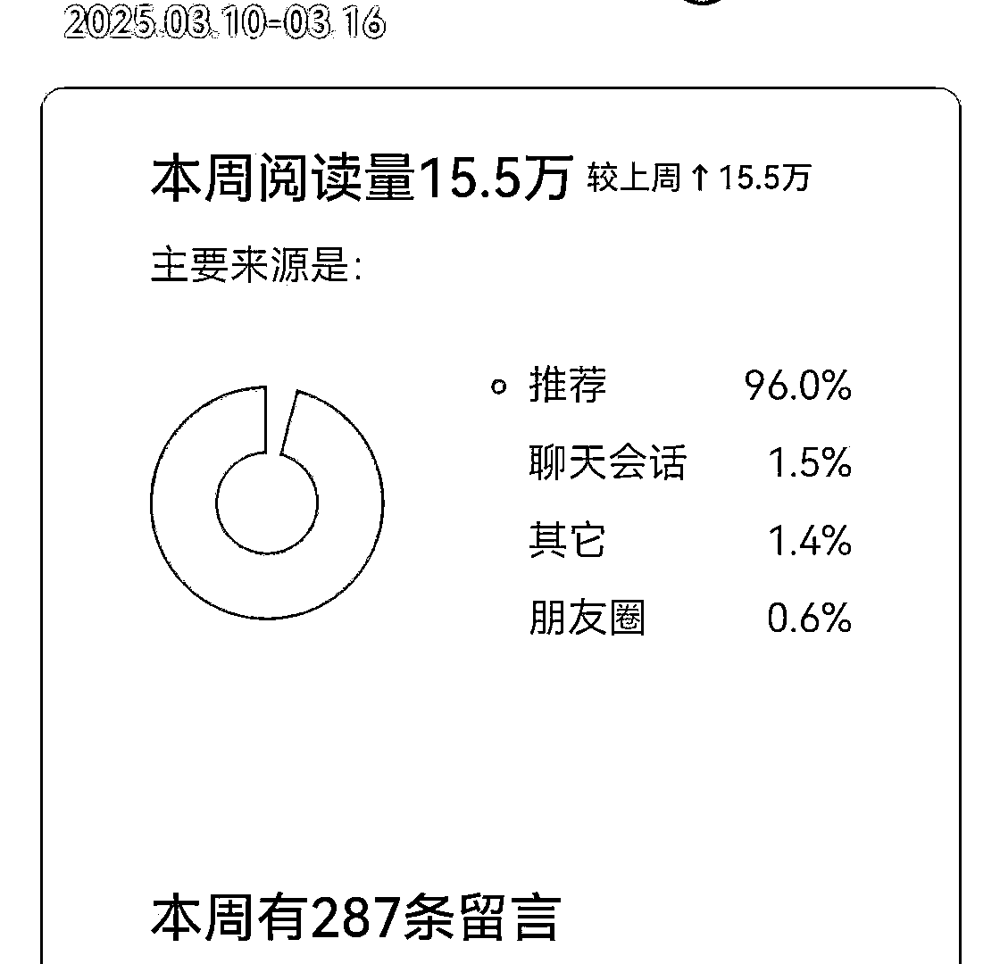

# 这篇关于DeepSeek做👸号爆款的复盘，我建议你至少读三遍
作者：龙哥

大家好，我是龙哥，在自媒体行当泡了五年，码字几百万，写出过几十篇10w+，也有几篇百万级大爆款。今天这篇，是拉着ChatGPT 4.0和DeepSeek一起打磨出来的复盘，希望能跟同路人交流一点真东西。

我反复在琢磨一件事：用DeepSeek这种工具，到底能不能稳定产出爆款？结论是可以，但前提是你得先看懂平台怎么想，读者要什么，而不是指望AI替你思考。

下面我从流量推荐机制、账号定位、标题设计、金句提炼、文章骨架、语言润色这几个维度，把能落地的操作都说透。每一条都配上AI介入的具体办法和提示词，你拿去就能用。

## 一、平台不是玄学，它偏爱什么样的内容？

很多人发完文章，看到阅读量惨淡，第一反应是“我被限流了”。其实平台没那么复杂，它就两个标准：原创、互动。注意，这里说的原创不是把别人的东西换个皮，而是真正有信息增量、有行业洞察的内容。比如你写养老金，如果只是复读政策文件，没人爱看；你要是能把未来五年的政策趋势讲清楚，再落到普通人钱包上，讨论度自然就上来了。

那怎么提高被推荐的概率？三个动作：

- 在文章里埋互动点：提问、投票、小调查，让读者有地方说话。
- 把内容做深：别只讲现象，要讲现象背后的政策逻辑、金融影响、人群心理。
- 敢亮立场：讲点大家想说不敢说的，制造点冲突和矛盾，有争议才有讨论，有讨论才有数据。

AI在这里能干一件事：分析数据。你可以直接用DeepSeek去跑最近一周的热门文章，让它总结推流规律，或者让它结合你的领域给出热点方向。提示词我都替你想好了：

- “帮我复盘这周👸号爆款文章的互动数据，提炼出平台偏好的内容特征，再给我十个标题方向。”
- “我是做房产内容的，根据近期趋势，给我三个适合👸号深挖的话题。”

有了AI的洞察，你就能避开同质化，去写平台稀缺的深度内容。

## 二、账号定位：别做大池塘里的小鱼，要做小池塘里的大鱼

一打开后台，看着自己杂乱无章的选题，很多人会陷入焦虑。问题往往出在定位上。你得先想清楚：我的读者是谁？他们的痛是什么？情绪出口在哪？

举个例子，你想做宝妈号，泛泛地写“育儿技巧”已经塞满赛道了。你应该写什么？写“当妈以后，我如何面对自己的情绪崩溃”，写“孩子出问题前，妈妈内心那个求救信号”。这些是从情感共鸣入手，而不是从工具书入手。

赛道怎么选？三个高潜方向：

- 民生类：养老金、医保改革、社会政策。这类话题有深度，又切近每个人，天生适合制造“读后感”。
- 房产类：别写房价涨跌，写城市格局变化、投资逻辑迁移，给读者一个看待市场的长期框架。
- 宝妈类：从陪伴视角出发，做情绪价值输出，做“理解你”的内容。

然后说差异化。最蠢的做法是看别人写什么你写什么。正确的做法是：找一个足够细的切口，比如“新一线城市房产投资”而不是“房产投资”，把标签缩得越小，用户越精准。

要想别人没讲过的，讲别人没听过的。很多同行来问我是不是用了什么AI工具做对标分析，说实话，我不用AI跑对标库，也不用什么第三方工具，大道至简，就自己一屏一屏刷，照样出10w+。思考，思考，再思考，这比任何工具都值钱。

当然，如果你想用AI辅助定位，它确实能帮你：

- 分析现有粉丝画像（性别、年龄、兴趣偏好）
- 拆解同赛道十家头部账号，给你差异化的切入点

提示词参考：

- “根据后台数据，帮我刻画用户画像，包含年龄、性别、内容偏好，再给出三个可切入的细分方向。”
- “找十个同类爆款账号，分析他们的定位策略，然后告诉我我的账号怎么做出差异化。”

一句话：你的用户是什么身份、要解决什么问题、有什么兴趣偏好，想透这三点，赛道自然就浮出来了。

## 三、标题：读者不关心你写了什么，只关心标题里有没有他

标题决定点击率，这是每篇爆款的第一道生死线。写标题要记住三个词：句式、关键词、话题。

高频好用的标题公式有三个：

- 数字+关键词：“5个步骤，解决你的养老金焦虑”
- 情感共鸣：“为什么我们都在怕一场延迟的养老危机？”
- 紧迫感+悬念：“2024年最后的房产窗口期，还能上车吗？”

标题不是写完就完事了，你需要批量生产，再人工筛选。这正好是AI的强项：你把文章核心丢给它，让它生成20个标题，涵盖数字型、情绪型、紧迫型，你自己再凭判断挑一个最合适。注意，这里的关键是“你”的判断，如果你没有判断力，反而会被AI带偏。

提示词：

- “根据这段内容，生成8个标题，要求至少3个带数字，3个带疑问句，2个制造紧迫感。”
- “为这篇养老政策分析，给出10个能引发点击欲的标题，要带情绪张力。”

## 四、金句：文章最容易被记住的，往往是那一两句话

读者看完文章后，细节会忘，框架会忘，但一句扎到心里的话，他会记住很久。所以金句不是锦上添花，而是文章的锚点。

怎么写金句？两个原则：一是对准情绪靶心，二是反复打磨到短小精悍。比如写养老，你可以说：“现在的每一分规划，都是在给未来的自己留体面。”写房产，你可以说：“你不跟上城市的节奏，城市就会悄悄甩开你。”金句有时候也不一定要自己想，从电影、从经典里借，比如“我命由我不由天”，放对语境就是爆款催化剂。

AI也能帮你提炼金句：用情感分析把文章里最有冲击力的句子挑出来。但别急着用，你需要像做手术一样去打磨它。AI生成的句子常常“差点意思”，只有你才知道你的读者听了哪句话会有电流穿过脊柱。

提示词：

- “从这篇3000字文章里，挑出5个最有情感穿透力的句子，改成金句。”
- “针对养老金主题，给我3句有力度、能作为结尾或排版加粗的金句。”

## 五、框架：先学会拆解，再学会搭建

很多人的文章读起来乱，是因为没框架。爆款文章通常有一个稳定结构：抛现象→铺数据→拆政策→给方案。你把那些10w+文章拿过来拆，会发现它们像积木一样整齐。

我的建议是：每周拆两篇爆款，把它们的骨架画出来，标出背景、转折、金句、行动号召的位置。拆够了，你自己的框架就会长出来。

自己搭框架时，可以照这个模板走：

1. 先用一个扎心的场景切入（比如：老张退休后才发现养老金不够花）
2. 再给数据、政策解读，制造紧迫感
3. 然后提出你的独特判断，最好反常识、反直觉
4. 最后落到可执行方案，别只讲道理。

AI在这里能帮你做“骨架师”：你给它一篇爆款，它帮你提炼结构；你想写新选题，它帮你按爆款结构搭框架。

提示词：

- “帮我把这篇房产爆款文章拆成层级框架，标注每个部分的功能。”
- “我现在要写养老金新政，请套用‘痛点-数据-政策-方案’结构，帮我列一份详细大纲。”

## 六、润色：别让AI把文章写成机器人

内容的核心从来不是辞藻，而是“人味”。什么叫人味？就是有情绪、有口语感、像一个活生生的人在跟你说话。所以润色的标准是：让他像一个朋友在饭桌上跟你讲，而不是一个专家在台上念PPT。

具体方法：长句拆短，术语换成大白话，多留一点呼吸感，多放一点情绪波动。比如“养老金政策调整可能引发结构性变化”这种话，读者一秒划走；改成“这次政策一变，可能影响你未来十年的生活水平”，他才会有反应。

AI润色的作用是帮你变口语化，但你需要反复审：这还有没有人味？有没有AI味？如果你自己觉得冷冰冰，那就要再拉回来。情绪和价值主张必须由你把关。

提示词：

- “把这段话改成更适合👸号的口语风格，保留原有信息和情感，不要让它像AI。”
- “请润色这篇文章，目标是读者觉得亲切、有共鸣，语言越接地气越好。”

写到这里，我其实最有感触的是最后一点：爆款从来不是一夜之间冒出来的。你看到的爆发，背后是无数次改稿、推翻、重来，是在灵感枯竭时咬咬牙又坐下来写的那股劲儿。长期主义不是一句口号，它就是你每天写的那几段文字，每天跟读者互动的那几分钟。时间不会辜负一直坚持的人，你现在的每一篇内容，都在为未来的某个爆发点铺路。

如果今天的文章没达到你的预期，别气馁，明天你会更好。持续写，持续思考，持续积累，你终会站在那个属于自己的地方。

谢谢你能看到这里，欢迎点赞、评论、交流。我们共同成长，日拱一卒，日复一日。