# 从自用工具到意外变现：用 Cursor 打造👸号矩阵系统的实战复盘
作者：龙哥


不久前我发过一篇实操笔记：https://t.zsxq.com/XzT7l ，里面记录了我在一个周末里用 Cursor 搭出第一版👸号账号管理系统的过程。起初只是为了解决自己的痛点：手上的👸号越来越多，手工管理混乱；Coze/Dify 搭的工作流再加上影刀 RPA 执行，总感觉慢半拍，自动化不够稳，做不到真正无人值守。为此我只想先做个能用的 MVP，核心方向当时是围绕流量主变现来设计。

没想到文章发出后在👸号和📕都小范围爆了，一次性加了几百位好友。聊下来才发现，真正呼声最高的是👸号矩阵和 SEO。于是我放弃了最初的流量主思路，转向批量生产 SEO 文章并做矩阵分发。前期先接了几位付费大客户，随后根据真实反馈持续迭代功能，一个半月时间就稳定做到了过万的收入。这段经历让我深刻体会到：精准捕捉用户真实需求并快速响应，比任何技术炫技都更值钱；也让我对 Cursor 在需求驱动下的快速开发交付能力有了新的认知。

那套 MVP 也正是文章里提到的周末作品。实操证明，Cursor 的提效能力完全能支撑中等复杂度的商业化软件开发。所以如果你还在犹豫，完全可以放心上手，它的效率提升是实打实的。

这篇复盘不会堆砌 Cursor 的对话截图，只会提炼核心流程设计和关键代码实现。Cursor 的基础用法在赚钱已经有很多教程，官方航海手册也足够完善。更重要的是，我们已经进入了“功能即代码”的时代。只要能看懂一个工具的界面和操作逻辑，就能借助 AI 和 Cursor 迅速复制、改造为自己的专属系统。不必深究底层原理，也不必有重度技术背景，真正关键的是对业务流程和系统设计的理解和掌控。工具本身退居二线，决定成败的是你如何搭建逻辑、规划流程，剩下的功能模块实现交给 Cursor 即可完成。AI 带来的便利，就是把创意到落地的距离压缩到极致。

大家都知道，从对话式 AI 到 Agent，再到工作流，最终落到产品化解决方案，是工具演进的必然路径。而一个产品真正的价值，在于把分散的流程串联成可控的闭环。

以👸号矩阵为例，第一阶段很多人会用 Coze 或 Dify 搭个简单工作流，再用 RPA 粘合。但这种方式天生缺乏系统化管理能力，比如多账号如何高效管理、多账号排版如何统一、是否需要人工介入修改、任务如何调度、发布时间如何安排、不同工作流如何集成，这些问题都必须靠一个更可视化、功能更完整的产品来解决，才能实现全链路可控和高效运营。

解决思路是多智能体协作 + 工作流产品化。让 AI 专注它擅长的生成环节，比如正文、配图等；把标准化流程解耦出来，通过系统化产品来承接调度与管理，从多账号管理、任务排期、内容分发到数据监控，构成一个完整闭环。

以前要做这样的系统化方案，成本和难度都很高。现在借助 Cursor 这类 AI 编程工具，一切都变得可行。Cursor 能让你快速把一个完整产品从零构建起来。

下面是我近一个月迭代完善后的整体功能设计和结构总结。

## 账号管理

做多平台矩阵运营，核心是要把浏览器、账号、发布任务三者建立清晰的关联模型：浏览器 - 账号 - 发布任务列表。通过结构化绑定，可以让登录、发布、调度变得可控。

浏览器 - 账号 - 发布任务列表，浏览器可以登录多个平台，但同一个账号只能在一个浏览器里登录；一个账号下可以挂载多篇文章任务。

我们需要实现账号与浏览器的强绑定。新增账号时关联浏览器 ID，后续就能从浏览器维度或账号维度双向管理。

## 账号与发布任务的关联

*   多对多关系：一个账号可承载多个待发任务，支持定时排期发布。
*   任务管理：通过统一的发布任务列表，实现对账号内容发布的集中调度。

## 整体关系

*   浏览器 - 账号 - 发布任务列表：浏览器是账号的运行环境，账号负责执行任务列表里的发布动作，完成内容生成与投放的闭环。

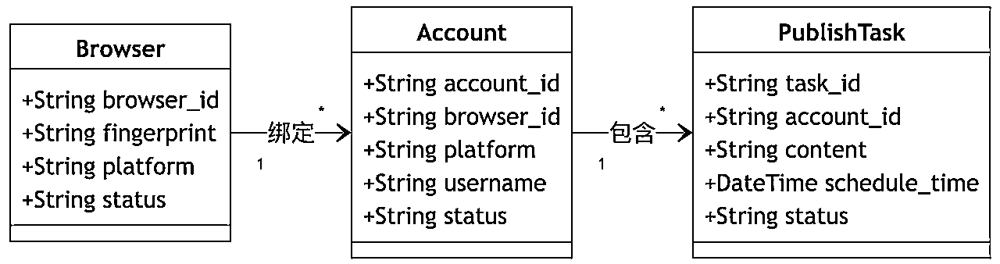

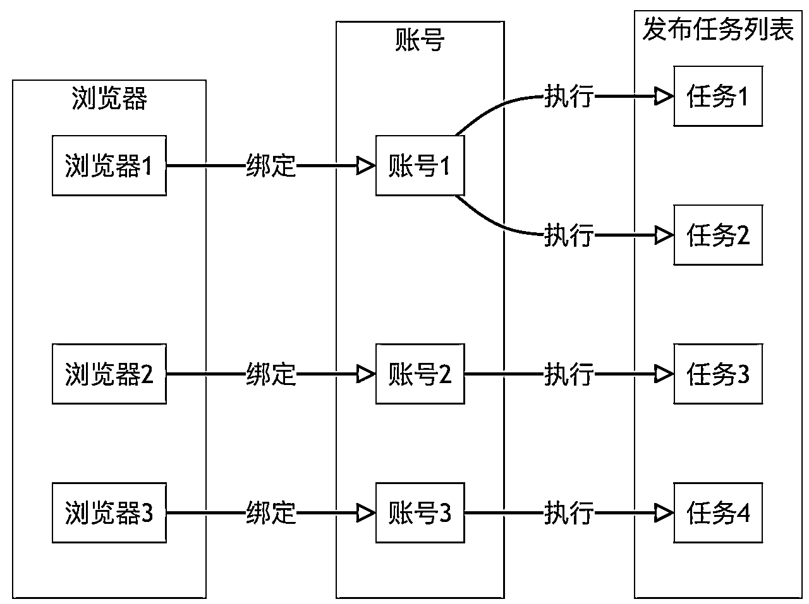

可视化界面如下，先对所有指纹浏览器进行统一管理

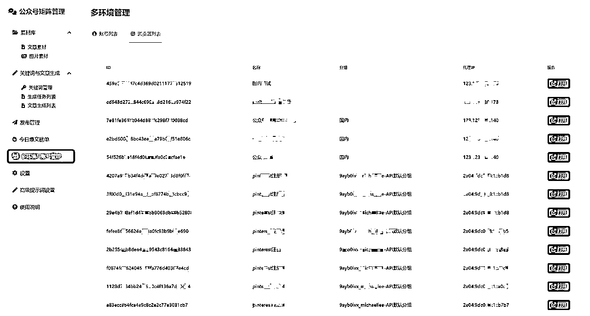

新增账号时维护账号与浏览器的对应关系，并补充首尾段、分组标签等字段，用于后续内容拼接和逻辑判断。

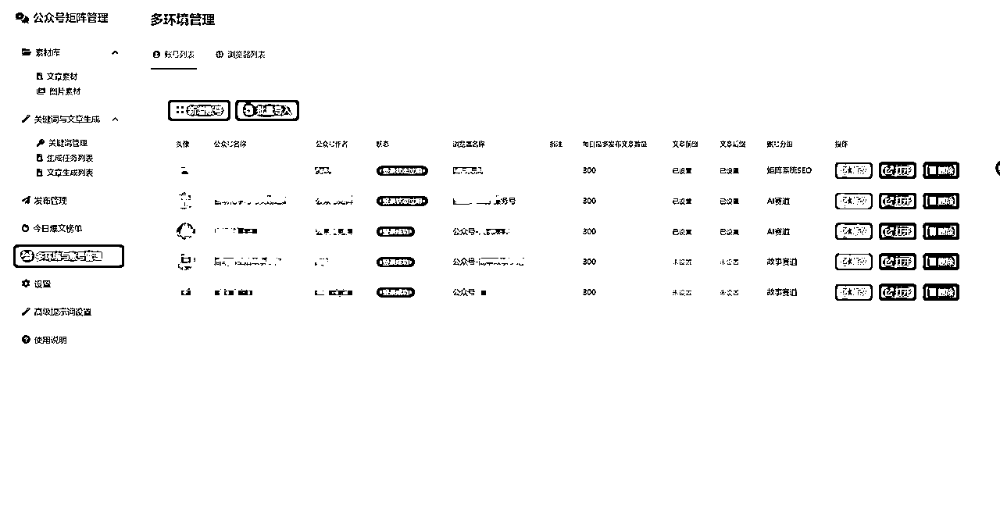

## 文章批量生成

在 SEO 运营里，批量生成文章是实现长尾关键词覆盖和效率提升的关键。借助系统化的词库管理和 AI 生成能力，可以快速产出海量素材，为矩阵账号提供持续弹药。

由于目标是 SEO，批量生成逻辑并不复杂，本质是长尾关键词 + AI 内容生成。发布时再按账号维度自动补全首尾段。AI 生成的要求不必太高，核心是关键词命中，比如让 AI 输出关键词密度更高的段落，配合首尾段引流即可。

SEO 文章批量生成流程

1.  获取长尾关键词
从第三方工具如 5118 导出目标长尾词导入系统，并配置提示词规则。规则可涵盖关键词分布、密度等，确保输出符合 SEO 规范。

1.  设置发布模式
根据运营策略选择发布方式：

*   自动分配：系统按规则把生成文章自动分发到各账号。
*   指定👸号：手动指定生成的文章投放到特定账号，满足个性化运营。

提前规划好发布模式，能保证内容储备充足，发布节奏稳定。

1.  生成任务列表
基于导入的关键词和规则，批量生成内容任务。任务列表是内容生产的调度核心，实现关键词与生成任务的精准映射。

#### 数据结构与关联关系

1.  关键词 - 任务列表 - 生成内容的关系

*   关键词或主题：内容生成的输入源，决定文章方向和关键词。
*   任务列表：基于关键词衍生的调度清单，管理生成过程。
*   生成内容：利用 AI 完成批量写作，为后续批量发布做准备。

1.  词库管理

*   词库表：集中维护所有长尾关键词及其属性。
*   关联表：建立词库与关键词的映射关系，支持分组和规则绑定。

E-R 关系图：

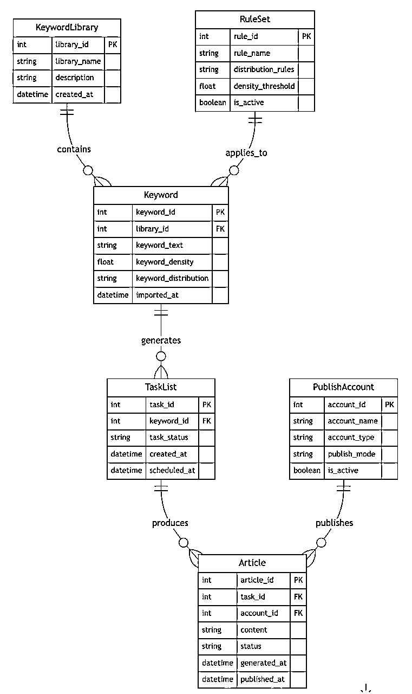

落地时先维护一个完整的词库表，记录所有长尾关键词及其信息，再通过关联表实现分组和规则绑定，保证生产流程灵活高效。

可视化如下：

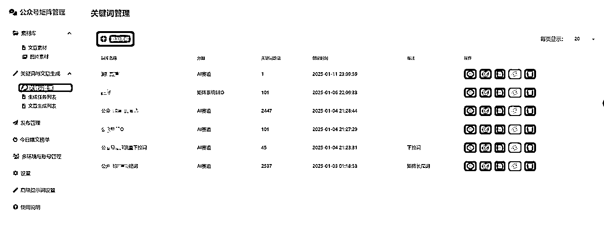

可配置的批量生成规则：

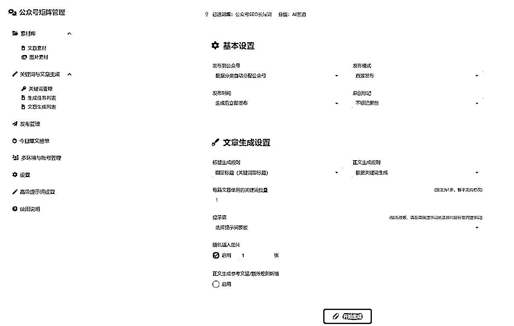

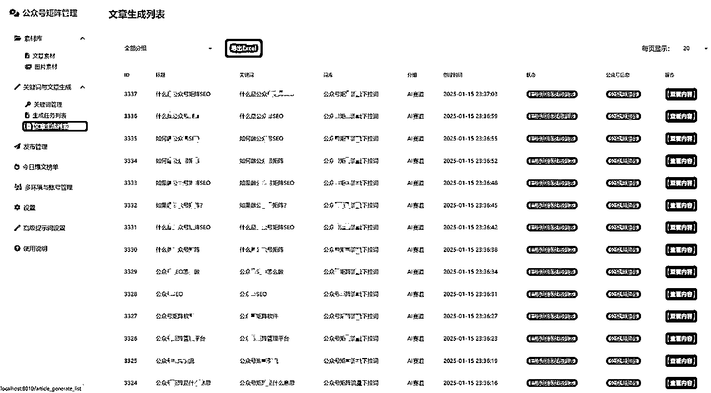

## 任务分配机制

文章生成后，如何公平且高效地分配到各账号，是系统的一个重点。为实现账号资源均衡与任务调度稳定，我采用了循环双队列方案，并加入持久化保障，确保在大规模账号场景下依然可靠。

#### 核心逻辑：循环双队列的设计

1.  赛道与账号的关联

*   每个账号按业务归属划分到不同赛道，用赛道 ID 标识。
*   同一赛道内维护一个循环队列，账号用完后重新入队，形成循环结构。

1.  双队列调度机制

*   外部队列：存放所有赛道的队列引用，用于快速定位。
*   内部队列：每个赛道对应一个循环队列，存放该赛道的账号。
*   调度流程：守护线程按顺序从外部队列取赛道 ID，再从内部循环队列取出一个账号分配任务，分配后账号重新入队尾，保证均衡。

1.  守护线程分配逻辑

*   定时轮询赛道队列，依次取出赛道 ID，进入对应循环队列。
*   取出当前账号分配任务后，将账号放回队尾。
*   从而实现同一赛道内账号的均匀轮转。

#### 持久化机制：保障恢复与一致性

1.  为什么需要持久化

小规模账号下队列状态丢失影响不大，但当账号规模达到几十上百甚至上千时，系统重启后若无法恢复队列顺序，会导致分配错乱，影响均衡性和权重控制。

1.  持久化方案

使用 Redis 缓存队列数据并持久化，将队列状态保存到 Redis，系统故障后可快速恢复循环队列状态，降低中断影响。

#### Redis 持久化实现

1.  队列状态存储：每个赛道的循环队列以 Redis List 存储，外部队列以 Sorted Set 存储赛道 ID 及优先级。
2.  任务分配更新：每次分配完成后，守护线程实时同步更新后的队列状态到 Redis。

v1 版本建议先用 o1 或 o1 pro mode 生成骨架，再基于设计迭代代码，这样完成度会更高。

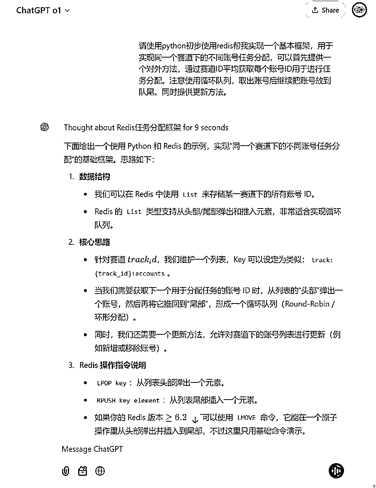

核心逻辑代码示例

```
import redis

class TrackAccountQueue:
    def __init__(self, redis_host='localhost', redis_port=6379, db=0):
        """
        初始化 Redis 连接
        """
        self.client = redis.Redis(host=redis_host, port=redis_port, db=db, decode_responses=True)

    def get_next_account(self, track_id: str) -> str:
        """
        获取赛道 track_id 下的下一个可用账号，并将其重新放回队尾。
        如果队列为空，返回 None。
        """
        key = f"track:{track_id}:accounts"
        # 从头部弹出一个账号
        account = self.client.lpop(key)
        if account is None:
            # 队列为空的情况
            return None
        # 将这个账号放回队列尾部
        self.client.rpush(key, account)
        return account

    def init_track_accounts(self, track_id: str, account_ids: list):
        """
        初始化/更新赛道 track_id 下的账号列表（会先删除原有列表）。
        常用于第一次设置或需要重置账号列表的场景。
        """
        key = f"track:{track_id}:accounts"
        # 先删除旧的列表
        self.client.delete(key)
        # 再插入新的账号列表，注意这里使用 rpush 一次性推入
        if account_ids:
            self.client.rpush(key, *account_ids)

    def add_account(self, track_id: str, account_id: str):
        """
        在赛道 track_id 下添加一个新的账号到队尾
        """
        key = f"track:{track_id}:accounts"
        self.client.rpush(key, account_id)

    def remove_account(self, track_id: str, account_id: str):
        """
        在赛道 track_id 下移除一个账号
        """
        key = f"track:{track_id}:accounts"
        # lrem key count value, count=0 表示移除所有匹配的元素
        self.client.lrem(key, 0, account_id)

    def get_all_accounts(self, track_id: str) -> list:
        """
        获取赛道 track_id 下当前所有账号列表，用于查看或调试
        """
        key = f"track:{track_id}:accounts"
        return self.client.lrange(key, 0, -1)

# ==== 以下为示例用法 ====
if __name__ == "__main__":
    # 实例化
    queue = TrackAccountQueue(redis_host="localhost", redis_port=6379, db=0)

    # 初始化赛道 track_1 下的账号列表
    queue.init_track_accounts("track_1", ["account_a", "account_b", "account_c"])

    # 获取当前列表
    print("初始列表:", queue.get_all_accounts("track_1"))

    # 获取下一个分配的账号（模拟任务分配）
    next_acct = queue.get_next_account("track_1")
    print("取到账号:", next_acct)
    print("取完后列表:", queue.get_all_accounts("track_1"))

    # 再取一次
    next_acct = queue.get_next_account("track_1")
    print("取到账号:", next_acct)
    print("取完后列表:", queue.get_all_accounts("track_1"))

    # 添加新账号
    queue.add_account("track_1", "account_d")
    print("添加新账号后列表:", queue.get_all_accounts("track_1"))

    # 移除账号
    queue.remove_account("track_1", "account_b")
    print("移除账号后列表:", queue.get_all_accounts("track_1"))

```

发布或自动化分配入口如下，业务流程以 batch 代码为主，参考上文设计。

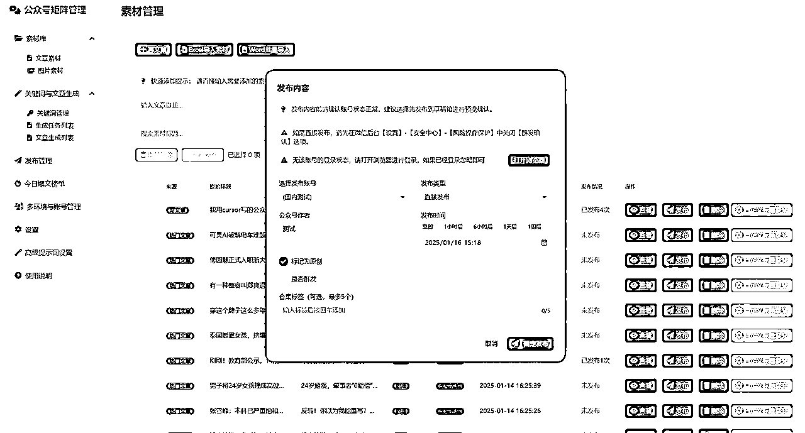

## 过期提醒

👸号后台机制会导致账号一段时间后过期，如何在发布过程中判断是否需要重新登录并及时通知？

我们基于飞书 Webhook 和扫码检测实现了自动化过期提醒。

例如下方可以看到 login_form 元素，可基于该元素判断是否存在二维码信息。

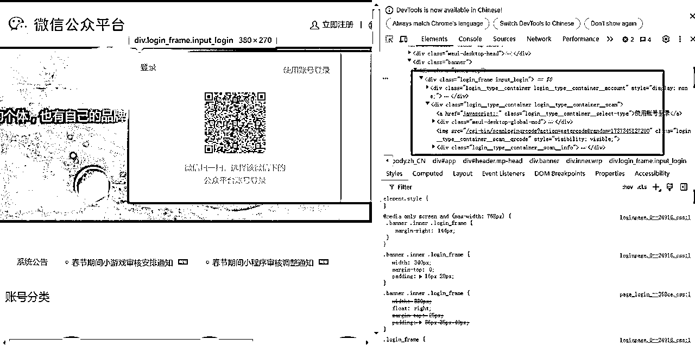

```
async def check_login_status(self) -> bool:
        try:
            # 等待页面加载完成
            await self.page.wait_for_load_state('networkidle')

            # 检查是否存在登录框
            login_frame = await self.page.locator('.login_frame.input_login').count()

            if login_frame > 0:
                print("检测到登录框，需要登录")

                return False
            else:
                print("已经登录")
                return True

        except Exception as e:
            print(f"检查登录状态时出错: {str(e)}")
            return False
```

在账号批量管理里，有两件事特别影响效率：一是账号过期提醒，二是文章发布自动化。先说过期提醒。

你不需要手动检查账号状态，系统一旦发现某个账号登录失效，就会自动通过飞书 Webhook 向指定的飞书群或具体用户推送提醒。推送里会写清楚过期账号的名称、所属的赛道ID，以及用来扫码恢复登录的链接。例如，你收到的可能是一条类似这样的消息：「提醒：账号XXX，赛道YYY，登录状态已过期，请扫描二维码重新登录。」

如果你希望通知方式更灵活一些，还可以接入🛰️推送，通过企业🛰️或者个人🛰️接收提醒，随时随地掌握账号动态。

团队里如果安排了专人负责账号运营，操作还能更简单：把登录二维码取出来，交给对应的人，让对方扫码登录就行。

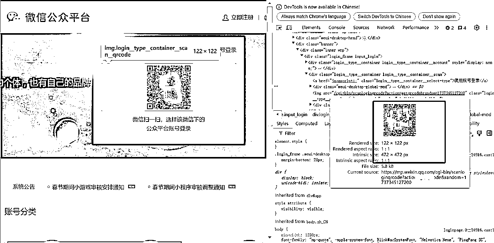 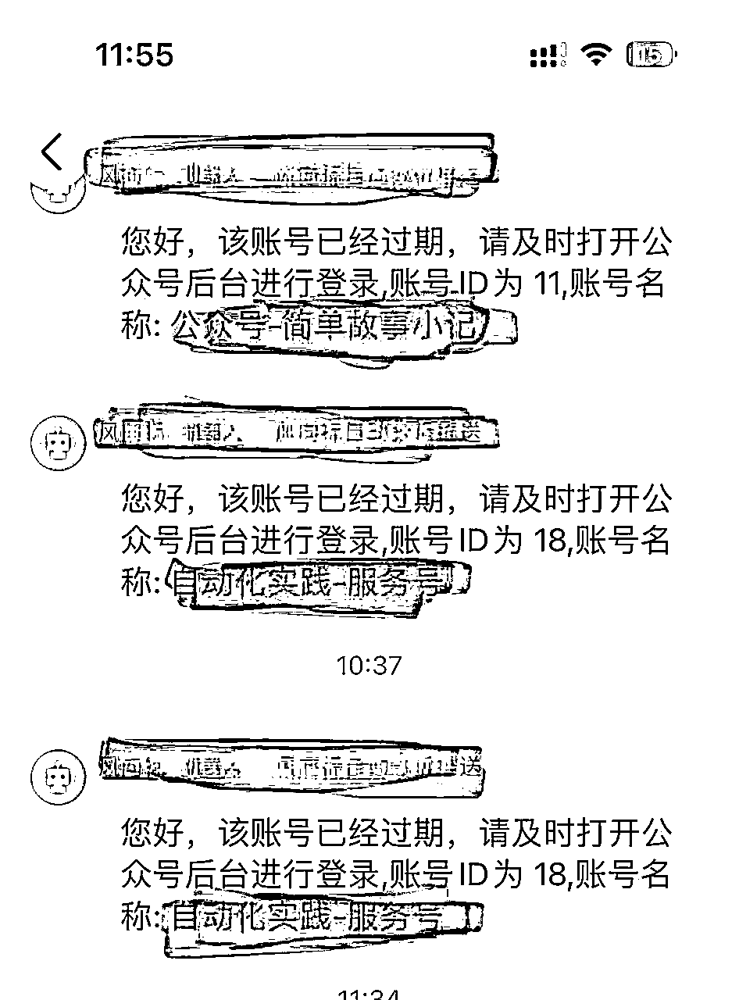

## 批量发布：从手动到全自动

到了批量发布环节，靠人工逐篇操作是行不通的。更高效的方法是通过调度指纹浏览器，再配合 Playwright、Selenium、DrissionPage 这类自动化工具，模拟真实用户操作，把账号登录、文章发布等流程全部打通。

在这些工具中，Playwright 的 Codegen 功能特别值得一说。它最大的好处是降低门槛：你只需要手动操作一遍，Codegen 就会自动记录整个流程并生成对应的脚本，既省去了手动写脚本的成本，也保证了整个流程的稳定，而且这套脚本可以反复使用。

想要让批量发布的效率再上一个台阶，建议采用异步执行。和传统串行方式不同，异步任务能让多个发布操作同时推进，整体吞吐量大增。从效率上看，Playwright 单任务执行至少比影刀快 3 倍；配合并行能力，每分钟最多能发布 20 篇文章。如果设备性能和并发设置给力，多账号一起跑，每分钟甚至能冲到 100 篇。反观影刀，平均要两到三分钟才能发布一篇，对比之下，上述多账号场景的整体效率至少是影刀的200倍，只多不少。

直接上核心发布代码：

有时候，最吊人胃口的，不是一句惊天动地的话，而是一个没头没尾的开始。

就像现在，摆在我面前的“素材”，干净得像一张白纸，只留下一个孤零零的记号——```
import time
import random
import traceback
import logging
from urllib.parse import urlparse, parse_qs

from drissionpage import Drission, DrissionPage

def random_sleep(min_sec=0.5, max_sec=1.5):
    """模拟人工操作的随机等待"""
    time.sleep(random.uniform(min_sec, max_sec))

class DrissionWeChatClient:
    def __init__(self):
        self.logger = logging.getLogger(self.__class__.__name__)
        self.drission = None
        self.page = None

    def initialize(self):
        try:
            self.logger.info("初始化 Drission...")
            self.drission = Drission()  # 这里不传参即使用默认配置，会自动寻找 chromedriver
            self.page = DrissionPage(self.drission, mode='d')
            self.logger.info("初始化完成，已创建webdriver模式页面。")
        except Exception as e:
            error_msg = f"初始化失败：{e}\n{traceback.format_exc()}"
            self.logger.error(error_msg)
            raise

    def close(self):
        """关闭浏览器和 Drission 相关资源。"""
        try:
            if self.page:
                self.page.close()
                self.page = None
            if self.drission:
                self.drission.close()
                self.drission = None
            self.logger.info("已关闭 DrissionPage 及相关资源。")
        except Exception as e:
            self.logger.error("关闭资源时出错: %s", e)

    def go_to_wechat_mp(self):
        self.page.get("https://mp.weixin.qq.com/")
        random_sleep()

    def check_login_status(self) -> bool:
        if self.page.ele('.login_frame.input_login'):
            self.logger.warning("检测到登录框，当前为未登录状态")
            return False
        return True

    def open_new_article_page(self, token: str, lang: str):

        caogao_url = (f"https://mp.weixin.qq.com/cgi-bin/appmsg?"
                      f"t=media/appmsg_edit_v2&action=edit&isNew=1&type=77&token={token}&lang={lang}")
        self.page.get(caogao_url)

    def fill_article_info(self, title: str, author: str):
        """
        填写文章标题、作者等信息
        """
        # 等标题、作者输入框可用
        self.page.ele_wait('#title', timeout=10)
        self.page.ele('#title').input(title, mode='replace')
        self.logger.info("成功输入文章标题：%s", title)

        self.page.ele_wait('#author', timeout=10)
        self.page.ele('#author').input(author, mode='replace')
        self.logger.info("成功输入作者：%s", author)

    def fill_content_by_paste(self, content: str):

        try:
            self.page.ele_wait('#ueditor_0', timeout=10)
        except Exception as e:
            self.logger.warning("无法找到正文 iframe：%s", e)
            return

        js_code = f"""
         let doc = iframe.contentDocument || iframe.contentWindow.document;
         doc.body.innerHTML = `{content.replace('`', '\\`')}`;
        """
        self.page.run_js(js_code)

    def select_cover_from_content(self):

        try:
            # 点击“从正文中选择封面”按钮的逻辑
            # 先等待按钮出现
            self.page.ele_wait('.select-cover__btn', timeout=10)
            cover_btn = self.page.ele('.select-cover__btn')
            cover_btn.click()
            time.sleep(1)

            # 继续等待并点击“从正文选择”选项
            self.page.ele_wait('#js_cover_null .js_selectCoverFromContent', timeout=5)
            from_content_btn = self.page.ele('#js_cover_null .js_selectCoverFromContent')
            from_content_btn.click()
            self.logger.info("已点击从正文选择封面。")
            time.sleep(2)

            # 选择正文中的第一张图片
            self.page.ele_wait('.appmsg_content_img_item', timeout=10)
            first_img = self.page.eles('.appmsg_content_img_item')[0]  # 拿到第一个
            first_img.click()
            time.sleep(1)

            # 点击下一步
            next_btn = self.page.ele('button.weui-desktop-btn.weui-desktop-btn_primary:hasText("下一步")')
            if next_btn:
                next_btn.click()
                time.sleep(1)

            # 点击完成
            finish_btn = self.page.ele('button.weui-desktop-btn.weui-desktop-btn_primary:hasText("完成")')
            if finish_btn:
                finish_btn.click()
                time.sleep(1)

        except Exception as e:
            self.logger.warning("从正文选择封面失败：%s", e)

    def set_digest(self, digest: str):
        """
        填写摘要
        """
        try:
            digest_ele = self.page.ele_wait('#js_description', timeout=5)
            digest_ele.input(digest, mode='replace')
            self.logger.info("成功填写摘要：%s", digest)
        except Exception as e:
            self.logger.warning("填写摘要失败：%s", e)

    def save_draft(self):

        try:
            # 等“保存为草稿”按钮出现并点击
            btn = self.page.ele_wait('button:hasText("保存为草稿")', timeout=5)
            btn.click()
            time.sleep(1)
            self.logger.info("已点击保存为草稿按钮")
        except Exception as e:
            self.logger.error("保存草稿失败：%s", e)
            raise

    def publish_article(self, is_qunfa: bool):

        try:
            pub_btn = self.page.ele_wait('button.mass_send:hasText("发表")', timeout=5)
            pub_btn.click()
            self.logger.info("已点击发表按钮")
            time.sleep(1)
        except Exception as e:
            self.logger.error("点击发表按钮失败：%s", e)
            return

        # 处理群发开关逻辑
        try:
            label = self.page.ele_wait('label.weui-desktop-form__label:hasText("群发通知")', timeout=3)
            # 拿到父节点
            control_group = label.parent()
            # 在父节点中找开关容器
            switch_container = control_group.ele('.weui-desktop-form__controls .weui-desktop-switch')
            switch_input = switch_container.ele('input.weui-desktop-switch__input')
            checked_attr = switch_input.get_attribute('checked')  # None 或者 'true'

            # 当前 checked_attr 为 'true' 表示已勾选
            currently_checked = bool(checked_attr)
            if is_qunfa and not currently_checked:
                switch_container.click()
                self.logger.info("已开启群发通知")
            elif not is_qunfa and currently_checked:
                switch_container.click()
                self.logger.info("已关闭群发通知")
        except Exception as e:
            self.logger.warning("设置群发开关状态失败：%s", e)

        # 再次点击弹窗中的“发表”按钮
        try:
            final_pub_btn = self.page.ele_wait(
                '.weui-desktop-dialog button.weui-desktop-btn.weui-desktop-btn_primary:hasText("发表")', 
                timeout=5
            )
            final_pub_btn.click()
            self.logger.info("已点击弹窗最终发表按钮")
            time.sleep(2)

            # 如果出现“继续发表”按钮，也点一下
            cont_btn = self.page.ele('button.weui-desktop-btn.weui-desktop-btn_primary:hasText("继续发表")')
            if cont_btn:
                cont_btn.click()
                self.logger.info("已点击 继续发表 按钮")
                time.sleep(3)

        except Exception as e:
            self.logger.warning("最终发表按钮或继续发表按钮处理时出错：%s", e)

async def process_process_browser_get_channel_info_dsync(
    is_original: int,
    account_id: int,
    title: str, 
    author: str, 
    content: str,
    digest: str,
    tags: str,
    publish_type: str,   # '1' => 直接发布；否则只保存草稿
    is_qunfa: str,       # '1' => 开启群发；'0' => 不开启
    wx_template_name: str
) -> None:

    client = DrissionWeChatClient()
    try:
        client.initialize()

        # 打开微信公众平台首页
        client.go_to_wechat_mp()

        # 检查是否登录
        if not client.check_login_status():
            # 登录过期 - 更新数据库状态，并通知
            await update_account_status(account_id, "登录状态过期")
            await notify_user_account_status(account_id)
            raise Exception("未登录微信公众平台，请先登录。")

        # 如果已登录，更新状态
        await update_account_status(account_id, "登录成功")

        # 拿到当前 URL，用来取 token & lang
        current_url = client.page.url
        parsed = urlparse(current_url)
        params = parse_qs(parsed.query)
        token = params.get('token', [''])[0]
        lang = params.get('lang', [''])[0]

        # 前往新建图文页
        client.open_new_article_page(token, lang)

        # 填写标题、作者
        client.fill_article_info(title, author)

        # 将正文 content 写入富文本编辑器
        client.fill_content_by_paste(content)

        # 滚动到页面底部
        client.page.run_js("window.scrollTo(0, document.body.scrollHeight)")
        time.sleep(1)

        # 如果 is_original == 1，尝试声明原创
        if is_original == 1:
            try:
                # 点击“未声明”按钮 -> 勾选协议 -> 确定
                unset_btn = client.page.ele('.js_unset_original_title:hasText("未声明")')
                if unset_btn:
                    unset_btn.click()
                    time.sleep(1)
                    # 勾选协议
                    agree_box = client.page.ele('.original_agreement input.weui-desktop-form__checkbox')
                    if agree_box and not agree_box.is_selected():

                        agree_box.click()
                else:
                    print("找不到原创声明按钮，可能已声明或页面结构有变。")
            except Exception as e:
                print(f"声明原创时出错：{e}")

        # 从正文中选择封面
        client.select_cover_from_content()

        # 填写摘要
        if not digest or digest.lower() == 'null':
            digest = title
        client.set_digest(digest)

        # 保存为草稿
        client.save_draft()

        # 如果 publish_type == '1'，则直接发表
        if publish_type == '1':
            # is_qunfa: '1' => True, '0' => False
            is_qunfa_bool = (is_qunfa == '1')
            client.publish_article(is_qunfa_bool)

    except Exception as e:
        print(f"处理过程中出错: {e}")
        raise e
    finally:
        client.close()
        print("发布流程结束。")
```。

别小看这个记号，它其实是给文案开了一扇门：门后面，什么都有可能发生。可能是金句，可能是数据，也可能是一段戳心故事。真正聪明的文案，从不急着把话说满，而是先铺好轨道，让情绪顺着一个节点自然生长。

老话说得好，留白才是最高的表达。与其堆砌辞藻，不如用一个抓手，把所有注意力都收拢到一个点上。

现在，这枚钩子已经就位。

它就是：```
import time
import random
import traceback
import logging
from urllib.parse import urlparse, parse_qs

from drissionpage import Drission, DrissionPage

def random_sleep(min_sec=0.5, max_sec=1.5):
    """模拟人工操作的随机等待"""
    time.sleep(random.uniform(min_sec, max_sec))

class DrissionWeChatClient:
    def __init__(self):
        self.logger = logging.getLogger(self.__class__.__name__)
        self.drission = None
        self.page = None

    def initialize(self):
        try:
            self.logger.info("初始化 Drission...")
            self.drission = Drission()  # 这里不传参即使用默认配置，会自动寻找 chromedriver
            self.page = DrissionPage(self.drission, mode='d')
            self.logger.info("初始化完成，已创建webdriver模式页面。")
        except Exception as e:
            error_msg = f"初始化失败：{e}\n{traceback.format_exc()}"
            self.logger.error(error_msg)
            raise

    def close(self):
        """关闭浏览器和 Drission 相关资源。"""
        try:
            if self.page:
                self.page.close()
                self.page = None
            if self.drission:
                self.drission.close()
                self.drission = None
            self.logger.info("已关闭 DrissionPage 及相关资源。")
        except Exception as e:
            self.logger.error("关闭资源时出错: %s", e)

    def go_to_wechat_mp(self):
        self.page.get("https://mp.weixin.qq.com/")
        random_sleep()

    def check_login_status(self) -> bool:
        if self.page.ele('.login_frame.input_login'):
            self.logger.warning("检测到登录框，当前为未登录状态")
            return False
        return True

    def open_new_article_page(self, token: str, lang: str):

        caogao_url = (f"https://mp.weixin.qq.com/cgi-bin/appmsg?"
                      f"t=media/appmsg_edit_v2&action=edit&isNew=1&type=77&token={token}&lang={lang}")
        self.page.get(caogao_url)

    def fill_article_info(self, title: str, author: str):
        """
        填写文章标题、作者等信息
        """
        # 等标题、作者输入框可用
        self.page.ele_wait('#title', timeout=10)
        self.page.ele('#title').input(title, mode='replace')
        self.logger.info("成功输入文章标题：%s", title)

        self.page.ele_wait('#author', timeout=10)
        self.page.ele('#author').input(author, mode='replace')
        self.logger.info("成功输入作者：%s", author)

    def fill_content_by_paste(self, content: str):

        try:
            self.page.ele_wait('#ueditor_0', timeout=10)
        except Exception as e:
            self.logger.warning("无法找到正文 iframe：%s", e)
            return

        js_code = f"""
         let doc = iframe.contentDocument || iframe.contentWindow.document;
         doc.body.innerHTML = `{content.replace('`', '\\`')}`;
        """
        self.page.run_js(js_code)

    def select_cover_from_content(self):

        try:
            # 点击“从正文中选择封面”按钮的逻辑
            # 先等待按钮出现
            self.page.ele_wait('.select-cover__btn', timeout=10)
            cover_btn = self.page.ele('.select-cover__btn')
            cover_btn.click()
            time.sleep(1)

            # 继续等待并点击“从正文选择”选项
            self.page.ele_wait('#js_cover_null .js_selectCoverFromContent', timeout=5)
            from_content_btn = self.page.ele('#js_cover_null .js_selectCoverFromContent')
            from_content_btn.click()
            self.logger.info("已点击从正文选择封面。")
            time.sleep(2)

            # 选择正文中的第一张图片
            self.page.ele_wait('.appmsg_content_img_item', timeout=10)
            first_img = self.page.eles('.appmsg_content_img_item')[0]  # 拿到第一个
            first_img.click()
            time.sleep(1)

            # 点击下一步
            next_btn = self.page.ele('button.weui-desktop-btn.weui-desktop-btn_primary:hasText("下一步")')
            if next_btn:
                next_btn.click()
                time.sleep(1)

            # 点击完成
            finish_btn = self.page.ele('button.weui-desktop-btn.weui-desktop-btn_primary:hasText("完成")')
            if finish_btn:
                finish_btn.click()
                time.sleep(1)

        except Exception as e:
            self.logger.warning("从正文选择封面失败：%s", e)

    def set_digest(self, digest: str):
        """
        填写摘要
        """
        try:
            digest_ele = self.page.ele_wait('#js_description', timeout=5)
            digest_ele.input(digest, mode='replace')
            self.logger.info("成功填写摘要：%s", digest)
        except Exception as e:
            self.logger.warning("填写摘要失败：%s", e)

    def save_draft(self):

        try:
            # 等“保存为草稿”按钮出现并点击
            btn = self.page.ele_wait('button:hasText("保存为草稿")', timeout=5)
            btn.click()
            time.sleep(1)
            self.logger.info("已点击保存为草稿按钮")
        except Exception as e:
            self.logger.error("保存草稿失败：%s", e)
            raise

    def publish_article(self, is_qunfa: bool):

        try:
            pub_btn = self.page.ele_wait('button.mass_send:hasText("发表")', timeout=5)
            pub_btn.click()
            self.logger.info("已点击发表按钮")
            time.sleep(1)
        except Exception as e:
            self.logger.error("点击发表按钮失败：%s", e)
            return

        # 处理群发开关逻辑
        try:
            label = self.page.ele_wait('label.weui-desktop-form__label:hasText("群发通知")', timeout=3)
            # 拿到父节点
            control_group = label.parent()
            # 在父节点中找开关容器
            switch_container = control_group.ele('.weui-desktop-form__controls .weui-desktop-switch')
            switch_input = switch_container.ele('input.weui-desktop-switch__input')
            checked_attr = switch_input.get_attribute('checked')  # None 或者 'true'

            # 当前 checked_attr 为 'true' 表示已勾选
            currently_checked = bool(checked_attr)
            if is_qunfa and not currently_checked:
                switch_container.click()
                self.logger.info("已开启群发通知")
            elif not is_qunfa and currently_checked:
                switch_container.click()
                self.logger.info("已关闭群发通知")
        except Exception as e:
            self.logger.warning("设置群发开关状态失败：%s", e)

        # 再次点击弹窗中的“发表”按钮
        try:
            final_pub_btn = self.page.ele_wait(
                '.weui-desktop-dialog button.weui-desktop-btn.weui-desktop-btn_primary:hasText("发表")', 
                timeout=5
            )
            final_pub_btn.click()
            self.logger.info("已点击弹窗最终发表按钮")
            time.sleep(2)

            # 如果出现“继续发表”按钮，也点一下
            cont_btn = self.page.ele('button.weui-desktop-btn.weui-desktop-btn_primary:hasText("继续发表")')
            if cont_btn:
                cont_btn.click()
                self.logger.info("已点击 继续发表 按钮")
                time.sleep(3)

        except Exception as e:
            self.logger.warning("最终发表按钮或继续发表按钮处理时出错：%s", e)

async def process_process_browser_get_channel_info_dsync(
    is_original: int,
    account_id: int,
    title: str, 
    author: str, 
    content: str,
    digest: str,
    tags: str,
    publish_type: str,   # '1' => 直接发布；否则只保存草稿
    is_qunfa: str,       # '1' => 开启群发；'0' => 不开启
    wx_template_name: str
) -> None:

    client = DrissionWeChatClient()
    try:
        client.initialize()

        # 打开微信公众平台首页
        client.go_to_wechat_mp()

        # 检查是否登录
        if not client.check_login_status():
            # 登录过期 - 更新数据库状态，并通知
            await update_account_status(account_id, "登录状态过期")
            await notify_user_account_status(account_id)
            raise Exception("未登录微信公众平台，请先登录。")

        # 如果已登录，更新状态
        await update_account_status(account_id, "登录成功")

        # 拿到当前 URL，用来取 token & lang
        current_url = client.page.url
        parsed = urlparse(current_url)
        params = parse_qs(parsed.query)
        token = params.get('token', [''])[0]
        lang = params.get('lang', [''])[0]

        # 前往新建图文页
        client.open_new_article_page(token, lang)

        # 填写标题、作者
        client.fill_article_info(title, author)

        # 将正文 content 写入富文本编辑器
        client.fill_content_by_paste(content)

        # 滚动到页面底部
        client.page.run_js("window.scrollTo(0, document.body.scrollHeight)")
        time.sleep(1)

        # 如果 is_original == 1，尝试声明原创
        if is_original == 1:
            try:
                # 点击“未声明”按钮 -> 勾选协议 -> 确定
                unset_btn = client.page.ele('.js_unset_original_title:hasText("未声明")')
                if unset_btn:
                    unset_btn.click()
                    time.sleep(1)
                    # 勾选协议
                    agree_box = client.page.ele('.original_agreement input.weui-desktop-form__checkbox')
                    if agree_box and not agree_box.is_selected():

                        agree_box.click()
                else:
                    print("找不到原创声明按钮，可能已声明或页面结构有变。")
            except Exception as e:
                print(f"声明原创时出错：{e}")

        # 从正文中选择封面
        client.select_cover_from_content()

        # 填写摘要
        if not digest or digest.lower() == 'null':
            digest = title
        client.set_digest(digest)

        # 保存为草稿
        client.save_draft()

        # 如果 publish_type == '1'，则直接发表
        if publish_type == '1':
            # is_qunfa: '1' => True, '0' => False
            is_qunfa_bool = (is_qunfa == '1')
            client.publish_article(is_qunfa_bool)

    except Exception as e:
        print(f"处理过程中出错: {e}")
        raise e
    finally:
        client.close()
        print("发布流程结束。")
```。

接下来要做的，就是接住它，然后，把故事讲下去。

在需要同时操盘多个账号做 SEO 的时候，这套批量上线的打法，效率提升是直接看得见的，人工重复操作被大幅压缩，大规模分发内容也终于有了可落地的技术底座。Playwright 那种丝滑的自动化执行力，叠加指纹浏览器天然的账号隔离能力，让整套方案不只是能顶替影刀的功能，还在执行速度和并发量上做到了全面碾压，真正给多账号运营提供了一个更聪明的选择。

## 小结

把前面讲的内容串起来，核心实现的思路其实很清晰，搭建门槛也没有想象中高。说白了就是用代码把各个环节串起来，就能跑通一条完整的自动化流水线。再把 Coze 或 Dify 这类写作 Agent 接进来，就能按需产出高质量素材，轻松应对各种创作场景。

整条流水线大致走两条路。第一条是内容先行：把写好的文章正文或链接丢进系统，先过一遍 AI 改写或 Coze/Dify 的写作 Agent 处理，再自动匹配好账号做预发布，最后一键正式上线。第二条是从关键词出发：以长尾词为起点，让 AI 围绕主题生成符合 SEO 规范的文章，再按指定规则或自动分配给不同账号完成批量分发。两条路径都很顺滑，既能保证效率，也能覆盖多账号、多场景的内容生产需求。

在实操过程中，我对 AI Agent 和工作流产品的认识也更落地了。现在 AI 在内容创作端已经很强，但要做到自动化调度、任务分发、闭环管理，单靠 Agent 还不够。哪怕有了 MCP、Browseuse 这类原生协议和框架，市面上的工具大多还处在demo级别，离真正支撑大规模生产还有距离。所以当下最务实的姿势，仍然是借助 Agent 的能力，人手把关键流程封装成可复用的工作流。

写这篇文章时还发生了一个挺有意思的插曲。调试 AI 自动改写+📕自动发布的功能时，随手发了一条测试笔记，结果两天内阅读量冲到了1.8万。明明是测试环境，文案用了基础 Prompt，没放联系方式，图文也算不上精致。最后还是有用户顺着👸号的旧文章找到了我，笔记转发将近一千，加我🛰️的精准粉接近80人。换算下来加微率只有1/230，但因为全程 AI 生成、无引导、无钩子，能主动找上门的都是高意向人群，后续转化就很漂亮。这件事让我再次意识到，很多机会其实来自一次随意的尝试。试得多、分享多、才更容易撞上运气。

新的一年，愿我们都能多点试错，多点分享，抓住更多能赚钱的可能性！