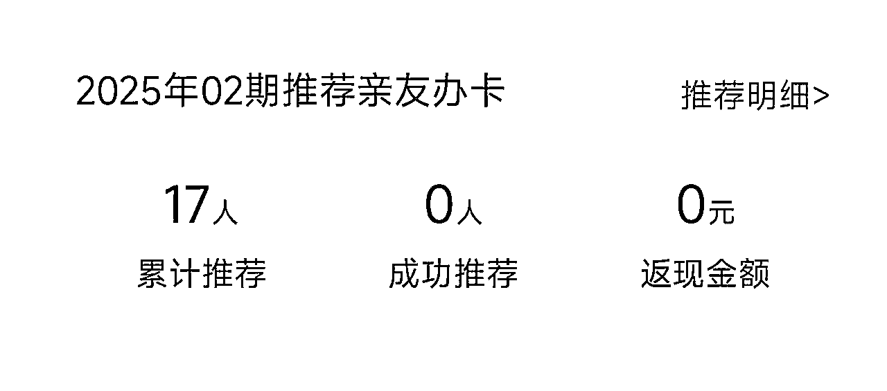
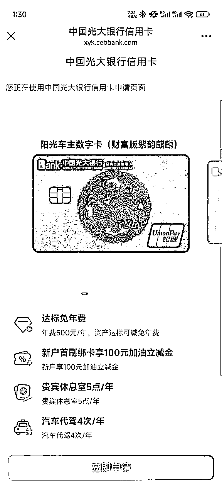
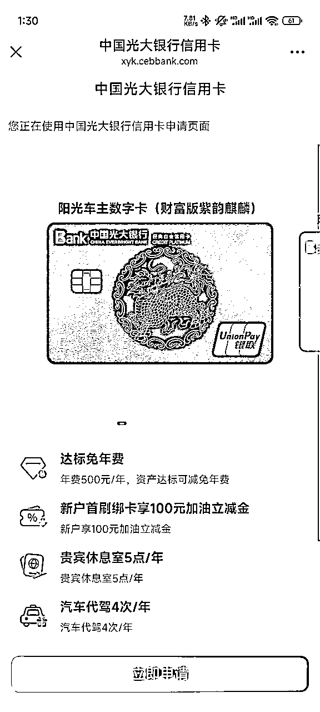
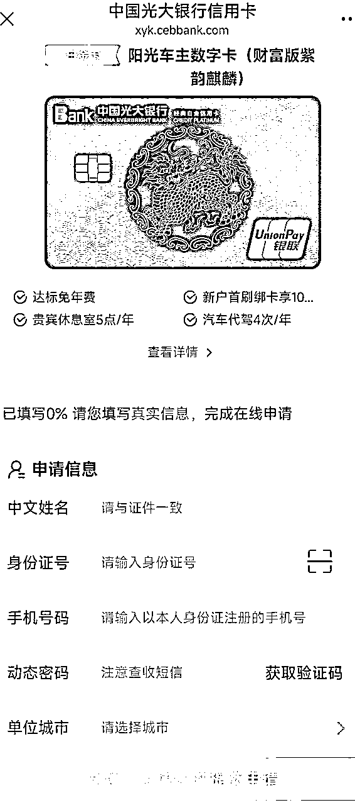
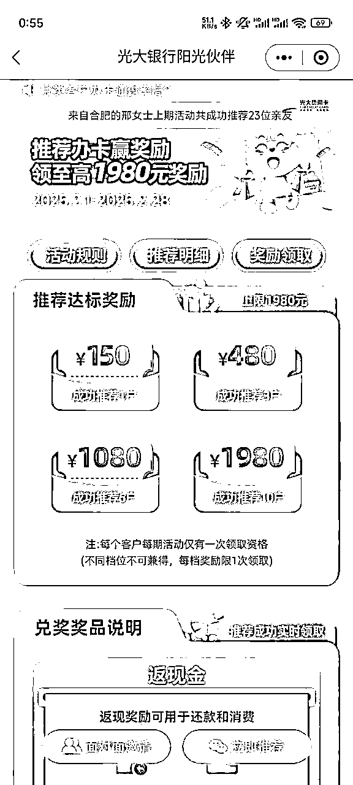
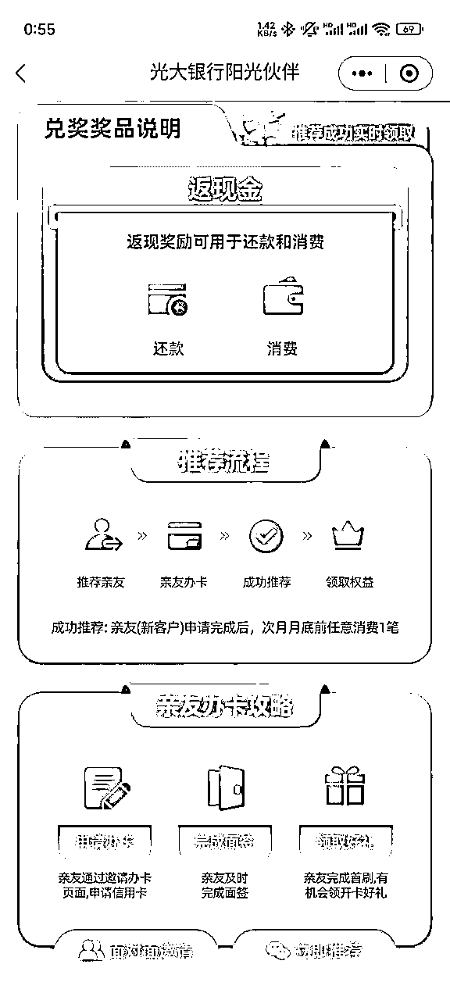
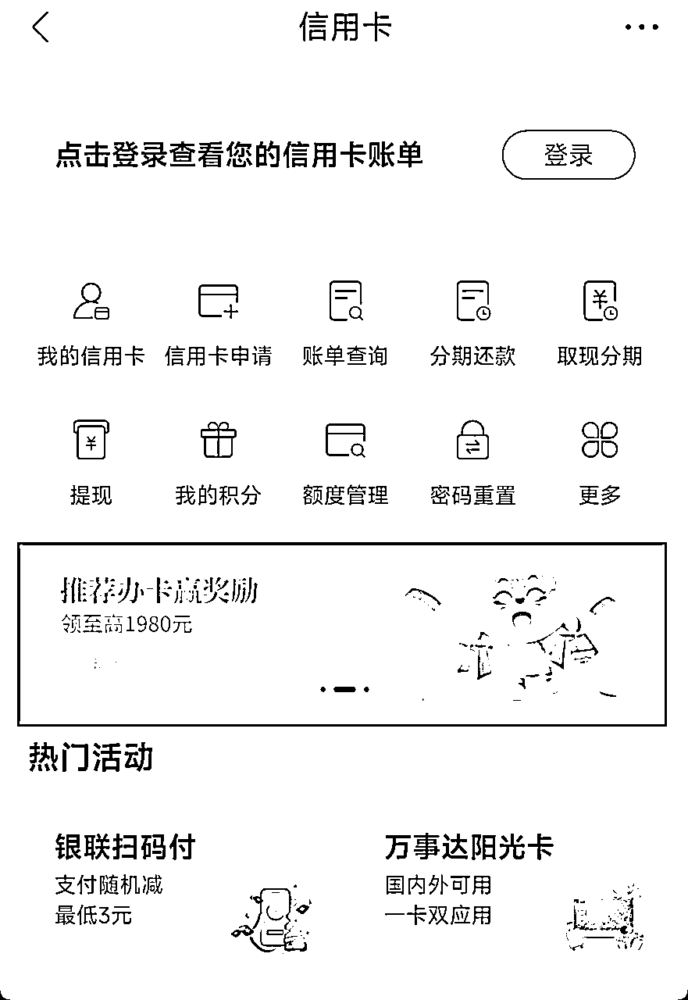
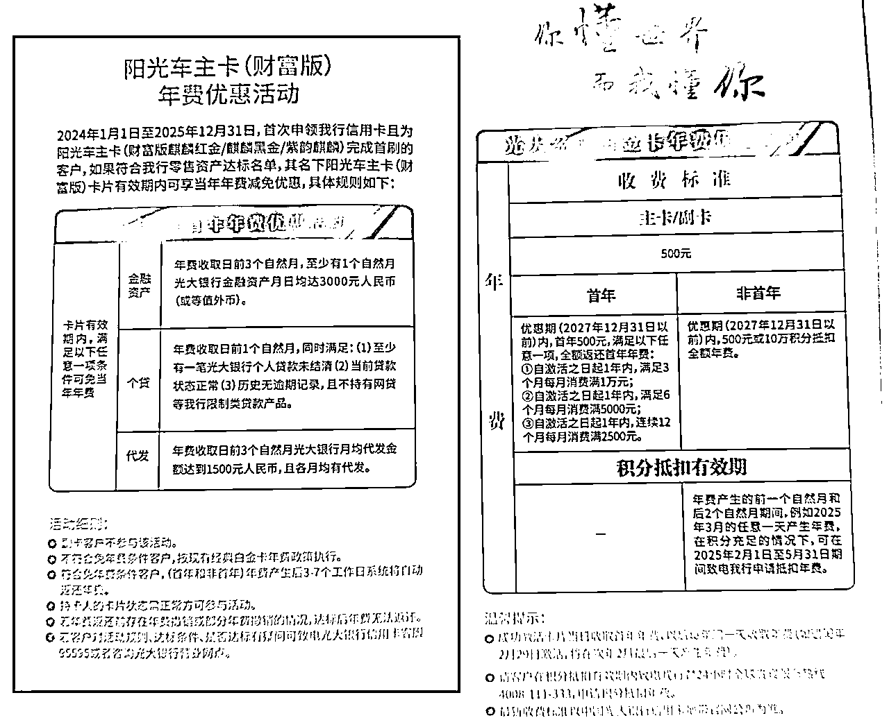

最近发现一个门槛不高、转化却很惊人的银行拉新玩法，分享给大家。

简单说，就是靠小红书发笔记，配上银行官方邀请链接，精准抓那些对信用卡权益敏感的用户，赚银行给的阶梯奖励。整个过程不需要私域中转，用户看完直接点链接申请，路径极短，转化自然高。

我自己的实战记录是：2月12日晚上7点多发了一条笔记，6小时内曝光量超过4000，点赞收藏破百，私信咨询42人，最终有17人通过我发的官方链接提交了申请。按“私信→申请”来算，转化率约40%，而且数据还在涨。

这个项目为什么能跑通？三个关键点。

第一，信息差够大。这张卡虽然能在官方公众号查到，但APP里根本没有申请入口，只有线下网点或者老用户邀请链接才能办。我特意问过两个网点的业务员，他们对这张卡都不太了解，政策细节还得自己找线上客服确认。这种“查得到但办不到”的状态，就是天然的护城河。

第二，权益确实能打。卡自带每年5点贵宾厅，最多能带3个人，正好补上很多白金卡不带人的短板；每年还有4次代驾；新户直接送100元加油立减金。年费500元，但只要你光大储蓄卡里有3000块，年费可以先付后返，等于没成本，用户决策压力很小。

第三，平台有红利。小红书目前对这类内容审核很松，关键词没被限流，系统还在持续推流。而且评论区能看出来需求是真实的，42个人主动来问，就说明这个方向有搞头。

再说说银行的奖励规则。要参与推荐，你先得是光大信用卡用户。按成功推荐户数分档：1户150元，3户480元，6户1080元，10户1980元。奖励可以直接抵扣信用卡还款或消费。注意，这个阶梯有时间和人数限制，比如你只邀请了2个人，那就只能按1人档的150元算，达不到2人档。一切都以“阳光惠生活”和光大银行APP的实时页面为准。

具体操作不复杂。第一步，去阳光惠生活APP里找“推荐有礼”，点“立即推荐”就能生成自己的邀请海报；或者从光大银行APP首页的信用卡banner进去，同样能生成。第二步，把海报发到小红书上，标题就往“5次免费贵宾厅”上靠，这是最钩人的点。有人问怎么办，你就说线下网点，或者说私信我发你链接。第三步，私聊回复模板可以直接用：“保存微信扫就行，右滑到紫麒麟，有两个紫色的比较像别选错了。”基本条件就是有社保、征信无逾期。如果用户没有光大储蓄卡，让他先开一张，存满一个月日均3000，再来办信用卡。

实操过程中，合规模线一定要守住。只发银行官方生成的带渠道ID海报，用户必须自己点链接申请，不能代为填写资料。任何“包过”“必下卡”“额度保障”这类词都不要碰，更不要教人虚假消费刷卡。所有用户的申请时间戳和私信记录都留存好，以备银行抽查。

最后说风险。这个项目不是没缺点：有人头限制，奖励链路比较长，而且用户得在次月完成面签和首刷，否则奖励就没了，中间会有流失。银行政策也可能随时变，每个月都要重新核实权益。另外奖励档位要看清，邀请2人只能拿1人档的钱，别被预期冲昏头。所有信息以官方客服95595和线下网点口径为准。

总之，这玩的就是信息差和合规操作。别诱导办卡，别造假资料，稳稳地把官方奖励吃透，一个月做到顶档1980元是可以期待的。材料我放在下面，有需要的自己研究。

