# 深度拆解：当编程被智能接管，工程化如何成为关键

> 来源：[https://chaojifeng.feishu.cn/docx/ROKgdTmcmoxholx2lpkcL8SJndd](https://chaojifeng.feishu.cn/docx/ROKgdTmcmoxholx2lpkcL8SJndd)

大家好，我是超级峰，目前在北京这边蛰伏，身份是一个名不见经传的产品负责人。

最近一季度的探索让我自己都有些惊讶：借助 Cursor 协作，我这个 iOS 几乎零基础的人，从白纸到上架做了四款 App。下面那四款就是成果。这段经历让我切身体会到智能辅助编程的魅力，也真切看到了 Apple 开发者生态的底盘之稳，更勾勒出了一条通往未来的演进图谱。

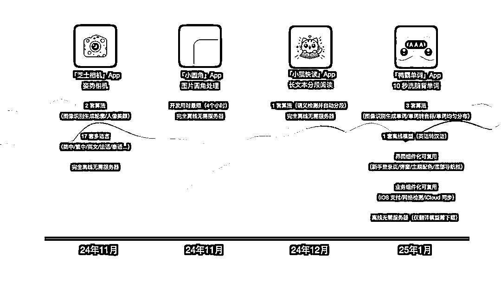

每一次从零搭起，我都发现不少功能其实是老面孔。却又要让助手重新写一遍。明明能复用，却因为缺乏统一沉淀而反复造轮子。哪怕把老项目的代码丢给它参考，效率依旧低下，而且在复杂逻辑上，模型偶尔会脑补不该出现的内容，导致隐患。

得益于此前在公司负责产品的经历，我对抽象、封装、可复用等概念相当敏感。它们的核心思想就是把高频出现的部分抽离出来做一次定义，后续在不同场景里直接调用，保证一致性、降低维护成本、加快交付。

带着这个判断，做第四款 App「鸭霸单词」时，我刻意做了大量组件化实验，主要落在了两个层面：

1、页面层面的组件

市面上的 UI 体系不少，但往往体量偏大，连智能助手都难以完整掌握。一旦出问题，因为是全局性的排查成本极高。再加上我本身是新手，不敢冒险，最终选择走轻量化路线：让模型帮我产出一组独立的界面单元。

以新用户引导为例，第一印象决定留存。我把整套引导页抽成一个独立的页面单元，如下图。

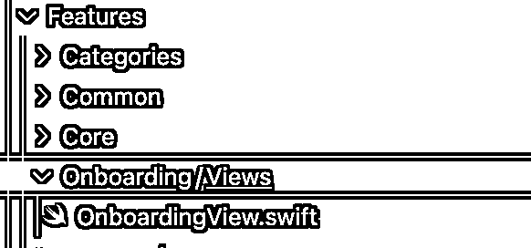

组件封装

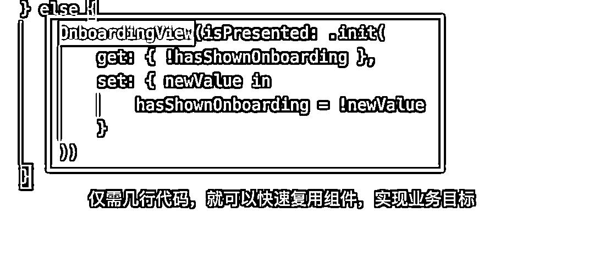

组件使用

这种轻封装的好处在于，可在不同页面里直接调用，也方便跨项目迁移，只需替换文案和素材就能得到一套新的引导页。

考虑到品牌辨识，我还单独建了一个「主题配色」配置文件，用来集中管理整款产品的视觉色板。

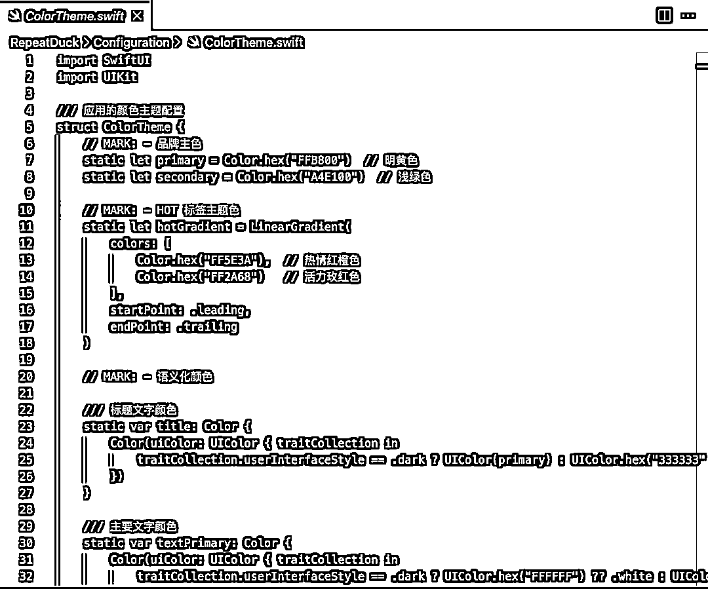

这样一来，助手在做视觉搭配时会保持全局一致，后续换项目只需要改动几处主色即可。

这两个例子验证了轻量组件化在智能协作下的价值：代码保持简洁，复用效率显著提升。想象一下，当产品数量起来后，若每个项目都要手写一套通用功能，效率的损耗会非常可怕。

2、业务层面的组件

如果说页面层关注的是呈现，那么业务层关注的就是底层的运转逻辑。这类模式随处可见，典型如「微信支付」。无论是红包

还是转账

亦或小程序

背后调用的都是同一套支付能力。

组件化的精髓在于扩展性。当未来要接入「云闪付」时，只需在核心单元里补充一次逻辑，所有已接入的场景便自动具备该能力。

对商业化产品而言，支付既是需求验证的标尺，也是持续获得正反馈的通道。因此我把支付作为业务组件化的首个试验田，并在「鸭霸单词」里完整跑通。

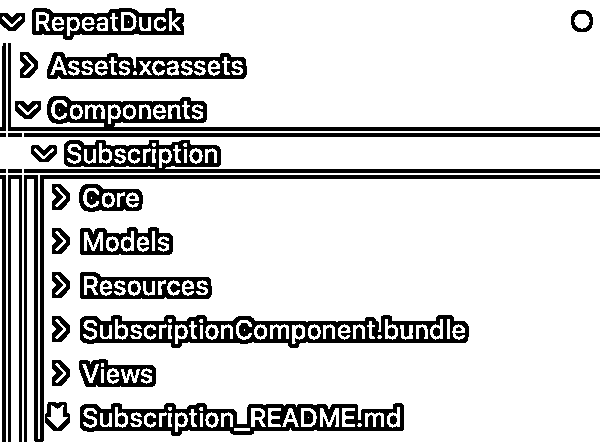

组件封装

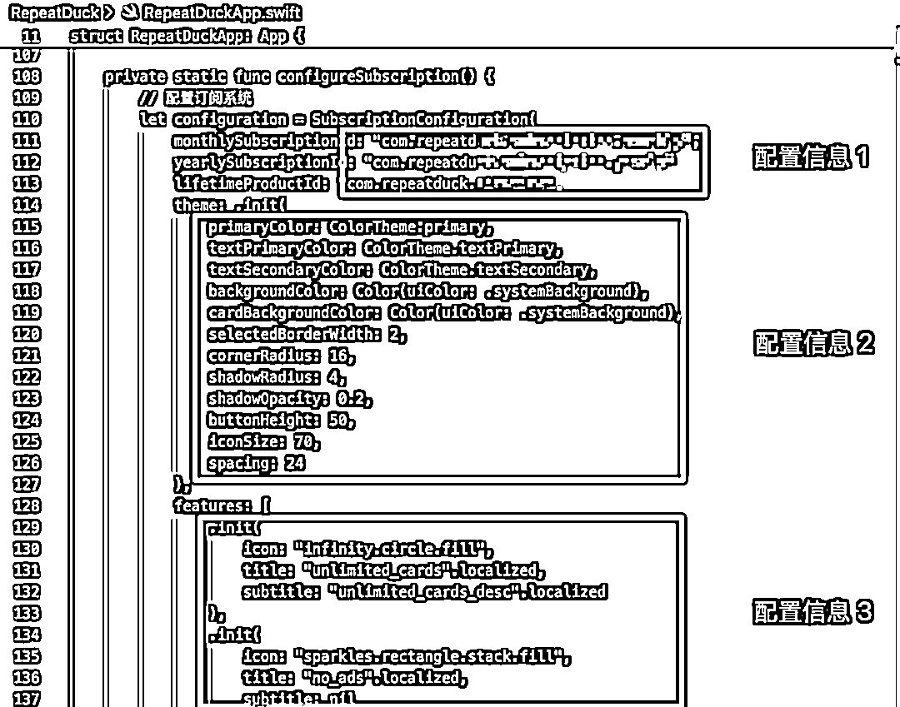

组件使用

有了这层封装，新项目里接入支付就变成几分钟的配置，而不是重复劳动。这正是我对业务组件化价值的理解。

回顾这两种思路，本质指向同一个闭环：提炼共性 → 封装成单元 → 反复调用。如图。

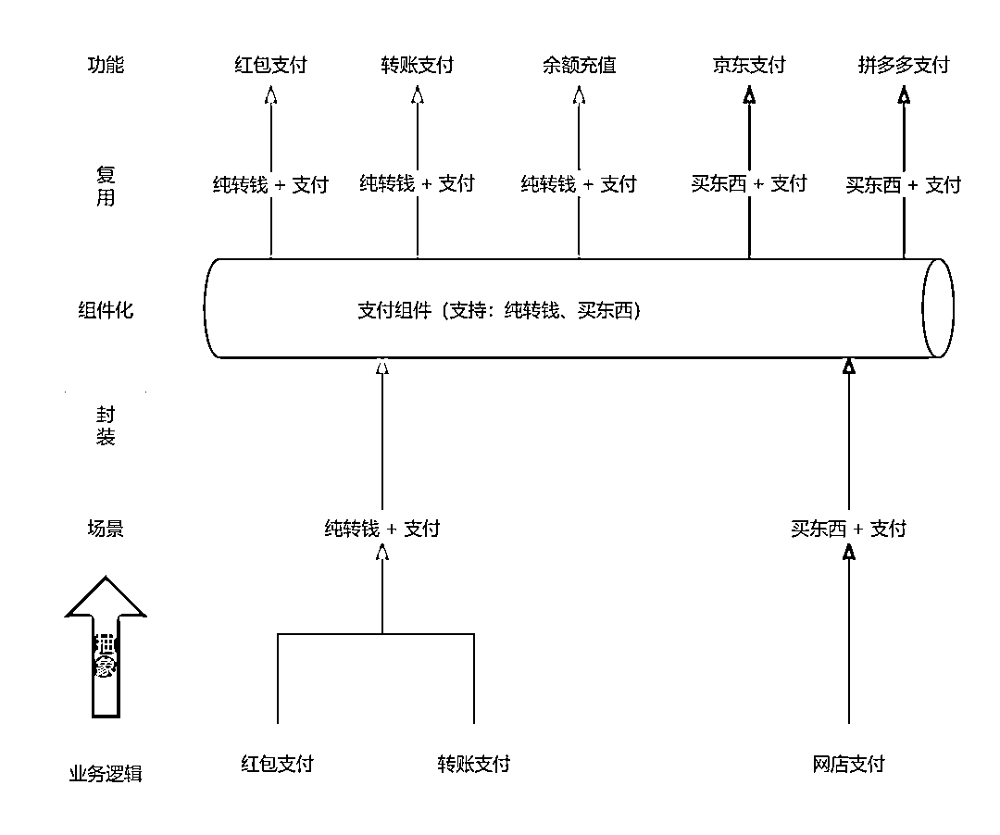

一个月来的实践、交流和反思，让我对智能编程赛道未来的走向有了轮廓。接下来想分享一些观察，希望能给同行一点新启发。

# 从混乱走向秩序：智能编程需要一张公路网

刚入门的人常会问：我该从哪一步起手？先建文件夹，还是先打开工具试试？

答案是场景相关的。做网页，可能建好目录后和助手聊几句就能看到成果。但做 iOS，若只是建个空文件夹就让它写倒计时，很可能直接跑不起来。先用 Xcode 把工程骨架搭好，再让助手填肉，体验会顺畅很多。

说明：Xcode 是 Apple 官方的 App 构建工具

根源在于，每个成熟平台都有各自的工程规范。现在的模型面对一个空目录，很难自发推导出符合规范的完整结构。对资深工程师这不算事，但随着门槛降低，越来越多非技术背景的创作者会涌入。如何服务好这批人，将成为工具厂商的核心竞争点。

我认为新手最需要的是两样东西：一套可以照做的工程规范，和一套即插即用的能力集合。

所谓规范，就是为每门主流语言制定统一的工程蓝图。用户只需在预设结构里填空，不必再纠结文件该放哪。所谓服务化，则是基于模型能力提供的组件库，分两层：

1. 视觉样式服务
* 提供可视化的模板预览与挑选
* 一键套用整体风格
* 保证视觉统一
* 比单纯的皮肤更系统

1. 功能模块服务
* 整合生态内的成熟能力
* 支持一键接入支付、登录、消息推送等
* 模型自动处理接入细节

传统开发里，规范和组件从未缺席，难的是怎样让它们在新的协作模式下焕发价值。我的判断是，未来模型会承担规范实现的执行，用户专注业务创新。这构成一条重要方向 —— 工程化路线：构建对模型友好的开发标准。

与此同时，以 Cursor 为代表的技术路线也至关重要，即持续进化模型本身的代码创造力 —— 技术路线：提升模型对代码的生成能力。下面重点展开工程化路线未来三年的演进。

# 工程化路线：从碰运气到依图行事

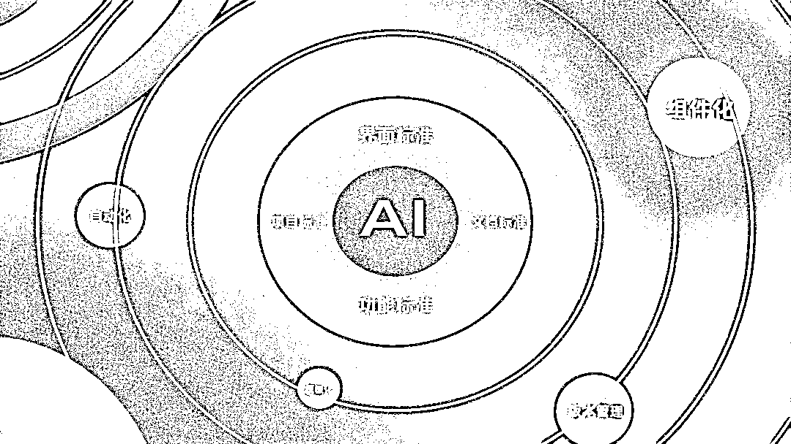

对非技术用户而言，一套清晰的工程标准的重要性不亚于模型能力。但当前领域里，统一的规范明显不足。App 开发里，新手要先学会 Xcode、Android Studio，如何建工程、怎么跑流程。对技术人是常识，对普通人却是门槛。

学习成本呈现梯队：

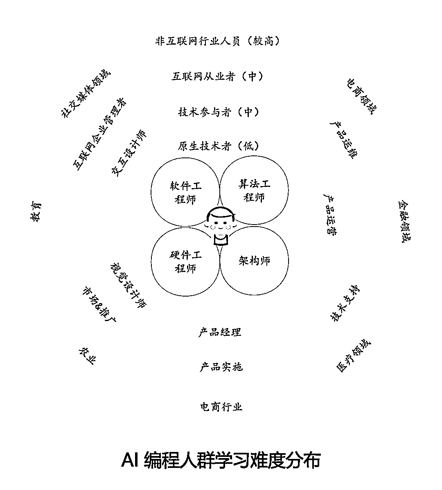

有技术背景的工程师最省力，产品、设计等互联网从业者次之，其余群体成本最高。

关键卡点不是“如何让模型写代码”，而是“如何搭出一个能运行的项目”。哪怕打开工具，很多人卡在第一步就止步。

如果工具内置标准化模板，用户简单配置即可自动生成合规结构，局面会改写。用户只需思考创意，实现交给助手。这样既拉低门槛，也能吸引大量有想法但无技术背景的创新者，让整个生态更繁荣。

这并非设想。bolt 已给出多技术栈的项目模板，lovable 更进一步，直接提供完整产品模板。它们已用实践证明，标准化和模板化能显著降低使用门槛。

统一标准还能直接提升模型的实战表现。把目录规则喂给模型，本质是补背景知识 —— 它知道功能该落在哪，就不容易越界。很多人都有过体验：只想改局部，模型却“好心”改了一堆无关文件，导致莫名报错。根源是模型靠猜测选择最可能的方案，像刚入职的员工，容易过度干预。

那这种猜测式协作能否改善？我判断未来一年到两年内精准度会有大幅提升。以 Cursor 为例，当前单次修改的可用率大约在八成左右，其余需要回修。剩余部分除需求表达不清外，多因约束不足。

用骰子做比喻：六面骰猜中概率约 16%，类似无规范时碰运气。换成两面硬币，概率到 50%，相当于给了基础规范。极致到只有一个面，概率 100%，相当于把完整标准交给模型。

因此，在现有基础模型上，通过工程化增加约束、给出清晰规范，短期内把准确率推向 95% 是可行的。再叠加新一代模型的技术跃迁，逼近 99% 也不是幻想。剩下的 1%，恰是人和模型协作的价值 —— 再优秀的程序员也会出错，人机互补才能产出更可靠的结果。

统一标准还能改善另一个隐性问题：交流效率。大家都在用智能工具编程，但因结构各异，交流常停留在工具层面。同样的支付系统，每个人结构不同，对话成本极高。建立共识后，社区有了共同语言，可以直接聊业务逻辑，知识沉淀会更快。

回到自身实践。过去三个月，每次开新项目都要重新向助手解释结构约定，像反复做入职培训。更糟的是，同一助手在不同时间对相似需求会给出不同实现，随机性给维护和协作带来压力。

和同行交流下来，共识是项目结构怎么组织是个痛点。传统软件工程早已证明，规范是质量和效率的保障。智能编程时代，我们也需要一套适配模型特性的工程体系，在创造力与规范性间取得平衡。

落地上，目录结构标准化是第一步。它像整理好的抽屉：物品有序、取用便捷；而杂乱的抽屉虽能装下东西，却难找。标准化结构给模型一张地图，带来三点价值：降低认知负担、提升代码质量、加速交付。

以 iOS 为例，可为每个目录配 README.md，明确模块职责、用法、注意事项和编码规范。

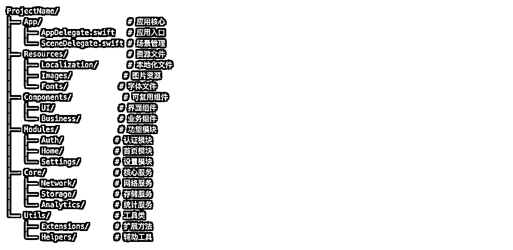

值得欣慰的是，行业里已有产品在尝试，只是节奏不均。

技术导向的 bolt 主打一站式网站开发，提供 Vue、React 等模板，用户选定后即可进入业务开发，无需反复交代初始化细节：

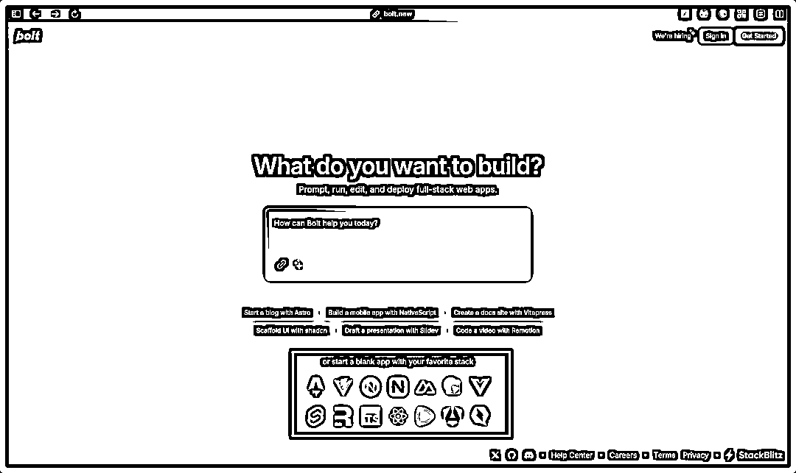

1.选择编程语言（以网站开发为主）

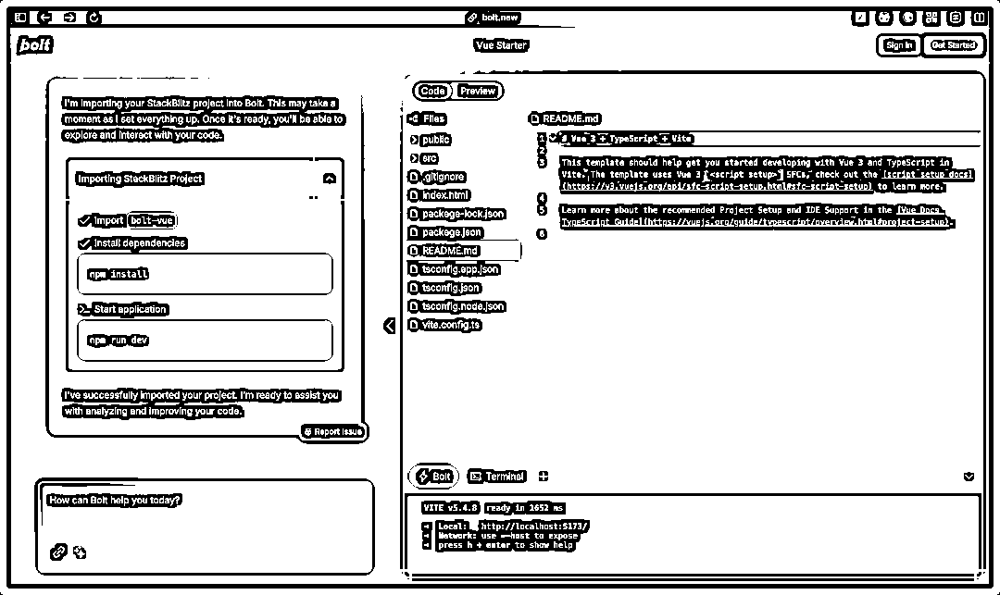

2.自动完成项目初始化

目前模板多在技术框架层，但潜力明显。未来可演进为按业务功能组织的目录结构。

业务导向的 lovable 则走得更远。口号是“Idea to app in seconds”，核心是快。它跳过技术模板，直接给完整产品模板，特别适合非技术创作者。

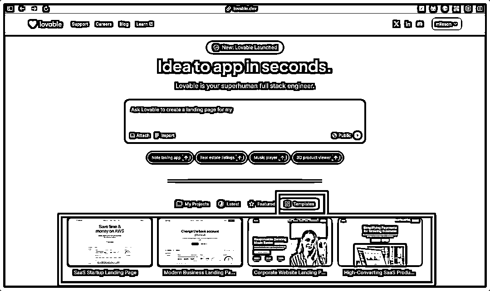

1.选择产品模板（以网站为主）

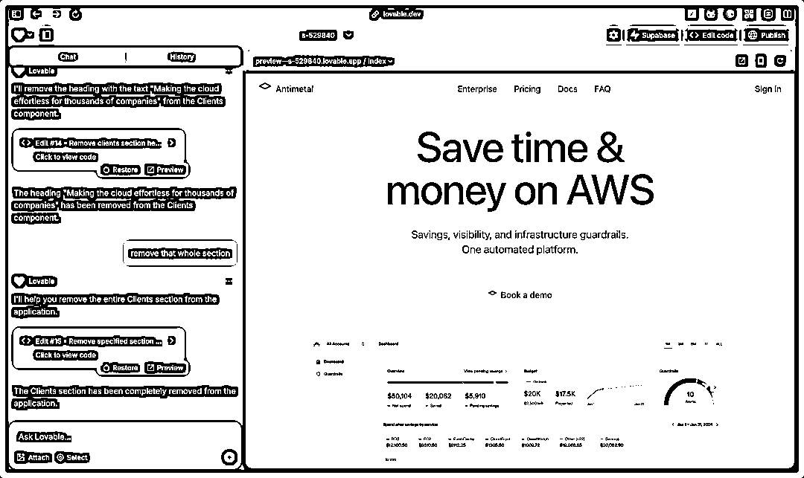

2.自动生成初版产品

当然，预设模板也会限制高度定制的需求。但至少，它把门槛再拉低了一截。

总体看，智能编程的未来不会是单线冲刺，而是多股力量协同：工程化负责把无序变有序，用标准给模型装上导航；技术化负责让模型更聪明，减少猜错概率。对普通创作者而言，这意味着很快可以把注意力放回产品本身，让模型处理重复、琐碎且需要纪律的工程细节。未来三年，这条路会越走越宽，也越走越亮。

可以预见的是，随着 AI 编程的普及，未来的发展图景会因使用者层级和项目工程目录的定位而呈现出不同的形态，但归根结底，所有分支都在指向同一个目标：让 AI 编程更强，让人对代码的掌控更稳。

从 bolt、lovable 等产品的演进来看，AI 编程整体上正向更易用、更规范的方向迁移。可问题在于，面对同一类工具，不同经验背景的开发者所感受到的痛点并不相同。

入门者通常渴望一套开箱即用的模版来快速起步；中级开发者更在意项目结构的清晰与高效维护；资深开发者则追求极致的灵活与可定制空间。正是这种差异，让“为不同人群定制差异化的工程化规范”成为一个值得深挖的命题。下面，便是几个极具想象空间的方向：

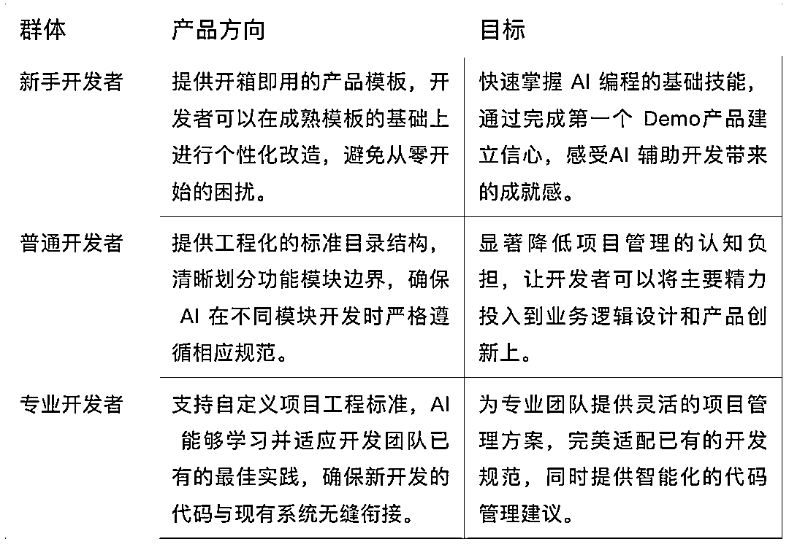

为各层级开发者匹配合适的工程化标准，本质上是在培育一个更成熟、更可持续的 AI 编程生态。所谓标准化，并非止于文档上的条条框框，而是一场影响深远的范式转换，会在多个维度重塑开发现实。

结合自身的实践，我认为这套工程化标准的落地，将从四个层面彻底改变开发生态：

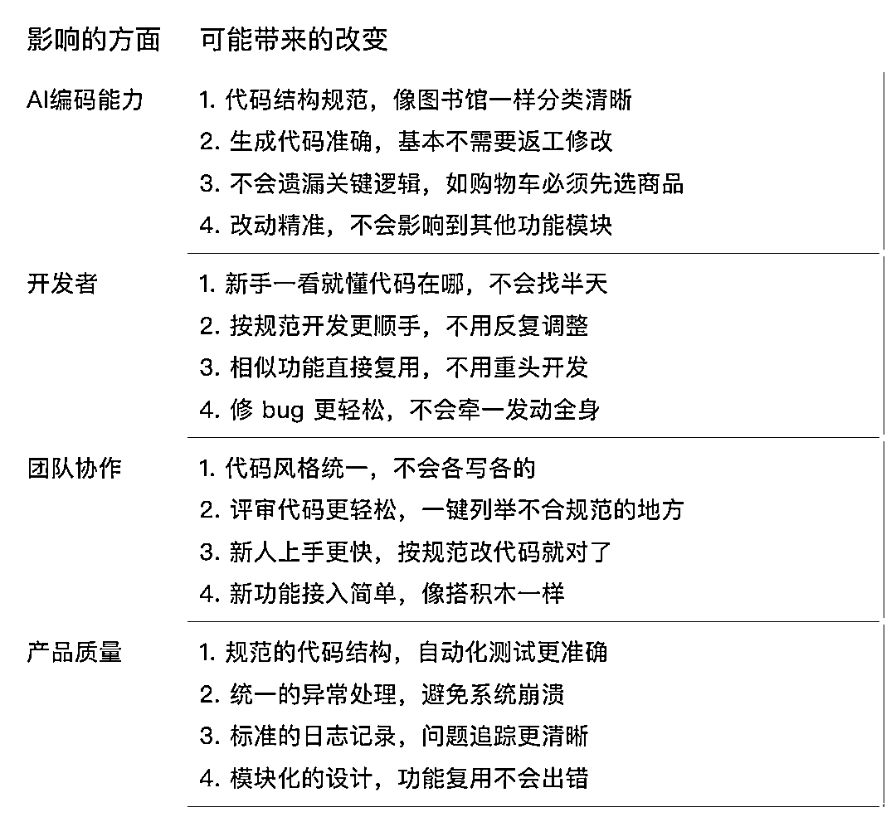

标准化首先是对 AI 行为的一种温和约束。把 AI 的发挥空间限定在已知的规范框架内，恰好契合了 AI“概率博弈”的本质——选项越少，选对的概率越高。

工程化与 AI 的技术特性形成了互补，让代码生成更可控、更高效、更可靠。这种约束并非束缚，而是赋能，让 AI 把算力集中在业务逻辑本身，而非反复纠结目录该如何摆放。

工程化规范正扮演着连接 AI 能力与工程实践的桥梁角色，为 AI 编程的大规模落地提供坚实底座。

#### 2.2.2 界面设计标准：用统一视觉语言提升专业感

让 AI 生成界面时，若没有统一指引，往往会出现风格漂移。同一个按钮组件，在不同页面可能长得不一样。短期看是审美不统一，长期看则是维护成本飙升、用户体验割裂、品牌识别弱化。

这好比一个团队里每位设计师都用自己的主观审美出活，最终交付物很难自成体系。

建立统一的界面设计标准，实质是给 AI 一套“设计系统”。有了这套系统，AI 生成界面的准确率会明显提升，就像手握一本设计规范手册去执行任务。

建立统一的界面设计标准，本质上是为 AI 提供一个完整的“设计系统”。这个系统可以从当下的视觉统一需求切入，逐步沉淀为可长久演进的设计规范。

参照乐高搭建的思路，我们可以先打造基础组件，再在真实使用中迭代完善。从基础设计规范、多场景适配、可扩展设计三个维度入手，保持设计语言的一致性：

（1）基础设计规范

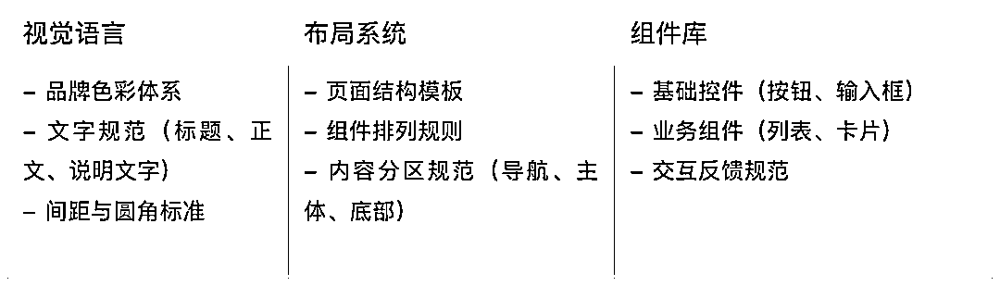

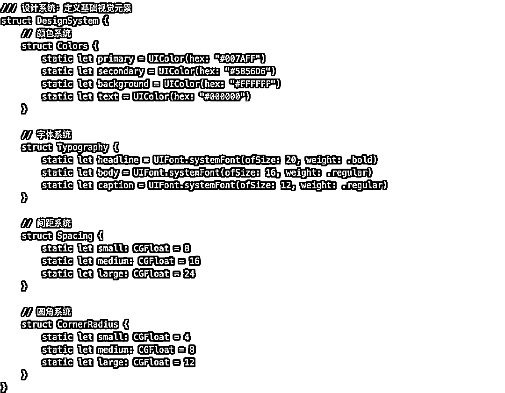

基础设计规范 - 代码示例

（2）多场景适配

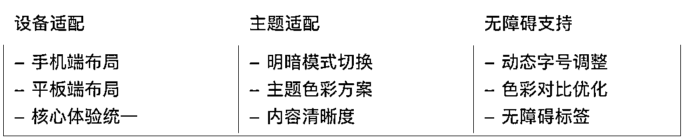

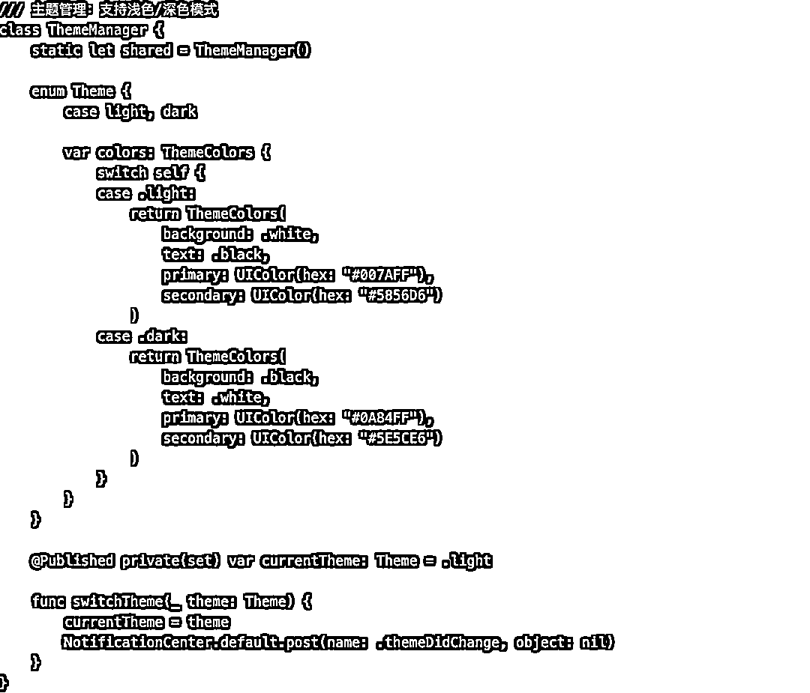

多场景适配方案 - 代码示例

（3）可扩展设计

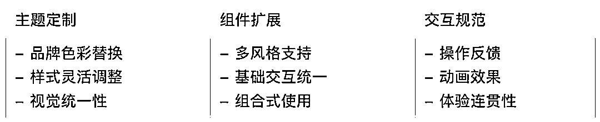

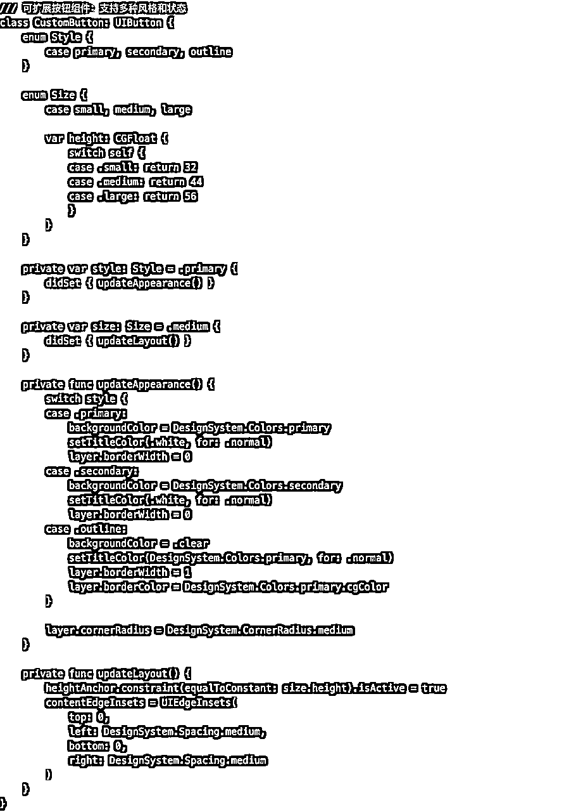

可扩展设计 - 代码示例

在思考界面标准的过程中，一个极具吸引力的设想浮现出来：如果出现一个“界面主题市场”，让 AI 编程像换手机主题一样便捷，会是什么效果？

设想一位普通创作者想做一款 App，不必从零设计，也不用啃透设计系统。只需像逛商城一样挑选一款心仪的界面主题包，一键套用，AI 即可基于该设计系统产出专业界面代码。

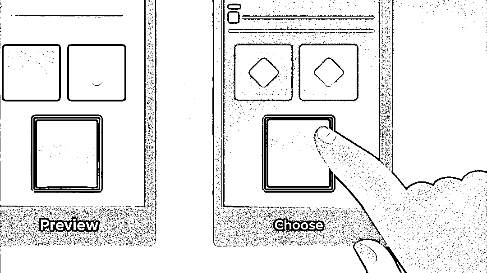

主题市场概念图

这种模式将大幅拉低使用门槛。专业设计师把沉淀的设计系统上架获利，普通创作者快速拿到高质量视觉资源，AI 则化身懂指令的设计助手，按图索骥实现界面。

更关键的是生态效应会被放大。设计师借此建立品牌与影响力，创作者能快速做出专业级产品，AI 在不断学习中对不同风格的还原度也随之提升，形成良性循环。

这相当于在 AI 编程工具内部内置了一个“虚拟设计团队”。创作者专注功能与业务，选定风格、描述需求，AI 便能输出统一且专业的界面。门槛降低，品质保障。

“界面主题市场”的设想，本质上是为 AI 编程打造更友好的创作环境，让专业设计资源普惠化，让 AI 服务更贴合不同层级的创作者。它不仅是界面标准的延伸，更是 AI 编程民主化的探索。

这种标准化的价值，不止于视觉统一，更在于对 AI 设计决策的有效引导。预设设计系统既保证了专业性，也提升了生成准确率。

工程化手法的加入，让 AI 在界面开发赛道释放出更大价值。

#### 2.2.3 常用功能标准：以积木思维复用成熟方案

“我要加个登录”、“来个支付流程”、“做个图片上传”……这类需求每天都在被不断描述给 AI。

即便是相同的登录功能，AI 也可能生成差异巨大的实现，有时会遗漏安全校验。这无异于每次都要重新造轮子，费时且易错。

建立常用功能的标准化实现，等同于为 AI 准备一套“功能积木”。这些经过验证的方案内置了最佳实践、边界处理与安全措施。

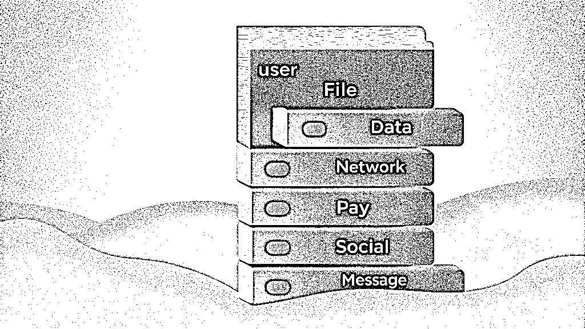

功能积木化概念图

类比乐高，每个积木都经过精确设计，能完美拼接。搭建作品时无需从原材料开始，只需挑选合适的积木按说明书组合。把常用功能模块化后，开发者也能像搭积木一样快速拼出完整应用。

我对可封装的功能逻辑做了梳理，供参考判断哪些功能适合模块化：

（1）基础功能模块

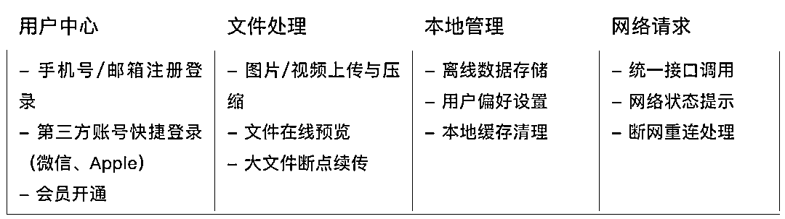

（2）业务功能模块

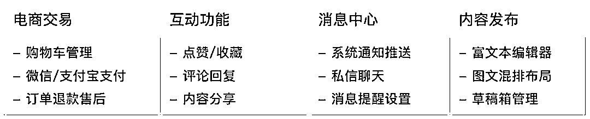

如果说界面主题市场解决的是“好看”的问题，那智能功能市场解决的就是“好用”的问题。设想一个在线功能模块商店，创作者可以像逛应用商店一样浏览功能模块的说明、场景与最佳实践。

选中后，AI 能自动完成集成并按项目需求智能适配。例如集成支付时，AI 会主动询问支持哪些支付渠道，再生成对应代码。

这片市场会随着使用与反馈持续进化。模块不断被优化，AI 在此基础上积累最佳实践，给出更精准的建议与实现。

#### 2.2.4 文档注释标准：让代码学会表达

让 AI 写代码时，常出现重实现轻维护的问题。复杂逻辑缺少解释，功能模块缺少使用说明。

这就像拿到一台没有说明书的精密仪器，能跑却难懂，维护与扩展更困难。

建立文档注释标准，本质上是赋予代码“自我表达”的能力。不仅服务当下的人，更为未来的 AI 理解意图和使用方式提供依据。

我认为一个相对完整的注释标准应覆盖三层：

（1）代码级注释

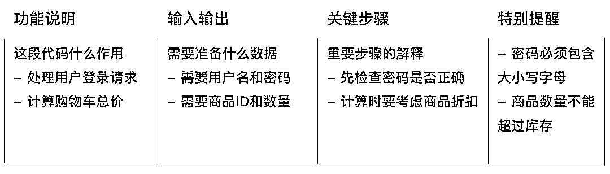

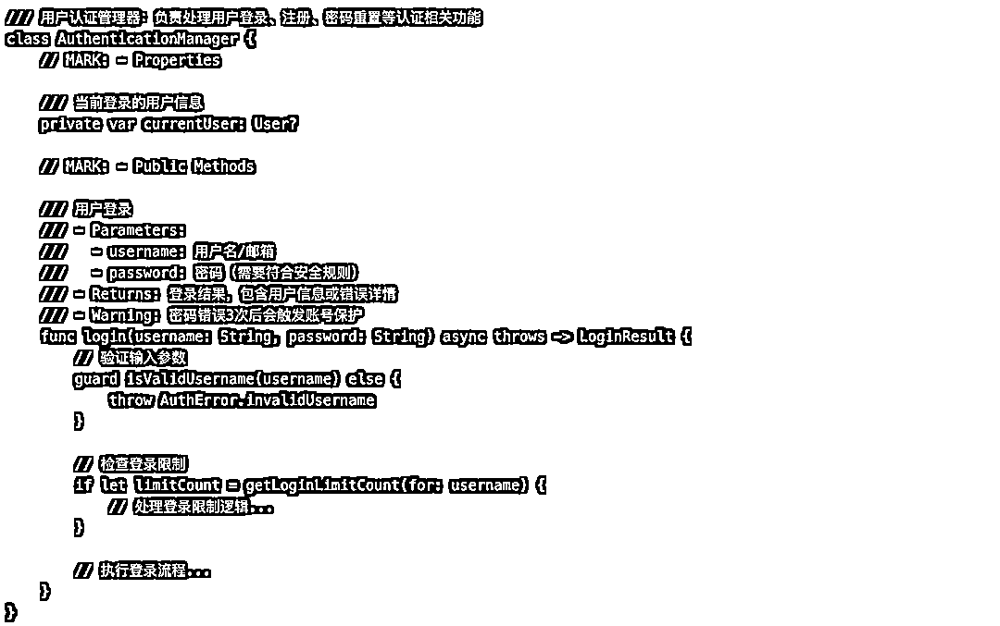

代码级注释 - 代码示例

（2）流程级说明

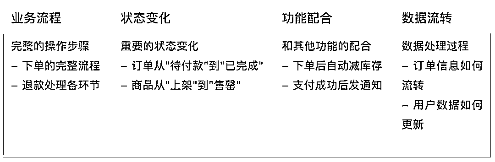

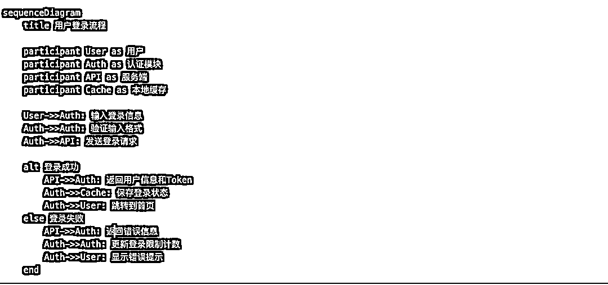

流程级说明 - 代码示例

（3）文档级说明

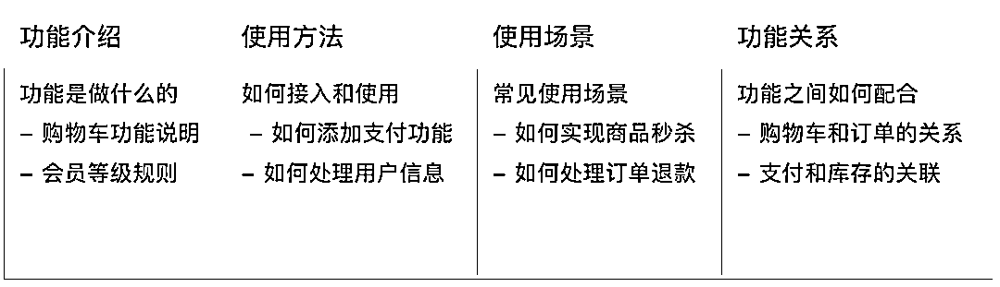

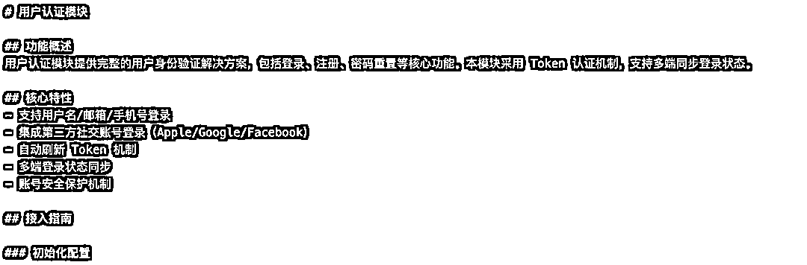

文档级说明 - 代码示例

多层次的文档体系如同为代码绘制知识地图。每个模块都有说明书，既助力开发者快速上手，也为 AI 提供精准上下文。

以电商支付为例，文档体系会包含：代码注释解释实现细节、mermaid 流程图呈现下单到支付全链路、模块交互图说明支付与订单、库存、账户的关联、最佳实践指导各类支付场景的处理。

对个人而言这是自述，对企业而言这是知识共享平台。新人上手更快，核心人员流失不带走知识，多团队协作更顺畅。

AI 编程的质量高度依赖上下文理解。完善的文档注释体系就是 AI 的重要参考系统，如同一位资深导师，引导 AI 在复杂业务中做出正确判断。

未来，随着文档体系完善与 AI 持续进步，AI 将从代码生成者进化为智能伙伴。它能理解字面之外的业务意图与设计思想，既能写代码，也能维护知识体系的完整与时效。

这将推动软件开发进入智能协作新纪元，知识从静态记录变为可自我更新的智能资产。

#### 2.2.5 版本管理标准：让迭代可回溯

“怎么撤回这次改动”、“这次变更影响了哪些功能”、“之前的方案长什么样”，这些是 AI 编程中的高频困扰。

Git 虽强大，却对普通开发者而言像技术高墙，学习成本高，导致很多人只能依赖简单的撤销。

建立友好的版本管理标准，就是让“记录历史”变得自然流畅。

就像手机相册自动分类并生成故事，AI 编程工具也应自动记录并管理产品的演进路径。

一个好的版本系统应像细心的记录者，不仅记录改动，更要理解改动原因与影响。

在开发者专注业务时，AI 在后台默默完成：识别关键节点、理解模块关联、预判影响、自动生成改动说明。

智能化版本管理大幅降低门槛，开发者无需关心底层概念，只需以自然方式管理版本。

想象这样的体验：AI 会为每个重要功能节点创建“快照”，记录变动原因、内容总结与代码差异，并可通过对话自然操作：

*   “我想回到上周的版本”
*   “这个功能之前是怎么实现的”
*   “为何之前能跑现在不行”
*   “上个版本改了哪些地方”

当技术细节被 AI 吸收，开发者可以更专注创造与大胆尝试。因为随时可回退，心理安全感提升，创新意愿随之增强。

总的来说，用工程化手段构建 AI 友好的开发规范，并非增加复杂度，而是以科学流程提升 AI 开发质量。正如优秀制造流程提升品质，标准化为 AI 提供清晰约束与指引。

如果说 DeepSeek R1 的成功在于把主导权交还给 AI，换取更深的自主思考；那么 AI 编程的未来，在于如何把足够强大的 AI 置于垂直领域的工程化约束之下，在受限的空间里提升精准度，实现工业化输出。

如前所述，大模型能力本质是概率游戏。通过标准化流程，我们缩小决策空间、提供更明确上下文。AI 知道每个阶段该关注什么、如何保证质量、输出什么内容时，表现会更可靠专业。

# 技术路线：激发 AI 的代码创造力

随着 OpenAI o 系列的发布和 DeepSeek 的爆火，AI 大模型正从指令驱动迈向推理驱动，从过程激励、强依赖预训练，转向结果激励、纯强化学习，思考深度与超越人类智能的潜力都在提升。

过程激励与结果激励的区别体现在训练范式上：

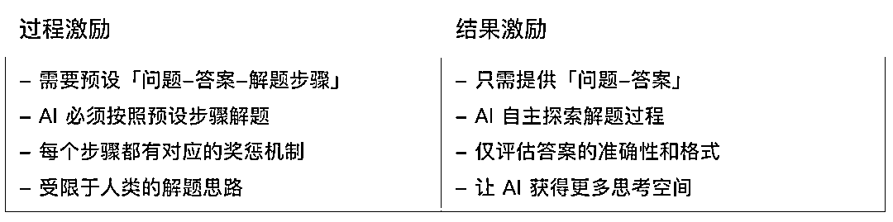

这种转变类似从“按图施工”到“给出目标”。AI 不再受限于人类思维定式，能凭借计算优势探索更优解。

这也是新一代 AI 能展现惊人推理力的原因，它们不再简单模仿人类解题路径，而是形成自己的思考方式。

从 GitHub Copilot 的代码补全，到 Cursor、Windsurf 的复杂对话与自主执行，再到 Devin 这类可承担初级开发工作的助手，以及 DeepSeek 在代码理解与生成上的卓越表现，AI 编程工具两年内完成了堪比十年的跨越。

DeepSeek 的启示是：AI 不仅要写代码，更要理解代码背后的逻辑，具备推理与思考能力。这将重塑人机协作，AI 从被动工具变为主动智能助手。

基于近几个月的行业观察，我对未来三年 AI 编程发展有五大方向的判断，每个都蕴含新机遇：

### 3.1 需求解析：从被动执行到主动思考

当前 AI 编程助手多是按指令执行，缺乏深度分析。比如用户说“写一个微信”，AI 可能直接开写，而非先引导需求分析和任务拆解。

推理型大模型的出现，标志着 AI 开始具备初步深度思考能力，这对理解与拆解复杂需求至关重要。

观察现有工具会发现一个现象：生成复杂代码尚可，但在需求理解与任务拆解上仍显机械。

这让人联想到康威定律，系统设计反映组织沟通结构。同理，AI 输出质量很大程度上取决于它对需求的理解深度。

据此，我认为未来 AI 编程助手的语义理解将在以下层面突破：

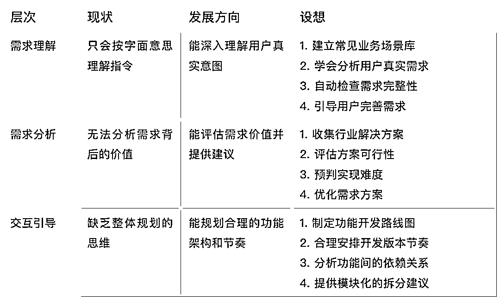

这种进化将改变 AI 的角色定位，重塑软件开发流程。AI 编程助手将从代码生成工具转变为具备咨询能力的伙伴。它能够：

*   收到模糊需求时主动提出澄清问题
*   基于历史经验预警技术风险
*   提供多套技术方案并分析利弊
*   自动生成需求文档与技术规划

关键在于 AI 建立对软件工程全生命周期的认知，而非仅关注代码本身。正如 DeepSeek 所示，具备推理能力的 AI 能在更高抽象层面思考，提供更有价值的帮助。

### 3.2 全局代码认知：突破规模限制的智能理解

当前 AI 处理超 1000 行的大型文件时，理解力下降、响应变慢，严重限制了在大型项目中的应用。

上下文感知是 AI 编程的核心竞争力，关乎代码连贯性与项目整体性。

如果让 AI 像人类工程师一样建立分层代码认知体系，是否就能突破限制？基于此思考，可能的发展方向如下：

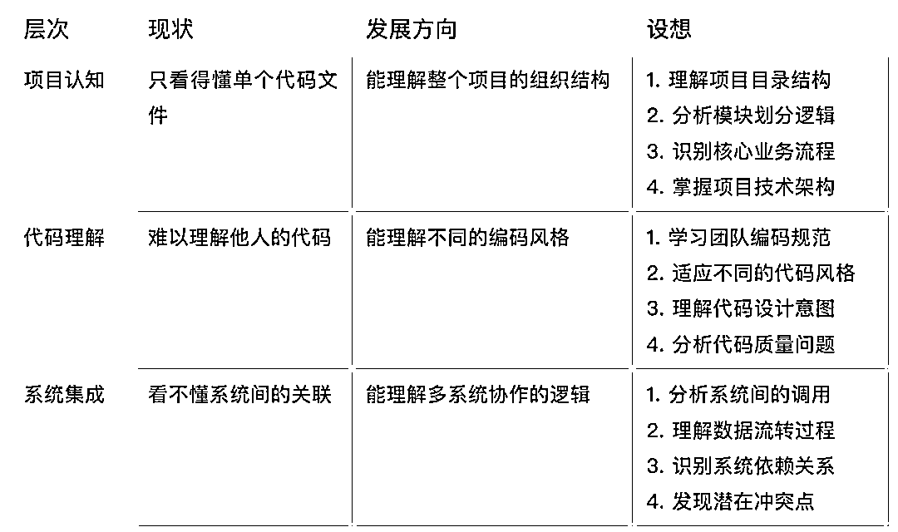

这将彻底改变大型项目的开发方式。AI 从代码编辑工具进化为具备全局视野的助手，能快速理解架构与目录、识别核心业务模块、遵循团队编码规范、发现质量问题、理清系统调用关系、预警集成风险。

进化的关键是赋予 AI“全局认知”能力，像经验丰富的技术主管一样兼顾整体、细节与集成。这将大幅提升效率，降低维护成本。

在企业级开发的战场上，真正让人头疼的往往不是“写代码”本身，而是如何与“复杂性”共舞。一个看似不起眼的需求，背后可能牵扯着十年前遗留的老旧系统、层层嵌套的服务调用、严苛的企业规范，还有多个团队之间的紧密配合。这些看不见的复杂度，既让开发者压力倍增，也成了AI编程工具必须翻越的高墙。

不妨设想一个常见场景：给支付系统加个小改动，可能就需要同步调整支付网关、订单模块、用户钱包、对账平台等多个环节；代码仓库中，既有十年前的PHP老接口，也有去年用Go重构的新服务。不同团队的编码风格和规范千差万别，新人光是把项目脉络摸清，就得花上一个月。在这样的环境里，AI究竟要怎么做，才能真正成为开发团队的左膀右臂？

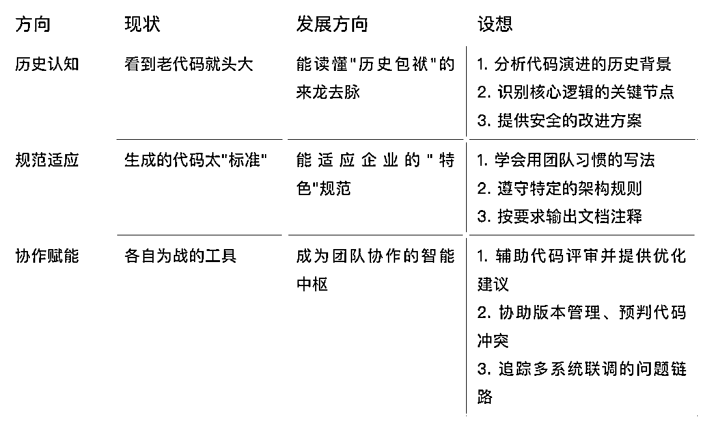

其实，答案的关键不在于AI能生成多少行代码，而在于它能否读懂企业开发中那些不成文的“潜规则”，并用智能化手段把整个研发链路串起来。例如，在代码审查时，它不仅要发现表面缺陷，还要判断这次改动会不会波及相邻系统；在排查线上故障时，它能迅速锁定问题根源，并给出兼顾各种限制条件的解决思路。随着AI在多智能体协作、系统级理解等方面不断突破，这种能力将带来颠覆性变化——不只提升效率，更让团队从容驾驭复杂项目，让企业级开发不再像一场噩梦。

另一个让开发者深有感触的场景，是跨平台开发。当一款iOS应用走红后，团队通常急着推出Android版本。这时摆在面前的无非两条路：要么用Android原生从头写一遍，要么用Flutter这类跨平台方案整体重构。但两种选择都不尽如人意。以Swift打造的iOS应用，在Android上重写意味着工作量翻倍，还得费心保持双端体验一致；而选择Flutter，虽然能“一次编写、多处运行”，却可能导致Face ID、指纹识别这类平台专属能力无法充分发挥。好在AI技术飞速演进，像DeepSeek这类模型展现出的代码理解力，为跨平台原生开发点亮了新的方向。我有理由相信，未来AI编程会真正催生跨平台原生开发的新范式，并在以下三个层面持续演进：

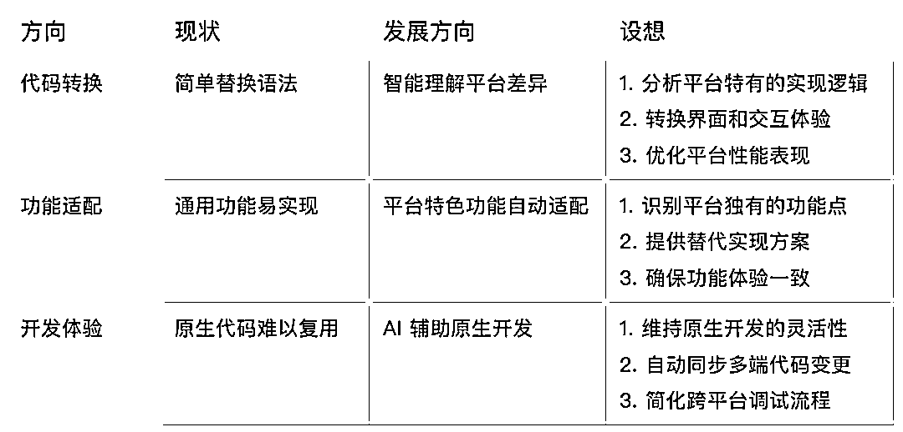

这里的核心，是让AI深入理解各平台的技术特性与最佳实践。它绝不是粗暴地把iOS代码“翻译”成Android代码，而是要先吃透代码背后的业务逻辑，再以每个平台最擅长的方式去实现。随着AI在代码理解与生成上的持续精进，这种智能化跨平台方案，既能保留原生开发独有的性能与灵活性，又能大幅削减多端建设成本——这与传统跨平台框架的底层思路，有着本质区别。

软件质量保障，同样是个绕不开的老大难。现在不少AI编程工具，能轻松挑出语法错误，但面对复杂的业务逻辑却常常束手无策。这就好比一个初级程序员，只明白“代码能不能编译通过”，却不清楚“代码是否真正满足了业务需求”。而新一代AI模型在代码理解上的突破，正在为质量保障提供全新解法：AI不再停留在语法表面，而是能洞察更深层的业务语义，帮助开发者筑起更可靠的软件防线。

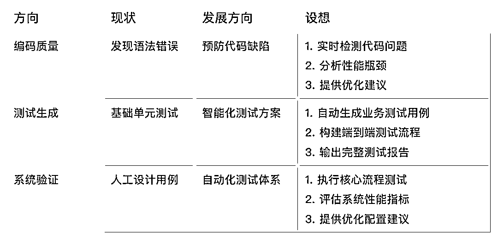

它的转变关键在于，AI要真正理解代码背后的业务逻辑，而不只是机械地核对规范。具体来说，它需要弄明白：这段代码是否完整覆盖了业务需求？高并发场景下会不会掉链子？系统的性能瓶颈卡在哪里？又该如何设计最高效的测试策略？随着AI在代码理解和测试用例生成方面日益成熟，这种全方位的质量保障体系，将极大提升软件交付的可靠性。既能在开发早期拦截隐患，又能靠自动化测试守护系统稳定性——和传统测试手段相比，堪称质的飞跃。

最后做个总结。如果说“提升AI的代码创造力”这条技术路线，是在拔高AI编程的能力天花板；那么“构建AI友好的开发标准”这条工程化路线，就是在降低AI编程的入门门槛。这两条路没有高低之分，只是体现了不同的发展哲学与市场需求。

技术路线痴迷于突破AI的能力边界，想让AI理解更复杂的业务逻辑、产出更可靠的代码。这需要持续的技术攻坚和大手笔研发投入，也是Cursor等海外企业为何押注于此——它们拥有更厚实的技术家底和创新土壤。

工程化路线则执着于降低AI编程的参与门槛，让更多人能投身产品创造。这种标准化、模块化的思路，与国内互联网圈长期信奉的“快速迭代、降本增效”天然合拍。通过打造友好的开发标准，让AI编程更贴合实际业务场景。

有意思的是，两条路线尽管侧重不同，却朝着同一个方向汇合：让AI编程真正服务于创新。技术路线是用能力的拉升来拓宽可能性，工程化路线是用门槛的下探来释放创造力。它们就像一枚硬币的两面，共同驱动着AI编程滚滚向前。

对于身处AI编程浪潮中的每一位伙伴来说，现在正站在难得的机遇窗口上。无论你痴迷于技术突破，还是热衷于工程落地，都能在这波浪潮中找到自己的生态位。关键是要提前看清趋势，找准兴趣点和优势赛道，未来收获可能会远超你的想象。

当然，以上这些观察和推演，都源于个人的实践与业内交流，难免带着局限性。技术演进永远充满未知，我们更需要保持开放的心态，持续学习。如果你对AI编程的未来持有不同见解，或者有更妙的思考，欢迎随时交流探讨——毕竟，只有在不断的碰撞与对话中，我们才能望得更远，走得更稳。