# DeepSeek Janus全攻略：本地部署+在线体验，文生图/图生文小白也能秒上手
作者：龙哥

## 想一键拿走的工作流

https://www.liblib.art/modelinfo/5aa87cd7cc39445080e8b0f4fe75d3af

## Janus 是什么

Janus 来自深度求索 DeepSeek，是一款开源的多模态大模型，核心能力集中在 AI 绘图与 AI 识图，兼顾文生图、图生文等交互场景，是其 AGI 技术版图中的重要一环。简单说，就是一个能自己画图也能看懂图的开源可定制模型。

*   官方代码库：https://github.com/deepseek-ai/Janus

## 在线即用，零门槛尝鲜

### 图生文：让 AI 描述你的图片

1.  挂上魔法网络打开 https://huggingface.co/spaces/deepseek-ai/Janus-Pro-7B，切到多模态识别模式，红色箭头处上传待分析的图片，在 QUESTION 输入框里填入 explain this picture，点击 CHAT 即可开始。

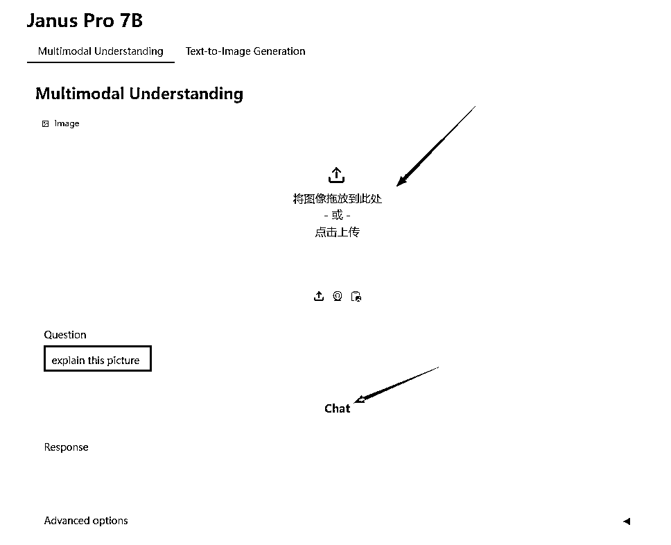

1.  等待片刻，Response 区域就会返回 AI 对图片的理解结果。

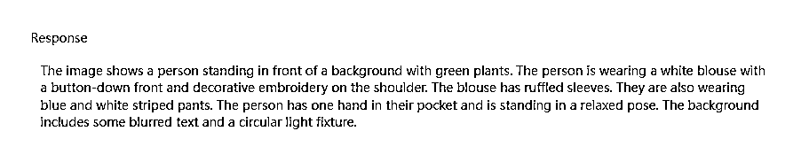

1.  需要更轻量的体验，也可选用早期版本：
Janus 1.3B 图像识别 https://huggingface.co/spaces/deepseek-ai/Janus-1.3B
JanusFlow-1.3B 图像识别 https://huggingface.co/spaces/deepseek-ai/JanusFlow-1.3B

### 文生图：输入文字生成图像

1.  同样打开 https://huggingface.co/spaces/deepseek-ai/Janus-Pro-7B，切换到文生图模式，红色箭头位置输入你的提示词，绿色箭头处点击生成按钮。

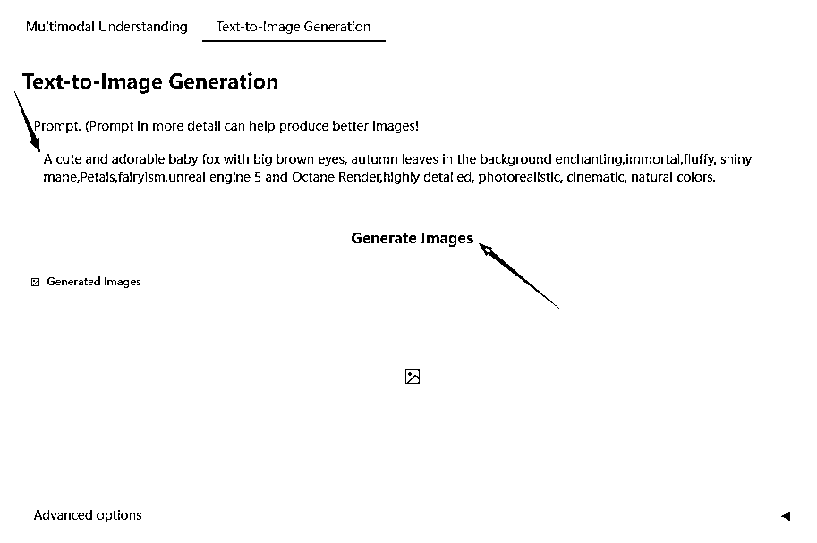

1.  稍作等待，生成的图片结果就会展示出来。

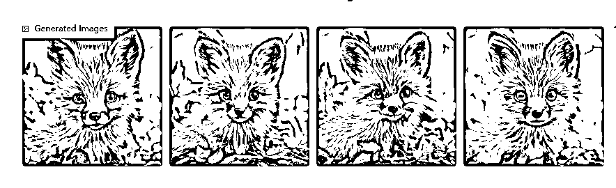

## 本地部署，完全掌控

按顺序完成下面三步，已装过的可直接跳过。

### 1. 搭建 ComfyUI 环境

参考来来的👸号教程完成 ComfyUI 安装。

### 2. 安装 Janus 插件

1.  在 ComfyUI 界面右上角打开管理器，进入节点管理。

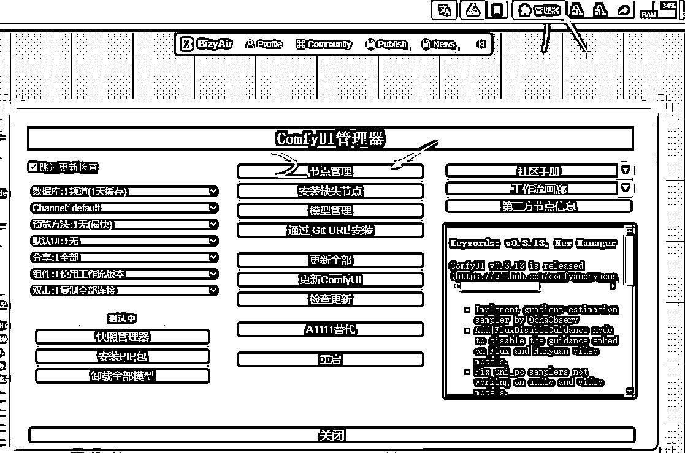

1.  开启魔法网络搜索 JANUS，选择其一安装即可：

https://github.com/chflame163/ComfyUI_Janus_Wrapper/
https://github.com/ZHO-ZHO-ZHO/ComfyUI-DeepSeek-JanusPro
https://github.com/CY-CHENYUE/ComfyUI-Janus-Pro

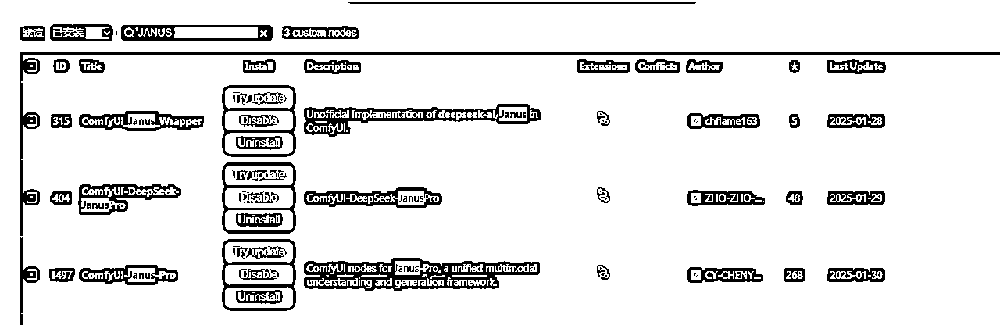

### 3. 导入模型文件

1.  首次运行会自动拉取模型，失败则需手动下载。
2.  下载 https://huggingface.co/deepseek-ai/Janus-Pro-7B/tree/main 全部文件，放进 ComfyUI\models\Janus-Pro\Janus-Pro-7B 目录。
3.  下载 https://huggingface.co/deepseek-ai/Janus-Pro-1B/tree/main 全部文件，放进 ComfyUI\models\Janus-Pro\Janus-Pro-1B 目录。
4.  目前提供 1B 和 7B 两个参数规模，适配不同显卡配置，且允许自由商用与二次开发。

### 本地图生文操作

导入工作流后，红色箭头处选择 Janus-Pro-1B 模型，绿色框里输入图像提示词，支持中英文。示例需求：详细描述画面内容，输出一份中文描述和一份英文描述。

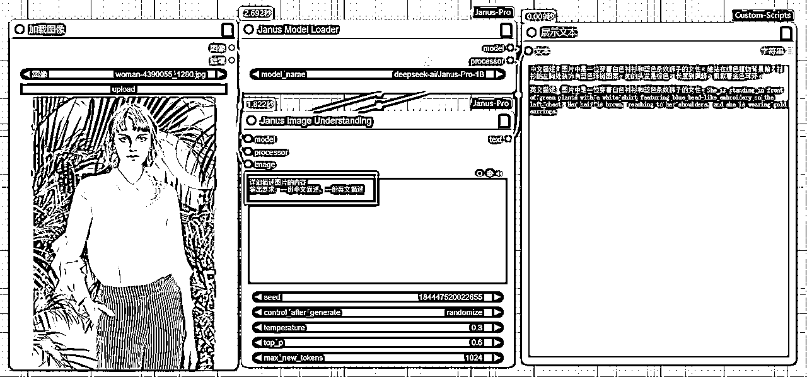

### 本地文生图操作

导入工作流后，红色箭头处选择 Janus-Pro-1B 模型，绿色框里填入英文提示词即可生成图像。

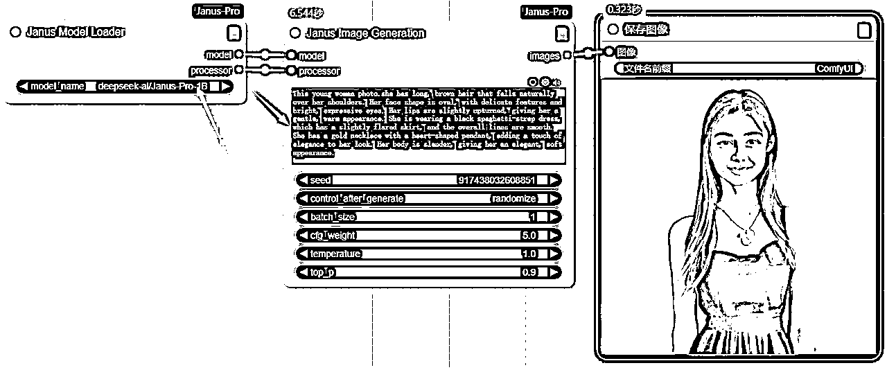

## Janus 系列版本深度解析

目前共三个主线版本，Janus-Pro 为最新迭代。

Janus-Pro：通过数据与模型规模的升级统一理解与生成

Janus-Pro 是 Janus 的进阶版，核心改进有三点：更优的训练策略、更大规模的训练数据、模型尺寸的扩展。在多模态理解、文本-图像指令遵循和图像生成稳定性上都有明显提升。

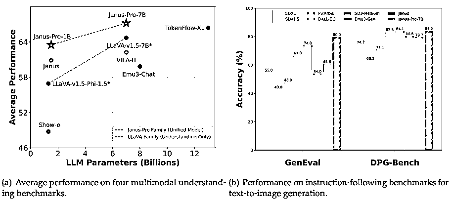

Janus：解耦视觉编码，实现理解与生成的统一

Janus 提出自回归框架来统一多模态任务。视觉编码被单独解耦成独立路径，而处理仍基于单一 Transformer 架构。这种设计去除了理解与生成在视觉编码器上的冲突，提升了灵活性，并在统一模型中达到了与专用模型相当甚至更优的效果。

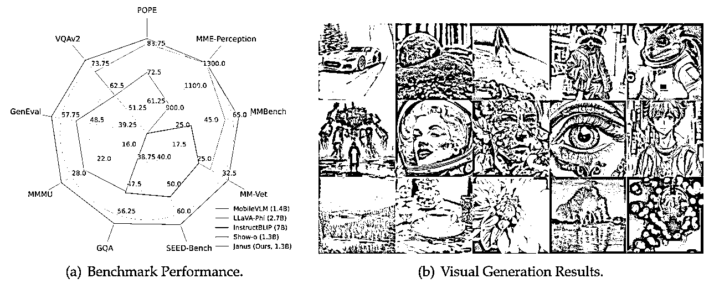

JanusFlow：自回归与整流流的融合

JanusFlow 采用极简结构，把自回归语言模型与整流流结合起来。研究发现整流流可在 LLM 框架内直接训练，无需复杂改造。实测显示其在各自领域匹敌专用模型，在统一基准上大幅领先同类方法。

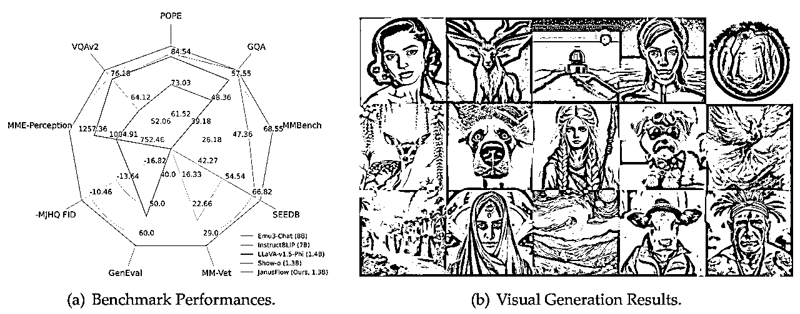

## 重要版本节点

2025.01.27：Janus-Pro 正式发布，显著增强多模态理解与视觉生成能力。见论文
2024.11.13：JanusFlow 发布，首创统一模型并用整流流做图生。见论文、演示与使用说明
2024.10.23：VLMEvalKit 加入复现 Janus 多模态理解结果的评测代码
2024.10.20：Janus-1.3B 发布，修复 tokenizer_log.json 错误并上线 Gradio 演示