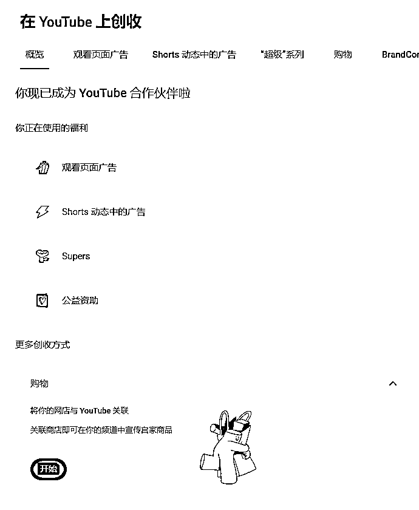
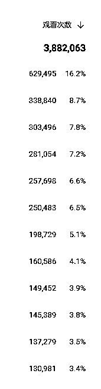
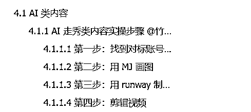
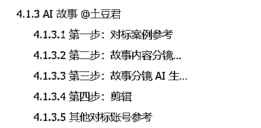
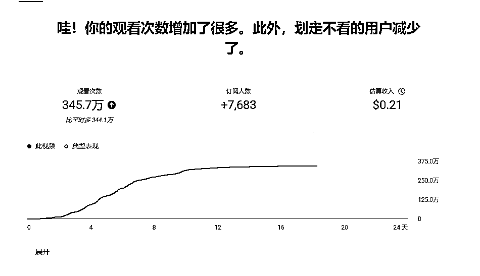
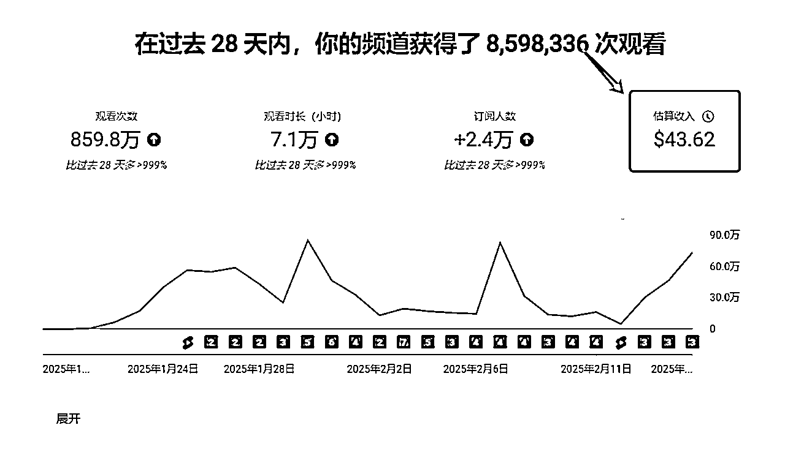
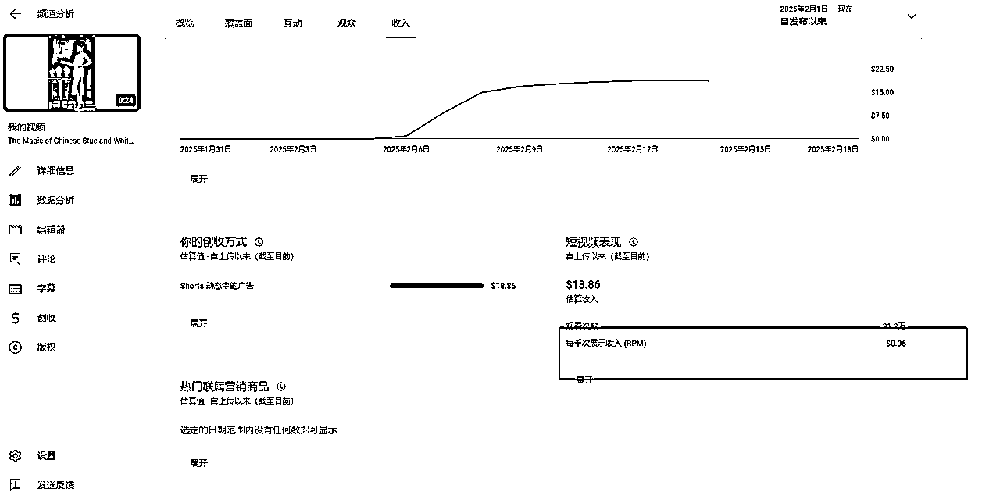
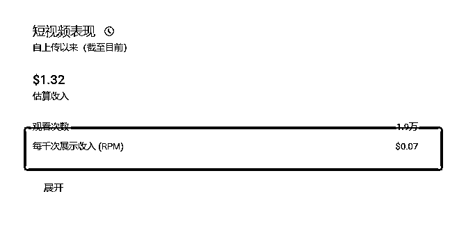
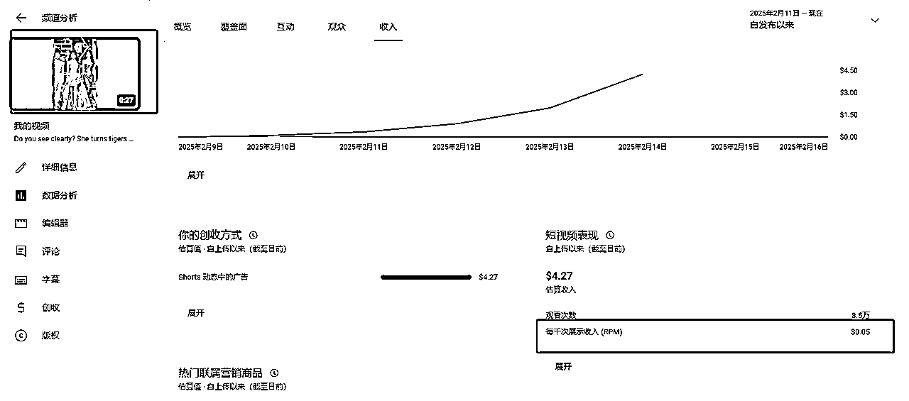
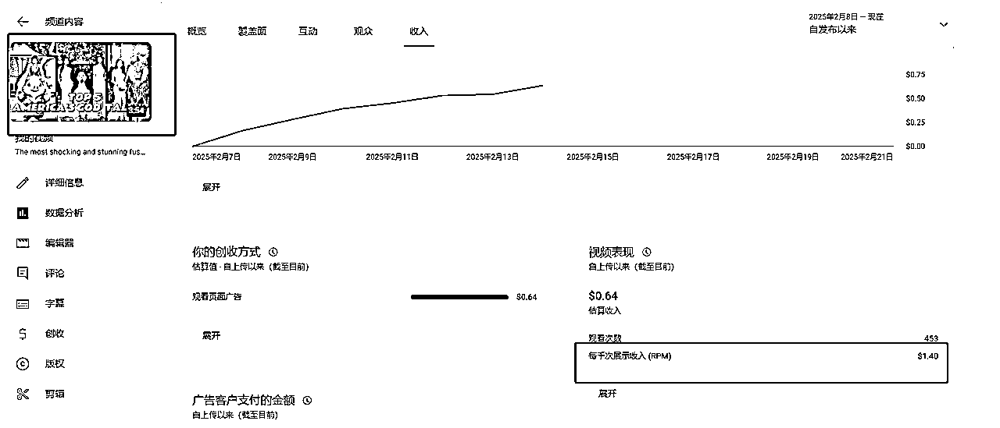

# 从0到高级YPP：一个体制内老师的YouTube打怪升级记录

大家好，我是茜茜。白天我是体制内教师，晚上则是一名YouTube创作者。去年3月通过@方波妮的引荐加入生财，4月底靠AI写作在生财赚到了第一桶金，5、6月还短暂体验过副业月入过万。之后，我报名参加YouTube航海计划和私教陪跑，从去年11月6日到今年2月6日，正好三个月，把YouTube高级YPP拿到了手。回头来看，整个过程可以分成三个阶段：独自摸索、航海实战、陪跑冲刺。

之所以写这篇，一是想给自己留个完整复盘，顺手帮大家避开一些坑；二是想给还在坚持的朋友打打气——只要不放弃，真的能等到结果；三是向陪跑教练和生财平台表达谢意。

10月底，亦仁出了一个超级标，@方波妮在11月初带着我和几个伙伴开始做YouTube Shorts，我们算是生财最早试水YouTube的一批圈友。11月6日晚，我发出了人生第一个视频，随后的一个月都是自己摸着石头过河。12月初，我跟着YouTube Shorts航海学习，航海结束又歇了半个月。1月初报名私教陪跑，靠着@方波妮和@Gary曹淦教练团队重新更新。1月22日，一支达人秀变身视频跑出了350万播放，涨粉超过7000，单支视频就够到了初级YPP的门槛。

春节期间，我又梳理出了爆款背后的规律，之后连续做出几条小爆款，高级YPP也就顺利到手。

下面是我三个阶段的心得复盘。

## 一、自我探索期：新号没人看很正常，比努力更重要的是选对赛道

最先想说的两个体会：起步阶段播放量低，不是你不努力，而是客观规律；选什么样的赛道、找什么样的对标，才是决定后续能不能做起来的关键。

最初做猫咪跳舞，制作很简单，上手几乎没有难度，但流量一直不温不火。11月8日，我还写过一条生财龙珠悬赏帖子分享制作经验。那会儿账号一天也就几千播放，我告诉自己：这是所有新手都会经历的阶段，焦虑没有用。11月11日，我停掉猫咪跳舞，换成宝宝走秀。

换赛道的原因很直接：我把当时关注的对标账号放到YouTube货币化检测网站查了一圈，发现其中一半压根没有开通创收，而且这些账号也不是新号。所以提醒大家，找对标之前最好先到工具网站确认对方是否已开通创收；当然，检测结果不一定百分百准确，最近一两个月刚开通的账号可能查不到。检测工具是ytlarge.com，数据查询和收益估算可以用viewstats.com。总之，选对方向、找准对标，比埋头做视频更重要。

宝宝走秀也没能做太久。11月27日，@方波妮提醒我，这类视频被批量标注为“面向儿童”，我当天就停更了。儿童类内容虽然也有收入，但商业广告可选择范围很小，收益天花板低，不太适合普通人。具体案例可以看航海手册，或者直接翻竹子那篇原帖。

## 二、YouTube航海期：别同时追几个赛道，也别一个人硬扛

这个阶段的感受可以浓缩成两句话：同时对标多个赛道，结果可能哪个都做不好；一个人闷头干很容易崩，团队氛围往往就是续命良药。

从11月29日到1月4日，我做的是变身秀。选它的原因有三：航海手册里有完整教程，不用从零开始摸索；达人秀在美国是老牌节目，生命周期够长；当时很多同类账号流量很大，而且都成功开通了YPP，证明这个方向可行。

当然，它的门槛也不低：赛道很卷，必须往更细分的方向去找机会；变身质量需要反复研究，才能真正做出爆款。这期间我也尝试过动物故事，同样是发在同一个账号上。动物故事的痛点在于，ChatGPT处理角色一致性还不稳定，要反复抽卡，不复杂但相当费时间。现在有圈友改用SD，据说可以全自动化，效果也更好，有兴趣的不妨研究一下。视频参照航海手册，或者看土豆君的原帖。

做完后我反思了一下：不同风格的视频混在一起，会让账号原本的粉丝群体变得混乱。对标账号只能有一个。另外，YouTube通常会在账号稳定更新十五天左右给第一波推流，之前是观察期，所以稳定的更新节奏也非常重要。

航海结束以后，我陷入了倦怠期，整整半个月没有发视频。一方面每天盯着平平无奇的数据，再看到别人不断出爆款，心态真的有点绷不住；另一方面，当时对标的达人秀流量也在下滑，我知道该换细分的赛道，但自己的挖掘能力和精力都不够。这时候正好知道生财要开陪跑小组，我没有任何犹豫就报名了，希望借团队的力量破局。

## 三、私教陪跑期：没有突然的爆款，只有终于兑现的积累

这一阶段的三个关键词是：积累、数据、敢试新东西。

1月16日陪跑小组启动，我先观望了两天，结合第一次教练直播对各个赛道的拆解，最后决定试动物示警——上手快，当时流量也正处于上升期。必须夸一下@方波妮和@Gary曹淦两位教练，他们反馈非常快，也特别尽责。整个陪跑过程中，教练团一直在测试新玩法，并且会在航海手册里同步更新，群里所有人都能直接看到。比起大群，这种小圈子更有体验感，大家交流起来更深入，也更有针对性。

后来我判断动物示警制作太简单、生命周期偏短，加上自己做变身秀有经验，就在1月22日转为多人变身达人秀。这次的变化节奏更快、转换次数更多，多人变身天然更容易获得大流量，同时对技术能力也提出了更高要求。运气不错，换赛道后的第一支视频，更新到第三天就开始爆发。

但回头看，与其说是那支视频质量有多高，不如说是前面积累的素材和手感在那一刻兑现了。而且断更过的老账号重新恢复更新，本身就会等到一波推流。所以正在断更的小伙伴，一定别放弃，说不定下一个爆的就是你。

账号迟迟没有起色的时候，先别情绪化，低头看数据。选择观看率和完播率基本决定了一支视频能冲到什么量级。我那支三百多万的视频，选择观看率是73%，完播率不到100%；千万播放级别的视频，选择观看率基本要达到80%以上，完播率要接近150%。如果这两个指标都正常，连续更新超过20天甚至一个月还没有推流，那就要检查一下对标账号或整个赛道是不是不行了，该换就换，多试几次。

## 开通YPP与真实收益

2月6日，高级YPP正式开通。整体频道的收益是万播0.5美金；短视频万播0.5~0.7刀；长视频万播11.4刀。

不同内容方向的差距也非常直观：青花瓷变身秀，万播0.6~0.7刀；三人多次变身，万播0.5刀；灵异类变身目前也是万播0.5刀，不过我的账号受众以美女变身为主，这个数字可能不具备代表性。

长视频方面，我是用剪映把8~10个短视频拼起来，剪成3分钟左右的长片，万播能到11.4刀。它的推流速度比较慢，但可以拉高账号时长，也能当额外的收入来源。

## 下一步计划

之后我想继续尝试更多赛道，慢慢把重心往长视频迁移，毕竟长视频的收益率更可观。目前我正在按照私教陪跑手册里的“名人解说”方向做长视频，同时研究长短视频结合的打法，看看一个人的情况下能不能获得更高收益。另外也想和教练团队继续探索，找到更多变现可能性。

## 写在最后

YouTube是典型的长线项目，反馈周期长，入局之前就要做好打持久战的准备。慢就是快。

Shorts流量虽然大，但单价不高，适合新手先用它把号做起来；长视频起号慢，可收益更可观，有经验的老手可以直接尝试，或者长短结合着推进。在此基础上，不断尝试新玩法和新赛道，条件允许的话搭一个小团队，会更有爆发力。

写这篇文章的初衷，就是想给你加一点油。做长线赛道，鸡血需要，心理按摩也需要。

最后，非常感谢生财提供的平台。YouTube航海让我打开了赚美金的大门，私教陪跑更是像一次“重启”，让我在短短两周多的时间里拿到了高级YPP。特别感谢@方波妮和@Gary曹淦教练，很多新赛道和新玩法都是他们亲手测出来的，并且毫无保留地分享给了大家。我觉得这种小团队陪跑的模式效果很好，满意度很高，希望生财能一直做下去。也感谢文中引用到的每一位精华帖作者。

祝大家都能早日开通自己的YPP！